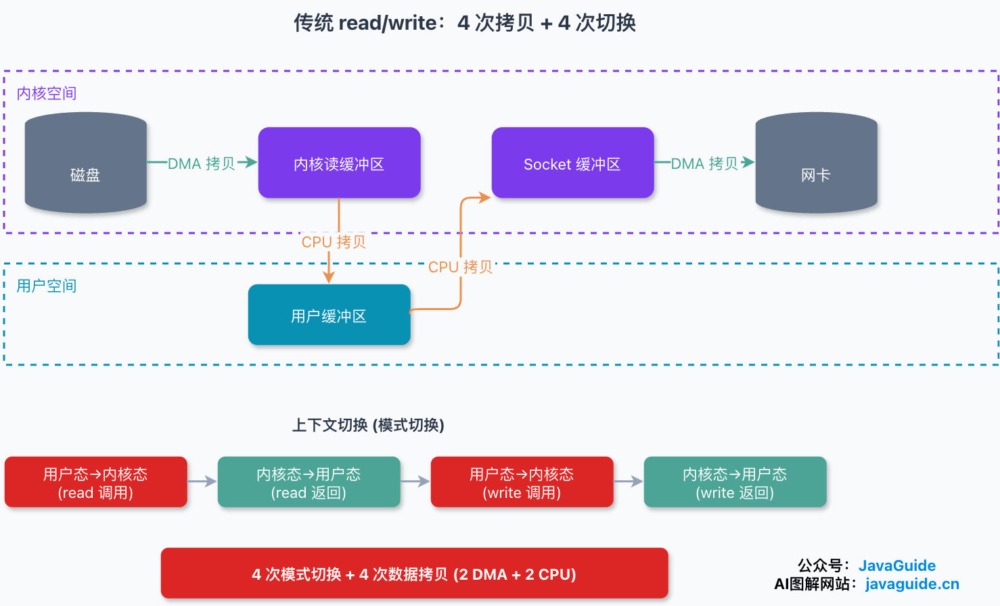
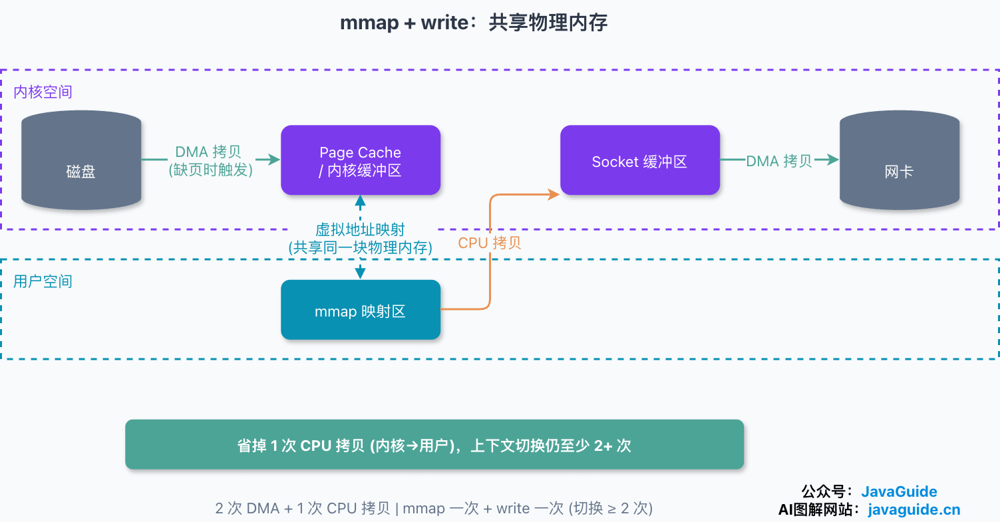
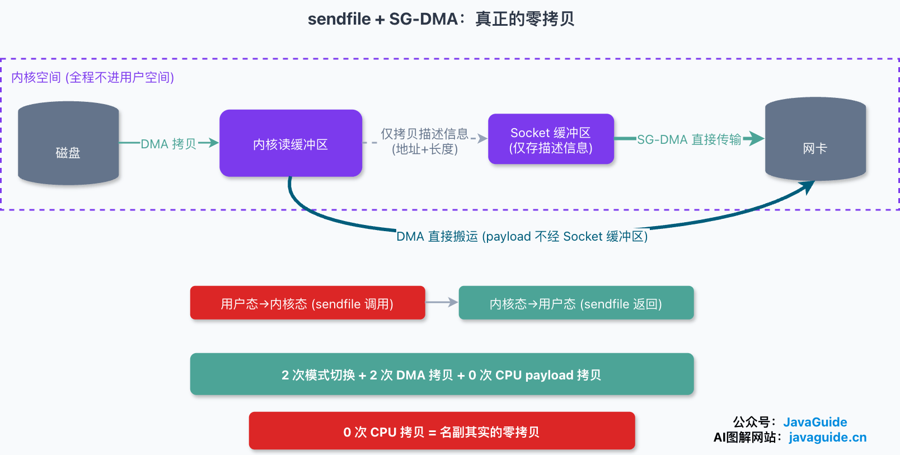
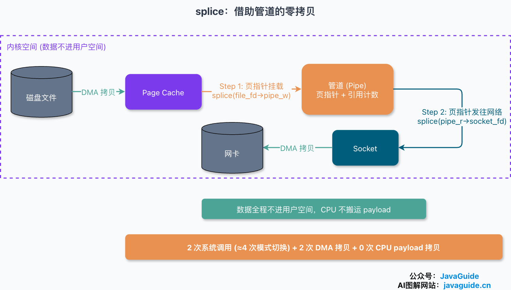
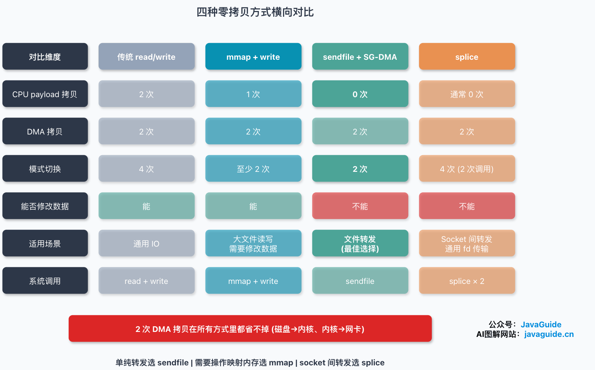

Interviewers often ask why Kafka is fast or how RocketMQ handles backlogs, then follow up on sequential writes, Page Cache, and zero-copy: Which copies does zero-copy remove? How do `mmap` and `sendfile` differ? What does `splice` do?

Many people can repeat that “zero-copy avoids user space,” but fewer can account for the four copies, two DMA transfers, and mode switches.

This article follows a file being sent over a network: **how many copies traditional I/O needs, what “zero” means, and what each of `mmap`, `sendfile`, and `splice` saves and costs.**

First, define the model. Unless otherwise stated, copy and switch counts below use these assumptions:

- A regular file is sent through a TCP socket, and the data is not in Page Cache yet, so it must be read from disk.
- The application does not process the data in user space for TLS encryption, compression, or format conversion.
- The device supports common DMA and scatter-gather features.
- “Copy” counts payload only, not descriptors or metadata.
- “Context switch” below means a **mode transition** between user and kernel space; each system call entry and return counts once. This is different from a scheduler switching threads. A thread context switch is added only if a system call blocks and the thread is descheduled.

Page Cache hits, TLS, and hardware without SG-DMA all change the counts. These assumptions explain the mechanisms; the numbers are not universal constants.

## How Many Copies Does Traditional `read`/`write` Need?

Consider a file-download endpoint that sends a disk file to a client over an established socket. The simple implementation reads into a buffer and writes it to the socket:

```c
while ((n = read(file_fd, buf, BUF_SIZE)) > 0)
    write(socket_fd, buf, n);
```

The code is short, but a full “read from disk and send over the network” operation moves the data four times using the CPU and DMA, with four user/kernel mode transitions.



The `read` half works like this:

1. The application calls `read`, entering the kernel (first mode transition).
2. DMA moves data from disk into the kernel read buffer (first copy, DMA).
3. The CPU copies it from the kernel buffer to the user buffer (second copy, CPU), then execution returns to user mode (second transition) and `read` returns.

The `write` half is similar:

4. The application calls `write` and enters the kernel (third transition).
5. The CPU copies data from the user buffer to the socket buffer (third copy, CPU).
6. DMA moves data from the socket buffer to the network card (fourth copy, DMA), and execution returns to user mode (fourth transition).

That is **4 mode transitions and 4 data copies**: 2 DMA copies and 2 CPU copies. Strictly speaking, `write` usually returns after copying data to the socket send buffer. The network stack queues and segments it, and DMA transmission happens asynchronously; `write` does not wait for the DMA to finish. The diagram groups these steps to make the accounting easier.

DMA (Direct Memory Access) is a capability provided by device controllers or system DMA engines. It moves data between a device and memory with little CPU involvement. Modern DMA logic is often integrated into a device controller, SoC, or chipset rather than a separate chip. It handles work such as disk-to-kernel-buffer and socket-buffer-to-network-card transfers, leaving the CPU free for other tasks.

The waste is in the two **CPU copies**. Data goes from the kernel read buffer to the user buffer, then right back to the socket buffer, even though the download endpoint never changes it. The CPU only moves the data through user space and also pays the cost of four mode transitions. These costs become significant with many concurrent requests and large files.

Zero-copy aims to reduce this work.

## What Does “Zero” Mean in Zero-Copy?

First, a common misconception: zero-copy does not mean there are no copies at all.

In the model above—a file missing from Page Cache and sent over TCP—the data still needs DMA transfers from disk to memory and from memory to the network card. **Zero-copy mainly avoids CPU copies of payload between memory buffers and may reduce user/kernel mode transitions.** The transfer count changes if, for example, the data is already in Page Cache or the device can access persistent memory directly.

More precisely, zero-copy is a family of I/O techniques that reduce CPU involvement in copying data between memory buffers, and often reduce the number of user/kernel mode transitions as well. The approaches below focus on removing CPU copies.

## Route 1: `mmap` + `write`

Virtual memory allows multiple virtual addresses to refer to the same physical memory. `mmap` uses this property.

```c
void *mmap(void *addr, size_t length, int prot, int flags, int fd, off_t offset);
```

The `fd` is the file to map, `length` is the mapping size, and `offset` is the file offset. The kernel's read buffer and a range of user-space virtual addresses can refer to the same physical memory. The two mappings share the data instead of holding separate copies.

The original `read` + `write` sequence can therefore use `mmap` + `write`. One important detail: **`mmap` only establishes a mapping from the file to a virtual-address range; it does not immediately read the file into memory.** Disk I/O occurs later when the process accesses a mapped page that is not resident, causing a page fault. The kernel loads it from Page Cache or, on a miss, from disk.

1. The application calls `mmap`. The kernel maps the file to a virtual-address range and returns; this enters and leaves kernel mode. No file data has been loaded yet.
2. The application later accesses the mapped region, for example as the source for `write`. Accessing a nonresident page causes a page fault; if it is not in Page Cache, DMA reads it from disk (DMA copy).
3. The page table maps the Page Cache page into the user address space. The kernel and application now share the same physical page.
4. The application calls `write`. The CPU copies data from Page Cache to the socket buffer (CPU copy). This avoids the extra CPU copy from kernel to user and back in the traditional path.
5. DMA sends data from the socket buffer to the network card (DMA copy), and `write` returns.



For a cache miss and the full path, that is roughly **2 DMA copies and 1 CPU copy**. There is one `mmap` transition and one `write` transition, plus page-fault handling on first access. Compared with traditional I/O, mmap removes the CPU copy from the kernel buffer to the user buffer.

So “mmap + write always has four transitions and three copies” is only a simplified teaching model. Page Cache hits and the timing of page faults change the real counts.

Another benefit is that the process does not need a separate user-space read buffer duplicating Page Cache data. How much physical memory this saves depends on the processing window, buffer size, and access pattern; it is not always “half.”

`mmap` also has costs. Establishing and tearing down mappings and page tables, and handling page faults, take time. For small files this overhead can be higher than straightforward `read`/`write`; mmap is more suitable for large files or repeated access. A less obvious hazard: if another process truncates a mapped file, accessing the truncated region may raise `SIGBUS` and terminate the program. This can be difficult to diagnose in production.

## Route 2: `sendfile`

`mmap` removes one CPU copy, but still uses both `mmap` and `write` system calls. If the file only needs to be sent unchanged, a single system call can perform the transfer inside the kernel.

Linux 2.1 introduced `sendfile` for this purpose:

```c
ssize_t sendfile(int out_fd, int in_fd, off_t *offset, size_t count);
```

- `in_fd`: Data source, usually a regular file; it must support mmap-like reading and cannot be a socket.
- `out_fd`: Destination. Before Linux 2.6.33 it had to be a socket; newer kernels allow other files. Check the kernel version for the exact constraints.
- `offset`: File offset to start at; `NULL` uses the current file offset.
- `count`: Number of bytes to transfer.

`sendfile` transfers data between two file descriptors entirely in the kernel, without sending it through user space. The path becomes:

1. The application calls `sendfile` and enters kernel mode (first transition).
2. DMA reads data from disk into the kernel read buffer (DMA copy).
3. The CPU copies data from the kernel read buffer to the socket buffer (CPU copy).
4. DMA sends it from the socket buffer to the network card (DMA copy), then execution returns to user mode (second transition) and `sendfile` returns.

That is **2 mode transitions and 3 data copies**: 2 DMA and 1 CPU.

Compared with `mmap`, the main benefit is moving file-to-socket forwarding into one system call, usually reducing one user/kernel round trip. The data stays in the kernel, so user space cannot modify it directly. If the application must change the content before sending, use mmap, ordinary `read`/`write`, or another approach that exposes the data to user space.

One CPU copy remains—from the kernel read buffer to the socket buffer. Can that be removed too?

## Route 3: `sendfile` + SG-DMA (Zero CPU Payload Copies)

Linux 2.4 enhanced `sendfile` with SG-DMA (scatter/gather DMA), a hardware capability that lets DMA transfer data from the kernel read buffer directly to the network card without first copying it into the socket buffer.

The updated path is:

1. The application calls `sendfile` and enters kernel mode (first transition).
2. DMA reads data from disk into the kernel read buffer (DMA copy).
3. Instead of copying payload, the CPU writes **descriptors** (memory address, offset, and length) for that data into the socket buffer.
4. SG-DMA uses the descriptors to send the data directly from the kernel read buffer to the network card (DMA copy), then execution returns to user mode (second transition) and `sendfile` returns.



That is **2 mode transitions and 2 data copies, both by DMA, with zero CPU payload copies**.

This is zero-copy in the strict sense used here: the CPU never moves payload; DMA handles the disk-to-network transfer. The CPU does write a few bytes of metadata in step 3, but that is not a payload copy. This path requires a network card that supports scatter-gather, a suitable kernel, and a protocol stack that does not need to inspect or change the payload. User-space TLS encryption or format conversion requires access to the payload and prevents this zero-CPU-copy path.

## Route 4: `splice`

`sendfile` has restrictions: `in_fd` must support mmap-like reading and usually be a regular file, not a socket; historically, `out_fd` also had to be a socket. To forward data between sockets or more general file descriptors without a user-space copy, Linux introduced `splice` in kernel 2.6.17. It was contributed by Jens Axboe and requires glibc 2.5 or later. The key is an intermediary **pipe**:

```c
ssize_t splice(int fd_in, loff_t *off_in, int fd_out, loff_t *off_out,
               size_t len, unsigned int flags);
```

At least one of `fd_in` and `fd_out` must be a pipe. Linux pipes use reference-counted page references: the pipe buffer stores pointers to kernel memory pages and a reference count for each page, not another copy of the data. Moving data from a pipe to another endpoint often means copying references and incrementing page reference counts, not moving the payload. `SPLICE_F_MOVE` is only a hint, not a guarantee; if a filesystem, device, or buffer layout cannot move pages directly, the kernel may fall back to copying.

Transferring a file to a socket with splice takes two calls:

```c
splice(file_fd, NULL, pipe_w, NULL, len, SPLICE_F_MOVE);   // File -> pipe write end
splice(pipe_r, NULL, socket_fd, NULL, len, SPLICE_F_MOVE); // Pipe read end -> socket
```



The first call attaches Page Cache pages to the pipe buffer. The second passes references to those pages as network packet fragments to the socket. The data never enters user space, and the CPU does not copy the payload. However, this uses **two `splice` calls**, each entering and leaving the kernel, for about four mode transitions in total. It is not one system call and two transitions like some explanations claim. In practice, both fds may need to be nonblocking and used with epoll; handle short transfers and `EAGAIN` too.

Compared with the other methods:

- **More general than `sendfile`:** `sendfile` focuses on in-kernel fd-to-fd transfer, typically file to socket. With a pipe intermediary, `splice` supports a wider set of transfers, including socket-to-socket. Some kernel versions reuse internal code, but these are separate system calls with different constraints and histories.
- **Opposite to `mmap`:** mmap exposes the mapping to user space so the application can change data. `splice` keeps the data out of user space, so the application cannot inspect or modify it.

Version detail: in Linux 2.6.30 and earlier, exactly one of `fd_in` and `fd_out` had to be a pipe. Starting with Linux 2.6.31, both endpoints may be pipes.

## Comparing the Four Approaches

| Method                            |        CPU payload copies | DMA copies | Mode transitions                                           | Typical calls                 |
| --------------------------------- | ------------------------: | ---------: | ---------------------------------------------------------- | ----------------------------- |
| Traditional `read` + `write`      |                         2 |          2 | 4                                                          | `read` + `write`              |
| `mmap` + `write`                  |                         1 |          2 | Usually at least 2 after mapping; first access also faults | One `mmap` + repeated `write` |
| `sendfile`                        | 0 or 1, depending on path |  Usually 2 | 2                                                          | `sendfile`                    |
| `splice` (file -> pipe -> socket) |         Usually avoidable |  Usually 2 | 4                                                          | Two `splice` calls            |



The mmap copy and transition counts vary with Page Cache hits and page-fault timing. With SG-DMA support, `sendfile` can reduce CPU payload copies to zero.

Two takeaways:

**First, the cache-miss file-to-TCP model still has two DMA transfers.** They are disk to memory and memory to the network card. Zero-copy mainly reduces CPU payload copies and mode transitions. Do not reuse the same fixed counts for another I/O path.

**Second, choose based on whether the application needs to inspect or change the data.** Use mmap when content must be modified; use `sendfile` to forward a file unchanged, with zero CPU payload copies possible when SG-DMA is supported. Consider splice for forwarding between more general fds, such as socket to socket, when the pipe intermediary and two system calls are worthwhile.

Zero-copy is not always a win. TLS, compression, format conversion, filtering, watermarks, and rate limiting require processing payload. For small files or random access, the fixed costs of mappings, page faults, or pipes may be more noticeable.

With mmap, accessing an old mapping after a file has been truncated can raise `SIGBUS`. Very large zero-copy transfers can also evict useful Page Cache pages and increase reclaim work, reducing the benefit.

## Using Zero-Copy in Java

Java NIO exposes two related approaches: mmap and sendfile-like transfer.

**`MappedByteBuffer` uses mmap.** `FileChannel.map` returns a `MappedByteBuffer` that maps a file or part of one into memory. Accessing the buffer uses the mapping rather than first copying data into a separate JVM-managed buffer:

```java
FileChannel channel = FileChannel.open(
        Paths.get("./data.bin"),
        StandardOpenOption.READ, StandardOpenOption.WRITE);
// Map the file into memory; the underlying mechanism is mmap.
MappedByteBuffer buffer = channel.map(
        FileChannel.MapMode.READ_WRITE, 0, channel.size());
```

**`FileChannel.transferTo` and `transferFrom` are closer to the sendfile approach.** Do not equate the Java API directly with `sendfile`: `transferTo` promises to write bytes to the target channel, while the implementation depends on the JDK, operating system, and target channel type. With a connected `SocketChannel` on a supported platform, the JDK may use an in-kernel zero-copy path. With a regular file or another channel, it may use a different implementation or copy through user space. That is why the example uses a `SocketChannel` target:

```java
FileChannel source = FileChannel.open(
        Paths.get("./in.dat"), StandardOpenOption.READ);
// socketChannel is a connected SocketChannel.
// On supported platforms, the JDK may use zero-copy such as sendfile.
source.transferTo(0, source.size(), socketChannel);
```

One pitfall: `transferTo` does not guarantee that one call transfers everything. Loop based on the return value to send the remaining bytes. If Linux `sendfile` is used, a single call is limited to `0x7ffff000` bytes (about 2 GB). The exact limit exposed by Java and whether the zero-copy path is used depend on the JDK and platform; Windows behavior differs from Linux.

## Which Approach Do Kafka and RocketMQ Use?

Zero-copy often comes up when explaining Kafka and RocketMQ, but they use different approaches because their read/write patterns differ.

**Kafka uses zero-copy on the consumer send path.** When a consumer fetches messages, Kafka sends log-segment files from disk over the network. This is a “forward unchanged” case, so Kafka uses `FileChannel.transferTo` to send log data from Page Cache to the socket without putting it in the JVM heap. Combined with sequential writes and Page Cache on the producer side, this supports high throughput. Kafka also uses mmap for index files. The path is not always available: message-format conversion, decompression and recompression, or user-space TLS encryption can require reading and processing the payload. Whether zero-copy is used depends on Kafka, JDK, and operating-system versions.

**RocketMQ mainly uses mmap.** It uses `MappedByteBuffer` to map its CommitLog for reads and writes, one reason the CommitLog uses fixed-size files that are easier to manage as mappings. It chooses mmap rather than sendfile because its read/write pattern needs flexible access to the mapped memory, not just unchanged file forwarding.

In short: **use sendfile to forward data unchanged; use mmap when the application needs to operate on mapped data.**

## Related but Different: Rust's `zerocopy` Crate

Searching for “zerocopy” may lead to Google's Rust library [google/zerocopy](https://github.com/google/zerocopy), which is actively maintained. Its version changes quickly, so check crates.io or GitHub releases for the current version.

This crate is **not the same concept as operating-system zero-copy**. OS zero-copy reduces payload movement between kernel and user buffers during I/O. Rust's `zerocopy` crate provides type-safe memory conversion between byte sequences and structures without copying or writing `unsafe` code. Both use the term “zero-copy,” but one concerns system calls and DMA, and the other concerns memory layout and type safety.

## How to Explain Zero-Copy in an Interview

If asked what zero-copy means, define “zero” precisely: it does not eliminate every copy. DMA transfers from disk to memory and from memory to the network card usually remain. Zero-copy mainly saves CPU payload copies between kernel and user buffers and may reduce mode transitions.

For traditional `read` + `write`, count four copies: disk to kernel buffer by DMA, kernel to user buffer by CPU, user buffer to socket buffer by CPU, and socket buffer to network card by DMA. The two CPU copies are wasteful when the application does not change the data and only passes it through user space.

Compare the alternatives in order: `mmap` + `write` maps Page Cache pages into user space and avoids the kernel-to-user CPU copy, but `write` still copies to the socket buffer. `sendfile` moves file-to-socket transfer into one system call without exposing the data to user space. With SG-DMA, the socket buffer holds descriptors and DMA can send payload directly from the kernel buffer to the network card. `splice` passes page references through a pipe, making it useful for forwarding between more general fds, but typically takes two system calls.

If the question turns to Kafka and RocketMQ, distinguish their use cases. Kafka's consumer path forwards log segments unchanged and can use `FileChannel.transferTo` and sendfile. RocketMQ's CommitLog needs flexible access to mapped memory and therefore commonly uses mmap. Add the boundary: TLS, compression, format conversion, and filtering require application processing and can prevent the zero-copy path.
