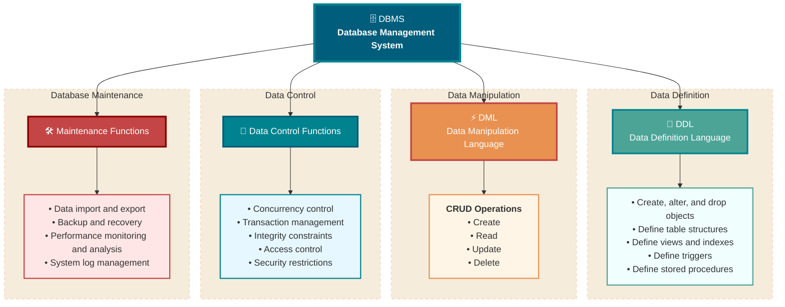
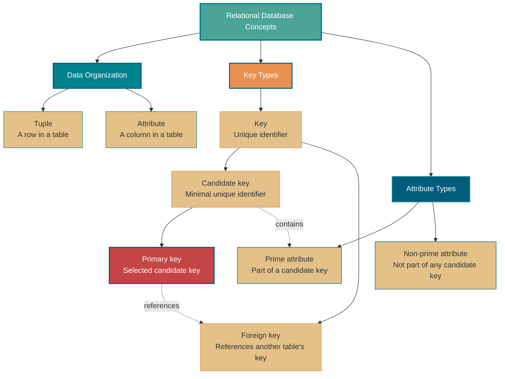
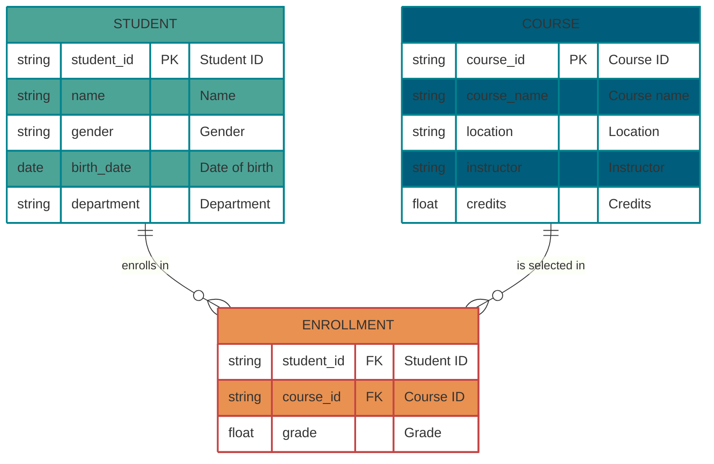
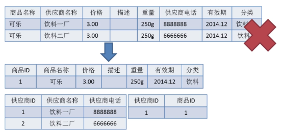
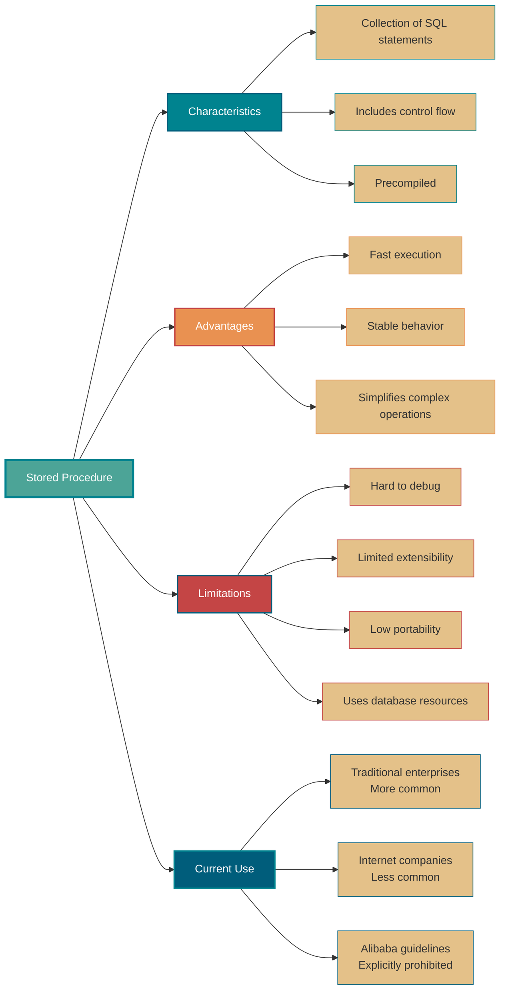
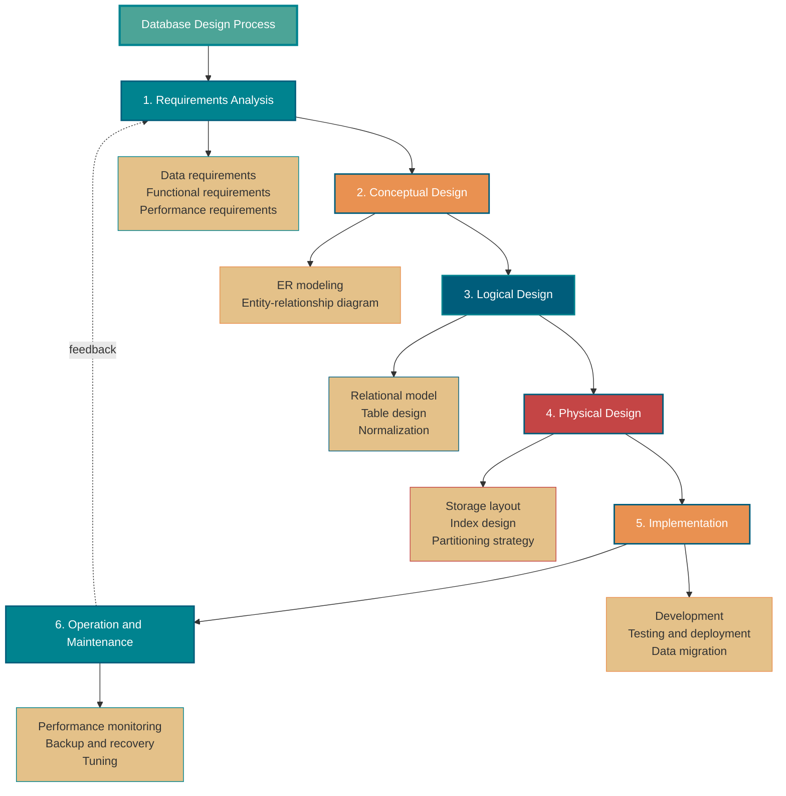

<!-- @include: @small-advertisement.snippet.md -->

Database fundamentals are important to understand because they provide the foundation for learning MySQL. This article covers many concepts and draws on explanations from Wikipedia and Baidu Baike.

## What Are a Database, a DBMS, a Database System, and a DBA?

These four terms describe different layers, from the data itself to the system that manages it. A library analogy can help explain how they fit together.

- **Database (DB):** Like the books and materials on a library's shelves, a database is a collection of structured data organized according to a data model and shared by users. It is the information we ultimately store and retrieve.
- **Database management system (DBMS):** Like a library's cataloging, lending, and security systems, a DBMS is software that manages databases. MySQL, Oracle, and PostgreSQL are examples. A DBMS organizes and stores data, provides interfaces such as SQL, and handles concurrency control, transactions, and access control while hiding low-level file operations.
- **Database system (DBS):** Like the entire operating library, a database system includes the database (DB) and its DBMS as well as hardware, applications, and people.
- **Database administrator (DBA):** Like a library director, a DBA is responsible for keeping the database system running. Responsibilities include database design and installation, monitoring, performance tuning, backup and recovery, and security.

DB and DBMS are often confused. When we say “use a MySQL database,” we usually mean using MySQL (the DBMS) to manage one or more databases (DBs).

## What Are the Main Functions of a DBMS?

DBMSs typically provide four core functions:

1. **Data definition:** DBMSs provide a data definition language (DDL) for creating, altering, and dropping database objects. This includes table structures, views, indexes, triggers, and stored procedures.
2. **Data manipulation:** A data manipulation language (DML) supports the create, read, update, and delete (CRUD) operations developers use to retrieve and modify data.
3. **Data control:** This includes concurrency control, transaction management, integrity constraints, access control, and security restrictions to keep data correct and secure.
4. **Database maintenance:** This supports reliable operation over time through data import and export, backup and recovery, performance monitoring, and system log management.

## What Types of DBMS Are There?

### Relational Databases

Relational database management systems (RDBMSs) such as MySQL, PostgreSQL, and Oracle use structured tables and SQL. They are well suited to structured data and use cases that need transaction guarantees, such as banking and order processing.

NoSQL and NewSQL databases emerged to address the large data volumes, high concurrency, and varied data models used by internet applications.

### NoSQL Databases

NoSQL databases commonly trade off some features, often transaction support, to improve performance and horizontal scalability.

**1. Key-value databases, such as Redis.**

- **Characteristics:** A simple map-like data model stores values under keys. In-memory operations provide high performance.
- **Use cases:** Caching, session storage, counters, and other workloads that need fast reads and writes.

**2. Document databases, such as MongoDB.**

- **Characteristics:** Store semi-structured documents such as JSON or BSON, with flexible schemas that don't need to be defined in advance.
- **Use cases:** Applications with changing data structures and rapid iteration, such as user profiles, content management, and log storage.

**3. Column-family databases, such as HBase and Cassandra.**

- **Characteristics:** Store data by column family rather than by row, which can make reading a few columns across many rows efficient.
- **Use cases:** Large-scale storage and analytics, monitoring data, and recommendation systems that need high write throughput and range scans.

**4. Graph databases, such as Neo4j.**

- **Characteristics:** Represent data as nodes and edges to store and query complex relationships between entities.
- **Use cases:** Social networks, recommendation engines, knowledge graphs, and fraud detection, where relationships are central to queries.

### NewSQL Databases

Some NoSQL systems don't provide the transaction guarantees required by systems such as financial, order, and trading platforms. Those workloads may still need to store large amounts of data.

One option is to buy more powerful hardware; another is to add database middleware. The first can be expensive, and the second can add significant development complexity.

NewSQL systems were developed to address this gap.

In short, NewSQL combines **distributed storage, SQL, and transactions**. It aims to handle large datasets while retaining relational database features such as ACID transactions and SQL, so it is also described as a **distributed relational database**.

Common NewSQL design goals include:

1. **Scale out:** Increase capacity by adding machines. Scale up instead increases capacity by upgrading hardware.
2. **Strong consistency:** Keep data consistent across nodes.
3. **High availability:** Keep the system available with minimal interruption.
4. **Standard SQL support:** Support SQL, as relational databases such as PostgreSQL, MySQL, and Oracle do.
5. **ACID transactions:** Provide atomicity, consistency, isolation, and durability.
6. **Relational database compatibility:** Interoperate with widely used relational databases such as MySQL, Oracle, and PostgreSQL.
7. **Cloud-native operation:** Automate deployment across public, private, and hybrid clouds.
8. **HTAP (hybrid transactional/analytical processing):** Support a mix of OLTP and OLAP workloads.

Examples of NewSQL systems include Google's F1 and Spanner, Alibaba's [OceanBase](https://open.oceanbase.com/), and PingCAP's [TiDB](https://pingcap.com/zh/product-community/).

## What Are Tuples, Keys, Candidate Keys, Primary Keys, Foreign Keys, Prime Attributes, and Non-Prime Attributes?

Understanding tuples, keys, candidate keys, primary keys, foreign keys, prime attributes, and non-prime attributes is important for relational database design and normalization. These concepts form part of relational database theory.

### Basic Concepts

- **Tuple:** The basic unit of a relation, represented by one row in a table. Each tuple contains information about an entity. For example, a student row containing an ID, name, and age is a tuple.
- **Key:** One or more attributes that uniquely identify a tuple. Keys help ensure uniqueness and integrity.

### Key Types

- **Candidate key:** A minimal set of attributes that uniquely identifies a tuple; none of its proper subsets can do so. A relation may have multiple candidate keys. For example, if both a student ID and a national ID uniquely identify a student, each is a candidate key.
- **Primary key:** The candidate key selected to identify tuples in a relation. A relation has one primary key, though it may have multiple candidate keys. Simplicity, stability, and the absence of business meaning are common selection criteria.
- **Foreign key:** An attribute or attribute group in one relation that references a key in another relation. It maintains the relationship between the two relations and supports referential integrity. For example, a student ID in an enrollment table can reference the student ID primary key in a student table.

### Attribute Types

- **Prime attribute:** An attribute that belongs to at least one candidate key. If a relation has multiple candidate keys, every attribute appearing in any of them is prime. For example, if both employee ID and national ID are candidate keys, both attributes are prime.
- **Non-prime attribute:** An attribute that doesn't belong to any candidate key. In the example above, name, gender, and department are non-prime attributes.

## What Is an ER Diagram?

When designing a project database, sketch an ER diagram to clarify the data model. Interviewers also commonly ask about this when discussing projects.

An **ER diagram** (entity-relationship diagram) represents entity types, attributes, and relationships.

An ER diagram has three components:

- **Entity:** Usually a real-world business object, though logical objects can also be entities. A campus management system might include students, teachers, courses, and classes. Entities are shown as rectangles.
- **Attribute:** A property that describes an entity; in product design, think of it as a field. Attributes are shown as ovals.
- **Relationship:** A connection between entities. Relationships are shown as diamonds and can indicate cardinality. For example, one class can have many students.

The ER diagram below models student enrollment. Each student can take multiple courses, and each course can have multiple students, so the relationship is many-to-many (M:N). The other common cardinalities are one-to-one (1:1) and one-to-many (1:N).

## What Are Database Normal Forms?

There are three common normal forms:

- **1NF (First Normal Form):** Attributes are atomic and cannot be divided further.
- **2NF (Second Normal Form):** Meets 1NF and removes partial functional dependencies of non-prime attributes on a candidate key.
- **3NF (Third Normal Form):** Meets 2NF and removes transitive functional dependencies of non-prime attributes on a candidate key.

### 1NF (First Normal Form)

An attribute (a table column) must hold an atomic value rather than several values that could be split into separate fields. **1NF is the basic requirement for relational databases**; a table in a relational database must satisfy it.

### 2NF (Second Normal Form)

2NF builds on 1NF and removes partial functional dependencies of non-prime attributes on a key. The illustration below shows a transition from 1NF to 2NF. In this example, a primary key is added and non-prime attributes depend on that key.

Some related concepts:

- **Functional dependency:** If the value of attribute or attribute set `X` determines the value of `Y`, then `Y` is functionally dependent on `X`, written `X → Y`.
- **Partial functional dependency:** If `X → Y` and a proper subset `X0` of `X` also determines `Y`, then `Y` is partially dependent on `X`. For a student table `R(student_id, national_id, name)`, if either ID uniquely identifies the student, then `(student_id, national_id) → name`, `student_id → name`, and `national_id → name`. Thus, `name` is partially dependent on the composite key `(student_id, national_id)`.
- **Full functional dependency:** A non-prime attribute is fully dependent on a key when it depends on the entire key, not on a proper subset. Suppose `R(student_id, class_id, name)` allows the same student ID in different classes, but not within one class. Then `(student_id, class_id) → name`, while neither `student_id → name` nor `class_id → name` holds.
- **Transitive functional dependency:** In relation schema `R(U)`, let `X`, `Y`, and `Z` be distinct attribute sets. If `X` determines `Y`, `Y` determines `Z`, and the required non-overlap conditions hold, then `Z` is transitively dependent on `X`. Transitive dependencies can cause redundancy and anomalies. For example, in `R(student_id, name, department, department_head)`, `student_id → department` and `department → department_head`, so `department_head` is transitively dependent on `student_id`.

### 3NF (Third Normal Form)

3NF builds on 2NF and removes transitive dependencies of non-prime attributes on candidate keys. A design in 3NF **largely** addresses excessive redundancy and insertion, update, and deletion anomalies. For example, `R(student_id, name, department, department_head)` is not in 3NF if `student_id → department` and `department → department_head`.

## What Is the Difference Between a Primary Key and a Foreign Key?

Their definitions and constraints differ:

- **Primary key:** Uniquely identifies each row in a table. Its value must be unique and non-null. A table has one primary key, which enforces entity integrity.
- **Foreign key:** Establishes and enforces a relationship between two tables. Its value must match a candidate key in another table (usually its primary key, but it can be a unique key) or be `NULL`. Foreign key values may repeat or be null, and a table may have multiple foreign keys. Foreign keys enforce referential integrity.

Consider a simple e-commerce example with two tables: `users` and `orders`.

- In `users`, `user_id` is the **primary key**. Each user's ID is unique.
- In `orders`, `order_id` is the table's **primary key**. The `user_id` column is a **foreign key** referencing `users.user_id`.

The foreign key constraint ensures that:

1. You can't create an order for a user that doesn't exist in `users`.
2. You can't delete a user who has orders unless a rule such as cascading deletion is configured.

## Why Are Foreign Keys and Cascading Updates Sometimes Discouraged?

The Alibaba Java Coding Guidelines state:

> **Mandatory:** Do not use foreign keys or cascading operations. Handle foreign-key relationships in the application layer.
>
> For example, `student_id` may be the primary key in a student table and a foreign key in a grades table. Updating the student ID and automatically updating it in the grades table is a cascading update. Foreign keys and cascading updates may suit a low-concurrency, single-instance system, but can be problematic in distributed, high-concurrency clusters. Cascading updates can block and trigger an update storm, and foreign-key checks can slow inserts.

Common reasons for avoiding foreign keys include:

1. **They add complexity:** Every `DELETE` or `UPDATE` must account for foreign-key constraints, which can make development and test-data setup harder. A relationship that is fixed in the schema can also become awkward if requirements change.
2. **They add database work:** The database must check related changes to preserve consistency, which uses resources. Handling relationships in the application layer may reduce database load.
3. **They complicate sharding:** Foreign-key constraints generally can't be enforced across independently sharded databases.
4. ……

These reasons don't tell the whole story. Foreign keys also have benefits:

1. They enforce data consistency and integrity.
2. Cascading operations can simplify application code.
3. ……

Don't reject foreign keys automatically. They may be appropriate when the system doesn't use database sharding and concurrency is moderate.

## What Is a Stored Procedure?

A stored procedure is a precompiled collection of SQL statements. It can combine multiple statements with control-flow constructs such as `IF/ELSE` and `WHILE` to create a reusable database object.

**Advantages of stored procedures:**

Stored procedures can be useful in traditional enterprise applications. When a business operation requires many SQL statements, a stored procedure can package them behind a simpler call. Because it is compiled and stored in the database when created, it may perform better than dynamically assembled SQL. Once debugged, it can also run consistently.

**Limitations of stored procedures:**

Stored procedures are less common in modern internet architectures. They can be hard to debug, difficult to extend, and hard to port because syntax varies between database systems. They also consume database resources and can be harder to manage with application code version control.

**Industry guidelines:**

For these reasons, some internet companies restrict or prohibit stored procedures. The Alibaba Java Coding Guidelines, for example, prohibit them and recommend keeping business logic in the application layer so the database remains simpler.

## How Do DROP, DELETE, and TRUNCATE Differ?

`DROP`, `DELETE`, and `TRUNCATE` are commonly used to remove database objects or data. They differ in behavior, performance, and use cases.

**`DROP`:**

- Syntax: `DROP TABLE table_name`
- Effect: Removes the table and related objects, including its schema, data, indexes, triggers, and constraints.
- Use when the table is no longer needed.

**`TRUNCATE`:**

- Syntax: `TRUNCATE TABLE table_name`
- Effect: Removes all rows while keeping the table structure.
- Behavior: Resets an `AUTO_INCREMENT` column to its initial value (usually 1).
- Use when you need to clear a table but keep its structure.

**`DELETE`:**

- Syntax: `DELETE FROM table_name WHERE condition`
- Effect: Removes rows that match the condition. Without a `WHERE` clause, it removes all rows.
- Behavior: Doesn't reset an `AUTO_INCREMENT` value; the next value continues from the previous sequence.
- Use when you need to delete selected rows.

`TRUNCATE`, `DELETE` without a `WHERE` clause, and `DROP` all remove table data. **`TRUNCATE` and `DELETE` remove only the data and retain the table definition. `DROP` also removes the table definition, so the table no longer exists.**

### Effect on the Table Structure

- `DROP`: Removes the table structure and all data; the table no longer exists.
- `TRUNCATE`: Removes the data but retains the table structure.
- `DELETE`: Removes rows but retains the table structure.

### Triggers

- `DELETE` activates applicable `DELETE` triggers.
- `TRUNCATE` and `DROP` don't activate `DELETE` triggers.

### Transactions and Rollback

- `DROP` and `TRUNCATE` are DDL operations. They take effect immediately and can't be rolled back.
- `DELETE` is a DML operation and can be rolled back within a transaction.

### Execution Speed

In general, `DROP` is faster than `TRUNCATE`, which is faster than `DELETE` (this comparison hasn't been tested here).

- A `DELETE` operation writes to the database `binlog`, which takes time but can help with recovery.
- A `TRUNCATE` operation doesn't produce database logs, so it is faster than `DELETE`. It also resets the auto-increment value and restores indexes to their initial size.
- `DROP` releases the space used by the table.

Tip: Focus more on the use case than on execution speed.

## How Do DML and DDL Differ?

- **DML (Data Manipulation Language)** operates on table data, including inserting, updating, deleting, and querying rows. Developers use it frequently.
- **DDL (Data Definition Language)** creates, drops, and alters database objects. Unlike DML, it changes definitions and structure rather than only the data inside tables. DBAs tend to use DDL more often than application developers.

Because `SELECT` doesn't modify a table, some classifications treat it separately as DQL (Data Query Language).

## What Are the Typical Steps in Database Design?

### 1. Requirements Analysis

**Goal:** Understand and analyze user needs and define the system boundaries.

**Main work:**

- Gather and analyze data requirements: identify what data to store, its volume, and how often it changes.
- Define functional requirements: list supported operations and their priorities.
- Define performance requirements: response times, concurrent users, and throughput.
- Identify security requirements: data access permissions, encryption, and auditing.

**Deliverables:** Requirements specification and an initial data dictionary.

### 2. Conceptual Design

**Goal:** Convert requirements into a conceptual model.

**Main work:**

- Identify entities: determine the main objects in the system.
- Define attributes: describe the properties of each entity.
- Define relationships: specify one-to-one, one-to-many, and many-to-many relationships.
- Draw an ER (entity-relationship) diagram.

**Deliverables:** ER diagram and conceptual data model documentation.

### 3. Logical Design

**Goal:** Convert the conceptual model into a logical model supported by the chosen DBMS.

**Main work:**

- Map the ER diagram to a relational model: convert entities to tables and attributes to columns.
- Normalize the schema to reduce redundancy and update anomalies (typically to 3NF).
- Define integrity constraints: primary keys, foreign keys, unique constraints, and check constraints.
- Denormalize where appropriate to meet performance requirements.

**Deliverables:** Logical data model and table design documentation.

### 4. Physical Design

**Goal:** Define physical storage and access methods.

**Main work:**

- Choose a storage engine, such as InnoDB or MyISAM in MySQL.
- Design indexes: select the index types and columns to create.
- Plan partitions for large tables when they can improve performance.
- Set storage parameters: tablespace size, data-file locations, and buffer configuration.
- Define full and incremental backup schedules and methods.

**Deliverables:** Physical design documentation and index plan.

### 5. Implementation

**Goal:** Turn the design into a working database system.

**Main work:**

- Create databases and tables by writing and executing DDL statements.
- Develop stored procedures and triggers if needed.
- Implement application interfaces.
- Import initial data.
- Run integration, functional, performance, and load tests.
- Train users and prepare documentation.

**Deliverables:** Database scripts, test reports, and user manuals.

### 6. Operation and Maintenance

**Goal:** Keep the database system stable and efficient.

**Main work:**

- Monitor performance and storage, and analyze error logs.
- Tune query performance, indexes, and server parameters.
- Back up and restore data, including recovery exercises.
- Manage permissions, security patches, and audits.
- Forecast data growth and scale capacity in advance.
- Assess and implement requirement changes.

**Deliverables:** Operations reports, optimization plans, and change records.

### Design Principles

Follow the principles of data independence, integrity, security, extensibility, and standardization throughout the design process.

## References

- <https://blog.csdn.net/rl529014/article/details/48391465>
- <https://www.zhihu.com/question/24696366/answer/29189700>
- <https://blog.csdn.net/bieleyang/article/details/77149954>

<!-- @include: @article-footer.snippet.md -->
