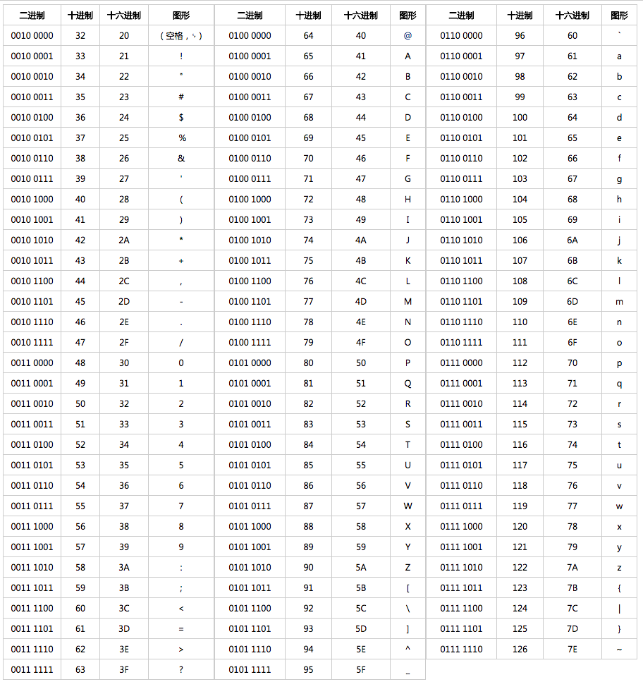
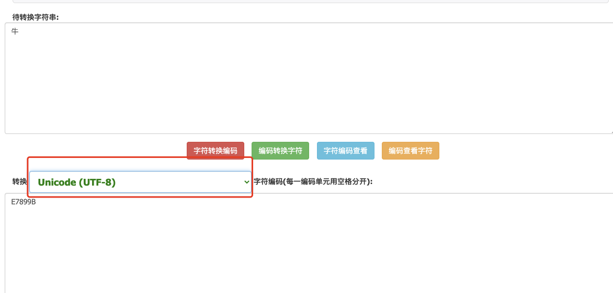
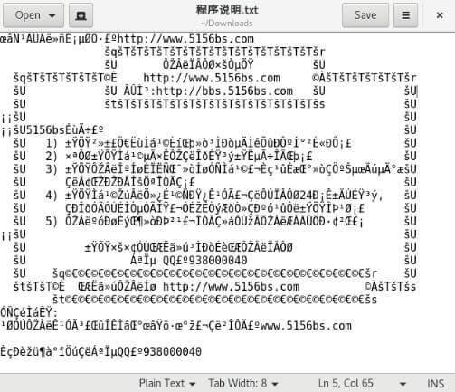
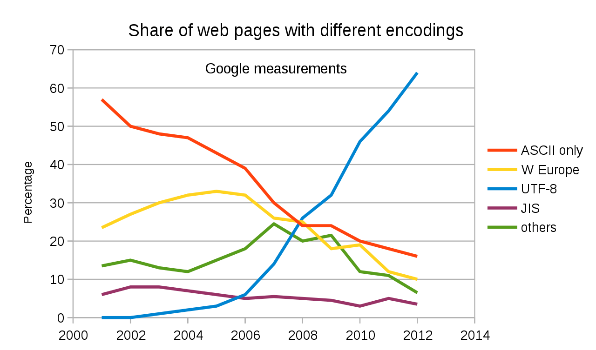
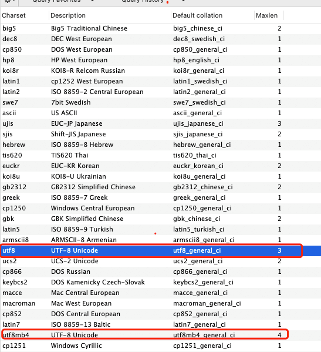

MySQL has two UTF-8 character set implementations: **`utf8`** and **`utf8mb4`**.

With **`utf8`**, storing emoji and some complex or traditional Chinese characters can fail. This article explains why.

## What Is a Character Set?

Characters include letters, symbols, punctuation, emoji, and digits. A **character set** is a collection of characters. Character sets vary in the range of characters they can represent; for example, some cannot represent Chinese characters.

**Computers store binary data. How can they store letters, Chinese characters, and emoji?**

Each character must map to binary data. For example, the character `a` might map to `01100001`, and `01100001` maps back to `a`. Converting characters to binary data is called **character encoding**; converting the binary data back to characters is called **character decoding**.

## What Is Character Encoding?

Character encoding is a mapping that converts characters in a character set to binary data and back. It lets computers store and transmit text.

Character sets use different encoding rules. Common encodings include ASCII, GB2312, GBK, GB18030, Big5, UTF-8, and UTF-16.

## Common Character Sets

Common character sets include ASCII, GB2312, GB18030, GBK, and Unicode.

They differ mainly in:

- Which characters they can represent.
- How they encode those characters.

### ASCII

**ASCII** (**A**merican **S**tandard **C**ode for **I**nformation **I**nterchange) is a character set designed primarily for modern American English. Its limited character coverage is one of its main drawbacks.

**Why doesn't ASCII include Chinese and other languages?** Computers were invented in the United States, and when ASCII was created, computers were not yet widely used in other countries. The standard therefore didn't account for other languages.

ASCII defines 128 characters, including 33 non-printing control characters such as carriage return and delete.

An ASCII code occupies one byte, or 8 bits. For example, `a` is `01100001`. The high bit is zero, leaving seven bits to represent 128 (`2^7`) characters.

The original ASCII set was too limited, so it was extended. Extended ASCII uses 8 bits per character and can represent 256 (`2^8`) values.



### GB2312

Many countries created character sets for their own languages because ASCII was designed for American English.

GB2312 supports Chinese and includes more than 6,700 Chinese characters, covering most commonly used characters. It doesn't support many rare or traditional Chinese characters.

English characters use the same encoding in GB2312 and ASCII and take one byte. Other characters use two bytes.

### GBK

GBK extends and remains compatible with GB2312. It includes more than 20,000 Chinese characters.

The `K` in GBK comes from the first letter of _kuozhan_, the Chinese word for “extension.”

### GB18030

GB18030 is compatible with GB2312 and GBK. It also includes minority languages used in China and Japanese and Korean characters. It is one of the most comprehensive Chinese character sets, with more than 70,000 Chinese characters.

### Big5

Big5 primarily supports traditional Chinese and includes more than 13,000 Chinese characters.

### Unicode and UTF-8

Many character sets were created to support particular languages. Because character sets differ in the characters they represent and how they encode them, using the wrong encoding to read a file can produce **mojibake**.

For example, decoding a GB2312-encoded file as UTF-8 produces garbled text. The CJK character U+725B is encoded as `C5A3` in GB2312, but decoding `C5A3` as UTF-8 produces `ţ`.

You can encode and decode text with this [online tool](https://www.haomeili.net/HanZi/ZiFuBianMaZhuanHuan).



This illustrates the source of mojibake: **the encoding and decoding steps use different or incompatible character sets**.



Unicode was created to include characters from languages around the world. The Unicode character set includes nearly all known characters, but it doesn't define how they are stored as binary data. UTF-8, UTF-16, and UTF-32 are encoding formats for Unicode.

UTF-8 uses one to four bytes per character. UTF-16 uses two or four bytes, and UTF-32 always uses four bytes.

UTF-8 chooses an encoding length based on the character. An English character needs only one byte, so UTF-8 uses the same encoding as ASCII for English characters.

UTF-32 has the simplest rules, but uses four times as much space as UTF-8 for characters such as English letters.

**UTF-8 is the most widely used character encoding today.**



## Character Sets in MySQL

MySQL supports many character sets, including GB2312, GBK, Big5, and Unicode encodings such as UTF-8, UTF-16, UCS-2, and UTF-32.

### Check Supported Character Sets

Use `SHOW CHARSET` to list supported character sets. The statement accepts `LIKE` and `WHERE` clauses.



### Default Character Set

MySQL 5.7 defaults to `latin1`. MySQL 8.0 defaults to `utf8mb4`.

### Character Set Scope

MySQL character sets can be configured at these levels:

- `server` (MySQL instance)
- `database`
- `table`
- `column`

Their precedence increases from the server level down to the column level. For example, if the server default is `utf8mb4` but a table uses `latin1`, that table's columns use `latin1` unless another character set is specified.

#### Server

Defaults vary by MySQL version: MySQL 5.7 uses `latin1`, while MySQL 8.0 uses `utf8mb4` by default.

Set the server character set when starting `mysqld` with `--character-set-server`:

```bash
mysqld
mysqld --character-set-server=utf8mb4
mysqld --character-set-server=utf8mb4 \
  --collation-server=utf8mb4_0900_ai_ci
```

If you build MySQL from source, set the character set with CMake:

```sh
cmake . -DDEFAULT_CHARSET=latin1
# Or:
cmake . -DDEFAULT_CHARSET=latin1 \
  -DDEFAULT_COLLATION=latin1_german1_ci
```

You can also change `character_set_server` at runtime. The server-level character set is a global default for newly created or altered databases unless another character set is specified. It can also affect the connection character set. See [MySQL Connector/J 8.0: Using Character Sets and Unicode](https://dev.mysql.com/doc/connector-j/8.0/en/connector-j-reference-charsets.html).

#### Database

Specify the database character set when creating or altering a database:

```sql
CREATE DATABASE db_name
    [[DEFAULT] CHARACTER SET charset_name]
    [[DEFAULT] COLLATE collation_name]

ALTER DATABASE db_name
    [[DEFAULT] CHARACTER SET charset_name]
    [[DEFAULT] COLLATE collation_name]
```

If no character set is specified, MySQL uses the server-level default.

Check a database's character set with:

```sql
USE db_name;
SELECT @@character_set_database, @@collation_database;
```

Or query `INFORMATION_SCHEMA`:

```sql
SELECT DEFAULT_CHARACTER_SET_NAME, DEFAULT_COLLATION_NAME
FROM INFORMATION_SCHEMA.SCHEMATA WHERE SCHEMA_NAME = 'db_name';
```

#### Table

Specify the table character set when creating or altering a table:

```sql
CREATE TABLE tbl_name (column_list)
    [[DEFAULT] CHARACTER SET charset_name]
    [COLLATE collation_name]

ALTER TABLE tbl_name
    [[DEFAULT] CHARACTER SET charset_name]
    [COLLATE collation_name]
```

If no table character set is specified, MySQL uses the database-level default.

#### Column

Specify a column's character set and collation in its definition. For example:

```sql
CREATE TABLE t1
(
    col1 VARCHAR(5)
      CHARACTER SET latin1
      COLLATE latin1_german1_ci
);
```

If no column-level character set is specified, MySQL uses the table-level default.

### Connection Character Sets

The previous levels govern stored data. Connection character sets govern communication with the MySQL server.

These variables describe the connection character sets:

- `character_set_client`: the character set used by the client for SQL statements it sends to the server.
- `character_set_connection`: the character set the server uses to interpret received SQL statements.
- `character_set_results`: the character set the server uses for results sent to the client.

Check their values with:

```sql
SELECT * FROM performance_schema.session_variables
WHERE VARIABLE_NAME IN (
'character_set_client', 'character_set_connection',
'character_set_results', 'collation_connection'
) ORDER BY VARIABLE_NAME;
```

```sql
SHOW SESSION VARIABLES LIKE 'character\_set\_%';
```

You can change these settings in the client configuration:

```properties
[mysql]
# Applies only to the MySQL command-line client.
default-character-set=utf8mb4
```

Or use SQL:

```sql
SET NAMES utf8mb4;
-- Or set the variables individually:
-- SET character_set_client = utf8mb4;
-- SET character_set_results = utf8mb4;
-- SET collation_connection = utf8mb4;
```

### How JDBC Affects Connection Character Sets

You may be able to store emoji correctly but see question marks when querying with a client such as Navicat. The JDBC driver may be responsible.

As described above, the connection character set can affect how data is stored and returned. The JDBC driver can affect the connection character set through properties such as:

- `characterEncoding`
- `characterSetResults`

For example, in DataGrip 2023.1.2, the advanced data source settings default `characterSetResults` to `utf8`. With `mysql-connector-java 8.0.25`, this can result in a connection character set of `utf8mb3`, causing emoji to display as question marks. That driver version doesn't allow `characterSetResults` to be set to `utf8mb4`, while `mysql-connector-java 8.0.29` does.

See this Stack Overflow answer: [DataGrip MySQL stores emojis correctly but displays them as?](https://stackoverflow.com/questions/54815419/datagrip-mysql-stores-emojis-correctly-but-displays-them-as).

### Using UTF-8 in MySQL

UTF-8 is generally a good default character encoding, but MySQL has an important distinction:

- **`utf8`:** MySQL's `utf8` supports only one to three bytes per character. Chinese characters use three bytes; many digits, English letters, and symbols use one byte. Emoji and some complex or traditional characters need four bytes.
- **`utf8mb4`:** MySQL's complete UTF-8 implementation, supporting up to four bytes per character, including emoji.

If you need to store emoji, complex characters, or traditional Chinese characters, use `utf8mb4` rather than `utf8`; otherwise, inserts may fail.

For example, this table uses `utf8` (MySQL 5.7 or later):

```sql
CREATE TABLE `user` (
  `id` varchar(66) CHARACTER SET utf8mb3 NOT NULL,
  `name` varchar(33) CHARACTER SET utf8mb3 NOT NULL,
  `phone` varchar(33) CHARACTER SET utf8mb3 DEFAULT NULL,
  `password` varchar(100) CHARACTER SET utf8mb3 DEFAULT NULL
) ENGINE=InnoDB DEFAULT CHARSET=utf8;
```

Inserting emoji into the table fails:

```sql
INSERT INTO `user` (`id`, `name`, `phone`, `password`)
VALUES
 ('A00003', 'Guide 😘😘😘', '181631312312', '123456');
```

The error looks like this:

```plain
Incorrect string value: '\xF0\x9F\x98\x98\xF0\x9F...' for column 'name' at row 1
```

## References

- [Character sets and character encoding](https://www.cnblogs.com/skynet/archive/2011/05/03/2035105.html)
- [Character sets and encodings in ten minutes](http://cenalulu.github.io/linux/character-encoding/)
- [Unicode on Wikipedia](https://zh.wikipedia.org/wiki/Unicode)
- [GB2312 on Wikipedia](https://zh.wikipedia.org/wiki/GB_2312)
- [UTF-8 on Wikipedia](https://zh.wikipedia.org/wiki/UTF-8)
- [GB18030 on Wikipedia](https://zh.wikipedia.org/wiki/GB_18030)
- [MySQL 8.0 documentation](https://dev.mysql.com/doc/refman/8.0/en/charset.html)
- [MySQL 5.7 documentation](https://dev.mysql.com/doc/refman/5.7/en/charset.html)
- [MySQL Connector/J documentation](https://dev.mysql.com/doc/connector-j/8.0/en/connector-j-reference-charsets.html)

<!-- @include: @article-footer.snippet.md -->
