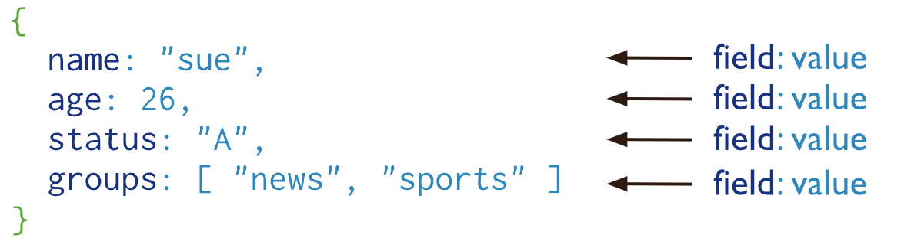
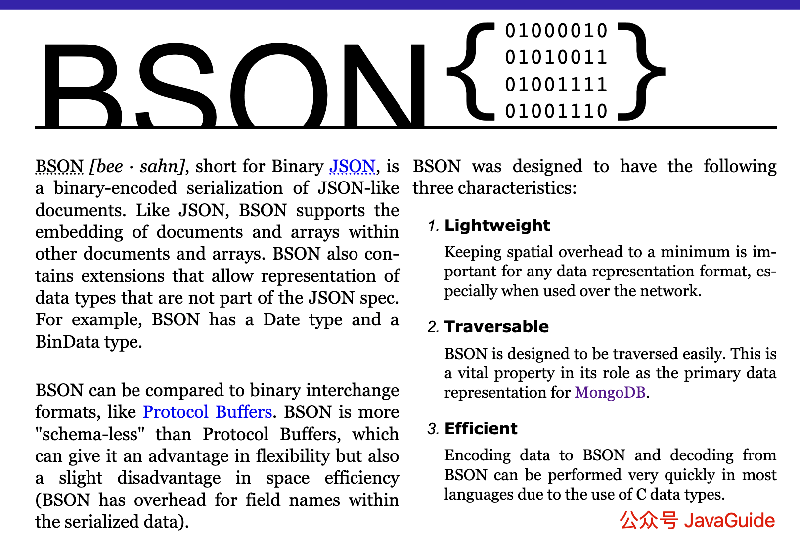
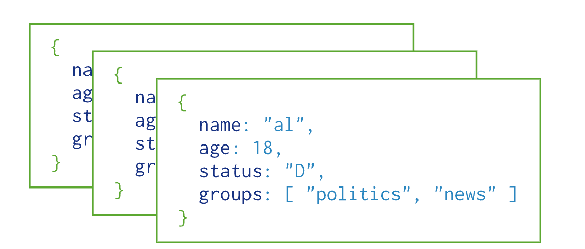
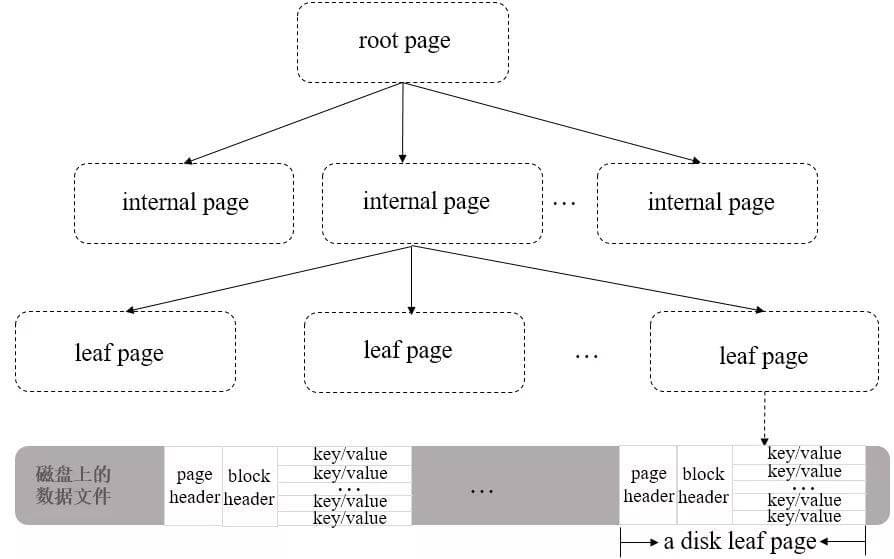
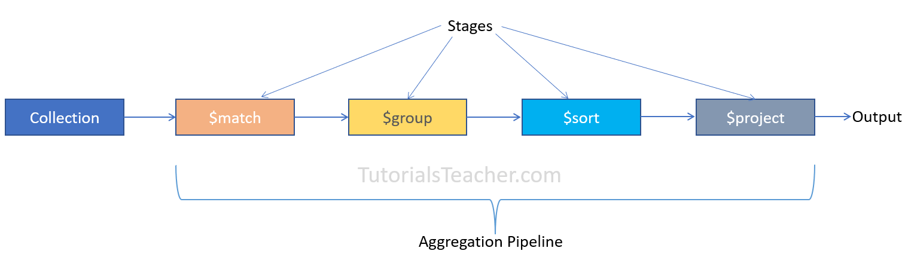

> Some descriptions in this article are based on the MongoDB documentation.

## MongoDB Fundamentals

### What Is MongoDB?

MongoDB is an open-source NoSQL database written in **C++** and based on **distributed file storage**. It uses a **document-oriented** storage model that is easy to work with, supports **schema-flexible** data modeling, and can store complex data types. It is a widely used **document database**.

Under heavy workloads, MongoDB supports horizontal scaling and high availability. You can add nodes or instances to maintain performance and availability. In some scenarios, MongoDB can replace a relational database or key-value store as a scalable, highly available, high-performance data store for web applications.

### How Is MongoDB Data Organized?

Unlike a traditional relational database, MongoDB organizes data into three main units:

- **Document**: The basic unit in MongoDB. A document consists of BSON key-value pairs and is similar to a row in a relational database.
- **Collection**: A collection contains multiple documents and is similar to a table in a relational database.
- **Database**: A database contains multiple collections. MongoDB can host multiple databases, similar to a relational database server.

MongoDB stores records as documents (specifically, [BSON documents](https://www.mongodb.com/docs/manual/core/document/#std-label-bson-document-format)). Documents are grouped into collections, and a database stores one or more collections.

**Common SQL and MongoDB terminology:**

| SQL            | MongoDB           |
| -------------- | ----------------- |
| Table          | Collection        |
| Row            | Document          |
| Column         | Field             |
| Primary key    | ObjectId          |
| Index          | Index             |
| Embedded table | Embedded document |
| Array          | Array             |

#### Documents

A MongoDB record is a BSON document: a key-value data structure similar to a JSON object and the basic data unit in MongoDB. Field values can include other documents, arrays, and arrays of documents.



Document keys are strings and can contain any UTF-8 character, with a few exceptions:

- Keys cannot contain `\0` (the null character), which marks the end of a key.
- `.` and `$` have special meanings and can be used only in specific contexts.
- Keys beginning with an underscore (`_`) are reserved, though this is not strictly enforced.

**BSON [bee·sahn]** is short for Binary [JSON](http://json.org/) and is a binary representation of JSON documents. It supports embedding documents and arrays within other documents and arrays, and extends JSON with additional data types. See the [BSON specification](http://bsonspec.org/) and [BSON types](https://www.mongodb.com/docs/manual/reference/bson-types/).

According to the cited Wikipedia description of BSON, BSON can be traversed faster than JSON, which is one reason MongoDB uses it. BSON may require more storage space.

> Compared with JSON, BSON is designed to improve storage and scan efficiency. Large elements in BSON documents are prefixed with their length to make scanning easier. In some cases, BSON uses more space than JSON because it stores length prefixes and explicit array indexes.



#### Collections

MongoDB collections belong to a database and have **no fixed structure**; they are **schema-flexible**. This means documents with different fields and types can be inserted into one collection, though they are usually related in some way.



You do not need to create a collection in advance. If it does not exist, MongoDB creates it when the first document is inserted or the first index is created.

Collection names can be any UTF-8 string that meets these conditions:

- A collection name cannot be an empty string (`""`).
- It cannot contain `\0` (the null character), which marks the end of a collection name.
- It cannot begin with `system.`; this prefix is reserved for system collections. For example, `system.users` stores database user information, and `system.namespaces` stores information about database collections.
- It must begin with an underscore or a letter and cannot contain `$`.

#### Databases

Databases store collections, which in turn store documents. A MongoDB deployment can contain multiple databases, each with its own collections and permissions.

MongoDB reserves several databases for special purposes:

- **admin**: Primarily stores root users and roles. For example, `system.users` stores users and `system.roles` stores roles. Directly modifying this database is generally not recommended. A user added here with the `dbAdminAnyDatabase` role on the admin database inherits permissions across all databases. Some server-side commands, such as shutting down the server, can only be run from this database.
- **local**: This database is not replicated to other shards, so it can store collections local to a single server. Direct use for application data and CRUD operations is generally discouraged because its data cannot be backed up and restored normally.
- **config**: When MongoDB is configured for sharding, this database stores sharding metadata.
- **test**: The default test database. If you connect to a [mongod](https://mongoing.com/docs/reference/program/mongod.html) server without specifying a database, the connection defaults to `test`.

Database names can be any UTF-8 string that meets these conditions:

- It cannot be an empty string (`""`).
- It cannot contain a space, `.`, `$`, `/`, `\`, or `\0` (the null character).
- It must be lowercase.
- It can be at most 64 bytes long.

Database names eventually become file names in the file system, which explains these restrictions.

### What Are MongoDB's Features?

- **Documents store records**: A MongoDB record is a BSON document, a key-value structure similar to a JSON object and the basic data unit in MongoDB.
- **Flexible schema**: A collection is similar to a MySQL table, but does not require a fixed schema. This can represent complex domain models with fewer data objects.
- **Multiple query methods**: The MongoDB query API supports CRUD operations, data aggregation, text search, and geospatial queries.
- **ACID transactions**: NoSQL databases often trade transaction support for scalability and performance, but MongoDB supports ACID transactions. Single-document operations are atomic. MongoDB 4.0 added multi-document transactions for replica sets; MongoDB 4.2 added support for multi-document transactions on sharded clusters.
- **Binary storage**: Documents in a collection are stored as key-value pairs. A key, usually an `ObjectId`, uniquely identifies a document, and values are stored in BSON (Binary JSON), which extends JSON with additional types and metadata.
- **Built-in compression**: Compression reduces the resources needed to store the same data.
- **Map-reduce support**: Map-reduce can perform complex aggregation tasks using a divide-and-conquer approach. However, it has not been recommended since MongoDB 5.0. The [aggregation pipeline](https://www.mongodb.com/docs/manual/core/aggregation-pipeline/) is the replacement and offers better performance and usability.
- **Multiple index types**: MongoDB supports single-field, compound, multikey, hashed, text, and geospatial indexes, each suited to different use cases.
- **Failover**: If the primary fails, a new primary is automatically elected from the secondary members, keeping the cluster available to clients.
- **Sharded clusters**: MongoDB can automatically distribute data across a cluster to increase storage capacity and performance, routing inserts and updates to the appropriate shards.
- **Large file support**: A MongoDB document cannot exceed 16 MB. For larger files, GridFS splits the data into smaller chunks and stores them in the database.

### Which Use Cases Suit MongoDB?

**MongoDB's strengths include a flexible data model and storage engine, a scalable architecture, and broad index support.**

Choose MongoDB based on the project's requirements and how well its strengths fit:

- As the project grows, will BSON's JSON-like data model meet its needs? MongoDB records are BSON documents made up of key-value pairs, similar to JSON objects.
- Is large-scale storage or rapid horizontal scaling needed? MongoDB sharded clusters let you add nodes to increase storage capacity and performance.
- Are different index types needed for varied query patterns? MongoDB supports single-field, compound, multikey, hashed, text, and geospatial indexes.
- ……

## MongoDB Storage Engines

### Which Storage Engines Does MongoDB Support?

A storage engine is a core database component that manages how data is stored in memory and on disk.

Like MySQL, MongoDB uses a **pluggable storage engine architecture**. Different engines address different needs, and you can specify a storage engine when creating a database or collection.

> A pluggable storage engine architecture decouples the server layer from the storage engine and allows multiple engines. For example, MySQL supports the B-Tree-based InnoDB engine and the LSM-based RocksDB engine.

MMAPv1 was the default storage engine in earlier releases, but MongoDB 4.x no longer supports it.

The main storage engines are:

- **WiredTiger**: Since MongoDB 3.2, [WiredTiger](https://www.mongodb.com/docs/manual/core/wiredtiger/) has been the default storage engine. It suits most workloads and is recommended for new deployments. Features include document-level concurrency, checkpoints, and data compression.
- **In-Memory**: Available in MongoDB Enterprise, the [In-Memory engine](https://www.mongodb.com/docs/manual/core/inmemory/) keeps documents in memory rather than on disk for more predictable data latency.

MongoDB 3.0 also introduced a **pluggable storage engine API**, allowing third parties to develop storage engines for MongoDB, much like MySQL.

### Does WiredTiger Use an LSM Tree or a B+ Tree?

Most popular database storage engines are based on B/B+ trees or LSM (Log-Structured Merge) trees. Many NoSQL databases, such as HBase, Cassandra, and RocksDB, use LSM trees; MongoDB differs.

As noted above, WiredTiger has been MongoDB's default storage engine since version 3.2. The WiredTiger documentation describes its storage structure as a B+ tree:

```plain
WiredTiger maintains a table's data in memory using a data structure called a B-Tree ( B+ Tree to be specific), referring to the nodes of a B-Tree as pages. Internal pages carry only keys. The leaf pages store both keys and values.
```

WiredTiger also supports [LSM (Log-Structured Merge) trees](https://source.wiredtiger.com/3.1.0/lsm.html), but MongoDB uses B+ trees by default with WiredTiger.

For more on why MongoDB uses B+ trees, see [MongoDB Uses B+ Trees, Not B-Trees](https://zhuanlan.zhihu.com/p/519658576).

With B+ trees, WiredTiger reads and writes data to disk in units called **pages**. Each B+ tree node is a page. There are three types:

- **Root page**: The root node of the B+ tree.
- **Internal page**: An intermediate index node that does not store data records.
- **Leaf page**: A data-bearing leaf node. It contains a page header, a block header, and the key-value data. The page header describes the page type, payload size, and record count; the block header stores the page checksum and its disk address.

The overall structure is shown below:



For an in-depth look at WiredTiger, see the MongoDB Chinese community's [WiredTiger storage engine series](https://mongoing.com/archives/category/wiredtiger%e5%ad%98%e5%82%a8%e5%bc%95%e6%93%8e%e7%b3%bb%e5%88%97).

## MongoDB Aggregation

### What Is MongoDB Aggregation Used For?

In practice, you may need to combine data from multiple documents or collections, analyze it (for example, calculate a sum or maximum), and return the result. This process is called **aggregation**.

According to the MongoDB documentation, aggregation can be used to:

- Combine values from multiple documents.
- Perform a series of operations on collection data.
- Analyze how data changes over time.

### Which Aggregation Methods Does MongoDB Provide?

MongoDB provides two ways to perform aggregation:

- **Aggregation pipeline**: The preferred method for aggregation.
- **Single-purpose aggregation methods**: Methods that perform one task, such as `count()`, `distinct()`, and `estimatedDocumentCount()`.

Many articles also mention **map-reduce** as an aggregation method. However, it has not been recommended since MongoDB 5.0. The replacement is the [aggregation pipeline](https://www.mongodb.com/docs/manual/core/aggregation-pipeline/), which offers better performance and usability.

An aggregation pipeline consists of stages that transform documents as they pass through the pipeline. Each stage receives the previous stage's output, processes it, and sends the result to the next stage.

The pipeline works as follows:

1. Accept a sequence of source documents.
2. Apply a series of operations to those documents.
3. Pass the resulting documents to the next stage.



**Common pipeline stages:**

| Operator  | Description                                                                                          |
| --------- | ---------------------------------------------------------------------------------------------------- |
| \$match   | Filters the document stream.                                                                         |
| \$project | Reshapes documents by including, renaming, or transforming fields, or adding new fields.             |
| \$sort    | Sorts documents by one or more fields.                                                               |
| \$limit   | Limits the number of documents returned.                                                             |
| \$skip    | Skips a specified number of documents.                                                               |
| \$count   | Counts the documents.                                                                                |
| \$group   | Groups documents in a collection.                                                                    |
| \$unwind  | Deconstructs an array field, outputting one document for each array value.                           |
| \$lookup  | Joins another collection in the same database and retrieves matching documents, similar to populate. |

For more pipeline stages, see the [MongoDB documentation](https://docs.mongodb.com/manual/reference/operator/aggregation/).

Stage operators are specified at the top level of the array passed to `db.collection.aggregate`.

```sql
db.collection.aggregate( [ { stageOperator: expression }, { stageOperator: expression }, ... ] )
```

Here is an example from the MongoDB documentation:

```sql
db.orders.aggregate([
   # Stage 1: $match filters documents by status and passes documents with status "A" to the next stage.
    { $match: { status: "A" } },
  # Stage 2: $group groups documents by cust_id and calculates the total amount for each distinct cust_id.
    { $group: { _id: "$cust_id", total: { $sum: "$amount" } } }
])
```

## MongoDB Transactions

> MongoDB transaction internals take time to understand, and I have not fully worked them out myself. This section provides a brief overview; consult additional resources for implementation details.
>
> The following resources may be helpful:
>
> - [MongoDB Transaction Internals](https://mongoing.com/archives/82187)
> - [Design and Implementation of MongoDB's Consistency Model](https://developer.aliyun.com/article/782494)
> - [MongoDB Transactions Documentation](https://www.mongodb.com/docs/upcoming/core/transactions/)

As discussed in the NoSQL guide, NoSQL databases often trade transaction support for scalability and performance. MongoDB is an exception and supports transactions.

Like relational database transactions, MongoDB transactions have ACID properties:

- **Atomicity**: A transaction is an indivisible unit of work. Either all of its operations complete, or none take effect.
- **Consistency**: Data remains consistent before and after a transaction. For example, the total balance across two accounts remains unchanged by a transfer, whether it succeeds or fails.
- **Isolation**: Concurrent transactions do not interfere with one another. WiredTiger supports read-uncommitted, read-committed, and snapshot isolation; MongoDB uses snapshot isolation by default. Depending on the isolation level, dirty reads, non-repeatable reads, or phantom reads may occur during a transaction.
- **Durability**: Once committed, a transaction's changes persist even if the database fails.

For a more detailed discussion of transactions, see [MySQL Interview Questions](../mysql/mysql-questions-01.md).

MongoDB provides atomicity for single-document operations. References to MongoDB transactions usually mean **multi-document transactions**. MongoDB 4.0 added multi-document ACID transactions for replica sets. MongoDB 4.2 introduced **distributed transactions**, extending multi-document transaction support to sharded clusters while retaining support for replica sets.

The MongoDB documentation states:

> Starting in MongoDB 4.2, “distributed transaction” and “multi-document transaction” refer to the same concept. A distributed transaction is a multi-document transaction on a sharded cluster or replica set. Both are called distributed transactions from MongoDB 4.2 onward.

In most cases, multi-document transactions have greater performance costs than single-document writes. For many use cases, a [denormalized data model with embedded documents and arrays](https://www.mongodb.com/docs/upcoming/core/data-model-design/#std-label-data-modeling-embedding) remains the best choice. Proper data modeling can minimize the need for multi-document transactions.

**Notes:**

- Starting with MongoDB 4.2, multi-document transactions support replica sets and sharded clusters. The primary must use WiredTiger; secondaries can use WiredTiger or In-Memory. In MongoDB 4.0, only replica sets using WiredTiger support transactions.
- In MongoDB 4.2 and earlier, you cannot create collections in a transaction. Starting with MongoDB 4.4, you can create collections and indexes in a transaction. See [Create Collections and Indexes in a Transaction](https://www.mongodb.com/docs/upcoming/core/transactions/#std-label-transactions-create-collections-indexes).

## MongoDB Data Compression

With the WiredTiger storage engine (MongoDB's default since version 3.2), MongoDB can compress all collections and indexes. Compression reduces storage use at the cost of additional CPU.

By default, WiredTiger uses the [Snappy](https://github.com/google/snappy) compression algorithm for block compression of collections and prefix compression of indexes. Snappy is an open-source Google algorithm designed for high speed and reasonable compression, typically 3–5x.

In addition to Snappy, collections can use these compression algorithms:

- [zlib](https://github.com/madler/zlib): A high-compression algorithm, typically 5–7x.
- [Zstandard](https://github.com/facebook/zstd) (zstd): An open-source, fast, lossless compression algorithm from Facebook. It offers higher compression and lower CPU use than zlib for real-time compression, and has been available since MongoDB 4.2.

WiredTiger logs are also compressed with Snappy by default. Records of 128 bytes or less are not compressed.

## Differences Between Amazon DocumentDB and MongoDB

Amazon DocumentDB (with MongoDB compatibility) is a fast, reliable, fully managed database service. It makes it easy to set up, operate, and scale MongoDB-compatible databases in the cloud.

### The `$vectorSearch` Operator

Amazon DocumentDB does not support `$vectorSearch` as a standalone operator. Instead, it supports `vectorSearch` inside the `$search` operator. See [Vector Search in Amazon DocumentDB](https://docs.aws.amazon.com/zh_cn/documentdb/latest/developerguide/vector-search.html) for details.

### `OpCountersCommand`

Amazon DocumentDB's `OpCountersCommand` differs from MongoDB's `opcounters.command` in these ways:

- MongoDB's `opcounters.command` counts all commands except inserts, updates, and deletes. Amazon DocumentDB's `OpCountersCommand` also excludes `find` commands.
- Amazon DocumentDB includes internal commands such as `getCloudWatchMetricsV2` in `OpCountersCommand`.

### Managing Databases and Collections

Amazon DocumentDB does not support the `admin` or `local` databases, or MongoDB's `system.*` and `startup_log` collections.

### `cursor.maxTimeMS`

In Amazon DocumentDB, `cursor.maxTimeMS` resets the timer for each request. For example, if `maxTimeMS` is 3,000 ms, a query takes 2,800 ms, and each subsequent `getMore` request takes 300 ms, the cursor does not time out. A cursor times out only when a single operation (the query or one `getMore` request) exceeds the specified `maxTimeMS`. A background process checks cursor execution time every five minutes.

### explain()

Amazon DocumentDB emulates the MongoDB 4.0 API using a purpose-built database engine on a distributed, fault-tolerant, self-healing storage system. Query plans and `explain()` output can therefore differ between Amazon DocumentDB and MongoDB. To control a query plan, use `$hint` to force the preferred index.

### Field Name Restrictions

Amazon DocumentDB does not support periods (`.`) in document field names. For example: `db.foo.insert({'x.1':1})`.

Amazon DocumentDB also does not support field names that begin with `$`.

For example, run the following command in Amazon DocumentDB or MongoDB:

```shell
rs0:PRIMARY< db.foo.insert({"a":{"$a":1}})
```

MongoDB returns:

```shell
WriteResult({ "nInserted" : 1 })
```

Amazon DocumentDB returns an error:

```shell
WriteResult({
  "nInserted" : 0,
  "writeError" : {
    "code" : 2,
    "errmsg" : "Document can't have $ prefix field names: $a"
  }
})
```

## References

- MongoDB documentation (primary reference): <https://www.mongodb.com/docs/manual/>
- _MongoDB: The Definitive Guide_
- [MongoDB Transaction Internals - MongoDB Chinese Community](https://mongoing.com/archives/82187)
- [Transactions - MongoDB Documentation](https://www.mongodb.com/docs/manual/core/transactions/)
- [WiredTiger Storage Engine - MongoDB Documentation](https://www.mongodb.com/docs/manual/core/wiredtiger/)
- [WiredTiger Storage Engine: An Analysis of Its Basic Data Structures](https://mongoing.com/topic/archives-35143)

<!-- @include: @article-footer.snippet.md -->
