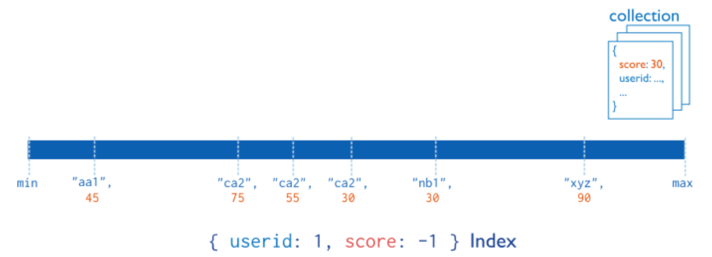
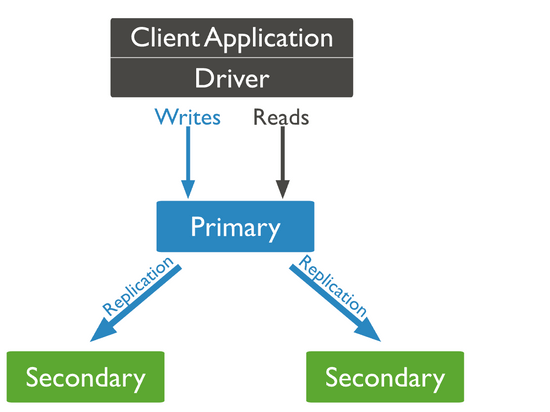
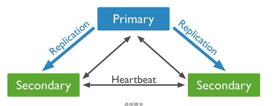
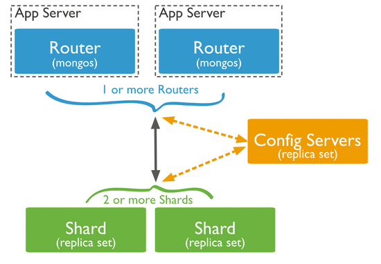
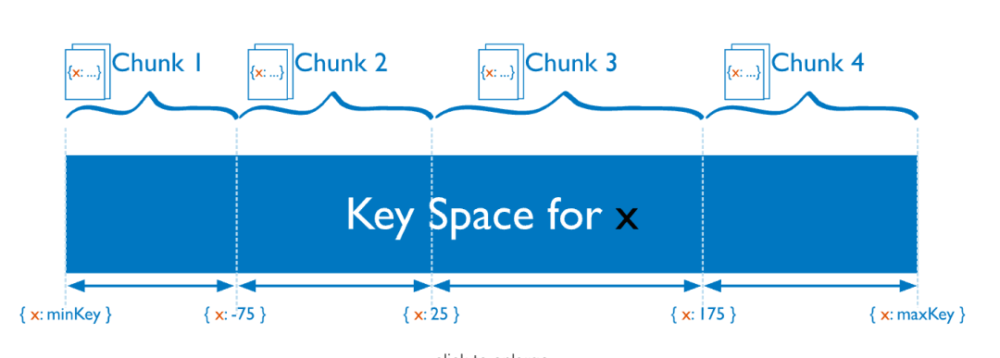
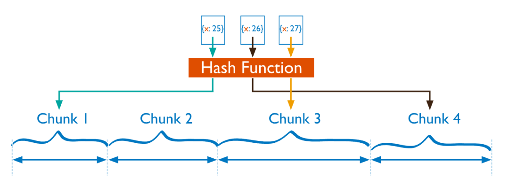
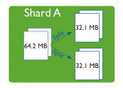
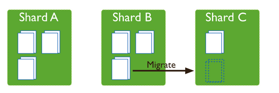

## MongoDB Indexes

### What Are MongoDB Indexes Used For?

Like relational databases, MongoDB uses indexes to improve query performance. Without an index, MongoDB must perform a **collection scan**, checking every document for a match. With a suitable index, MongoDB can limit the number of documents it examines and use the index order to return sorted results.

Indexes can significantly reduce query time, but using and maintaining them has a cost. Writes must update both documents and indexes, which affects write performance. Indexes may not be worthwhile for workloads with many writes and few reads, or when read performance is not important.

### Which Index Types Does MongoDB Support?

**MongoDB supports several index types, including single-field, compound, multikey, hashed, text, and geospatial indexes. Each suits different use cases.**

- **Single-field index**: An index on one field. MongoDB can traverse it in either direction, regardless of the sort order used when creating it.
- **Compound index**: An index on multiple fields, also called a composite or compound index.
- **Multikey index**: Created on an array field. MongoDB indexes each array value, so queries can use the index to match values in the array.
- **Hashed index**: Indexes the hash of a value and is used for hashed sharding.
- **Text index**: Supports text search on string content. It can include fields containing strings or arrays of strings. A collection can have only one text index, but that index can cover multiple fields. The source advises against MongoDB text indexes due to performance concerns.
- **Geospatial index**: Based on geographic coordinates and suited to 2D and 3D location queries.
- **Unique index**: Prevents duplicate values in the indexed field. Creating a unique index fails if the collection already contains documents that violate the constraint.
- **TTL index**: Expires documents after a configured time and removes them from the collection.
- ……

### Does Field Order Matter in a Compound Index?

Field order matters in a compound index. For example, the index `{userid: 1, score: -1}` shown below sorts by `userid` in ascending order, then by `score` in descending order within each `userid` value.



The sort order of a compound index determines whether MongoDB can use it for a query.

Sorts that can use the compound index:

```sql
db.s2.find().sort({"userid": 1, "score": -1})
db.s2.find().sort({"userid": -1, "score": 1})
```

Sorts that cannot use the compound index:

```sql
db.s2.find().sort({"userid": 1, "score": 1})
db.s2.find().sort({"userid": -1, "score": -1})
db.s2.find().sort({"score": 1, "userid": -1})
db.s2.find().sort({"score": 1, "userid": 1})
db.s2.find().sort({"score": -1, "userid": -1})
db.s2.find().sort({"score": -1, "userid": 1})
```

Use `explain()` to analyze the query:

```sql
db.s2.find().sort({"score": -1, "userid": 1}).explain()
```

### Do Compound Indexes Follow the Leftmost Prefix Rule?

**MongoDB compound indexes follow the leftmost prefix rule**: an index on multiple keys can support queries on prefixes of those keys, but not on other subsets. For example, an index like `{a: 1, b: 1, c: 1, ..., z: 1}` can support prefixes such as `{a: 1}`, `{a: 1, b: 1}`, and `{a: 1, b: 1, c: 1}`, but not a non-prefix such as `{b: 1}`.

### What Is a TTL Index?

A TTL index provides expiration by setting an `expireAfterSeconds` value for documents. MongoDB deletes a document after it reaches its expiration time. Apart from the `expireAfterSeconds` option, a TTL index works like a regular index.

Expiration is useful for data that needs to be retained only for a limited time, such as machine-generated events, logs, and session data.

**How TTL indexes work:**

- MongoDB runs a background thread that checks TTL index values for expired documents. Expired documents are not necessarily removed immediately: the thread runs a deletion task every 60 seconds, and a large deletion task may still be running when the next one starts. As a result, documents can remain for more than 60 seconds past their retention period.
- In a replica set, the TTL background process runs only on the primary. It remains idle on secondaries, which learn about deletions through the oplog.

**TTL index limitations:**

- A TTL index must be a single-field index; compound indexes do not support TTL.
- The `_id` field does not support TTL indexes.
- TTL indexes cannot be created on capped collections because MongoDB cannot delete documents from them.
- You cannot create a TTL index on a field that already has a non-TTL index.

### What Is a Covered Query?

According to the MongoDB documentation, a covered query meets these conditions:

- All fields in the query are part of an index.
- All fields returned by the result are in the same index.
- No query field is equal to `null`.

Because every field used by the query is part of the index, MongoDB can find matching documents and return results from the index without fetching the full documents. Since indexes are in memory, reading from an index can be much faster than scanning documents.

For example, consider this `users` collection:

```json
{
   "_id": ObjectId("53402597d852426020000002"),
   "contact": "987654321",
   "dob": "01-01-1991",
   "gender": "M",
   "name": "Tom Benzamin",
   "user_name": "tombenzamin"
}
```

Create a compound index on the `gender` and `user_name` fields in the `users` collection:

```sql
db.users.ensureIndex({gender:1,user_name:1})
```

This index can cover the following query:

```sql
db.users.find({gender:"M"},{user_name:1,_id:0})
```

To let this index cover the query, explicitly specify `_id: 0` to exclude `_id` from the results, because the index does not include the `_id` field.

## MongoDB High Availability

### Replica Sets

#### What Is a Replica Set?

A MongoDB replica set is a group of `mongod` processes that maintain the same data set.

Clients connect to the replica set. The primary handles writes, and secondaries can serve reads, though reads go to the primary by default. If the primary fails, the set automatically elects a new one so the cluster can continue operating without client intervention.

A replica set typically has one primary, multiple secondaries, and zero or one arbiter.

- **Primary**: The cluster's write entry point. It accepts writes and records data changes in the operation log (oplog). If it fails, the set elects a new primary.
- **Secondary**: Replicates data from the primary and can participate in electing a new primary if the current one fails. A secondary can be assigned priority 0 to prevent it from becoming primary.
- **Arbiter**: Used to reduce resource use or support disaster recovery across data centers. It votes in primary elections but stores no data, helping a candidate obtain a majority.

The diagram below shows a typical three-member replica set:



The primary and secondaries synchronize data through the **oplog (operation log)**. The oplog is a special **capped collection** in the `local` database that stores the incremental log of write operations, similar to MySQL's binary log.

> A capped collection is like a fixed-size circular queue. Data is appended to the end, and when the collection reaches its size limit, the oldest documents are overwritten. Capped collections write sequentially to a fixed area of disk, which makes I/O fast; performance is better without indexes.



After a write completes on the primary, a corresponding entry is added to the oplog. Secondaries continually fetch new entries from the oplog and replay them locally to synchronize their data.

A replica set has at most one primary. If the current primary is unavailable, an election selects a new one. MongoDB's election rules ensure the selected member has the most complete data set among eligible members.

#### Why Use a Replica Set?

- **Failover**: If the primary fails, the replica set automatically elects a new one so the cluster can continue operating without client intervention.
- **Read/write separation**: Configure reads to use secondaries while the primary handles writes, reducing load on the primary. For MongoDB versions before 4.0, the source advises against this when the primary is not overloaded, since writes can block reads. It may be suitable when response time is not critical and some delay in reading historical data is acceptable.

### Sharded Clusters

#### What Is a Sharded Cluster?

A sharded cluster is MongoDB's distributed deployment model. Unlike a replica set, it distributes data across shards. This increases the cluster's storage capacity and spreads read and write load across shards, addressing replica set performance limits.

A MongoDB sharded cluster has three components (diagram from the [MongoDB sharding documentation](https://www.mongodb.com/docs/manual/sharding/)):



- **Config servers**: A MongoDB replica set that stores cluster metadata and configuration, such as shard addresses and chunks.
- **`mongos`**: A query router that stores no application data. It gets cluster configuration from the config servers, routes requests to the appropriate shards, and combines the results for the client.
- **Shard**: Each shard stores a subset of the data. Starting with MongoDB 3.6, every shard must be deployed as a replica set.

#### Why Use a Sharded Cluster?

As data volume and throughput grow, there are two common approaches: vertical scaling and horizontal scaling.

Vertical scaling increases the capacity of a single server, such as its disk space, memory, or number of CPUs. Horizontal scaling stores data across multiple servers and adds servers as needed.

Like Redis Cluster, MongoDB uses sharding for **horizontal scaling**. This flexible approach supports larger data volumes and higher throughput. It can cost less overall by using modest servers, but adds infrastructure and operational complexity.

Sharding can help when:

- Storage capacity is limited by a single machine, such as when disk space is a bottleneck.
- Read or write capacity is limited by a single machine because of CPU, memory, or network bottlenecks.

#### What Is a Shard Key?

The **shard key** determines how a collection's documents are distributed across shards, partitioning data across servers to reduce the load on each one.

A shard key is a document field with specific requirements:

- It must be present in every document.
- It must be an index on the collection. It can be a single-field index or a prefix of a compound index, but cannot be a multikey, text, or geospatial index.
- Before MongoDB 4.2, a document's shard key value was immutable. Starting with MongoDB 4.2, you can update it unless the shard key is the immutable `_id` field. Starting with MongoDB 5.0, live resharding allows you to choose a completely different shard key.
- It cannot exceed 512 bytes.

#### How Do You Choose a Shard Key?

Choosing a shard key has a major effect on sharding efficiency. Consider these four factors (from [Sharded Cluster Usage Notes - Tencent Cloud](https://cloud.tencent.com/document/product/240/44611)):

- **Cardinality**: Prefer high cardinality. A low-cardinality shard key has few possible values and therefore limits the number of chunks. As data grows, chunks become larger and harder to move during horizontal scaling. For example, age has at most about 100 values. If many documents share one value, a chunk can exceed the chunk size and become a jumbo chunk that cannot be migrated, causing uneven distribution and a performance bottleneck.
- **Value distribution**: Aim for an even distribution. An uneven shard key can create chunks with very large data volumes and the same distribution and performance problems.
- **Queries that include the shard key**: Include the shard key in queries where possible. `mongos` can then target a specific shard; otherwise, it must send the query to every shard and wait for their responses.
- **Avoid monotonic keys**: A monotonically increasing shard key can reduce data movement, but concentrates writes and causes the newest chunk to keep growing and migrating. The same issue applies to monotonically decreasing keys.

Consider all four factors and meet as many as possible to reduce the performance impact of chunk migrations.

#### Which Sharding Strategies Are Available?

MongoDB supports two sharding strategies for different query patterns (from [Introduction to MongoDB Sharded Clusters - Alibaba Cloud](https://help.aliyun.com/document_detail/64561.html?spm=a2c4g.11186623.0.0.3121565eQhUGGB#h2--shard-key-3)):

**1. Range-based sharding**



MongoDB divides data into chunks based on ranges of shard key values. Each chunk contains data within a range. Range-based sharding is more efficient when the shard key has high cardinality, values are not overly frequent, and the key does not change monotonically.

- **Advantages**: `mongos` can quickly locate the required data and route requests to the relevant shard.
- **Disadvantages**: Data may be unevenly distributed across shards, creating read/write hotspots and concentrating writes.
- **Use cases**: The shard key is not monotonically increasing or decreasing, has high cardinality with few repeated values, and the workload needs range queries.

**2. Hashed sharding**



MongoDB hashes a single field and partitions data into chunks based on hash value ranges.

- **Advantages**: Distributes data more evenly across shards and spreads writes.
- **Disadvantages**: Not suited to range queries, which require read requests to be sent to all shards.
- **Use cases**: The shard key is monotonically increasing or decreasing, has high cardinality with few repeated values, and writes or reads need to be distributed randomly.

In addition to these strategies, you can configure a **compound shard key**, for example, combining a low-cardinality key with a monotonically increasing key.

#### How Is Sharded Data Stored?

**A chunk** is a core concept in MongoDB sharded clusters. It is a logical data unit containing a group of documents. Each chunk contains data for a shard key range. The ranges do not overlap, and together they cover the entire data set, forming a **partition** in the mathematical sense.

A sharded cluster does not track the shard for each individual document. Instead, it tracks which shard contains each chunk and which data belongs to that chunk.

By default, a chunk has a maximum size of 64 MB. This can be adjusted from 1 to 1,024 MB; keep the default unless you have a specific need. During inserts, updates, or deletes, if `mongos` detects that a target chunk has exceeded its size or data limit, it triggers a **chunk split**.



As data grows, chunks split and their counts may become uneven across shards. The **balancer** component in `mongos` automatically tries to keep chunk counts balanced across shards. This process is called **rebalancing**. Rebalancing is enabled for databases and collections by default.

As shown below, inserts cause chunks to split, leaving shards A and B with three chunks each and shard C with one. The balancer then moves a chunk from B to C to balance the cluster.



> Since MongoDB 3.4, the balancer is a background process that runs on the primary of the config server replica set. It monitors chunk counts on each shard and migrates chunks when a shard reaches a threshold.

Chunks split but are not merged, even if `chunkSize` is increased.

Rebalancing can consume significant system resources. Reduce its impact by scheduling it during off-peak periods, pre-splitting chunks, or setting a rebalancing window.

#### How Does Chunk Migration Work?

For details, see the MongoDB Chinese community article [MongoDB Chunk Migration Explained](https://mongoing.com/archives/77479).

## Recommended Learning Resources

- [MongoDB Chinese Manual](https://docs.mongoing.com/) (recommended): Based on version 4.2 and regularly updated to track the latest official documentation.
- [MongoDB for Beginners: Learn MongoDB in 7 Days](https://mongoing.com/archives/docs/mongodb%e5%88%9d%e5%ad%a6%e8%80%85%e6%95%99%e7%a8%8b/mongodb%e5%a6%82%e4%bd%95%e5%88%9b%e5%bb%ba%e6%95%b0%e6%8d%ae%e5%ba%93%e5%92%8c%e9%9b%86%e5%90%88): A quick introduction.
- [A Practical Guide to Integrating MongoDB with Spring Boot (2022)](https://www.cnblogs.com/dxflqm/p/16643981.html): An introduction to MongoDB's Java client and basic CRUD operations.

## References

- MongoDB documentation (primary reference): <https://www.mongodb.com/docs/manual/>
- _MongoDB: The Definitive Guide_
- [Indexes - MongoDB Documentation](https://www.mongodb.com/docs/manual/indexes/)
- [MongoDB Indexes - Programmer Xiangzai (2022)](https://fatedeity.cn/posts/database/mongodb-index-knowledge.html)
- [MongoDB Indexes](https://www.cnblogs.com/Neeo/articles/14325130.html)
- [Sharding - MongoDB Documentation](https://www.mongodb.com/docs/manual/sharding/)
- [Introduction to MongoDB Sharded Clusters - Alibaba Cloud](https://help.aliyun.com/document_detail/64561.html)
- [Sharded Cluster Usage Notes - Tencent Cloud](https://cloud.tencent.com/document/product/240/44611)

<!-- @include: @article-footer.snippet.md -->
