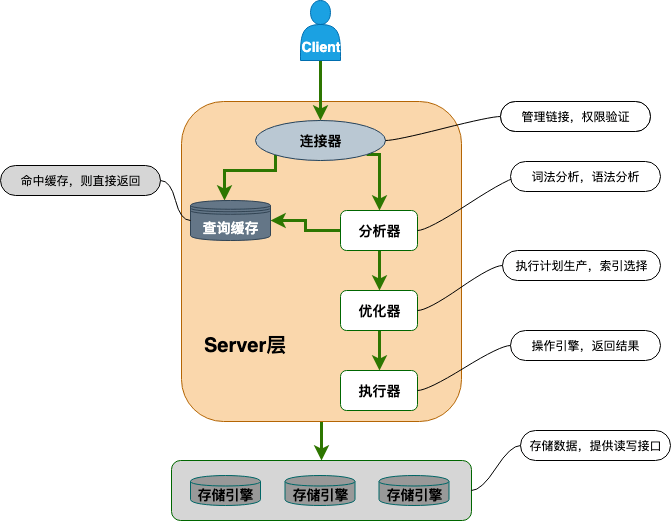

> Contributed by [Mumujiang](https://github.com/kinglaw1204).

This article explains how MySQL processes SQL queries and updates. First, we'll review the MySQL architecture and the role of each component; then we'll follow queries and updates through the system.

## 1. MySQL Architecture

### 1.1 Overview

The diagram below gives a high-level view of MySQL and shows how a client SQL statement flows through the server.

The components are introduced briefly here and covered in more detail in Section 1.2:

- **Connection handler:** Authenticates users and handles permissions when they connect.
- **Query cache:** Checks for cached results before executing a query. Removed in MySQL 8.0 because it had limited practical value.
- **Parser:** Identifies what the SQL statement does and checks its syntax when there is no cache hit.
- **Optimizer:** Chooses an execution plan that MySQL estimates to be efficient.
- **Executor:** Runs the statement and gets results from the storage engine.



MySQL has two main layers: the **Server layer** and the **storage engine layer**.

- **Server layer:** Includes the connection handler, query cache, parser, optimizer, and executor. It also implements features shared across storage engines, such as stored procedures, triggers, views, functions, and the binary log (`binlog`).
- **Storage engines:** Handle data storage and retrieval through a pluggable architecture. MySQL supports InnoDB, MyISAM, Memory, and other engines. InnoDB has its own redo log. **InnoDB has been the default storage engine since MySQL 5.5.**

### 1.2 Server Components

#### 1) Connection Handler

The connection handler is responsible for authentication and permissions. Think of it as a high-level gatekeeper.

It logs users in and verifies account credentials and permissions. After authentication, it reads the user's privileges from the privilege tables. Permission checks for that connection then use the privileges read at that time. If the connection remains open, changing the user's privileges later doesn't affect that connection.

#### 2) Query Cache (Removed in MySQL 8.0)

The query cache stores `SELECT` statements and their result sets.

After a connection is established, MySQL checks whether the exact SQL statement has been executed before. It uses the statement as a key and the result set as the value. On a cache hit, MySQL can return the result directly; otherwise, it continues processing the query and may cache the result. MySQL still checks whether the user has permission to query the table.

The query cache was often a poor fit for real workloads because an update to a table invalidated all cached queries for that table. It could help with data that rarely changes, but was generally not recommended.

MySQL 8.0 removed the query cache because it had limited use in practice.

#### 3) Parser

If the query doesn't hit the cache, it goes to the parser, which analyzes the SQL statement in two steps:

1. **Lexical analysis:** Break the statement into tokens, identifying keywords such as `SELECT`, table names, column names, and conditions.
2. **Syntax analysis:** Check whether the statement follows MySQL's SQL grammar.

After parsing, MySQL knows what the statement means. The optimizer then chooses how to execute it.

#### 4) Optimizer

The optimizer chooses an execution plan it estimates to be efficient. For example, it selects an index when multiple indexes are available or chooses a join order for a multi-table query. The chosen plan determines how the statement will be executed, though the estimate isn't always optimal.

#### 5) Executor

Once a plan is selected, the executor checks the user's permissions. If the user is authorized, it calls the storage engine's API and returns the engine's result.

## 2. Statement Walkthroughs

### 2.1 Query

SQL statements can be grouped into queries and updates (inserts, modifications, and deletes). Consider this query:

```sql
SELECT * FROM tb_student A WHERE A.age = '18' AND A.name = ' Alice ';
```

Its execution proceeds as follows:

- The connection handler authenticates the user and loads permissions. Before MySQL 8.0, the server then checked the query cache, using the SQL statement as the key. On a cache hit, it returned the cached result; otherwise, it continued.
- The parser performs lexical analysis to identify `SELECT`, the `tb_student` table, all columns, and the conditions on `age` and `name`. It then checks the statement's syntax.
- The optimizer chooses an execution plan. For example, it might use an index on `name` and then check `age`, or use an index on `age` and then check `name`. It estimates which plan is more efficient, though the estimate isn't always best.
- The executor checks permissions and, if allowed, calls the storage engine and returns its result.

### 2.2 Update

An update follows a similar path, but it also needs to be logged. MySQL's server layer writes the binary log (`binlog`), which is available to all storage engines. InnoDB also writes its own redo log. This walkthrough follows an update using InnoDB:

```sql
UPDATE tb_student A SET A.age = '19' WHERE A.name = ' Alice ';
```

The update proceeds as follows:

- MySQL finds the row for Alice. It doesn't use the query cache, which was designed for query statements.
- The executor changes `age` to 19 and calls the storage engine API. InnoDB updates the row in memory and writes to the redo log, which enters the `prepare` state. InnoDB then reports that it is ready to commit.
- The executor writes the `binlog` and invalidates the table's query-cache entries. Invalidating the cache before commit prevents later `SELECT` statements from reading stale results.
- The executor asks InnoDB to mark the redo log as `commit`.
- The update is complete.

**Why use two logs instead of one?**

MySQL originally shipped with MyISAM, before InnoDB was integrated as a storage engine. The `redo log` is specific to InnoDB, while the `binlog` is available to all storage engines. The `redo log` provides InnoDB crash recovery; the `binlog` supports archiving and replication.

In principle, one log could be enough, but InnoDB uses the redo log for transaction processing. The `prepare` state in a two-phase commit helps keep the redo log and `binlog` consistent. Consider what could go wrong without it:

- **Commit redo log, then write `binlog`:** If the server crashes after the redo log commits but before the `binlog` is written, local recovery includes the update, but the `binlog` doesn't. Backups or replicas can then miss the row.
- **Write `binlog`, then commit redo log:** If the server crashes after writing the `binlog` but before committing the redo log, local recovery omits the update even though the `binlog` contains it. This also creates inconsistency.

With two-phase commit, InnoDB first marks the redo log as `prepare`, then MySQL writes the `binlog`, and finally InnoDB marks the redo log as `commit`.

What if the server crashes after the redo log enters `prepare` and the `binlog` is written? MySQL uses the transaction ID (XID) to decide how to recover:

- If the redo log is already `commit`, MySQL commits it.
- If the redo log is only `prepare`, MySQL checks the `binlog` for the transaction's XID. If the transaction is present, MySQL commits the redo log; otherwise, it rolls back the transaction.

This recovery process preserves consistency between the logs.

## 3. Summary

- MySQL has a Server layer and a storage engine layer. The Server layer includes the connection handler, query cache, parser, optimizer, executor, and `binlog`. The InnoDB engine also has a `redo log`.
- MySQL uses a pluggable storage engine architecture that includes InnoDB, MyISAM, and Memory.
- A query goes through permission checks, the query cache (if enabled and applicable), the parser, optimizer, executor, and storage engine.
- An InnoDB update goes through the parser, permission checks, executor, storage engine, redo log `prepare`, `binlog`, and redo log `commit`.

## 4. References

- _MySQL: A Hands-On Guide to Database Internals_
- [MySQL 5.6 Reference Manual](https://dev.mysql.com/doc/refman/5.6/en/)

<!-- @include: @article-footer.snippet.md -->
