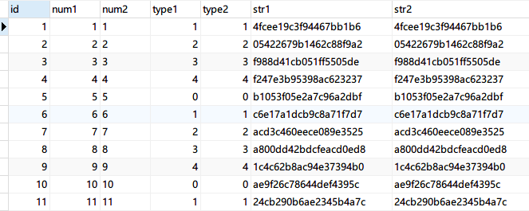
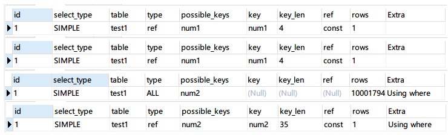
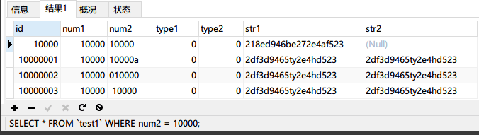
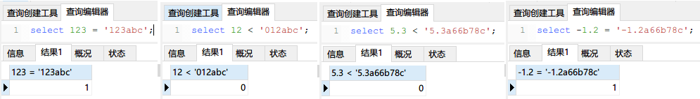
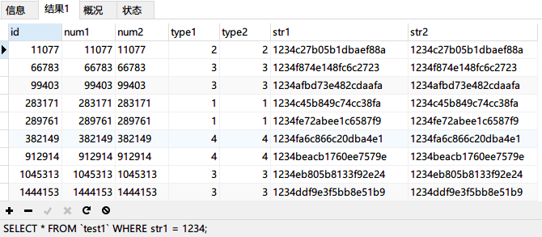

> These tests use MySQL `5.7.26`. Behavior may differ across MySQL versions, so verify the conclusions against your version.
>
> Original article: <https://www.guitu18.com/post/2019/11/24/61.html>

## Introduction

Database optimization requires a solid understanding of database behavior. Some production issues have simple causes but serious effects, and can be difficult to diagnose. They often come from a small oversight or an unfamiliar technical detail.

One common database issue is an index not being used. Small datasets can hide the problem, but performance degrades as data grows and can eventually overwhelm the database. This article focuses on **index loss caused by implicit conversion**.

## Test data

First, use a stored procedure to generate 10 million test rows. The table has seven columns, including the primary key. `num1` and `num2` contain sequential values matching `id`; `num2` is a string. `type1` and `type2` contain `id` modulo 5, simulating common type fields; `type2` is not indexed. `str1` and `str2` contain random 20-character strings. `str1` is `NOT NULL`, while `str2` allows `NULL`; one in every 100 `str2` values is set to `NULL`.

```sql
-- Create the test table
DROP TABLE IF EXISTS test1;
CREATE TABLE `test1` (
    `id` int(11) NOT NULL,
    `num1` int(11) NOT NULL DEFAULT '0',
    `num2` varchar(11) NOT NULL DEFAULT '',
    `type1` int(4) NOT NULL DEFAULT '0',
    `type2` int(4) NOT NULL DEFAULT '0',
    `str1` varchar(100) NOT NULL DEFAULT '',
    `str2` varchar(100) DEFAULT NULL,
    PRIMARY KEY (`id`),
    KEY `num1` (`num1`),
    KEY `num2` (`num2`),
    KEY `type1` (`type1`),
    KEY `str1` (`str1`),
    KEY `str2` (`str2`)
) ENGINE=InnoDB DEFAULT CHARSET=utf8;
-- Create the stored procedure
DROP PROCEDURE IF EXISTS pre_test1;
DELIMITER //
CREATE PROCEDURE `pre_test1`()
BEGIN
    DECLARE i INT DEFAULT 0;
    SET autocommit = 0;
    WHILE i < 10000000 DO
        SET i = i + 1;
        SET @str1 = SUBSTRING(MD5(RAND()),1,20);
        -- Set str2 to NULL for every 100th row.
        IF i % 100 = 0 THEN
            SET @str2 = NULL;
        ELSE
            SET @str2 = @str1;
        END IF;
        INSERT INTO test1 (`id`, `num1`, `num2`,
        `type1`, `type2`, `str1`, `str2`)
        VALUES (CONCAT('', i), CONCAT('', i),
        CONCAT('', i), i%5, i%5, @str1, @str2);
        -- Improve insert performance by committing every 10,000 rows.
        IF i % 10000 = 0 THEN
            COMMIT;
        END IF;
    END WHILE;
END;
// DELIMITER ;
-- Run the stored procedure
CALL pre_test1();
```

This may take a while because the procedure generates many rows and uses `MD5` to create random strings.

Generating 10 million rows took 33 minutes on the author's machine; the time depends on your hardware. A few sample rows are shown below.



## SQL tests

Consider these four queries. In the test table, `num1` is an indexed `int` column and `num2` is an indexed `varchar` column. Both contain sequential numbers matching the primary key `id`.

```sql
1: SELECT * FROM `test1` WHERE num1 = 10000;
2: SELECT * FROM `test1` WHERE num1 = '10000';
3: SELECT * FROM `test1` WHERE num2 = 10000;
4: SELECT * FROM `test1` WHERE num2 = '10000';
```

The queries compare `int` columns in cases 1 and 2, and `varchar` columns in cases 3 and 4. Each pair uses either a numeric or quoted string literal. How do these literal types affect performance?

The results differ substantially. Queries 1, 2, and 4 took about 0.001–0.005 seconds, while query 3 took about 4.5–4.8 seconds across repeated tests.

Why are queries 3 and 4 so different, while queries 1 and 2 perform similarly? Compare their execution plans:



Queries 1, 2, and 4 use indexes, have access type `ref`, and scan one row. Query 3 does not use an index and scans all 10 million rows, explaining the performance gap.

Both queries 3 and 4 use the `varchar` column `num2`, but query 4 uses the index despite its quoted string literal. A type mismatch alone does not explain why query 2 also uses its index on the `int` column `num1`.

The reason is implicit conversion. The MySQL 5.7 documentation describes comparison conversions as follows:

> MySQL documentation: [12.2 Type Conversion in Expression Evaluation](https://dev.mysql.com/doc/refman/5.7/en/type-conversion.html?spm=5176.100239.blogcont47339.5.1FTben)
>
> When an operator is used with operands of different types, conversion may be needed to make them compatible. Some conversions are implicit; for example, MySQL may convert strings to numbers or numbers to strings. These rules describe comparison conversions:
>
> 1. If either operand is `NULL`, the comparison returns `NULL`, except `<=>` returns `1` when comparing two `NULL` values. No conversion is needed.
> 2. Two strings are compared as strings, without conversion.
> 3. Two integers are compared as integers, without conversion.
> 4. A hexadecimal value compared with a nonnumeric value is treated as a binary string.
> 5. If one operand is `TIMESTAMP` or `DATETIME` and the other is a constant, the constant is converted to a timestamp.
> 6. If one operand is `DECIMAL` and the other is `DECIMAL` or an integer, the integer is converted to `DECIMAL`. If the other is a floating-point value, `DECIMAL` is converted to floating point.
> 7. **In all other cases, both operands are converted to floating-point values before comparison.**

Queries 2 and 3 both involve implicit conversion. In query 2, `num1 = '10000'` compares an integer column with a string; query 3 does the reverse. Under rule 7, both operands are converted to floating point.

In query 2, ``SELECT * FROM `test1` WHERE num1 = '10000';``, the integer value and the string value both convert to the same floating-point value, `10000`. This conversion does not prevent index use.

In query 3, ``SELECT * FROM `test1` WHERE num2 = 10000;``, MySQL converts the indexed string column to a number. Other strings, such as `'10000a'` and `'010000'`, can also convert to `10000`, so the index cannot identify all matching rows directly.

Verify this **implicit conversion** by inserting rows where `num2` is `'10000a'`, `'010000'`, or `'10000'`:

```sql
INSERT INTO `test1` (`id`, `num1`, `num2`, `type1`, `type2`, `str1`, `str2`) VALUES ('10000001', '10000', '10000a', '0', '0', '2df3d9465ty2e4hd523', '2df3d9465ty2e4hd523');
INSERT INTO `test1` (`id`, `num1`, `num2`, `type1`, `type2`, `str1`, `str2`) VALUES ('10000002', '10000', '010000', '0', '0', '2df3d9465ty2e4hd523', '2df3d9465ty2e4hd523');
INSERT INTO `test1` (`id`, `num1`, `num2`, `type1`, `type2`, `str1`, `str2`) VALUES ('10000003', '10000', ' 10000', '0', '0', '2df3d9465ty2e4hd523', '2df3d9465ty2e4hd523');
```

Then run query 3, ``SELECT * FROM `test1` WHERE num2 = 10000;``:



All three rows match. The string-to-number conversion rules explain why:

1. Strings that **do not start with a number** convert to `0`, such as `'abc'`, `'a123bc'`, and `'abc123'`.
2. Strings that **start with a number** are parsed up to the first nonnumeric character. For example, `'123abc'` converts to `123`, `'012abc'` to `12`, and `'5.3a66b78c'` to `5.3`.

The following test demonstrates these rules:



This confirms the earlier query results.

Now query the `str1` column with ``SELECT * FROM `test1` WHERE str1 = 1234;``:



## Analysis and summary

These tests demonstrate several aspects of MySQL comparison behavior:

1. **Implicit conversion** occurs when the operands have **different data types**.
2. If the left side of a `WHERE` comparison is numeric, implicit conversion may have little performance impact, but matching types is still preferable.
3. If the left side is a string column, converting it can prevent index use and cause a costly full table scan.
4. When converting strings to numbers, strings without a leading number become `0`; otherwise, parsing stops at the first nonnumeric character.

Match the literal type to the column type in SQL predicates. In particular, quote string values; comparing a string column with a numeric literal can prevent index use and trigger a full table scan.

<!-- @include: @article-footer.snippet.md -->
