> Author: Feitian Xiaoniurou
>
> Original article: <https://mp.weixin.qq.com/s/qci10h9rJx_COZbHV3aygQ>

An auto-increment primary key generally inserts rows in ascending order in the clustered index, avoiding random inserts and improving query performance.

However, MySQL does not guarantee that auto-increment primary keys are consecutive.

Consider the following table:

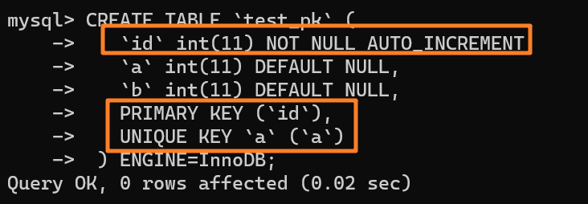

## Where Is the AUTO_INCREMENT Value Stored?

Insert a row with `insert into test_pk values(null, 1, 1)`, then run `SHOW CREATE TABLE` to inspect the table definition:

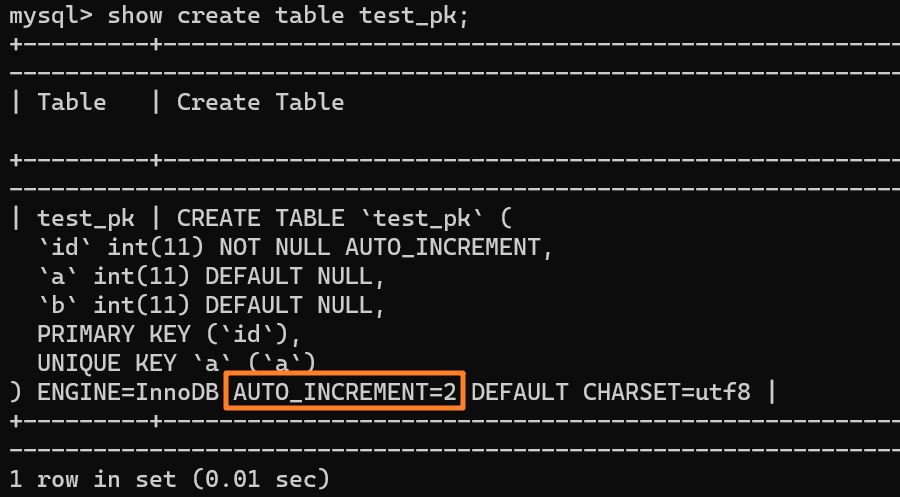

The table definition shown above is stored in a local `.frm` file, which can be found in the `data` directory under the MySQL installation directory:

The table definition contains `AUTO_INCREMENT=2`. If the next insert needs a generated value, MySQL will assign `id = 2`.

The AUTO_INCREMENT value is not stored in the `.frm` table definition. Storage engines handle it differently:

1. MyISAM stores the AUTO_INCREMENT value in the data file.

2. InnoDB stores the value in memory rather than persisting it. When a table is first opened, InnoDB finds the maximum value `max(id)` and uses `max(id)+1` as the current AUTO_INCREMENT value.

For example, suppose the largest `id` is 1 and `AUTO_INCREMENT=2`. If the row with `id=1` is deleted, AUTO_INCREMENT remains 2.

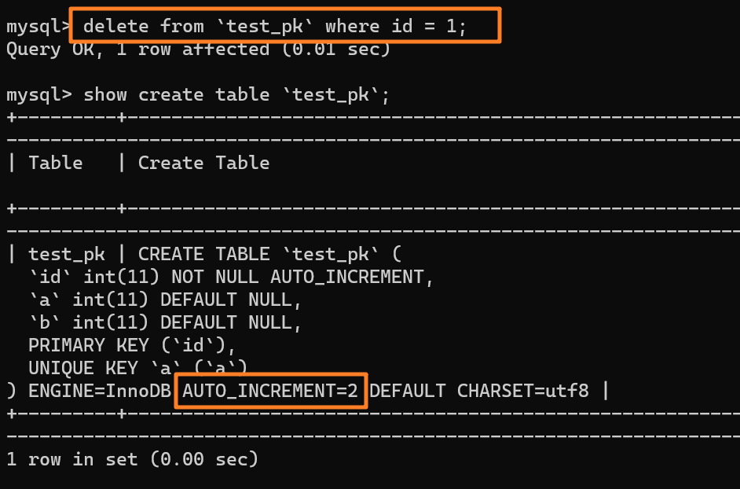

If the MySQL instance is restarted, however, the table's AUTO_INCREMENT value becomes 1. In other words, a restart can change the value.

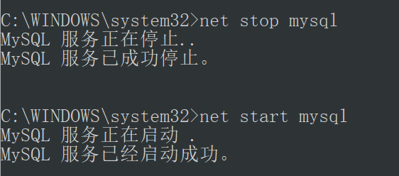

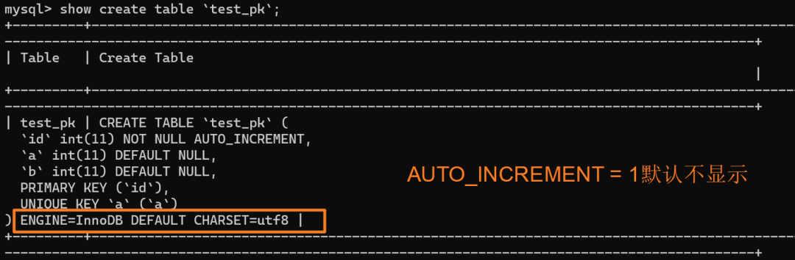

This behavior was observed with a local MySQL 5.x instance. In **MySQL 8.0, changes to the AUTO_INCREMENT value are recorded in the redo log**, making the value persistent. After a restart, the value can be recovered to what it was before the restart.

In the example above, the table's AUTO_INCREMENT value remains 2 after restarting the instance.

Now that we know where MySQL stores the AUTO_INCREMENT value, let's look at how it changes and why gaps can occur.

## Why AUTO_INCREMENT Values Have Gaps

### Scenario 1: Nondefault Initial Value or Increment

When `id` is defined as `AUTO_INCREMENT`, inserts behave as follows:

- If `id` is `0`, `NULL`, or omitted, MySQL assigns the current AUTO_INCREMENT value.
- If a specific `id` is provided, MySQL uses that value.

The next value depends on the inserted value and the current AUTO_INCREMENT value. Let the inserted value be `insert_num` and the current value be `autoIncrement_num`:

- If `insert_num < autoIncrement_num`, the table's AUTO_INCREMENT value does not change.
- If `insert_num >= autoIncrement_num`, the current value advances.

For example, if the inserted `id` is 100 and the current value is 90, the next AUTO_INCREMENT value becomes 101.

This is not always the case.

To avoid primary key conflicts across two databases, one can generate odd IDs in one database and even IDs in the other.

The `auto_increment_offset` and `auto_increment_increment` settings control the starting value and increment. Both default to 1.

The next value is calculated by starting at `auto_increment_offset` and adding `auto_increment_increment` until finding the first value greater than 100.

Depending on these settings, the next value might be 102 or 103, leaving a gap in the primary key sequence.

Even when both settings are 1, auto-increment primary keys are not guaranteed to be consecutive.

### Scenario 2: Unique Key Conflict

Suppose we insert `(null,1,1)`. MySQL assigns primary key 1, and `AUTO_INCREMENT` becomes 2.

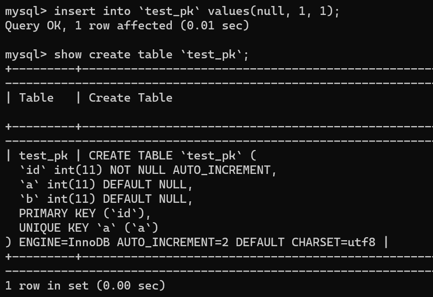

Inserting `(null,1,1)` again returns `Duplicate entry` because column `a` has a unique index:

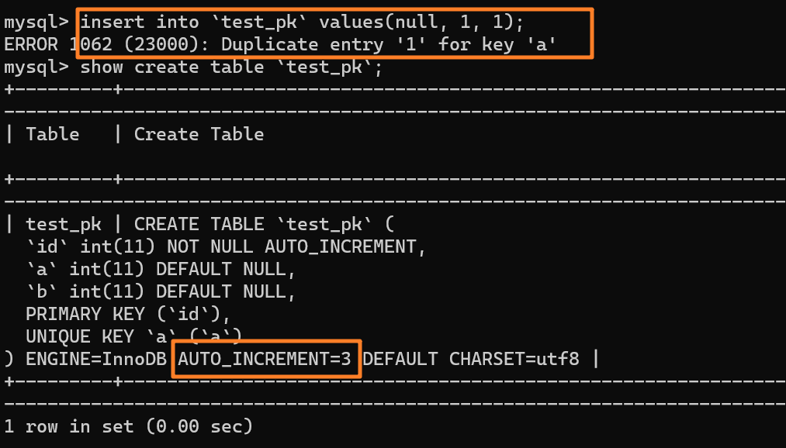

Although the insert fails, the AUTO_INCREMENT value still advances from 2 to 3.

Why?

The insert proceeds as follows:

1. The SQL layer calls the InnoDB interface to insert `(null,1,1)`.
2. Since no auto-increment ID was provided, InnoDB obtains the current value, 2, for `test_pk`.
3. The row becomes `(2,1,1)`.
4. The table's AUTO_INCREMENT value advances to 3.
5. The insert continues, but an existing row has `a=1`, so it returns a duplicate key error.

The AUTO_INCREMENT value is changed before the row is inserted.

The unique key conflict prevents row `id=2` from being inserted, but the AUTO_INCREMENT value is not rolled back. The next insert receives `id=3`, leaving a gap.

So far, two causes of gaps are:

1. The AUTO_INCREMENT offset or increment is not 1.
2. A unique key conflict.

Transaction rollbacks can also cause gaps.

### Scenario 3: Transaction Rollback

Suppose the table has one row `(1,1,1)` and `AUTO_INCREMENT = 3`:

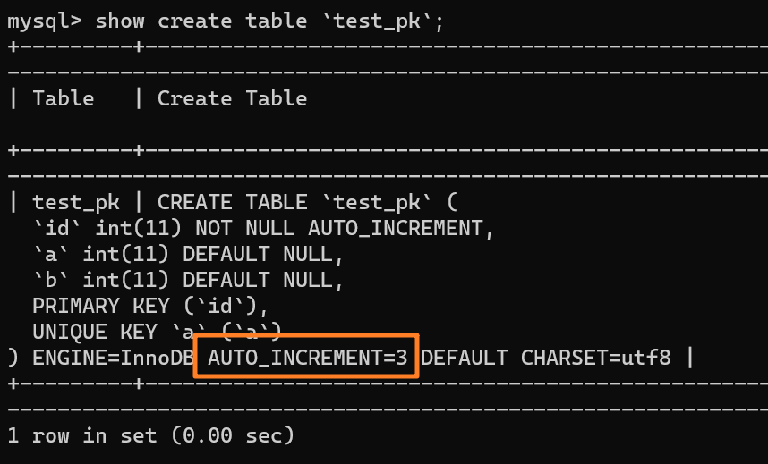

Insert `(null, 2, 2)`, which becomes `(3, 2, 2)`. `AUTO_INCREMENT` advances to 4:

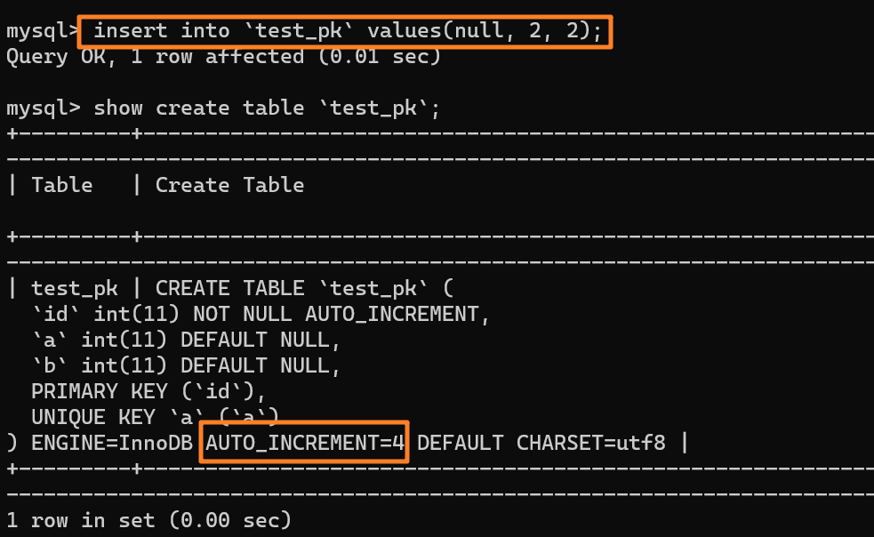

Then run the following SQL:

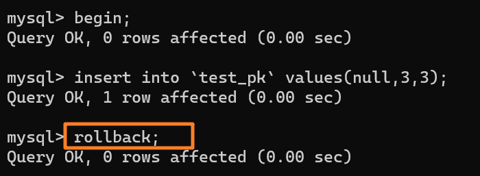

The `(null, 3, 3)` row is rolled back, so it is not stored in the database:

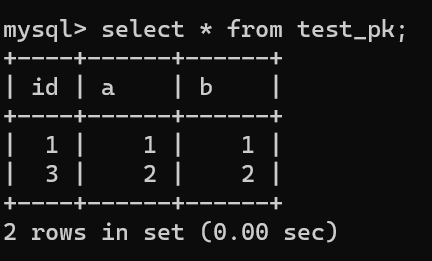

The AUTO_INCREMENT value is not rolled back with the transaction. As shown below, it advances from 4 to 5:

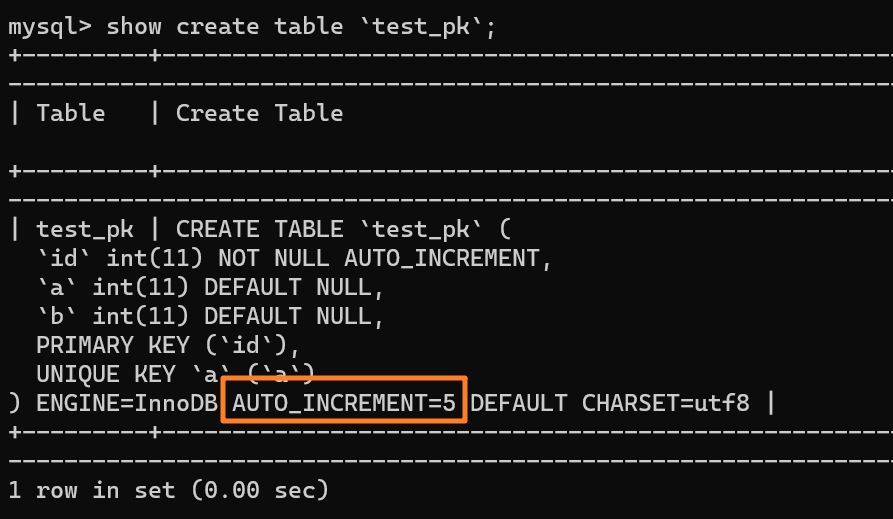

The next insert of `(null, 3, 3)` therefore receives primary key `5`:

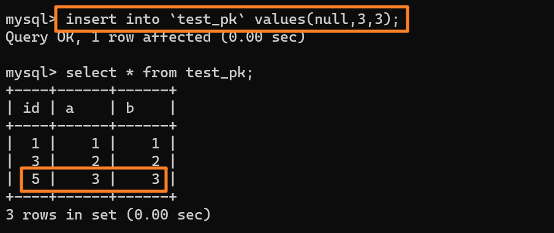

Why doesn't MySQL restore the AUTO_INCREMENT value after a unique key conflict or rollback? Wouldn't that prevent gaps?

The main reason is performance.

Suppose MySQL did restore the value on rollback. Consider two concurrent transactions, A and B. To avoid assigning the same ID, they must lock and request IDs in order.

1. Transaction A gets `id=1`; transaction B gets `id=2`, so the table's next value is 3.
2. Transaction B commits, but A hits a unique key conflict. If A rolls the value back to 1, the table already contains `id=2` while the next value is 1.
3. Another transaction could then receive `id=2`, causing a primary key conflict.

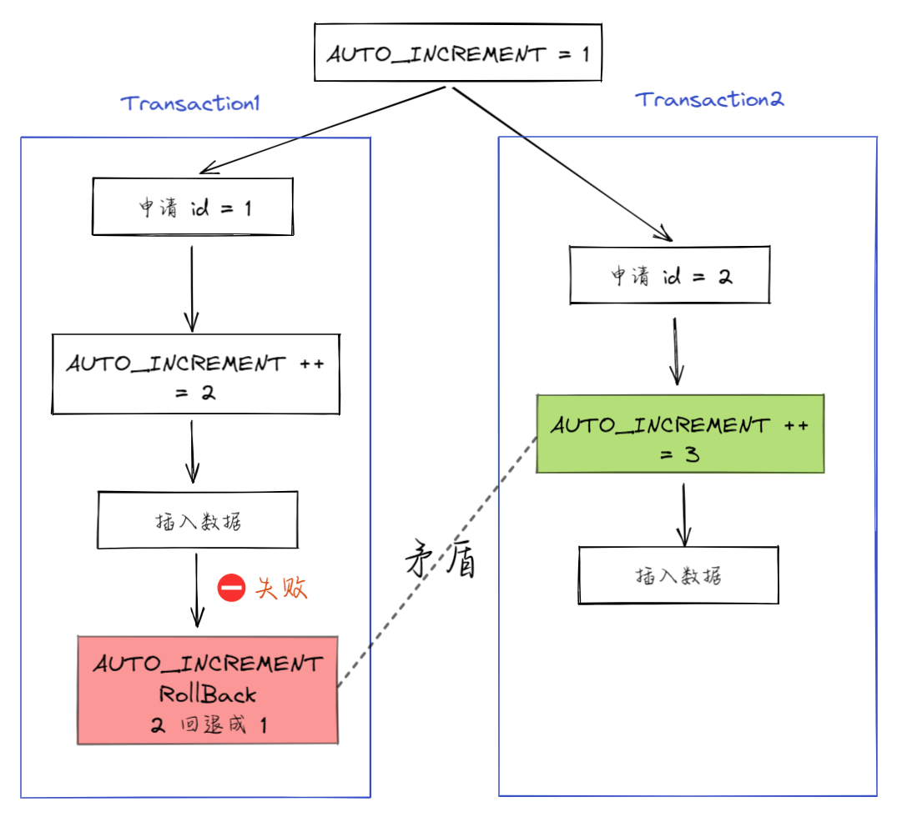

There are two ways to prevent this conflict:

1. Check whether each requested ID already exists and skip it if necessary.
2. Hold the auto-increment lock until a transaction completes and commits, before allowing the next transaction to request an ID.

Both approaches have significant performance costs. The problem arises from allowing AUTO_INCREMENT values to roll back.

InnoDB therefore does not roll back auto-increment values when a statement fails. IDs are increasing, but not necessarily consecutive.

These are three causes of gaps. A fourth is bulk insertion.

### Scenario 4: Bulk Inserts

MySQL allocates auto-increment IDs in batches for some insert statements:

1. The first request during a statement allocates one ID.
2. After that ID is used, the second request allocates two IDs.
3. After those are used, the third request allocates four IDs.
4. This continues, doubling the batch size for each request by the same statement.

This does not refer to a regular `INSERT` with multiple `VALUES` tuples. MySQL can calculate how many IDs that statement needs, request them at once, and then release the lock.

For statements such as `INSERT ... SELECT`, `REPLACE ... SELECT`, and `LOAD DATA`, MySQL cannot know in advance how many IDs are needed. It uses this batch allocation strategy to avoid requesting them one at a time.

For example, suppose the table contains these rows:

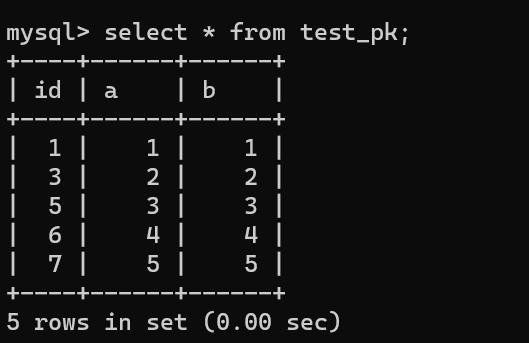

Create `test_pk2` with the same definition as `test_pk`:

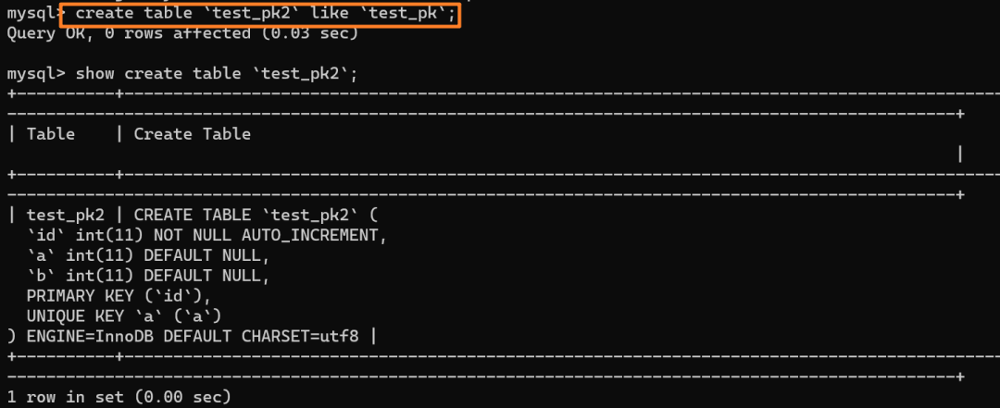

Then bulk-insert rows into `test_pk2` with `INSERT ... SELECT`:

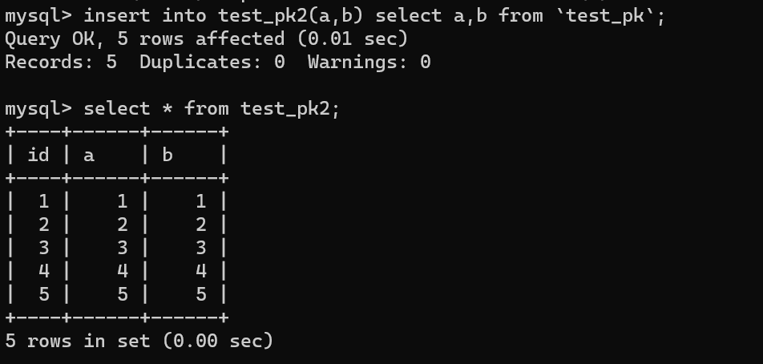

The rows are inserted successfully.

Now check the AUTO_INCREMENT value of `test_pk2`:

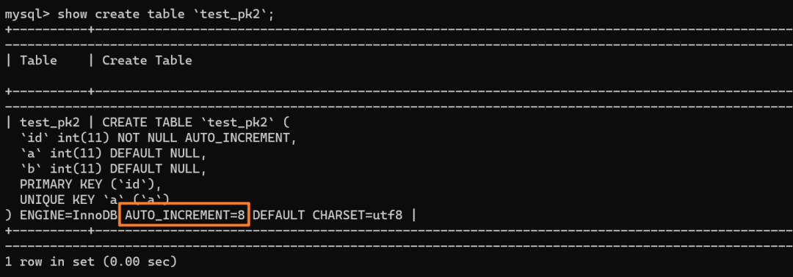

As explained above, the value is 8 rather than 6.

`INSERT ... SELECT` inserted five rows: `(1,1)`, `(2,2)`, `(3,3)`, `(4,4)`, and `(5,5)`. The statement requested IDs three times, with each allocation twice the size of the previous one:

- The first request allocated one ID: `id=1`.
- The second request allocated two IDs: `id=2` and `id=3`.
- The third request allocated four IDs: `id=4`, `id=5`, `id=6`, and `id=7`.

The statement used only five IDs, so `id=6` and `id=7` were unused. The next statement, `insert into test_pk2 values(null,6,6)`, inserts `(8,6,6)`:

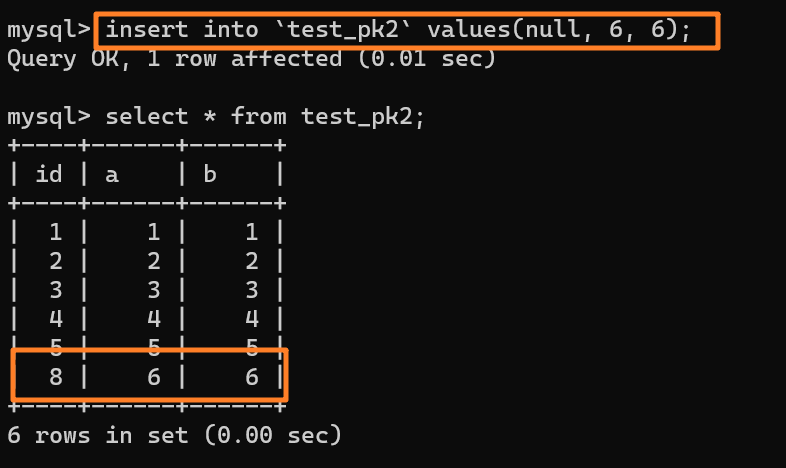

## Summary

AUTO_INCREMENT gaps can occur because of:

1. A nondefault AUTO_INCREMENT offset or increment.
2. A unique key conflict.
3. A transaction rollback.
4. Bulk insertion, such as `INSERT ... SELECT`.

<!-- @include: @article-footer.snippet.md -->
