> Thanks to [WT-AHA](https://github.com/WT-AHA) for improving this article. Related PR: <https://github.com/Snailclimb/JavaGuide/pull/1648>.

Anyone who has been through a few interviews knows that database indexes come up often.

Indexes are important for interview preparation, and using them well can significantly improve SQL performance. They are also a cost-effective optimization technique.

## Indexes

**An index is a data structure that speeds up data searches and retrieval. It can be thought of as an ordered data structure.**

An index works like a book's table of contents. Without one, you would have to search every page of a dictionary for a word. With one, you can find the page number first and turn directly to it.

Indexes can use different underlying data structures, including B-Trees, B+Trees, hash tables, and red-black trees. MySQL's InnoDB and MyISAM engines both use B+Trees for indexes.

## Index Tradeoffs

**Advantages:**

1. **Faster queries (the primary purpose)**: An index can **greatly reduce the amount of data to scan**, locate matching records directly, and reduce disk I/O.
2. **Enforce uniqueness**: A **unique index** ensures that values in one or more columns are unique, for example, user IDs or email addresses. A primary key is also a unique index.
3. **Faster sorting and grouping**: If an `ORDER BY` or `GROUP BY` clause uses indexed columns, the database may use the index's ordering to avoid an extra sort.

**Disadvantages:**

1. **Creation and maintenance costs**: Creating an index takes time, especially for large tables. Inserts, deletes, and updates (DML operations) must also maintain the relevant indexes, which can reduce write performance.
2. **Storage use**: Indexes require storage, so more or larger indexes use more disk space.
3. **Poor index use**: With a poorly designed index or query, the optimizer may skip the index or choose the wrong one, reducing performance.

**Does using an index always improve query performance?**

**No.** A well-chosen index is usually much faster than a full table scan, but there are exceptions:

- **Small tables**: A full table scan may be faster for a table with only a few hundred rows because using an index also has a cost.
- **Large result sets**: If a query returns a large share of the table (for example, more than 20–30%), the optimizer may prefer a full table scan over repeated lookups from the index, which involve random I/O.
- **Stale statistics or poor index maintenance**: These can lead the optimizer to choose a poor plan.

## Index Data Structures

### Hash Tables

A hash table stores key-value pairs and can retrieve a value by its key in close to O(1) time.

**Why can a hash table retrieve a value by key so quickly?** A **hash function** maps the key to an array index, which identifies the value.

```java
hash = hashfunc(key)
index = hash % array_size
```

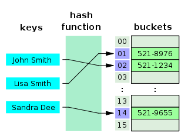

However, hash functions can produce **hash collisions**, where different keys map to the same index. A common solution is **separate chaining**, which stores colliding entries in a linked list. Before JDK 1.8, `HashMap` used this approach. From JDK 1.8 onward, it can use a red-black tree when a list becomes too long, improving lookup performance.

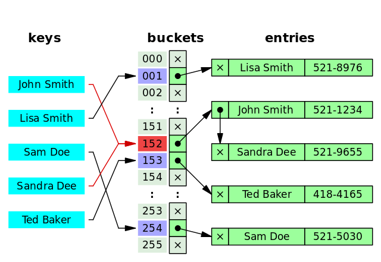

A good hash function distributes values evenly across the possible hash values to reduce collisions.

InnoDB does not directly support conventional hash indexes, but it has a special **Adaptive Hash Index**. This combines features of B+Trees and hash indexes to adapt to data access patterns. Each hash bucket is a small B+Tree that can store multiple key-value pairs, helping reduce collision chain length. See [Adaptive Hash Index: One of MySQL's Buffer Structures](https://mp.weixin.qq.com/s/ra4v1XR5pzSWc-qtGO-dBg) for details.

If hash tables are so fast, **why doesn't MySQL use them as its main index structure?** Hash indexes do not support ordered or range queries, and each I/O operation can fetch only one item.

Consider this query:

```java
SELECT * FROM tb1 WHERE id < 500;
```

With an ordered index, the database can scan the leaf nodes for IDs below 500. A hash index would need to hash each value from 1 to 499 separately. This is its main limitation.

### Binary Search Trees (BSTs)

A binary search tree has these properties:

1. Every value in the left subtree is smaller than the root value.
2. Every value in the right subtree is larger than the root value.
3. Both subtrees are also binary search trees.

When a binary search tree is balanced, with the heights of each node's subtrees differing by at most 1, lookup takes O(log₂ N) time. An unbalanced tree, such as one built by inserting values in sorted order, can degrade into a linear chain, making lookup O(N).

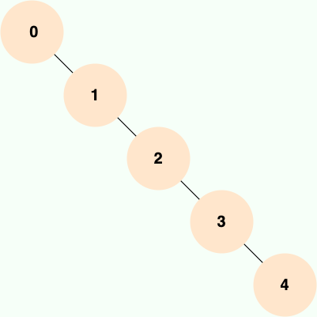

**A binary search tree's performance depends heavily on its balance, making it unsuitable as MySQL's underlying index structure.**

Several improved structures address this problem, including balanced binary trees, B-Trees, and B+Trees.

### AVL Trees

The AVL tree was one of the first self-balancing binary search trees. Its name comes from its inventors, G. M. Adelson-Velsky and E. M. Landis. It keeps the height difference between a node's left and right subtrees at no more than 1, so it is also called a height-balanced binary tree. Lookup, insertion, and deletion take O(log n) time on average and in the worst case.

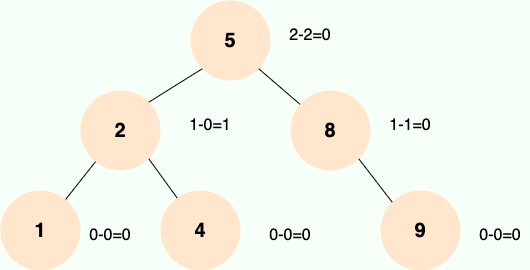

AVL trees use rotations to stay balanced. The four main rotations are LL, RR, LR, and RL. LL and RR rotations fix left-left and right-right imbalances; LR and RL rotations fix left-right and right-left imbalances.

AVL trees may require frequent rotations to stay balanced, adding overhead to database writes. Each node also stores only one value, so a disk I/O reads only one node. Finding data across multiple nodes therefore requires multiple disk I/O operations. **Because disk I/O is expensive, database indexes should minimize the number of I/O operations.**

AVL trees are not widely used in practice.

### Red-Black Trees

A red-black tree is a self-balancing binary search tree. It uses recoloring and rotations during insertion and deletion to keep the tree balanced. Its properties are:

1. Every node is either red or black.
2. The root is black.
3. Every leaf is a black NIL node.
4. A red node has black children, though a black node's children need not be red.
5. Every path from a node to a leaf or NIL node contains the same number of black nodes (the same black height).

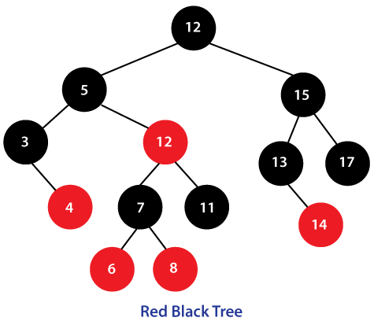

Unlike AVL trees, red-black trees allow a looser balance. Lookups may be slower because the tree can be taller, potentially requiring more disk I/O. This is a key reason MySQL does not use red-black trees for indexes. Insertion and deletion are faster, however: they need only O(1) rotations and recolorings to maintain balance, rather than the O(log n) rotations that AVL trees may require.

**Red-black trees are widely used. `TreeMap`, `TreeSet`, and `HashMap` in JDK 1.8 use them internally. They work very well for in-memory data.**

For a basic comparison of binary search trees, AVL trees, red-black trees, B-Trees, and B+Trees, see [Trees Explained](../../cs-basics/data-structure/tree.md) and [Red-Black Trees Explained](../../cs-basics/data-structure/red-black-tree.md).

### B-Trees and B+Trees

A B-Tree is a **balanced multiway search tree**. A B+Tree is a variant of a B-Tree. The “B” stands for `Balanced`.

Most database systems and file systems use B-Trees or variants such as B+Trees for indexes.

**How do B-Trees and B+Trees differ?**

- B-Tree nodes store both keys and data. In a B+Tree, only leaf nodes store data; internal nodes store keys only.
- B-Tree leaf nodes are independent. B+Tree leaf nodes are linked to their neighbors.
- A B-Tree search may finish at an internal node. A B+Tree search always traverses from the root to a leaf, so lookup performance is more consistent.
- For a B-Tree range query, the database finds the lower bound and traverses the tree in order until it reaches the upper bound. For a B+Tree, it can scan the linked leaves.

Compared with B-Trees, B+Trees require fewer I/O operations, provide more consistent lookup performance, and are better suited to range queries.

For a quick review of B-Trees and B+Trees from a data-structure perspective, see the interview review section in [Trees Explained](../../cs-basics/data-structure/tree.md).

MySQL's MyISAM and InnoDB engines both use B+Trees for indexes, but their implementations differ. (The following is adapted from _The Way of the Java Engineer_.)

> In MyISAM, the data field of each B+Tree leaf stores the address of a row. An index lookup first searches the B+Tree for the key, then uses the data field as an address to read the row. This is called a **nonclustered index**.
>
> In InnoDB, the table's data file is itself an index. Unlike MyISAM, which keeps index and data files separate, InnoDB organizes table data as a B+Tree whose leaf nodes contain complete rows. The tree is keyed by the primary key, so the data file is the primary index. This is called a **clustered index**. Other indexes are **secondary indexes**; their leaf nodes store the corresponding primary key rather than a row address. A lookup through the primary index retrieves the row directly. A lookup through a secondary index first retrieves the primary key, then searches the primary index. For this reason, avoid long or non-monotonic primary keys, which can cause frequent splits in the primary index.

## Index Types

By data structure:

- **B-Tree index**: MySQL's default and most common index type. Only leaf nodes store values; internal nodes store keys and pointers. MyISAM and InnoDB both implement these as B+Trees, though their implementations differ.
- **Hash index**: Uses key-value pairs to locate a value directly.
- **R-Tree index**: Rarely used. It supports only geometry data types and is designed for spatial range searches. Search engines such as Elasticsearch are often used instead.
- **Full-text index**: Tokenizes text for searching. Full-text indexes can be created only on `CHAR`, `VARCHAR`, and `TEXT` columns. Search engines such as Elasticsearch are often used instead.

By storage organization:

- **Clustered index**: Stores the index structure and table data together. InnoDB's primary key index is clustered.
- **Nonclustered index**: Stores the index separately from the table data. Secondary indexes are nonclustered. MyISAM uses nonclustered indexes for both primary and non-primary keys.

By purpose:

- **Primary key index**: Speeds up lookups and enforces unique, non-`NULL` values. A table can have only one.
- **Regular index**: Speeds up lookups.
- **Unique index**: Speeds up lookups and enforces unique values. It can contain `NULL` values.
- **Covering index**: Contains all column values needed by a query.
- **Composite index**: Indexes multiple columns for queries that use them together. It is generally more efficient than index merge.
- **Full-text index**: Tokenizes text for searching. It can be created only on `CHAR`, `VARCHAR`, and `TEXT` columns; search engines such as Elasticsearch are often used instead.
- **Prefix index**: Indexes only the first few characters of a string, so it uses less space than a regular index.

Index features introduced in MySQL 8.x:

- **Invisible indexes**: The optimizer does not use them, but they still need to be maintained. They are useful for soft deletion and gradual rollouts. A primary key cannot be made invisible, explicitly or implicitly.
- **Descending indexes**: Earlier versions accepted `DESC` when defining an index but still created an ascending index. MySQL 8.x supports actual descending indexes. MySQL 8.x also no longer sorts `GROUP BY` results implicitly.
- **Functional indexes**: Since MySQL 8.0.13, indexes can include the values of functions or expressions.

## Primary Key Indexes

The primary key column of a table uses a primary key index.

A table can have only one primary key. Its values must be unique and cannot be `NULL`.

If an InnoDB table has no explicitly defined primary key, InnoDB first checks for a `NOT NULL` unique index and uses it as the primary key if one exists. Otherwise, InnoDB creates a 6-byte auto-incrementing primary key.

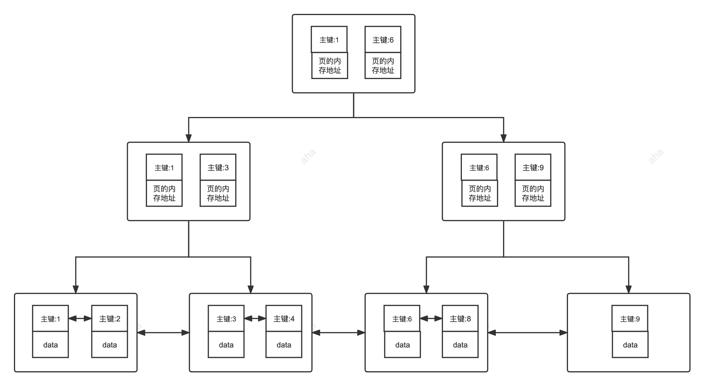

## Secondary Indexes

The leaf nodes of a secondary index store primary key values. A secondary index can therefore locate a row's primary key; it is also called an auxiliary or non-primary-key index.

Unique, regular, and prefix indexes are all secondary indexes.

> If some details are unclear, keep reading; the following sections explain them.

1. **Unique index (`UNIQUE KEY`)**: A constraint that prevents duplicate values in the indexed columns but allows `NULL`. A table can have multiple unique indexes. Its main purpose is usually to enforce uniqueness, not to improve query performance.
2. **Regular index (`INDEX`)**: Speeds up lookups. A table can have multiple regular indexes, and their values may repeat or be `NULL`.
3. **Prefix index**: Available only for string data. It indexes the first few characters, so it is smaller than a regular index on the full string.
4. **Full-text index**: Searches for keywords in large text fields. MyISAM supported full-text indexes before MySQL 5.6; InnoDB has supported them since MySQL 5.6.

Secondary index:

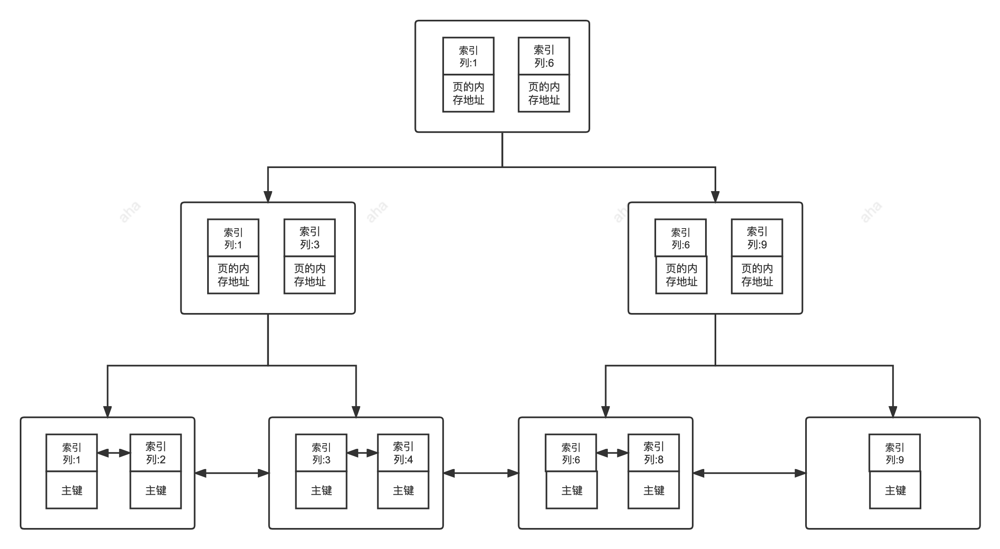

## Clustered and Nonclustered Indexes

### Clustered Indexes

#### Overview

A clustered index stores the index structure and table data together; it is not a separate index type. InnoDB's primary key index is clustered.

In MySQL, an InnoDB table's `.ibd` file contains both its data and indexes. In the table's B+Tree, internal nodes store index entries, while leaf nodes store index entries and their corresponding data.

#### Advantages and Disadvantages

**Advantages:**

- **Fast lookups**: A B+Tree is a balanced multiway tree with ordered leaf nodes. Finding an index entry also locates the data, avoiding the extra I/O required by a nonclustered index.
- **Efficient sorting and range scans**: Clustered indexes support fast primary key lookups and range scans.

**Disadvantages:**

- **Requires ordered data**: B+Trees keep data ordered. Long strings or UUIDs can be slower to compare and insert than integers.
- **Expensive updates**: Updating an indexed column also updates the index. Since clustered index leaves contain the rows, these updates can be costly. Primary keys are therefore generally treated as immutable.

### Nonclustered Indexes

#### Overview

A nonclustered index stores its structure separately from the table data; it is not a separate index type. Secondary indexes are nonclustered. MyISAM uses nonclustered indexes for both primary and non-primary keys.

Nonclustered index leaves do not always store row pointers. In InnoDB, secondary index leaves store primary keys, which are then used to look up the row.

#### Advantages and Disadvantages

**Advantages:**

Updates cost less than with a clustered index because nonclustered index leaves do not store the table data.

**Disadvantages:**

- **Requires ordered data**: Like clustered indexes, nonclustered indexes rely on ordered data.
- **May require a second lookup**: After finding an index entry's pointer or primary key, the database may need another lookup in the data file or table to retrieve the row.

The following image shows MySQL table files:

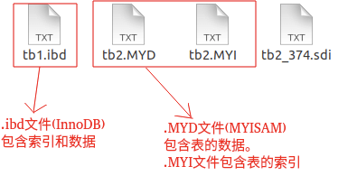

Clustered and nonclustered indexes:

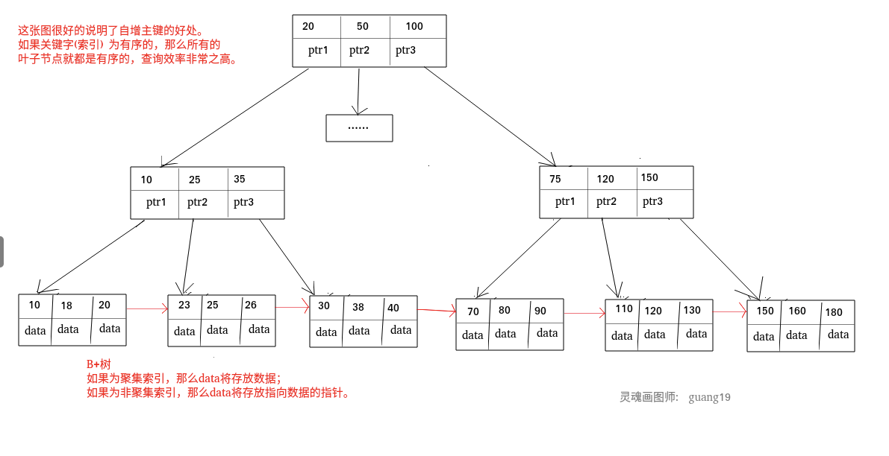

#### Do Nonclustered Indexes Always Require a Table Lookup?

**No. A nonclustered index does not always require a table lookup.**

Suppose a user wants to query a username and the `name` column is indexed:

```sql
SELECT name FROM table WHERE name='guang19';
```

The index key is `name`, so MySQL can return the matching value directly without looking up the row.

This also applies to MyISAM. Its primary key index normally requires a table lookup because its leaf nodes store pointers. But **what if the query selects only the primary key?**

```sql
SELECT id FROM table WHERE id=1;
```

The primary key is the index key, so MySQL can return it directly. This is a **covering index**.

## Covering and Composite Indexes

### Covering Indexes

An index that contains all the column values required by a query is called a **covering index**.

In InnoDB, secondary index leaves contain primary key values. When a query uses a secondary index, the database first finds the primary key, then uses the primary key index to retrieve the full row. This is called a **table lookup**.

**When an index contains all columns needed by a query, MySQL can return the result from the index without looking up the row.**

> For example, a query that selects only the primary key can get it from the primary key index. Likewise, if `name` has a regular index, a query that selects only `name` can return the value from that index without a table lookup.

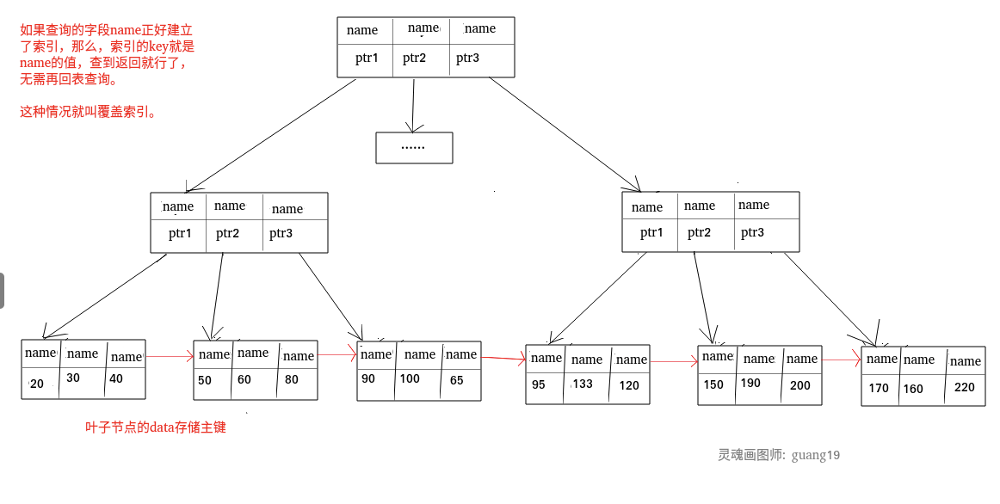

The following example demonstrates a covering index.

1. Create a table named `cus_order` to test this query. For simplicity, it has only three columns: `id`, `score`, and `name`.

```sql
CREATE TABLE `cus_order` (
  `id` int(11) unsigned NOT NULL AUTO_INCREMENT,
  `score` int(11) NOT NULL,
  `name` varchar(11) NOT NULL DEFAULT '',
  PRIMARY KEY (`id`)
) ENGINE=InnoDB AUTO_INCREMENT=100000 DEFAULT CHARSET=utf8mb4;
```

2. Define a stored procedure to insert one million test rows.

```sql
DELIMITER ;;
CREATE DEFINER=`root`@`%` PROCEDURE `BatchinsertDataToCusOder`(IN start_num INT,IN max_num INT)
BEGIN
      DECLARE i INT default start_num;
      WHILE i < max_num DO
          insert into `cus_order`(`id`, `score`, `name`)
          values (i,RAND() * 1000000,CONCAT('user', i));
          SET i = i + 1;
      END WHILE;
  END;;
DELIMITER ;
```

After defining the procedure, run it:

```sql
CALL BatchinsertDataToCusOder(1, 1000000); # Insert over one million random rows
```

After a short wait, the million test rows will be inserted.

3. Create a covering index and analyze the query with `EXPLAIN`.

To sort these rows by `score`, run this query:

```sql
# Sort in descending order
SELECT `score`,`name` FROM `cus_order` ORDER BY `score` DESC;
```

Analyze the query with `EXPLAIN`. The `Using filesort` value in the `Extra` column shows that it is not using a covering index.

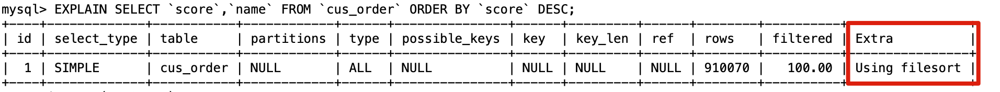

This is expected because no index has been created yet.

Create a composite index on `score` and `name`:

```sql
ALTER TABLE `cus_order` ADD INDEX id_score_name(score, name);
```

After creating the index, analyze the query again with `EXPLAIN`.

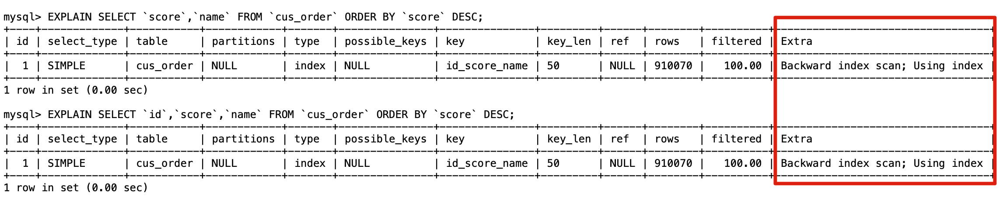

The `Using index` value in the `Extra` column indicates that the query is using a covering index.

For details about `EXPLAIN`, see [MySQL Execution Plan Analysis](./mysql-query-execution-plan.md).

### Composite Indexes

An index created on multiple columns is called a **composite index**.

Create a composite index on `score` and `name`:

```sql
ALTER TABLE `cus_order` ADD INDEX id_score_name(score, name);
```

### The Leftmost Prefix Rule

When using a composite index, MySQL matches query conditions to indexed columns from left to right. If a query condition matches the leftmost column, MySQL can use the index to filter rows.

Matching continues to the right until MySQL encounters a range condition such as `>` or `<`. Conditions using `>=`, `<=`, `BETWEEN`, or a prefix `LIKE` do not stop matching.

Suppose a composite index covers `(column1, column2, column3)`. Its leftmost prefixes are `(column1)`, `(column1, column2)`, and `(column1, column2, column3)`. Queries using these prefixes can use the index instead of a full table scan.

When creating a composite index, consider placing the column with higher cardinality first, since it can filter out more rows.

The following example demonstrates the leftmost prefix rule.

1. Create a table named `student` with three columns: `id`, `name`, and `class`.

```sql
CREATE TABLE `student` (
  `id` int NOT NULL,
  `name` varchar(100) DEFAULT NULL,
  `class` varchar(100) DEFAULT NULL,
  PRIMARY KEY (`id`),
  KEY `name_class_idx` (`name`,`class`)
) ENGINE=InnoDB DEFAULT CHARSET=utf8mb4;
```

2. Test these three SQL statements:

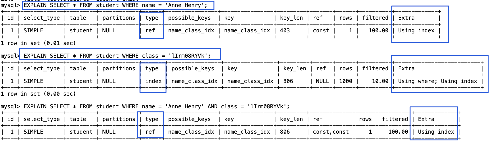

```sql
# Uses the index
SELECT * FROM student WHERE name = 'Anne Henry';
EXPLAIN SELECT * FROM student WHERE name = 'Anne Henry' AND class = 'lIrm08RYVk';
# Cannot use the index
SELECT * FROM student WHERE class = 'lIrm08RYVk';
```

Consider a common interview question. Given a composite index `(a, b, c)`, can these queries use it: `a=1 AND c=1`, `c=1`, `b=1 AND c=1`, and `b=1 AND a=1 AND c=1`?

Try to answer before reading on.

1. `a=1 AND c=1`: The query can use the index prefix on `a`, then filter the results by `c=1`.
2. `c=1`: The query does not include the leftmost column `a`, so it cannot use the index.
3. `b=1 AND c=1`: As in the previous case, the query cannot use the index.
4. `b=1 AND a=1 AND c=1`: The query optimizer can reorder conditions for a composite index, so this query can use the index as if the conditions were `a=1 AND b=1 AND c=1`.

MySQL 8.0.13 introduced **Index Skip Scan (ISS)**, which can improve some index queries. Before ISS, a query that did not follow the leftmost prefix rule required a full table scan. ISS can avoid that scan in some cases. Its capabilities are limited compared with Oracle's, and MySQL 8.0.31 had a bug that caused incorrect results; it was fixed in later versions. See [Bug #109145](https://bugs.mysql.com/bug.php?id=109145). It is useful to know that ISS exists, but you may not encounter it in practice.

## Index Condition Pushdown

**Index Condition Pushdown (ICP)**, introduced in **MySQL 5.6**, lets the storage engine evaluate some `WHERE` conditions while scanning an index. It can filter out rows that do not match, reducing table lookups and improving query performance.

Suppose a table named `user` has four columns: `id`, `username`, `zipcode`, and `birthdate`. It has a composite index on `(zipcode, birthdate)`.

```sql
CREATE TABLE `user` (
  `id` int NOT NULL AUTO_INCREMENT,
  `username` varchar(20) CHARACTER SET utf8mb4 COLLATE utf8mb4_0900_ai_ci NOT NULL,
  `zipcode` varchar(20) CHARACTER SET utf8mb4 COLLATE utf8mb4_0900_ai_ci NOT NULL,
  `birthdate` date NOT NULL,
  PRIMARY KEY (`id`),
  KEY `idx_zipcode_birthdate` (`zipcode`,`birthdate`) ) ENGINE=InnoDB AUTO_INCREMENT=1001 DEFAULT CHARSET=utf8mb4;

# Find users with zipcode 431200 who were born in March
SELECT * FROM user WHERE zipcode = '431200' AND MONTH(birthdate) = 3;
```

- **Without ICP**: The index on `zipcode` quickly finds users where `zipcode = '431200'`, but MySQL must look up every matching row to retrieve the full data before checking `MONTH(birthdate) = 3`.
- **With ICP**: While using the `zipcode` index, the storage engine also checks `MONTH(birthdate) = 3`. Only rows that satisfy both conditions are returned, reducing table lookups.

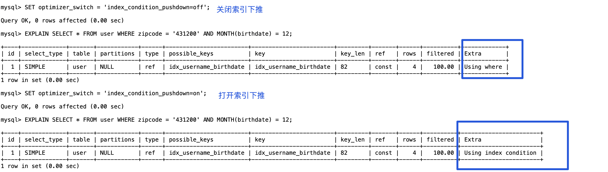

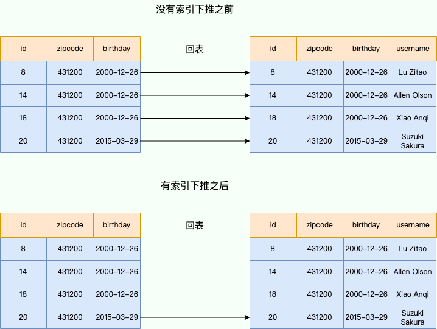

To understand how ICP works, first look at this simplified MySQL architecture diagram.

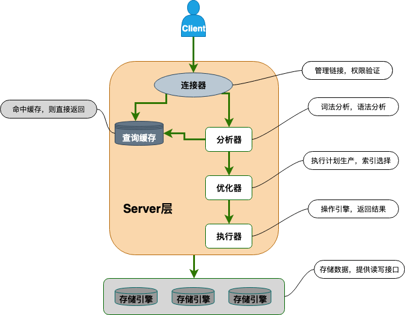

MySQL can be divided into the Server layer and the storage engine layer. The Server layer handles query parsing, analysis, optimization, caching, and client interaction. The storage engine layer stores and reads data. MySQL supports several storage engines, including InnoDB, MyISAM, and Memory.

The **pushdown** in index condition pushdown means that some work normally done by the upper Server layer is delegated to the lower storage engine layer.

Here is how ICP changes the example query.

Without ICP:

- The storage engine uses the `zipcode` index to find the primary keys of all users where `zipcode = '431200'`, then looks up each full row.
- It passes all matching rows to the Server layer, which filters them using `MONTH(birthdate) = 3`.

With ICP:

- The storage engine uses the `zipcode` index to find users where `zipcode = '431200'`, then checks `MONTH(birthdate) = 3` and keeps only the matching primary keys.
- It looks up the full rows for those primary keys.
- It passes only the matching rows to the Server layer.

**ICP reduces both the number of table lookups and the amount of data passed from the storage engine layer to the Server layer.**

ICP applies in these cases:

1. Queries using the InnoDB or MyISAM storage engine.
2. Range queries whose execution plans use `range`, `ref`, `eq_ref`, or `ref_or_null` access.
3. For InnoDB tables, only nonclustered indexes. ICP aims to reduce full-row reads and I/O. With a clustered index, InnoDB has already read the complete row into its buffer, so ICP does not reduce I/O.
4. Subqueries cannot use ICP because they usually process results in temporary tables without indexes.
5. Stored procedures cannot use ICP because the storage engine cannot call stored functions.

## Indexing Guidelines

### Choose Columns Carefully

- **Columns that are not `NULL`**: Prefer non-`NULL` values because they can be easier for the database to optimize. If a frequently queried column must allow `NULL`, consider clear short values such as `0`, `1`, `true`, or `false` as alternatives where appropriate.
- **Frequently queried columns**: Consider indexing columns used often in queries.
- **Filter columns**: Consider indexing columns used in `WHERE` conditions.
- **Sort columns**: An index may speed up sorting when a query can use its order.
- **Join columns**: Consider indexing columns frequently used in joins, including columns that represent relationships between tables. A foreign key constraint is not required for a column to be used in a join.

### Avoid Conditions That Prevent Index Use

Queries that cannot use an index are a common cause of slow performance. Common causes fall into two categories:

**1. The SQL condition conflicts with the index structure**

These cases are common. The query condition prevents the B+Tree from quickly locating values through its ordering.

- **Violating the leftmost prefix rule**: Skipping leading columns in a composite index, or using a range condition such as `>`, `<`, `BETWEEN`, or `LIKE "abc%"`, can prevent precise lookups on later columns. MySQL may scan a range and filter the results instead.
- **Applying an operation to an indexed column**: Arithmetic or a function on the indexed column in a `WHERE` condition can prevent MySQL from using the index order.
- **Implicit type conversion**: Comparing a string column to a numeric value may make MySQL convert the column values, preventing efficient index use.
- **Leading wildcard in `LIKE`**: For example, `LIKE "%abc"` gives the optimizer no fixed starting point for an index scan.
- **`ORDER BY` without a suitable index**: An unmatched sort column or sort direction may require an additional in-memory or on-disk sort (`Using filesort`).

**2. The optimizer's cost decision**

The index may be usable, but the MySQL optimizer estimates that another plan will cost less.

- **`SELECT *` makes table lookups expensive**: When a query requests many columns not covered by an index and matches many rows (often more than 20–30%), the optimizer may prefer sequential I/O from a full table scan over repeated random I/O from table lookups.
- **`OR` conditions**: A full table scan may be chosen if either side of an `OR` has no suitable index. Even if both sides are indexed, the optimizer may reject Index Merge if its estimated cost is too high.
- **Long `IN` lists**: When an `IN` list exceeds a system threshold (200 by default), the optimizer may switch from index dives to rougher statistical estimates. Stale statistics can then lead to a poor cost estimate.

For details, see [Common Cases Where MySQL Does Not Use an Index](https://javaguide.cn/database/mysql/mysql-index-invalidation.html).

### Be Careful When Indexing Frequently Updated Columns

Indexes can speed up queries, but maintaining them has a cost. If a column is rarely queried but frequently updated, it may not be a good candidate for an index.

### Limit the Number of Indexes per Table

More indexes are not always better. As a guideline, keep the number of indexes per table below five. Indexes can improve performance, but they can also reduce it.

Indexes can speed up queries, but they also slow down inserts and updates and can sometimes make queries slower.

The MySQL optimizer evaluates available indexes using statistics to choose an execution plan. When many indexes could be used, plan generation takes longer and may reduce query performance.

### Prefer Composite Indexes Where Appropriate

Indexes use disk space; each can be thought of as a B+Tree. When a table has many columns and indexes, they can consume substantial space and take longer to update. A composite index can store multiple columns in one index, saving space and reducing the cost of maintaining separate indexes.

### Avoid Redundant Indexes

Redundant indexes provide the same functionality. If an index on `(a, b)` can serve the same queries as an index on `(a)`, the latter is redundant. For example, `(name, city)` can serve queries that use the `name` prefix, so a separate `(name)` index is often unnecessary. In most cases, extend an existing index instead of creating another one.

### Consider Prefix Indexes for String Columns

Prefix indexes are available only for strings and use less space than indexes on full values. Consider them as an alternative to regular indexes when appropriate.

### Remove Indexes That Are No Longer Used

Remove indexes that are no longer used; unused indexes add unnecessary overhead.

In MySQL 5.7, query the `schema_unused_indexes` view in the `sys` schema to find indexes that have never been used.

### Check Whether a Query Uses an Index

Use `EXPLAIN` to inspect a query's **execution plan** and see whether it uses an index. An execution plan describes how MySQL runs a query after optimizing it.

`EXPLAIN` does not execute the query. It uses the **query optimizer** to analyze the statement, choose a plan, and display information about it.

An `EXPLAIN` result looks like this:

```sql
mysql> EXPLAIN SELECT `score`,`name` FROM `cus_order` ORDER BY `score` DESC;
+----+-------------+-----------+------------+------+---------------+------+---------+------+--------+----------+----------------+
| id | select_type | table     | partitions | type | possible_keys | key  | key_len | ref  | rows   | filtered | Extra          |
+----+-------------+-----------+------------+------+---------------+------+---------+------+--------+----------+----------------+
|  1 | SIMPLE      | cus_order | NULL       | ALL  | NULL          | NULL | NULL    | NULL | 997572 |   100.00 | Using filesort |
+----+-------------+-----------+------------+------+---------------+------+---------+------+--------+----------+----------------+
1 row in set, 1 warning (0.00 sec)
```

The columns mean:

| **Column**    | **Meaning**                                                       |
| ------------- | ----------------------------------------------------------------- |
| id            | Identifier for the `SELECT` query sequence                        |
| select_type   | Type of `SELECT` query                                            |
| table         | Table used                                                        |
| partitions    | Matching partitions; `NULL` for unpartitioned tables              |
| type          | Table access method                                               |
| possible_keys | Indexes that might be used                                        |
| key           | Index actually used                                               |
| key_len       | Length of the selected index                                      |
| ref           | Column or constant compared with the index for an equality lookup |
| rows          | Estimated number of rows to read                                  |
| filtered      | Estimated percentage of rows remaining after filtering            |
| Extra         | Additional information                                            |

This is a brief introduction to MySQL execution plans. For details, see [MySQL Execution Plan Analysis](./mysql-query-execution-plan.md).

## Further Reading on Data Structures

To understand MySQL indexes, review these tree structures:

- [Trees Explained](../../cs-basics/data-structure/tree.md): Compare binary search trees, AVL trees, red-black trees, B-Trees, and B+Trees.
- [Red-Black Trees Explained](../../cs-basics/data-structure/red-black-tree.md): Review the tradeoffs of in-memory self-balancing search trees and why B+Trees are better suited to disk indexes.

<!-- @include: @article-footer.snippet.md -->
