> Contributed by Programmer A Xing. JavaGuide has added clarifications and further details.

## Introduction

MySQL logs include error logs, general query logs, slow query logs, transaction logs, and binary logs. The key logs are the binary log (`binlog`) and InnoDB's transaction logs: the redo log and undo log.

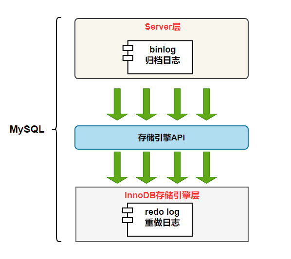

This article covers the redo log, binlog, two-phase commit, and undo log.

## Redo log

The redo log is specific to InnoDB and enables crash recovery.

If a MySQL instance crashes, InnoDB uses the redo log during restart to recover data and preserve durability and integrity.

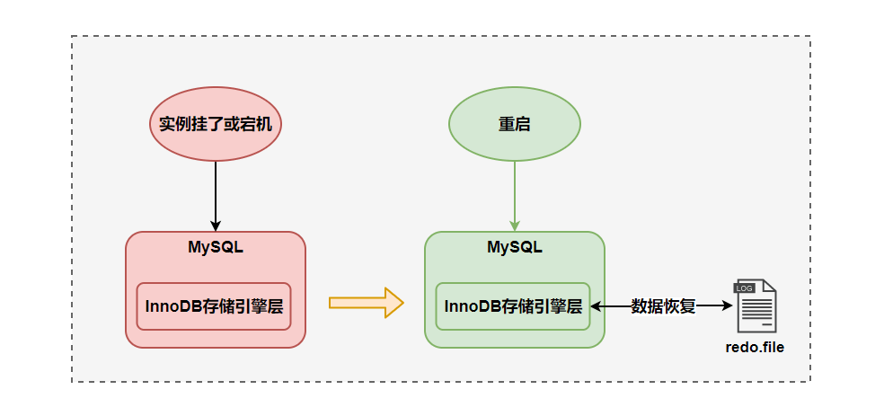

MySQL stores data in pages. Reading a row loads its page from disk into the `Buffer Pool`.

Subsequent reads check the `Buffer Pool` first and load from disk only on a cache miss, reducing disk I/O.

Updates work similarly: if the page is in the `Buffer Pool`, InnoDB updates it there.

InnoDB records the change to the page in the redo log buffer (`redo log buffer`), then flushes it to the redo log file.

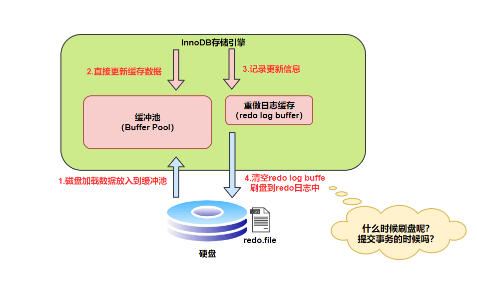

> Figure correction: In step 4, “flush the redo log buffe to the redo log” should read “buffer.”

Ideally, the log would be flushed when a transaction commits, but the actual timing depends on the configured policy.

> Tip: Each redo record contains the tablespace ID, page number, offset, length of the change, and changed data.

### When the redo log is flushed

The **redo log buffer** is an in-memory area for staging redo log records. InnoDB flushes its contents to disk at specific times to preserve durability and consistency:

1. **At transaction commit**: The log buffer is flushed when a transaction commits. This behavior is controlled by `innodb_flush_log_at_trx_commit`.
2. **When the redo log buffer is low on space**: InnoDB flushes logs proactively to avoid blocking user threads.
   - When more than **50%** of the buffer is used, a background thread can flush records to free space.
   - If a large transaction or heavy I/O fills the buffer, threads writing new logs block until a synchronous flush frees space. Avoid this condition where possible.
3. **At a checkpoint**: Checkpoints shorten crash recovery by flushing dirty pages created before the checkpoint. Under **Write-Ahead Logging (WAL)**, the corresponding redo log must reach disk before its data page, so checkpoint processing also ensures the related redo log is flushed.
4. **Periodic background flush**: InnoDB's master thread performs routine work about once per second, including flushing the redo log buffer. This is the main durability mechanism when `innodb_flush_log_at_trx_commit` is 0 or 2.
5. **During a clean shutdown**: InnoDB flushes the remaining redo log buffer to disk.
6. **When rotating binlog files**: With binlogging enabled and both `innodb_flush_log_at_trx_commit=1` and `sync_binlog=1`, filling a binlog file or running `FLUSH LOGS` can trigger a redo log flush to keep redo log and binlog state consistent for recovery and replication.

InnoDB flushes redo logs at several points to preserve durability and consistency.

Configure `innodb_flush_log_at_trx_commit` carefully. Depending on the setting, a crash may lose recent transactions.

`innodb_flush_log_at_trx_commit` has three settings:

- **0**: No flush is performed at commit. This offers the highest performance but is least safe; a crash may lose about one second of transactions.
- **1**: Flush at each commit. This offers the strongest durability; a committed transaction's redo log is on disk.
- **2**: At commit, write the redo log from the buffer to the filesystem page cache. Performance and durability fall between settings 0 and 1.

The default is 1. Use this setting for the strongest transaction durability.

InnoDB also has a background thread that writes the `redo log buffer` to the filesystem page cache and calls `fsync` about once per second.

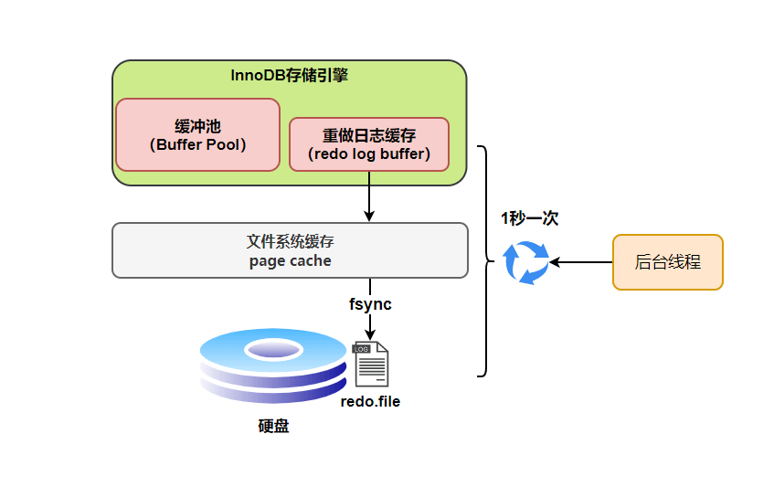

This means redo log records for uncommitted transactions may also be flushed.

**Why?**

Redo log records are written to the `redo log buffer` during transaction execution, and the background thread may flush them.

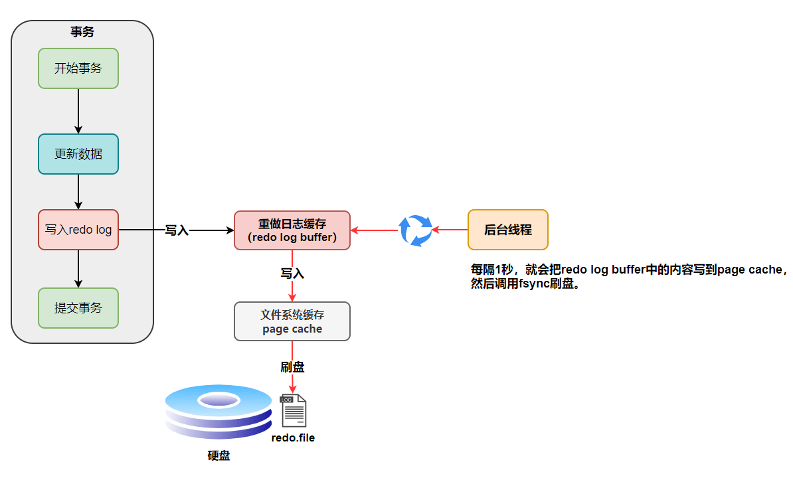

Besides its periodic flush, the background thread may flush when the `redo log buffer` is about to reach half of `innodb_log_buffer_size`.

The following diagrams show the flush behavior for each setting.

#### innodb_flush_log_at_trx_commit=0

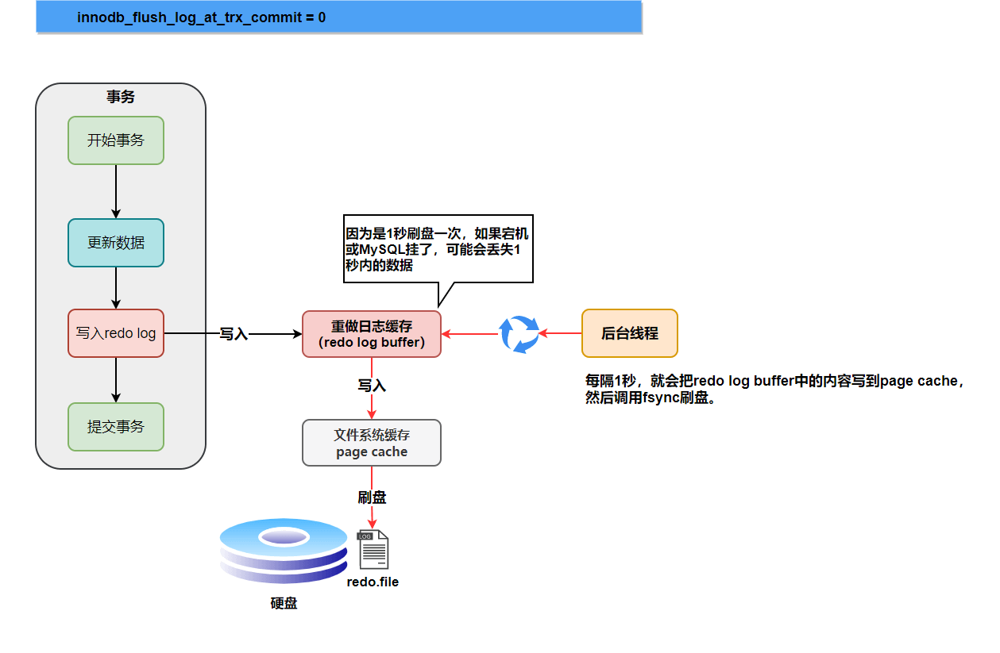

With value `0`, a crash may lose about one second of data.

#### innodb_flush_log_at_trx_commit=1

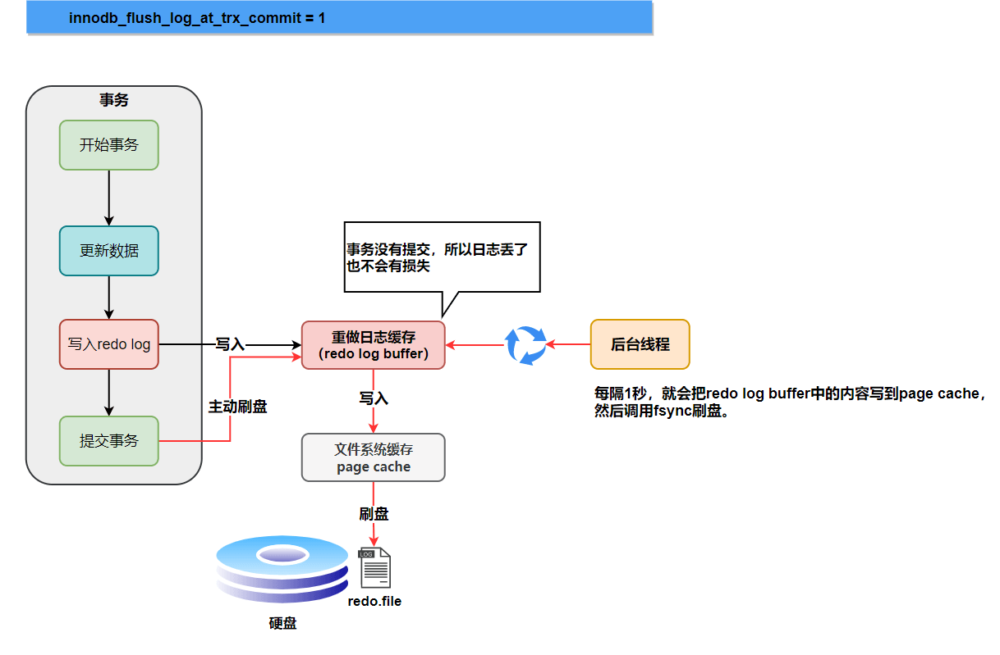

With value `1`, a committed transaction's redo log is on disk.

If MySQL crashes during a transaction, its uncommitted logs may be lost, but the transaction was not committed.

#### innodb_flush_log_at_trx_commit=2

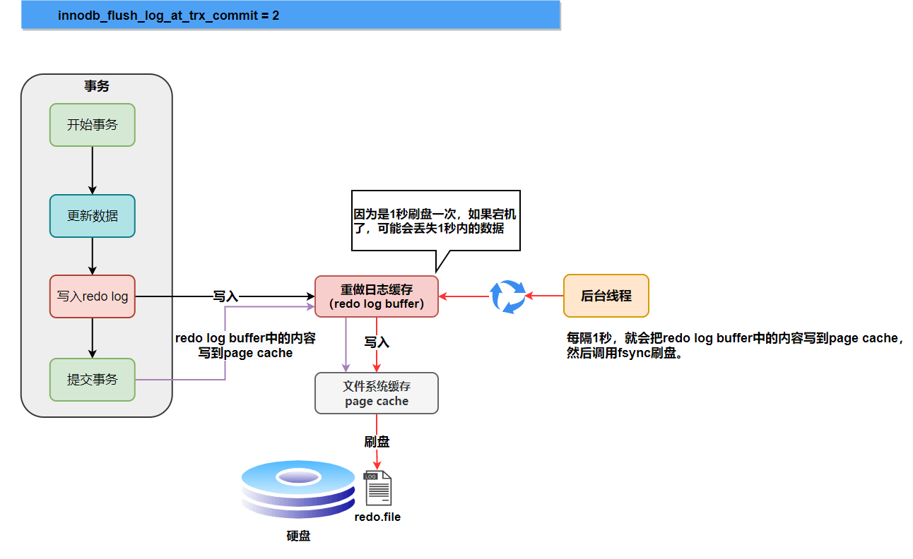

With value `2`, a committed transaction's redo log is written to the filesystem page cache.

If only MySQL crashes, data is not lost; a machine failure may lose about one second of data.

### Redo Log File Groups

Redo logs are stored in a **log file group** containing multiple files of the same size.

For example, a group of four 1 GB files can store 4 GB of redo logs.

The group works like a circular buffer: writing starts at the beginning and loops back when it reaches the end.

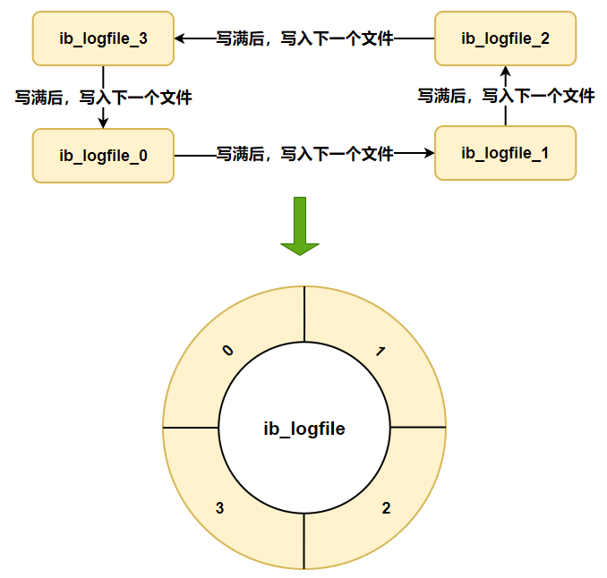

The **log file group** has two important positions: `write pos` and `checkpoint`.

- **`write pos`** is the current write position; it moves forward as records are written.
- **`checkpoint`** is the position that can be cleared; it also moves forward.

Each time redo log records are flushed to the **log file group**, `write pos` advances.

When MySQL loads the **log file group** to recover data, it clears the redo log records it has applied and advances `checkpoint`.

The unused space between `write pos` and `checkpoint` is available for new redo log records.

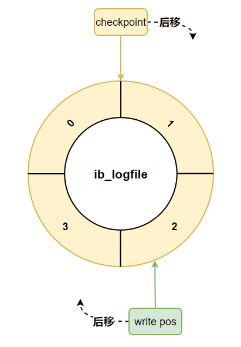

If `write pos` catches up with `checkpoint`, the **log file group** is full. MySQL cannot write new redo log records until it clears some records and advances `checkpoint`.

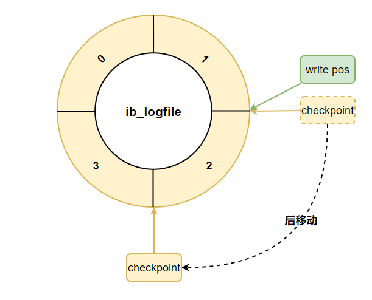

The log file group changed in MySQL 8.0.30:

> The innodb_redo_log_capacity variable supersedes the innodb_log_files_in_group and innodb_log_file_size variables, which are deprecated. When the innodb_redo_log_capacity setting is defined, the innodb_log_files_in_group and innodb_log_file_size settings are ignored; otherwise, these settings are used to compute the innodb_redo_log_capacity setting (innodb_log_files_in_group \* innodb_log_file_size = innodb_redo_log_capacity). If none of those variables are set, redo log capacity is set to the innodb_redo_log_capacity default value, which is 104857600 bytes (100MB). The maximum redo log capacity is 128GB.

> Redo log files reside in the #innodb_redo directory in the data directory unless a different directory was specified by the innodb_log_group_home_dir variable. If innodb_log_group_home_dir was defined, the redo log files reside in the #innodb_redo directory in that directory. There are two types of redo log files, ordinary and spare. Ordinary redo log files are those being used. Spare redo log files are those waiting to be used. InnoDB tries to maintain 32 redo log files in total, with each file equal in size to 1/32 \* innodb_redo_log_capacity; however, file sizes may differ for a time after modifying the innodb_redo_log_capacity setting.

Before MySQL 8.0.30, `innodb_log_files_in_group` and `innodb_log_file_size` configured the number and size of files in the log group. From MySQL 8.0.30 onward, these variables are deprecated and used only to calculate `innodb_redo_log_capacity` if specified. The group maintains 32 files, each sized at `innodb_redo_log_capacity / 32`.

You can verify this change as follows.

First, create a configuration file and set `innodb_log_files_in_group` and `innodb_log_file_size`:

```properties
[mysqld]
innodb_log_file_size = 10485760
innodb_log_files_in_group = 64
```

Start a MySQL 8.0.32 container with Docker:

```bash
docker run -d -p 3312:3309 -e MYSQL_ROOT_PASSWORD=your-password -v /path/to/your/conf:/etc/mysql/conf.d --name
MySQL830 mysql:8.0.32
```

Check the startup log:

```plain
2023-08-03T02:05:11.720357Z 0 [Warning] [MY-013907] [InnoDB] Deprecated configuration parameters innodb_log_file_size and/or innodb_log_files_in_group have been used to compute innodb_redo_log_capacity=671088640. Please use innodb_redo_log_capacity instead.
```

This confirms that `innodb_log_files_in_group` and `innodb_log_file_size` are deprecated and used to calculate `innodb_redo_log_capacity`.

Now check the number of files in the log group:


There are 32 files, each sized `671088640 / 32 = 20971520` bytes.

For MySQL 8.0.30 and later, configure the log group with `innodb_redo_log_capacity`.

### Redo Log Summary

The preceding sections covered the purpose, flush timing, and storage format of the redo log.

Consider this question: **Why use a redo log instead of flushing each modified data page directly to disk?**

Both involve flushing data, so what is the difference?

```java
1 Byte = 8bit
1 KB = 1024 Byte
1 MB = 1024 KB
1 GB = 1024 MB
1 TB = 1024 GB
```

Data pages are `16 KB`, and flushing one can take time. If only a few bytes changed, is it necessary to flush the entire page?

Flushing data pages also involves random writes because each page may be at a different location in the disk file, which can be slow.

A redo log record may take only a few dozen bytes. It contains the tablespace ID, page number, file offset, and updated value. Since the log is written sequentially, flushing it is faster.

Recording changes in the redo log is much faster than flushing whole data pages, which also improves database concurrency.

> In-memory data pages are also flushed to disk at certain times. This is called page flushing and is covered in more detail in the `Buffer Pool` section.

## The Binlog

The redo log is a physical log that records changes made to data pages. It belongs to the InnoDB storage engine.

The binlog is a logical log that records the original operation, such as “increment column `c` for the row with ID 2.” It belongs to the `MySQL Server` layer.

Regardless of the storage engine, changes to table data are recorded in the binlog.

What is the binlog used for?

MySQL **backups and replication** rely on the binlog to synchronize data and maintain consistency.


The binlog records logical operations that modify data and is written sequentially.

### Binlog Formats

The binlog has three formats, selected with the `binlog_format` parameter:

- **statement**
- **row**
- **mixed**

With `statement`, the binlog records the original `SQL` statement. For example, running `update T set update_time=now() where id=1` produces the following record.

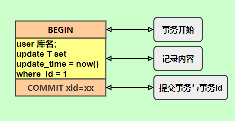

When synchronizing data, the recorded `SQL` statement is executed. However, `update_time=now()` uses the current system time, which may differ from the time on the source server and cause inconsistent data.

To avoid this problem, use `row`. The binlog then records the affected data rather than only the `SQL` statement:


The details in a `row` format record are not immediately readable; use the `mysqlbinlog` tool to decode them.

`update_time=now()` becomes a specific value, such as `update_time=1627112756247`. The `@1`, `@2`, and `@3` values in the condition are the original values of the row's first three columns (**assuming the table has only three columns**).

This preserves consistency during synchronization. `row` is commonly used because it makes recovery and replication more reliable.

However, this format requires more storage and more I/O during recovery and synchronization, which can affect performance.

`mixed` is a compromise that combines the other two formats.

MySQL uses `row` format if an `SQL` statement could cause inconsistent data; otherwise, it uses `statement` format.

### Write Process

During a transaction, MySQL first writes binlog records to the `binlog cache`. When the transaction commits, it writes the cache to the binlog file.

The binlog records for a transaction must be written together, regardless of the transaction's size. The system therefore allocates a block of memory as a `binlog cache` for each thread.

The `binlog_cache_size` parameter controls the size of each thread's binlog cache. If the records exceed this size, they are temporarily stored on disk (`Swap`).

The binlog flush process is shown below.

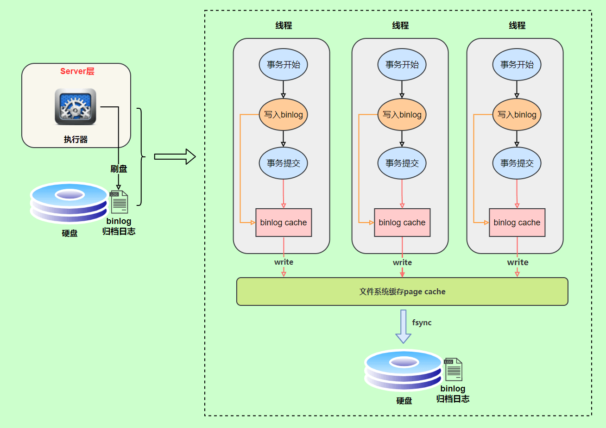

- **`write` writes the log to the filesystem's page cache; it does not persist the data to disk, so it is relatively fast.**
- **`fsync` persists the data to disk.**

The `sync_binlog` parameter controls when `write` and `fsync` occur. Its default value is `1`.

At `0`, each transaction commit performs only `write`; the operating system decides when to perform `fsync`.

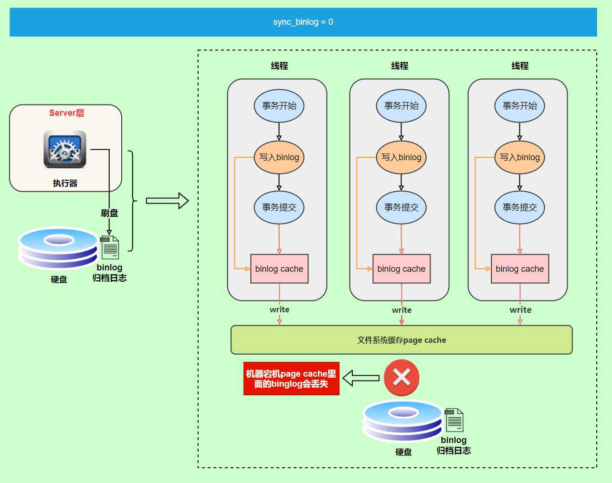

This improves performance, but a machine crash may lose binlog data in the `page cache`.

For stronger durability, set it to `1`. Each transaction commit then performs `fsync`, as with the **redo log flush process**.

Another compromise is `N` (`N > 1`): each transaction performs `write`, but `fsync` occurs only after every `N` transactions.

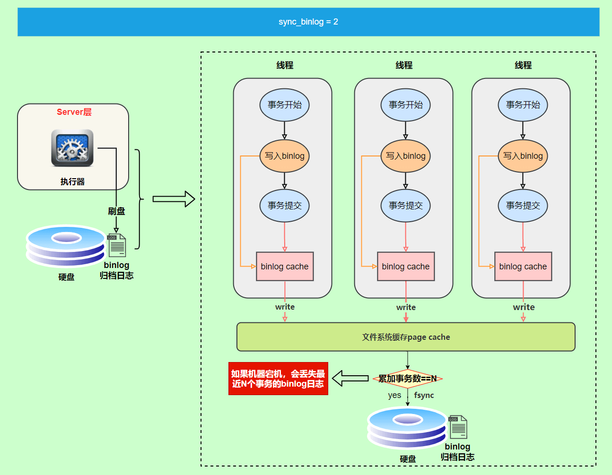

When I/O is a bottleneck, a larger `sync_binlog` value can improve performance.

If the machine crashes, the binlog may lose the most recent `N` transactions.

## Two-Phase Commit

The redo log gives the InnoDB storage engine crash recovery.

The binlog keeps data consistent across a MySQL cluster.

Both logs support persistence, but they serve different purposes.

An update writes to both the redo log and the binlog. The redo log can be written as the transaction runs, while the binlog is written only when the transaction commits. Their write timings therefore differ.

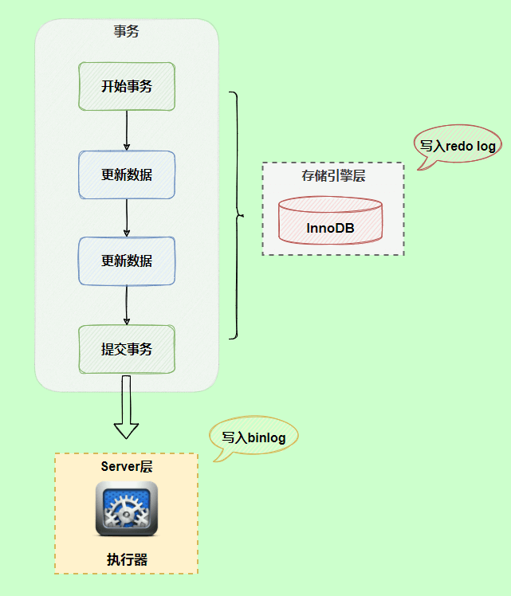

What happens if the redo log and binlog become inconsistent?

Consider an `update` statement. Suppose row `id=2` has a `c` value of `0`, and the statement `update T set c=1 where id=2` changes it to `1`.

What if an error occurs while writing the binlog, after the redo log has been written?

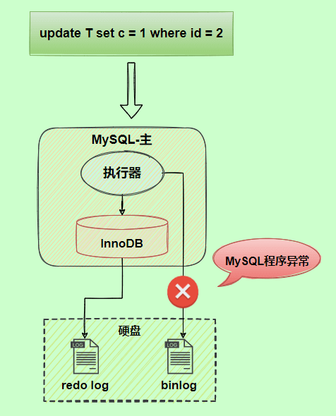

Because the binlog write failed, there is no corresponding update in the binlog. A later recovery from the binlog would leave `c` at `0`, while redo log recovery on the original database would restore it to `1`. The databases would become inconsistent.

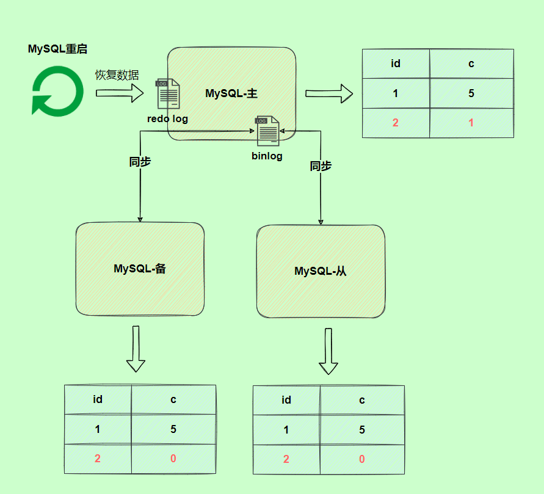

To keep the two logs consistent, InnoDB uses **two-phase commit**.

The process is simple: redo log writing has two stages, `prepare` and `commit`. This is **two-phase commit**.

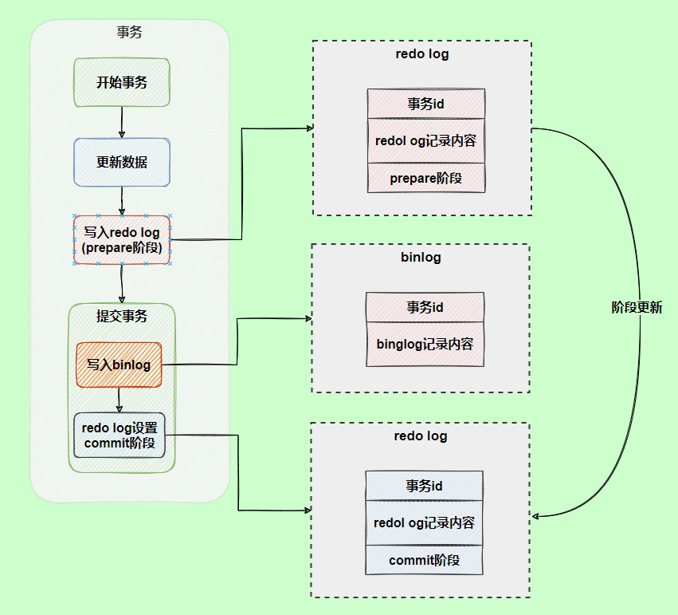

With **two-phase commit**, an error during the binlog write does not leave inconsistent data. During redo log recovery, MySQL rolls back a transaction that is still in the `prepare` stage and has no matching binlog entry.

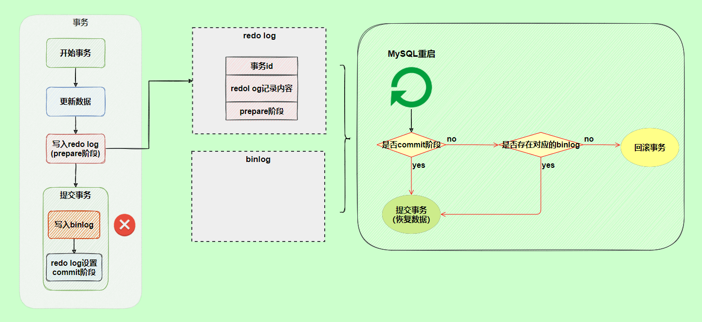

Consider another case: what if an error occurs while setting the redo log to the `commit` stage? Is the transaction rolled back?

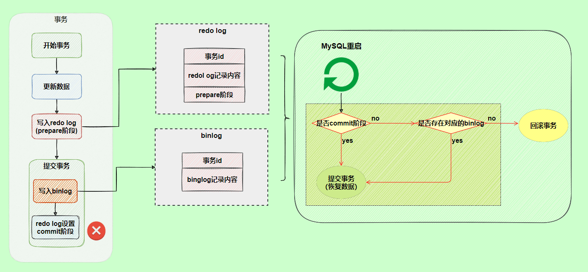

No. MySQL follows the logic highlighted above. Although the redo log is still in the `prepare` stage, MySQL can find the matching binlog entry using the transaction `id`. It treats the transaction as complete and commits it during recovery.

## Undo Log

> This section was added by JavaGuide.

Each transaction's data changes are recorded in the undo log. If an error occurs or the transaction must be rolled back, MySQL uses the undo log to restore data to its state before the transaction began.

The undo log is a logical log. For example, if a transaction executes a `DELETE`, the undo log records a corresponding `INSERT`. Undo log information is also recorded in the redo log to ensure durability. Undo log records are eventually purged: records for `INSERT` operations can be removed after commit, while records for `UPDATE` and `DELETE` operations are added to the history list and later removed by a background purge thread.

The undo log is organized into segments. Each undo operation uses an **undo log segment**, which is part of a **rollback segment**. A rollback segment is allocated when a transaction starts. Each rollback segment has 1024 undo log segments to support rollback for concurrent transactions.

The **rollback segment header**, usually on the first page of the rollback segment, manages the rollback segment. The **history list** is part of this header. It tracks undo logs for committed transactions that have not yet been purged, allowing the purge thread to find and remove records that are no longer needed.

The implementation of `MVCC` relies on **hidden columns, a Read View, and the undo log**. InnoDB uses a row's `DB_TRX_ID` and the Read View to determine whether the row is visible. If it is not visible, InnoDB follows `DB_ROLL_PTR` to find an earlier version in the undo log. Transactions may see different versions of data. Within a transaction, a user sees changes committed before its Read View was created, along with changes made by that transaction.

## Summary

> This section was added by JavaGuide.

The MySQL InnoDB engine uses the **redo log** to ensure transaction **durability** and the **undo log** to ensure **atomicity**.

MySQL **backups and replication** rely on the binlog to synchronize data and maintain consistency.

## References

- _MySQL in Practice: 45 Lectures_
- _From Zero to MySQL Performance Tuning Expert_
- _How MySQL Works: Understanding MySQL from the Ground Up_
- _MySQL Technology: InnoDB Storage Engine_

<!-- @include: @article-footer.snippet.md -->
