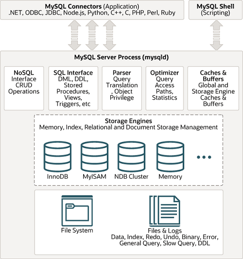
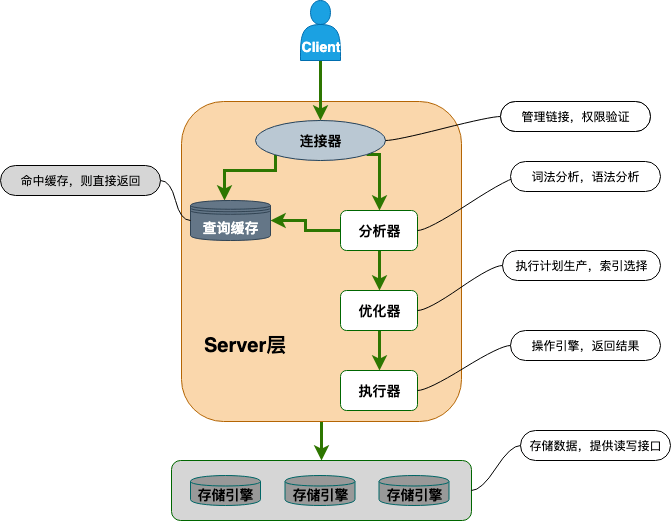

Caching is a common way to improve performance in operating systems, applications, and web services.

However, experienced DBAs generally recommend disabling MySQL's built-in Query Cache in production. It was deprecated by default in MySQL 5.7.20 and removed in MySQL 8.0.

Why? Was the Query Cache really that ineffective?

This article answers the following questions:

- What was the MySQL Query Cache, and when was it useful?
- What rules governed cache entries?
- What were its advantages and disadvantages?
- How did it affect performance?

## What Was the MySQL Query Cache?

The diagram below shows the MySQL architecture:



To speed up identical queries, MySQL Server calculated a hash from each query and looked for a matching result in the Query Cache. It did not normalize the SQL; the query text had to match exactly to produce the same hash.

- On a cache hit, the result set was returned without parsing or executing the query.
- On a cache miss, MySQL executed the query and stored the hash and result for later use.

In short, **MySQL Server checked the Query Cache when it received a `SELECT`; if the query had run before, it returned the cached result.**



## Query Cache Configuration

Use `SHOW VARIABLES LIKE '%query_cache%'` to inspect Query Cache settings.

Before MySQL 8.0, the output could look like this:

```bash
mysql> show variables like '%query_cache%';
+------------------------------+---------+
| Variable_name                | Value   |
+------------------------------+---------+
| have_query_cache             | YES     |
| query_cache_limit            | 1048576 |
| query_cache_min_res_unit     | 4096    |
| query_cache_size             | 599040  |
| query_cache_type             | ON      |
| query_cache_wlock_invalidate | OFF     |
+------------------------------+---------+
6 rows in set (0.02 sec)
```

In MySQL 8.0 and later, it looks like this:

```bash
mysql> show variables like '%query_cache%';
+------------------+-------+
| Variable_name    | Value |
+------------------+-------+
| have_query_cache | NO    |
+------------------+-------+
1 row in set (0.01 sec)
```

The following settings apply to versions before MySQL 8.0:

- **`have_query_cache`**: Whether this MySQL Server supports the Query Cache (`YES` or `NO`).
- **`query_cache_limit`**: Maximum result size eligible for caching. Larger results are not cached.
- **`query_cache_min_res_unit`**: Minimum allocation size in bytes. MySQL stores results as queries run; large results may require multiple allocations. Adjusting this value can improve memory use.
- **`query_cache_size`**: Memory allocated to cached results, in bytes, and a multiple of 1024. The MySQL 5.7 manual lists `1048576` (1 MB) as the default; defaults vary across minor versions. Specify it explicitly rather than relying on the default. A value of 0 disables the cache.
- **`query_cache_type`**: Cache mode, `ON` by default. The global value sets the mode for new connections; clients can set a session value for their own use.
- **`query_cache_wlock_invalidate`**: Whether to return cached data when a table is locked. It is off by default; production systems generally keep this default.

Possible `query_cache_type` values. It was dynamic in MySQL 5.6 and 5.7, **with a caveat**: if the server started with `query_cache_type=0`, it skipped allocating the Query Cache mutex, so changing the setting with `SET GLOBAL` fails. Change the configuration and restart instead. If the server started with a nonzero value, `SET GLOBAL query_cache_type=N` takes effect without a restart.

- `0` or `OFF`: Disable the cache.
- `1` or `ON`: Enable it, except for queries starting with `SELECT SQL_NO_CACHE`.
- `2` or `DEMAND`: Enable it only for queries starting with `SELECT SQL_CACHE`.

**Recommendations:**

- Do not set `query_cache_size` too high. It takes memory from other structures and increases lookup costs. Start with 10–100 MB based on instance size, then adjust from observed usage.
- Disable the Query Cache by setting `query_cache_size=0`, rather than relying only on `query_cache_type`. This skips cache allocation and lookup entirely.

  Before MySQL 8.0, add the following to `my.cnf` and restart MySQL to enable the cache:

```properties
query_cache_type=1
query_cache_size=614400
```

If the server started with a nonzero `query_cache_type`, enable the cache online with these commands. If it started with 0, this will fail; update the configuration file and restart instead.

```sql
set global query_cache_type=1;
set global query_cache_size=614400;
```

Use these statements to clear or manage the cache:

- `FLUSH QUERY CACHE;`: Defragment the Query Cache.
- `RESET QUERY CACHE;`: Remove all queries from the cache.
- `FLUSH TABLES;`: Close open tables and clear the Query Cache.

## Query Cache Behavior

### Cache rules

- The cache stores queries and result sets in memory as key-value pairs. The key is a hash of the query text and context, including the current database, client character set, and protocol version. The value is the result set.
- Cache entries are shared across sessions, so one client can use a result cached by another.
- Query text and context must match exactly, including case, whitespace, current database, protocol version, and character set. MySQL Server does not normalize the query before checking the cache.
- Only the final result set is cached, not the results of subqueries.
- Queries using nondeterministic functions such as `NOW()`, `CURDATE()`, `LAST_INSERT_ID()`, or `RAND()` are not cached.
- Queries that produce warnings are not cached.
- Results larger than `query_cache_limit` (1 MB by default) are not cached.
- Results are not cached if a query uses user-defined or stored functions, user variables, temporary tables, or system tables in the `mysql` database.
- MySQL tracks the tables referenced by each cached query. Changing a table's data or structure invalidates all related entries.
- The Query Cache is rarely useful with sharding. Middleware such as ShardingSphere or MyCat routes queries to separate MySQL instances, each with its own cache. Middleware may also rewrite SQL, producing a different hash and a cache miss.
- Queries using `SQL_NO_CACHE` are not cached.
- ...

Examples of `SELECT` cache options:

```sql
SELECT SQL_CACHE id, name FROM customer;     -- Cache the result.
SELECT SQL_NO_CACHE id, name FROM customer;  -- Do not cache the result.
```

### Cache memory management

The Query Cache is entirely memory-resident, so it helps to understand its memory management before configuring it.

The Query Cache manages allocation and release through its own memory pool rather than the operating system. Its variable-length blocks store metadata and data. A result set is linked from multiple blocks; the minimum block size is `query_cache_min_res_unit`.

At startup, the cache is initialized as one free block. Because MySQL does not know the final result size in advance, it first requests a block of `query_cache_min_res_unit` bytes. If the result is larger, it requests additional blocks as needed and links them together.

Allocating blocks requires locking the memory pool and can be slow. MySQL tries to limit allocations by choosing small blocks, requesting more only as needed, and releasing unused space after storing the result.

As concurrent reads and writes release blocks of different sizes, the pool can become fragmented. Small leftover regions below `query_cache_min_res_unit` cannot be reused, leading to more frequent memory defragmentation.

## Advantages and Disadvantages

**Advantages:**

- Cache lookup occurred after permission checks but before parsing and optimization. On a hit, MySQL could return the result without creating an execution plan or accessing the storage engine.
- Returning results from memory reduced disk I/O and CPU work. **This helped only in mostly read-only workloads with low concurrency.** Under high concurrency, contention on the global `LOCK_query_cache` mutex could leave many threads waiting (visible as `Waiting for query cache lock` in `SHOW PROCESSLIST`) and reduce TPS/QPS.

**Disadvantages:**

- MySQL hashed each `SELECT` and checked for a cached result. Hashing was cheap, but cache checks and writes used the same global `LOCK_query_cache` mutex. High concurrency caused lock contention and context switching, creating a major bottleneck.
- Frequent table changes invalidated cache entries. Changes included data, schema, and indexes.
- Different query text with the same result created separate entries. Differences in case, whitespace, or comments produced different hashes and used extra memory.
- Poorly chosen settings could cause memory fragmentation and frequent cache cleanup.

## Performance Impact

Enabling the Query Cache added overhead to both reads and writes:

- **Reads need a lock check**: Each read query checks for a cache hit using the shared `LOCK_query_cache` lock. Concurrent reads can queue while contending for it.
- **Cache writes add overhead**: Cacheable results require memory allocation and linked-list updates under the lock.
- **Writes invalidate entries globally**: A table write invalidates all entries that reference it. This takes an exclusive lock to scan the cache; larger `query_cache_size` values can increase lock time. This global mutex design was a key reason for removal in MySQL 8.0.
- **Long InnoDB transactions make it worse**: With MVCC, related cache entries cannot be used until a transaction commits. Long transactions reduce hit rates, and exclusive locks from writes can block cache reads for **unrelated tables**.

Use this command to inspect Query Cache usage:

```sql
SHOW STATUS LIKE 'Qcache%';
```

Key metrics:

| Status variable        | Meaning                                                                                         |
| :--------------------- | :---------------------------------------------------------------------------------------------- |
| `Qcache_hits`          | Number of cache hits                                                                            |
| `Qcache_inserts`       | Number of results added to the cache                                                            |
| `Qcache_not_cached`    | Queries not cached (unsupported or not cached)                                                  |
| `Qcache_lowmem_prunes` | Entries removed due to low memory; a rising value may indicate insufficient or fragmented space |
| `Qcache_free_memory`   | Free cache memory, in bytes                                                                     |

Approximate hit-rate formula:

```
Hit rate = Qcache_hits / (Qcache_hits + Qcache_inserts + Qcache_not_cached)
```

If the hit rate stays below 50%, the workload is likely a poor fit and the cache should be disabled. Also monitor the ratio of `Qcache_lowmem_prunes` to `Qcache_inserts`: a high ratio means entries are evicted soon after insertion. If `Qcache_lowmem_prunes` keeps rising, run `FLUSH QUERY CACHE` to defragment memory or reduce `query_cache_min_res_unit`.

## Summary

The Query Cache could improve query performance, but added management overhead: MySQL checked the cache for each query and removed entries when they became invalid.

It was useful in limited cases, such as applications with few database updates. A blog with mostly static tables, for example, could benefit from it.

The Query Cache was best suited to workloads with:

- Infrequent table updates and mostly static data.
- Frequently repeated queries.
- Result sets smaller than 1 MB.

For frequently updated systems, the Query Cache offered little benefit and could reduce performance.

It was a poor fit when:

- Table data, schema, or indexes change frequently.
- Queries are rarely repeated.
- Result sets are large.

_High Performance MySQL_ notes:

> In our experience, the query cache can reduce system performance under high concurrency, or even make the system unresponsive. If you use it, keep the cache small and do so only when there is a clear benefit, such as infrequent database updates.

**In practice, local caches such as Caffeine or distributed caches such as Redis are usually more general-purpose and perform better.**

## References

- _High Performance MySQL_
- [MySQL cache mechanisms](https://zhuanlan.zhihu.com/p/55947158)
- [Configuring and using the MySQL Query Cache](https://help.aliyun.com/document_detail/41717.html)
- [8.10.3 The MySQL Query Cache — MySQL Reference Manual](https://dev.mysql.com/doc/refman/5.7/en/query-cache.html)

<!-- @include: @article-footer.snippet.md -->
