## MySQL Fundamentals

### What Is a Relational Database?

A relational database (RDB) is built on the relational model, which describes relationships between stored data, such as one-to-one, one-to-many, and many-to-many relationships.

Data in a relational database is stored in tables, such as a user table. Each row stores one record, such as information about a user.

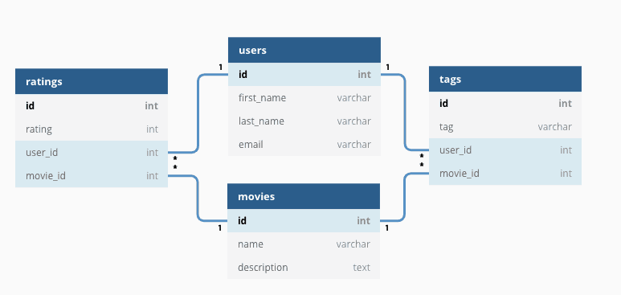

Most relational databases use SQL to work with data and support the four ACID properties of transactions.

**What are some common relational databases?**

MySQL, PostgreSQL, Oracle, SQL Server, and SQLite. For example, WeChat uses SQLite to store local chat history.

### What Is SQL?

SQL (Structured Query Language) is a language for working with databases. It provides a simple and effective way to read and write data.

Nearly all major relational databases support SQL, making it widely applicable. Some non-relational databases also support SQL or similar query languages.

SQL can be used to:

- Create databases, tables, and columns.
- Insert, delete, update, and query data.
- Create views, functions, and stored procedures.
- Perform basic data analysis.
- Work with big data tools such as Hive and Spark SQL.
- Work with machine learning tools such as SQLFlow.
- And more.

### What Is MySQL?


**MySQL is a relational database commonly used to persist application data, such as user information.**

MySQL is mature, open-source, and widely used. It can be downloaded and modified under the GPL (General Public License). MySQL's default port is **3306**.

### ⭐️What Are the Advantages of MySQL?

This question is really asking why MySQL is so popular.

MySQL's success comes from its strengths in **ecosystem, features, and operations**.

**First, its ecosystem and low cost have helped it become widely adopted.**

- **Open source and free**: This has been central to MySQL's adoption. Companies and individuals can use it at no cost, lowering the technical and initial financial barriers.
- **Large community and mature ecosystem**: After decades of development, MySQL has an active community and a rich ecosystem. Solutions to common problems are easy to find, and mainstream programming languages, frameworks, ORM tools, and monitoring systems support it well. Documentation and learning resources are also widely available.

**Second, its core technical features are capable and well balanced.**

- **Strong transaction support**: This is a core feature of a relational database. InnoDB's default `REPEATABLE READ` isolation level uses MVCC and next-key locks to prevent most phantom reads, balancing performance and consistency. For details, see [MySQL Transaction Isolation Levels](https://javaguide.cn/database/mysql/transaction-isolation-level.html).
- **Performance and scalability**: MySQL has been tested by large-scale internet workloads and offers strong single-instance performance. It also has mature horizontal scaling architectures, including replication, read/write splitting, and sharding through middleware, supporting systems from startups to large platforms.

**Third, it is accessible to use and operate.**

- **Easy to get started**: Compared with large commercial databases such as Oracle, MySQL is straightforward to install, configure, and use. Its learning curve is gradual, making it accessible to developers and junior DBAs.
- **Low maintenance cost**: Its simplicity and large community make it relatively easy to find operations staff and solutions, reducing overall maintenance costs.

In recent years, PostgreSQL has grown rapidly and in some areas has overtaken MySQL. Some online articles attack MySQL or praise PostgreSQL without nuance. Neither approach is useful.

For a comparison of these two prominent relational databases, see [Has MySQL Fallen to Second Place?](https://mp.weixin.qq.com/s/APWD-PzTcTqGUuibAw7GGw).

## MySQL Data Types

MySQL data types can be divided into three broad categories:

- **Numeric**: Integer types (`TINYINT`, `SMALLINT`, `MEDIUMINT`, `INT`, and `BIGINT`), floating-point types (`FLOAT` and `DOUBLE`), fixed-point type (`DECIMAL`), and bit-field type (`BIT`).
- **String and binary**: `CHAR`, `VARCHAR`, `TINYTEXT`, `TEXT`, `MEDIUMTEXT`, `LONGTEXT`, `BINARY`, `TINYBLOB`, `BLOB`, `MEDIUMBLOB`, and `LONGBLOB`. `CHAR` and `VARCHAR` are most commonly used.
- **Date and time**: `YEAR`, `TIME`, `DATE`, `DATETIME`, and `TIMESTAMP`.

The following diagram is not my work, and I no longer remember where I found it, but it provides a useful summary.


MySQL has many data types. This article focuses on types commonly used in development and often discussed in interviews. Unless stated otherwise, the discussion applies to the InnoDB storage engine.

For more on optimizing MySQL data types, see Chapter 4 of _High Performance MySQL, 3rd Edition_.

### ⭐️What Does the UNSIGNED Attribute Do for Integer Types?

MySQL integer types can use the optional `UNSIGNED` attribute to disallow negative values. This doubles the maximum positive value because the type does not need to represent negative numbers.

For example, `TINYINT UNSIGNED` ranges from 0 to 255, while a regular `TINYINT` ranges from -128 to 127. `INT UNSIGNED` ranges from 0 to 4,294,967,295, while a regular `INT` ranges from -2,147,483,648 to 2,147,483,647.

`UNSIGNED` can be suitable for an ID column that increases from zero because it disallows negative values and provides a larger positive range.

### What Is the Difference Between CHAR and VARCHAR?

`CHAR` and `VARCHAR` are common string types. The main difference is that **`CHAR` has a fixed length, while `VARCHAR` has a variable length.**

When storing a `CHAR` value, MySQL pads it with spaces on the right to the specified length and removes them when retrieving it. `VARCHAR` uses one or two extra bytes to store the string length and requires no such padding.

`CHAR` is better suited to short strings of similar length, such as Bcrypt or MD5 password hashes and ID numbers. `VARCHAR` is better for strings of varying lengths, such as usernames and article titles.

For both `CHAR(M)` and `VARCHAR(M)`, `M` is the maximum number of characters, whether letters, digits, or Chinese characters.

### What Is the Difference Between VARCHAR(100) and VARCHAR(10)?

Both `VARCHAR(100)` and `VARCHAR(10)` are variable-length types, with maximum lengths of 100 and 10 characters. `VARCHAR(100)` supports longer values and may be more flexible as requirements change. Values longer than 10 characters require a schema change if the column is `VARCHAR(10)`.

Although their maximum lengths differ, `VARCHAR(100)` and `VARCHAR(10)` use the same disk space when storing the same string. This is a common misconception.

However, `VARCHAR(100)` may use more memory. Operations on `VARCHAR` values often allocate fixed-size memory blocks based on the declared length. For example, sorting may use the full length of 100 characters.

### What Is the Difference Between DECIMAL and FLOAT/DOUBLE?

**`DECIMAL` is a fixed-point type, while `FLOAT` and `DOUBLE` are floating-point types. `DECIMAL` stores exact decimal values; `FLOAT` and `DOUBLE` store approximate values.**

Use `DECIMAL` for values that require decimal precision, such as currency, to avoid floating-point precision loss.

In Java, MySQL's `DECIMAL` type corresponds to `java.math.BigDecimal`.

### Why Are TEXT and BLOB Usually Not Recommended?

`TEXT` is similar to `CHAR` (0–255 bytes) and `VARCHAR` (0–65,535 bytes), but it can store longer strings, such as blog content.

| Type       | Maximum size          | Use             |
| ---------- | --------------------- | --------------- |
| TINYTEXT   | 0–255 bytes           | Short text      |
| TEXT       | 0–65,535 bytes        | Long text       |
| MEDIUMTEXT | 0–16,772,150 bytes    | Larger text     |
| LONGTEXT   | 0–4,294,967,295 bytes | Very large text |

`BLOB` types are mainly used to store binary large objects, such as images, audio, and video files.

| Type       | Maximum size | Use                    |
| ---------- | ------------ | ---------------------- |
| TINYBLOB   | 0–255 bytes  | Small binary data      |
| BLOB       | 0–65 KB      | Binary data            |
| MEDIUMBLOB | 0–16 MB      | Larger binary data     |
| LONGBLOB   | 0–4 GB       | Very large binary data |

In everyday development, `TEXT` is used occasionally and `BLOB` is rarely used. If `VARCHAR` can accommodate the expected values, avoid `TEXT`.

Database guidelines often discourage `BLOB` and `TEXT` because of limitations such as:

- They cannot have default values.
- Temporary tables that use them cannot be stored in memory and must be created on disk (as noted in _High Performance MySQL_).
- Retrieval may be less efficient.
- Indexes require a specified prefix length.
- They may consume substantial network and I/O bandwidth.
- They may slow DML operations on the table.
- And more.

### ⭐️What Is the Difference Between DATETIME and TIMESTAMP, and Which Should You Choose?

`DATETIME` values do not include time zone information; `TIMESTAMP` values are time-zone-aware.

`TIMESTAMP` uses 4 bytes of storage, while `DATETIME` uses 8 bytes. As a result, `TIMESTAMP` supports a smaller time range:

- `DATETIME`: '1000-01-01 00:00:00.000000' to '9999-12-31 23:59:59.999999'
- `TIMESTAMP`: '1970-01-01 00:00:01.000000' UTC to '2038-01-19 03:14:07.999999' UTC

The main advantage of `TIMESTAMP` is its built-in time zone handling. The database stores values in UTC and converts them automatically based on the session time zone, simplifying applications that handle multiple time zones. Choose `TIMESTAMP` when this behavior is useful, while keeping its range limitation—the year 2038 problem—in mind.

Choose `DATETIME` when the application does not need automatic time zone conversion, needs full control of time zone handling, or must represent dates after 2038.

For a detailed comparison and guidance on choosing a date/time type, see [Choosing MySQL Date and Time Types](./some-thoughts-on-database-storage-time.md).

### What Is the Difference Between NULL and ''?

`NULL` and `''` (the empty string) are different values with different meanings and behavior. `NULL` represents missing or unknown data, while `''` is a known empty string. Their main differences are:

1. **Meaning**:
   - `NULL` represents an unknown value and is not equal to any value, including itself. Therefore, `SELECT NULL = NULL` returns `NULL`, not `true` or `false`. Some operations, such as `DISTINCT`, `GROUP BY`, and `ORDER BY`, treat `NULL` values as belonging to the same group. This does not make them equal; it is special handling for those operations.
   - `''` is an empty string and is a known value.
2. **Storage**:
   - The storage required for `NULL` depends on the database implementation; some space is usually needed to mark a value as null.
   - `''` usually takes little space because it stores no actual characters.
3. **Comparisons**:
   - Comparisons between any value and `NULL` (such as `=`, `!=`, `>`, and `<`) return `NULL`, meaning the result is unknown. Use `IS NULL` or `IS NOT NULL` to test for `NULL`.
   - `''` can be compared like any other string. For example, `'' = ''` returns `true`.
4. **Aggregate functions**:
   - Most aggregate functions, such as `SUM`, `AVG`, `MIN`, and `MAX`, ignore `NULL` values.
   - `COUNT(*)` counts all rows, including rows containing `NULL`. `COUNT(column)` counts non-`NULL` values in that column.
   - The empty string `''` is included in aggregation. For example, `SUM` treats it as 0, while `MIN` and `MAX` treat it as an empty string.

This also helps answer another common interview question: “Why does MySQL discourage using `NULL` as a column's default value?”

### ⭐️How Are Boolean Values Represented?

MySQL has no dedicated Boolean type. `BOOL` and `BOOLEAN` are synonyms for `TINYINT(1)`. Typically, 0 represents false and any nonzero value represents true. `BIT(1)` can also store 0 or 1, but it is not the underlying type for `BOOL` or `BOOLEAN`.

### ⭐️Should Phone Numbers Be Stored as INT or VARCHAR?

**Use `VARCHAR` to store phone numbers**, not `INT` or `BIGINT,` for these reasons:

1. **Format compatibility**:
   - Phone numbers may contain leading zeros, country-code prefixes such as `+`, or separators such as hyphens and spaces. Numeric types lose formatting information: leading zeros disappear, and `+` and `-` cannot be stored.
   - `VARCHAR` preserves different formats, including local numbers and international numbers with country codes.
2. **Not arithmetic data**: Phone numbers look numeric, but they are identifiers and are not used in calculations such as sums or averages. `VARCHAR` better reflects their purpose.
3. **Flexible queries**:
   - Applications often search by prefix, such as finding users whose number starts with `138`. A query using `VARCHAR` and `LIKE '138%'` is straightforward and efficient.
   - With a numeric type, prefix searches require functions such as `CAST` or `SUBSTRING`, or range conditions such as `WHERE phone >= 13800000000 AND phone < 13900000000`. These are more cumbersome and may not use indexes effectively.
4. **Encrypted storage**:
   - Security and privacy requirements may require sensitive personal information such as phone numbers to be encrypted in the database.
   - Ciphertext is a string, often containing letters, digits, and symbols or encoded with Base64 or hexadecimal. `INT` and `BIGINT` cannot store it; use `VARCHAR`, `TEXT`, or `BLOB`.

**Choosing a `VARCHAR` length:**

- **If storing the number without encryption (strongly discouraged)**: `VARCHAR(20)` to `VARCHAR(32)` is generally a safe range for international numbers and formatting characters. `VARCHAR(15)` may be too short for some numbers with country codes and separators.
- **If storing it encrypted (the recommended practice)**: Choose the length based on the maximum ciphertext length produced by the selected encryption algorithm and any encoding. For example, Base64 adds about one-third to the length. A longer column such as `VARCHAR(128)` or `VARCHAR(256)` may be needed.

The table below summarizes the comparison:

| Comparison               | `VARCHAR` (recommended)                                     | `INT`/`BIGINT` (not recommended)               | Notes                                                                                |
| ------------------------ | ----------------------------------------------------------- | ---------------------------------------------- | ------------------------------------------------------------------------------------ |
| **Format compatibility** | ✔ Preserves leading zeros, `+`, `-`, spaces, and more      | ✘ Leading zeros and symbols are lost           | `VARCHAR` preserves formatting; numeric types store digits only.                     |
| **Data integrity**       | ✔ Preserves formatting                                     | ✘ Formatting is lost                           | For example, `013800012345` becomes `13800012345` as an `INT`; `+` cannot be stored. |
| **Not arithmetic data**  | ✔ Suitable for identifiers                                 | ✘ Intended for numeric operations              | Phone numbers are string identifiers, not values used in arithmetic.                 |
| **Query flexibility**    | ✔ Supports `LIKE '138%'`                                   | ✘ Prefix queries are cumbersome or inefficient | Numeric types may require conversion or other complex conditions.                    |
| **Encrypted storage**    | ✔ Can store ciphertext                                     | ✘ Cannot store ciphertext                      | Encrypted numbers are strings or binary data; use `VARCHAR`, `TEXT`, or `BLOB`.      |
| **Suggested length**     | 15–20 when unencrypted; determine separately when encrypted | Not applicable                                 | For encrypted values, length depends on the algorithm and encoding.                  |

## MySQL Architecture

> For more context on MySQL architecture, see [How MySQL Executes SQL Statements](./how-sql-executed-in-mysql.md). The execution flow of an SQL statement is also a common interview question.

The following diagram outlines MySQL's architecture and shows how a client SQL statement is executed internally.

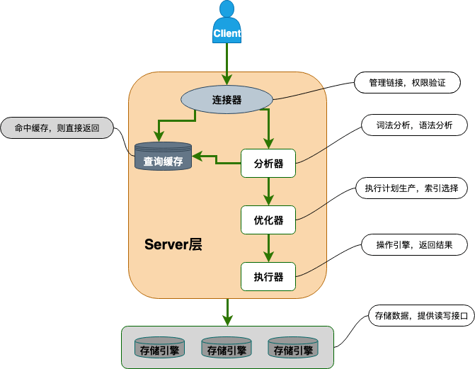

As shown in the diagram, MySQL consists of these main components:

- **Connection handler**: Handles authentication and permissions when a client connects to MySQL.
- **Query Cache**: Checks for cached results before executing a query. It was removed in MySQL 8.0 because it was not useful enough.
- **Parser**: If there is no cache hit, the parser determines what the SQL statement does and checks its syntax.
- **Optimizer**: Chooses a plan that MySQL estimates to be optimal.
- **Executor**: Runs the statement and returns data from the storage engine. It checks permissions before execution and reports an error if the client lacks permission.
- **Pluggable storage engines**: Store and retrieve data. The pluggable architecture supports engines such as InnoDB, MyISAM, and Memory. InnoDB is the default engine and is the right choice for most use cases.

## MySQL Storage Engines

Storage engines are central to MySQL. To study MySQL in depth, you need to understand its storage engines.

### Which Storage Engines Does MySQL Support? Which Is the Default?

MySQL supports several storage engines. Use `SHOW ENGINES` to list them.

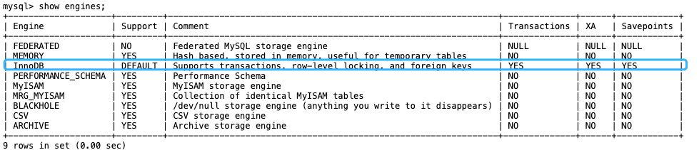

The diagram shows that InnoDB is the current default storage engine. Among the listed engines, only InnoDB is transactional and supports transactions.

This article uses MySQL 8.x. Details may differ between MySQL versions.

Before MySQL 5.5.5, MyISAM was the default storage engine. InnoDB has been the default since MySQL 5.5.5.

Use `SELECT VERSION()` to check your MySQL version.

```bash
mysql> SELECT VERSION();
+-----------+
| VERSION() |
+-----------+
| 8.0.27    |
+-----------+
1 row in set (0.00 sec)
```

Use `SHOW VARIABLES LIKE '%storage_engine%'` to check the current default storage engine.

```bash
mysql> SHOW VARIABLES  LIKE '%storage_engine%';
+---------------------------------+-----------+
| Variable_name                   | Value     |
+---------------------------------+-----------+
| default_storage_engine          | InnoDB    |
| default_tmp_storage_engine      | InnoDB    |
| disabled_storage_engines        |           |
| internal_tmp_mem_storage_engine | TempTable |
+---------------------------------+-----------+
4 rows in set (0.00 sec)
```

For more details about each storage engine and their differences, see the corresponding MySQL documentation. Interviews rarely go into this level of detail, so a basic understanding is enough:

- InnoDB storage engine: <https://dev.mysql.com/doc/refman/8.0/en/innodb-storage-engine.html>
- Other storage engines: <https://dev.mysql.com/doc/refman/8.0/en/storage-engines.html>

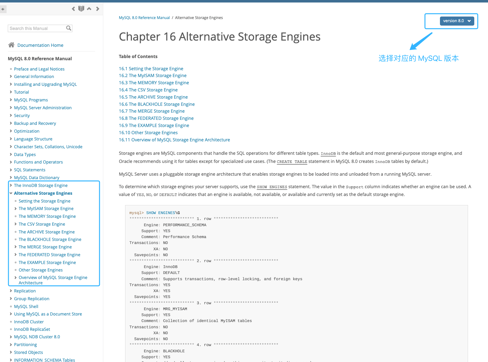

### What Is the MySQL Storage Engine Architecture?

MySQL storage engines use a **pluggable architecture**. Different tables can use different engines to suit different needs. **Storage engines are configured per table, not per database.**

The diagram shows MySQL's architecture with pluggable storage engines:

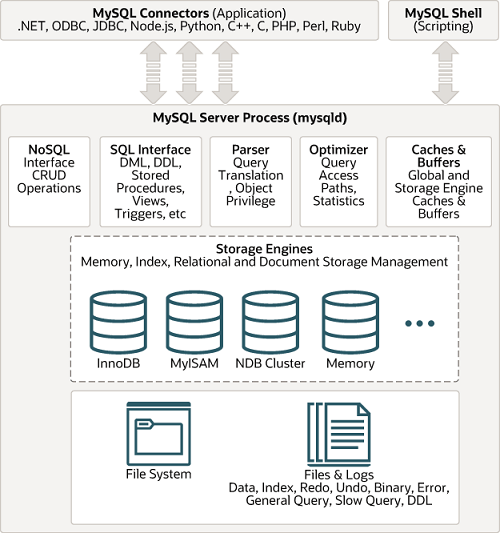

You can also implement MySQL's storage engine interface to create a custom engine. Engines not provided by Oracle are often called third-party storage engines. InnoDB, now the most widely used engine, originally began as a third-party engine before Oracle acquired it.

The MySQL documentation explains how to write a custom storage engine: <https://dev.mysql.com/doc/internals/en/custom-engine.html>.

### ⭐️What Is the Difference Between MyISAM and InnoDB?

Before MySQL 5.5, MyISAM was the default storage engine.

MyISAM offers reasonable performance and features such as full-text indexes, compression, and spatial functions. However, it does not support transactions or row-level locks, and it cannot recover safely from a crash.

InnoDB has been the default storage engine since MySQL 5.5.

Here is a brief comparison:

**1. Row-level locking**

MyISAM supports only table-level locks. InnoDB supports both row-level and table-level locks, and uses row-level locks by default.

With MyISAM, a lock applies to the entire table, which can be inefficient for concurrent writes. InnoDB therefore performs better when writes run concurrently.

**2. Transaction support**

MyISAM does not support transactions.

InnoDB supports transactions and the four isolation levels defined by the SQL standard. It can commit and roll back transactions. Its default `REPEATABLE READ` isolation level prevents phantom reads through MVCC and next-key locks.

For details about MySQL transactions, see [MySQL Transaction Isolation Levels](./transaction-isolation-level.md).

**3. Foreign key support**

MyISAM does not support foreign keys; InnoDB does.

Foreign keys help maintain data consistency but can affect performance. They are often avoided in production systems, with constraints enforced in application code instead.

Alibaba's _Java Development Manual_ also explicitly prohibits foreign keys.

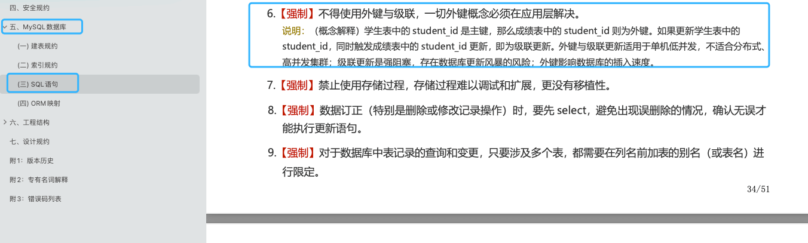

Enforcing constraints in application code places more responsibility on developers. Whether to use foreign keys depends on the project.

In general, foreign keys are often avoided in favor of application-level checks, but this can threaten data consistency. Decide based on your project's requirements.

**4. Crash recovery**

MyISAM does not support safe crash recovery; InnoDB does.

After a crash, an InnoDB database uses the `redo log` during restart to recover its state.

**5. MVCC support**

MyISAM does not support MVCC; InnoDB does.

This comparison is somewhat obvious because MyISAM does not even support row-level locking. MVCC can be viewed as an improvement over locking that reduces lock operations and improves performance.

**6. Different index implementations**

Both MyISAM and InnoDB use B+Trees for indexes, but their implementations differ.

In InnoDB, the data file is itself an index file. Unlike MyISAM, which stores indexes and data separately, InnoDB organizes the table data as a B+Tree whose leaf nodes contain complete rows.

For details, see [MySQL Indexes Explained](./mysql-index.md).

**7. Performance**

InnoDB generally performs better than MyISAM. In mixed read/write and read-only workloads, its throughput can scale linearly as CPU cores are added. MyISAM cannot run reads and writes concurrently, so its processing capacity does not scale with core count in the same way.

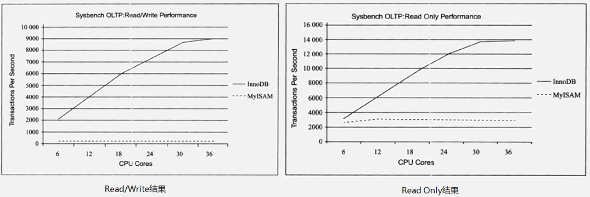

**8. Different caching mechanisms**

InnoDB uses the Buffer Pool to cache data and index pages. MyISAM's Key Cache stores index pages only, not data pages.

**Summary:**

- InnoDB supports row-level locks; MyISAM supports only table-level locks.
- MyISAM does not support transactions; InnoDB supports the four isolation levels defined by the SQL standard.
- MyISAM does not support foreign keys; InnoDB does.
- MyISAM does not support MVCC; InnoDB does.
- Both engines use B+Trees, but their implementations differ.
- MyISAM does not support safe crash recovery; InnoDB does.
- InnoDB generally offers better performance.

The following image compares several common MySQL storage engines.

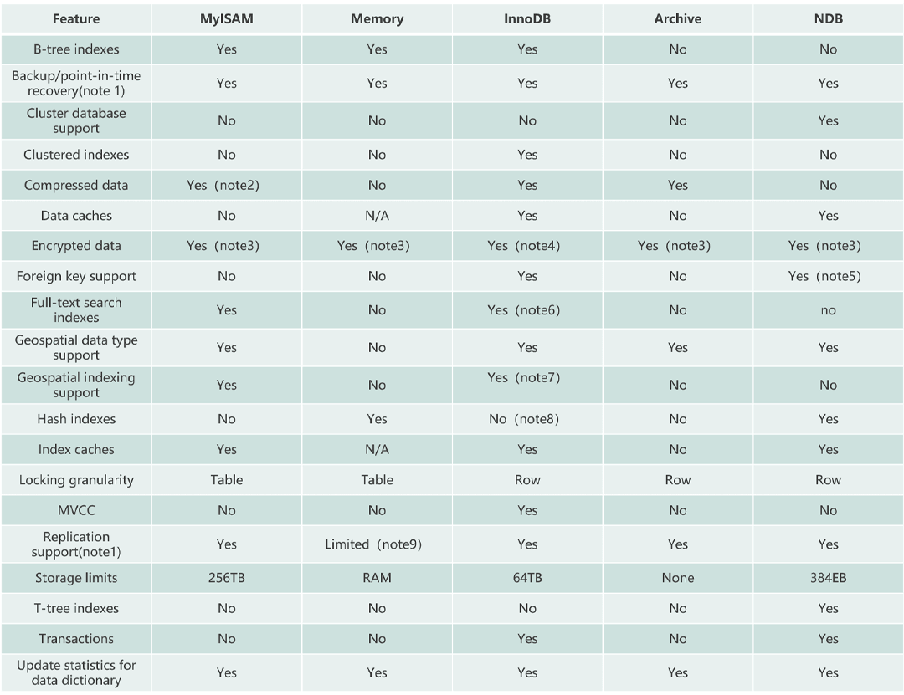

### How Should You Choose Between MyISAM and InnoDB?

InnoDB is the right choice for most use cases. MyISAM may be suitable for some read-heavy workloads, provided the project can tolerate its lack of transaction support and crash recovery—which most projects cannot.

_High Performance MySQL_ makes the following point:

> Do not accept rules of thumb such as “MyISAM is faster than InnoDB” without question. The claim is rarely universally true. In many scenarios, InnoDB can significantly outperform MyISAM, especially when clustered indexes are used or the data being accessed fits in memory.

For most business systems, there is little reason to choose MyISAM; using the default InnoDB engine is usually the right choice.

## ⭐️MySQL Indexes

MySQL indexes are a common and important interview topic. For details, see [MySQL Indexes Explained](./mysql-index.md).

### What Is an Index?

**An index is a data structure that speeds up data searches and retrieval. It can be thought of as an ordered data structure.**

An index works like a book's table of contents. Without one, you would have to search every page of a dictionary for a word. With one, you can find the page number first and turn directly to it.

Indexes can use different underlying data structures, including B-Trees, B+Trees, hash tables, and red-black trees. MySQL's InnoDB and MyISAM engines both use B+Trees for indexes.

**Advantages:**

1. **Faster queries (the main purpose)**: An index can **greatly reduce the amount of data to scan**, locate matching records directly, and reduce disk I/O.
2. **Enforce uniqueness**: A **unique index** ensures that values in one or more columns are unique, such as user IDs or email addresses. A primary key is also a unique index.
3. **Faster sorting and grouping**: If an `ORDER BY` or `GROUP BY` clause uses indexed columns, the database may use the index's ordering to avoid an extra sort.

**Disadvantages:**

1. **Creation and maintenance costs**: Creating an index takes time, especially for large tables. Inserts, deletes, and updates (DML operations) must also maintain relevant indexes, which can reduce write performance.
2. **Storage use**: Indexes require storage, so more or larger indexes use more disk space.
3. **Poor index use**: With a poorly designed index or query, the optimizer may skip the index or choose the wrong one, reducing performance.

**Does using an index always improve query performance?**

**No.** A well-chosen index is usually much faster than a full table scan, but there are exceptions:

- **Small tables**: A full table scan may be faster for a table with only a few hundred rows because using an index also has a cost.
- **Large result sets**: If a query returns a large share of the table (for example, more than 20–30%), the optimizer may prefer a full table scan to repeated lookups from the index, which involve random I/O.
- **Stale statistics or poor index maintenance**: These can lead the optimizer to choose a poor plan.

### Why Are Indexes Fast?

Indexes are fast mainly because they **greatly reduce the number of disk I/O operations**.

An index is essentially an **ordered data structure**, like a book's table of contents, so the database does not need to scan every row.

MySQL uses **B+Trees**, which improve performance in two main ways:

1. B+Trees are “short and wide.” An index on a table with tens of millions of rows may be only three or four levels deep, requiring at most **three or four disk I/O operations** to locate a value. A full table scan may require thousands.
2. B+Tree leaf nodes are **linked together**. Once the first matching leaf is found, the database can **read sequentially** through the linked leaves, which works well with disks and can trigger read-ahead.

### What Data Structure Does MySQL Use for Indexes?

Both MyISAM and InnoDB use B+Trees for indexes. For details, see [MySQL Indexes Explained](./mysql-index.md).

### Why Doesn't InnoDB Use Hashes as Its Index Structure?

> Many candidates and even interviewers misunderstand this question and assume that MySQL does not use hash tables or B-Trees internally for indexes.
>
> In fact, distinguish between storage engines when asking or answering this question. For example, the Memory engine supports both hash and B-Tree indexes.

Hash indexes use a hash table. Their advantage is that **exact equality lookups** have a theoretical time complexity of **O(1)**, as in `WHERE id = 123`.

However, they have several serious limitations for a general-purpose database:

1. **No range queries**: A hash function may map adjacent input values, such as `id=100` and `id=101`, to unrelated positions. This destroys ordering and prevents range queries such as `WHERE age > 30` or `BETWEEN 100 AND 200`. A hash index must fall back to a full table scan for such queries.
2. **No sorting**: Hash values are unordered, so a hash index cannot optimize an `ORDER BY` clause.
3. **No lookup by a partial index key**: A hash index on `(col1, col2)` requires both columns; it cannot use only `col1` to speed up a query.
4. **Hash collisions**: Different keys may produce the same hash value. Resolving collisions with linked lists or open addressing can reduce performance.

Because range queries and sorting are common database operations, a structure that does not support them is not suitable as the default general-purpose index.

### Why Does InnoDB Use B+Trees Instead of B-Trees?

Both B-Trees and B+Trees are balanced multiway search trees well suited to disk storage. Their shallow, wide structure makes efficient use of each disk I/O operation.

However, B+Trees extend B-Trees with several optimizations for database workloads:

1. **Higher I/O efficiency**: In a B+Tree, only leaf nodes store data (or pointers to data); internal nodes store keys only. Internal nodes can therefore hold more keys, increasing the tree's fan-out. For the same amount of data, a B+Tree is usually shorter than a B-Tree and requires fewer disk I/O operations to find a value.
2. **More consistent lookup performance**: Every B+Tree lookup reaches a leaf, so the path length is consistent. A B-Tree lookup may finish at an internal node or continue to a leaf, making its path length less predictable.
3. **Efficient range queries**: B+Tree leaf nodes are linked in both directions. For a range query such as `WHERE id > 100`, the database finds the leaf containing `id=100` and scans forward through the linked leaves without returning to upper levels.

### What Is a Covering Index?

An index that contains all column values required by a query is called a **covering index**.

In InnoDB, secondary index leaves contain primary key values. When a query uses a secondary index, the database first finds the primary key, then uses the primary key index to retrieve the full row. This is called a **table lookup**.

**If an index contains all columns needed by a query, MySQL can return the result directly from the index without looking up the row.**

### Explain Composite Indexes and the Leftmost Prefix Rule

An index created on multiple columns is called a **composite index**.

Create a composite index on `score` and `name`:

```sql
ALTER TABLE `cus_order` ADD INDEX id_score_name(score, name);
```

When using a composite index, MySQL matches query conditions to indexed columns from left to right. If a condition matches the leftmost column, MySQL can use the index to filter rows.

Matching continues to the right until MySQL encounters a range condition such as `>` or `<`. Conditions using `>=`, `<=`, `BETWEEN`, or a prefix `LIKE` do not stop matching. For more, see [A Common Misconception About the Leftmost Prefix Rule for Composite Indexes](https://mp.weixin.qq.com/s/8qemhRg5MgXs1So5YCv0fQ).

Suppose a composite index covers `(column1, column2, column3)`. Its leftmost prefixes are `(column1)`, `(column1, column2)`, and `(column1, column2, column3)`. Queries using these prefixes can use the index instead of a full table scan.

When creating a composite index, consider placing the column with higher cardinality first, since it can filter out more rows.

The following example demonstrates the leftmost prefix rule.

1. Create a table named `student` with three columns: `id`, `name`, and `class`.

```sql
CREATE TABLE `student` (
  `id` int NOT NULL,
  `name` varchar(100) DEFAULT NULL,
  `class` varchar(100) DEFAULT NULL,
  PRIMARY KEY (`id`),
  KEY `name_class_idx` (`name`,`class`)
) ENGINE=InnoDB DEFAULT CHARSET=utf8mb4;
```

2. Test these three SQL statements:

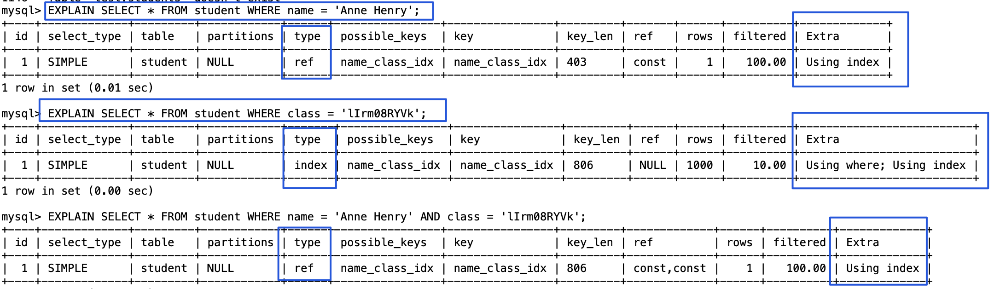

```sql
# Uses the index
SELECT * FROM student WHERE name = 'Anne Henry';
EXPLAIN SELECT * FROM student WHERE name = 'Anne Henry' AND class = 'lIrm08RYVk';
# Cannot use the index
SELECT * FROM student WHERE class = 'lIrm08RYVk';
```

Consider a common interview question. Given a composite index `(a, b, c)`, can these queries use it: `a=1 AND c=1`, `c=1`, `b=1 AND c=1`, and `b=1 AND a=1 AND c=1`?

Try to answer before reading on.

1. `a=1 AND c=1`: The query can use the index prefix on `a`, then filter the results by `c=1`.
2. `c=1`: The query does not include the leftmost column `a`, so it cannot use the index.
3. `b=1 AND c=1`: As in the previous case, the query cannot use the index.
4. `b=1 AND a=1 AND c=1`: The optimizer can reorder conditions for a composite index, so this query can use the index as if the conditions were `a=1 AND b=1 AND c=1`.

MySQL 8.0.13 introduced **Index Skip Scan (ISS)**, which can improve some index queries. Before ISS, a query that did not follow the leftmost prefix rule required a full table scan. ISS can avoid that scan in some cases. Its capabilities are limited compared with Oracle's, and MySQL 8.0.31 had a bug that caused incorrect results; it was fixed in later versions. See [Bug #109145](https://bugs.mysql.com/bug.php?id=109145). It is useful to know that ISS exists, but you may not encounter it in practice.

### Does SELECT \* Prevent Index Use?

`SELECT *` does not directly prevent index use. If MySQL does not use an index, the `WHERE` clause may match too many rows. However, `SELECT *` can waste network bandwidth and processing resources and may prevent the use of a covering index.

### Which Columns Are Good Candidates for Indexes?

- **Columns that are not `NULL`**: Prefer non-`NULL` values because they can be easier to optimize. If a frequently queried column must allow `NULL`, consider clear short values such as `0`, `1`, `true`, or `false` where appropriate.
- **Frequently queried columns**: Consider indexing columns used often in queries.
- **Filter columns**: Consider indexing columns used in `WHERE` conditions.
- **Sort columns**: An index may speed up sorting when a query can use its order.
- **Join columns**: Consider indexing columns frequently used in joins, including columns that represent relationships between tables. A foreign key constraint is not required for a column to be used in a join.

### What Can Prevent MySQL from Using an Index?

1. A composite index is used with conditions that do not follow the leftmost prefix rule.
2. The indexed column is used in a calculation, function, or type conversion.
3. A `LIKE` pattern begins with `%`, such as `LIKE '%abc'`.
4. An `OR` condition includes a column without an index, preventing the involved indexes from being used.
5. A large `IN` list may lead the optimizer to choose a full table scan. `NOT IN` can have similar index-use issues.
6. An [implicit type conversion](https://javaguide.cn/database/mysql/index-invalidation-caused-by-implicit-conversion.html) occurs.

## MySQL Query Cache

The MySQL Query Cache stores query results. When a query runs, MySQL checks the cache first and returns the result directly if it finds a match.

Add the following settings to `my.cnf` and restart MySQL to enable the Query Cache:

```properties
query_cache_type=1
query_cache_size=600000
```

You can also enable it with these commands:

```properties
set global  query_cache_type=1;
set global  query_cache_size=600000;
```

The Query Cache returns a cached result when the query and data are unchanged. Matching is strict: even a small difference can prevent a cache hit. Matching factors include the query text, the current database, and other details that may affect the result, such as the client protocol version.

**The Query Cache misses when:**

1. Two queries differ by even one character.
2. The query contains a user-defined or stored function, user variable, temporary table, or system table from the `mysql` database.
3. A table referenced by the query changes, either in its data or structure. MySQL tracks referenced tables and invalidates all related cached results when one changes.

**The cache can speed up queries, but it also adds overhead: MySQL must check and update the cache after each query and remove invalidated entries.** Enable it cautiously, especially in write-heavy applications. If enabled, control its size; a few dozen MB is often sufficient. The `sql_cache` and `sql_no_cache` hints can also control caching for an individual query:

```sql
SELECT sql_no_cache COUNT(*) FROM usr;
```

The Query Cache has been disabled by default since MySQL 5.6 and was removed in MySQL 8.0. See [MySQL 8.0: Retiring Support for the Query Cache](https://dev.mysql.com/blog-archive/mysql-8-0-retiring-support-for-the-query-cache/).

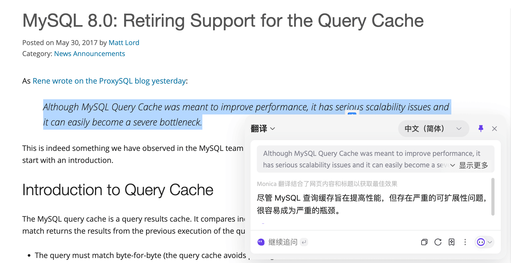

## ⭐️MySQL Logs

Answers to the questions in this section are available in the **Technical Interview Questions** section of [Java Interview Guide (paid; use the link for a discount)](https://javaguide.cn/zhuanlan/java-mian-shi-zhi-bei.html).

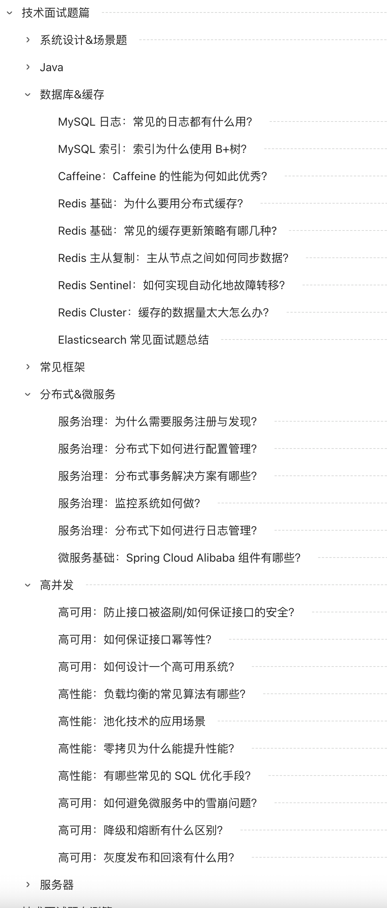

Article: <https://www.yuque.com/snailclimb/mf2z3k/zr4kfk> (get the password at <https://t.zsxq.com/avfM0>).

## ⭐️MySQL Transactions

### What Is a Transaction?

Suppose we need to insert several related records into a database. The process can encounter problems such as:

- The database crashes partway through.
- A network issue prevents the client from connecting to the database.
- Concurrent threads overwrite each other's changes.
- And so on.

Any of these problems can lead to inconsistent data. A system needs a way to handle them, and transactions provide a standard mechanism. Transactions originated in databases, but the concept is now widely used.

**What is a transaction?** In short, **a transaction is a logical group of operations that either all succeed or all fail.**

The classic example is a bank transfer. Suppose Alex transfers 1,000 units of currency to Sam. The transfer has two operations, and both must succeed or both must fail:

1. Subtract 1,000 from Alex's balance.
2. Add 1,000 to Sam's balance.

A transaction treats these operations as one logical unit. They either both succeed or both fail, preventing Alex's balance from decreasing without Sam's balance increasing.


### What Is a Database Transaction?

Unless a **distributed transaction** is specified, “transaction” usually refers to a **database transaction**.

Database transactions are common in everyday development, especially in monolithic applications.

**What does a database transaction do?**

A database transaction groups multiple database operations (SQL statements) into one logical unit. The operations **either all succeed or none are applied**.

```sql
# Start a transaction
START TRANSACTION;
# Multiple SQL statements
SQL1,SQL2...
## Commit the transaction
COMMIT;
```

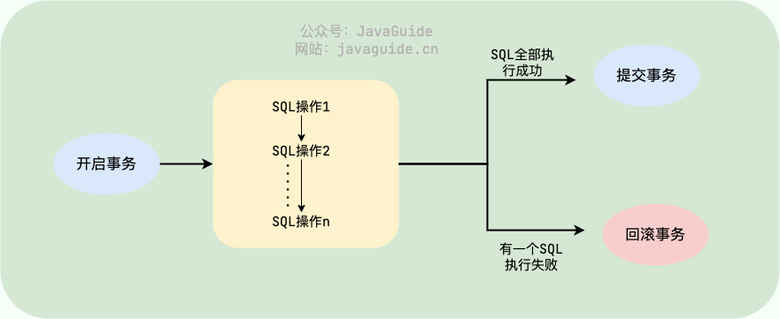

Transactions in relational databases such as `MySQL`, `SQL Server`, and `Oracle` have the **ACID** properties:

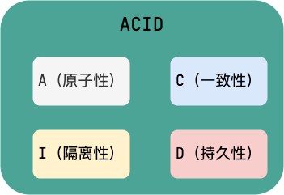

1. **Atomicity**: A transaction is indivisible. Either all its operations complete or none take effect.
2. **Consistency**: Data remains consistent before and after a transaction. For example, a transfer should preserve the combined balance of the sender and recipient whether it succeeds or fails.
3. **Isolation**: Concurrent transactions do not interfere with one another; each behaves as though it were independent.
4. **Durability**: Once committed, a transaction's changes persist, even if the database fails.

🌈 One clarification: **Consistency depends on durability, atomicity, and isolation. In other words, A, I, and D are the means; C is the goal.** I found this distinction clarifying in Zhou Zhiming's open course, [Software Architecture](https://time.geekbang.org/opencourse/intro/100064201).

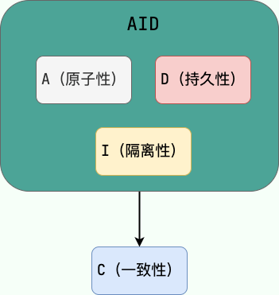

The author of [_Designing Data-Intensive Applications_ (DDIA)](https://book.douban.com/subject/30329536/) also writes:

> Atomicity, isolation, and durability are properties of the database, whereas consis‐
> tency (in the ACID sense) is a property of the application. The application may rely
> on the database’s atomicity and isolation properties in order to achieve consistency,
> but it’s not up to the database alone.
>
> In other words, atomicity, isolation, and durability are properties of the database, while consistency (in the ACID sense) is a property of the application. An application may rely on database atomicity and isolation to achieve consistency, but consistency does not depend on the database alone. Therefore, C is not a database property in ACID.

_Designing Data-Intensive Applications_ is well worth reading, and many readers return to it more than once. A Chinese translation is available on GitHub: [https://github.com/Vonng/ddia](https://github.com/Vonng/ddia).


### What Problems Can Concurrent Transactions Cause?

In a typical application, multiple transactions run concurrently and may operate on the same data. Concurrency is necessary, but it can cause the following problems.

#### Dirty Read

A transaction modifies data, and that uncommitted change becomes visible to other transactions. If another transaction reads it and the first transaction later rolls back, the second transaction has read data that was never committed. This is a dirty read.

For example, Transaction 1 reads `A=20` and changes it to `A=A-1`. Transaction 2 reads `A=19`. Transaction 1 then rolls back, so the change was never committed and `A` remains 20.

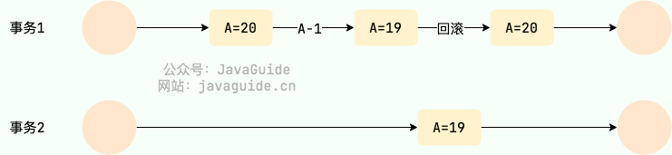

#### Lost Update

When one transaction reads data and another transaction also accesses it, both may later modify it. If the second write overwrites the first, the first transaction's update is lost. This is called a lost update.

For example, Transaction 1 and Transaction 2 both read `A=20`. Transaction 1 changes it to `A=A-1`, then Transaction 2 does the same. The final value is `A=19`, so Transaction 1's update is lost.

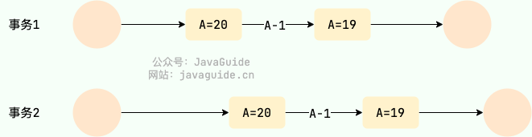

#### Non-Repeatable Read

This occurs when a transaction reads the same data more than once, while another transaction modifies it before the first transaction ends. The first transaction may then get different values from its reads.

For example, Transaction 1 reads `A=20`. Transaction 2 also reads `A=20`, then Transaction 1 changes `A` to `19`. When Transaction 2 reads again, it gets `A=19`, which differs from its first read.

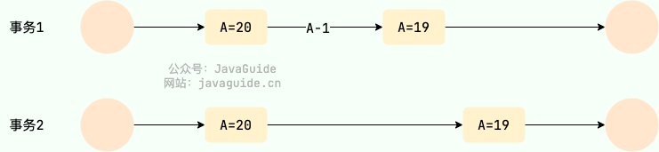

#### Phantom Read

Phantom reads are similar to non-repeatable reads. They occur when a transaction reads a range of rows and another concurrent transaction inserts rows into that range. A later query by the first transaction returns rows that were not there before, as if they had appeared like phantoms.

For example, Transaction 2 reads a range of data. Transaction 1 inserts a row in that range. When Transaction 2 reads the range again, it finds an additional row.

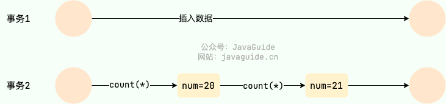

### What Is the Difference Between Non-Repeatable Reads and Phantom Reads?

- **Non-repeatable read**: Another transaction updates or deletes a row, so a repeated read in the same transaction returns different contents or finds that the row no longer exists.
- **Phantom read**: Repeating a range query in the same transaction returns a different set of rows because matching rows have appeared or disappeared.

Phantom reads can be viewed as a special case of non-repeatable reads. They are treated separately because the solutions differ.

For example, `DELETE` and `UPDATE` can lock existing records to protect a transaction. A record lock cannot lock a row that does not yet exist, so preventing an `INSERT` requires a gap lock. In other words, InnoDB uses next-key locks (record lock + gap lock) to prevent phantom reads during inserts.

### How Does MySQL Control Concurrent Transactions?

MySQL controls concurrent transactions mainly through **locks** and **MVCC**. Locks are a form of pessimistic control; multiversion concurrency control (MVCC) can be viewed as optimistic control.

With **locks**, MySQL explicitly controls access to shared resources. It mainly uses **read/write locks** for concurrency control.

- **Shared lock (S lock)**: Also called a read lock. A transaction acquires it when reading a record. Multiple transactions can hold shared locks at the same time.
- **Exclusive lock (X lock)**: Also called a write lock. A transaction acquires it when modifying a record. Only one transaction can hold an exclusive lock on a record, and no other lock can be acquired on that record while it is held.

Read/write locks allow concurrent reads but not concurrent reads and writes or concurrent writes on the same locked resource. Locks are also classified by granularity as **table-level locks** and **row-level locks**. InnoDB supports both and defaults to row-level locks. Because row locks cover only the relevant records, they generally allow better write concurrency. Both table-level and row-level locks can be shared (S) or exclusive (X).

**MVCC** stores multiple versions of data and uses transaction visibility rules to determine which version each transaction can see. A version allocator typically assigns a unique version number to each row version.

MySQL implements MVCC using **hidden columns, read views, and undo logs**.

- **Undo log**: Records previous versions of a row.
- **Read view and hidden columns**: Determine whether a row version is visible to the transaction.

For details about InnoDB's MVCC implementation, see [How InnoDB Implements MVCC](./innodb-implementation-of-mvcc.md).

### Which Transaction Isolation Levels Does the SQL Standard Define?

The SQL standard defines four transaction isolation levels to balance isolation and concurrency. Higher isolation can improve consistency but may reduce concurrency:

- **READ UNCOMMITTED**: The lowest level. It allows reads of uncommitted changes, which may cause dirty reads, phantom reads, and non-repeatable reads. It is rarely used because it provides weak consistency guarantees.
- **READ COMMITTED**: Allows reads of changes committed by concurrent transactions. It prevents dirty reads, but phantom and non-repeatable reads may still occur. This is the default isolation level in many databases, including Oracle and SQL Server.
- **REPEATABLE READ**: Repeated reads of the same row return the same result unless the transaction itself changed the data. It prevents dirty and non-repeatable reads, though phantom reads may still occur. This is InnoDB's default isolation level. InnoDB also uses MVCC and next-key locks to prevent most phantom reads at this level.
- **SERIALIZABLE**: The highest isolation level. Transactions execute as if they were serialized, preventing dirty reads, non-repeatable reads, and phantom reads.

| Isolation level  | Dirty read | Non-repeatable read | Phantom read               |
| ---------------- | ---------- | ------------------- | -------------------------- |
| READ UNCOMMITTED | √          | √                   | √                          |
| READ COMMITTED   | ×          | √                   | √                          |
| REPEATABLE READ  | ×          | ×                   | √ (standard) / ≈× (InnoDB) |
| SERIALIZABLE     | ×          | ×                   | ×                          |

### What Is MySQL's Default Isolation Level?

InnoDB's default isolation level is **REPEATABLE READ**. Check it with:

- Before MySQL 8.0: `SELECT @@tx_isolation;`
- MySQL 8.0 and later: `SELECT @@transaction_isolation;`

```sql
mysql> SELECT @@tx_isolation;
+-----------------+
| @@tx_isolation  |
+-----------------+
| REPEATABLE-READ |
+-----------------+
```

For details, see [MySQL Transaction Isolation Levels](./transaction-isolation-level.md).

### Are MySQL Isolation Levels Implemented with Locks?

MySQL isolation levels are implemented using both locks and MVCC.

`SERIALIZABLE` uses locks. `READ COMMITTED` and `REPEATABLE READ` rely on MVCC, but other levels may also use locks. For example, `REPEATABLE READ` uses locking reads for current reads to prevent phantom reads.

## MySQL Locks

Locks are a common way to control concurrent transactions.

### What Is the Difference Between Table-Level and Row-Level Locks?

MyISAM supports only table-level locks, which lock the entire table and perform poorly with concurrent writes. InnoDB supports both table-level and row-level locks and defaults to row-level locks.

Row-level locks have finer granularity and lock only the relevant rows, allowing InnoDB to handle concurrent writes more effectively.

**Comparison:**

- **Table-level lock**: The coarsest lock in MySQL other than a global lock. It locks the whole table, is simple and inexpensive to acquire, and cannot deadlock. However, conflicts are common and performance can be poor under high concurrency. Both MyISAM and InnoDB support table locks.
- **Row-level lock**: The finest-grained MySQL lock. It **locks index records** relevant to the current operation. This reduces conflicts and allows more concurrency, but has greater overhead, takes longer to acquire, and can deadlock. Row-level locks are implemented by the storage engine.

### What Should You Know When Using Row-Level Locks?

InnoDB row locks apply to index records, while table-level locks apply to non-indexed columns. When running `UPDATE` or `DELETE`, if the `WHERE` condition does not use a unique index or the index cannot be used, MySQL may scan the entire table and lock all rows. Watch for this in application code.

Even when an index exists, the optimizer may still choose a full table scan.

### What Types of Row Locks Does InnoDB Support?

InnoDB row locks are implemented by locking records on index pages. InnoDB supports three types:

- **Record lock**: Locks an individual row record.
- **Gap lock**: Locks a range between records, excluding the records themselves.
- **Next-key lock**: Combines a record lock and a gap lock. It locks a range including the record and is mainly used to prevent phantom reads. A record lock protects only existing records; a gap lock prevents new records from being inserted into the range.

**At InnoDB's default `REPEATABLE READ` isolation level, row locks use next-key locks by default. When the operation uses a primary key or unique index, InnoDB may optimize a next-key lock into a record lock, locking only the index record rather than the range.**

### What Are Shared and Exclusive Locks?

Both table-level and row-level locks can be shared (S) or exclusive (X):

- **Shared lock (S lock)**: Also called a read lock. Multiple transactions can hold it on the same record at once.
- **Exclusive lock (X lock)**: Also called a write lock. Only one transaction can hold it on a record, and no other lock is compatible with it.

An exclusive lock is incompatible with all other locks. A shared lock is compatible only with another shared lock.

|        | S lock     | X lock   |
| :----- | :--------- | :------- |
| S lock | Compatible | Conflict |
| X lock | Conflict   | Conflict |

Because of MVCC, InnoDB does not lock rows for an ordinary `SELECT`. Use these statements to acquire shared or exclusive locks explicitly:

```sql
# Shared lock; supported in MySQL 5.7 and MySQL 8.0
SELECT ... LOCK IN SHARE MODE;
# Shared lock; supported in MySQL 8.0
SELECT ... FOR SHARE;
# Exclusive lock
SELECT ... FOR UPDATE;
```

### What Are Intention Locks Used For?

When acquiring a table lock, MySQL needs to know whether rows in the table already have row locks. Checking every row would be too slow, so it uses intention locks to determine quickly whether a table lock can be acquired.

Intention locks are table-level locks. There are two types:

- **Intention shared lock (IS lock)**: A transaction intends to acquire shared locks (S locks) on some rows. It must first acquire an IS lock on the table.
- **Intention exclusive lock (IX lock)**: A transaction intends to acquire exclusive locks (X locks) on some rows. It must first acquire an IX lock on the table.

**The storage engine manages intention locks; users cannot acquire them directly. Before locking a row, InnoDB first acquires the corresponding intention lock on the table.**

Intention locks are compatible with one another.

|         | IS lock    | IX lock    |
| ------- | ---------- | ---------- |
| IS lock | Compatible | Compatible |
| IX lock | Compatible | Compatible |

Intention locks conflict with table-level shared and exclusive locks, but do not conflict with row-level shared or exclusive locks.

|        | IS lock    | IX lock  |
| ------ | ---------- | -------- |
| S lock | Compatible | Conflict |
| X lock | Conflict   | Conflict |

The corresponding description in _MySQL Technology: InnoDB Storage Engine_ appears to contain a typo.

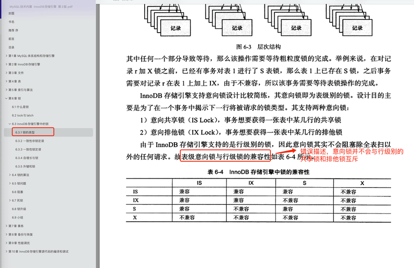

### What Is the Difference Between Current Reads and Snapshot Reads?

**A snapshot read** (a consistent nonlocking read) is a regular `SELECT`, excluding these locking reads:

```sql
# Exclusive lock; supported in MySQL 5.7 and MySQL 8.0
SELECT ... FOR UPDATE
# Shared lock; supported in MySQL 5.7 and MySQL 8.0
SELECT ... LOCK IN SHARE MODE;
# Shared lock; supported in MySQL 8.0
SELECT ... FOR SHARE;
```

A snapshot is a historical version of a record. A row may have multiple historical versions through multiversioning.

For a snapshot read, if the row is being updated or deleted, the read does not wait for its X lock to be released. It reads a snapshot of the row instead.

InnoDB uses consistent nonlocking reads only at the `READ COMMITTED` (RC) and `REPEATABLE READ` (RR) isolation levels:

- At `READ COMMITTED`, a consistent nonlocking read returns the latest snapshot of a locked row.
- At `REPEATABLE READ`, it returns the row version from the start of the transaction.

Snapshot reads suit workloads that prioritize performance and do not require the latest committed version for every read.

**A current read** (a consistent locking read) acquires an X or S lock on the row.

Common current-read statements include:

```sql
# Acquire an X lock on the row being read
SELECT...FOR UPDATE
# Acquire an S lock on the row being read
SELECT...LOCK IN SHARE MODE
# Acquire an S lock on the row being read
SELECT...FOR SHARE
# Acquire an X lock on the row being modified
INSERT...
UPDATE...
DELETE...
```

### What Is the AUTO-INC Lock?

> This is a lower-priority topic; a basic understanding is enough.

Relational database tables often have an auto-incrementing primary key. InnoDB uses a special table-level lock for auto-increment columns called the **AUTO-INC lock**.

```sql
CREATE TABLE `sequence_id` (
  `id` BIGINT(20) UNSIGNED NOT NULL AUTO_INCREMENT,
  `stub` CHAR(10) NOT NULL DEFAULT '',
  PRIMARY KEY (`id`),
  UNIQUE KEY `stub` (`stub`)
) ENGINE=InnoDB DEFAULT CHARSET=utf8mb4;
```

More precisely, any `AUTO_INCREMENT` column may involve this lock, not just a primary key; non-primary-key columns can also auto-increment.

When a transaction inserts data into a table with an auto-increment column, it may first acquire an AUTO-INC lock and block if the lock is unavailable. This is one possible behavior; the lock's implementation varies by mode. Set `innodb_autoinc_lock_mode` (introduced in MySQL 5.1.22) to one of these values:

| innodb_autoinc_lock_mode | Description                                 |
| :----------------------- | :------------------------------------------ |
| 0                        | Traditional mode                            |
| 1                        | Consecutive mode (default before MySQL 8.0) |
| 2                        | Interleaved mode (default since MySQL 8.0)  |

In interleaved mode, “INSERT-like” statements (`INSERT`, `REPLACE`, `INSERT…SELECT`, `REPLACE…SELECT`, and `LOAD DATA`) do not use a table-level lock. They use a lightweight mutex instead, allowing multiple insert statements to run concurrently with better speed and scalability.

However, if MySQL replication uses the `STATEMENT` binlog format, do not use interleaved mode. Concurrent insert statements may execute in an order that cannot be preserved during replication, causing inconsistent data.

> With the `STATEMENT` binlog format, MySQL replication synchronizes the SQL statements themselves.

For more, see [Why MySQL Auto-Increment Primary Keys Are Not Monotonic or Continuous](https://draveness.me/whys-the-design-mysql-auto-increment/).

## ⭐️MySQL Performance Tuning

For MySQL performance tuning guidelines, see [MySQL Performance Tuning Recommendations](./mysql-high-performance-optimization-specification-recommendations.md).

### Can MySQL Store Files Directly, Such as Images?

Yes. You can store a file's binary data directly, but this is generally not recommended because it can hurt database performance and consume substantial storage.

Consider a managed file storage service from a cloud provider. These services are mature, reliable, and relatively inexpensive.


You can also host your own file storage service with open-source projects such as FastDFS or MinIO (recommended) to provide distributed file storage.

**Store only file references in the database; let a file storage service store the files.**

### How Can MySQL Store IP Addresses?

Convert IP addresses to integers before storing them to improve performance and reduce storage use.

MySQL provides two functions for handling IP addresses:

- `INET_ATON()`: Converts an IP address to an unsigned integer (4–8 bytes).
- `INET_NTOA()`: Converts an integer to an IP address.

Before inserting a record, use `INET_ATON()` to convert the IP address to an integer. When displaying the value, use `INET_NTOA()` to convert it back to an address.

### What Are Common SQL Optimization Techniques?

The **Technical Interview Questions** section of [Java Interview Guide (paid)](https://javaguide.cn/zhuanlan/java-mian-shi-zhi-bei.html) has a detailed, clear overview of common SQL optimization techniques.

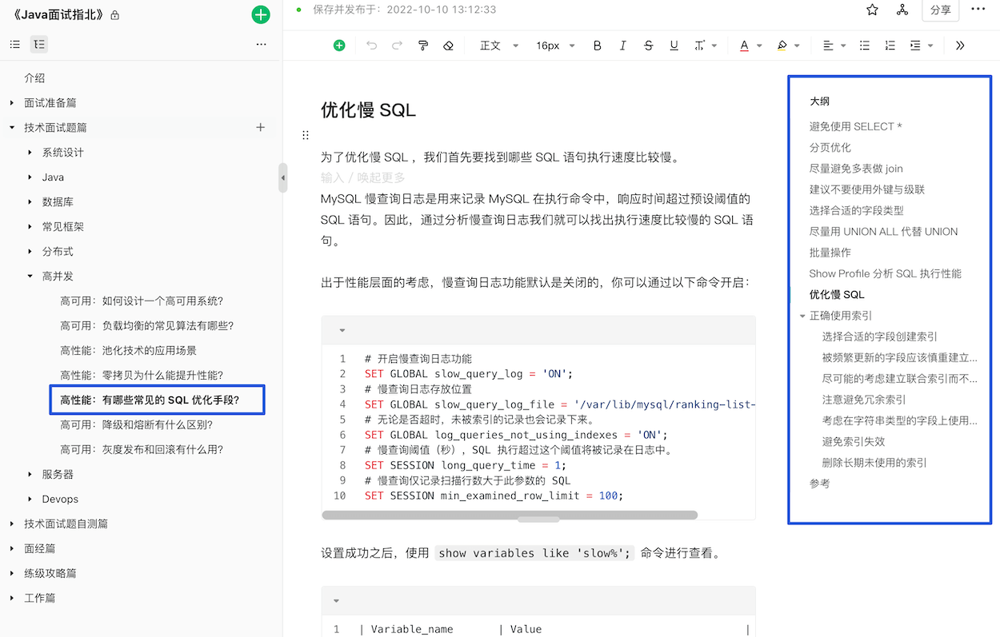

Article: <https://www.yuque.com/snailclimb/mf2z3k/abc2sv> (get the password at <https://t.zsxq.com/avfM0>).

### How Do You Analyze SQL Performance?

Use `EXPLAIN` to analyze a query's **execution plan**, which describes how MySQL runs a statement after optimizing it.

`EXPLAIN` does not execute the statement. It uses the **query optimizer** to analyze the statement, choose a plan, and display information about it.

`EXPLAIN` supports `SELECT`, `DELETE`, `INSERT`, `REPLACE`, and `UPDATE` statements, but it is most commonly used to analyze `SELECT` queries.

Here is a brief example of using `EXPLAIN`.

An `EXPLAIN` result looks like this:

```sql
mysql> EXPLAIN SELECT `score`,`name` FROM `cus_order` ORDER BY `score` DESC;
+----+-------------+-----------+------------+------+---------------+------+---------+------+--------+----------+----------------+
| id | select_type | table     | partitions | type | possible_keys | key  | key_len | ref  | rows   | filtered | Extra          |
+----+-------------+-----------+------------+------+---------------+------+---------+------+--------+----------+----------------+
|  1 | SIMPLE      | cus_order | NULL       | ALL  | NULL          | NULL | NULL    | NULL | 997572 |   100.00 | Using filesort |
+----+-------------+-----------+------------+------+---------------+------+---------+------+--------+----------+----------------+
1 row in set, 1 warning (0.00 sec)
```

The columns mean:

| **Column**    | **Meaning**                                                       |
| ------------- | ----------------------------------------------------------------- |
| id            | Identifier for the `SELECT` query sequence                        |
| select_type   | Type of `SELECT` query                                            |
| table         | Table used                                                        |
| partitions    | Matching partitions; `NULL` for unpartitioned tables              |
| type          | Table access method                                               |
| possible_keys | Indexes that might be used                                        |
| key           | Index actually used                                               |
| key_len       | Length of the selected index                                      |
| ref           | Column or constant compared with the index for an equality lookup |
| rows          | Estimated number of rows to read                                  |
| filtered      | Estimated percentage of rows remaining after filtering            |
| Extra         | Additional information                                            |

This is a brief introduction to MySQL execution plans. For details, see [MySQL Execution Plan Analysis](./mysql-query-execution-plan.md).

### What Are Read/Write Splitting and Database/Table Sharding?

Read/write splitting and database/table sharding are common interview topics. See [Read/Write Splitting and Database/Table Sharding](../../high-performance/read-and-write-separation-and-library-subtable.md).

### How Can Deep Pagination Be Optimized?

[Deep Pagination: Overview and Optimization](../../high-performance/deep-pagination-optimization.md)

### How Can Hot and Cold Data Be Separated?

[Hot and Cold Data Separation](../../high-performance/data-cold-hot-separation.md)

### How Do You Optimize MySQL Performance?

MySQL performance tuning is a broad discipline. In an interview, you cannot cover every aspect, so start with the core problem and expand from there to show how you analyze and solve it.

**1. Start with the core: identify and analyze slow SQL**

The first step in performance tuning is to find the bottleneck. In an interview, start with **identifying and analyzing slow SQL** to show both your problem-solving approach and familiarity with database monitoring:

- **Monitoring tools**: Describe tools such as the **MySQL slow query log** and **Performance Schema**, and explain how you use them to locate problems.
- **`EXPLAIN`**: Explain how you inspect query plans and index usage. Use an example to show how you interpret execution order, index selection, and full table scans.

**2. Expand the analysis: indexes, schema, and SQL**

After identifying a slow query, optimize the specific causes. Discuss techniques for indexes, table design, and SQL style:

- **Index tuning**: Explain index design, covering indexes, and the leftmost prefix rule. Use examples from your project to show how you chose suitable indexes.
- **Schema design**: Choose suitable column types, avoid redundant columns, and use normalization or denormalization where appropriate.
- **SQL tuning**: Avoid `SELECT *`, select only required columns, consider joins instead of subqueries, optimize pagination, and batch operations where suitable.

**3. Advanced options: architecture changes**

If the interviewer wants to discuss architecture-level tuning, you can cover strategies such as:

- **Read/write splitting**: Route reads and writes to different database instances to increase concurrency.
- **Database/table sharding**: Distribute data across database instances or tables to reduce table size and improve queries. Use it carefully because it adds complexity and maintenance costs.
- **Hot/cold data separation**: Store infrequently accessed or less important data on lower-cost, lower-performance storage, and frequently accessed data on faster storage.
- **Caching**: Cache frequently accessed data in memory with middleware such as Redis to reduce database load. This is common and can be highly cost-effective.

**4. Other tuning techniques**

You can also mention other techniques to show a broader understanding of MySQL performance tuning:

- **Connection pool configuration**: Set appropriate values for connection pool size and timeouts to avoid unnecessary connection overhead.
- **Hardware**: Higher-performance servers, more memory, and **SSD** storage can improve overall database performance.

**5. Summary**

In an interview, cover slow-query analysis, [index tuning](./mysql-index.md), schema design, and [SQL optimization](../../high-performance/sql-optimization.md) in that order. Treat architecture changes such as [read/write splitting and sharding](../../high-performance/read-and-write-separation-and-library-subtable.md) and [hot/cold data separation](../../high-performance/data-cold-hot-separation.md) as later options. Use them only when a clear bottleneck justifies their added complexity and maintenance cost.

## Recommended MySQL Study Resources

[**Recommended books**](../../books/database.md#mysql)

**Recommended articles:**

- [Yishuyixi's MySQL tutorial series](https://mp.weixin.qq.com/mp/appmsgalbum?__biz=Mzg3NTc3NjM4Nw==&action=getalbum&album_id=2372043523518300162&scene=173&from_msgid=2247484308&from_itemidx=1&count=3&nolastread=1#wechat_redirect)
- [Yes's MySQL tutorial series](https://mp.weixin.qq.com/mp/appmsgalbum?__biz=MzkxNTE3NjQ3MA==&action=getalbum&album_id=1903249596194095112&scene=173&from_msgid=2247490365&from_itemidx=1&count=3&nolastread=1#wechat_redirect)
- [How This Article Improved My SQL Tuning Skills](https://juejin.cn/post/7161964571853815822) — Biancheng Paixing, 2022
- [InnoDB Locks Explained in Depth](https://juejin.cn/post/7094049650428084232) — Jianti luo de xiao nan hai, 2022
- [Are MySQL Auto-Increment Primary Keys Always Continuous?](https://mp.weixin.qq.com/s/qci10h9rJx_COZbHV3aygQ) — Feitian xiao niurou
- [Understanding the Internals of MySQL Indexes](https://zhuanlan.zhihu.com/p/113917726) — Tencent Technology Engineering, 2020

## References

- _High Performance MySQL_, Chapter 7: Advanced MySQL Features
- _MySQL Technology: InnoDB Storage Engine_, Chapter 6: Locks
- Relational Database：<https://www.omnisci.com/technical-glossary/relational-database>
- [How Many Characters Can MySQL VARCHAR Store?](https://www.cnblogs.com/zhuyeshen/p/11642211.html)
- [Understanding Phantom Reads and Isolation Levels](https://opensource.actionsky.com/20210818-mysql/)
- MySQL Server Logs - MySQL 5.7 Reference Manual：<https://dev.mysql.com/doc/refman/5.7/en/server-logs.html>
- Redo Log - MySQL 5.7 Reference Manual：<https://dev.mysql.com/doc/refman/5.7/en/innodb-redo-log.html>
- Locking Reads - MySQL 5.7 Reference Manual：<https://dev.mysql.com/doc/refman/5.7/en/innodb-locking-reads.html>
- [Understanding Row and Table Locks](https://zhuanlan.zhihu.com/p/52678870)
- [The Role of Intention Locks in MySQL InnoDB](https://juejin.cn/post/6844903666332368909)
- [MySQL AUTO-INC Locks Explained](https://juejin.cn/post/6968420054287253540)
- [How Should Non-Repeatable Reads and Phantom Reads Be Distinguished?](https://www.zhihu.com/question/392569386)

<!-- @include: @article-footer.snippet.md -->
