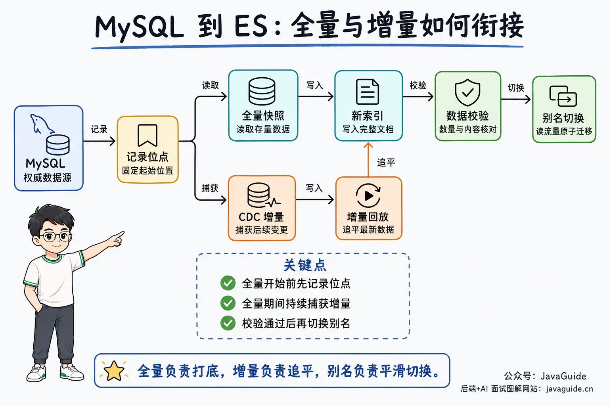
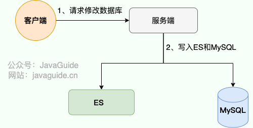
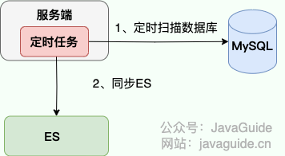
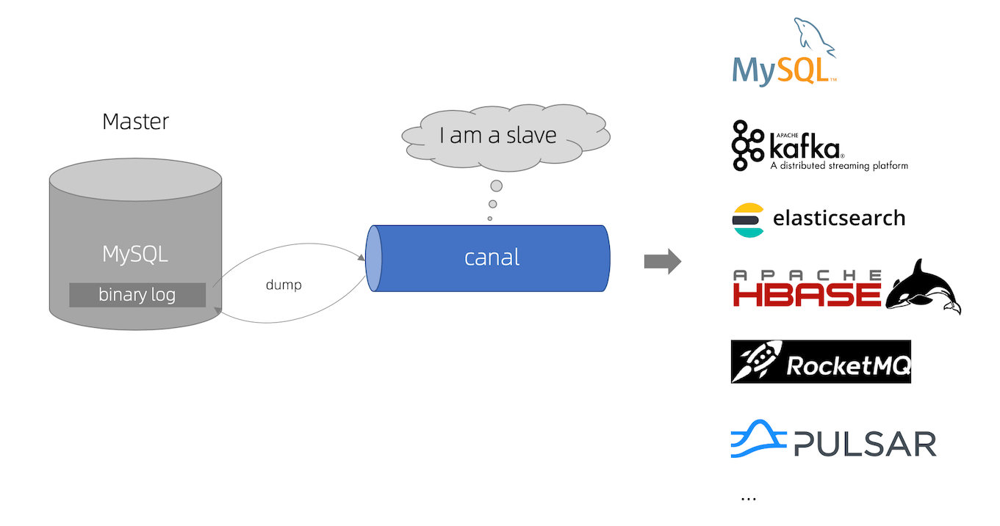
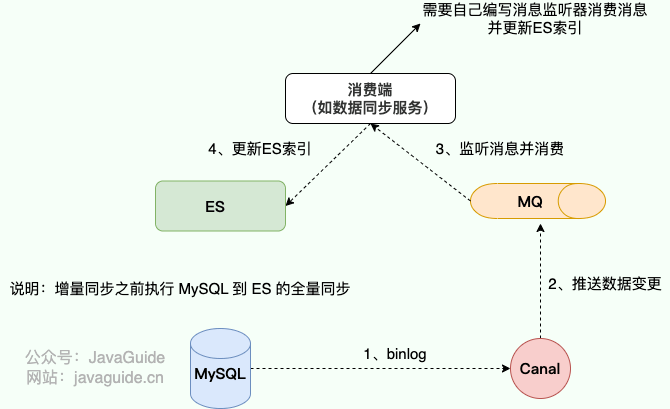
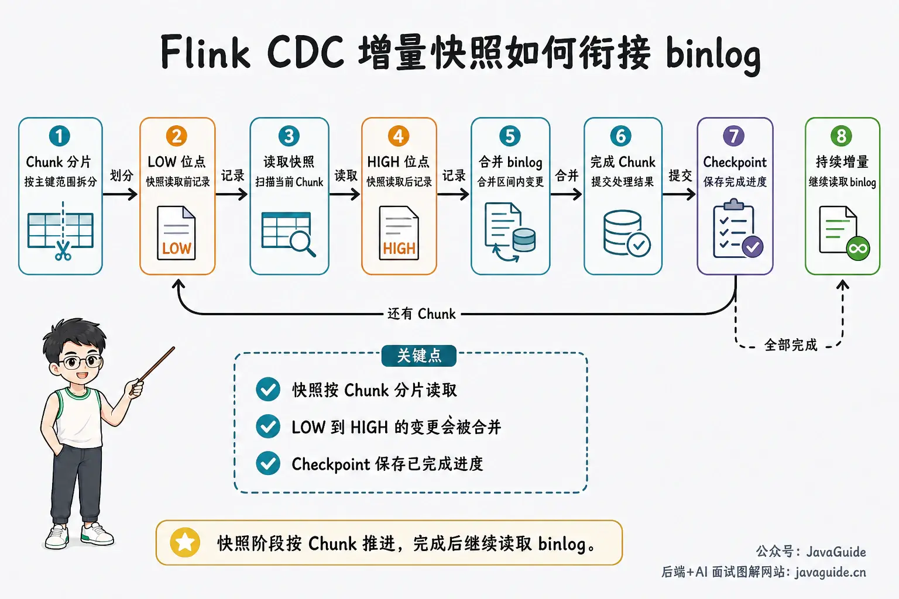
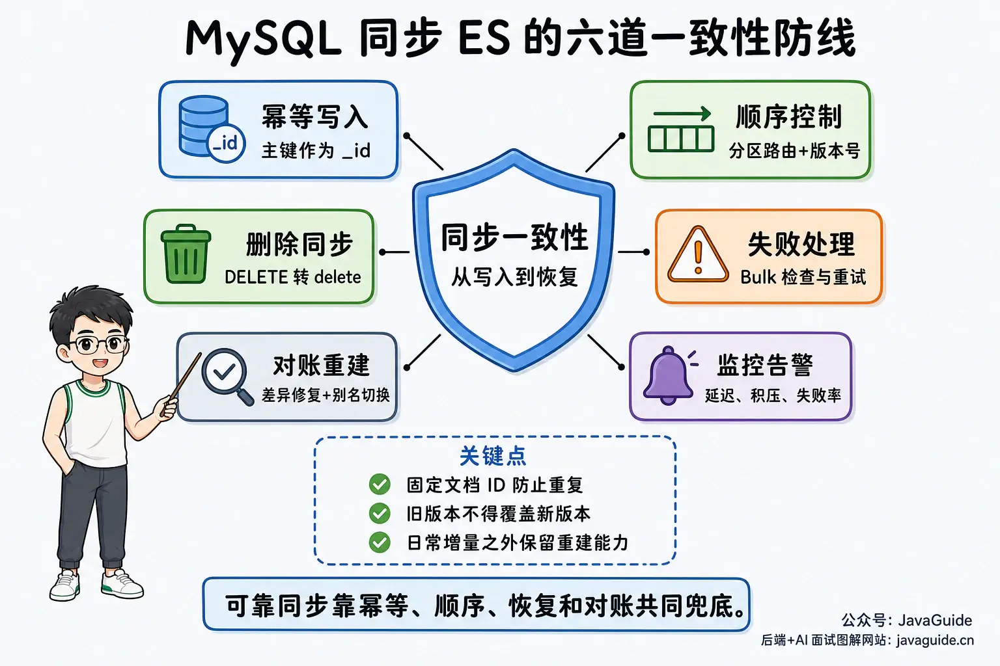

MySQL is well suited to transaction processing, while Elasticsearch is designed for full-text and complex searches. Many systems use MySQL as the authoritative data source, then organize the fields needed for search into documents in Elasticsearch.

This approach raises several questions:

- How should existing MySQL data be imported during the initial deployment?
- How should inserts, updates, and deletes in MySQL continue to update Elasticsearch?
- How can the sync process prevent old data from overwriting new data when messages are redelivered, arrive out of order, or processing is interrupted?
- How can an index be rebuilt and switched over smoothly when its structure changes or data becomes inconsistent?

A practical sync design must account for **full synchronization, incremental synchronization, failure recovery, and data validation**. Addressing only one part can cause problems during deployment or recovery.

## Define the Synchronization Goal

Synchronization from MySQL to Elasticsearch usually has two parts:

- **Full synchronization**: Read existing MySQL data and build a complete Elasticsearch index. This is common during initial deployment, index rebuilds, and data repair.
- **Incremental synchronization**: Continuously capture committed MySQL `INSERT`, `UPDATE`, and `DELETE` operations and update the corresponding Elasticsearch documents.

These approaches are often combined. For example, first import ten million historical records, then continue consuming changes from the binlog position recorded when the full import began until the sync catches up.

An acknowledged Elasticsearch write does not mean the document is immediately searchable. Elasticsearch uses `refresh` to make new documents visible to searches, so end-to-end latency includes change capture, message queuing, processing, the Elasticsearch write, and `refresh`. Elasticsearch calls this [near real-time search](https://www.elastic.co/docs/manage-data/data-store/near-real-time-search).



## Define the Synchronization Contract Before Choosing a Tool

The same synchronization tool can behave differently depending on the data model and consistency requirements. Before choosing a tool, define the following:

- **Authoritative data source**: MySQL is usually authoritative, while Elasticsearch stores a rebuildable search view. Business services should not bypass MySQL to modify authoritative fields in Elasticsearch.
- **Document construction rules**: Specify which tables and columns make up each document, where its `_id` comes from, and which documents must be rebuilt after changes to each table.
- **Delete semantics**: Decide whether physical deletes, logical deletes, and business-level invalidation should delete the Elasticsearch document, preserve a deletion marker, or rebuild the document.
- **Ordering and versions**: Choose the partition key and version source for each document to prevent retries, concurrency, or multiple pipelines from letting stale values overwrite newer ones.
- **Latency and recovery targets**: Define the acceptable normal delay, how quickly the pipeline should catch up after an outage, and how to reinitialize if required binlogs or MQ messages have expired.
- **Field types and null values**: Define how amounts, unsigned integers, dates, enums, and empty strings are written to Elasticsearch. Distinguish missing fields, `null`, and empty values.
- **Source database resource limits**: Estimate connections, concurrency, and disk I/O for full scans. Decide whether to read from the primary or a read replica, and set throttling and pause conditions for sync jobs.
- **Schema change process**: Decide who updates mappings when fields, types, or analyzers change, and in what order the application, sync job, and index template are deployed.

Acceptance testing should check more than whether the total row counts match. Cover inserts, updates, physical and logical deletes, duplicate and out-of-order messages. Also pause Elasticsearch or the sync job and verify that it catches up after recovery. Exercise the full process of loading a new index, catching up on incremental changes, validating data, switching aliases, and rolling back. Each part of the synchronization contract should map to a test case or monitoring metric.

## Comparing Common Approaches

| Approach                      | Full sync                  | Incremental sync  | Advantages                                                                            | Challenges                                                           | Suitable for                                                 |
| ----------------------------- | -------------------------- | ----------------- | ------------------------------------------------------------------------------------- | -------------------------------------------------------------------- | ------------------------------------------------------------ |
| Application-level dual writes | No                         | Yes               | Simple implementation and a short pipeline                                            | No atomic commit, changes to business code, and out-of-order writes  | Simple, low-volume systems that tolerate brief inconsistency |
| Transactional outbox + MQ     | No                         | Yes               | Business updates and event records share a transaction                                | Still requires full import, delivery, and consumer components        | Applications already using event-driven architecture         |
| Scheduled sync                | Yes                        | Conditional scans | Simple and low operational cost                                                       | Higher latency; deletes and scan windows need extra handling         | Low-volume data with infrequent updates                      |
| Canal + consumer              | Must be handled separately | Yes               | Mature ecosystem; integrates with MQ and custom consumers                             | Requires managing positions, consumers, and full/incremental handoff | Incremental sync with existing Java/MQ infrastructure        |
| Debezium + Kafka              | Snapshot support           | Yes               | Mature Kafka Connect ecosystem and a consistent event format                          | More components; depends on Kafka Connect                            | Existing Kafka Connect or multi-source CDC platforms         |
| Flink CDC                     | Yes                        | Yes               | Automatically coordinates full and incremental sync; supports complex transformations | Higher deployment and state-management costs                         | Large datasets, streaming, or multi-table transformations    |

“Supported” in the table means only that the tool provides the capability; it does not guarantee the application's consistency requirements. The result also depends on the Elasticsearch write method, message ordering, checkpoints, retry policy, and index design.

## Application-Level Dual Writes

With application-level dual writes, business code updates MySQL and then calls the Elasticsearch API to update the index.



Assuming the writes happen in this order—MySQL first, then Elasticsearch—the outcomes may be:

| Scenario                                          | MySQL       | Elasticsearch | Outcome                    |
| ------------------------------------------------- | ----------- | ------------- | -------------------------- |
| Both writes succeed                               | Success     | Success       | Consistent                 |
| MySQL write fails                                 | Rolled back | Not attempted | Consistent                 |
| Application crashes after MySQL succeeds          | Success     | Not attempted | Inconsistent               |
| MySQL succeeds, Elasticsearch write fails         | Success     | Failure       | Inconsistent               |
| Elasticsearch write succeeds but client times out | Success     | Unknown       | Retries must be idempotent |

A MySQL transaction cannot roll back a write already committed to Elasticsearch, and Elasticsearch cannot participate in a regular local transaction with MySQL. Dual writes therefore usually provide only eventual consistency.

Direct dual writes also have two commonly overlooked problems.

The first is performance and availability. Each business request must wait for an additional Elasticsearch call, and Elasticsearch instability affects the main request path. Sending updates asynchronously through a thread pool, `CompletableFuture`, or a regular MQ can reduce request latency, but a process can still crash after the MySQL commit and before sending the message.

The second is out-of-order concurrent updates. Suppose a product record is updated to `v2` and then `v3`; the Elasticsearch requests may arrive in the opposite order, allowing stale `v2` to overwrite `v3`. Making writes asynchronous does not solve ordering by itself.

### Use a Transactional Outbox to Close the Transaction Gap

For more reliable synchronization, use a **Transactional Outbox**:

1. Update the business table and insert an outbox event in the same MySQL transaction.
2. A separate delivery process or CDC component reads the outbox table and sends events to an MQ.
3. The Elasticsearch consumer processes each message and records the result on success. On failure, it retries or sends the message to a dead-letter queue.

This ensures that the business data update and the pending event are either both committed or both rolled back. Debezium also provides an [Outbox Event Router](https://debezium.io/documentation/reference/stable/transformations/outbox-event-router.html) to capture and transform outbox events.

An outbox prevents events from being lost, but duplicate consumption, message ordering for the same business key, initial full loading, and data reconciliation still need to be handled.

## Scheduled Synchronization

For small datasets with infrequent updates, a scheduled job may be sufficient if the business can tolerate delays of minutes or even days. Personal blogs, internal knowledge bases, and small administrative search systems are typical use cases.



Scheduled synchronization does not need to scan the entire table every time. It can query incrementally by update time:

```sql
SELECT id, title, content, updated_at
FROM article
WHERE (
        updated_at > :last_updated_at
        OR (updated_at = :last_updated_at AND id > :last_id)
      )
  AND updated_at <= :task_cutoff
ORDER BY updated_at, id
LIMIT :batch_size;
```

Set `task_cutoff` at the start of the job, then save a composite cursor of `last_updated_at` and `last_id` after each batch. Keep using the same cutoff until the current run is complete. This avoids deep pagination and prevents records with identical `updated_at` values from being skipped.

Physical deletes leave no `updated_at` value, so scheduled incremental sync usually needs a logical-delete field, a deletion table, or periodic full validation. Otherwise, deleted MySQL data may remain in Elasticsearch indefinitely.

With Spring Task, run a job every Monday at midnight as follows:

```java
@Scheduled(cron = "0 0 0 ? * MON", zone = "Asia/Shanghai")
public void rebuildArticleIndex() {
    // Read MySQL in pages and write batches to a new Elasticsearch index
}
```

### Use Index Aliases for Full Rebuilds

Avoid deleting and rewriting the old index while users are querying it. A safer approach is:

1. Create a versioned index, such as `articles_v2`, and configure its `settings` and `mappings` in advance.
2. Load all MySQL data into the new index, then validate counts, sampled documents, and query results.
3. Apply incremental changes that occurred while the full load was running.
4. Atomically switch the application alias from the old index to the new one using the `_aliases` API.
5. Keep the old index for a while and remove it after verification.

```http
POST /_aliases
{
  "actions": [
    { "remove": { "index": "articles_v1", "alias": "articles", "must_exist": true } },
    { "add": { "index": "articles_v2", "alias": "articles" } }
  ]
}
```

Elasticsearch's [Aliases API](https://www.elastic.co/guide/en/elasticsearch/reference/current/aliases.html) can apply multiple alias changes atomically. However, an alias switch only migrates read traffic smoothly. If writes continue during the rebuild, capture them through binlog replay, dual writes, or a write pause.

## Binlog-Based CDC

Change Data Capture (CDC) reads the MySQL binlog and converts committed data changes into events for downstream consumers. This avoids maintaining Elasticsearch write logic in every business endpoint and is a common approach to incremental synchronization.

Check these settings before connecting a CDC tool:

- Enable the MySQL binlog and grant the CDC account the required replication and table-read permissions.
- Use a binlog format supported by the tool. Row-level change tools such as Canal, Debezium, and Flink CDC usually require `binlog_format=ROW`. Debezium explicitly requires `binlog_row_image=FULL`; check the required setting for the specific version of other tools. MySQL 8.4 defaults to `ROW`, but verify the actual configuration on older installations and managed database services.
- Set binlog retention to cover the longest expected recovery window. If a job is stopped until its required binlog has been purged, a new snapshot or full synchronization is usually required.
- Give each CDC client a unique `server_id`. For high availability failover, also verify GTID handling, position recovery, and the binlog configuration of the replica it connects to.
- Grant the CDC account only the replication, metadata, and table-read permissions required by the tool. Restrict the Elasticsearch account to writing to the target index or alias. Do not put credentials directly in task configuration committed to the repository.

### Canal

[Canal](https://github.com/alibaba/canal) emulates the MySQL Replica protocol, requests the binlog from MySQL, and parses it into structured change events.



Canal Server's main role is to subscribe to and parse incremental logs. A downstream service can consume events directly through Canal Client, or Canal can send them to an MQ such as Kafka or RocketMQ for a synchronization service to update Elasticsearch.



An MQ provides several benefits:

- It decouples Canal from the Elasticsearch consumer. Changes can accumulate in the MQ during a brief Elasticsearch outage.
- Events with the same business key can be routed to one partition to preserve ordering for that key.
- The consumer can combine messages and use the Elasticsearch Bulk API to reduce request overhead.
- Retaining messages allows failed data to be replayed or downstream systems to be rebuilt.

An MQ does not guarantee consistency by itself. The consumer must still define when to acknowledge messages, how to retry failures, whether retries are idempotent, and who repairs dead-letter data.

Canal Server primarily handles incremental subscriptions. Load the initial dataset with a custom paginated job or a bulk synchronization tool whose compatibility has been verified. The open-source [DataX](https://github.com/alibaba/DataX/tree/master/elasticsearchwriter) includes an ElasticsearchWriter, but its README says it was tested only with Elasticsearch 5.x. Before using it with Elasticsearch 7 or 8, verify mapping types, the client protocol, and write parameters. Canal Client Adapter has also provided ETL support for some downstream systems; verify that it supports the Elasticsearch version and mappings in use. When separate jobs handle full and incremental sync, recording and correctly bridging the binlog position is essential.

### Flink CDC

Flink CDC's MySQL Source can read a table snapshot and then continue consuming the binlog. It splits a table into chunks by a partition key and reads the snapshot in parallel. For each chunk, it records the `LOW` and `HIGH` binlog positions before and after the read, then merges changes from that interval to produce a consistent chunk result.

This incremental snapshot algorithm has several characteristics:

- Snapshot reads can run in parallel.
- Checkpoints are taken per chunk, allowing recovery from completed progress after a failure.
- It does not need to hold the global read lock acquired by `FLUSH TABLES WITH READ LOCK` throughout the snapshot.
- Binlog consumption continues automatically after the full snapshot, reducing the work needed to bridge positions manually.



As of Flink CDC 3.6, the official [MySQL Pipeline Connector](https://nightlies.apache.org/flink/flink-cdc-docs-release-3.6/docs/connectors/pipeline-connectors/mysql/) and [Elasticsearch Pipeline Connector](https://nightlies.apache.org/flink/flink-cdc-docs-release-3.6/docs/connectors/pipeline-connectors/elasticsearch/) can describe a MySQL-to-Elasticsearch pipeline. The Elasticsearch sink does not create indexes automatically, so prepare the index, mappings, and templates first.

The exactly-once semantics described in Flink CDC documentation mainly apply to the Source during snapshot and binlog reads. The Flink Elasticsearch Sink documentation provides at-least-once delivery: a checkpoint waits for submitted Elasticsearch requests to complete, but requests may be replayed after recovery. A fixed document ID and idempotent `index` or upsert operations direct duplicate writes to the same document. If events for a document can also arrive out of order, use source-side version numbers. Source-level exactly-once does not imply end-to-end exactly-once delivery from MySQL to Elasticsearch.

### Debezium

Debezium's MySQL Connector usually runs on Kafka Connect. On its first start, it can take a consistent snapshot, then continuously publish row-level change events to Kafka topics from the binlog position corresponding to that snapshot. Chunked incremental snapshots can also be triggered later as needed.

If the team already uses Kafka Connect or plans to route changes from multiple databases through Kafka, Debezium is simpler than building custom binlog parsing and event formats. Writing to Elasticsearch still requires an Elasticsearch Sink Connector or a custom consumer. Delete events, topic compaction, schema changes, and message transformations need separate design.

For details about snapshots and configuration, see the [Debezium MySQL Connector documentation](https://debezium.io/documentation/reference/stable/connectors/mysql.html).

## Production Considerations

Tool selection determines how changes reach downstream systems. Data correctness also depends on these implementation details.



### 1. Use the MySQL Primary Key as the Elasticsearch Document ID

Use a stable, unique business key as the Elasticsearch `_id`. Repeating an `index` or upsert operation for the same record updates the same document, making idempotent consumers easier to implement.

If Elasticsearch generates `_id` values, retried messages may create duplicate documents, and deletes may not target the right document.

### 2. Preserve Event Order for Each Document

Global ordering is usually expensive. Most MySQL-to-Elasticsearch pipelines need only to preserve the order of events for each document ID. A common approach is to partition the MQ by business key so that events for the same key go to one partition and are processed sequentially.

Rebalancing, retries, and multiple sync pipelines can still cause out-of-order events. If stale values must not overwrite newer ones, include a monotonically increasing business version in the event and Elasticsearch document, then discard stale versions before writing. The version must come from a reliable ordering source; local timestamps generated by different machines are not a safe substitute.

If the source version can be represented as a non-negative `long`, the Elasticsearch [Bulk API](https://www.elastic.co/docs/api/doc/elasticsearch/operation/operation-bulk) supports `version` and `version_type=external` for `index` and `delete` operations. Only a higher version can overwrite an existing document. Delete events must use the same version scheme; otherwise, a delayed update may recreate a deleted document. GTIDs, binlog filenames, and positions usually cannot be used directly as Elasticsearch external versions. Define a stable comparison rule before using them.

### 3. Handle Deletes Correctly

`INSERT` and `UPDATE` can usually be handled as upserts, but `DELETE` must be converted explicitly to an Elasticsearch delete operation. For logical deletes, decide whether to delete the document or keep it with `deleted=true`.

If the sync job filters on mutable fields such as `status` or `is_deleted`, handle records that matched before an update but no longer match afterward. A simple filter drops the new update event but does not delete the old Elasticsearch document. Either retain the state field and filter at query time, or detect the state transition and generate a delete event explicitly.

Aggregated documents built from multiple tables are especially easy to leave stale. For example, if a product document contains fields from product, brand, and category tables, deleting a category requires finding affected products and rebuilding their documents; deleting only the Elasticsearch document for the category ID is not enough.

### 4. Handle Documents Built from Multiple Tables

The binlog records row changes, while Elasticsearch commonly stores denormalized documents. A product document may combine data from product, brand, inventory, and tag tables.

When CDC captures a brand-name change, the pipeline needs to identify which products reference that brand. Common approaches include:

- Have the consumer query MySQL based on the change event and rebuild each affected document.
- Maintain a denormalized table in MySQL for search, then synchronize that table.
- Use a stream-processing engine such as Flink to maintain join state and generate downstream documents.

The first approach is straightforward, but MySQL lookup concurrency and caching need to be managed. The second adds the cost of maintaining a denormalized table. The third suits larger datasets and more complex joins, but state, checkpoints, and job upgrades require dedicated operations.

### 5. Check Individual Results in Bulk Writes

The Elasticsearch [Bulk API](https://www.elastic.co/guide/en/elasticsearch/reference/current/docs-bulk.html) can perform multiple `index`, `update`, and `delete` operations in one request, reducing network and request-processing overhead.

Some documents may fail even when the overall Bulk request succeeds. Consumers must inspect each item in `items`, not only the HTTP status code. Retry only transient errors such as network timeouts, 429, and some 5xx responses. Retrying mapping conflicts or invalid field formats is usually pointless; record the original message and send it to a dead-letter queue or a manual repair process.

There is no batch size that suits every system. Tune the number of documents, byte size, concurrency, and refresh frequency based on document size, shard count, Elasticsearch write queues, and load-test results.

When Elasticsearch writes more slowly than upstream changes arrive, propagate backpressure upstream: limit in-flight Bulk requests and consumer concurrency, and pause consumption or reduce the Source read rate if needed. Do not absorb the backlog in an unbounded in-memory queue; this only turns an Elasticsearch write bottleneck into an out-of-memory failure in the sync process. With an MQ, ensure message retention covers the longest expected backlog period.

### 6. Manage Mappings and DDL Changes

Adding a column to MySQL does not mean that the Elasticsearch mapping should automatically gain a field with the same name. Dynamic mapping may infer the wrong type for a date, number, or string, or cause a mapping explosion if the number of fields grows without control.

Design field mappings for the intended queries rather than mechanically converting MySQL types:

- Use `text` for names, titles, and descriptions that need full-text search. Add a `keyword` subfield when sorting, aggregation, or exact filtering is also required. Structured strings such as status codes, tags, and email addresses usually use `keyword` directly.
- Do not automatically convert amounts to `float` or `double`. Store integer values in the smallest currency unit, or use `scaled_float` with an appropriate precision. Define the conversion rule in the synchronization contract.
- MySQL `BIGINT UNSIGNED` can exceed the range of Elasticsearch `long`. Use `unsigned_long` or convert large values to `keyword`; do not allow silent overflow during serialization.
- MySQL `TIMESTAMP` is converted between the session time zone and UTC; `DATETIME` does not undergo the same automatic conversion. Fix the source session time zone and Elasticsearch date format, then test values across time zones and around daylight-saving transitions.
- Distinguish missing fields, `null`, empty strings, and empty arrays. Define how each is handled for `exists` queries, sorting, aggregations, and partial updates before writing the data.

Explicit mappings and index templates are usually better for production. When an incompatible field type or analyzer change is needed, create a new index, rebuild it, and switch the alias. CDC jobs must also define how to handle MySQL DDL events and the deployment order for code, index templates, and synchronization jobs.

### 7. Monitor Lag, Failures, and Binlog Retention

At a minimum, monitor:

- The gap between the current consumer position and the latest MySQL binlog position.
- MQ backlog size and the age of the oldest message.
- Elasticsearch Bulk success rate, individual failure reasons, retry count, and dead-letter count.
- Full-load read and write rates and remaining data volume.
- Whether remaining binlog retention exceeds the current backlog and recovery window.
- Elasticsearch cluster health, write rejections, disk watermarks, and refresh latency.

Set alert thresholds based on business latency targets and load-test baselines. Universal thresholds such as “lag over 60 seconds” or “failure rate over 1%” usually have no sound basis.

### 8. Reconcile Data Regularly and Keep Rebuild Capability

No message backlog does not guarantee consistent data. Incorrect synchronization rules, missed deletes, mapping conflicts, and manual Elasticsearch edits can all cause silent discrepancies.

Reconciliation can be done in stages:

1. Compare the number of active records in MySQL and Elasticsearch to find obvious differences.
2. Compare counts and summaries by primary key range or business partition to narrow down discrepancies.
3. Compare key fields in samples or hash normalized documents.
4. Pass differing keys to a repair job that rebuilds the corresponding documents instead of editing Elasticsearch manually.

Regardless of how reliable the incremental pipeline is, keep a process that can create a new index, perform a full load, catch up on incremental changes, validate the data, and switch the alias. This is useful both for data repair and for mapping or analyzer upgrades.

### 9. Prepare a Recovery Runbook

Deciding whether to retry or rebuild only after an alert fires can make an incident worse. Before deployment, document recovery steps for common failures and test that positions, checkpoints, MQ offsets, and index aliases work as expected.

| Failure scenario                                                    | Response                                                                                                                           | Avoid                                                                    |
| ------------------------------------------------------------------- | ---------------------------------------------------------------------------------------------------------------------------------- | ------------------------------------------------------------------------ |
| Elasticsearch is briefly unavailable or returns 429/5xx             | Pause or throttle writes, retain unacknowledged messages, retry with backoff, and check that the backlog shrinks after recovery.   | Commit the consumer position before a successful write.                  |
| Mapping conflict or invalid field format                            | Stop ineffective retries, record the original event and error, fix the template or transformation, then replay the affected event. | Retry the same deterministic error forever.                              |
| CDC job restarts and state is available                             | Recover from the saved checkpoint, binlog position, or MQ offset, and use idempotent writes to handle duplicates.                  | Clear state and start directly from the latest position.                 |
| Required binlog or messages have expired                            | Run a consistent snapshot or full rebuild and establish the full/incremental handoff again.                                        | Jump to the latest position and claim the data is consistent.            |
| Elasticsearch index is corrupted or sync rules change substantially | Create a new index, reload all data, catch up on changes, validate, and switch the alias.                                          | Patch the old index in place without a rollback point for query traffic. |

The runbook should also list owners, required permissions, the location of state files or checkpoints, how to replay dead-letter messages, and rollback conditions. After each drill, check for spikes in source database load, Elasticsearch write rejections, binlog expiration during recovery, or repeated replay of the same data.

## Choosing an Approach

- **Small dataset, infrequent updates, and high latency tolerance**: Use scheduled incremental sync with periodic full rebuilds.
- **Reliable domain events and MQ already in place**: Use a transactional outbox and MQ, then have a synchronization service consume events and update Elasticsearch.
- **Need reliable incremental MySQL changes, with Java and MQ expertise**: Canal + MQ + a custom consumer is often a good fit; design the full-load process separately.
- **Kafka Connect already in place, or multiple databases need a shared pipeline**: Consider Debezium.
- **Large dataset, automatic full/incremental handoff, streaming transformations, or complex multi-table conversion**: Consider Flink CDC.

Do not choose based only on tool throughput. First define acceptable search latency, recovery time, deployment complexity, document construction complexity, and the team's operational capacity. Then load-test with production-like data volumes and document structures.

## References

- [MySQL 8.4: Setting the Binary Log Format](https://dev.mysql.com/doc/refman/8.4/en/binary-log-setting.html)
- [Canal documentation](https://github.com/alibaba/canal)
- [Flink CDC 3.6：MySQL Pipeline Connector](https://nightlies.apache.org/flink/flink-cdc-docs-release-3.6/docs/connectors/pipeline-connectors/mysql/)
- [Flink CDC 3.6：Elasticsearch Pipeline Connector](https://nightlies.apache.org/flink/flink-cdc-docs-release-3.6/docs/connectors/pipeline-connectors/elasticsearch/)
- [Flink: Elasticsearch Sink fault-tolerance semantics](https://nightlies.apache.org/flink/flink-docs-stable/docs/connectors/datastream/elasticsearch/)
- [Debezium MySQL Connector](https://debezium.io/documentation/reference/stable/connectors/mysql.html)
- [Debezium Outbox Event Router](https://debezium.io/documentation/reference/stable/transformations/outbox-event-router.html)
- [Elasticsearch Bulk API](https://www.elastic.co/guide/en/elasticsearch/reference/current/docs-bulk.html)
- [Elasticsearch Aliases](https://www.elastic.co/guide/en/elasticsearch/reference/current/aliases.html)
- [Elasticsearch field data types](https://www.elastic.co/docs/reference/elasticsearch/mapping-reference/field-data-types)
- [Elasticsearch numeric field types](https://www.elastic.co/docs/reference/elasticsearch/mapping-reference/number)
- [MySQL 8.4: DATE, DATETIME, and TIMESTAMP types](https://dev.mysql.com/doc/refman/8.4/en/datetime.html)
- [Spring Framework: Task Execution and Scheduling](https://docs.spring.io/spring-framework/reference/integration/scheduling.html)

<!-- @include: @article-footer.snippet.md -->
