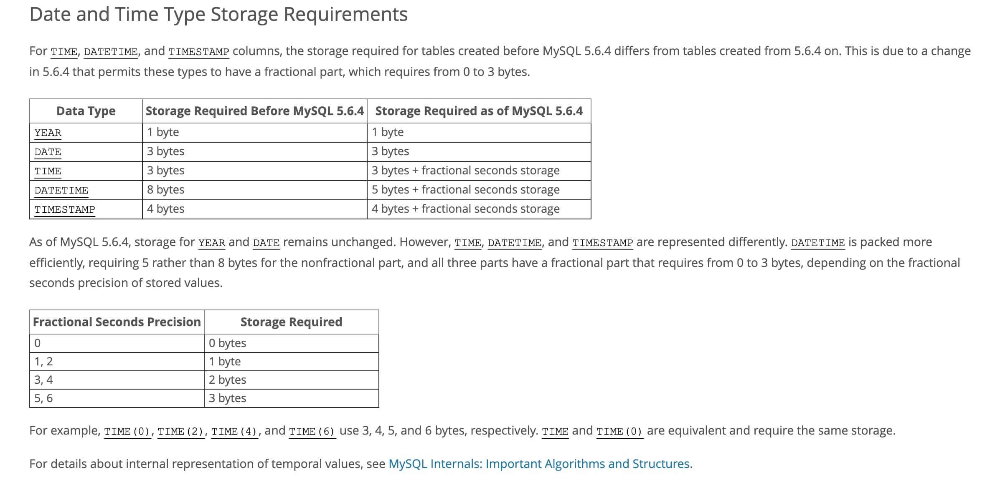
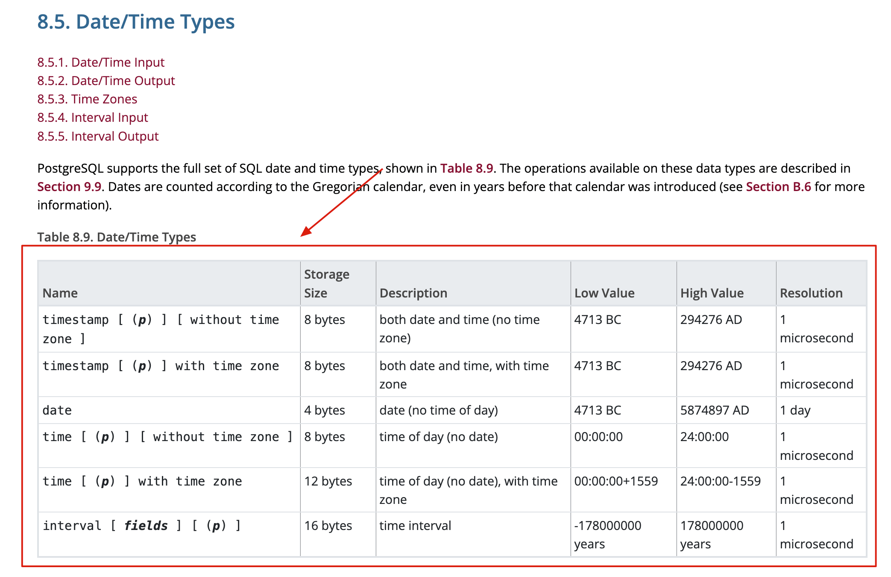
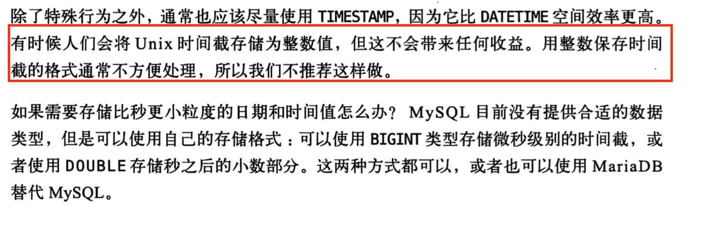

Storing time is a common requirement in software development. Whether recording when data changed, a financial transaction occurred, a trip started, or an order was placed, time is closely tied to business logic. Choosing the right MySQL date and time type can affect data accuracy and system stability.

This article reviews MySQL's time storage options to help developers choose the one that best fits their application.

## Do Not Store Dates as Strings

Like many people new to databases, I once tried storing dates and times as strings such as `VARCHAR`, assuming it would be simple and intuitive. A value such as `YYYY-MM-DD HH:MM:SS` looks clear and readable.

However, this approach has two main problems:

1. **Storage efficiency**: Strings usually require more storage than MySQL's native date and time types for the same information.
2. **Less efficient queries and calculations**:
   - **Complex and inefficient comparisons**: String dates are compared character by character in lexicographic order. This can be unintuitive (for example, `'2024-05-01'` sorts before `'2024-1-10'`) and less efficient than comparing native date and time values.
   - **Limited calculations**: You cannot use the database's date and time functions directly to calculate intervals or add and subtract dates. Values must first be converted, adding complexity.
   - **Weaker index performance**: String indexes are generally less efficient and flexible than native date and time indexes for range queries, such as finding records in a time interval.

## Choosing Between DATETIME and TIMESTAMP

`DATETIME` and `TIMESTAMP` are two common MySQL types for storing date and time values. Both store values with second-level precision; MySQL 5.6.4 and later also support fractional seconds. How should you choose between them?

Compare them across these dimensions:

### Time Zone Information

`DATETIME` stores a **literal date and time value** and **contains no time zone information**. When you insert a `DATETIME` value, MySQL stores the value as provided without converting it between time zones.

**What problem can this cause?** If an application supports multiple time zones, or the server or client time zone can change, the application must interpret and convert `DATETIME` values itself. Incorrect assumptions—for example, treating all stored values as belonging to one time zone after the environment changes—can cause errors in display and calculations.

**`TIMESTAMP` is time-zone-aware.** MySQL converts the value from the current session time zone to UTC (Coordinated Universal Time) for storage. When queried, it converts the stored UTC value back to the current session time zone for display.

The same `TIMESTAMP` value may therefore appear as different local times in sessions with different time zones, even though it represents the same instant. This is useful for applications that support multiple time zones.

Here is an example.

Create a table:

```sql
CREATE TABLE `time_zone_test` (
  `id` bigint(20) NOT NULL AUTO_INCREMENT,
  `date_time` datetime DEFAULT NULL,
  `time_stamp` timestamp NOT NULL DEFAULT CURRENT_TIMESTAMP ON UPDATE CURRENT_TIMESTAMP,
  PRIMARY KEY (`id`)
) ENGINE=InnoDB DEFAULT CHARSET=utf8;
```

Insert a row (assuming the session uses the system default time zone, such as UTC+0):

```sql
INSERT INTO time_zone_test(date_time,time_stamp) VALUES(NOW(),NOW());
```

Query the data in the same session time zone:

```sql
SELECT date_time, time_stamp FROM time_zone_test;
```

Result:

```plain
+---------------------+---------------------+
| date_time           | time_stamp          |
+---------------------+---------------------+
| 2020-01-11 09:53:32 | 2020-01-11 09:53:32 |
+---------------------+---------------------+
```

Now change the current session time zone to UTC+8:

```sql
SET time_zone = '+8:00';
```

Query the data again:

```bash
# The TIMESTAMP value is automatically converted to UTC+8
+---------------------+---------------------+
| date_time           | time_stamp          |
+---------------------+---------------------+
| 2020-01-11 09:53:32 | 2020-01-11 17:53:32 |
+---------------------+---------------------+
```

**Common MySQL time zone commands:**

```sql
# View the current session time zone
SELECT @@session.time_zone;
# Set the current session time zone
SET time_zone = 'Europe/Helsinki';
SET time_zone = "+00:00";
# View the global time zone
SELECT @@global.time_zone;
# Set the global time zone
SET GLOBAL time_zone = '+8:00';
SET GLOBAL time_zone = 'Europe/Helsinki';
```

### Storage Requirements

The following diagram shows the storage requirements of MySQL date and time types. See the [official documentation](https://dev.mysql.com/doc/refman/8.0/en/storage-requirements.html).



Before MySQL 5.6.4, `DATETIME` and `TIMESTAMP` used fixed storage sizes of 8 and 4 bytes, respectively. Since MySQL 5.6.4, their sizes vary with fractional-second precision: `DATETIME` uses 5–8 bytes and `TIMESTAMP` uses 4–7 bytes.

### Supported Range

`TIMESTAMP` has a smaller range and ends in 2038:

- `DATETIME`: '1000-01-01 00:00:00.000000' to '9999-12-31 23:59:59.999999'
- `TIMESTAMP`: '1970-01-01 00:00:01.000000' UTC to '2038-01-19 03:14:07.999999' UTC

### Performance

Because `TIMESTAMP` requires conversion between UTC and the current session time zone during storage and retrieval, it may incur additional computation, especially when the system needs to retrieve or process time zone information. Modern databases and operating systems optimize this process, but in some extremely high-concurrency or latency-sensitive workloads, `DATETIME` may have a slight performance advantage because it does not involve time zone conversion.

For predictable behavior and potentially lower conversion overhead, manage time zones consistently in the application or explicitly set `time_zone` at the connection or session level instead of relying on the server or operating system default.

## Are Numeric Timestamps a Better Choice?

In addition to these types, applications often store a Unix timestamp in an integer type (`INT` or `BIGINT`). It represents the number of seconds or milliseconds since 1970-01-01 00:00:00 UTC.

This approach shares some advantages with `TIMESTAMP`. Sorting and comparing dates can be efficient, and numeric values are easy to transfer between systems. However, they are much less readable because the stored value does not show the date and time directly.

The timestamp is defined as follows:

> A timestamp is an integer measured from a reference time: 1970-01-01 00:00:00 +00:00. The value increases over time, usually in seconds or milliseconds. It represents an absolute instant, so the same timestamp applies everywhere on Earth and requires no time zone conversion when transferred between systems. Convert it to a local time string only when displaying it to a user.

Example database operations:

```sql
-- Convert a date and time string to a Unix timestamp (seconds)
mysql> SELECT UNIX_TIMESTAMP('2020-01-11 09:53:32');
+---------------------------------------+
| UNIX_TIMESTAMP('2020-01-11 09:53:32') |
+---------------------------------------+
|                            1578707612 |
+---------------------------------------+
1 row in set (0.00 sec)

-- Convert a Unix timestamp (seconds) to a date and time value
mysql> SELECT FROM_UNIXTIME(1578707612);
+---------------------------+
| FROM_UNIXTIME(1578707612) |
+---------------------------+
| 2020-01-11 09:53:32       |
+---------------------------+
1 row in set (0.01 sec)
```

## PostgreSQL Does Not Have a DATETIME Type

Some readers asked about PostgreSQL (PG) date and time types, so this section provides a brief overview. See the [PostgreSQL documentation](https://www.postgresql.org/docs/current/datatype-datetime.html).



As shown above, PostgreSQL has no type named `DATETIME`:

- PostgreSQL's `TIMESTAMP WITHOUT TIME ZONE` is functionally closest to MySQL's `DATETIME`. It stores a literal date and time value without time zone information.
- PostgreSQL's `TIMESTAMP WITH TIME ZONE` (or `TIMESTAMPTZ`) is similar to MySQL's `TIMESTAMP`. It converts input values to UTC for storage and converts them to the session time zone for display when retrieved.

For most applications that need to record an exact instant, `TIMESTAMPTZ` is the most robust PostgreSQL choice because it handles time zone complexity well.

## Summary

Which type should you use to store time in MySQL: `DATETIME`, `TIMESTAMP`, or a numeric timestamp?

There is no single best choice. Numeric timestamps can be efficient and portable, but they are less readable.

The authors of _High Performance MySQL_ recommend `TIMESTAMP` because numeric timestamps are not easy to read. The passage is shown below:



Each option has advantages. Choose based on your use case. The table below compares them:

| Type              | Storage   | Format                         | Range                                                                | Includes time zone information |
| ----------------- | --------- | ------------------------------ | -------------------------------------------------------------------- | ------------------------------ |
| DATETIME          | 5–8 bytes | YYYY-MM-DD hh:mm:ss[.fraction] | 1000-01-01 00:00:00[.000000] to 9999-12-31 23:59:59[.999999]         | No                             |
| TIMESTAMP         | 4–7 bytes | YYYY-MM-DD hh:mm:ss[.fraction] | 1970-01-01 00:00:01[.000000] UTC to 2038-01-19 03:14:07[.999999] UTC | Yes                            |
| Numeric timestamp | 4 bytes   | Numeric, such as 1578707612    | After 1970-01-01 00:00:01                                            | No                             |

**Recommendations:**

- `TIMESTAMP` provides built-in time zone handling. MySQL stores values in UTC and converts them automatically based on the session time zone. Choose it when the application supports multiple time zones or should rely on the database for conversion, keeping the 2038 range limit in mind.
- Choose `DATETIME` when time zone conversion is not needed, the application should control time zone handling, or dates after 2038 must be represented.
- Choose a numeric timestamp when comparison performance or frequent cross-system transfer is a priority and reduced readability is acceptable (or values are always converted in the application).

<!-- @include: @article-footer.snippet.md -->
