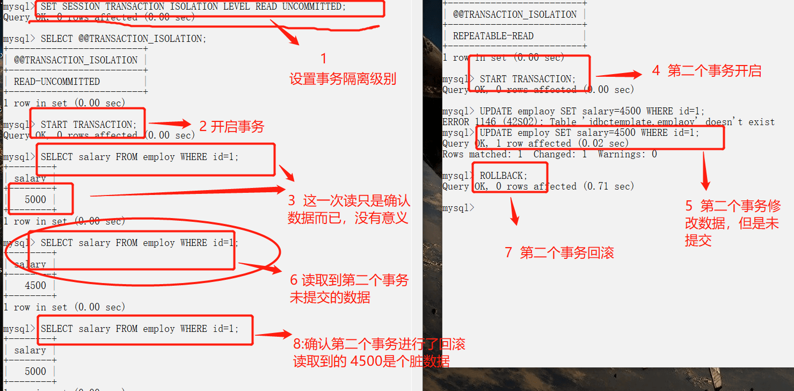
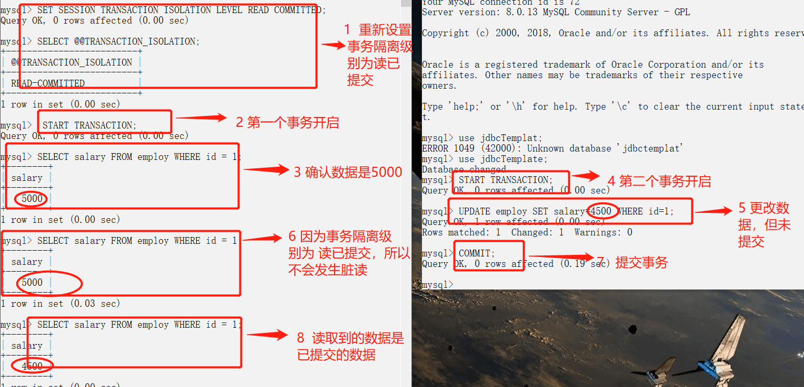
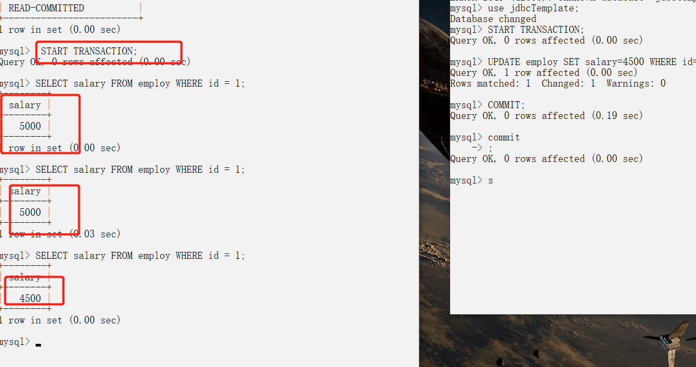
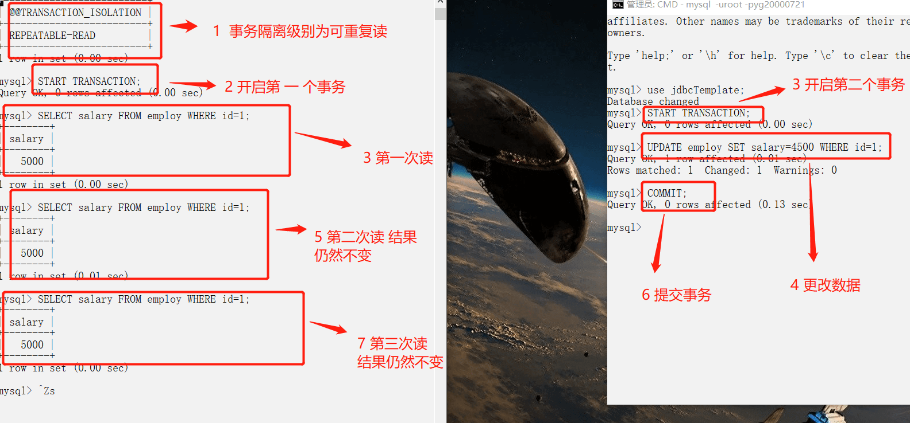
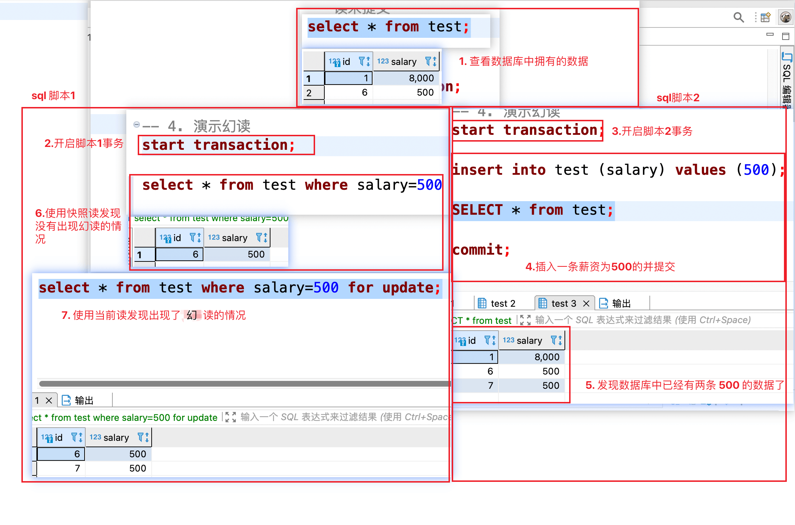

> Written by [SnailClimb](https://github.com/Snailclimb) and [guang19](https://github.com/guang19).

For an overview of transactions, see [MySQL Interview Questions: Core Concepts](./mysql-questions-01.md#MySQL-Transactions).

## Transaction Isolation Levels

The SQL standard defines four transaction isolation levels to balance isolation and concurrency. Higher isolation can improve consistency but may reduce concurrency:

- **READ UNCOMMITTED**: The lowest level. It allows reads of uncommitted changes, which may cause dirty reads, phantom reads, and non-repeatable reads. It is rarely used because it provides weak consistency guarantees.
- **READ COMMITTED**: Allows reads of changes committed by concurrent transactions. It prevents dirty reads, but phantom and non-repeatable reads may still occur. This is the default isolation level in many databases, including Oracle and SQL Server.
- **REPEATABLE READ**: Repeated reads of the same row return the same result unless the transaction itself changed the data. It prevents dirty and non-repeatable reads, though phantom reads may still occur. This is InnoDB's default isolation level. InnoDB also uses MVCC and next-key locks to prevent most phantom reads at this level.
- **SERIALIZABLE**: The highest isolation level. Transactions execute as if serialized, preventing dirty reads, non-repeatable reads, and phantom reads.

| Isolation level  | Dirty read | Non-repeatable read | Phantom read               |
| ---------------- | ---------- | ------------------- | -------------------------- |
| READ UNCOMMITTED | √          | √                   | √                          |
| READ COMMITTED   | ×          | √                   | √                          |
| REPEATABLE READ  | ×          | ×                   | √ (standard) / ≈× (InnoDB) |
| SERIALIZABLE     | ×          | ×                   | ×                          |

**Checking the default isolation level:**

InnoDB's default isolation level is **REPEATABLE READ**. Check it with:

- Before MySQL 8.0: `SELECT @@tx_isolation;`
- MySQL 8.0 and later: `SELECT @@transaction_isolation;`

```bash
mysql> SELECT @@transaction_isolation;
+-------------------------+
| @@transaction_isolation |
+-------------------------+
| REPEATABLE-READ         |
+-------------------------+
```

**How InnoDB's REPEATABLE READ Handles Phantom Reads:**

In the SQL standard, `REPEATABLE READ` does not prevent phantom reads. InnoDB largely avoids them at this level through these mechanisms:

- **Snapshot reads**: Ordinary `SELECT` statements use **MVCC**. A snapshot is created for the transaction, and subsequent snapshot reads use the same version, so they do not see rows inserted or modified by other transactions afterward.
- **Current reads**: Statements such as `SELECT ... FOR UPDATE`, `SELECT ... LOCK IN SHARE MODE`, `INSERT`, `UPDATE`, and `DELETE`. InnoDB uses **next-key locks** to lock scanned index records and the gaps between them, preventing other transactions from inserting rows in that range. A next-key lock combines a record lock and a gap lock.

Although higher isolation is often assumed to reduce concurrency, InnoDB uses MVCC to optimize `REPEATABLE READ`. For many read-only or read-heavy workloads, its performance **may not differ significantly from READ COMMITTED**. In write-heavy workloads with high contention, however, RR's gap locks may cause more lock waits than RC.

In some cases, such as distributed transactions that require strict consistency (XA transactions), InnoDB may require or recommend `SERIALIZABLE` to ensure global consistency.

Chapter 7.7 of _MySQL Technology: InnoDB Storage Engine, 2nd Edition_ states:

> The InnoDB storage engine supports XA transactions, which can be used to implement distributed transactions. A distributed transaction allows multiple independent transactional resources to participate in a global transaction. These resources are usually relational database systems, but may also be other types of resources. A global transaction requires all participating transactions either to commit or to roll back, extending the original ACID requirements. When using distributed transactions, the InnoDB transaction isolation level must also be set to `SERIALIZABLE`.

## Demonstration

The following example uses two MySQL command-line sessions to demonstrate a dirty read between concurrent transactions accessing the same data.

Transactions are enabled for autocommit by default in the MySQL command-line client, so each SQL statement is committed immediately. To start a transaction explicitly, use `START TRANSACTION`.

Set the isolation level with:

```sql
SET [SESSION|GLOBAL] TRANSACTION ISOLATION LEVEL [READ UNCOMMITTED|READ COMMITTED|REPEATABLE READ|SERIALIZABLE]
```

The following concurrency control statements are used in the examples:

- `START TRANSACTION` or `BEGIN`: Explicitly starts a transaction.
- `COMMIT`: Commits the transaction, making its database changes permanent.
- `ROLLBACK`: Ends the transaction and undoes all uncommitted changes.

### Dirty Read (READ UNCOMMITTED)



### Preventing Dirty Reads (READ COMMITTED)



### Non-Repeatable Read

The preceding `READ COMMITTED` example prevents dirty reads, but a non-repeatable read can still occur before the transaction ends.



### REPEATABLE READ



### Phantom Read

#### Demonstrating a Phantom Read



When Script 1 first queries for records with a salary of 500, it finds one row. Script 2 inserts another row with a salary of 500 and commits. Script 1 then performs a current read in the same transaction and finds two matching rows. This is a phantom read.

> Note: This example uses different read semantics: the first read is a snapshot read, while the second is a current read. Under RR, MVCC prevents phantoms in snapshot reads and next-key locks constrain current reads. Mixing snapshot and current reads in one transaction can still produce different results.

#### Preventing Phantom Reads

There are several ways to prevent phantom reads. The general idea is to prevent other transactions from inserting or deleting rows in the range while a transaction is working with it. Common approaches include:

1. Set the transaction isolation level to `SERIALIZABLE`.
2. At `REPEATABLE READ`, acquire a table lock on the table being accessed.
3. At `REPEATABLE READ`, use `Next-Key Lock` (record lock + gap lock) on the table being accessed.

### References

- _MySQL Technology: InnoDB Storage Engine_
- <https://dev.MySQL.com/doc/refman/5.7/en/>
- [MySQL Locks: Seven Key Questions](https://tech.youzan.com/seven-questions-about-the-lock-of-MySQL/)
- [Transaction Isolation Levels and Locks in InnoDB](https://tech.meituan.com/2014/08/20/innodb-lock.html)

<!-- @include: @article-footer.snippet.md -->
