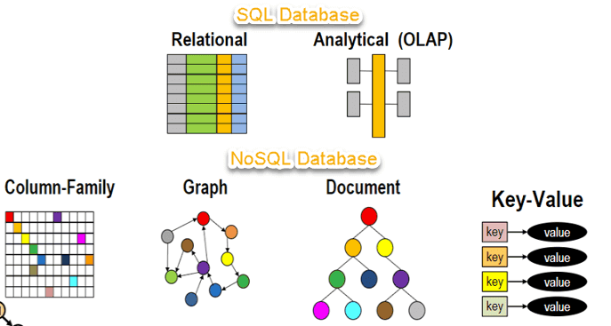
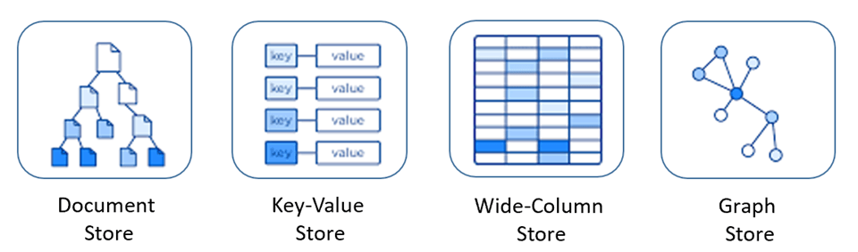

## What Is NoSQL?

NoSQL (short for “Not Only SQL”) refers broadly to non-relational databases, including key-value, document, and graph stores. NoSQL databases are designed for distributed operation and commonly support data replication and sharding to provide scalable, highly available, high-performance storage.

A common misconception is that NoSQL databases cannot store relational data well. They can store relational data, but organize it differently from relational databases.

Examples of NoSQL databases include HBase, Cassandra, MongoDB, and Redis.

## How Do SQL and NoSQL Differ?

|              | SQL databases                                                                                | NoSQL databases                                                                                                                              |
| :----------- | -------------------------------------------------------------------------------------------- | -------------------------------------------------------------------------------------------------------------------------------------------- |
| Data model   | Structured storage in tables with fixed rows and columns.                                    | Varies by type: JSON documents, key-value pairs, wide-column tables with dynamic columns, or graph nodes and edges.                          |
| History      | Developed in the 1970s, with a focus on reducing data duplication.                           | Gained popularity in the late 2000s, with a focus on scalability and reducing the cost of storing large data sets.                           |
| Examples     | Oracle, MySQL, Microsoft SQL Server, PostgreSQL.                                             | Document: MongoDB, CouchDB; key-value: Redis, DynamoDB; wide-column: Cassandra, HBase; graph: Neo4j, Amazon Neptune, Giraph.                 |
| ACID         | Provides atomicity, consistency, isolation, and durability (ACID).                           | Often trades ACID transactions for scalability and performance, though some systems, such as MongoDB, support them with different semantics. |
| Performance  | Often depends on the disk subsystem; optimize queries, indexes, and schema for best results. | Often depends on cluster hardware, network latency, and the calling application.                                                             |
| Scaling      | Vertical scaling, read/write separation, and sharding.                                       | Horizontal scaling by adding servers, often using sharding.                                                                                  |
| Query syntax | Structured Query Language (SQL).                                                             | Varies by database.                                                                                                                          |

## What Are the Advantages of NoSQL Databases?

NoSQL databases suit many modern applications, including mobile, web, and gaming, that need flexible, scalable, high-performance databases to deliver a strong user experience.

- **Flexibility:** NoSQL databases often have flexible schemas that support faster, iterative development. Their data models suit semi-structured and unstructured data.
- **Scalability:** NoSQL databases are often designed to scale horizontally across distributed clusters instead of vertically on larger, more expensive servers.
- **Performance:** NoSQL databases are optimized for specific data models and access patterns, which can improve performance over using a relational database for the same tasks.
- **Rich features:** NoSQL databases provide APIs and data types tailored to their data models.

## What Are the Main Types of NoSQL Databases?

NoSQL databases generally fall into four categories:

- **Key-value:** A simple database type in which each item consists of a key and a value. Applications control the contents of the value, making this a flexible data model. Redis and DynamoDB are popular key-value databases.
- **Document:** Stores data in documents similar to JSON (JavaScript Object Notation). Each document contains field-value pairs, and values can include strings, numbers, Booleans, arrays, or objects. Document structures often map naturally to objects used in application code. MongoDB is a popular document database.
- **Graph:** Designed for applications that work with highly connected data. Common use cases include social networks, recommendation engines, fraud detection, and knowledge graphs. Neo4j and Giraph are popular graph databases.
- **Wide-column:** Suited to storing large volumes of data. Cassandra and HBase are popular wide-column databases.

The following image is from Microsoft's documentation on [relational and NoSQL data](https://learn.microsoft.com/en-us/dotnet/architecture/cloud-native/relational-vs-nosql-data).

## References

- [What Is NoSQL? - MongoDB Documentation](https://www.mongodb.com/zh-cn/nosql-explained)
- [What Is NoSQL? - AWS](https://aws.amazon.com/cn/nosql/)
- [NoSQL vs. SQL Databases - MongoDB Documentation](https://www.mongodb.com/zh-cn/nosql-explained/nosql-vs-sql)

<!-- @include: @article-footer.snippet.md -->
