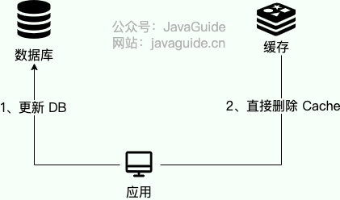
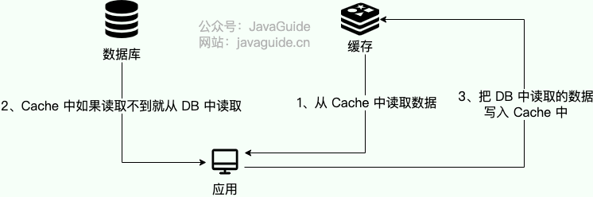
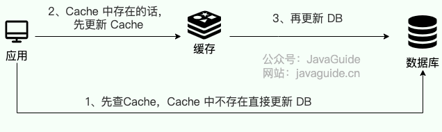
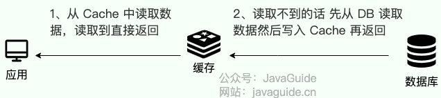

Many candidates list “**proficient with caching**” on their resumes, but struggle to explain the **three common cache read/write strategies** when asked.

This often happens because people learn Redis by writing simple demos without studying cache read/write strategies, or do not know these strategies exist.

Understanding these three common strategies is useful both when using caches at work and when discussing caching in interviews.

**Each of the following strategies has tradeoffs. There is no universally best choice; select one that fits the workload.**

### Cache Aside Pattern

This is the **most common and established** pattern in application development. It is widely used in web applications, especially for **read-heavy workloads**.

It is called **“aside”** because the application's **write operations bypass the cache and go directly to the database**.

The application coordinates data flow and must manage both the cache and the database.

The read and write steps are:

**Write:**

1. The application **updates the database and commits the transaction**.
2. After the commit succeeds, it **deletes the corresponding cache entry**.

The diagram shows the write flow.

**Read:**

1. The application reads from the cache.
2. On a cache hit, it returns the value.
3. On a cache miss, it reads from the database, **writes the value to the cache**, then returns it.

The diagram shows the read flow.

Knowing the basic steps is not enough; you should also understand how the pattern behaves.

An interviewer may ask:

1. Why update the database before deleting the cache? Can the order be reversed?
2. Is updating the database before deleting the cache always safe?
3. Why delete the cache instead of updating it?

The following sections answer these questions.

**1. Why update the database before deleting the cache? Can the order be reversed?**

**Answer:** Usually, no. If you delete the cache before updating the database, a concurrent read may load the old value and put it back in the cache.

- **Timeline (Request A writes; Request B reads):**
  1. Request A deletes the cache entry.
  2. Request B finds a cache miss, reads the **old value** from the database, and prepares to cache it.
  3. Request A writes the **new value** to the database and commits.
  4. Request B writes the previously read **old value** to the cache.
- **Result:** The database has the new value, but the cache has the old value.

**2. Is updating the database before deleting the cache always safe?**

**Answer:** No. This ordering can also cause **the database and cache to become inconsistent**.

- **Timeline (Request A reads; Request B writes):**
  1. Request A misses the cache and reads the **old value** from the database.
  2. Request B updates the database, commits the transaction, then deletes the cache entry.
  3. Request A writes its previously read **old value** to the cache.
- **Result:** The database has the new value, but the cache has the old value.
- **What affects the likelihood?** Whether the “read database → write cache” window overlaps with a write. Slow queries, thread pauses, and network delays can extend this window; do not assume the risk is negligible just because reads are usually faster than writes.

“Update the database first” means the **transaction must commit successfully**. If the cache is deleted after `UPDATE` inside a transaction method, but the transaction commits only after the method returns, other requests may still read the old value before the commit and repopulate the cache. An after-commit callback preserves ordering, but the process can still exit after the commit and before the callback runs, so failure recovery is still needed.

The freshness of the database value also matters. With read/write splitting, a replica may not have applied the primary's update yet. Under InnoDB's `REPEATABLE READ`, a long-running transaction with an existing snapshot may also continue to see an old version. For freshness-sensitive cache fills, consider reading from the primary in a new, short transaction instead of caching a value from an old snapshot. See the [MySQL documentation](https://dev.mysql.com/doc/refman/8.4/en/innodb-transaction-isolation-levels.html) for snapshot behavior.

**3. Why delete the cache instead of updating it?**

- **Write overhead**: A write may update only some fields of an object. Re-querying or recomputing the entire cached object can be expensive; deleting an entry is lightweight.
- **Lazy loading**: Deletion follows a lazy-loading approach. The next read loads the value from the database and repopulates the cache, avoiding unnecessary cache updates.
- **Avoid overwriting newer data with an older write**: Suppose A commits version 1, then B commits version 2 and updates the cache. If A's cache update arrives later, it can overwrite version 2 with version 1. Deleting the cache avoids writing a stale value directly, though stale cache fills still need to be handled.

This pattern assumes that cache entries can be rebuilt from the database, readers can fall back to the database on a cache miss, and the business can tolerate a period of stale reads. That period may occur after a commit but before cache deletion, or result from a failed deletion or stale cache fill; it is not necessarily brief. [Cache Aside does not guarantee that the cache and database are always consistent](https://learn.microsoft.com/en-us/azure/architecture/patterns/cache-aside).

**4. How should deletion failures and stale cache fills be handled?**

- **Make deletion failures recoverable.** Use a message queue or background job to retry invalidation, but publishing a message after committing the database can still fail if the process crashes between the two steps. For reliable coordination, use a **Transactional Outbox**: record a pending event in the same database transaction as the business update, then publish it asynchronously after commit. Alternatively, use CDC to trigger invalidation from committed changes. Repeating a delete is usually safe. Monitor backlog and retry failures, and provide a repair path. See [AWS guidance on the Transactional Outbox](https://docs.aws.amazon.com/prescriptive-guidance/latest/cloud-design-patterns/transactional-outbox.html).
- **Deletion retries alone cannot prevent stale cache fills.** A deletion may succeed, then an old request may write stale data to the cache afterward. A delayed second deletion can remove some late fills, but a fixed delay cannot cover arbitrarily long request pauses, transactions, or replication lag, and the second deletion can also fail. Delayed double deletion reduces risk but does not guarantee strong consistency.
- **TTL is a fallback, not a synchronization protocol.** After expiration, reload from the database. If the value still comes from a lagging replica or old snapshot, stale data gets a new TTL. Do not extend the TTL every time stale data is read, or it may persist indefinitely. Choose TTL based on the acceptable staleness window and database load.

If the business needs tighter control over concurrent cache fills, define a locking or version-check protocol that covers the relevant read and write paths. Locking only writes does not prevent an unlocked read from repopulating the cache. Comparing only the current cache version cannot detect a late stale value after the cache has been deleted; a separate version watermark may be needed. **Neither Redis locks nor Lua scripts make writes to Redis and MySQL one atomic transaction.** For operations that must read the latest committed state, define the authoritative read path and database isolation requirements.

Now consider the **limitations of Cache Aside**.

**Limitation 1: The first request is always a cache miss**

**Solution:** Preload highly popular data during startup or off-peak hours.

**Limitation 2: Frequent writes repeatedly invalidate cache entries and reduce the hit rate.**

**Possible responses:**

- First decide whether the data should be cached. If reads and writes are similarly frequent and the data is inexpensive to rebuild, querying the database directly may be simpler.
- If the cache must be updated proactively, handle concurrent write ordering and failure recovery, and set a suitable TTL. Locks and version checks can address some concurrency issues, but do not replace cross-system failure handling.

### Read/Write Through Pattern

In this pattern, the application treats the **cache as its primary storage**. All reads and writes go through the cache, which is responsible for synchronizing data with the database.

The database is **transparent** to the application, so application developers do not need to handle it directly.

This strategy is uncommon in everyday application development. Apart from performance concerns, a likely reason is that Redis, a widely used distributed cache, does not provide built-in cache-to-database writes. The application or middleware must implement that behavior.

**Write Through:**

- Check the cache. If the entry is absent, update the database directly.
- If the entry exists, update the cache first, then let the cache service update the database. Return success only after both writes succeed.

The diagram shows the write flow.

**Read Through:**

- The application reads from the cache.
- On a hit, the cache returns the value.
- On a miss, the **cache service** loads the value from the database, stores it in the cache, then returns it to the application.

The diagram shows the read flow.

Read Through wraps the Cache Aside pattern. With Cache Aside, the client writes a value to the cache after a miss. With Read Through, the cache service performs that write, hiding the behavior from the client.

In implementation terms, Read Through moves the “cache miss → read database → populate cache” logic inside the cache service.

Like Cache Aside, Read Through has a cache miss on the first request. Preload popular data to avoid it.

### Write Behind Pattern (Asynchronous Cache Writes)

The Write Behind (also called Write Back) pattern is similar to Read/Write Through: the cache service handles reads and writes for both the cache and database.

However, they differ in an important way: **Read/Write Through synchronously updates both the cache and database, while Write Behind updates the cache first and writes to the database asynchronously in batches.**

**Write Behind:**

1. The application writes to the cache and **returns immediately**.
2. The cache service adds the write to a queue.
3. A separate asynchronous thread or job **batches and combines** queued writes before applying them to the database.

This pattern can compromise consistency. For example, the system may crash before cached data is written back to the database. It is therefore unsuitable for use cases requiring strong consistency, such as payments or inventory.

However, asynchronous batching can provide **very high write throughput**. It is widely used in high-performance systems:

- **InnoDB Buffer Pool in MySQL**: Data changes are made in the in-memory Buffer Pool first, then flushed to disk asynchronously by a background thread.
- **Operating system page cache**: File writes first go to memory, then the operating system flushes them to disk asynchronously.
- **High-frequency counters**: For values such as article views or post likes, where brief inconsistency is acceptable but writes are frequent, increment counters quickly in Redis and synchronize them to the database periodically.

<!-- @include: @article-footer.snippet.md -->
