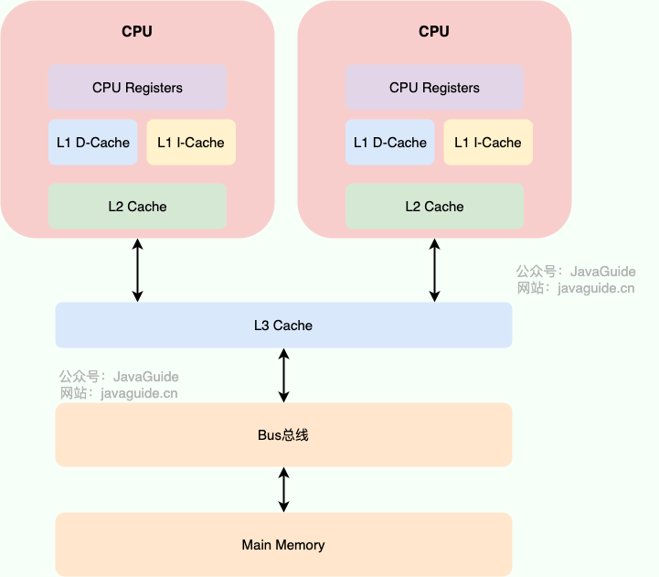
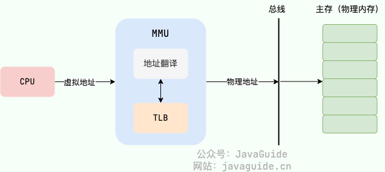
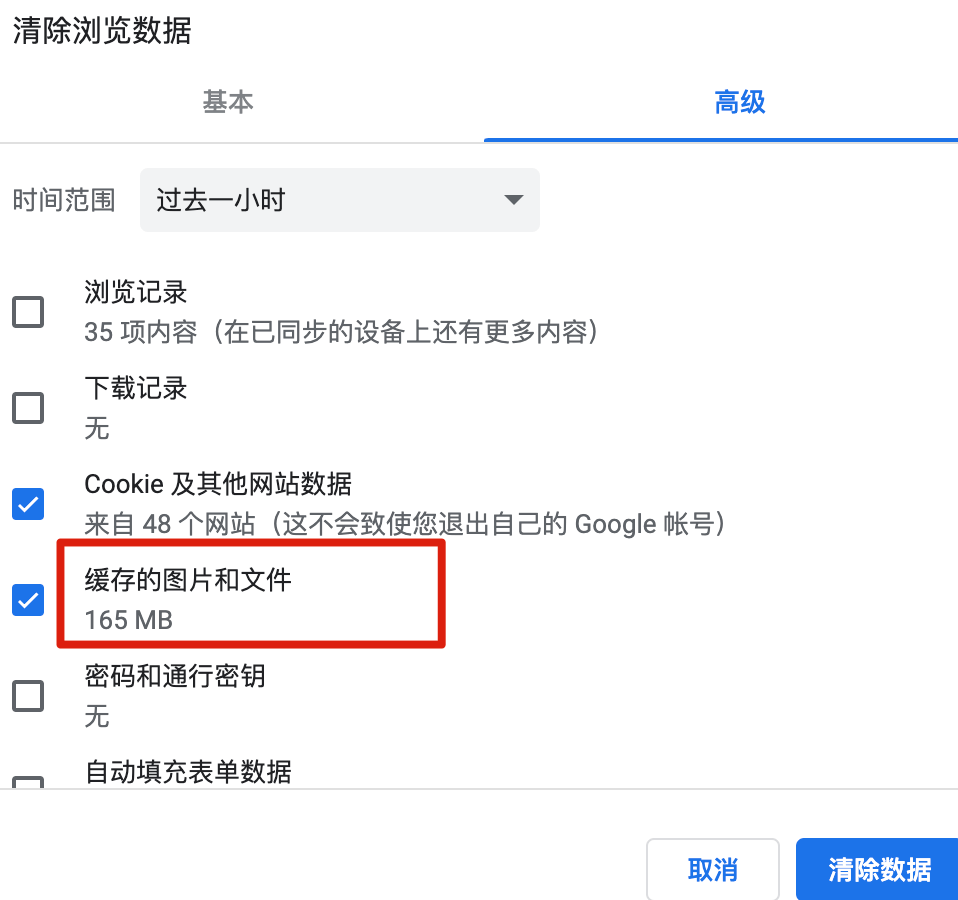
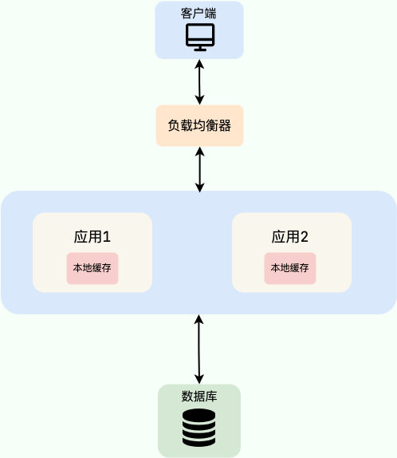
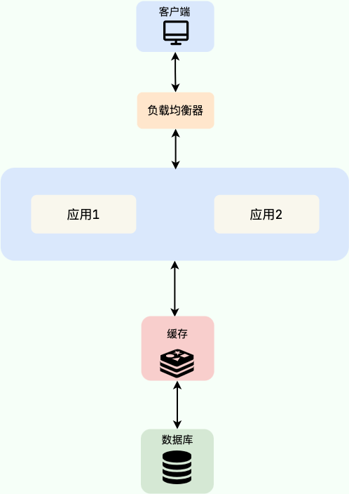
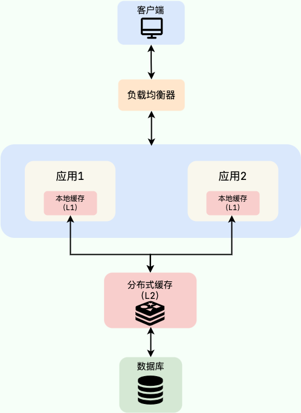

> **Related interview questions:**
>
> - Why use a cache?
> - How should you implement a local cache?
> - Why use a distributed cache instead of a local cache?
> - Why use a multilevel cache?
> - Which workloads suit multilevel caching?

## The Basic Idea Behind Caching

Many developers know that caching improves system performance and reduces **response time**, but may not know the core idea behind it.

Caching is a classic performance optimization that trades **space for time**. It stores data that may be reused or recomputed in additional storage, reducing the time needed to fetch or calculate it again.

Other examples of this trade-off include:

- **Indexes:** An index stores selected table columns in a separate data structure. It takes extra space but speeds up lookups and reduces sorting work.
- **Database denormalization:** Frequently joined data can be stored together to reduce joins and improve query performance.
- **CDNs (Content Delivery Networks):** Static resources are distributed to edge nodes for faster access and to reduce load and bandwidth use at the origin server.

These examples illustrate a useful design principle: connect related ideas when reasoning about performance. Explaining these trade-offs in an interview can also help show how you think about system design.

Caching is a common and cost-effective way to improve performance, but the idea is not limited to application systems. CPUs, operating systems, and many other systems use it.

For example, **CPU caches** store copies of memory data to bridge the speed gap between the CPU and main memory. Main memory also caches disk data to reduce the cost of slow disk **I/O**.



Similarly, operating systems use a **Translation Lookaside Buffer (TLB)**, also called a page-translation cache, to speed up virtual-to-physical address translation on top of page tables.



Web browsers cache previously accessed images and static files, so revisiting a page can load faster.



Application caches usually store data in **RAM**, which provides fast access. To protect against data loss after a restart or crash, many cache systems, including **Redis**, support disk persistence. Compared with relational databases such as **MySQL**, caches can provide much higher throughput and lower access latency. Adding a cache above a database can protect the underlying storage and increase system throughput.

## Types of Caches

Application caches generally fall into a few categories.

### Local Cache

#### What Is a Local Cache?

Local caches are common, especially in monolithic applications. They can work well when the data set is small and the application does not need to share cached data across a distributed deployment.

A local cache runs inside the application process. Because requests do not incur network overhead, access is very fast.

The diagram below shows a common setup: Nginx load balances requests across two instances of the same application. Both instances use the same database and maintain their own local caches.



**Note:** A clustered deployment that uses local caches must account for its load-balancing strategy. With Nginx's default **round-robin** strategy, a user's requests may reach different instances, reducing the local cache hit rate. Options include:

1. **At the gateway:** Use consistent hashing or sticky sessions to route a user's requests to the same instance.
2. **In the application:** Use local caches only for data that is nearly global and immutable, such as configuration dictionaries, rather than user-specific data.

#### Local Cache Options

**1. JDK `HashMap` and `ConcurrentHashMap`**

`ConcurrentHashMap` is a thread-safe alternative to `HashMap`. Both store key-value pairs, but neither is commonly used as a complete cache because they lack features such as expiration. A practical cache library should provide at least **expiration**, **eviction**, and **hit-rate statistics**.

**2. `Ehcache`, `Guava Cache`, and `Spring Cache`**

- `Ehcache` is heavier than the other options. It can be integrated with Hibernate and MyBatis for multilevel caching, persist cached data to local disk, and provide clustering support. Its clustering feature is often not useful in practice.
- `Guava Cache` and `Spring Cache` have similar use cases. `Guava Cache` is widely used and provides a convenient API, including expiration settings. Its implementation shares some design ideas with `ConcurrentHashMap`.
- `Spring Cache` annotations keep application code concise, but do not by themselves prevent cache penetration or memory exhaustion.

**3. Caffeine**

`Caffeine` generally offers better performance than `Guava Cache` and is often a good replacement. Its API is similar to Guava's.

The following example uses the builder pattern to create a Caffeine local cache:

```java
// Create a local cache with Caffeine
Cache<String, String> cache = Caffeine.newBuilder()
        // Expire 60 days after each write
        .expireAfterWrite(60, TimeUnit.DAYS)
        // Initial capacity
        .initialCapacity(100)
        // Maximum number of entries
        .maximumSize(500)
        // Enable statistics
        .recordStats()
        .build();
```

#### Limitations of Local Caches

Local caches are **lightweight**, **simple**, **inexpensive**, and have few external dependencies.

They also have limitations:

- **They are not shared across application instances.** If the same service runs on multiple machines, each instance has its own cache.
- **Their capacity is limited by the host's available memory.** If the service uses a lot of memory, less remains available for the cache.

### Distributed Cache

#### What Is a Distributed Cache?

A distributed cache is an independent in-memory data service that provides cached data to applications.

It runs outside the application, so multiple applications can use the same cache service.

The diagram below shows a basic setup: Nginx load balances requests across two application instances, which share a database and a cache.



With a distributed cache, the cache service can run on a separate server. Multiple instances of the same service can share the same cache. A dedicated distributed cache can also provide greater capacity and more features.

**There is no silver bullet in system design; introducing any technology involves trade-offs.** Used well, a distributed cache can provide substantial benefits. Used poorly, it adds cost and operational work.

Adding a distributed cache can introduce these costs:

- **More system complexity:** You must maintain cache/database consistency, manage hot keys, and keep the cache highly available.
- **Higher development and infrastructure costs:** The cache requires a separate service and consumes memory, which is often expensive.

#### Distributed Cache Options

**Memcached** and **Redis** are established distributed caches. Memcached was widely used before Redis became popular, but Redis is now more common in many projects.

Some companies have also released high-performance distributed key-value stores similar to Redis. Tencent's open-source [Tendis](https://github.com/Tencent/Tendis), for example, uses [RocksDB](https://github.com/facebook/rocksdb) as its storage engine and supports the Redis protocol and Redis 4.0 data models. Tencent published an overview comparing the systems: [Redis vs. Tendis: An Overview of the Hybrid Hot/Cold Storage Architecture](https://mp.weixin.qq.com/s/MeYkfOIdnU6LYlsGb24KjQ).

However, Tendis's open-source edition appears to receive little maintenance, has limited adoption, and is not a recommended choice for a distributed cache.

Two other open-source distributed caches positioned as Redis alternatives are:

- [Dragonfly](https://github.com/dragonflydb/dragonfly): An in-memory data store built for modern application workloads. It supports the Redis and Memcached APIs and aims to offer high performance.
- [KeyDB](https://github.com/Snapchat/KeyDB): A high-performance Redis fork focused on multithreading, memory efficiency, and throughput.

Redis remains a strong default for distributed caching because of its production track record, ecosystem, and extensive documentation.

### Multilevel Cache

#### What Is a Multilevel Cache, and Why Use One?

This section focuses on the common combination of a **local cache and a distributed cache**.

Why use a local cache if a distributed cache is already available? Local cache access is faster because it does not require a network request.

In most cases, multilevel caching is unnecessary. It increases operational complexity, including the work required to keep the L1 and L2 caches consistent, and often provides little benefit for typical workloads.

Multilevel caching may suit workloads where:

- Cached data changes infrequently and remains relatively stable.
- Read volume is extremely high, such as during a flash sale.

In a multilevel cache, **L1** is usually local memory (such as Caffeine), while **L2** is a distributed cache (such as Redis).



On a read, check L1 first. If it misses, check L2. If L2 hits, populate the current instance's L1 before returning the result; otherwise, later L1 misses would repeatedly access L2. If L2 also misses, query the database and populate both caches. This reduces reads against L2.

Open-source multilevel cache options include:

- [J2Cache](https://gitee.com/ld/J2Cache): A two-level Java cache based on local memory and Redis.
- [JetCache](https://github.com/alibaba/jetcache): An Alibaba open-source caching framework with multilevel caching and automatic refresh for distributed caches, among other features.

#### How to Maintain Consistency Across Cache Levels

Multilevel caches usually aim for eventual consistency. Handle changes between **the database and Redis**, and between **Redis and each instance's L1 cache**. Deleting a Redis key alone does not invalidate local copies in other JVMs. A short L1 TTL limits how long stale data may be served, but does not replace invalidation notifications.

An invalidation mechanism must account for both delivery scope and recovery from failures:

- **Redis Pub/Sub** can broadcast invalidation messages, but it provides at-most-once delivery. Messages published while a subscriber is disconnected are not replayed after reconnect. Use an L1 TTL and clear affected local caches when the notification connection is lost or its state is uncertain. See [Redis Pub/Sub delivery semantics](https://redis.io/docs/latest/develop/pubsub/#delivery-semantics).
- **Redis Streams or a message queue** can retain messages and support retries, but must be configured to reach every instance. Consumers in the same Stream consumer group share messages, so putting every JVM in one group will not notify every L1 cache. Each instance can maintain an independent offset or use its own consumer group. Also account for restarts, backlog, and message retention. See [XREADGROUP consumer group semantics](https://redis.io/docs/latest/commands/xreadgroup/).
- **Redis client-side caching (Client Tracking)** can notify clients when tracked Redis keys change, but it cannot detect database updates that have not yet reached Redis. Clients must also handle the ordering of invalidation messages and read responses to avoid placing a late stale response into L1 after invalidation. See the [Redis client-side caching reference](https://redis.io/docs/latest/develop/reference/client-side-caching/).

Zhengcaiyun Technology uses Canal with broadcast messages. The general flow is:

1. Update the database.
2. Listen for Canal change events and trigger cache updates.
3. Update Redis. Since the Redis cluster shares the cache data, update the shared cache.
4. Invalidate or update local caches by broadcasting a message to all application instances through a message queue.

More detail: [Design and Implementation of a Distributed Multilevel Cache](https://juejin.cn/post/7225634879152570405).

The flow must also define message ordering and cache population behavior. If L1 is invalidated while Redis still contains stale data, a read may repopulate L1 with that stale value. If messages carry full data, a delayed older version may overwrite a newer one. Version checks, invalidation retries, and TTLs can help address these cases; receiving a notification does not mean every cache level is already synchronized.

#### What If Writers Delete Cache Entries but Readers Only Wait for Scheduled Refreshes?

With **Cache Aside**, deleting a cache entry and loading from the source on a cache miss are complementary parts of the read/write contract. If readers only check the cache, deletion can make data temporarily unavailable to the application.

For example, an activity display service stores configuration in L1 and Redis, while a background job refreshes Redis periodically. After an administrator changes the configuration, the old Redis value is deleted. If the display service returns an empty result when both cache levels miss, the page may report that the activity does not exist until the next refresh, even though the database still contains it.

Define what readers should do on a cache miss:

- **Allow a source read:** When both L1 and Redis miss, the display service or a shared data service queries the database and rebuilds the cache. Coalesce concurrent loads for the same hot key to avoid a burst of database requests.
- **Disallow a source read:** Design reliable refreshes, retries after refresh failures, and fallback behavior for missing entries. If stale configuration is acceptable, retain an old copy with a maximum staleness period. Waiting for the next scheduled refresh after deletion is not a complete strategy.

Also distinguish a **cache miss**, a **database-confirmed absence**, and a **cache access failure**. Write a short-lived negative cache entry only after the database confirms that the data does not exist. Treating a Redis timeout or cache miss as proof of absence can turn a temporary failure into a cached result.

Applications that share a cache should use consistent instances, logical databases, key prefixes, serialization formats, and update ownership. To investigate recurring failures, correlate error times with scheduled jobs, TTLs, deletion events, and cache population logs. See [Three Common Cache Read/Write Strategies](./3-commonly-used-cache-read-and-write-strategies.md) for read/write ordering and failure recovery.

## Related Data Structure Guides

Cache questions often involve specific data structures:

- [Bloom Filter](../../cs-basics/data-structure/bloom-filter.md): Learn about cache penetration, false-positive rates, and the difficulty of deletion.
- [LRU Cache: Interview Questions](../../cs-basics/data-structure/lru-cache.md): Learn about local cache eviction, `LinkedHashMap`, and page replacement.
- [Hash Tables: Interview Questions](../../cs-basics/data-structure/hash-table.md): Learn about cache key mapping, hash collisions, and resizing.

## References

- [All About Caching](https://tech.meituan.com/2017/03/17/cache-about.html)
- [Cache Design in Distributed Systems](https://segmentfault.com/a/1190000041689802)
