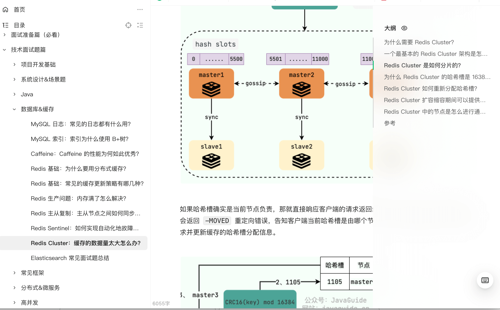

Interview questions about **Redis clustering** are exclusive to my [Knowledge Planet](../../about-the-author/zhishixingqiu-two-years.md) community. Details on joining are available at [The Java Interview Guide](../../zhuanlan/java-mian-shi-zhi-bei.md).

<!-- @include: @planet.snippet.md -->
