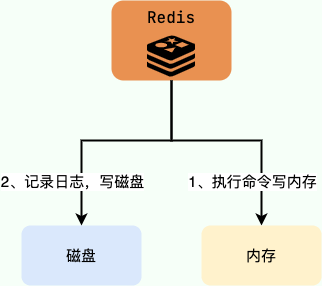

> Adapted from [this article](https://mp.weixin.qq.com/s/0Nqfq_eQrUb12QH6eBbHXA) by A Q Talks Code.

This guide summarizes common causes of Redis blocking and their effects on performance. Keep these cases in mind when operating Redis.

## O(N) Commands

Most Redis commands have O(1) time complexity, but some take O(N), for example:

- `KEYS *`: Returns all keys matching a pattern.
- `HGETALL`: Returns all field-value pairs in a hash.
- `LRANGE`: Returns elements in a specified list range.
- `SMEMBERS`: Returns all members of a set.
- `SINTER` / `SUNION` / `SDIFF`: Computes the intersection, union, or difference of sets.
- ...

These commands may scan many elements, so execution time grows with N and can block clients. They are not always forbidden, but use them only when the collection size is understood. For iteration, consider `HSCAN`, `SSCAN`, or `ZSCAN`.

Some commands have complexity above O(N) in terms of the collection size, or can take substantial time when they return or remove many elements:

- `ZRANGE` / `ZREVRANGE`: Returns members in a rank range from a Sorted Set. Complexity is O(log(N) + M), where N is the number of elements and M is the number returned. When M is close to N, the work approaches O(N).
- `ZREMRANGEBYRANK` / `ZREMRANGEBYSCORE`: Removes members in a rank or score range. Complexity is O(log(N) + M), where M is the number removed. When M is close to N, the work approaches O(N).
- ...

## `SAVE` and RDB Snapshots

Redis provides two commands for creating an RDB snapshot:

- `SAVE`: Saves synchronously and blocks the Redis main thread.
- `BGSAVE`: Forks a child process to save the snapshot without blocking the main thread. This is the default option.

Redis uses `BGSAVE` by default. Running `SAVE` manually blocks the main thread.

## AOF

### Blocking While Recording AOF Commands

Redis records commands in the AOF log after executing them. Relational databases such as MySQL typically log changes before execution to support recovery.



**Why does Redis log commands after execution?**

- It avoids extra checks because AOF logging does not validate command syntax.
- Logging after execution does not block the current command from running.

This approach has risks, as discussed in [Redis Persistence](./redis-persistence.md):

- If Redis crashes immediately after executing a command, the change may be lost.
- **Recording the AOF log on the Redis main thread can block subsequent commands.**

### Blocking During AOF fsync

When AOF persistence is enabled, Redis appends each write command to the `server.aof_buf` buffer. The `appendfsync` setting controls when the buffer is synced to the AOF file on disk.

Redis supports three AOF fsync policies:

1. `appendfsync always`: After the main thread calls `write`, it immediately calls `fsync` to sync the AOF file and waits for it to finish. The main thread performs `fsync` directly. This is the safest policy, but syncing on every write can severely reduce performance.
2. `appendfsync everysec`: The main thread calls `write` and returns. A background `aof_fsync` thread calls `fsync` about once per second.
3. `appendfsync no`: The main thread calls `write` and returns. The operating system decides when to sync the data; on Linux, this is often around every 30 seconds.

If the background `aof_fsync` thread is blocked while waiting for disk I/O, the main thread may also block on `write` until `fsync` completes. Heavy disk pressure can therefore affect command processing.

For more detail on the AOF workflow, see [Redis Persistence](./redis-persistence.md).

### Blocking During AOF Rewrite

1. Redis forks a child process to rewrite the AOF file. While the child creates a new file, the server records write commands in an AOF rewrite buffer.
2. When the child finishes, the server appends the rewrite buffer to the new AOF file so it reflects the current database state.
3. The server replaces the old AOF file with the new one.

Blocking can occur in step 2, while the buffered commands are appended to the new file.

Related reading: [Analysis of Redis AOF Rewrite Blocking](https://cloud.tencent.com/developer/article/1633077).

## Large Keys

A key is considered large when its value occupies a substantial amount of memory. These are rough guidelines:

- A String value larger than 1 MB.
- A collection (List, Hash, Set, or Sorted Set) with more than 5,000 elements. Element count alone does not determine memory usage.

Large keys can cause several problems:

- **Client timeouts:** Redis processes commands on its main thread. Operations on large keys can take a long time, leaving clients waiting for a response.
- **Network congestion:** Reading a large key can generate substantial traffic. For example, reading a 1 MB key 1,000 times per second produces about 1,000 MB of traffic per second, overwhelming a typical 1 Gbps network interface.
- **Blocked worker thread:** Deleting a large key with `DEL` can take long enough to delay later commands.

### Finding Large Keys

When using Redis's `--bigkeys` option, prefer running it on a replica because it can block the node being scanned.

- Use `SCAN` to inspect keys incrementally.
- Analyze an RDB file if Redis uses RDB persistence. Tools include:
  - `redis-rdb-tools`: A Python tool for analyzing Redis RDB snapshots.
  - `rdb_bigkeys`: A Go tool for analyzing Redis RDB snapshots; it is designed for higher performance.

### Deleting Large Keys

Deleting a key requires releasing the memory used by its value. The operating system must also manage the freed memory for future allocation, which takes time and can block the application releasing it.

Releasing a large amount of memory at once can delay Redis's main thread. While that thread is blocked, requests may time out, connections can accumulate, and Redis may run out of available connections.

Delete large keys in batches or use asynchronous deletion.

## Flushing the Database

Like deleting large keys, `FLUSHDB` and `FLUSHALL` remove keys and release their memory. These commands can block Redis.

## Cluster Resharding

Redis Cluster supports adding and removing nodes, but resharding still requires operational intervention.

Resharding moves data between nodes. To preserve consistency, Redis performs migration operations synchronously. Both source and destination nodes can block for varying lengths of time. The impact may be negligible for small keys, but large keys can cause long pauses and may trigger cluster failover.

## Swap

**What is swap?** On Linux, swap is disk space used as an extension of memory when RAM is insufficient. It is similar to virtual memory in Windows.

Swap is particularly harmful to Redis because Redis relies on in-memory data for performance. If the operating system swaps Redis memory to disk, performance can drop sharply because disk I/O is much slower than RAM.

To check whether a Redis process is using swap:

1. Find the Redis process ID:

```bash
redis-cli -p 6383 info server | grep process_id
process_id: 4476
```

2. Inspect swap usage for that process:

```bash
cat /proc/4476/smaps | grep Swap
Swap: 0kB
Swap: 0kB
Swap: 4kB
Swap: 0kB
Swap: 0kB
.....
```

Values of 0 KB, or an occasional 4 KB, are generally normal.

To reduce the risk of swapping:

- Keep enough free memory on the host.
- Set `maxmemory` for every Redis instance to prevent uncontrolled memory growth.
- Lower the system's swap preference, for example: `echo 10 > /proc/sys/vm/swappiness`.

## CPU Contention

Redis can be CPU-intensive. Avoid colocating it with other CPU-intensive services on the same host. If other processes consume too much CPU, Redis throughput can drop significantly.

Use `redis-cli --stat` to inspect Redis activity. Use `top` to inspect process CPU usage, and `INFO commandstats` to investigate command execution time and identify expensive commands or excessive memory optimization work.

## Network Issues

Connection refusals, network latency, and NIC soft interrupts can also make Redis appear blocked.

## References

- [Six Common Redis Blocking Scenarios](https://mp.weixin.qq.com/s/eaZCEtTjTuEmXfUubVHjew)
- [Redis Development and Operations Notes: Redis's Blocking Nightmare](https://mp.weixin.qq.com/s/TDbpz9oLH6ifVv6ewqgSgA)

<!-- @include: @article-footer.snippet.md -->
