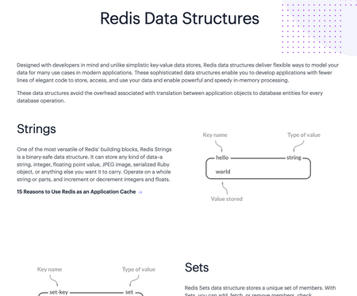
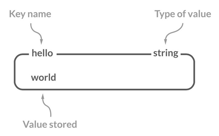
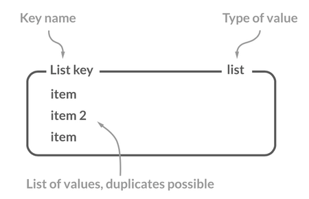
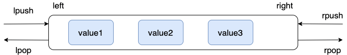
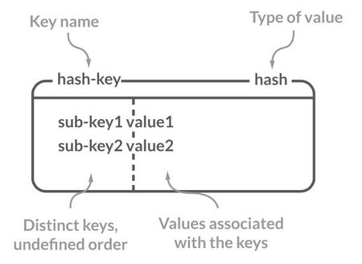
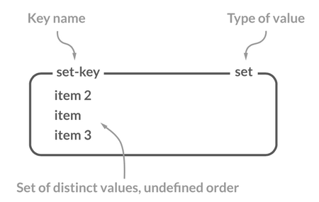
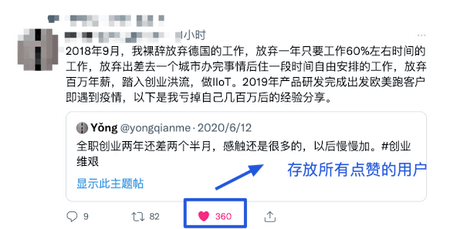
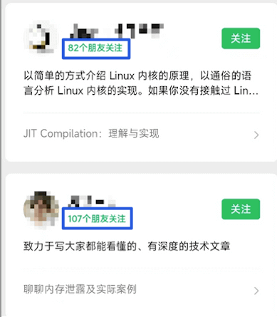
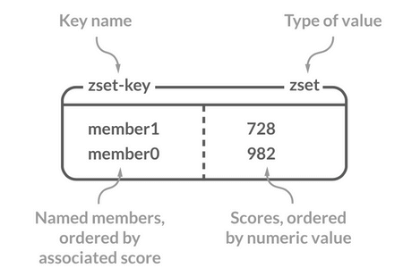
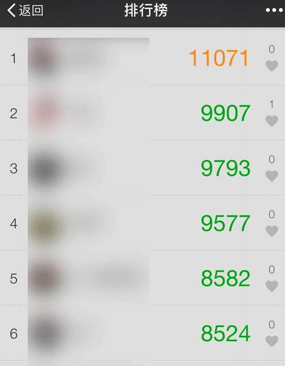

Redis provides five core data types: String, List, Set, Hash, and Sorted Set (Zset).

These are the data types exposed to users. Internally, Redis implements them using data structures such as Simple Dynamic Strings (SDS), linked lists, dictionaries, skip lists, integer sets, zip lists, quicklists, and listpacks.

The following table shows common internal encodings for the five data types:

| String | List                         | Hash          | Set          | Zset              |
| :----- | :--------------------------- | :------------ | :----------- | :---------------- |
| SDS    | LinkedList/ZipList/QuickList | Dict, ZipList | Dict, Intset | ZipList, SkipList |

Before Redis 3.2, Lists were implemented using either a linked list or a zip list. Redis 3.2 introduced QuickList, which combines linked-list and zip-list behavior. Starting with Redis 7.0, ListPack replaced ZipList.

The Redis website has detailed references for [Redis data structures](https://redis.com/redis-enterprise/data-structures/) and [Redis data types](https://redis.io/docs/manual/data-types/data-types-tutorial/).

New Redis versions may add or change data structures. Check the official documentation for the version you use.



## String

### Overview

String is Redis's simplest and most commonly used data type.

A String is binary-safe and can store strings, integers, floating-point numbers, images (as Base64 data or file paths), and serialized objects.



Although Redis is written in C, it does not use C strings to represent strings. Instead, it uses **Simple Dynamic Strings (SDS)**. Unlike C strings, SDS can store both text and binary data, and its length can be retrieved in O(1) time rather than O(N). The SDS API also avoids buffer overflows.

### Common Commands

| Command                          | Description                         |
| -------------------------------- | ----------------------------------- |
| `SET key value`                  | Set the value of a key              |
| `SETNX key value`                | Set a key only if it does not exist |
| `GET key`                        | Get the value of a key              |
| `MSET key1 value1 key2 value2 …` | Set one or more key-value pairs     |
| `MGET key1 key2 ...`             | Get the values of one or more keys  |
| `STRLEN key`                     | Return the length of a String value |
| `INCR key`                       | Increment the numeric value by one  |
| `DECR key`                       | Decrement the numeric value by one  |
| `EXISTS key`                     | Check whether a key exists          |
| `DEL key` (generic)              | Delete a key                        |
| `EXPIRE key seconds` (generic)   | Set a key's expiration time         |

See the [Redis String commands](https://redis.io/commands/?group=string) for the full command reference.

**Basic operations:**

```bash
> SET key value
OK
> GET key
"value"
> EXISTS key
(integer) 1
> STRLEN key
(integer) 5
> DEL key
(integer) 1
> GET key
(nil)
```

**Set and get multiple keys:**

```bash
> MSET key1 value1 key2 value2
OK
> MGET key1 key2 # Get the values of multiple keys
1) "value1"
2) "value2"
```

**Counter (when the String contains an integer):**

```bash
> SET number 1
OK
> INCR number # Increment the value by one
(integer) 2
> GET number
"2"
> DECR number # Decrement the value by one
(integer) 1
> GET number
"1"
```

**Set an expiration time (keys never expire by default):**

```bash
> EXPIRE key 60
(integer) 1
> SETEX key 60 value # Set a value and its expiration time
OK
> TTL key
(integer) 56
```

### Use Cases

**Storing general-purpose data**

- Examples: Sessions, tokens, image paths, and serialized objects. Compared with a Hash, a serialized object may use less memory.
- Commands: `SET`, `GET`.

**Counters**

- Examples: Per-user request counts for simple rate limiting, or page views over a time period.
- Commands: `SET`, `GET`, `INCR`, `DECR`.

**Distributed locks**

`SETNX key value` can implement a basic distributed lock, but it has limitations and is generally not recommended as a complete lock implementation.

## List

### Overview

Redis List supports list operations at both ends. See [Arrays, Linked Lists, Stacks, and Queues](https://javaguide.cn/cs-basics/data-structure/linear-data-structure.html) for an introduction to linked lists.

Redis has used different internal encodings across versions. Earlier versions used a **doubly linked list** or a **zip list**; Redis 3.2 introduced QuickList, combining linked-list nodes with compact list storage. This supports operations at both ends, with some additional memory overhead.



### Common Commands

| Command                       | Description                                 |
| ----------------------------- | ------------------------------------------- |
| `RPUSH key value1 value2 ...` | Append one or more elements to a List       |
| `LPUSH key value1 value2 ...` | Prepend one or more elements to a List      |
| `LSET key index value`        | Set the value at an index                   |
| `LPOP key`                    | Remove and return the first (leftmost) item |
| `RPOP key`                    | Remove and return the last (rightmost) item |
| `LLEN key`                    | Return the number of elements               |
| `LRANGE key start end`        | Return elements in an index range           |

See the [Redis List commands](https://redis.io/commands/?group=list) for the full command reference.

**Implement a queue with `RPUSH`/`LPOP` or `LPUSH`/`RPOP`:**

```bash
> RPUSH myList value1
(integer) 1
> RPUSH myList value2 value3
(integer) 3
> LPOP myList
"value1"
> LRANGE myList 0 1
1) "value2"
2) "value3"
> LRANGE myList 0 -1
1) "value2"
2) "value3"
```

**Implement a stack with `RPUSH`/`RPOP` or `LPUSH`/`LPOP`:**

```bash
> RPUSH myList2 value1 value2 value3
(integer) 3
> RPOP myList2 # Pop the rightmost element
"value3"
```

The diagram below illustrates `RPUSH`, `LPOP`, `LPUSH`, and `RPOP`:



**Use `LRANGE` to read elements by index:**

```bash
> RPUSH myList value1 value2 value3
(integer) 3
> LRANGE myList 0 1
1) "value1"
2) "value2"
> LRANGE myList 0 -1
1) "value1"
2) "value2"
3) "value3"
```

`LRANGE` can also support pagination over a List.

**Use `LLEN` to get the List length:**

```bash
> LLEN myList
(integer) 3
```

### Use Cases

**Activity feeds**

- Examples: Recent articles and updates.
- Commands: `LPUSH`, `LRANGE`.

**Message queues**

Lists can be used as message queues, but their feature set is limited and has several drawbacks. Redis Streams, introduced in Redis 5.0, are a better fit for many queue use cases, though they are still less capable than dedicated message brokers. Message loss and backlog management can be difficult.

## Hash

### Overview

A Redis Hash maps String fields to String values. It is useful for storing objects whose fields may need to be updated independently.

A Hash is similar to a `HashMap` in JDK 1.8 and earlier, with an internal structure that can use an array and linked lists, though Redis applies additional optimizations.



### Common Commands

| Command                                     | Description                            |
| ------------------------------------------- | -------------------------------------- |
| `HSET key field value`                      | Set a field's value                    |
| `HSETNX key field value`                    | Set a field only if it does not exist  |
| `HMSET key field1 value1 field2 value2 ...` | Set multiple field-value pairs         |
| `HGET key field`                            | Get a field's value                    |
| `HMGET key field1 field2 ...`               | Get one or more field values           |
| `HGETALL key`                               | Get all fields and values              |
| `HEXISTS key field`                         | Check whether a field exists           |
| `HDEL key field1 field2 ...`                | Delete one or more fields              |
| `HLEN key`                                  | Return the number of fields            |
| `HINCRBY key field increment`               | Increment or decrement a numeric field |

See the [Redis Hash commands](https://redis.io/commands/?group=hash) for the full command reference.

**Store object-like data:**

```bash
> HMSET userInfoKey name "guide" description "dev" age 24
OK
> HEXISTS userInfoKey name # Check whether the field exists
(integer) 1
> HGET userInfoKey name # Get a field's value
"guide"
> HGET userInfoKey age
"24"
> HGETALL userInfoKey # Get all fields and values
1) "name"
2) "guide"
3) "description"
4) "dev"
5) "age"
6) "24"
> HSET userInfoKey name "GuideGeGe"
> HGET userInfoKey name
"GuideGeGe"
> HINCRBY userInfoKey age 2
(integer) 26
```

### Use Cases

**Storing object fields**

- Examples: User, product, article, and shopping cart data.
- Commands: `HSET` and `HMSET` to set fields; `HGET` and `HMGET` to retrieve fields.

## Set

### Overview

A Redis Set is an unordered collection of unique elements, similar to Java's `HashSet`. Use it to store a collection without duplicates. It also provides efficient membership checks, which Lists do not.

Sets support intersection, union, and difference operations. For example, storing a user's follows and followers in separate Sets makes it easy to find mutual follows, mutual followers, or shared interests.



### Common Commands

| Command                                 | Description                                 |
| --------------------------------------- | ------------------------------------------- |
| `SADD key member1 member2 ...`          | Add one or more members                     |
| `SMEMBERS key`                          | Return all members                          |
| `SCARD key`                             | Return the number of members                |
| `SISMEMBER key member`                  | Check whether a member exists               |
| `SINTER key1 key2 ...`                  | Return the intersection of Sets             |
| `SINTERSTORE destination key1 key2 ...` | Store the intersection in a destination Set |
| `SUNION key1 key2 ...`                  | Return the union of Sets                    |
| `SUNIONSTORE destination key1 key2 ...` | Store the union in a destination Set        |
| `SDIFF key1 key2 ...`                   | Return the difference of Sets               |
| `SDIFFSTORE destination key1 key2 ...`  | Store the difference in a destination Set   |
| `SPOP key count`                        | Remove and return random members            |
| `SRANDMEMBER key count`                 | Return random members without removing them |

See the [Redis Set commands](https://redis.io/commands/?group=set) for the full command reference.

**Basic operations:**

```bash
> SADD mySet value1 value2
(integer) 2
> SADD mySet value1 # Duplicate members are ignored
(integer) 0
> SMEMBERS mySet
1) "value1"
2) "value2"
> SCARD mySet
(integer) 2
> SISMEMBER mySet value1
(integer) 1
> SADD mySet2 value2 value3
(integer) 2
```

- `mySet`: `value1`, `value2`.
- `mySet2`: `value2`, `value3`.

**Intersection:**

```bash
> SINTERSTORE mySet3 mySet mySet2
(integer) 1
> SMEMBERS mySet3
1) "value2"
```

**Union:**

```bash
> SUNION mySet mySet2
1) "value3"
2) "value2"
3) "value1"
```

**Difference:**

```bash
> SDIFF mySet mySet2 # Members in mySet that are not in mySet2
1) "value1"
```

### Use Cases

**Storing unique values**

- Examples: Website UV counts (HyperLogLog is more suitable at very large scale), article likes, and activity likes.
- Command: `SCARD` to count members.



**Finding intersections, unions, or differences across data sources**

- Examples: Mutual friends, followers, and follows (intersection); friend, music, and subscription recommendations (difference or intersection).
- Commands: `SINTER`, `SINTERSTORE`, `SUNION`, `SUNIONSTORE`, `SDIFF`, and `SDIFFSTORE`.



**Selecting random members**

- Examples: Prize draws and random name selection.
- Commands: `SPOP` returns and removes random members, which is useful when a member must not win more than once. `SRANDMEMBER` returns random members without removing them, allowing repeat selection.

## Sorted Set

### Overview

A Sorted Set is similar to a Set, but each member has a numeric `score`. Members are ordered by score, and can be queried by score range. It combines some characteristics of Java's `HashMap` and `TreeSet`.



### Common Commands

| Command                                         | Description                                                  |
| ----------------------------------------------- | ------------------------------------------------------------ |
| `ZADD key score1 member1 score2 member2 ...`    | Add one or more members with scores                          |
| `ZCARD key`                                     | Return the number of members                                 |
| `ZSCORE key member`                             | Return a member's score                                      |
| `ZINTERSTORE destination numkeys key1 key2 ...` | Store the intersection; aggregate matching scores with `SUM` |
| `ZUNIONSTORE destination numkeys key1 key2 ...` | Store the union; aggregation is similar to `ZINTERSTORE`     |
| `ZDIFFSTORE destination numkeys key1 key2 ...`  | Store the difference                                         |
| `ZRANGE key start end`                          | Return members by rank, from lowest to highest score         |
| `ZREVRANGE key start end`                       | Return members by rank, from highest to lowest score         |
| `ZREVRANK key member`                           | Return a member's rank in descending score order             |

See the [Redis Sorted Set commands](https://redis.io/commands/?group=sorted-set) for the full command reference.

**Basic operations:**

```bash
> ZADD myZset 2.0 value1 1.0 value2
(integer) 2
> ZCARD myZset
2
> ZSCORE myZset value1
2.0
> ZRANGE myZset 0 1
1) "value2"
2) "value1"
> ZREVRANGE myZset 0 1
1) "value1"
2) "value2"
> ZADD myZset2 4.0 value2 3.0 value3
(integer) 2
```

- `myZset`: `value1` (2.0), `value2` (1.0).
- `myZset2`: `value2` (4.0), `value3` (3.0).

**Get a member's rank:**

```bash
> ZREVRANK myZset value1
0
> ZREVRANK myZset value2
1
```

**Intersection:**

```bash
> ZINTERSTORE myZset3 2 myZset myZset2
1
> ZRANGE myZset3 0 1 WITHSCORES
value2
5
```

**Union:**

```bash
> ZUNIONSTORE myZset4 2 myZset myZset2
3
> ZRANGE myZset4 0 2 WITHSCORES
value1
2
value3
3
value2
5
```

**Difference:**

```bash
> ZDIFF 2 myZset myZset2 WITHSCORES
value1
2
```

### Use Cases

**Ranking members by score**

- Examples: Live-stream tipping leaderboards, step-count rankings, game rankings, and trending topics.
- Commands: `ZRANGE` for ascending order, `ZREVRANGE` for descending order, and `ZREVRANK` for a member's rank.



[The Java Interview Guide](https://javaguide.cn/zhuanlan/java-mian-shi-zhi-bei.html) includes an article on designing a leaderboard with Sorted Sets.


**Storing data with priorities**, such as a priority task queue.

- Commands: `ZRANGE` for ascending order, `ZREVRANGE` for descending order, and `ZREVRANK` for a member's rank.

## Summary

| Data type  | Description                                                                                                                          |
| ---------- | ------------------------------------------------------------------------------------------------------------------------------------ |
| String     | A binary-safe type that stores strings, integers, floating-point numbers, images as Base64 data or paths, and serialized objects.    |
| List       | An ordered collection supporting operations at both ends; its internal encoding depends on the Redis version and collection size.    |
| Hash       | A map of String fields to values, useful for storing objects and updating their fields independently.                                |
| Set        | An unordered collection of unique members, similar to Java's `HashSet`.                                                              |
| Sorted Set | A Set whose members have scores and are ordered by those scores. It combines some characteristics of Java's `HashMap` and `TreeSet`. |

## Related Data Structure Guides

Redis data types rely on fundamental data structures. To study their internals, see:

- [Linear Data Structures](../../cs-basics/data-structure/linear-data-structure.md): Lists, queues, and linked lists.
- [Hash Tables: Interview Questions](../../cs-basics/data-structure/hash-table.md): Lookup and collision handling for Hash and Set.
- [Skip Lists: Interview Questions](../../cs-basics/data-structure/skip-list.md): The structure behind Sorted Set range queries and ranking.

## References

- [Redis Data Structures](https://redis.com/redis-enterprise/data-structures/)
- [Redis Commands](https://redis.io/commands/)
- [Redis Data Types Tutorial](https://redis.io/docs/manual/data-types/data-types-tutorial/)
- [Should Redis Store Object Data in Hashes or Strings?](https://segmentfault.com/a/1190000040032006)

<!-- @include: @article-footer.snippet.md -->
