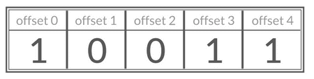
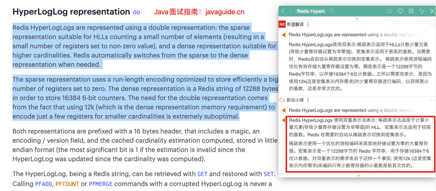
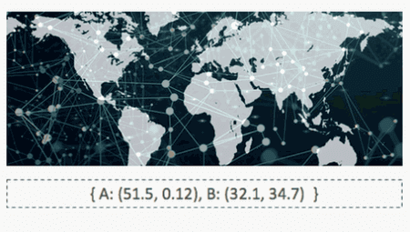
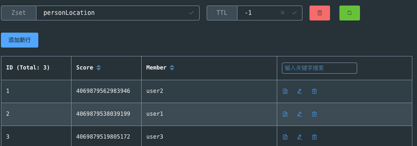

In addition to its five core data types, Redis provides three specialized types: Bitmap, HyperLogLog, and GEO.

## Bitmap

### Overview

The [Redis documentation](https://redis.io/docs/latest/develop/data-types/bitmaps/) explains that Bitmaps are not a separate data type. They are bit-oriented operations on the String type, which is treated as a bit vector. Redis Strings are binary-safe and can be up to 512 MB, so a Bitmap can address up to 2^32 bits.

A Bitmap stores a sequence of bits (0s and 1s). Each bit can represent a value or state, and its array index is called the `offset`. This representation can save substantial space: eight bits fit in one byte.



### Common Commands

| Command                                 | Description                                   |
| --------------------------------------- | --------------------------------------------- |
| `SETBIT key offset value`               | Set the bit at an offset                      |
| `GETBIT key offset`                     | Get the bit at an offset                      |
| `BITCOUNT key start end`                | Count set bits in a range                     |
| `BITOP operation destkey key1 key2 ...` | Apply `AND`, `OR`, `XOR`, or `NOT` to Bitmaps |

**Basic Bitmap operations:**

```bash
# SETBIT returns the previous bit value (0 by default); this creates bits through offset 7
> SETBIT mykey 7 1
(integer) 0
> SETBIT mykey 7 0
(integer) 1
> GETBIT mykey 7
(integer) 0
> SETBIT mykey 6 1
(integer) 0
> SETBIT mykey 8 1
(integer) 0
# Count the bits set to 1
> BITCOUNT mykey
(integer) 2
```

### Use Cases

**Representing state with a 0 or 1**

- Examples: User attendance, active-user status, and user actions such as whether someone liked a video.
- Commands: `SETBIT`, `GETBIT`, `BITCOUNT`, and `BITOP`.

## HyperLogLog

### Overview

HyperLogLog is a well-known probabilistic algorithm for cardinality estimation. It is based on LogLog Counting (LLC), with further optimizations. It is not unique to Redis; Redis implements the algorithm and provides a simple API.

Redis HyperLogLog uses very little memory. It can estimate the cardinality of a set with nearly 2^64 possible distinct elements using about 12 KB. Redis uses two storage representations:

- **Sparse representation:** Uses little memory when the estimated cardinality is small.
- **Dense representation:** Uses about 12 KB after cardinality reaches a threshold.

The Redis documentation provides more detail:



To save memory, a probabilistic cardinality estimator does not store all input elements. It estimates the number of distinct elements, so the result is not exact. HyperLogLog's standard error is `0.81%`.


HyperLogLog is simple to use but has a more involved underlying algorithm. See [An Explanation of the HyperLogLog Algorithm and Its Use in Redis](https://juejin.cn/post/6844903785744056333) for details.

This interactive article can also help explain the algorithm: [Sketch of the Day: HyperLogLog — Cornerstone of a Big Data Infrastructure](http://content.research.neustar.biz/blog/hll.html).

Redis also provides other probabilistic data structures. See the [Redis probabilistic data structures documentation](https://redis.io/docs/data-types/probabilistic/).

### Common Commands

HyperLogLog has only a few commands. These three are the most common:

| Command                                     | Description                                          |
| ------------------------------------------- | ---------------------------------------------------- |
| `PFADD key element1 element2 ...`           | Add one or more elements to a HyperLogLog            |
| `PFCOUNT key1 key2`                         | Estimate the cardinality of one or more HyperLogLogs |
| `PFMERGE destkey sourcekey1 sourcekey2 ...` | Merge HyperLogLogs into a destination key            |

**Basic HyperLogLog operations:**

```bash
> PFADD hll foo bar zap
(integer) 1
> PFADD hll zap zap zap
(integer) 0
> PFADD hll foo bar
(integer) 0
> PFCOUNT hll
(integer) 3
> PFADD some-other-hll 1 2 3
(integer) 1
> PFCOUNT hll some-other-hll
(integer) 6
> PFMERGE desthll hll some-other-hll
"OK"
> PFCOUNT desthll
(integer) 6
```

### Use Cases

**Counting very large sets (millions or tens of millions of elements and more)**

- Examples: Daily, weekly, or monthly unique IP addresses on a popular website; unique visitors (UV) to popular posts.
- Commands: `PFADD`, `PFCOUNT`.

## Geospatial Data (GEO)

### Overview

A **geospatial index**, or GEO, stores location data. Redis implements it using a Sorted Set.

GEO commands can calculate the distance between two locations and find members near a specified location.



### Common Commands

| Command                                        | Description                                                                   |
| ---------------------------------------------- | ----------------------------------------------------------------------------- |
| `GEOADD key longitude latitude member ...`     | Add members with their longitude and latitude                                 |
| `GEOPOS key member ...`                        | Return the coordinates of members                                             |
| `GEODIST key member1 member2 M/KM/FT/MI`       | Return the distance between two members                                       |
| `GEORADIUS key longitude latitude radius unit` | Find members within a radius; supports options such as `ASC`, `DESC`, `COUNT` |
| `GEORADIUSBYMEMBER key member radius unit`     | Search around an existing member                                              |

**Basic operations:**

```bash
> GEOADD personLocation 116.33 39.89 user1 116.34 39.90 user2 116.35 39.88 user3
3
> GEOPOS personLocation user1
116.3299986720085144
39.89000061669732844
> GEODIST personLocation user1 user2 km
1.4018
```

Inspecting `personLocation` with a Redis GUI shows that the underlying structure is a Sorted Set.

GEO encodes longitude and latitude with the GeoHash algorithm and uses the resulting integer as the Sorted Set score.



**Find members within a radius:**

```bash
> GEORADIUS personLocation 116.33 39.87 3 km
user3
user1
> GEORADIUS personLocation 116.33 39.87 2 km
> GEORADIUS personLocation 116.33 39.87 5 km
user3
user1
user2
> GEORADIUSBYMEMBER personLocation user1 5 km
user3
user1
user2
> GEORADIUSBYMEMBER personLocation user1 2 km
user1
user2
```

For an explanation of the implementation behind `GEORADIUS`, see Alibaba's article: [How Does Redis Implement “People Nearby”?](https://juejin.cn/post/6844903966061363207).

**Remove a member:**

GEO is backed by a Sorted Set, so you can use Sorted Set commands with GEO data.

```bash
> ZREM personLocation user1
1
> ZRANGE personLocation 0 -1
user3
user2
> ZSCORE personLocation user2
4069879562983946
```

### Use Cases

**Managing geospatial data**

- Example: Finding people nearby.
- Commands: `GEOADD`, `GEORADIUS`, and `GEORADIUSBYMEMBER`.

## Summary

| Data type        | Description                                                                                                                |
| ---------------- | -------------------------------------------------------------------------------------------------------------------------- |
| Bitmap           | Treats a String as a bit vector. A bit at an offset represents a value or state, using one bit per item where appropriate. |
| HyperLogLog      | Estimates the cardinality of a set using about 12 KB, with a standard error of `0.81%`.                                    |
| Geospatial index | Stores geographic locations and is implemented using a Sorted Set.                                                         |

## References

- [Redis Data Structures](https://redis.com/redis-enterprise/data-structures/)
- _Redis in Action: Core Principles and Practice_, section 1.6, “HyperLogLog: Doing More with Less.”
- [Bloom Filters, Bitmaps, and HyperLogLog](https://hogwartsrico.github.io/2020/06/08/BloomFilter-HyperLogLog-BitMap/index.html)

<!-- @include: @article-footer.snippet.md -->
