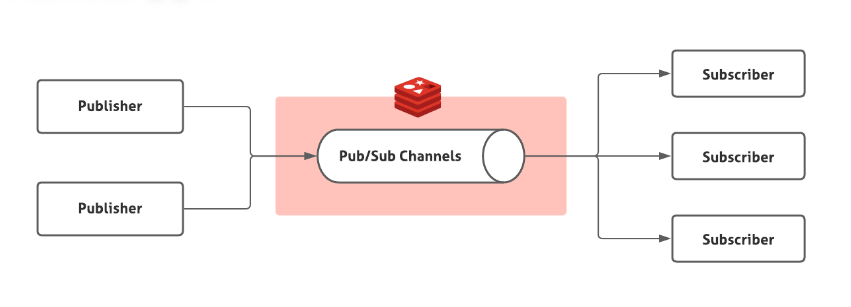
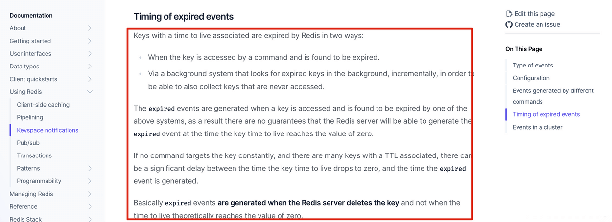

There are two common Redis-based approaches to delayed tasks:

1. Redis key expiration notifications.
2. Redisson's built-in delayed queue.

In an interview, explain that you considered both approaches and chose Redisson's `RDelayedQueue` after evaluating the limitations of key expiration notifications. Be ready to discuss the trade-offs and related Redis topics.

### How Do Key Expiration Notifications Implement Delayed Tasks?

Redis introduced publish/subscribe (Pub/Sub) in version 2.0. Pub/Sub uses **channels**, similar to topics in a message queue.

Pub/Sub has two roles: publishers and subscribers (also called consumers).

- A publisher sends a message to a channel with `PUBLISH`.
- A subscriber listens to one or more channels with `SUBSCRIBE`.

The publisher specifies the channel, and consumers subscribe to the channels they need.

Redis publishes events to some built-in channels. For example, `__keyevent@0__:expired` reports key expiration events. When Redis deletes an expired key, it publishes an event to `__keyevent@<db>__:expired`.

Subscribe to this channel to receive expired-key notifications and trigger delayed tasks. Redis calls this feature **keyspace notifications**; it can report changes to keys and values.

### What Are the Limitations of Key Expiration Notifications?

#### 1. Event timing is not precise

The [Redis documentation on expiration events](https://redis.io/docs/manual/keyspace-notifications/#timing-of-expired-events) explains the timing behavior:

Redis publishes an expiration event when it deletes the key, not exactly when the key's TTL reaches zero.

Redis uses two expiration strategies:

1. **Lazy expiration:** Redis checks whether a key has expired when the key is accessed. This minimizes CPU work, but expired keys that are never accessed may remain in memory.
2. **Active expiration:** Redis periodically samples keys and deletes expired ones. It limits the time and frequency spent on expiration to reduce CPU impact.

Active expiration is more favorable for memory usage; lazy expiration is more favorable for CPU usage. Redis combines both strategies. As a result, a key may remain undeleted for some time after its TTL elapses, so its expiration event may also be delayed.

#### 2. Messages can be lost

Redis Pub/Sub messages are not persisted, unlike messages in a message queue. If no subscriber is listening when a message is published, Redis discards it.

#### 3. Multiple service instances may process the same message

Redis Pub/Sub broadcasts messages. Every consumer subscribed to a channel receives the published message.

If multiple instances of a service subscribe to the same channel, each may process the same task. Preventing duplicate work adds implementation and maintenance overhead.

### How Does Redisson's Delayed Queue Work?

Redisson is an open-source Java Redis client. It provides ready-to-use features such as distributed locks and delayed queues.

Redisson's `RDelayedQueue` uses a Redis Sorted Set. Each member has a score, and Redisson uses the score to represent when the task should become available.

Redisson periodically runs `ZRANGEBYSCORE` to find due tasks, removes them from the Sorted Set, and moves them to a ready-message queue. Consumers block on that queue and are notified when a message arrives. This avoids repeatedly scanning the entire Sorted Set.

Compared with key expiration notifications, this approach has these advantages:

1. **Lower risk of message loss:** Delayed queue messages are persisted in Redis. If Redis fails, the amount of lost data depends on the configured persistence and recovery mechanisms. A database scan can also be used as a reconciliation mechanism.
2. **No Pub/Sub broadcast duplication:** Clients take tasks from the same target queue rather than each receiving a broadcast copy.

For production workloads, a dedicated message queue with delayed-message support is often preferable. It can provide stronger delivery guarantees, throughput controls, and independent scaling for producers and consumers.
