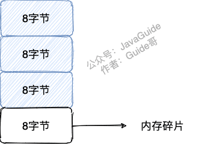
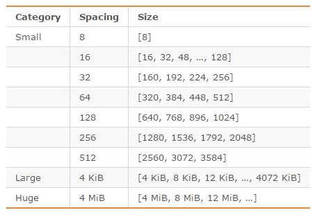
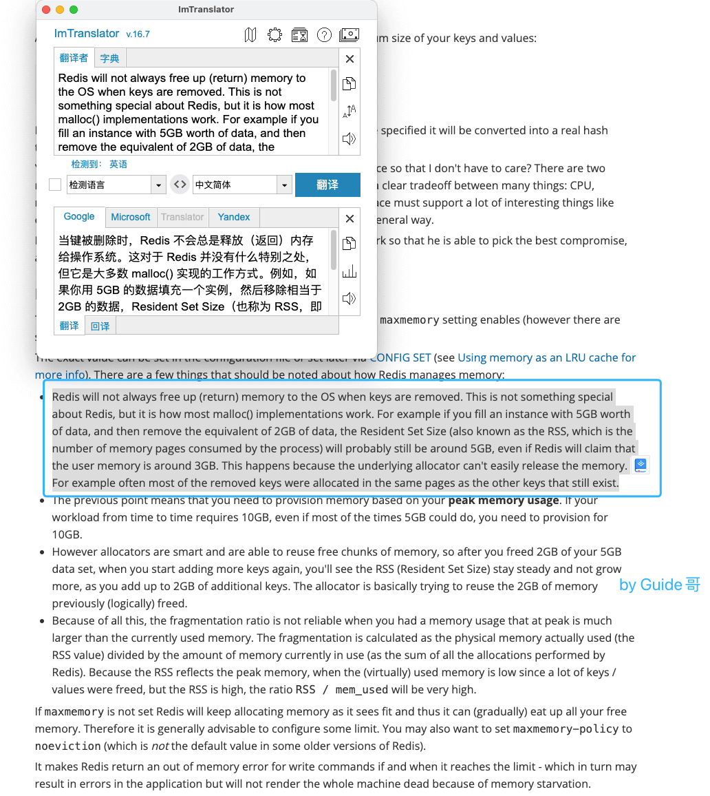
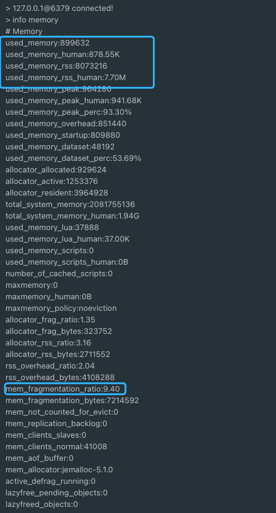

## What Is Memory Fragmentation?

Memory fragmentation is memory that is free but cannot be reused efficiently.

For example, the operating system allocates a contiguous 32-byte block, but the application needs only 24 bytes. If the remaining 8 bytes cannot be allocated to other data, they are internal fragmentation.



Redis memory fragmentation does not directly reduce Redis performance, but it increases memory usage.

## Why Does Redis Memory Fragmentation Occur?

Two common causes are:

**1. Redis may request more memory than the data requires.**

The Redis documentation notes:

> To store user keys, Redis allocates at most as much memory as the `maxmemory` setting enables (however there are small extra allocations possible).

When Redis allocates memory with `zmalloc`, its own allocation function, it allocates the requested `size` plus `PREFIX_SIZE` bytes.

Here is a simplified excerpt from [`zmalloc.c`](https://github.com/antirez/redis-tools/blob/master/zmalloc.c):

```c
void *zmalloc(size_t size) {
    // Allocate the requested size
    void *ptr = malloc(size + PREFIX_SIZE);
    if (!ptr) zmalloc_oom_handler(size);
#ifdef HAVE_MALLOC_SIZE
    update_zmalloc_stat_alloc(zmalloc_size(ptr));
    return ptr;
#else
    *((size_t*)ptr) = size;
    update_zmalloc_stat_alloc(size + PREFIX_SIZE);
    return (char*)ptr + PREFIX_SIZE;
#endif
}
```

Redis can use different memory allocators, including libc, jemalloc, and tcmalloc. It uses [jemalloc](https://github.com/jemalloc/jemalloc) by default. jemalloc allocates memory in size classes such as 8, 16, and 32 bytes.



If an application requests 17 bytes, jemalloc may allocate a 32-byte block, leaving 15 bytes unused. jemalloc is designed to limit fragmentation, so this does not usually lead to severe fragmentation by itself.

**2. Frequent changes to Redis data can create fragmentation.**

When Redis deletes data, it does not always return the freed memory to the operating system immediately.

The [Redis memory optimization documentation](https://redis.io/topics/memory-optimization) explains this behavior:



## How to Check Redis Memory Fragmentation

Run `INFO memory` to inspect Redis memory statistics. See the [Redis `INFO` command documentation](https://redis.io/commands/INFO) for details about each field.



Redis's memory fragmentation ratio is:

`mem_fragmentation_ratio = used_memory_rss / used_memory`

`used_memory_rss` is the physical memory allocated to Redis by the operating system. `used_memory` is the memory Redis's allocator reports as being used for data. A higher `mem_fragmentation_ratio` generally indicates more fragmentation.

Do not assume that `used_memory_rss - used_memory` equals the amount of fragmented memory. The difference also includes process overhead, shared libraries, stacks, and other allocations.

How high should the ratio be before taking action? A common rule of thumb is to investigate when `mem_fragmentation_ratio > 1.5`. For example, Redis may use more than 3 GB of physical memory to store 2 GB of data.

To check the ratio quickly:

```bash
redis-cli -p 6379 INFO memory | grep mem_fragmentation_ratio
```

The ratio can also be less than 1. This is uncommon in everyday use; see [What to Do When the Redis Memory Fragmentation Ratio Is Too Low](https://mp.weixin.qq.com/s/drlDvp7bfq5jt2M5pTqJCw) for a discussion.

## How to Reduce Redis Memory Fragmentation

Redis 4.0-RC3 and later include active defragmentation.

Enable it with:

```bash
CONFIG SET activedefrag yes
```

These settings control when defragmentation starts:

```bash
# Start when fragmented memory reaches 500 MB
CONFIG SET active-defrag-ignore-bytes 500mb
# Start when the fragmentation ratio exceeds 1.5
CONFIG SET active-defrag-threshold-lower 50
```

Active defragmentation can affect Redis performance. These settings limit the CPU time it uses:

```bash
# Minimum percentage of CPU time for active defragmentation
CONFIG SET active-defrag-cycle-min 20
# Maximum percentage of CPU time for active defragmentation
CONFIG SET active-defrag-cycle-max 50
```

Restarting a node can also reorganize memory. In a highly available Redis cluster, you can promote a replica in place of a primary with high fragmentation, then restart the former primary safely.

## References

- [Redis Memory Optimization](https://redis.io/topics/memory-optimization)
- [_Redis Core Technology and Practice_: “Why Does Memory Usage Remain High After Deleting Data?”](https://time.geekbang.org/column/article/289140)
- [Redis Source Code Analysis: Memory Allocation](https://shinerio.cc/2020/05/17/redis/Redis)

<!-- @include: @article-footer.snippet.md -->
