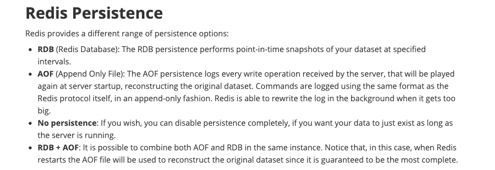
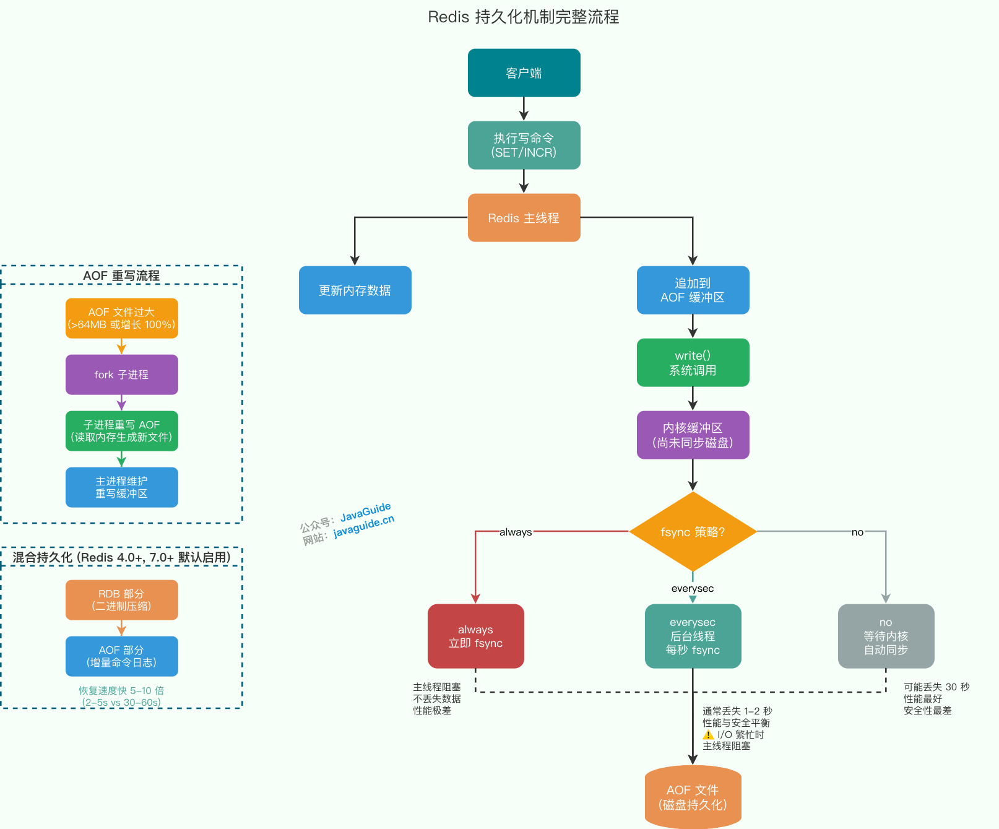
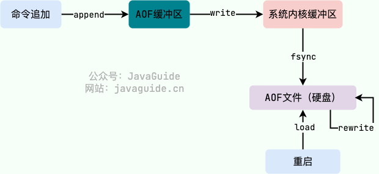
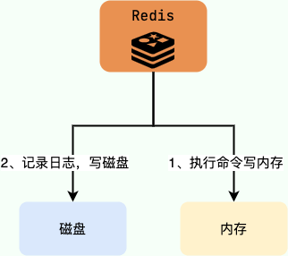

When using a cache, you may need to persist in-memory data to disk so it can be reused after a restart or failure. Persistence can also support data synchronization, such as transferring data between Redis primary and replica nodes using an RDB file.

Unlike Memcached, Redis supports three persistence mechanisms:

- RDB snapshots.
- Append-only file (AOF) logging.
- Mixed RDB and AOF persistence, introduced in Redis 4.0.

See the [Redis persistence documentation](https://redis.io/docs/latest/operate/oss_and_stack/management/persistence/) for the official reference.



**This guide is based on Redis 7.0 and later.** Persistence behavior differs across versions:

| Version        | Default persistence | Notable change                     |
| -------------- | ------------------- | ---------------------------------- |
| **Redis 4.0**  | RDB                 | Introduced mixed RDB+AOF files     |
| **Redis 6.0**  | RDB                 | AOF still must be enabled manually |
| **Redis 7.0**  | RDB                 | Introduced Multi-Part AOF          |
| **Redis 7.2+** | RDB                 | Further persistence improvements   |

Key version differences:

- **AOF rewrite memory usage:** Before Redis 7.0, incremental data was retained in memory during rewrite. Redis 7.0+ uses Multi-Part AOF to address this.
- **Mixed persistence:** Redis 4.0–6.x requires it to be enabled manually; Redis 7.0+ enables it by default.

Check your Redis version with:

```bash
redis-cli INFO server | grep redis_version
# Example output: redis_version:7.0.12
```



## RDB Persistence

### What Is RDB Persistence?

Redis can create a snapshot of its in-memory data set at a **specific point in time**. You can back up the snapshot, copy it to another server to create a Redis replica, or keep it for restoring data after a restart.

Snapshotting is Redis's default persistence method. The default configuration in `redis.conf` is:

```text
# Redis 7.0 default configuration (single-line format)
save 3600 1 300 100 60 10000

# Save if at least this many keys change within each interval:
# - 1 key in 3600 seconds (1 hour)
# - 100 keys in 300 seconds (5 minutes)
# - 10000 keys in 60 seconds (1 minute)

# Equivalent older multi-line format:
# save 3600 1
# save 300 100
# save 60 10000
```

### Does Creating an RDB Snapshot Block the Main Thread?

Redis provides two commands for creating an RDB snapshot:

- `SAVE`: Saves synchronously and blocks the Redis main thread.
- `BGSAVE`: Forks a child process to create the snapshot.

The main thread is mentioned here because Redis performs most of its work on a primary thread. Calling it the main process is also understandable.

#### Fork Performance Overhead

`BGSAVE` runs in a child process, so the child does not block the main thread while writing the snapshot. However, **the `fork` operation itself blocks** and can use additional memory. The figures below are estimates; actual values depend on CPU, memory fragmentation, system load, and other factors.

| Data set size | Fork latency | Additional memory    | Risk      |
| ------------- | ------------ | -------------------- | --------- |
| < 1 GB        | < 10 ms      | ~10 MB (page tables) | Low       |
| 1–10 GB       | 10–100 ms    | 10–100 MB            | Medium    |
| 10–50 GB      | 100 ms–1 s   | 100–500 MB           | High      |
| > 50 GB       | > 1 s        | > 500 MB             | Very high |

> This section uses RDB `BGSAVE` to explain fork overhead. The same mechanisms apply to AOF rewrite (`BGREWRITEAOF`): both operations fork a child process and can incur fork latency, Copy-on-Write (COW) memory overhead, and Transparent Huge Pages (THP) risks. Monitor fork-related performance for both operations in production.

#### Copy-on-Write (COW)

- After `fork`, the child and parent share memory pages (typically 4 KB per page).
- When either process modifies a page, the kernel copies that page (Copy-on-Write).
- A large data set and high write load can cause many page copies and affect performance.

#### Memory Pressure from Transparent Huge Pages

Many Linux distributions enable **Transparent Huge Pages (THP)** by default, with a page size of 2 MB. THP can increase the amount of memory copied by COW. In the worst case, if memory has been consolidated into 2 MB pages, changing only 10 bytes can cause the kernel to copy an entire 2 MB page, multiplying COW memory use by **512 times** (2 MB / 4 KB = 512).

**Actual behavior:** The kernel does not force all memory into 2 MB pages; it decides dynamically whether pages should be combined. A write causes 2 MB of COW only if THP has successfully combined the page. Under high write concurrency, however, this can still increase memory use sharply and trigger the **OOM Killer** on Redis.

Check whether THP is enabled:

```bash
cat /sys/kernel/mm/transparent_hugepage/enabled
# [always] madvise never means THP is enabled (risky)
# Expected: always madvise [never]
```

**Mitigation:** Add `echo never > /sys/kernel/mm/transparent_hugepage/enabled` to the Redis startup script, or use `redis-server --disable-thp yes` (supported since Redis 6.0).

**Startup warning:** If THP is enabled, Redis logs `WARNING you have Transparent Huge Pages (THP) support enabled in your kernel`. Address this warning.

#### Production Recommendations

```bash
# 1. Monitor memory indicators related to fork risk
redis-cli INFO memory | grep -E "(used_memory|used_memory_rss)"

# Example output:
# used_memory:1073741824
# used_memory_rss:1226833920
# used_memory_rss_human:1.14G

# Compare RSS with used memory; aim for a ratio below 2 before forking
# A ratio near or above 2 indicates higher fork risk

# 2. Limit Redis memory usage to leave room for fork overhead
# Set these in redis.conf:
# maxmemory 8gb
# maxmemory-policy allkeys-lru

# 3. Avoid manually triggering BGSAVE during peak traffic
# Let Redis trigger it according to configured rules

# 4. Consider primary-replica replication with persistence on the replica
# This moves persistence work away from the primary
```

**Monitor these indicators:**

- `rdb_last_bgsave_time_sec`: Duration of the last `BGSAVE`; recommended below 5 seconds.
- `rdb_last_cow_size`: COW memory used by the last fork; recommended below 10% of `used_memory`.

## AOF Persistence

### What Is AOF Persistence?

AOF persistence can provide more up-to-date recovery data than snapshots. Redis does not enable AOF by default. Set `appendonly` to enable it:

> **Version note:** Redis uses RDB by default. Enable AOF with `appendonly yes` if needed. Redis 7.0 introduced Multi-Part AOF to improve AOF performance, but RDB remains the default persistence method.

```bash
appendonly yes
```

After AOF is enabled, Redis appends each write command to the `server.aof_buf` buffer, then writes it to the AOF file. At that point, the data is in the operating system's page cache, not necessarily on disk. The `appendfsync` policy determines when the operating system's cached data is synced to disk.

Data is not durably persisted until it has been synced to disk. If the machine fails before the sync, the unsynced data may be lost.

The `dir` configuration controls where both AOF and RDB files are stored. The default AOF filename is `appendonly.aof`.

### What Are the Main Steps in the AOF Workflow?

AOF persistence has five main steps:

1. **Append:** Add write commands to the AOF buffer.
2. **Write:** Write buffer contents to the AOF file by calling the `write` system call. `write` returns after copying the data to the operating system's page cache; it does not necessarily sync data to disk.
3. **Sync (`fsync`):** Redis calls `fsync` according to the `appendfsync` policy. `fsync` forces the operating system to flush file data to disk and blocks until the write completes.
4. **Rewrite:** Periodically rewrite the AOF file to reduce its size.
5. **Load:** On restart, Redis can load the AOF file to restore the data set.

> Linux provides functions for accessing and controlling files and devices. These functions are called **system calls (syscalls)**.

More detail on the system calls:

- `write` returns after writing to the operating system's page cache; it does not immediately sync to disk. This improves performance but creates a data-loss risk. Disk sync depends on the Linux kernel's dirty-page writeback policy, which is affected by:
  - `/proc/sys/vm/dirty_expire_centisecs`: Dirty page expiration time (30 seconds by default).
  - `/proc/sys/vm/dirty_writeback_centisecs`: Interval for waking the kernel writeback thread (5 seconds by default).
  - System memory pressure: Low memory can cause more aggressive syncing.
- **With `appendfsync no`, the amount of data lost during a failure is unpredictable** because it depends on when the kernel last synced data.
- `fsync` forces the operating system to flush cached file data to disk and returns after the sync completes.



### What AOF Persistence Policies Are Available?

Redis provides three AOF fsync policies:

1. `appendfsync always`: After the main thread calls `write`, it immediately calls `fsync` and waits for the AOF file to be synced. The main thread performs `fsync` directly. This is the safest policy, but syncing every write blocks the main thread and has poor performance.
2. `appendfsync everysec`: The main thread calls `write` and returns. A background `aof_fsync` thread calls `fsync` about once per second. This usually balances performance and data safety well; a crash may lose the most recent second of data.

   > **Production caveat: possible two-second loss and blocking**
   >
   > “At most one second” describes ideal conditions. If disk I/O is slow and background `fsync` takes too long, the main thread checks when the last `fsync` completed. If more than two seconds have passed, the main thread can be forced to block to prevent memory from growing without limit (see the `aof_background_fsync` logic in Redis's `aof.c`).
   >
   > In an extreme failure, up to two seconds of data may be lost, and disk latency can increase Redis P99 latency.
   >
   > Monitor `redis-cli INFO persistence | grep aof_delayed_fsync`. This counter records how often the main thread was delayed by `fsync`; it is present when AOF is enabled.

3. `appendfsync no`: The main thread calls `write` and returns. The operating system decides when to sync the data; on Linux, this is often around every 30 seconds. This provides the best performance by avoiding `fsync` on the Redis thread, but the amount of data lost during a crash is unpredictable.

The main difference among these policies is **when Redis calls `fsync` to sync the AOF file**.

For a balance between write performance and data safety, `appendfsync everysec` is a common choice. Redis generally loses at most one second of writes if the system crashes, although disk contention may increase the loss window and block the main thread as described above. Redis can also slow down when the disk cannot keep up with writes.

> **Note:** Severe disk I/O contention can block the Redis main thread while it waits for `fsync`, possibly for up to two seconds. Monitor `aof_delayed_fsync` to assess disk health.

Starting with Redis 7.0.0, AOF uses **Multi-Part AOF**. Instead of a single file, it has three file types:

- **BASE:** The base AOF file, usually created by a child process during rewrite. There is at most one.
- **INCR:** Incremental AOF files, usually created when AOF rewrite starts. There can be multiple.
- **HISTORY:** Previous BASE and INCR files retained after a successful rewrite. Redis deletes these files automatically.

Multi-Part AOF is an advanced topic; see Alibaba's [Design and Implementation of Redis 7.0 Multi-Part AOF](https://zhuanlan.zhihu.com/p/467217082) for details.

Related issue: [Redis AOF mode #783](https://github.com/Snailclimb/JavaGuide/issues/783).

### Why Does AOF Log Commands After Execution?

Relational databases such as MySQL usually log changes before executing commands to support recovery. Redis AOF records commands after execution.



**Why log after execution?**

- It avoids additional checks; AOF logging does not validate command syntax.
- Logging after execution does not block the current command from running.

This also creates risks:

- If Redis crashes immediately after executing a command, the change may be lost.
- Logging on the Redis main thread may block subsequent commands.

### What Is AOF Rewrite?

When the AOF file becomes too large, Redis can rewrite it in the background. The new AOF file represents the same database state but is smaller.


> The name “AOF rewrite” can be misleading. Redis creates the rewritten file by reading the current key-value pairs; it does not need to read, parse, or modify the existing AOF file.

Because rewriting can involve many writes, Redis runs the rewrite process in a child process to avoid interfering with normal command processing.

While the child creates the new AOF file, Redis maintains an **AOF rewrite buffer** containing write commands. When the child finishes, Redis appends the buffered commands to the new file so it reflects the current database state. Redis then replaces the old AOF file.

Run `BGREWRITEAOF` to start a rewrite manually. These settings let Redis trigger rewrites automatically:

- `auto-aof-rewrite-min-size`: Do not rewrite if the AOF is smaller than this value. The default is 64 MB.
- `auto-aof-rewrite-percentage`: Trigger a rewrite when the current AOF size (`aof_current_size`) has grown by this percentage compared with its size after the previous rewrite (`aof_base_size`). Set it to 0 to disable automatic rewrites. The default is 100.

**AOF rewrite failure modes and risks:**

| Risk               | Impact                          | Trigger                          | Mitigation                                         |
| ------------------ | ------------------------------- | -------------------------------- | -------------------------------------------------- |
| **Fork failure**   | Rewrite child cannot be created | Low memory or system limits      | Monitor memory and set `maxmemory`                 |
| **Disk full**      | New AOF file cannot be written  | Rapid data growth during rewrite | Monitor disk use (`df -h`); alert at 70%           |
| **No inodes**      | New files cannot be created     | Too many small files             | Monitor inode use (`df -i`); clean temporary files |
| **Clock rollback** | Multi-Part AOF file issues      | VM clock synchronization         | Configure NTP and `aof-timestamp-enabled`          |
| **SIGTERM**        | Rewrite is interrupted          | Manual restart                   | Configure graceful shutdown (`shutdown-timeout`)   |

**Production monitoring suggestions:**

```bash
# Monitor AOF rewrite state
redis-cli INFO persistence | grep aof_rewrite_in_progress

# Monitor AOF file sizes
redis-cli INFO persistence | grep aof_current_size
redis-cli INFO persistence | grep aof_base_size

# Check disk and inode usage
df -h /var/lib/redis
df -i /var/lib/redis

# Configure incremental fsync during AOF rewrite (Redis 7.0+)
# aof-rewrite-incremental-sync yes
```

Before Redis 7.0, write commands arriving during a rewrite could consume substantial memory and be written to disk twice.

Redis 7.0 improved this mechanism. The following summary is adapted from Alibaba's article [The Past and Future of Redis Through the Redis 7.0 Release](https://mp.weixin.qq.com/s/RnoPPL7jiFSKkx3G4p57Pg):

> Handling incremental data during AOF rewrite was a longstanding issue. Previously, Redis retained new writes in memory during the rewrite and appended them to the new AOF file when it finished. This consumed additional memory and disk I/O. Alibaba Cloud's Redis Enterprise edition developed Multi-Part AOF to address this, then contributed it to the community for Redis 7.0. It stores base data and incremental data in separate files, reducing memory and I/O overhead. It also supports retaining historical AOF files and, with timestamps, point-in-time recovery (PITR), a feature available in Alibaba Cloud Tair.

Related issue: [The Redis AOF Rewrite Description Is Inaccurate #1439](https://github.com/Snailclimb/JavaGuide/issues/1439).

### How Does Redis Validate AOF Integrity?

**Key point:** A pure AOF file has no checksum. Redis validates it by parsing commands. A CRC64 checksum is present only in the RDB section of a mixed persistence file.

#### Pure AOF: No Checksum, Syntax Parsing Only

Pure AOF files do not have a CRC64 checksum for the whole file or individual commands. Redis checks validity by parsing commands one by one when loading the file.

**Why is there no checksum?**

AOF is a frequently appended log. Recomputing a CRC64 checksum for the entire file after every append would add substantial CPU and disk I/O overhead. Redis instead parses command syntax during restart. If it encounters an invalid or incomplete command, it stops loading and reports an error.

> **Recovery from a truncated tail:**
>
> After a power failure or `kill -9`, the last AOF command may be incomplete. The `aof-load-truncated` setting controls recovery:
>
> | Setting         | Behavior                                                          | Use case                                  |
> | --------------- | ----------------------------------------------------------------- | ----------------------------------------- |
> | `yes` (default) | Redis discards the incomplete tail, starts, and logs a warning    | Production when availability is preferred |
> | `no`            | Redis refuses to start; inspect and repair with `redis-check-aof` | Strict integrity requirements             |
>
> **Test truncated-tail recovery:**
>
> ```bash
> # Simulate a power failure by appending invalid data to the AOF file
> echo "truncated garbage data" >> /var/lib/redis/appendonly.aof
>
> # Restart Redis; aof-load-truncated=yes allows recovery
> redis-server /path/to/redis.conf
> # Log: Bad file format reading the append only file; back up the AOF, then run redis-check-aof --fix
> ```
>
> **Failure case:** If the middle of the AOF file is corrupted, automatic tail truncation cannot help. Redis refuses to load the file, and you may need `redis-check-aof --fix`.

**How `redis-check-aof` works:**

- **Check:** Reads commands according to the AOF format, validates argument counts and string lengths, and reports the position of invalid or incomplete commands.
- **Repair:** Truncates the file at the error position. **All data after that point is lost.** The original file is backed up as `appendonly.aof.broken`.

#### Mixed Persistence: Separate Validation for Each Section

In mixed persistence mode (introduced in Redis 4.0), the AOF file uses different validation for its two sections:

```text
┌─────────────────────────────────────────────────────────┐
│                 Mixed persistence file                  │
├─────────────────────────────────────────────────────────┤
│  RDB snapshot (binary)   ← protected by a CRC64 checksum │
│  ├── "REDIS" header                                      │
│  ├── Database number and key-value data                  │
│  ├── EOF marker                                           │
│  └── CRC64 checksum (8 bytes) ← checksum boundary        │
├─────────────────────────────────────────────────────────┤
│  AOF incremental section (text) ← syntax parsing only    │
│  ├── *3\r\n$3\r\nSET\r\n...                           │
│  └── ...                                                 │
└─────────────────────────────────────────────────────────┘
```

- **RDB snapshot section:** Starts with the `REDIS` signature and stores a snapshot of memory at a point in time. A CRC64 checksum at the end protects this binary section only.
- **AOF incremental section:** Follows the snapshot and records write commands. It has no checksum and is validated by parsing commands, like a pure AOF file.

**Validation during loading:**

1. Redis checks the RDB section's CRC64 checksum. If it does not match, Redis refuses to start.
2. If the RDB check passes, Redis parses incremental AOF commands in order. If parsing fails, it stops loading later commands; the RDB snapshot has already loaded.

#### Configuration Options

| Setting              | Applies to                               | Description                                     |
| -------------------- | ---------------------------------------- | ----------------------------------------------- |
| `rdbchecksum`        | RDB files and RDB section of mixed files | Controls CRC64; does not apply to pure AOF data |
| `aof-load-truncated` | Pure AOF and AOF section of mixed files  | Controls recovery from a truncated tail         |

**Manual repair** (for advanced users):

- If you do not want to repair by truncating, you can try to edit the AOF manually.
- Open the text-format AOF file in an editor and remove or correct invalid commands.
- Do this only when the error location and repair are understood.

## Improvements in Newer Redis Versions

### What Did Redis 4.0 Change About Persistence?

RDB and AOF have different strengths. Redis 4.0 introduced mixed persistence to combine them.

#### Configuration

```bash
# Enable AOF
appendonly yes

# Enable mixed persistence (enabled by default in Redis 7.0+)
aof-use-rdb-preamble yes

# Configure rewrite thresholds
auto-aof-rewrite-percentage 100   # Rewrite after the AOF grows by 100%
auto-aof-rewrite-min-size 64mb    # Rewrite only after the AOF reaches 64 MB
```

**Version differences:**

- **Redis 4.0–6.x:** Mixed persistence is disabled by default; set `aof-use-rdb-preamble yes` to enable it.
- **Redis 7.0+:** Mixed persistence is enabled by default.

#### How Mixed Persistence Works

With mixed persistence enabled, AOF rewrite writes RDB data at the beginning of the AOF file. This combines fast loading from RDB with the more recent write history in AOF.

**File layout:**

```text
┌───────────────────┐
│   RDB Header      │ ← Binary snapshot
│   REDIS0009       │
│   ...             │
├───────────────────┤
│   AOF Log Entries │ ← Text-format commands
│   *3\r\n$3\r\nSET\r\n$5\r\nkey01\r\n...
│   INCR counter    │
│   ...             │
└───────────────────┘
```

**Main workflow:**

1. **Process writes:**
   - A client runs a write command such as `SET` or `INCR`.
   - Redis updates the in-memory data.
   - Redis appends the command to the AOF buffer in text format.
2. **Trigger persistence:**
   - The AOF reaches its configured size threshold or growth percentage.
   - Redis starts AOF rewrite (`BGREWRITEAOF`).
3. **Build the file:**
   - A child process writes current in-memory data as RDB at the start of a new AOF file.
   - The parent continues processing writes and records incremental commands in the rewrite buffer.
   - When rewrite finishes, Redis appends the buffered commands to the new AOF file.
4. **Restore data:**
   - On startup, Redis loads the RDB section to restore base data quickly.
   - Redis then replays incremental AOF commands to restore more recent changes.

#### Comparing Persistence Methods

| Metric               | RDB only           | AOF only         | Mixed persistence   |
| -------------------- | ------------------ | ---------------- | ------------------- |
| **Recovery speed**   | Fast (seconds)     | Slow (minutes)   | Fast (seconds)      |
| **Data-loss window** | Minutes            | ≤2 seconds       | ≤2 seconds          |
| **File size**        | Small (compressed) | Large (text log) | Medium              |
| **Write impact**     | Low                | High             | Medium              |
| **Readability**      | Low (binary)       | High (text)      | Low for RDB section |

**Example benchmark** (1 GB data set, SSD):

- AOF-only recovery: 30–60 seconds.
- Mixed persistence recovery: 2–5 seconds (5–10 times faster).

**Limitations of mixed persistence:**

- The RDB section is compressed binary data, not readable AOF commands.
- RDB compression and decompression use additional CPU.

#### Common Issues and Recovery

**1. Verify configuration:**

```bash
# Method 1: Check the file header; REDIS indicates mixed persistence
head -c 5 appendonly.aof

# Method 2: Check the setting
redis-cli CONFIG GET aof-use-rdb-preamble
# Output: 1) "aof-use-rdb-preamble"
#         2) "yes"
```

**2. Recover from file corruption:**

| Tool                | How it works                                                    | Error detection                      | Repair support                                                    |
| ------------------- | --------------------------------------------------------------- | ------------------------------------ | ----------------------------------------------------------------- |
| **redis-check-aof** | Reads commands and validates argument counts and string lengths | Finds invalid or incomplete commands | **Can repair:** truncates after the error or allows manual repair |
| **redis-check-rdb** | Reads the RDB header, data, and footer                          | Detects and reports invalid data     | **Cannot repair:** detects issues only                            |

**Recovery steps:**

```bash
# Step 1: Check the AOF file
redis-check-aof appendonly.aof
# Reports the error location and cause

# Step 2: Repair the AOF by truncating at the error
redis-check-aof --fix appendonly.aof
# Backs up the original file as appendonly.aof.broken

# Step 3: Check the RDB section
redis-check-rdb appendonly.aof
# This tool checks the file; it has no --fix option

# Step 4: If the RDB section is damaged, repair it manually or discard the file
# Option A: Repair it manually (requires understanding the binary RDB format)
# Option B: Remove the mixed file and restore from a pure RDB or AOF backup

# Step 5: Start Redis
redis-server --appendonly yes --appendfilename appendonly.aof
```

> **Important:**
>
> - **AOF:** `redis-check-aof --fix` truncates at the error and loses all later data.
> - **RDB:** `redis-check-rdb` cannot repair files. If the RDB section is damaged, the mixed file may be unrecoverable; use a backup or pure AOF file.
> - **Manual repair:** Repairing the RDB section requires editing its binary format with a tool such as `hexdump` or `xxd`.

#### Production Configuration Suggestions

```bash
# Example production configuration
appendonly yes
aof-use-rdb-preamble yes

# Performance options
aof-rewrite-incremental-fsync yes   # Incremental fsync reduces disk I/O spikes
# For latency-sensitive workloads, consider yes:
no-appendfsync-on-rewrite yes       # Pause fsync during rewrite to avoid blocking
# For data-safety-sensitive workloads, consider no:
no-appendfsync-on-rewrite no        # Continue fsync during rewrite; may block

# Capacity planning:
# - Reserve disk space equal to at least 2x memory
# - Keep each AOF file below 16 GB
# - Monitor aof_delayed_fsync
```

See the [Redis persistence documentation](https://redis.io/docs/latest/operate/oss_and_stack/management/persistence/).


### What Did Redis 7.0 Change About Persistence?

Redis 7.0 introduced Multi-Part AOF to address memory buffering and duplicate disk writes during AOF rewrite. It is enabled by default; use `appenddirname` to choose the directory.

Multi-Part AOF separates a base file (at most one, containing a full snapshot in RDB or AOF format) from incremental command-log files. During rewrite, new commands are written directly to a new incremental file, and a manifest tracks all files. This reduces rewrite memory buffering and duplicate I/O, which can improve performance and reduce `fsync` blocking.

Because the files are separate, INCR files remain read-only during a rewrite, making individual file copies safer. A consistent backup across files still requires coordination with rewrite, so backups are more complex. Monitor resource use for very large data sets.

> **Critical failure risk: manifest corruption**
>
> Multi-Part AOF depends on a manifest that tracks the `base`, `incr`, and `history` files. It is essential metadata for loading the incremental log:
>
> | Failure                              | Impact                                                               | Recovery difficulty                     |
> | ------------------------------------ | -------------------------------------------------------------------- | --------------------------------------- |
> | **Silent manifest corruption**       | Redis may not identify or load AOF files; data cannot be restored    | Very high; may need to rebuild manifest |
> | **Manifest lost after disk failure** | Redis cannot reconstruct file dependencies even if data files remain | Very high; manual intervention needed   |
>
> **Mitigations:**
>
> ```bash
> # 1. Back up the manifest along with the data files
> cp /var/lib/redis/appendonlydir/appendonly.aof.manifest /backup/
>
> # 2. Monitor disk health
> smartctl -a /dev/sda | grep -E "SMART overall-health self-assessment|Media_Errors"
>
> # 3. Validate the manifest regularly (Redis checks it at startup)
> redis-check-aof /var/lib/redis/appendonlydir/appendonly.aof.manifest
> ```
>
> Redis does not provide an automated manifest repair tool. Include the manifest in production backups; it is as important as the RDB/AOF data files.

## Production Monitoring

### Persistence Performance Metrics

```bash
# RDB metrics
redis-cli INFO persistence | grep rdb_last_bgsave_time_sec
# Target: < 5 seconds. Longer times may indicate a large data set or slow I/O.

redis-cli INFO persistence | grep rdb_last_cow_size
# Target: < 10% of used_memory. Higher values indicate substantial fork COW overhead.

redis-cli INFO memory | grep used_memory_rss
redis-cli INFO memory | grep used_memory
# Calculate used_memory_rss / used_memory; target < 2 before fork.

# AOF metrics
redis-cli INFO persistence | grep aof_rewrite_in_progress
# Expected: 0 when idle, 1 during rewrite.

redis-cli INFO persistence | grep aof_current_size
redis-cli INFO persistence | grep aof_base_size
# Monitor growth to avoid overly frequent rewrites.

redis-cli INFO persistence | grep aof_buffer_length
# Target: < 4 MB. A larger buffer may mean writes are outpacing fsync.
```

### System Resource Monitoring

```bash
# Disk utilization and I/O wait
iostat -x 1 5 | grep dm-0
# Watch %util (I/O utilization) and await (average wait time).

# Disk space; leave room for the new file created during rewrite
df -h /var/lib/redis
# Target: utilization < 70%.

# Inode use, especially on systems with many small files
df -i /var/lib/redis
# Target: utilization < 90%.

# Memory use
free -h
# Keep at least 20% free memory for fork overhead.
```

### Suggested Alert Rules

> **Metric sources:**
>
> - Redis metrics come from `redis-cli INFO` or a Redis exporter (for example, `redis_rss_memory` and `aof_current_size`).
> - Node metrics come from node_exporter or system commands (for example, disk use, memory, and CPU).
>
> The following rules assume Prometheus, Redis exporter, and node_exporter.

```yaml
alert_rules:
  # Redis persistence alerts
  - name: "RedisHighMemFragmentation"
    expr: redis_memory_rss_bytes / redis_memory_used_bytes > 2
    for: 5m
    labels:
      severity: warning
    annotations:
      summary: "Redis memory fragmentation is high; fork COW risk is elevated"
      description: >
        Instance {{ $labels.instance }} has mem_fragmentation_ratio = {{ $value | humanize }},
        above the threshold of 2. High fragmentation means the OS has allocated more
        physical memory than Redis reports. Forking for BGSAVE or BGREWRITEAOF may
        copy more pages, increasing memory use and OOM risk under high write load.
        Consider MEMORY PURGE or restarting the instance during off-peak hours.

  - name: "RedisAofGrowthTooFast"
    expr: deriv(redis_aof_current_size_bytes[5m]) * 60 > 10485760
    for: 5m
    labels:
      severity: warning
    annotations:
      summary: "Redis AOF file is growing rapidly"
      description: >
        Instance {{ $labels.instance }} has an AOF growth rate above 10 MB/min
        (currently about {{ $value | humanize1024 }}B/min). Rapid writes may trigger
        frequent automatic rewrites and increase disk I/O and write amplification.
        Check for command bursts or full scans such as KEYS.

  - name: "RedisAofFsyncDelayed"
    expr: rate(redis_aof_delayed_fsync_total[5m]) > 0
    for: 2m
    labels:
      severity: critical
    annotations:
      summary: "Redis AOF fsync is delayed; main-thread responses may be blocked"
      description: >
        Instance {{ $labels.instance }} has a sustained increase in aof_delayed_fsync.
        The main thread is waiting for AOF fsync, which can degrade P99 latency.
        Common causes include saturated disk I/O, appendfsync always, or sharing a disk
        with other I/O-intensive processes. Consider everysec or a dedicated disk.

  # Node resource alerts
  - name: "RedisDiskUsageHigh"
    expr: >
      (1 - node_filesystem_avail_bytes{mountpoint="/var/lib/redis"}
         / node_filesystem_size_bytes{mountpoint="/var/lib/redis"}) * 100 > 70
    for: 5m
    labels:
      severity: warning
    annotations:
      summary: "Redis data disk usage is above 70%"
      description: >
        Mount point /var/lib/redis is {{ $value | humanize }}% full. AOF rewrite
        temporarily creates a new file and needs about 1.5x the current AOF size in
        free space. Insufficient space can make rewrite fail and cause Redis MISCONF
        errors. RDB BGSAVE also needs free disk space.
      remediation: >
        1. Remove obsolete RDB snapshots and historical AOF files.
        2. Increase auto-aof-rewrite-min-size to reduce rewrite frequency.
        3. Expand the disk or move the data directory to a larger volume.
```

## How to Choose Between RDB and AOF

The [Redis persistence documentation](https://redis.io/docs/manual/persistence/) compares the trade-offs. The following summarizes the main points.

**RDB advantages over AOF:**

- **Compact files for backup and disaster recovery:** RDB stores a compressed binary snapshot of the data set at a point in time. It is usually much smaller than AOF, which records write commands in a log similar to MySQL's binlog. Redis can rewrite a large AOF into a smaller file, but before Redis 7.0 writes during rewrite could consume substantial memory and be written to disk twice.
- **Faster recovery:** Redis restores an RDB snapshot directly instead of replaying every write command, so it can recover large data sets more quickly than from AOF.
- **Useful for replication:** Replicas can use RDB snapshots for synchronization and partial resynchronization after a restart or failover, avoiding a full data transfer when possible.
- **Lower persistence overhead:** The Redis parent process only needs to fork a child; the child performs the remaining persistence work. The parent does not perform the disk I/O for the snapshot.

**AOF advantages over RDB:**

- **More recent recovery data:** RDB snapshots are periodic and may lose changes since the last snapshot. AOF can sync every second, depending on the `fsync` policy. With `everysec`, a failure usually loses at most one second, though disk I/O contention can increase the window to two seconds and block the main thread.
- **Compatibility across versions:** RDB is stored in a binary format that can change across Redis versions, so older Redis releases may not support newer RDB formats.
- **Readable and editable log:** AOF records operations in a human-readable format that can be analyzed and, in some cases, edited. If `FLUSHALL` is accidentally run and the AOF has not been rewritten, removing the latest command and restarting Redis may recover the prior state.
- **Recoverable partial writes:** AOF is append-only. If the last command is partially written because of a full disk or another failure, `redis-check-aof` can repair the file.

**How version changes affect the choice:**

| Version       | Change                                                | Effect on AOF                                                    | Implication                                                       |
| ------------- | ----------------------------------------------------- | ---------------------------------------------------------------- | ----------------------------------------------------------------- |
| **Redis 4.0** | Introduced mixed persistence (`aof-use-rdb-preamble`) | Rewrite uses an RDB base file; recovery can be 5–10 times faster | Reduces slow AOF loading, but rewrite memory and I/O still matter |
| **Redis 7.0** | Introduced Multi-Part AOF                             | Reduces duplicate writes and memory/I/O overhead during rewrite  | AOF-only use is more practical, though fork blocking remains      |

**Remaining concerns:**

- **Fork pauses:** Both RDB `BGSAVE` and AOF rewrite use `fork`, which can block the main thread. The pause generally grows with the data set.
- **Redis recommendation:** Redis documentation recommends enabling both RDB and AOF. RDB provides an additional cold backup if the AOF is damaged or contains an error.

**How AOF and RDB interact:**

When both persistence methods are enabled:

- **Avoid simultaneous heavy I/O:** Since Redis 2.4, Redis avoids running RDB snapshotting at the same time as AOF rewrite, or allows BGSAVE during AOF rewrite, so two Redis background processes do not perform heavy disk I/O simultaneously.
- **AOF rewrite scheduling:** If a snapshot is in progress and `BGREWRITEAOF` is requested, Redis returns `OK` and starts the rewrite after the snapshot finishes.
- **Recovery priority:** If both AOF and RDB are enabled when Redis restarts, Redis uses AOF to reconstruct the data set because it is expected to be more complete.

**Recommendations by workload:**

| Workload                                         | Suggested configuration                                                              | Notes                                                                                              |
| ------------------------------------------------ | ------------------------------------------------------------------------------------ | -------------------------------------------------------------------------------------------------- |
| **Disposable cache**                             | **Disable persistence** or use infrequent RDB snapshots                              | No persistence has the least overhead; keep RDB for cold backups if needed                         |
| **Moderately important data** (sessions, config) | **RDB + AOF mixed persistence** (Redis 4.0+)                                         | RDB speeds recovery; AOF adds recent changes. `everysec` usually limits loss to about one second   |
| **Critical business data**                       | **RDB + AOF (MP-AOF, Redis 7.0+)**, with Redis as a cache rather than the only store | MP-AOF reduces rewrite overhead; the primary database (such as MySQL) remains the system of record |
| **Primary-replica deployment**                   | **Disable persistence on the primary and enable AOF on replicas**                    | Prevent automatic restart of an empty primary from overwriting replica data                        |

## References

- _Redis Design and Implementation_.
- [Redis Persistence Documentation](https://redis.io/docs/management/persistence/).
- [AOF vs. RDB Persistence](https://www.sobyte.net/post/2022-04/redis-rdb-and-aof/).
- [Redis AOF Persistence Explained](http://remcarpediem.net/article/376c55d8/).
- [Redis RDB and AOF Persistence](https://wingsxdu.com/posts/database/redis/rdb-and-aof/).

<!-- @include: @article-footer.snippet.md -->
