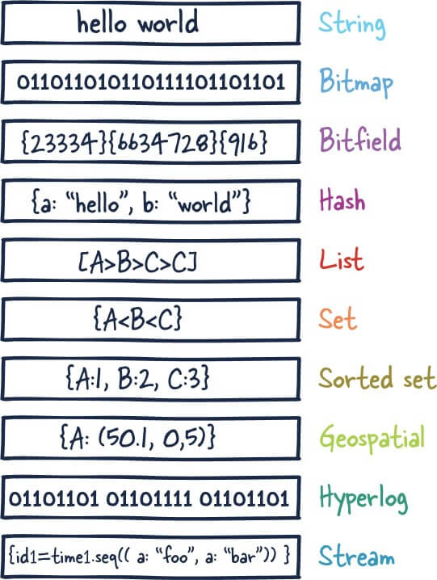
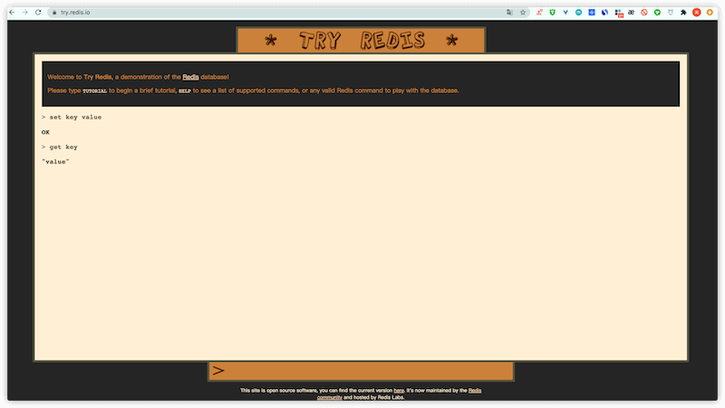
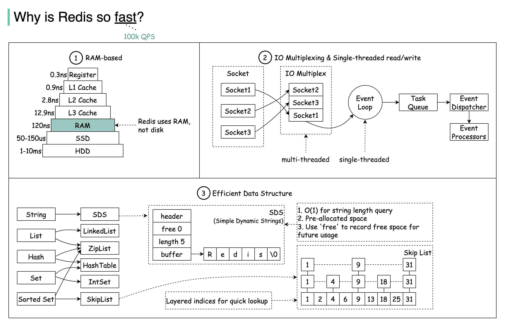
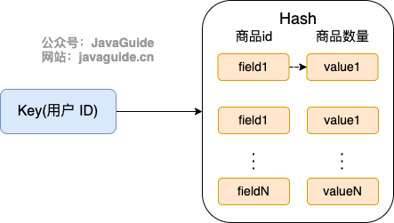
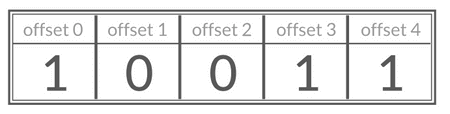
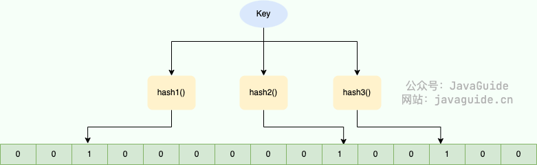
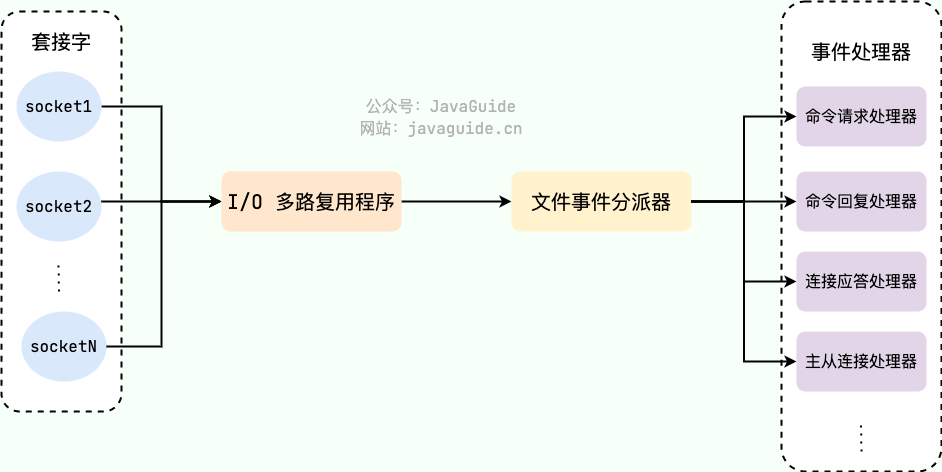
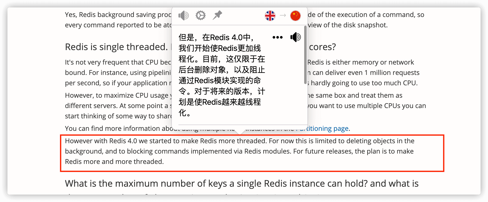
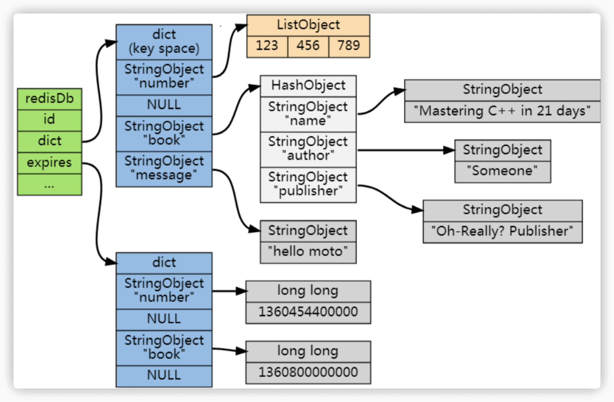
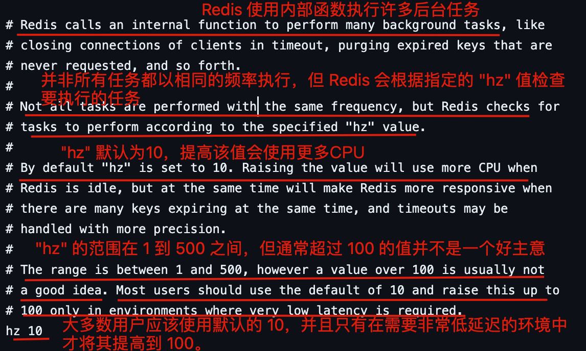

## Redis Fundamentals

### What Is Redis?

[Redis](https://redis.io/) (**RE**mote **DI**ctionary **S**erver) is an open-source NoSQL data store written in C and distributed under the BSD license. It stores data in memory and supports persistence, which makes reads and writes fast. Redis is widely used as a distributed cache and stores data as key-value pairs.

Redis provides data types for different workloads, including String, Hash, Sorted Set, Bitmap, HyperLogLog, and GEO. It also supports transactions, persistence, Lua scripting, Pub/Sub, and clustering through Redis Sentinel and Redis Cluster.



Redis has no external runtime dependencies. Linux and macOS are its most tested operating systems; Redis recommends Linux for production deployments.

To try Redis, install it locally or use the [online Redis environment](https://try.redis.io/) (some commands are unavailable there).



Many websites use Redis. [Techstacks.io](https://techstacks.io/) maintains a [list of popular sites that use Redis](https://techstacks.io/tech/redis).

### ⭐️ Why Is Redis So Fast?

Redis uses several performance techniques:

1. **In-memory storage:** Redis reads and writes data in memory, typically in nanoseconds. Disk I/O in traditional databases is much slower, often measured in milliseconds.
2. **Efficient I/O model:** A single-threaded event loop with I/O multiplexing handles I/O events from many connections. This avoids much of the context-switching and lock contention associated with multithreaded command processing.
3. **Optimized data structures:** Redis offers String, List, Hash, Set, and Sorted Set, with internal encodings such as quicklists, skip lists, and hash tables. Redis selects encodings based on the data and configuration.
4. **Simple protocol:** Redis uses RESP (REdis Serialization Protocol), a simple, efficient, binary-safe protocol that keeps serialization overhead low.

> This diagram summarizes [Why Is Redis So Fast?](https://twitter.com/alexxubyte/status/1498703822528544770).



If Redis is so fast, why not use it as the primary database? Memory is expensive, and Redis persistence still carries a risk of data loss.

### What Other Distributed Cache Solutions Do You Know?

This question often checks whether you evaluated Redis or chose it only because it is popular, and whether you know alternatives.

**Memcached** and **Redis** are established distributed caches. Memcached was widely used before Redis became popular; many projects now choose Redis for its richer features.

Some companies have released Redis-compatible key-value stores. Tencent's [Tendis](https://github.com/Tencent/Tendis), for example, uses [RocksDB](https://github.com/facebook/rocksdb) as its storage engine and supports the Redis protocol and Redis 4.0 data models. See Tencent's [Redis vs. Tendis: An Overview of the Hybrid Hot/Cold Storage Architecture](https://mp.weixin.qq.com/s/MeYkfOIdnU6LYlsGb24KjQ).

The open-source Tendis project appears to receive little maintenance and has limited adoption, so it is not a recommended default.

Other open-source Redis alternatives include:

- [Dragonfly](https://github.com/dragonflydb/dragonfly): An in-memory data store designed for modern workloads. It supports the Redis and Memcached APIs and aims for high performance.
- [KeyDB](https://github.com/Snapchat/KeyDB): A Redis fork focused on multithreading, memory efficiency, and throughput.

Redis remains a strong default because of its production track record, ecosystem, and extensive documentation.

### How Do Redis and Memcached Compare?

**Similarities:**

1. Both are in-memory data stores commonly used as caches.
2. Both support expiration.
3. Both provide high performance.

**Differences:**

1. **Data types:** Redis supports String, List, Set, Sorted Set, Hash, and other data structures. Memcached primarily stores simple key-value data.
2. **Persistence:** Redis supports persistence and can reload data after restart. Memcached stores data in memory only.
3. **Clustering:** Memcached does not provide a native cluster; clients typically shard data. Redis supports clustering natively starting with Redis 3.0.
4. **Threading:** Memcached uses a multithreaded, non-blocking I/O model. Redis processes commands on a single thread and uses I/O multiplexing; Redis 6.0 added threads for network I/O.
5. **Features:** Redis supports Pub/Sub, Lua scripts, and transactions. Memcached does not provide these features.
6. **Expiration:** Memcached uses lazy expiration. Redis uses both lazy and active expiration.

### ⭐️ Why Use Redis?

**1. Fast access**

Traditional databases store data on disk, while Redis stores it in memory. Caching frequently accessed data in Redis can make access tens or hundreds of times faster.

**2. High throughput**

A MySQL server might handle roughly 4,000 queries per second on a 4-core, 8 GB machine, while a single Redis instance may handle 50,000 or more, depending on workload and hardware. A Redis cluster can scale further.

> QPS (queries per second) is the number of queries a server can execute per second.

Serving some requests from cache reduces database load and can increase overall system concurrency.

**3. Broad feature set**

Redis can also support distributed locks, rate limiting, message queues, and delayed tasks.

### ⭐️ Why Use Redis Instead of a Local Cache?

| Feature     | Local cache                                                    | Redis                                      |
| ----------- | -------------------------------------------------------------- | ------------------------------------------ |
| Consistency | Instances may have different data in a multi-server deployment | Shared data across clients                 |
| Capacity    | Limited by one server's memory                                 | Runs independently and can use more memory |
| Data loss   | Lost if the application server fails                           | Persistence is available                   |
| Operations  | Distributed across application instances                       | Centralized with management tools          |
| Features    | Often basic key-value storage                                  | Multiple data structures and features      |

For a detailed comparison of local, distributed, and multilevel caches, see [Cache Fundamentals: Common Interview Questions](https://javaguide.cn/database/redis/cache-basics.html).

### What Cache Read/Write Strategies Are Common?

See [Three Common Cache Read/Write Strategies](https://javaguide.cn/database/redis/3-commonly-used-cache-read-and-write-strategies.html).

### What Is a Redis Module?

Redis 4.0 introduced Modules, which extend Redis with additional features. Modules are loaded as shared libraries (such as .so files).

Modules can add capabilities such as search, custom distributed locks, or distributed rate limiting. Examples include:

- [RediSearch](https://github.com/RediSearch/RediSearch): Search.
- [RedisJSON](https://github.com/RedisJSON/RedisJSON): JSON data.
- [RedisGraph](https://github.com/RedisGraph/RedisGraph): Graph data.
- [RedisTimeSeries](https://github.com/RedisTimeSeries/RedisTimeSeries): Time-series data.
- [RedisBloom](https://github.com/RedisBloom/RedisBloom): Bloom filters.
- [RedisAI](https://github.com/RedisAI/RedisAI): Machine learning and deep learning models.
- [RedisCell](https://github.com/brandur/redis-cell): Distributed rate limiting.
- ...

See the [Redis Modules documentation](https://redis.io/modules).

## ⭐️ Redis Use Cases

### What Can Redis Do Besides Caching?

- **Distributed locks:** Commonly implemented with Redisson. See [Distributed Locks](https://javaguide.cn/distributed-system/distributed-lock.html).
- **Rate limiting:** Redis with Lua scripts can implement rate limiters. Redisson's RRateLimiter uses Lua and a token bucket algorithm.
- **Message queues:** Lists can provide a simple queue. Redis Streams, introduced in Redis 5.0, support persistence and acknowledgments and have concepts similar to Kafka, such as streams and consumer groups.
- **Delayed tasks:** Redisson provides a delayed queue backed by a Sorted Set.
- **Distributed sessions:** Store session data in String or Hash values that all application servers can access.
- **Other use cases:** Use Bitmap for active-user counts, Sorted Sets for leaderboards, and HyperLogLog for approximate UV/PV counts.
- ...

### How Do You Implement a Distributed Lock with Redis?

See [Distributed Lock Implementations](https://javaguide.cn/distributed-system/distributed-lock-implementations.html).

### Can Redis Be Used as a Message Queue?

In brief:

- **For simple, low-volume workloads** that prioritize performance and can tolerate a small risk of message loss, Redis Streams can avoid the cost of deploying another message broker.
- **For financial workloads, very high volumes, or strict delivery guarantees**, use a mature message broker such as Kafka or RabbitMQ.

See [Can Redis Be Used as a Message Queue? How?](https://javaguide.cn/database/redis/redis-stream-mq.html) for a detailed comparison.

### How Can Redis Implement Delayed Tasks?

Typical examples include expiring an unpaid order after ten minutes or returning an unclaimed red envelope after 24 hours.

Two common approaches are:

1. Redis key expiration notifications.
2. Redisson's built-in delayed queue.

Key expiration notifications have timing limitations, are not persisted, and are broadcast to every subscriber, which can lead to delayed or duplicate processing.

Redisson's delayed queue has two advantages:

1. **Lower risk of message loss:** Queue data is persisted according to Redis's persistence settings. A database scan can provide reconciliation after failures.
2. **No Pub/Sub broadcast duplication:** Clients consume from the same target queue rather than each receiving a broadcast copy.

See [How to Implement Delayed Tasks with Redis](./redis-delayed-task.md).

## ⭐️ Redis Data Types

For details about Redis's five core types and three specialized types, see these guides and the [Redis documentation](https://redis.io/docs/data-types/):

- [Redis's Five Core Data Types](https://javaguide.cn/database/redis/redis-data-structures-01.html)
- [Redis's Three Specialized Data Types](https://javaguide.cn/database/redis/redis-data-structures-02.html)

### What Are the Common Redis Data Types?

- **Five core types:** String, List, Set, Hash, and Sorted Set (Zset).
- **Three specialized types:** HyperLogLog (cardinality estimation), Bitmap, and Geospatial (GEO).

Redis also supports data types such as [Bloom filters](https://javaguide.cn/cs-basics/data-structure/bloom-filter.html) and Bitfields.

### What Are Common Uses for String?

String is Redis's simplest and most commonly used type. It is binary-safe and can store strings, integers, floating-point numbers, images (as Base64 data or paths), and serialized objects.

Common uses include:

- Caching sessions, tokens, serialized objects, and image paths.
- Counters, such as per-user request counts for basic rate limiting or page views.
- Basic distributed locks with SETNX key value.

See [Redis's Five Core Data Types](https://javaguide.cn/database/redis/redis-data-structures-01.html).

### Should You Store Objects as Strings or Hashes?

- **Storage model:** A String stores the serialized object as a whole. A Hash stores each object field separately, allowing partial reads and updates and reducing network traffic when only some fields are needed.
- **Memory:** Hashes can use less memory, especially for objects with many short fields. Redis optimizes small Hashes with compact encodings.
- **Complex objects:** Strings are simpler for nested or complex objects because fields do not need separate handling.
- **Performance:** Whole-object String reads and writes are straightforward. Hashes add per-field work, especially when many fields change.

In most cases, a String is suitable when the whole object is read or written together. Use a Hash when fields are accessed or updated independently, or when it saves memory.

### How Is String Implemented Internally?

Redis is written in C, but its String type is not a null-terminated C string. Redis uses [Simple Dynamic Strings (SDS)](https://github.com/antirez/sds), originally designed by Redis's author and later optimized for Redis.

Redis 7.0 defines several SDS header types in [sds.h](https://github.com/redis/redis/blob/7.0/src/sds.h):

```c
/* Note: sdshdr5 is never used, we just access the flags byte directly.
 * However is here to document the layout of type 5 SDS strings. */
struct __attribute__ ((__packed__)) sdshdr5 {
    unsigned char flags; /* 3 lsb of type, and 5 msb of string length */
    char buf[];
};
struct __attribute__ ((__packed__)) sdshdr8 {
    uint8_t len; /* used */
    uint8_t alloc; /* excluding the header and null terminator */
    unsigned char flags; /* 3 lsb of type, 5 unused bits */
    char buf[];
};
struct __attribute__ ((__packed__)) sdshdr16 {
    uint16_t len; /* used */
    uint16_t alloc; /* excluding the header and null terminator */
    unsigned char flags; /* 3 lsb of type, 5 unused bits */
    char buf[];
};
struct __attribute__ ((__packed__)) sdshdr32 {
    uint32_t len; /* used */
    uint32_t alloc; /* excluding the header and null terminator */
    unsigned char flags; /* 3 lsb of type, 5 unused bits */
    char buf[];
};
struct __attribute__ ((__packed__)) sdshdr64 {
    uint64_t len; /* used */
    uint64_t alloc; /* excluding the header and null terminator */
    unsigned char flags; /* 3 lsb of type, 5 unused bits */
    char buf[];
};
```

There are five SDS header types: SDS_TYPE_5 (unused), SDS_TYPE_8, SDS_TYPE_16, SDS_TYPE_32, and SDS_TYPE_64. Redis selects a type based on string length to reduce memory use.

| Type     | Header size | Length capacity |
| -------- | ----------- | --------------- |
| sdshdr5  | < 1 byte    | < 8 bits        |
| sdshdr8  | 1 byte      | 8 bits          |
| sdshdr16 | 2 bytes     | 16 bits         |
| sdshdr32 | 4 bytes     | 32 bits         |
| sdshdr64 | 8 bytes     | 64 bits         |

The four used header types contain these fields:

- len: Number of bytes currently used by the string.
- alloc: Allocated character capacity. alloc - len is the remaining capacity.
- buf[]: The string data.
- flags: The low three bits identify the SDS type.

SDS improves on C strings in several ways:

1. **Prevents buffer overflows:** Before modifying a string, SDS checks len and expands the buffer if necessary.
2. **Provides O(1) length lookup:** SDS stores the length in len; C strings require traversal, which takes O(N).
3. **Reduces allocations:** SDS uses preallocation when strings grow and lazy freeing when they shrink. Freed capacity can be reused or released explicitly.
4. **Supports binary data:** C strings use \0 as a terminator, but binary files may contain null bytes. SDS uses len to determine the string length.

Some articles show the older SDS definition:

```c
struct sdshdr {
    unsigned int len;
    unsigned int free;
    char buf[];
};
```

This definition was used before Redis 3.2. Redis later introduced five header types to avoid always using four bytes each for len and free.

### Should Shopping Cart Data Use String or Hash?

A shopping cart changes frequently, so a Hash is a suitable representation:

- User ID is the key.
- Product ID is the field.
- Quantity is the value.



Operations include adding a product as a field, reading the cart, changing a quantity, removing a field, or deleting the key to clear the cart. Real e-commerce carts may need more fields than a product ID, so this is a simplified example.

### How Do You Build a Leaderboard with Redis?

Sorted Sets are commonly used for leaderboards such as tipping rankings, step counts, game ranks, and trending topics. Useful commands include ZRANGE (ascending order), ZREVRANGE (descending order), and ZREVRANK (rank a member).


[The Java Interview Guide](https://javaguide.cn/zhuanlan/java-mian-shi-zhi-bei.html) has a detailed article on designing a leaderboard with Sorted Sets.


### Why Does Redis Use a Skip List for Sorted Sets Instead of a Tree?

This is a common, challenging interview question.

- **Balanced tree vs. skip list:** Both support insertion, deletion, and lookup in O(log N), and both can support range queries. Balanced trees must maintain strict balance after updates, often using rotations. Skip lists use probabilistic balancing, making insertion and deletion simpler.
- **Red-black tree vs. skip list:** Skip lists are simpler to implement because they do not need rotations or recoloring. They also work well for range queries.
- **B+ tree vs. skip list:** B+ trees reduce disk I/O in databases and file systems. That advantage is less relevant in an in-memory database. Skip lists use probabilistic indexing and are simpler to update than B+ trees that may split or merge nodes.

For more detail, see [Why Redis Uses Skip Lists for Sorted Sets](https://javaguide.cn/database/redis/redis-skiplist.html) and [Skip Lists: Interview Questions](https://javaguide.cn/cs-basics/data-structure/skip-list.html).

### What Are Common Uses for Set?

A Redis Set is an unordered collection of unique elements, similar to Java's HashSet.

Common use cases include:

- Unique values, such as website UV counts (HyperLogLog is more suitable at very large scale), article likes, and activity likes.
- Set operations across data sources, such as mutual friends, followers, and follows (intersection), or friend and music recommendations (difference).
- Random selection, such as prize draws or random name selection.

### How Do You Build a Prize Draw with Set?

- SADD key member1 member2 ...: Add members to the Set.
- SPOP key count: Randomly return and remove members; useful when winners cannot be selected twice.
- SRANDMEMBER key count: Randomly return members without removing them; winners can be selected again.

### How Do You Count Active Users with Bitmap?

A Bitmap stores bits (0 and 1), with each array index represented by an offset. One bit per item can save space.



Use the date as the key and user ID as the offset. Set the bit to 1 when the user is active that day.

Initialize data:

```bash
> SETBIT 20210308 1 1
(integer) 0
> SETBIT 20210308 2 1
(integer) 0
> SETBIT 20210309 1 1
(integer) 0
```

Count users active on both March 8 and March 9:

```bash
> BITOP and desk1 20210308 20210309
(integer) 1
> BITCOUNT desk1
(integer) 1
```

Count users active on either day:

```bash
> BITOP or desk2 20210308 20210309
(integer) 1
> BITCOUNT desk2
(integer) 2
```

### When Should You Use HyperLogLog?

HyperLogLog (HLL) estimates the number of unique elements in a large data set using little memory. It trades exactness for memory efficiency; Redis's standard error is 0.81%.

HLL is suitable when:

1. **The data set is huge and memory is limited.** A Set holding hundreds of millions of user IDs could require gigabytes of memory. A Redis HyperLogLog uses about 12 KB.
2. **An approximate result is enough.** Estimating whether a post had about 10 million or 10.1 million unique visitors may be sufficient. HLL is unsuitable for exact counts such as financial transactions.

Use cases include:

- Website or app UV counts by IP address or user ID.
- Distinct users who searched for a keyword.
- Unique users who shared a social media post.

Redis switches between sparse and dense representations as cardinality grows.

### How Do You Count Page UVs with HyperLogLog?

Use PFADD to add visitors and PFCOUNT to estimate the unique count.

```bash
PFADD PAGE_1:UV USER1 USER2 ...... USERn
PFCOUNT PAGE_1:UV
```

### Which Data Type Can Tell You Whether an Element Is Absent from a Huge Set?

A Bloom filter can say an element is definitely absent or possibly present. It uses little memory but has a false-positive rate; it does not have false negatives. If it says an element may be present, it can be wrong. If it says the element is absent, the element is definitely absent.



To add a string, multiple hash functions map it to positions in a bit array, initially all zeros. Those bits are set to 1. To test membership, hash the string again and check the corresponding bits. If any bit is 0, the element is absent; if all are 1, it may be present.

See [Bloom Filters](https://javaguide.cn/cs-basics/data-structure/bloom-filter.html) for false positives, deletion limitations, and Guava and RedisBloom usage.

## ⭐️ Redis Persistence (Important)

See [Redis Persistence](https://javaguide.cn/database/redis/redis-persistence.html) for RDB, AOF, and mixed persistence.

## ⭐️ Redis Thread Model (Important)

Redis processes read and write commands using a single-threaded model. Redis 4.0 added background threads for asynchronous deletion of large values; Redis 6.0 added threads for network I/O.

### Are You Familiar with Redis's Single-Threaded Model?

**Redis uses an event-processing model based on the Reactor pattern.** Netty also uses a Reactor-based thread model. Redis's file event handler runs on one thread, which is why Redis is often described as single-threaded.

_Redis Design and Implementation_ describes the file event handler:

> Redis implements a network event handler based on the Reactor pattern, called the file event handler.
>
> - It uses I/O multiplexing to monitor multiple sockets and associates event handlers with each socket based on its current task.
> - When a socket is ready to accept, read, write, or close, the file event handler invokes its associated handler.
>
> **Although the file event handler runs on one thread, I/O multiplexing lets it monitor multiple sockets.** This provides efficient networking while keeping Redis's internal design simple.

**How can one thread listen to many client connections?**

Redis uses I/O multiplexing to monitor client sockets. It registers read and write events with the kernel and checks when those events are ready. This avoids creating a separate thread for each client and is similar to Java NIO's Selector.

The file event handler consists of:

- Client sockets.
- I/O multiplexing.
- An event dispatcher that maps sockets to handlers.
- Event handlers for accepting connections, processing commands, and sending replies.



### Why Didn't Redis Use Multiple Threads Before 6.0?

Redis 4.0 added threads for specific operations, such as asynchronously deleting large values, while normal command processing remained single-threaded.

New asynchronous commands included:

- UNLINK: An asynchronous alternative to DEL.
- FLUSHALL ASYNC: Asynchronously remove keys from all databases.
- FLUSHDB ASYNC: Asynchronously remove keys from the selected database.



Before Redis 6.0, most operations were still handled by one thread. Reasons include:

- Single-threaded code is simpler to write and maintain.
- Redis bottlenecks were often memory or network related rather than CPU-bound.
- Multithreading introduces lock contention, deadlocks, and context-switching overhead, which can reduce performance.

See [Why Does Redis Use a Single-Threaded Model?](https://draveness.me/whys-the-design-redis-single-thread/).

### Why Did Redis 6.0 Introduce Multiple Threads?

**Redis 6.0 introduced multiple threads mainly to improve network I/O.** Redis still executes commands sequentially on the main thread, so command execution does not introduce new thread-safety concerns.

I/O threads are disabled by default. To enable them, set their number to more than one in redis.conf:

```bash
io-threads 4 # For 4 CPU cores Redis suggests 2 or 3 I/O threads; for 8 cores, 6.
```

Notes:

- The I/O thread count cannot be changed dynamically with CONFIG.
- I/O threads do not work when SSL is enabled.

By default, I/O threads handle writes to clients. To enable threaded reads as well, set:

```bash
io-threads-do-reads yes
```

Threaded reads may provide limited improvement, so they are generally not recommended.

Further reading:

- [Redis 6.0 Multithreading: 13 Questions](https://mp.weixin.qq.com/s/FZu3acwK6zrCBZQ_3HoUgw)
- [Redis's Multithreaded Network Model](https://segmentfault.com/a/1190000039223696) (recommended)

### Are You Familiar with Redis Background Threads?

Redis is often called single-threaded because its main command-processing logic runs on one thread. It also uses background threads for slower tasks:

- bio_close_file closes temporary files created during AOF or RDB operations.
- bio_aof_fsync calls fsync to flush AOF data from the operating system buffer to disk.
- bio_lazy_free frees memory used by deleted large objects asynchronously.

These job types are defined in Redis 6.0's [bio.h](https://github.com/redis/redis/blob/6.0/src/bio.h):

```c
#ifndef __BIO_H
#define __BIO_H

/* Exported API */
void bioInit(void);
void bioCreateBackgroundJob(int type, void *arg1, void *arg2, void *arg3);
unsigned long long bioPendingJobsOfType(int type);
unsigned long long bioWaitStepOfType(int type);
time_t bioOlderJobOfType(int type);
void bioKillThreads(void);

/* Background job opcodes */
#define BIO_CLOSE_FILE    0 /* Deferred close(2) syscall. */
#define BIO_AOF_FSYNC     1 /* Deferred AOF fsync. */
#define BIO_LAZY_FREE     2 /* Deferred object freeing. */
#define BIO_NUM_OPS       3

#endif
```

See [Redis 6.0 Background Threads](https://juejin.cn/post/7102780434739626014).

## ⭐️ Redis Memory Management

### Why Set Expiration Times on Cached Data?

Memory is limited. Without expiration, cached data can accumulate and eventually cause an out-of-memory (OOM) condition. Expiration lets Redis remove data that is no longer needed.

```bash
127.0.0.1:6379> EXPIRE key 60 # The key expires after 60 seconds
(integer) 1
127.0.0.1:6379> SETEX key 60 value # Set the value with a 60-second TTL
OK
127.0.0.1:6379> TTL key # Check the remaining TTL
(integer) 56
```

Only String has the SETEX command; use EXPIRE to set a TTL for other types. Use PERSIST to remove a key's expiration.

Expiration is also useful when data should exist only for a limited time, such as an SMS verification code valid for one minute or a login token valid for one day. With a traditional database, the application would need to check expiration itself.

### How Does Redis Track Whether Data Has Expired?

Redis stores expiration times in an expiration dictionary (a hash table). Each key refers to a key in the Redis database, and its value is the expiration time as a millisecond-precision Unix timestamp.



The expiration dictionary is stored in the redisDb structure:

```c
typedef struct redisDb {
    ...

    dict *dict;     // Database keyspace, containing all key-value pairs
    dict *expires;  // Expiration dictionary, containing key expiration times
    ...
} redisDb;
```

When looking up a key, Redis first checks whether it has an expiration entry in O(1) time. If it does, Redis checks whether the key has expired. An expired key is deleted and the lookup returns null.

### How Does Redis Delete Expired Keys?

Common expiration strategies include:

1. **Lazy expiration:** Check a key's TTL only when it is accessed. This is CPU-efficient, but expired keys that are never accessed may remain in memory.
2. **Active expiration:** Periodically sample keys with expiration times and delete expired ones. This reduces memory use but consumes CPU.
3. **Delayed queue:** Put expiring keys in a queue and delete them when due. This can remove keys on time, but the queue consumes resources and is difficult to maintain.
4. **Scheduled expiration:** Schedule a timer for every expiring key. This avoids retaining expired keys but creates high CPU overhead.

Redis combines **active expiration and lazy expiration**, balancing CPU use and memory reclamation.

Active expiration samples keys, so it does not guarantee immediate deletion of every expired key. Redis limits how long and how often it runs expiration to reduce CPU impact.

Expiration work is also adjusted according to elapsed time and the percentage of expired keys found:

- If the time budget is exceeded, Redis stops the current cycle.
- If a sampled batch contains a high percentage of expired keys, Redis repeats the cycle to reclaim more memory. If the percentage is low, it stops to avoid spending CPU for little benefit.

In Redis 7.2, the slow-cycle CPU budget is 25 ms and the acceptable stale-key percentage is 10%:

```c
#define ACTIVE_EXPIRE_CYCLE_FAST_DURATION 1000 /* Microseconds. */
#define ACTIVE_EXPIRE_CYCLE_SLOW_TIME_PERC 25 /* Max % of CPU to use. */
#define ACTIVE_EXPIRE_CYCLE_ACCEPTABLE_STALE 10 /* % of stale keys after which
                                                   we do extra efforts. */
```

Redis 7.2 samples 20 keys at a time, as defined in expire.c:

```c
#define ACTIVE_EXPIRE_CYCLE_KEYS_PER_LOOP 20 /* Keys for each DB loop. */
```

The hz parameter controls the frequency of periodic tasks. Its default is 10, meaning Redis attempts to find and delete expired keys ten times per second.

hz ranges from 1 to 500. A higher value runs periodic tasks more often and uses more CPU. Redis recommends not exceeding 100; the default is enough for most workloads.



dynamic-hz is also enabled by default. It lets Redis adjust the effective hz based on activity.

```properties
# Default is 10
hz 10
# Enabled by default
dynamic-hz yes
```

Other periodic tasks also use hz, including closing idle client connections and updating statistics.

**Why doesn't Redis delete all expired keys in one pass?**

Scanning every key could take a long time and harm performance. Redis balances memory reclamation against CPU use.

**Why not delete a key exactly when its TTL expires?**

A timer for every key would be expensive. A delayed queue would also use memory and require updates whenever a key's TTL changes, along with concurrency control.

### What If Many Keys Expire at Once?

A large number of keys expiring together can cause:

- **Higher request latency:** Deleting many keys consumes CPU and delays other requests.
- **High memory use:** Expired keys still occupy memory until Redis deletes them, potentially causing memory pressure or OOM.

To reduce the impact:

1. Add random jitter to expiration times to avoid synchronized expiration.
2. Enable lazy freeing by setting lazyfree-lazy-expire yes in redis.conf. Redis then frees expired keys asynchronously instead of blocking the main thread.

### Are You Familiar with Redis Eviction Policies?

> Related question: If MySQL has 20 million rows but Redis stores only 200,000, how can you ensure Redis contains only hot data?

Redis eviction occurs when memory reaches the maxmemory limit in redis.conf. On 64-bit systems, the default is 0 (no limit); on 32-bit systems, the default maximum is 3 GB.

Check the setting:

```bash
> CONFIG GET maxmemory
1) "maxmemory"
2) "0"
```

Redis provides these eviction policies:

1. **volatile-lru (least recently used):** Evict the least recently used keys that have an expiration set.
2. **volatile-ttl:** Evict keys with an expiration set that are closest to expiring.
3. **volatile-random:** Randomly evict keys that have an expiration set.
4. **allkeys-lru (least recently used):** Evict the least recently used keys from all keys.
5. **allkeys-random:** Randomly evict keys from all keys.
6. **noeviction (default):** Do not evict keys. Writes that need more memory fail with an error.

Redis 4.0 added:

7. **volatile-lfu (least frequently used):** Evict the least frequently used keys that have an expiration set.
8. **allkeys-lfu (least frequently used):** Evict the least frequently used keys from all keys.

allkeys-xxx policies consider every key. volatile-xxx policies consider only keys with an expiration.

The policy enum in config.c includes:

```c
configEnum maxmemory_policy_enum[] = {
    {"volatile-lru", MAXMEMORY_VOLATILE_LRU},
    {"volatile-lfu", MAXMEMORY_VOLATILE_LFU},
    {"volatile-random",MAXMEMORY_VOLATILE_RANDOM},
    {"volatile-ttl",MAXMEMORY_VOLATILE_TTL},
    {"allkeys-lru",MAXMEMORY_ALLKEYS_LRU},
    {"allkeys-lfu",MAXMEMORY_ALLKEYS_LFU},
    {"allkeys-random",MAXMEMORY_ALLKEYS_RANDOM},
    {"noeviction",MAXMEMORY_NO_EVICTION},
    {NULL, 0}
};
```

Check the current policy:

```bash
> CONFIG GET maxmemory-policy
1) "maxmemory-policy"
2) "noeviction"
```

Use `CONFIG SET maxmemory-policy <policy>` to change the policy immediately. The change is not retained after restart. To make it persistent, set `maxmemory-policy` in `redis.conf` and restart Redis:

```properties
maxmemory-policy noeviction
```

See the [Redis eviction documentation](https://redis.io/docs/reference/eviction/).

## References

- _Redis Development and Operations_.
- _Redis Design and Implementation_.
- _Redis Core Principles and Practice_.
- [Redis Command Reference](https://www.redis.com.cn/commands.html).
- [RedisSearch: A Complete Guide](https://mp.weixin.qq.com/s/FA4XVAXJksTOHUXMsayy2g).
- [Why Redis Uses a Single Thread](https://medium.com/@jychen7/sharing-redis-single-thread-vs-multi-threads-5870bd44d153).

<!-- @include: @article-footer.snippet.md -->
