<!-- @include: @article-header.snippet.md -->

## Redis Transactions

### What Is a Redis Transaction?

A Redis transaction groups multiple commands and executes them sequentially without interleaving commands from other clients. Redis queues the commands first, then runs them when the client sends EXEC.

Redis transactions are rarely used in application development and should not be confused with relational database transactions. They do not provide traditional rollback. Durability depends on Redis persistence.

### How Do You Use Redis Transactions?

Redis transactions use MULTI, EXEC, DISCARD, and WATCH.

```bash
> MULTI
OK
> SET PROJECT "JavaGuide"
QUEUED
> GET PROJECT
QUEUED
> EXEC
1) OK
2) "JavaGuide"
```

After MULTI, Redis queues commands instead of executing them. EXEC runs the queued commands in order:

1. Start the transaction with MULTI.
2. Queue commands.
3. Run the transaction with EXEC.

Use DISCARD to clear the queued commands:

```bash
> MULTI
OK
> SET PROJECT "JavaGuide"
QUEUED
> GET PROJECT
QUEUED
> DISCARD
OK
```

WATCH monitors keys. If another client changes a watched key before EXEC, the transaction is aborted:

```bash
# Client 1
> SET PROJECT "RustGuide"
OK
> WATCH PROJECT
OK
> MULTI
OK
> SET PROJECT "JavaGuide"
QUEUED

# Client 2 changes PROJECT before Client 1 calls EXEC
> SET PROJECT "GoGuide"

# Client 1: EXEC aborts because PROJECT changed
> EXEC
(nil)
> GET PROJECT
"GoGuide"
```

If the same client changes a watched key inside its transaction, EXEC can still succeed. See [this issue about WATCH and MULTI](https://github.com/Snailclimb/JavaGuide/issues/1714).

Changes to the watched key inside a transaction:

```bash
> SET PROJECT "JavaGuide"
OK
> WATCH PROJECT
OK
> MULTI
OK
> SET PROJECT "JavaGuide1"
QUEUED
> SET PROJECT "JavaGuide2"
QUEUED
> SET PROJECT "JavaGuide3"
QUEUED
> EXEC
1) OK
2) OK
3) OK
> GET PROJECT
"JavaGuide3"
```

A change outside the transaction aborts it:

```bash
> SET PROJECT "JavaGuide"
OK
> WATCH PROJECT
OK
> SET PROJECT "JavaGuide2"
OK
> MULTI
OK
> GET USER
QUEUED
> EXEC
(nil)
```

See the [Redis transactions documentation](https://redis.io/docs/latest/develop/using-commands/transactions/).

### Do Redis Transactions Support Atomicity?

Redis transactions differ from traditional database transactions. The ACID properties are:

1. **Atomicity:** A transaction completes entirely or has no effect.
2. **Isolation:** Concurrent transactions do not interfere with each other.
3. **Durability:** Committed changes persist even after a failure.
4. **Consistency:** A transaction preserves valid data states.

If a command fails while Redis executes a transaction, other queued commands can still run. Redis transactions do not support rollback, so they do not provide traditional atomicity.

Redis's developers chose not to support rollback to keep the implementation simpler and faster, and expect command errors to be caught during development.

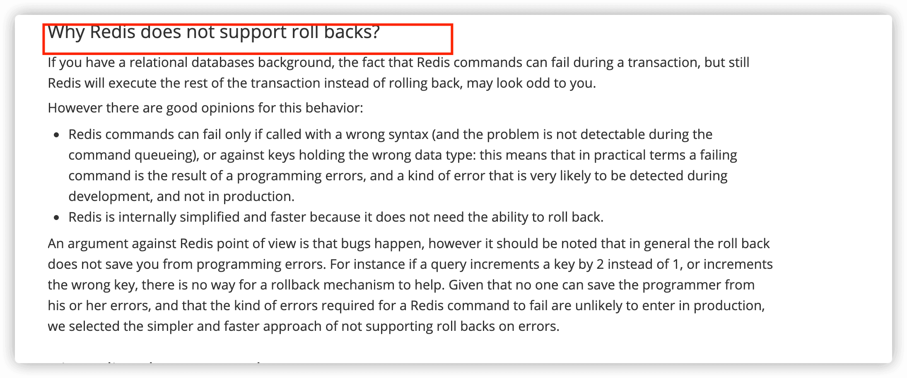

Related issues:

- [Redis transactions and atomicity](https://github.com/Snailclimb/JavaGuide/issues/452)
- [Why Redis has no transaction rollback](https://github.com/Snailclimb/JavaGuide/issues/491)

### Do Redis Transactions Support Durability?

Redis supports RDB snapshots, AOF, and mixed RDB/AOF persistence. AOF can sync writes using one of three policies:

```bash
appendfsync always    # Main thread fsyncs after every write; safest but slow
appendfsync everysec  # Background thread fsyncs about once per second
appendfsync no        # Operating system decides when to sync, often around 30 seconds
```

With no or everysec, a failure may lose recent writes. Always offers stronger durability but has high performance costs. Redis transaction durability therefore depends on the configured persistence policy and is not guaranteed by the transaction itself.

### How Can You Address the Limitations of Redis Transactions?

Redis 2.6 introduced Lua scripting, which can execute multiple commands in one server-side operation. A script runs without other Redis commands interleaving, reducing network overhead.

A Lua script is not equivalent to rollback: if it errors midway, prior writes remain, while later commands do not run. Ensure the script syntax and commands are valid.

Redis 7.0 also introduced [Redis Functions](https://redis.io/docs/latest/develop/programmability/functions-intro/), which provide a server-side programmability feature beyond ad hoc Lua scripts.

## ⭐️ Redis Performance Optimization (Important)

Further reading:

- [Has Your Redis Really Slowed Down? How to Optimize Performance](https://mp.weixin.qq.com/s/nNEuYw0NlYGhuKKKKoWfcQ)
- [Common Causes of Redis Blocking](https://javaguide.cn/database/redis/redis-common-blocking-problems-summary.html)

### Reduce Network Traffic with Batch Operations

A Redis command can be divided into four steps:

1. Send the command.
2. Queue the command.
3. Execute the command.
4. Return the result.

The time spent sending the command and receiving the result is **Round-Trip Time (RTT)**. Batching reduces network round trips. It can also reduce socket I/O costs, including context switches and read/write system calls. See Redis's [pipelining documentation](https://redis.io/docs/latest/develop/using-commands/pipelining/).

#### Native Batch Commands

Redis has commands that operate on multiple values, including:

- MGET and MSET for multiple keys.
- HMGET and HMSET for multiple Hash fields.
- SADD for multiple Set members.
- ...

In Redis Cluster, keys may belong to different hash slots. A command such as MGET may therefore require requests to multiple nodes, losing single-request efficiency and atomicity. Clients commonly handle this by:

1. Finding the hash slot for each key.
2. Sending requests to the relevant nodes.
3. Combining the results in the input key order.

Maintaining the key-to-slot mapping manually can reduce network requests but adds complexity.

Redis Cluster uses **hash slot partitioning**, not consistent hashing. Each key maps to a hash slot, and the cluster maps slots to nodes. See [Redis Clustering (Premium)](https://javaguide.cn/database/redis/redis-cluster.html).

#### Pipeline

For commands without native batch support, a **pipeline** sends multiple commands in one network round trip. Limit the number and total size of commands in a batch; for example, keep batches under about 500 commands, depending on value sizes.

Pipelines also need special handling in Redis Cluster when keys map to different slots. The client can group commands by node.

Native batch commands and pipelines differ:

- Native batch commands such as MGET are atomic for their supported key set; pipelines are not atomic.
- A pipeline can contain different commands; a native batch command has a fixed operation.
- Native batch commands are implemented by Redis. Pipeline support requires both client and server protocol support.

Transactions and pipelines also differ:

- Redis transactions execute their queued commands together without interleaving; pipelines are non-atomic and may interleave with other clients.
- A transaction sends each command to Redis while queueing, then sends EXEC. A pipeline sends a batch of commands together.

> Redis transactions prevent command interleaving but do not provide rollback. Atomicity here means other commands do not run in the middle; it does not mean all writes are reverted if one command fails.

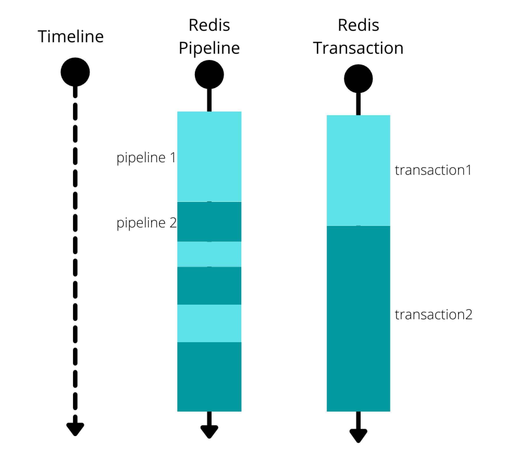

A pipeline is not suitable when later commands depend on earlier command results. Use a Lua script for that case.

#### Lua Scripts

Lua scripts can batch commands, run without other Redis commands interleaving, and implement simple logic such as reading and processing a value. Pipelines cannot do this.

Lua scripts still have limitations:

- If a script fails midway, earlier writes are not rolled back.
- In Redis Cluster, all keys used by a script must be in the same hash slot.

### Many Keys Expiring at the Same Time

Redis combines active and lazy expiration. A large expiration cycle can consume time on the Redis main thread and delay client requests.

Common mitigations:

1. Add random jitter to expiration times.
2. Enable lazy freeing with lazyfree-lazy-expire yes in redis.conf. Redis 4.0+ can release expired key memory asynchronously on a background thread.

Use expiration jitter whether or not lazy freeing is enabled.

### Redis Large Keys (bigkeys)

#### What Is a Large Key?

A key can be considered large when its value uses substantial memory. These are rough guidelines:

- A String value larger than 1 MB.
- A collection (List, Hash, Set, or Sorted Set) with more than 5,000 elements. Element count alone does not determine memory use.

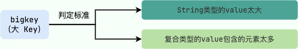

#### How Are Large Keys Created, and What Problems Do They Cause?

Common causes include:

- Poor design, such as storing a large file's binary data in a String.
- Underestimating how quickly a collection will grow.
- Failing to remove obsolete data, leaving unused Hash fields or other members.

Large keys consume memory and bandwidth and can affect performance. They can cause:

1. **Client timeouts:** Redis processes commands on its main thread. Operations on large values can delay other commands.
2. **Network congestion:** Fetching a 1 MB key 1,000 times per second sends about 1,000 MB per second, which can overwhelm a typical 1 Gbps network interface.
3. **Blocked work:** DEL on a large key can delay later commands.

Large keys can also slow replication and cluster resharding. Avoid them where possible.

#### How Do You Find Large Keys?

**1. Use redis-cli --bigkeys.**

```bash
# redis-cli -p 6379 --bigkeys

# Scanning the keyspace for the largest keys and average sizes per type.
# Use -i 0.1 to pause 0.1 seconds per 100 SCAN commands if needed.

[00.00%] Biggest string found so far '"example:key"' with 4437 bytes
[00.00%] Biggest list found so far '"my-list"' with 17 items

-------- summary -------
Sampled 5 keys in the keyspace!
Total key length in bytes is 264 (avg len 52.80)
Biggest list found '"my-list"' has 17 items
Biggest string found '"example:key"' has 4437 bytes
```

This scans the keyspace and can affect Redis performance. It reports the largest String and largest collection by element count, not necessarily the key using the most memory. On production systems, use the -i option to throttle scanning, for example redis-cli -p 6379 --bigkeys -i 3.

**2. Use SCAN and type-specific commands.**

SCAN returns keys incrementally. For each key, use a type-specific command to inspect its length or member count:

| Type       | Command | Complexity | Result             |
| ---------- | ------- | ---------- | ------------------ |
| String     | STRLEN  | O(1)       | String length      |
| Hash       | HLEN    | O(1)       | Number of fields   |
| List       | LLEN    | O(1)       | Number of elements |
| Set        | SCARD   | O(1)       | Number of members  |
| Sorted Set | ZCARD   | O(1)       | Number of members  |

For collections, MEMORY USAGE (Redis 4.0+) reports the memory used by a key.

**3. Analyze an RDB file.**

This requires RDB persistence. Tools include:

- [redis-rdb-tools](https://github.com/sripathikrishnan/redis-rdb-tools): Analyze RDB snapshots using Python.
- [rdb_bigkeys](https://github.com/weiyanwei412/rdb_bigkeys): Analyze RDB snapshots using Go.

**4. Use managed Redis analysis tools.**

Cloud Redis services may provide key analysis. For example, Alibaba Cloud supports [real-time key statistics](https://www.alibabacloud.com/help/zh/apsaradb-for-redis/latest/use-the-real-time-key-statistics-feature).

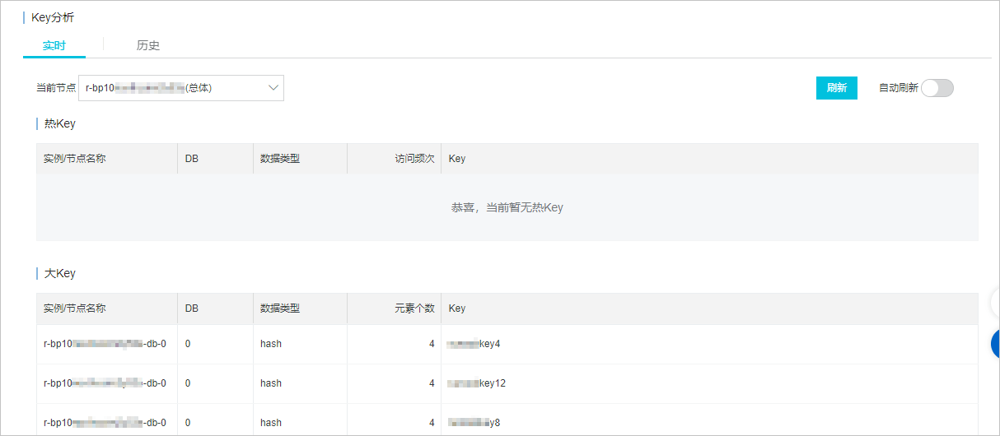

#### How Do You Handle Large Keys?

Common approaches can be combined:

- **Split the key:** Divide a large Hash into smaller Hashes, for example by applying a secondary hash to its fields.
- **Delete in batches:** Redis 4.0+ supports asynchronous UNLINK. On older versions, combine SCAN and DEL to delete keys in batches.
- **Choose a suitable data type:** Do not store file contents in Strings; use HyperLogLog for approximate UV counts and Bitmap for Boolean state.
- **Enable lazy freeing:** Redis 4.0+ can release memory asynchronously to avoid blocking the main thread.

### Redis Hot Keys (hotkeys)

#### What Is a Hot Key?

A key is hot when it receives far more accesses than other keys. For example, if an instance handles 5,000 requests per second and one key receives 2,000 per second, that key may be hot.

Hot keys often result from sudden demand for popular data, such as breaking news or a flash-sale product.

#### What Problems Do Hot Keys Cause?

Hot keys can consume CPU and bandwidth and increase latency for other requests. Under overload, requests may queue, time out, or reduce throughput. Unbounded retries or fallback to a database can spread the load further.

Access count alone is not enough: expensive commands can exhaust CPU, while large values can saturate bandwidth. Distinguish read hot spots from write hot spots. Local caching can reduce reads but does not directly solve concentrated writes.

#### How Do You Find Hot Keys?

**1. Use redis-cli --hotkeys.**

redis-cli --hotkeys scans keys and reads OBJECT FREQ to find keys with high LFU frequency counters. These counters are approximate and are not actual request counts or QPS.

The instance must use allkeys-lfu or volatile-lfu. Do not change a production eviction policy just to run this diagnostic; doing so changes behavior at the maxmemory limit.

```bash
redis-cli -h 127.0.0.1 -p 6379 --hotkeys -i 0.1
```

LFU counters increase probabilistically and decay over time. The scan takes time and is not a snapshot of all traffic, so it can miss short-lived hot keys. On a cluster, specify which nodes are being examined.

See [OBJECT FREQ](https://redis.io/docs/latest/commands/object-freq/), [LFU eviction](https://redis.io/docs/latest/develop/reference/eviction/#lfu-eviction), and the [Redis CLI guide](https://redis.io/docs/latest/develop/tools/cli/).

**2. Use MONITOR briefly.**

MONITOR streams commands processed by the server. It can help count key accesses during a short observation window, but it is not a complete audit log and can affect performance. Do not leave it running for long in production.

```bash
redis-cli MONITOR
```

Limit the capture duration and output size, then analyze the data offline. It only shows commands observed during collection and may expose application parameters. See the [MONITOR documentation](https://redis.io/docs/latest/commands/monitor/).

**3. Use an open-source project.**

JD Retail's [hotkey](https://gitee.com/jd-platform-opensource/hotkey) supports hot-key discovery and handling.

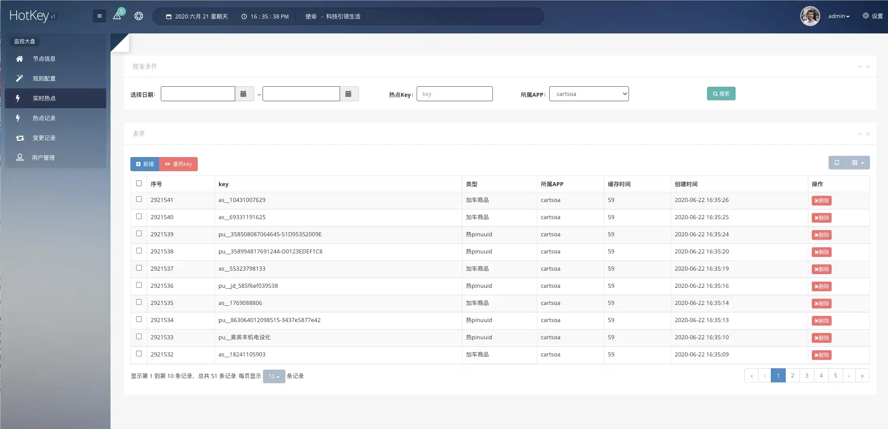

**4. Predict hot keys from the workload.**

Known hot data, such as flash-sale products, can be identified in advance. Sudden events such as breaking news cannot always be predicted.

**5. Collect statistics in a client or proxy.**

A shared SDK or proxy can count key accesses over a time window across instances. A single instance sees only its own traffic, and local cache hits do not appear as Redis requests. Use sampling or bounded counters to control overhead; do not create unbounded metrics labelled by every key.

**6. Use managed Redis analysis tools.**

Some cloud Redis services offer hot-key analysis. For example, Alibaba Cloud supports [real-time key statistics](https://www.alibabacloud.com/help/zh/apsaradb-for-redis/latest/use-the-real-time-key-statistics-feature).


**7. Collect hot-key statistics on the server.**

A server-side extension can track hot keys over a time window with bounded memory and provide query or notification interfaces. It requires maintaining custom code and checking compatibility with Redis upgrades. Sampling and eviction can cause missed accesses, so account for the observation window, capacity, and overhead.

**Redis Open Source 8.6.0 and later provides the HOTKEYS command family.** It identifies hot keys by CPU time or network bytes over an observation period. This differs from redis-cli --hotkeys, which relies on LFU counters.

```bash
# Observe for 30 seconds, retain the top 10 by CPU and network; SAMPLE 10 samples 1/10 of requests
redis-cli HOTKEYS START METRICS 2 CPU NET COUNT 10 DURATION 30 SAMPLE 10
# View results during or after collection
redis-cli HOTKEYS GET
```

Sampling affects accuracy, and results cover only the specified observation window. See [HOTKEYS START](https://redis.io/docs/latest/commands/hotkeys-start/) and [HOTKEYS GET](https://redis.io/docs/latest/commands/hotkeys-get/).

Start with existing monitoring to find overloaded nodes and time windows, then use a diagnostic suited to the Redis version. Packet capture may help analyze plaintext RESP traffic, but protocol parsing, capture overhead, and TLS make it unsuitable as the default continuous monitor.

#### How Do You Handle Hot Keys?

- **Spread read traffic:** Cache stable, read-heavy data in application memory (such as Caffeine) or a proxy cache. Set capacity limits and TTLs, define invalidation, and coalesce concurrent cache misses.
- **Read from replicas when stale data is acceptable:** Account for asynchronous replication lag. Replicas can spread reads, but do not distribute writes to the same key.
- **Separate different hot keys:** Redis Cluster distributes different keys across shards, but one key belongs to one slot and is served by one primary during normal operation. Adding shards alone does not distribute a single key's load. See the [Redis Cluster specification](https://redis.io/docs/latest/operate/oss_and_stack/reference/cluster-spec/).
- **Split writes only when semantics allow:** A counter that can be aggregated later may be split into sub-counters. Reassess read cost, atomicity, and consistency. Do not apply this directly to inventory updates that require a shared constraint.
- **Control overload propagation:** Use rate limiting, degradation, request coalescing, and bounded retries to avoid sending every timeout to the database.

If read replicas use different keys, ensure they map to different shards and define how updates or invalidations reach every copy. The same hash tag puts keys in the same slot. See [Cache Fundamentals](./cache-basics.md) for multilevel cache consistency.

Alibaba Cloud Redis also offers Proxy Query Cache for hot-key workloads:

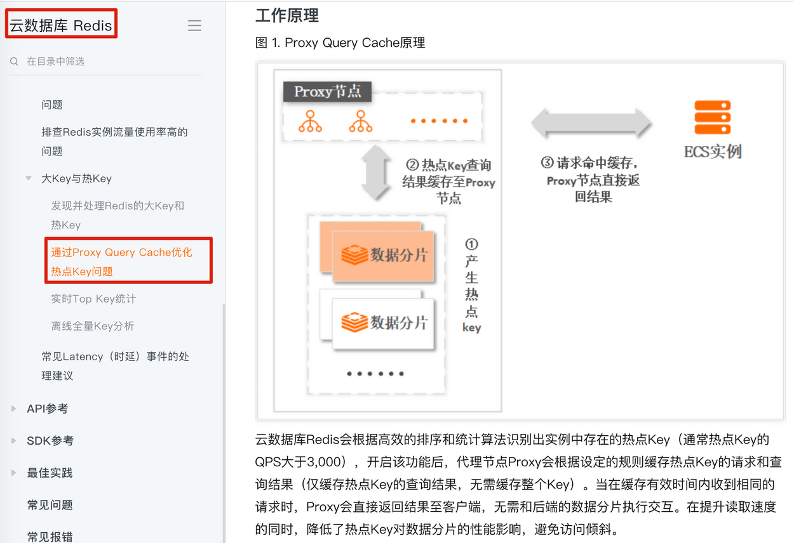

### Slow Commands

#### Why Do Slow Commands Occur?

A Redis command has four stages: sending, queuing, execution, and returning the result. Redis's slow log measures **command execution time**, not network round-trip time.

Most Redis commands are O(1), but some are O(N), including:

- KEYS \*: Return all matching keys.
- HGETALL: Return all fields and values in a Hash.
- LRANGE: Return a range of List elements.
- SMEMBERS: Return every Set member.
- SINTER, SUNION, SDIFF: Compute Set operations.
- ...

These commands can take longer as the collection grows. Use them only when the data size is understood; use HSCAN, SSCAN, or ZSCAN for iteration.

Other commands can also be expensive when they return or remove many members:

- ZRANGE and ZREVRANGE have complexity O(log(N) + M), where M is the number of members returned.
- ZREMRANGEBYRANK and ZREMRANGEBYSCORE have complexity O(log(N) + M), where M is the number removed.

#### How Do You Find Slow Commands?

Redis's **Slow Log** records commands whose execution exceeds a configured threshold. Set slowlog-log-slower-than for the threshold and slowlog-max-len for the maximum number of entries in redis.conf. When full, Redis removes the oldest entries.

The slow log consumes memory, so avoid an unnecessarily large limit. Default settings:

```properties
# Time is in microseconds: 1000000 is one second.
# A negative value disables the slow log; zero logs every command.
slowlog-log-slower-than 10000

# The list length is not limited internally; entries consume memory.
# Reclaim memory with SLOWLOG RESET.
slowlog-max-len 128
```

Change these settings at runtime with CONFIG SET:

```bash
# Log commands taking longer than 10 ms
CONFIG SET slowlog-log-slower-than 10000
# Keep the most recent 128 entries
CONFIG SET slowlog-max-len 128
```

Read entries with SLOWLOG GET:

```bash
127.0.0.1:6379> SLOWLOG GET
1) 1) (integer) 5
   2) (integer) 1684326682
   3) (integer) 12000
   4) 1) "KEYS"
      2) "*"
   5) "172.17.0.1:61152"
   6) ""
```

Each entry contains:

1. Unique entry ID.
2. Unix timestamp when execution completed.
3. Execution duration in microseconds.
4. Command and its arguments.
5. Client IP address and port.
6. Client name, if set with CLIENT SETNAME.

SLOWLOG GET returns the ten most recent entries by default. Specify a count with SLOWLOG GET N.

Other useful commands:

```bash
# Return the number of slow-log entries
SLOWLOG LEN
# Clear the slow log
SLOWLOG RESET
```

### Redis Memory Fragmentation

Related questions:

1. What is memory fragmentation, and why does it occur in Redis?
2. How can Redis memory fragmentation be reduced?

See [Redis Memory Fragmentation](https://javaguide.cn/database/redis/redis-memory-fragmentation.html).

## ⭐️ Redis Production Issues (Important)

### Cache Penetration

#### What Is Cache Penetration?

Cache penetration occurs when many requests use invalid keys that exist neither in the cache nor in the database. These requests pass through to the database and can overload it.

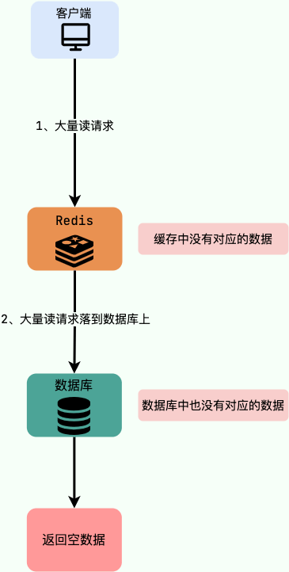

For example, an attacker may generate many invalid keys. Every request misses the cache and the database, creating load on the database.

#### How Can You Prevent It?

First validate request parameters. Reject invalid inputs, such as negative database IDs or malformed email addresses.

**1. Cache invalid keys**

If a key is missing from both cache and database, cache a placeholder with a short TTL, for example SET key value EX 10086. This helps when invalid keys repeat. An attacker can still generate many unique keys, so this does not solve the problem by itself. Keep placeholder TTLs short.

A common key format is table:column:primary-key-name:primary-key-value.

Example:

```java
public Object getObjectInclNullById(Integer id) {
    Object cacheValue = cache.get(id);
    if (cacheValue == null) {
        Object storageValue = storage.get(key);
        cache.set(key, storageValue);
        if (storageValue == null) {
            cache.expire(key, 60 * 5); // Do not cache missing values without a TTL
        }
        return storageValue;
    }
    return cacheValue;
}
```

**2. Use a Bloom filter**

A Bloom filter can efficiently test whether an element may be present in a large set. It uses a bit array and multiple hash functions. It is space-efficient but probabilistic: it can report false positives, but not false negatives. More inserted elements increase the false-positive probability, and deletion is difficult.

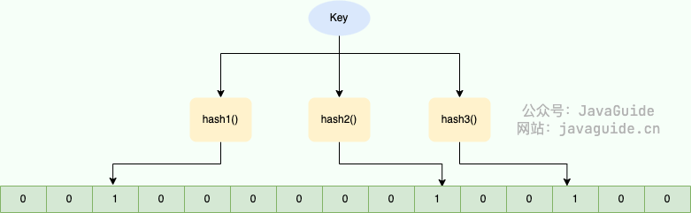

The filter maps each value to bit positions and sets those bits to 1. When checking a value, a zero at any mapped position means the value is definitely absent; if all are one, it may be present.


Use the filter before querying the cache or database. If an element is definitely absent, reject the request. See [Bloom Filters](https://javaguide.cn/cs-basics/data-structure/bloom-filter.html) for false positives, deletion limits, and Guava and RedisBloom usage.

**3. Rate-limit requests**

Rate-limit by user or IP. Add a blocklist for clearly abusive traffic. Rate limiting can also reduce database load during cache breakdowns and stampedes.

See [Rate Limiting](https://javaguide.cn/high-availability/limit-request.html).

### Cache Breakdown

#### What Is Cache Breakdown?

Cache breakdown occurs when a hot key exists in the database but is missing from the cache, often because its cached value expired. A burst of requests can then hit the database at once.

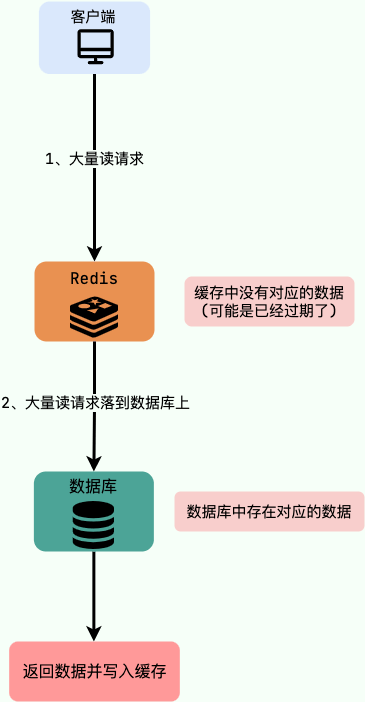

For example, if a flash-sale product expires from the cache during a sale, requests for it may all reach the database.

#### How Can You Prevent It?

1. **Keep hot keys indefinitely:** Usually not recommended unless there is a clear invalidation plan.
2. **Prewarm the cache:** Load hot data before demand begins and set a TTL that covers the relevant period, such as the end of a flash sale.
3. **Use a lock when appropriate:** After a miss, allow one request to query the database and refresh the cache while others wait or use a fallback.

#### How Do Cache Penetration and Breakdown Differ?

With penetration, the requested key exists in neither cache nor database. With breakdown, the key is hot and exists in the database but is missing from the cache, often because it expired.

### Cache Avalanche

#### What Is a Cache Avalanche?

A cache avalanche occurs when many or all cached entries expire around the same time, sending a large volume of requests to the database. A cache service outage can cause the same effect.

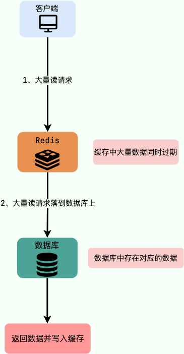

#### How Can You Prevent It?

**If Redis becomes unavailable:**

1. **Use a Redis cluster:** Avoid relying on one instance. Redis Cluster and Sentinel are common approaches; see [Redis Clustering (Premium)](https://javaguide.cn/database/redis/redis-cluster.html).
2. **Use multilevel caching:** A local cache can serve some data when Redis is unavailable.

**If many keys expire together:**

1. **Add expiration jitter:** Randomize TTLs to spread expirations over time.
2. **Prewarm hot data:** Load it before demand and set suitable expiration times.
3. **Use persistent cache entries selectively:** Keep stable, critical data without expiration only when there is a reliable update and invalidation strategy.

#### How Do You Prewarm a Cache?

Common approaches include:

1. Use a scheduled job, such as XXL-JOB, to load hot database records into the cache.
2. Publish hot-record IDs to a message queue such as Kafka and let a cache service consume them, query the database, and refresh the cache asynchronously.

#### How Do Cache Avalanche and Breakdown Differ?

An avalanche involves many or all cache entries expiring or a cache outage. A breakdown involves one hot key missing from the cache while it still exists in the database.

### How Do You Keep a Cache Consistent with a Database?

Cache consistency is a common engineering challenge. Caching improves performance and reduces database load, but adds a risk of stale data. Stronger consistency usually increases complexity and cost, so choose a level that fits the workload.

The common **Cache Aside** pattern uses this flow:

- **Read:** Check the cache. On a hit, return the value. On a miss, read from the database, populate the cache, and return the value.
- **Write:** Update and commit the database first, then delete the corresponding cache entry.

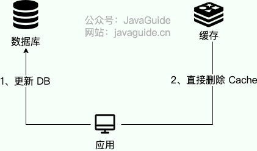

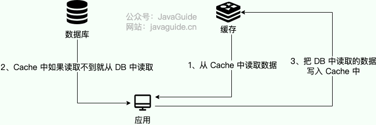

This sequence still needs failure handling:

- **Deletion failure:** Retry invalidation with a recoverable task. If using a message queue, handle a crash after database commit but before publishing the message; a transactional outbox or CDC may be needed. Monitor retries.
- **Stale repopulation:** A read can fetch old data before an update and populate the cache after deletion. Delayed double deletion reduces some races but cannot cover arbitrarily long delays. Replica reads and long database snapshots can also return stale data.
- **TTL fallback:** Set a TTL according to the business tolerance, but ensure a cache miss can read sufficiently fresh data. TTL alone does not provide strong consistency.
- **Read path and local copies:** Cache deletion requires a source-of-truth read or a defined fallback. JVM-local caches need their own invalidation mechanism.

See [Three Common Cache Read/Write Strategies](./3-commonly-used-cache-read-and-write-strategies.md) for concurrency and retry details, and [Cache Fundamentals](./cache-basics.md) for multilevel cache behavior.

Further reading: [Cache and Database Consistency: A Practical Guide](https://mp.weixin.qq.com/s?__biz=MzIyOTYxNDI5OA==&mid=2247487312&idx=1&sn=fa19566f5729d6598155b5c676eee62d&chksm=e8beb8e5dfc931f3e35655da9da0b61c79f2843101c130cf38996446975014f958a6481aacf1&scene=178&cur_album_id=1699766580538032128#rd).

### What Can Cause Redis to Block?

Common causes include:

- O(N) commands such as KEYS \*, HGETALL, LRANGE, and SMEMBERS taking too long as data grows.
- SAVE synchronously creating an RDB snapshot on the main thread. BGSAVE forks a child process instead.
- AOF logging on the main thread delaying subsequent commands.
- AOF fsync waiting on slow disks, which can also delay main-thread writes, especially with appendfsync always or everysec.
- Appending the rewrite buffer to a new AOF file during rewrite.
- Large keys causing command latency, network congestion, or blocking deletion.
- FLUSHDB and FLUSHALL deleting many keys and releasing memory.
- Cluster resharding synchronously migrating data; large keys can block both nodes and may trigger failover.
- Swap moving Redis memory to disk, sharply reducing performance.
- CPU contention from other processes.
- Network connection failures, latency, or NIC soft interrupts.

See [Common Causes of Redis Blocking](https://javaguide.cn/database/redis/redis-common-blocking-problems-summary.html).

## Redis Clustering

**Redis Sentinel:**

1. What is Sentinel, and what does it do?
2. How does Sentinel detect node failure? What is the difference between subjective and objective down?
3. How does Sentinel perform failover?
4. Why deploy multiple Sentinel nodes?
5. How does Sentinel select a new primary?
6. How does Sentinel elect a leader?
7. Can Sentinel prevent split-brain?

**Redis Cluster:**

1. Why use Redis Cluster, and what problems does it solve?
2. How does Redis Cluster shard data?
3. Why does Redis Cluster use 16,384 hash slots?
4. How is a key mapped to a slot?
5. Can Redis Cluster reassign slots?
6. Does the cluster remain available while scaling?
7. How do Redis Cluster nodes communicate?

See [Redis Clustering (Premium)](https://javaguide.cn/database/redis/redis-cluster.html).

## Redis Usage Guidelines

Follow these common practices:

1. Use a connection pool instead of frequently creating and closing connections.
2. Avoid O(N) commands where possible. If using them, understand N. Use HSCAN, SSCAN, or ZSCAN for iteration.
3. Reduce network traffic with native batch commands, pipelines, or Lua scripts.
4. Avoid Redis transactions when Lua scripts or another design better fits; Redis transactions have limited guarantees.
5. Do not leave MONITOR running for long; it can affect performance.
6. Set key lifetimes to avoid retaining data that is no longer accessed.
7. ...

## References

- _Redis Development and Operations_.
- _Redis Design and Implementation_.
- [Redis Transactions](https://redis.io/docs/latest/develop/using-commands/transactions/).
- [What Is a Redis Pipeline?](https://buildatscale.tech/what-is-redis-pipeline/).
- [Finding and Handling Big Keys and Hot Keys in Redis](https://mp.weixin.qq.com/s/FPYE1B839_8Yk1-YSiW-1Q).
- [Approaches to Resolving Big Key Issues](https://mp.weixin.qq.com/s/Sej7D9TpdAobcCmdYdMIyA).
- [A Guide to Diagnosing Redis Latency](https://mp.weixin.qq.com/s/mIc6a9mfEGdaNDD3MmfFsg).

<!-- @include: @article-footer.snippet.md -->
