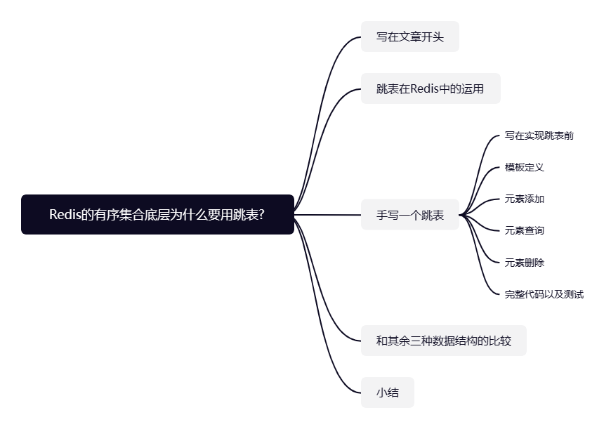
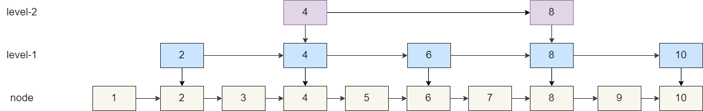
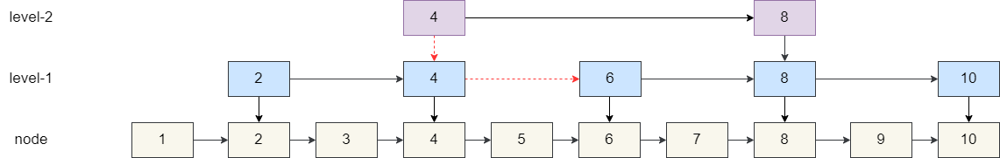
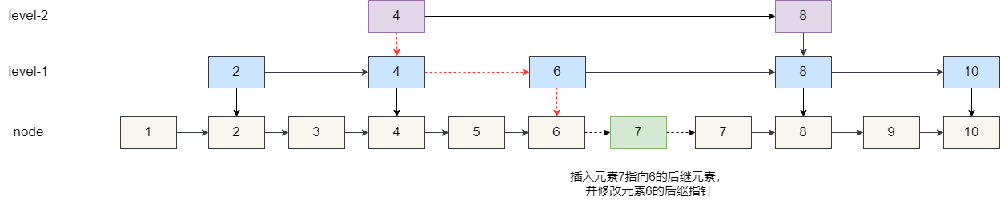
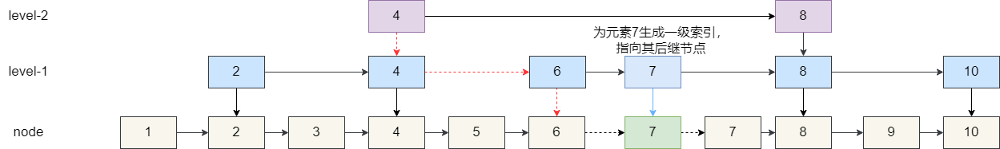
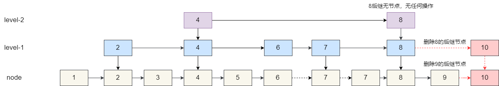
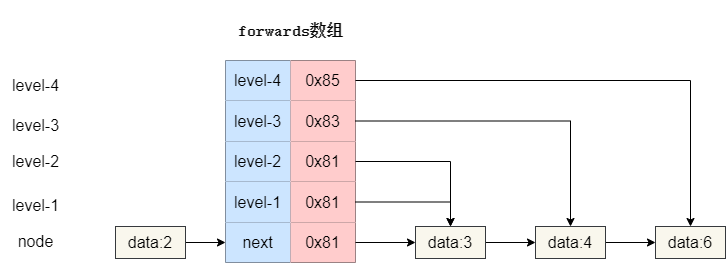
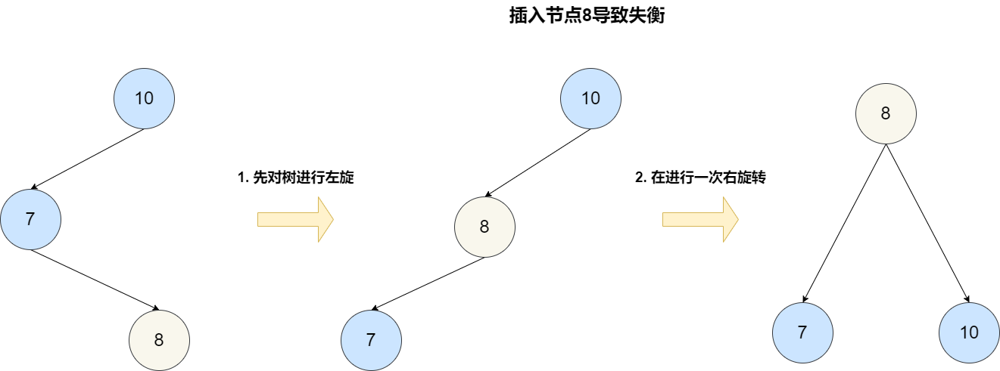
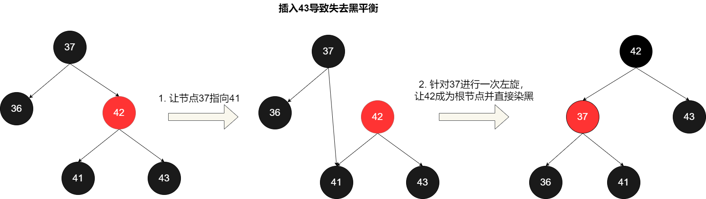
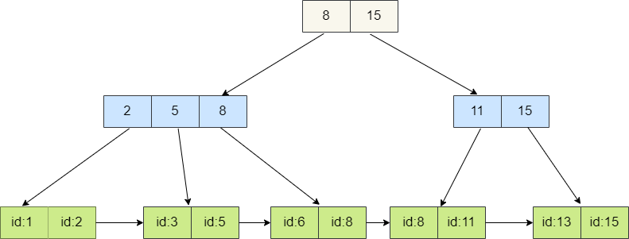

## Introduction

Redis interview questions often cover the implementation choices behind common data structures. One interesting question is: “Why does Redis use a skip list for Sorted Sets instead of a balanced tree, red-black tree, or B+ tree?”

This guide uses that question to explain skip lists, including Redis Sorted Set usage and a Java implementation. For a quick review of skip-list indexes, complexity, and interview answers, see [Skip Lists: Interview Questions](../../cs-basics/data-structure/skip-list.md).



## How Redis Uses Skip Lists

Redis provides an ordered collection called a **Sorted Set** (Zset). Each member is unique and has a score. Sorted Sets are commonly used for leaderboards and ranking.

The following example adds three users with scores 60, 80, and 60, then lists them in descending score order:

```bash
127.0.0.1:6379> ZADD rankList 60 xiaoming
(integer) 1
127.0.0.1:6379> ZADD rankList 80 xiaohong
(integer) 1
127.0.0.1:6379> ZADD rankList 60 xiaowang
(integer) 1

# Return members in the score range, ordered from highest to lowest
127.0.0.1:6379> ZREVRANGE rankList 0 100 WITHSCORES
1) "xiaohong"
2) "80"
3) "xiaowang"
4) "60"
5) "xiaoming"
6) "60"
```

Inspect the object's encoding:

```bash
127.0.0.1:6379> OBJECT ENCODING rankList
"ziplist"
```

Redis uses a compact representation for small Sorted Sets to save memory. In configurations that use the legacy ziplist encoding, a Sorted Set uses it when each member is shorter than 64 bytes and the collection has fewer than 128 entries. These thresholds are controlled by:

```bash
zset-max-ziplist-value 64
zset-max-ziplist-entries 128
```

If either threshold is exceeded, Redis converts the object to a **skip list** encoding backed by both a dictionary and a skip list. The dictionary helps retrieve a member's score efficiently.

Add a member longer than 64 bytes:

```bash
127.0.0.1:6379> ZADD rankList 90 yigemingzihuichaoguo64zijiedeyonghumingchengyongyuceshitiaobiaodeshijiyunyong
(integer) 1

# The encoding changes after a threshold is exceeded
127.0.0.1:6379> OBJECT ENCODING rankList
"skiplist"
```

A Sorted Set uses the compact encoding only when both conditions hold:

1. It has fewer than 128 entries.
2. Each member is shorter than 64 bytes.

Otherwise, it uses the skip-list encoding. Redis versions that use listpack instead of ziplist have corresponding configuration names and encoding details.

## Implementing a Skip List

A sorted linked list takes O(N) time on average for insertion, lookup, and deletion. A skip list adds multiple levels of indexes over the base linked list, reducing the expected time for these operations to O(log N).

The following example stores values 1–10 in the base list and has two index levels. Each level contains about half as many nodes as the level below it.



### Searching

To find 6:

1. Start at the top index and move to node 4.
2. Node 4's next top-level node is 8, which is greater than 6. Move down a level.
3. At the next level, node 4 points to 6, so the search finds the target.

A linked list would inspect six nodes. The skip list finds the target in two steps in this example.



### Insertion

To insert 7, find the greatest value smaller than 7 (node 6), then insert 7 after it. Search from the highest level:

1. Start at node 4 in the top index.
2. Its next node is 8, which is greater than 7, so move down.
3. At the next level, move from 4 to 6.
4. Node 6's next node is 8, so move down again.
5. At the base level, insert 7 after 6.



Should the new node have indexes, and if so, how many? Ideally, each index level contains about half as many nodes as the level below. For 16 base nodes, the expected number of indexes is:

```text
Level 1: 16 / 2 = 8
Level 2: 8 / 2 = 4
Level 3: 4 / 2 = 2
```

For N elements, the expected number of nodes at index level K is:

```text
r = N / 2^K
```

If the highest level has about two nodes and the skip list contains N elements, the height H satisfies:

```text
2 = N / 2^H
2 * 2^H = N
2^(H + 1) = N
H = log2(N) - 1
```

For example, if N is 65,536, the estimated maximum height is 15. A practical implementation can cap the height at 16.

To approximate the ideal distribution, generate the node height randomly:

1. Start with height 1, meaning the base node has no index.
2. Generate a random number between 0 and 1.
3. Promote the node one level when the number is greater than 0.5.
4. Repeat until promotion fails or the maximum height is reached.

Each additional level has half the probability of the previous one: 50% for level 1, 25% for level 2, 12.5% for level 3, and so on.



### Deletion

To delete 10, locate the greatest node below 10 at every level, then update links that point to 10:

1. At the top level, move from 4 to 8.
2. Node 8 has no next node at this level; move down.
3. At the next level, node 8 points to 10. Bypass 10.
4. Continue down to the base level, where node 9 also points to 10. Bypass it as well.



### Node Structure

A skip-list node stores:

1. Its value.
2. A set of forward pointers.
3. Its height.

The forward-pointer array stores the next node at each level. Index 0 is the base list; higher array indexes correspond to higher skip-list levels.



The implementation below uses a maximum height of 16. The head node is a sentinel, and levelCount tracks the current height of the list.

```java
private static final int MAX_LEVEL = 16;

class Node {
    private int data = -1;
    private Node[] forwards = new Node[MAX_LEVEL];
    private int maxLevel = 0;
}
```

### Adding Elements

Generate a random height for the new node. Then search from the highest level down, storing the predecessor at each level that the new node will occupy. Update those forward pointers to insert the node.

```java
private static final float PROB = 0.5f;
private int levelCount = 1;
private Node head = new Node();

private int randomLevel() {
    int level = 1;
    while (Math.random() > PROB && level < MAX_LEVEL) {
        level++;
    }
    return level;
}

public void add(int value) {
    int level = randomLevel();

    Node newNode = new Node();
    newNode.data = value;
    newNode.maxLevel = level;

    Node[] update = new Node[level];
    for (int i = 0; i < level; i++) {
        update[i] = head;
    }

    Node current = head;
    for (int i = levelCount - 1; i >= 0; i--) {
        while (current.forwards[i] != null
                && current.forwards[i].data < value) {
            current = current.forwards[i];
        }
        if (i < level) {
            update[i] = current;
        }
    }

    for (int i = 0; i < level; i++) {
        newNode.forwards[i] = update[i].forwards[i];
        update[i].forwards[i] = newNode;
    }

    if (levelCount < level) {
        levelCount = level;
    }
}
```

### Searching for Elements

Search from the highest level down. At each level, move forward while the next value is less than the target. At the base level, check whether the next node is the target.

```java
public Node get(int value) {
    Node current = head;

    for (int i = levelCount - 1; i >= 0; i--) {
        while (current.forwards[i] != null
                && current.forwards[i].data < value) {
            current = current.forwards[i];
        }
    }

    Node candidate = current.forwards[0];
    if (candidate != null && candidate.data == value) {
        return candidate;
    }
    return null;
}
```

### Deleting Elements

Record the predecessor at each level. If the target exists at the base level, bypass it at every level that points to it. Reduce levelCount if the top level becomes empty.

```java
public void delete(int value) {
    Node current = head;
    Node[] update = new Node[levelCount];

    for (int i = levelCount - 1; i >= 0; i--) {
        while (current.forwards[i] != null
                && current.forwards[i].data < value) {
            current = current.forwards[i];
        }
        update[i] = current;
    }

    Node candidate = current.forwards[0];
    if (candidate != null && candidate.data == value) {
        for (int i = levelCount - 1; i >= 0; i--) {
            if (update[i].forwards[i] == candidate) {
                update[i].forwards[i] = candidate.forwards[i];
            }
        }
    }

    while (levelCount > 1 && head.forwards[levelCount - 1] == null) {
        levelCount--;
    }
}
```

### Complete Example and Test

The following class combines the node definition and the add, search, delete, and print operations:

```java
public class SkipList {
    private static final int MAX_LEVEL = 16;
    private static final float PROB = 0.5f;

    private int levelCount = 1;
    private Node head = new Node();

    public class Node {
        private int data = -1;
        private Node[] forwards = new Node[MAX_LEVEL];
        private int maxLevel = 0;

        @Override
        public String toString() {
            return "Node{"
                    + "data=" + data
                    + ", maxLevel=" + maxLevel
                    + '}';
        }
    }

    private int randomLevel() {
        int level = 1;
        while (Math.random() > PROB && level < MAX_LEVEL) {
            level++;
        }
        return level;
    }

    public void add(int value) {
        int level = randomLevel();
        Node newNode = new Node();
        newNode.data = value;
        newNode.maxLevel = level;

        Node[] update = new Node[level];
        for (int i = 0; i < level; i++) {
            update[i] = head;
        }

        Node current = head;
        for (int i = levelCount - 1; i >= 0; i--) {
            while (current.forwards[i] != null
                    && current.forwards[i].data < value) {
                current = current.forwards[i];
            }
            if (i < level) {
                update[i] = current;
            }
        }

        for (int i = 0; i < level; i++) {
            newNode.forwards[i] = update[i].forwards[i];
            update[i].forwards[i] = newNode;
        }

        if (levelCount < level) {
            levelCount = level;
        }
    }

    public Node get(int value) {
        Node current = head;
        for (int i = levelCount - 1; i >= 0; i--) {
            while (current.forwards[i] != null
                    && current.forwards[i].data < value) {
                current = current.forwards[i];
            }
        }

        Node candidate = current.forwards[0];
        return candidate != null && candidate.data == value
                ? candidate
                : null;
    }

    public void delete(int value) {
        Node current = head;
        Node[] update = new Node[levelCount];

        for (int i = levelCount - 1; i >= 0; i--) {
            while (current.forwards[i] != null
                    && current.forwards[i].data < value) {
                current = current.forwards[i];
            }
            update[i] = current;
        }

        Node candidate = current.forwards[0];
        if (candidate != null && candidate.data == value) {
            for (int i = levelCount - 1; i >= 0; i--) {
                if (update[i].forwards[i] == candidate) {
                    update[i].forwards[i] = candidate.forwards[i];
                }
            }
        }

        while (levelCount > 1 && head.forwards[levelCount - 1] == null) {
            levelCount--;
        }
    }

    public void printAll() {
        Node current = head;
        while (current.forwards[0] != null) {
            current = current.forwards[0];
            System.out.println(current);
        }
    }
}
```

Test it with:

```java
public static void main(String[] args) {
    SkipList skipList = new SkipList();
    for (int i = 0; i < 24; i++) {
        skipList.add(i);
    }

    System.out.println("********** Added elements **********");
    skipList.printAll();

    SkipList.Node node = skipList.get(22);
    System.out.println("********** Search result: " + node + " **********");

    skipList.delete(22);
    System.out.println("********** After deletion **********");
    skipList.printAll();
}
```

**Redis skip-list characteristics:**

1. Redis uses a **doubly linked list**, unlike the example above. A backward pointer makes it easier to find a predecessor, for example when deleting a member.
2. Scores can repeat. When scores are equal, Redis orders members lexicographically by their element value (an SDS).
3. Redis defines a maximum skip-list height of 32 with ZSKIPLIST_MAXLEVEL.

## Comparing Skip Lists with Other Data Structures

The interview question is: “Why does Redis use a skip list for Sorted Sets instead of a balanced tree, red-black tree, or B+ tree?”

### Balanced Tree vs. Skip List

An AVL tree is a strictly balanced binary tree. For every node, the heights of the left and right subtrees differ by at most one (balance factor in [-1, 1]). Search, insertion, and deletion are O(log N), as they are for a skip list.

AVL trees can support range queries through in-order traversal. However, insertions and deletions may require rotations to restore strict balance.



Skip lists use probabilistic rather than strict balancing. Their insertion and deletion algorithms are simpler and can be faster than equivalent balanced-tree operations. See William Pugh's paper, [“Skip Lists: A Probabilistic Alternative to Balanced Trees”](https://15721.courses.cs.cmu.edu/spring2018/papers/08-oltpindexes1/pugh-skiplists-cacm1990.pdf).

> Skip lists can be used instead of balanced trees. They use probabilistic balancing instead of strictly enforced balancing, which makes insertion and deletion algorithms simpler and often faster.

The following AVL insertion excerpt illustrates the balance checks and rotations required after inserting a node:

```java
// Add a new (key, value) to the binary search tree.
public void add(K key, V value) {
    root = add(root, key, value);
}

// Insert into the tree rooted at node and return the new root.
private Node add(Node node, K key, V value) {
    if (node == null) {
        size++;
        return new Node(key, value);
    }

    if (key.compareTo(node.key) < 0) {
        node.left = add(node.left, key, value);
    } else if (key.compareTo(node.key) > 0) {
        node.right = add(node.right, key, value);
    } else {
        node.value = value;
    }

    node.height = 1 + Math.max(getHeight(node.left), getHeight(node.right));
    int balanceFactor = getBalanceFactor(node);

    if (balanceFactor > 1 && getBalanceFactor(node.left) >= 0) {
        return rightRotate(node); // LL case
    }
    if (balanceFactor < -1 && getBalanceFactor(node.right) <= 0) {
        return leftRotate(node); // RR case
    }
    if (balanceFactor > 1 && getBalanceFactor(node.left) < 0) {
        node.left = leftRotate(node.left); // LR case
        return rightRotate(node);
    }
    if (balanceFactor < -1 && getBalanceFactor(node.right) > 0) {
        node.right = rightRotate(node.right); // RL case
        return leftRotate(node);
    }
    return node;
}
```

### Red-Black Tree vs. Skip List

A red-black tree is a self-balancing binary search tree. Its lookup is slightly slower than an AVL tree, while insertion and deletion can be more efficient. Search, insertion, and deletion are O(log N).

A red-black tree maintains black-height invariants using rotations and recoloring. This is generally less costly than maintaining AVL balance, but skip lists are simpler to implement. Skip lists also work well for range queries.



Example red-black tree insertion code:

```java
private Node<K, V> add(Node<K, V> node, K key, V value) {
    if (node == null) {
        size++;
        return new Node(key, value);
    }

    if (key.compareTo(node.key) < 0) {
        node.left = add(node.left, key, value);
    } else if (key.compareTo(node.key) > 0) {
        node.right = add(node.right, key, value);
    } else {
        node.value = value;
    }

    if (isRed(node.right) && !isRed(node.left)) {
        node = leftRotate(node);
    }
    if (isRed(node.left) && isRed(node.left.left)) {
        node = rightRotate(node);
    }
    if (isRed(node.left) && isRed(node.right)) {
        flipColors(node);
    }
    return node;
}
```

### B+ Tree vs. Skip List

B+ trees are widely used for database and file-system indexes:

1. **Multiway structure:** Each node can contain many children, reducing tree height.
2. **High fan-out:** Internal nodes store multiple keys; leaf nodes store values, which supports efficient range queries.
3. **Balanced height:** The tree remains balanced, so lookup and insertion are O(log N).
4. **Sequential access:** Leaf nodes are linked to support range scans.
5. **Even distribution:** Insertions may split or merge nodes to keep data distributed.



B+ trees reduce disk I/O by locating many index entries in each page. That advantage is less important for Redis's in-memory data. Skip lists can maintain probabilistic indexes with less complex insertion logic; they do not need B+ tree node splits and merges.

### Redis Author's Reasons

Redis's author gave several reasons for choosing skip lists:

> 1. They are not very memory intensive. Their memory use can be adjusted by changing the probability that a node has a given number of levels.
> 2. Sorted Sets often serve ZRANGE and ZREVRANGE operations, which traverse the skip list as a linked list. Skip-list cache locality is at least as good as that of other balanced trees for this operation.
> 3. They are simpler to implement and debug. This simplicity made it easier to add augmented skip lists for O(log N) ZRANK.

## Summary

This guide explained how skip lists work and how they compare with balanced trees, red-black trees, and B+ trees. To study skip-list basics, see [Skip Lists: Interview Questions](../../cs-basics/data-structure/skip-list.md). Related guides include [Red-Black Trees](../../cs-basics/data-structure/red-black-tree.md) and [Hash Tables: Interview Questions](../../cs-basics/data-structure/hash-table.md).

## References

- [Why Redis Uses Skip Lists Instead of Red-Black Trees](https://www.zhihu.com/question/20202931/answer/16086538)
- [Skip List: A Detailed Guide](https://www.jianshu.com/p/9d8296562806)
- [Redis Objects and Internal Data Structures](https://blog.csdn.net/shark_chili3007/article/details/104171986)
- [Redis Sorted Sets](https://www.runoob.com/redis/redis-sorted-sets.html)
- [Comparing Red-Black Trees and Skip Lists](https://zhuanlan.zhihu.com/p/576984787)
- [Why Does Redis Zset Use a Skip List Instead of a B+ Tree?](https://blog.csdn.net/f80407515/article/details/129136998)
