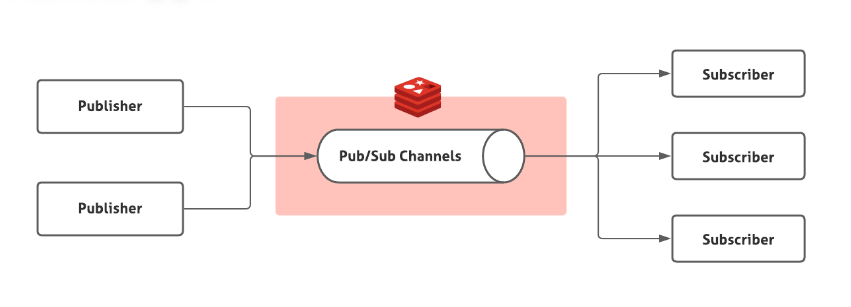
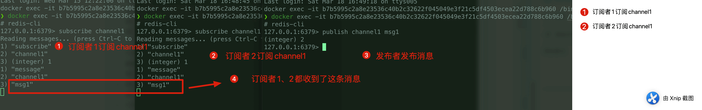
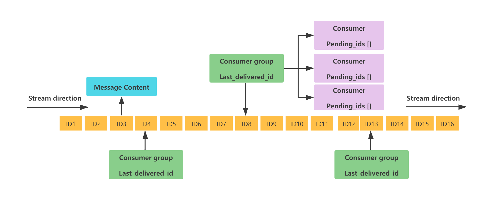
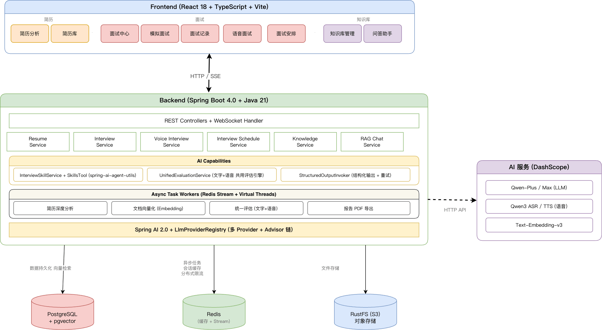
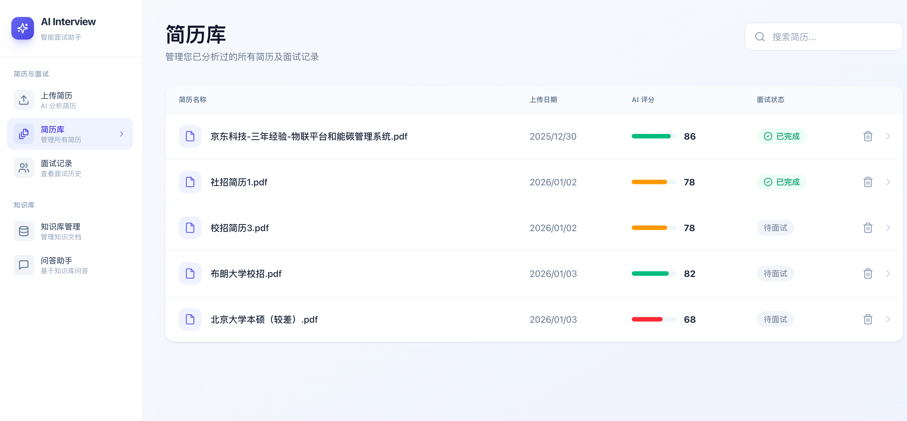

The short answer: **Redis can be used as a message queue, depending on the workload.** It lacks some capabilities of dedicated message brokers such as Kafka and RabbitMQ.

Before comparing Redis options, consider the core capabilities expected from a production message queue:

| Capability                 | Description                                                | Common mechanisms                                 |
| :------------------------- | :--------------------------------------------------------- | :------------------------------------------------ |
| **Persistence**            | Messages survive process or node failures                  | Disk sync, replicated acknowledgments, low RPO    |
| **At-least-once delivery** | A message is eventually processed, possibly more than once | Idempotent consumers                              |
| **Acknowledgment**         | Consumers confirm successful processing                    | ACK, timeout, retry, dead-letter queue            |
| **Retry**                  | Failed messages can be delivered again                     | Backoff, retry limits, dead-letter routing        |
| **Consumer groups**        | Consumers share work and recover from failures             | Load balancing, partition assignment, rebalancing |
| **Backlog handling**       | Buffer messages when production exceeds consumption        | Disk storage, TTL, backlog alerts                 |
| **Ordering**               | Preserve message order                                     | Per-partition or global ordering                  |
| **Scalability**            | Scale throughput or fault tolerance horizontally           | Sharding, stateless brokers, dynamic scaling      |

Redis supports several queue patterns, from the early List approach to Pub/Sub and Redis 5.0 Streams. Streams are an ordered log implemented with a radix tree and support consumer groups and acknowledgments, making them useful for lightweight queue workloads.

## Stage 1: Using Lists

Before Redis 2.0, Lists were the main way to build a message queue. RPUSH/LPOP or LPUSH/RPOP can implement a basic queue:

```bash
# Producer publishes messages
> RPUSH myList msg1 msg2
(integer) 2
> RPUSH myList msg3
(integer) 3

# Consumer receives a message
> LPOP myList
"msg1"
```

Polling with RPOP or LPOP wastes requests when the List is empty. Redis also provides blocking reads such as BLPOP and BRPOP. If the List is empty, the server waits for a message or until the timeout expires. A timeout of 0 waits indefinitely.

```bash
# Wait up to 10 seconds; return immediately if a message is available
> BRPOP myList 10
null
```

Lists are simple and lack built-in acknowledgments. More critically, a message is removed when consumed, so a consumer failure can permanently lose it. Lists also do not broadcast one message to multiple consumers.

## Stage 2: Pub/Sub

Redis 2.0 introduced publish/subscribe (Pub/Sub), which adds broadcasting.



Pub/Sub uses **channels**. Publishers send messages to a channel with PUBLISH, and subscribers listen with SUBSCRIBE. Multiple subscribers can listen to the same channel, so every subscriber receives the published message.

The diagram below shows a simple example with three Redis clients:



Pub/Sub supports both one-to-one and broadcast delivery, along with simple pattern matching for channels.

Its critical limitation is that Pub/Sub is **fire-and-forget**: it has no persistence or delivery guarantees. If a consumer is offline or briefly disconnected when a message is published, it loses that message. Pub/Sub also has no acknowledgment mechanism or backlog support. Use it for low-reliability real-time notifications, not critical business messages.

## Stage 3: Redis Streams

Redis 5.0 introduced the Stream data type. A Stream is an ordered message log implemented with a radix tree. It supports consumer groups and acknowledgments, so it can serve as a lightweight message queue.

**Why use a radix tree instead of a List or linked list?**

1. **Compact storage:** Stream IDs, such as 1625000000000-0, are ordered and often share prefixes. A radix tree compresses common prefixes. A linked list stores each node separately and cannot exploit this prefix overlap.
2. **Efficient lookup:** A radix tree supports efficient range queries such as XRANGE over large streams. Lists are optimized for operations at their ends and do not support efficient lookup by ID.

Streams borrow ideas from systems such as Kafka:

1. **Consumer groups:** Distribute messages among consumers in a group and support recovery when a consumer fails.
2. **Persistence:** RDB and AOF can preserve messages across restarts. The loss window depends on appendfsync; everysec can typically lose up to one second of writes.
3. **Acknowledgments:** Consumers use XACK after processing. Unacknowledged messages remain in the Pending Entries List (PEL), supporting at-least-once delivery.
4. **Replay and claiming:** XRANGE reads messages by ID or time range; XCLAIM transfers pending messages to another consumer.

> **Version updates:**
>
> - Redis 8.2 added XACKDEL and XDELEX, and extended XADD and XTRIM, to provide finer control over stream operations across consumer groups.
> - Redis 8.6 added idempotent message processing for at-most-once production, preventing duplicate entries when using at-least-once delivery.



A Stream is an ordered log. Each message has a unique ID made from a timestamp and sequence number, plus one or more field-value pairs.

Key concepts:

- **Consumer group:** Organizes consumers. The group tracks delivery state and distributes messages; consumers perform the actual processing.
- **last_delivered_id:** The group's cursor. It advances when a consumer in the group reads messages.
- **pending_ids:** IDs of messages delivered to consumers but not yet acknowledged.

Common Stream commands:

- XADD: Add a message.
- XREAD: Read messages from a Stream.
- XREADGROUP: Read messages as a consumer group.
- XRANGE: Read messages within an ID range.
- XREVRANGE: Read a range in reverse order.
- XDEL: Delete messages.
- XTRIM: Trim a Stream by length or minimum ID (MAXLEN/MINID).
- XLEN: Get the Stream length.
- XGROUP CREATE: Create a consumer group.
- XGROUP DESTROY: Delete a consumer group.
- XGROUP DELCONSUMER: Remove a consumer from a group.
- XGROUP SETID: Set the group's last-delivered message ID.
- XACK: Acknowledge processed messages.
- XPENDING: Inspect unacknowledged messages.
- XCLAIM: Transfer pending messages to another consumer.
- XINFO: Inspect a Stream, groups, or consumers.

The sequence diagram shows how messages move through a consumer group and its acknowledgment flow:

```mermaid
sequenceDiagram
    participant P as Producer
    participant R as Redis Stream<br/>(my_stream)
    participant CG as Consumer Group<br/>(group_a)
    participant C1 as Consumer-1
    participant C2 as Consumer-2

    P->>R: XADD my_stream * field value
    R-->>P: Returns ID = 1001

    C1->>R: XREADGROUP GROUP group_a consumer-1<br/>STREAMS my_stream >
    R-->>C1: Returns message 1001

    Note over CG: 1️⃣ last_delivered_id advances to 1001
    Note over CG: 2️⃣ 1001 enters the PEL

    alt Processing succeeds
        C1->>R: XACK my_stream group_a 1001
        R-->>C1: OK
        Note over CG: 1001 is removed from the PEL
    else Consumer crashes
        Note over C1: No ACK; connection closes
        Note over CG: 1001 remains in the PEL<br/>idle time increases

        C2->>R: XPENDING my_stream group_a
        R-->>C2: Returns 1001 and idle time

        C2->>R: XCLAIM my_stream group_a consumer-2 60000 1001
        R-->>C2: Returns 1001

        Note over CG: 1001 is transferred to consumer-2

        C2->>R: XACK my_stream group_a 1001
        R-->>C2: OK
    end
```

Streams meet many basic queue requirements, but consider these limitations:

1. **Persistence guarantees:** Streams rely on RDB/AOF persistence. Recent messages may be lost during recovery depending on appendfsync; everysec can typically lose up to one second.
2. **Backlog capacity:** Stream data resides in Redis memory, so capacity is limited by available memory. It is not suited to massive backlogs like Kafka's disk-based storage.
3. **Consumer-group maintenance:** Group state such as last_delivered_id must be managed. Long-lived pending messages consume memory.

## Redis Streams Compared with Other Queues

| Dimension       | Redis Stream                                           | RabbitMQ                                                   | Kafka                                                  | In-memory queue                         |
| :-------------- | :----------------------------------------------------- | :--------------------------------------------------------- | :----------------------------------------------------- | :-------------------------------------- |
| **Throughput**  | High (around 100K QPS)                                 | Medium (around 10K QPS)                                    | **Very high; scales with partitions**                  | Very high; limited by CPU and memory    |
| **Latency**     | **Very low (sub-millisecond)**                         | **Low (microsecond/millisecond)**                          | Medium (milliseconds; batching affects latency)        | Very low (nanosecond/microsecond)       |
| **Persistence** | RDB/AOF, typically asynchronous                        | Disk-backed                                                | **Native sequential disk writes**                      | None                                    |
| **Backlog**     | Limited by memory                                      | Medium; large backlogs may reduce performance              | **Very large; disk storage can reach TBs**             | Poor; risk of OOM                       |
| **Replay**      | By ID or time                                          | Not supported in a traditional queue                       | **By offset or time**                                  | Not supported                           |
| **Reliability** | Medium; AOF can lose recent writes                     | **High; mature publisher confirms and acknowledgments**    | **Very high with replicas and suitable configuration** | Low                                     |
| **Operations**  | Low if Redis is already operated                       | Medium; Erlang and cluster management                      | High; ZooKeeper or KRaft                               | Very low                                |
| **Use cases**   | Lightweight, low-latency workloads with existing Redis | **Complex routing, high reliability, financial workloads** | **Big data, log aggregation, high-throughput streams** | In-process decoupling and maximum speed |

## Summary

**Can Redis be used as a message queue?**

- **For simple, low-volume workloads** that prioritize performance and can tolerate a small risk of message loss, Redis Streams can avoid the cost of operating another broker and reuse an existing Redis deployment.
- **For financial workloads, massive backlogs, or strict delivery guarantees**, use a dedicated broker such as Kafka or RabbitMQ.

For more Redis interview questions, see:

- [Common Redis Interview Questions, Part 1](https://javaguide.cn/database/redis/redis-questions-01.html): Fundamentals, use cases, data types, persistence, and threading.
- [Common Redis Interview Questions, Part 2](https://javaguide.cn/database/redis/redis-questions-02.html): Transactions, performance, production issues, clustering, and usage guidelines.
- [How to Implement Delayed Tasks with Redis](https://javaguide.cn/database/redis/redis-delayed-task.html)
- [Redis's Five Core Data Types](https://javaguide.cn/database/redis/redis-data-structures-01.html)
- [Redis's Three Specialized Data Types](https://javaguide.cn/database/redis/redis-data-structures-02.html)
- [Why Redis Uses Skip Lists for Sorted Sets](https://javaguide.cn/database/redis/redis-skiplist.html)
- [Redis Persistence](https://javaguide.cn/database/redis/redis-persistence.html)
- [Redis Memory Fragmentation](https://javaguide.cn/database/redis/redis-memory-fragmentation.html)
- [Common Causes of Redis Blocking](https://javaguide.cn/database/redis/redis-common-blocking-problems-summary.html)

The [SpringAI Interview Platform with a RAG Knowledge Base](https://javaguide.cn/zhuanlan/interview-guide.html) project uses Redis Streams as its message queue. For that workload, Streams were a good fit and met the project's needs.




