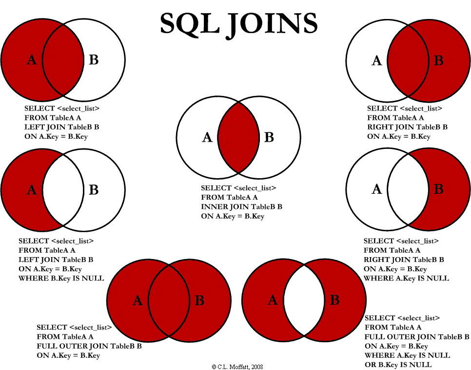

> Questions are from [Nowcoder - SQL Basics](https://www.nowcoder.com/exam/oj?page=1&tab=SQL%E7%AF%87&topicId=298).

## Retrieving Data

Use `SELECT` to retrieve data from a database.

### Retrieve All IDs from the Customers Table

The `Customers` table contains:

| cust_id |
| ------- |
| A       |
| B       |
| C       |

Write a query to retrieve all `cust_id` values from `Customers`.

Answer:

```sql
SELECT cust_id
FROM Customers
```

### Retrieve a List of Ordered Products

The `OrderItems` table has a non-null `prod_id` column and contains all ordered products. Some products may have been ordered more than once.

| prod_id |
| ------- |
| a1      |
| a2      |
| a3      |
| a4      |
| a5      |
| a6      |
| a7      |

Write a query to retrieve a distinct list of all ordered products (`prod_id`).

Answer:

```sql
SELECT DISTINCT prod_id
FROM OrderItems
```

`DISTINCT` returns unique values in a column.

### Retrieve All Columns

The `Customers` table has a `cust_id` column for customer IDs and a `cust_name` column for customer names.

| cust_id | cust_name |
| ------- | --------- |
| a1      | andy      |
| a2      | ben       |
| a3      | tony      |
| a4      | tom       |
| a5      | an        |
| a6      | lee       |
| a7      | hex       |

Write a query to retrieve all columns.

Answer:

```sql
SELECT cust_id, cust_name
FROM Customers
```

## Sorting Retrieved Data

Use `ORDER BY` to sort a result set by one or more columns. Rows are sorted in ascending order by default. Use `DESC` to sort in descending order.

### Retrieve and Sort Customer Names

The `Customers` table has a `cust_id` column for customer IDs and a `cust_name` column for customer names.

| cust_id | cust_name |
| ------- | --------- |
| a1      | andy      |
| a2      | ben       |
| a3      | tony      |
| a4      | tom       |
| a5      | an        |
| a6      | lee       |
| a7      | hex       |

Retrieve all customer names (`cust_name`) from `Customers` and sort them from Z to A.

Answer:

```sql
SELECT cust_name
FROM Customers
ORDER BY cust_name DESC
```

### Sort by Customer ID and Date

The `Orders` table contains:

| cust_id | order_num | order_date          |
| ------- | --------- | ------------------- |
| andy    | aaaa      | 2021-01-01 00:00:00 |
| andy    | bbbb      | 2021-01-01 12:00:00 |
| bob     | cccc      | 2021-01-10 12:00:00 |
| dick    | dddd      | 2021-01-11 00:00:00 |

Write a query to retrieve customer IDs (`cust_id`) and order numbers (`order_num`) from `Orders`. Sort first by customer ID, then by order date in descending order.

Answer:

```sql
# Sort by column name.
# Sort by order_date in descending order, not by order_num.
SELECT cust_id, order_num
FROM Orders
ORDER BY cust_id,order_date DESC
```

When sorting by multiple columns with `ORDER BY`, list the primary sort column first. Each column can use a different sort direction.

### Sort by Quantity and Price

Assume the `OrderItems` table contains:

| quantity | item_price |
| -------- | ---------- |
| 1        | 100        |
| 10       | 1003       |
| 2        | 500        |

Write a query to display the quantity (`quantity`) and price (`item_price`) from `OrderItems`. Sort by quantity from highest to lowest, then by price from highest to lowest.

Answer:

```sql
SELECT quantity, item_price
FROM OrderItems
ORDER BY quantity DESC,item_price DESC
```

### Fix the SQL Statement

The `Vendors` table contains:

| vend_name |
| --------- |
| 海底捞    |
| 小龙坎    |
| 大龙燚    |

What is wrong with the following query? Correct it so that it runs and sorts the results by `vend_name` in descending order.

```sql
SELECT vend_name,
FROM Vendors
ORDER vend_name DESC
```

Corrected query:

```sql
SELECT vend_name
FROM Vendors
ORDER BY vend_name DESC
```

Notes:

- Use commas to separate column names.
- Write the full `ORDER BY` clause in the correct position.

## Filtering Data

Use `WHERE` to filter the rows returned by a query.

The following operators can be used in a `WHERE` clause:

| Operator | Description                                                 |
| :------- | :---------------------------------------------------------- |
| =        | Equal to                                                    |
| <>       | Not equal to. **Note:** Some SQL dialects use `!=` instead. |
| >        | Greater than                                                |
| <        | Less than                                                   |
| >=       | Greater than or equal to                                    |
| <=       | Less than or equal to                                       |
| BETWEEN  | Within a range                                              |
| LIKE     | Search for a pattern                                        |
| IN       | Match any of several possible values for a column           |

### Return Products at a Specific Price

The `Products` table contains:

| prod_id | prod_name      | prod_price |
| ------- | -------------- | ---------- |
| a0018   | sockets        | 9.49       |
| a0019   | iphone13       | 600        |
| b0018   | gucci t-shirts | 1000       |

Retrieve the product ID (`prod_id`) and name (`prod_name`) from `Products`. Return only products priced at $9.49.

Answer:

```sql
SELECT prod_id, prod_name
FROM Products
WHERE prod_price = 9.49
```

### Return Products Above a Price

The `Products` table contains:

| prod_id | prod_name      | prod_price |
| ------- | -------------- | ---------- |
| a0018   | sockets        | 9.49       |
| a0019   | iphone13       | 600        |
| b0019   | gucci t-shirts | 1000       |

Write a query to retrieve the product ID (`prod_id`) and name (`prod_name`) from `Products`. Return only products priced at $9 or more.

Answer:

```sql
SELECT prod_id, prod_name
FROM Products
WHERE prod_price >= 9
```

### Return Products and Sort by Price

The `Products` table contains:

| prod_id | prod_name | prod_price |
| ------- | --------- | ---------- |
| a0011   | egg       | 3          |
| a0019   | sockets   | 4          |
| b0019   | coffee    | 15         |

Write a query to return the names (`prod_name`) and prices (`prod_price`) of products in `Products` priced between $3 and $6. Sort the results by price.

Answer:

```sql
SELECT prod_name, prod_price
FROM Products
WHERE prod_price BETWEEN 3 AND 6
ORDER BY prod_price

# Or:
SELECT prod_name, prod_price
FROM Products
WHERE prod_price >= 3 AND prod_price <= 6
ORDER BY prod_price
```

### Return Orders with at Least 100 Items

The `OrderItems` table has an order number (`order_num`) and an item quantity (`quantity`).

| order_num | quantity |
| --------- | -------- |
| a1        | 105      |
| a2        | 1100     |
| a2        | 200      |
| a4        | 1121     |
| a5        | 10       |
| a2        | 19       |
| a7        | 5        |

Retrieve distinct order numbers (`order_num`) from `OrderItems` for orders containing at least 100 items in total.

Answer:

```sql
SELECT order_num
FROM OrderItems
GROUP BY order_num
HAVING SUM(quantity) >= 100
```

## Advanced Filtering

Use the `AND` and `OR` operators to filter rows by multiple conditions. They can be combined. `AND` requires both conditions to be true; `OR` requires at least one.

### Retrieve Vendor Names

The `Vendors` table has columns for vendor name (`vend_name`), country (`vend_country`), and state (`vend_state`).

| vend_name | vend_country | vend_state |
| --------- | ------------ | ---------- |
| apple     | USA          | CA         |
| vivo      | CNA          | shenzhen   |
| huawei    | CNA          | xian       |

Write a query to retrieve vendor names (`vend_name`) from `Vendors`, returning only vendors in California. Filter by both country (`USA`) and state (`CA`), since other countries may also have a state named CA.

Answer:

```sql
SELECT vend_name
FROM Vendors
WHERE vend_country = 'USA' AND vend_state = 'CA'
```

### Retrieve Ordered Products

The `OrderItems` table contains all ordered products. Some products may have been ordered more than once.

| prod_id | order_num | quantity |
| ------- | --------- | -------- |
| BR01    | a1        | 105      |
| BR02    | a2        | 1100     |
| BR02    | a2        | 200      |
| BR03    | a4        | 1121     |
| BR017   | a5        | 10       |
| BR02    | a2        | 19       |
| BR017   | a7        | 5        |

Write a query to find orders containing at least 100 units of product `BR01`, `BR02`, or `BR03`. Return the order number (`order_num`), product ID (`prod_id`), and quantity (`quantity`) from `OrderItems`, filtering by product ID and quantity.

Answer:

```sql
SELECT order_num, prod_id, quantity
FROM OrderItems
WHERE prod_id IN ('BR01', 'BR02', 'BR03') AND quantity >= 100
```

### Return Product Names and Prices in a Range

The `Products` table contains:

| prod_id | prod_name | prod_price |
| ------- | --------- | ---------- |
| a0011   | egg       | 3          |
| a0019   | sockets   | 4          |
| b0019   | coffee    | 15         |

Write a query to return the names (`prod_name`) and prices (`prod_price`) of products priced between $3 and $6. Use `AND` and sort the results by price in ascending order.

Answer:

```sql
SELECT prod_name, prod_price
FROM Products
WHERE prod_price >= 3 and prod_price <= 6
ORDER BY prod_price
```

### Fix the SQL Statement

The `Vendors` table has columns for vendor name (`vend_name`), country (`vend_country`), and state (`vend_state`).

| vend_name | vend_country | vend_state |
| --------- | ------------ | ---------- |
| apple     | USA          | CA         |
| vivo      | CNA          | shenzhen   |
| huawei    | CNA          | xian       |

Correct the following SQL query.

```sql
SELECT vend_name
FROM Vendors
ORDER BY vend_name
WHERE vend_country = 'USA' AND vend_state = 'CA';
```

Corrected query:

```sql
SELECT vend_name
FROM Vendors
WHERE vend_country = 'USA' AND vend_state = 'CA'
ORDER BY vend_name
```

The `ORDER BY` clause must come after `WHERE`.

## Filtering with Wildcards

SQL wildcards must be used with the `LIKE` operator.

SQL supports the following wildcards:

| Wildcard                       | Description                          |
| :----------------------------- | :----------------------------------- |
| `%`                            | Represents zero or more characters   |
| `_`                            | Replaces exactly one character       |
| `[charlist]`                   | Any single character in the list     |
| `[^charlist]` or `[!charlist]` | Any single character not in the list |

### Retrieve Product Names and Descriptions (1)

The `Products` table contains:

| prod_name | prod_desc      |
| --------- | -------------- |
| a0011     | usb            |
| a0019     | iphone13       |
| b0019     | gucci t-shirts |
| c0019     | gucci toy      |
| d0019     | lego toy       |

Write a query to retrieve product names (`prod_name`) and descriptions (`prod_desc`) from `Products`. Return only products whose descriptions contain the word `toy`.

Answer:

```sql
SELECT prod_name, prod_desc
FROM Products
WHERE prod_desc LIKE '%toy%'
```

### Retrieve Product Names and Descriptions (2)

The `Products` table contains:

| prod_name | prod_desc      |
| --------- | -------------- |
| a0011     | usb            |
| a0019     | iphone13       |
| b0019     | gucci t-shirts |
| c0019     | gucci toy      |
| d0019     | lego toy       |

Write a query to retrieve product names (`prod_name`) and descriptions (`prod_desc`) from `Products`. Return only products whose descriptions do not contain `toy`, then sort by product name.

Answer:

```sql
SELECT prod_name, prod_desc
FROM Products
WHERE prod_desc NOT LIKE '%toy%'
ORDER BY prod_name
```

### Retrieve Product Names and Descriptions (3)

The `Products` table contains:

| prod_name | prod_desc        |
| --------- | ---------------- |
| a0011     | usb              |
| a0019     | iphone13         |
| b0019     | gucci t-shirts   |
| c0019     | gucci toy        |
| d0019     | lego carrots toy |

Write a query to retrieve product names (`prod_name`) and descriptions (`prod_desc`) from `Products`. Return only products whose descriptions contain both `toy` and `carrots`. Several approaches are possible, but use `AND` with two `LIKE` conditions for this exercise.

Answer:

```sql
SELECT prod_name, prod_desc
FROM Products
WHERE prod_desc LIKE '%toy%' AND prod_desc LIKE "%carrots%"
```

### Retrieve Product Names and Descriptions (4)

The `Products` table contains:

| prod_name | prod_desc        |
| --------- | ---------------- |
| a0011     | usb              |
| a0019     | iphone13         |
| b0019     | gucci t-shirts   |
| c0019     | gucci toy        |
| d0019     | lego toy carrots |

Write a query to retrieve product names (`prod_name`) and descriptions (`prod_desc`) from `Products`. Return only products whose descriptions contain `toy` followed by `carrots`. Hint: use `LIKE` with three `%` wildcards.

Answer:

```sql
SELECT prod_name, prod_desc
FROM Products
WHERE prod_desc LIKE '%toy%carrots%'
```

## Creating Calculated Fields

### Aliases

Aliases are often used to rename columns in query results to meet reporting or customer requirements. The `Vendors` table contains vendor information: `vend_id` is the vendor ID, `vend_name` the vendor name, `vend_address` the vendor address, and `vend_city` the vendor's city.

| vend_id | vend_name     | vend_address | vend_city |
| ------- | ------------- | ------------ | --------- |
| a001    | tencent cloud | address1     | shenzhen  |
| a002    | huawei cloud  | address2     | dongguan  |
| a003    | aliyun cloud  | address3     | hangzhou  |
| a003    | netease cloud | address4     | guangzhou |

Write a query to retrieve `vend_id`, `vend_name`, `vend_address`, and `vend_city` from `Vendors`. Rename `vend_name` to `vname`, `vend_city` to `vcity`, and `vend_address` to `vaddress`. Sort the results by vendor name in ascending order.

Answer:

```sql
SELECT vend_id, vend_name AS vname, vend_address AS vaddress, vend_city AS vcity
FROM Vendors
ORDER BY vname
# `AS` can be omitted.
SELECT vend_id, vend_name vname, vend_address vaddress, vend_city vcity
FROM Vendors
ORDER BY vname
```

### Apply a Discount

The sample store is running a sale: all products are discounted by 10%. The `Products` table has a product ID (`prod_id`) and price (`prod_price`).

Write a query to return `prod_id`, `prod_price`, and `sale_price` from `Products`. `sale_price` is a calculated field for the discounted price. Hint: multiply by 0.9 to get 90% of the original price, a 10% discount.

Answer:

```sql
SELECT prod_id, prod_price, prod_price * 0.9 AS sale_price
FROM Products
```

Note: `sale_price` is an alias for the calculated value, not an existing column.

## Working with Data Using Functions

### Customer Login Names

The store is now online, and customer accounts are being created. Each user needs a login name, which defaults to a combination of their name and city.

The `Customers` table contains:

| cust_id | cust_name | cust_contact | cust_city |
| ------- | --------- | ------------ | --------- |
| a1      | Andy Li   | Andy Li      | Oak Park  |
| a2      | Ben Liu   | Ben Liu      | Oak Park  |
| a3      | Tony Dai  | Tony Dai     | Oak Park  |
| a4      | Tom Chen  | Tom Chen     | Oak Park  |
| a5      | An Li     | An Li        | Oak Park  |
| a6      | Lee Chen  | Lee Chen     | Oak Park  |
| a7      | Hex Liu   | Hex Liu      | Oak Park  |

Write a query to return the customer ID (`cust_id`), name (`cust_name`), and login (`user_login`). Make the login uppercase and compose it from the first two characters of the customer contact (`cust_contact`) and the first three characters of the city (`cust_city`). Hint: use functions, concatenation, and an alias.

Answer:

```sql
SELECT cust_id, cust_name, UPPER(CONCAT(SUBSTRING(cust_contact, 1, 2), SUBSTRING(cust_city, 1, 3))) AS user_login
FROM Customers
```

Key points:

- `SUBSTRING()` extracts part of a string. `SUBSTRING(str, n, m)` returns `m` characters from `str`, starting at position `n`.
- `CONCAT()` joins two or more strings. For example, `CONCAT(A, B)` joins strings `A` and `B`.

- `UPPER()` converts a string to uppercase.

### Return Orders from January 2020

The `Orders` table contains:

| order_num | order_date          |
| --------- | ------------------- |
| a0001     | 2020-01-01 00:00:00 |
| a0002     | 2020-01-02 00:00:00 |
| a0003     | 2020-01-01 12:00:00 |
| a0004     | 2020-02-01 00:00:00 |
| a0005     | 2020-03-01 00:00:00 |

Write a query to return the order number (`order_num`) and date (`order_date`) for all orders placed in January 2020. Sort by order date in ascending order.

Answer:

```sql
SELECT order_num, order_date
FROM Orders
WHERE month(order_date) = '01' AND YEAR(order_date) = '2020'
ORDER BY order_date
```

You can also use a wildcard:

```sql
SELECT order_num, order_date
FROM Orders
WHERE order_date LIKE '2020-01%'
ORDER BY order_date
```

Key points:

- Date format: `YYYY-MM-DD`
- Time format: `HH:MM:SS`

Common date and time functions:

| Function        | Description                                       |
| --------------- | ------------------------------------------------- |
| `ADDDATE()`     | Adds an interval to a date (days, weeks, etc.)    |
| `ADDTIME()`     | Adds an interval to a time (hours, minutes, etc.) |
| `CURDATE()`     | Returns the current date                          |
| `CURTIME()`     | Returns the current time                          |
| `DATE()`        | Extracts the date part of a datetime value        |
| `DATEDIFF`      | Calculates the difference between two dates       |
| `DATE_FORMAT()` | Returns a formatted date or time string           |
| `DAY()`         | Returns the day of the month                      |
| `DAYOFWEEK()`   | Returns the day of the week for a date            |
| `HOUR()`        | Returns the hour part of a time                   |
| `MINUTE()`      | Returns the minute part of a time                 |
| `MONTH()`       | Returns the month part of a date                  |
| `NOW()`         | Returns the current date and time                 |
| `SECOND()`      | Returns the second part of a time                 |
| `TIME()`        | Extracts the time part of a datetime value        |
| `YEAR()`        | Returns the year part of a date                   |

## Summarizing Data

Aggregate functions:

| Function  | Description                            |
| --------- | -------------------------------------- |
| `AVG()`   | Returns the average of a column        |
| `COUNT()` | Returns the number of rows in a column |
| `MAX()`   | Returns the maximum value in a column  |
| `MIN()`   | Returns the minimum value in a column  |
| `SUM()`   | Returns the sum of a column's values   |

### Find the Total Quantity Sold

The `OrderItems` table contains sold products; `quantity` is the number of units sold.

| quantity |
| -------- |
| 10       |
| 100      |
| 1000     |
| 10001    |
| 2        |
| 15       |

Write a query to find the total quantity of products sold.

Answer:

```sql
SELECT Sum(quantity) AS items_ordered
FROM OrderItems
```

### Find the Quantity Sold for Product BR01

The `OrderItems` table contains sold products. `quantity` is the number of units sold, and `prod_id` identifies the product.

| quantity | prod_id |
| -------- | ------- |
| 10       | AR01    |
| 100      | AR10    |
| 1000     | BR01    |
| 10001    | BR010   |

Modify the previous query to find the total quantity sold for product `BR01` (`prod_id`).

Answer:

```sql
SELECT Sum(quantity) AS items_ordered
FROM OrderItems
WHERE prod_id = 'BR01'
```

### Find the Highest Product Price at or Below $10

The `Products` table contains the product price in `prod_price`.

| prod_price |
| ---------- |
| 9.49       |
| 600        |
| 1000       |

Write a query to find the highest product price (`prod_price`) in `Products` that does not exceed $10. Name the result `max_price`.

Answer:

```sql
SELECT Max(prod_price) AS max_price
FROM Products
WHERE prod_price <= 10
```

## Grouping Data

`GROUP BY`:

- The `GROUP BY` clause groups rows into summary rows.
- `GROUP BY` returns one row for each group.
- `GROUP BY` is commonly used with aggregate functions such as `COUNT`, `MAX`, `SUM`, and `AVG`.
- `GROUP BY` can group by one or more columns.
- After grouping by columns, `ORDER BY` can sort by aggregate values.

`HAVING`:

- `HAVING` filters the grouped results produced by `GROUP BY`.
- `HAVING` must be used with `GROUP BY`.
- `WHERE` and `HAVING` can be used in the same query.

`HAVING` vs. `WHERE`:

- `WHERE` filters rows and cannot be followed by an aggregate function.
- `HAVING` filters groups and must be used with `GROUP BY`; it cannot be used alone.

### Count the Rows for Each Order

`OrderItems` contains the products in each order.

| order_num |
| --------- |
| a002      |
| a002      |
| a002      |
| a004      |
| a007      |

Write a query to return the number of lines (`order_lines`) for each order number (`order_num`). Sort by `order_lines` in ascending order.

Answer:

```sql
SELECT order_num, Count(order_num) AS order_lines
FROM OrderItems
GROUP BY order_num
ORDER BY order_lines
```

Key points:

1. Both `COUNT(*)` and `COUNT(column_name)` can be used. `COUNT(column_name)` counts only non-`NULL` values.
2. `ORDER BY` runs last, so it can use column aliases.
3. Include `GROUP BY` when aggregating by group; otherwise, the query returns a single result row.

### Find the Cheapest Product for Each Vendor

The `Products` table has a product price (`prod_price`) and vendor ID (`vend_id`).

| vend_id | prod_price |
| ------- | ---------- |
| a0011   | 100        |
| a0019   | 0.1        |
| b0019   | 1000       |
| b0019   | 6980       |
| b0019   | 20         |

Write a query to return each vendor's lowest product price from `Products` in a field named `cheapest_item`. Sort the results from lowest to highest price.

Answer:

```sql
SELECT vend_id, Min(prod_price) AS cheapest_item
FROM Products
GROUP BY vend_id
ORDER BY cheapest_item
```

### Return Orders with a Total Quantity of at Least 100

`OrderItems` contains order items, including the order number (`order_num`) and quantity (`quantity`).

| order_num | quantity |
| --------- | -------- |
| a1        | 105      |
| a2        | 1100     |
| a2        | 200      |
| a4        | 1121     |
| a5        | 10       |
| a2        | 19       |
| a7        | 5        |

Write a query to return the order numbers whose total quantity is at least 100. Sort the results by order number in ascending order.

Answer:

```sql
# Aggregate directly.
SELECT order_num
FROM OrderItems
GROUP BY order_num
HAVING Sum(quantity) >= 100
ORDER BY order_num

# Use a subquery.
SELECT a.order_num
FROM (SELECT order_num, Sum(quantity) AS sum_num
    FROM OrderItems
    GROUP BY order_num
    HAVING sum_num >= 100) a
ORDER BY a.order_num
```

Key points:

- `WHERE` filters rows and cannot be followed by an aggregate function.
- `HAVING` filters groups and must be used with `GROUP BY`.

### Calculate Order Totals

`OrderItems` contains order information, including the order number (`order_num`), sale price (`item_price`), and quantity (`quantity`).

| order_num | item_price | quantity |
| --------- | ---------- | -------- |
| a1        | 10         | 105      |
| a2        | 1          | 1100     |
| a2        | 1          | 200      |
| a4        | 2          | 1121     |
| a5        | 5          | 10       |
| a2        | 1          | 19       |
| a7        | 7          | 5        |

Write a query to group by order number and return orders with a total price of at least 1,000. Sort the results by order number in ascending order.

Hint: total price = `item_price` × `quantity`.

Answer:

```sql
SELECT order_num, Sum(item_price * quantity) AS total_price
FROM OrderItems
GROUP BY order_num
HAVING total_price >= 1000
ORDER BY order_num
```

### Fix the SQL Statement

The `OrderItems` table has an order number (`order_num`).

| order_num |
| --------- |
| a002      |
| a002      |
| a002      |
| a004      |
| a007      |

Correct the following query.

```sql
SELECT order_num, COUNT(*) AS items
FROM OrderItems
GROUP BY items
HAVING COUNT(*) >= 3
ORDER BY items, order_num;
```

Corrected query:

```sql
SELECT order_num, COUNT(*) AS items
FROM OrderItems
GROUP BY order_num
HAVING items >= 3
ORDER BY items, order_num;
```

## Using Subqueries

A subquery is a SQL query nested inside a larger query. It is also called an inner query or inner select; the query containing it is the outer query or outer select. In short, a subquery uses the result of one `SELECT` query as a data source or condition in another SQL statement.

Subqueries can appear in `SELECT`, `INSERT`, `UPDATE`, and `DELETE` statements, and can be used with operators such as `=`, `<`, `>`, `IN`, `BETWEEN`, and `EXISTS`.

Subqueries are commonly used in `WHERE` and `FROM` clauses:

- In a `WHERE` clause, a subquery can return one row and one column, multiple rows and one column, or one row with multiple columns, depending on the operator. Its result must be usable as a `WHERE` condition.
- In a `FROM` clause, a subquery usually returns multiple rows and columns, acting like a temporary table. This enables queries across multiple tables.

> Note: MySQL has supported subqueries since version 4.1. Earlier versions do not support them.

The basic syntax for a subquery in a `WHERE` clause is:

```sql
SELECT column_name [, column_name ]
FROM table1 [, table2 ]
WHERE column_name operator
(SELECT column_name [, column_name ]
FROM table1 [, table2 ]
[WHERE])
```

- Put the subquery inside parentheses `( )`.
- `operator` is the operator used in the `WHERE` clause. It can be a comparison operator, such as `=`, `<`, `>`, or `<>`, or a logical operator, such as `IN`, `NOT IN`, `EXISTS`, or `NOT EXISTS`, depending on the query.

The basic syntax for a subquery in a `FROM` clause is:

```sql
SELECT column_name [, column_name ]
FROM (SELECT column_name [, column_name ]
      FROM table1 [, table2 ]
      [WHERE]) AS temp_table_name [, ...]
[JOIN type JOIN table_name ON condition]
WHERE condition;
```

- A subquery in `FROM` acts like a temporary table, so use `AS` to give it an alias.
- Put the subquery inside parentheses `( )`.
- You can define multiple temporary tables and join them with `JOIN`.

### Return Customers Who Bought Products Priced at $10 or More

`OrderItems` contains order items, with an order number (`order_num`) and item price (`item_price`). `Orders` contains customer IDs (`cust_id`) and order numbers (`order_num`).

`OrderItems`:

| order_num | item_price |
| --------- | ---------- |
| a1        | 10         |
| a2        | 1          |
| a2        | 1          |
| a4        | 2          |
| a5        | 5          |
| a2        | 1          |
| a7        | 7          |

`Orders`:

| order_num | cust_id |
| --------- | ------- |
| a1        | cust10  |
| a2        | cust1   |
| a2        | cust1   |
| a4        | cust2   |
| a5        | cust5   |
| a2        | cust1   |
| a7        | cust7   |

Use a subquery to return the customers who bought products priced at $10 or more. The results do not need to be sorted.

Answer:

```sql
SELECT cust_id
FROM Orders
WHERE order_num IN (SELECT DISTINCT order_num
    FROM OrderItems
    where item_price >= 10)
```

### Find Orders That Include Product BR01 (1)

`OrderItems` contains order items and product IDs (`prod_id`). `Orders` contains customer IDs (`cust_id`) and order dates (`order_date`).

`OrderItems`:

| prod_id | order_num |
| ------- | --------- |
| BR01    | a0001     |
| BR01    | a0002     |
| BR02    | a0003     |
| BR02    | a0013     |

`Orders`:

| order_num | cust_id | order_date          |
| --------- | ------- | ------------------- |
| a0001     | cust10  | 2022-01-01 00:00:00 |
| a0002     | cust1   | 2022-01-01 00:01:00 |
| a0003     | cust1   | 2022-01-02 00:00:00 |
| a0013     | cust2   | 2022-01-01 00:20:00 |

Task:

Use a subquery to find the orders in `OrderItems` that include product `BR01`. Then return each matching customer's ID (`cust_id`) and order date (`order_date`) from `Orders`, sorted by order date in ascending order.

Answer:

```sql
# Option 1: subquery
SELECT cust_id,order_date
FROM Orders
WHERE order_num IN
    (SELECT order_num
     FROM OrderItems
     WHERE prod_id = 'BR01' )
ORDER BY order_date;

# Option 2: join the tables
SELECT b.cust_id, b.order_date
FROM OrderItems a,Orders b
WHERE a.order_num = b.order_num AND a.prod_id = 'BR01'
ORDER BY order_date
```

### Return Email Addresses of Customers Who Bought Product BR01 (1)

To find when product `BR01` was ordered, use `OrderItems`, which contains product IDs (`prod_id`); `Orders`, which contains customer IDs (`cust_id`) and order dates (`order_date`); and `Customers`, which contains customer email addresses (`cust_email`) and IDs (`cust_id`).

`OrderItems`:

| prod_id | order_num |
| ------- | --------- |
| BR01    | a0001     |
| BR01    | a0002     |
| BR02    | a0003     |
| BR02    | a0013     |

`Orders`:

| order_num | cust_id | order_date          |
| --------- | ------- | ------------------- |
| a0001     | cust10  | 2022-01-01 00:00:00 |
| a0002     | cust1   | 2022-01-01 00:01:00 |
| a0003     | cust1   | 2022-01-02 00:00:00 |
| a0013     | cust2   | 2022-01-01 00:20:00 |

`Customers` contains customer information: customer ID (`cust_id`) and email address (`cust_email`).

| cust_id | cust_email        |
| ------- | ----------------- |
| cust10  | <cust10@cust.com> |
| cust1   | <cust1@cust.com>  |
| cust2   | <cust2@cust.com>  |

Return the email addresses (`cust_email` in `Customers`) of all customers who bought product `BR01`. The results do not need to be sorted.

Hint: Use nested `SELECT` statements. The innermost query returns `order_num` from `OrderItems`; the middle query returns `cust_id` from `Orders`.

Answer:

```sql
# Option 1: subquery
SELECT cust_email
FROM Customers
WHERE cust_id IN (SELECT cust_id
    FROM Orders
    WHERE order_num IN (SELECT order_num
        FROM OrderItems
        WHERE prod_id = 'BR01'))

# Option 2: join the tables (inner join)
SELECT c.cust_email
FROM OrderItems a,Orders b,Customers c
WHERE a.order_num = b.order_num AND b.cust_id = c.cust_id AND a.prod_id = 'BR01'

# Option 3: join the tables (left join)
SELECT c.cust_email
FROM Orders a LEFT JOIN
  OrderItems b ON a.order_num = b.order_num LEFT JOIN
  Customers c ON a.cust_id = c.cust_id
WHERE b.prod_id = 'BR01'
```

### Return the Total Order Amount for Each Customer

Return each customer ID with the total amount they have ordered.

`OrderItems` contains order numbers (`order_num`), sale prices (`item_price`), and quantities (`quantity`).

| order_num | item_price | quantity |
| --------- | ---------- | -------- |
| a0001     | 10         | 105      |
| a0002     | 1          | 1100     |
| a0002     | 1          | 200      |
| a0013     | 2          | 1121     |
| a0003     | 5          | 10       |
| a0003     | 1          | 19       |
| a0003     | 7          | 5        |

`Orders` contains order numbers (`order_num`) and customer IDs (`cust_id`).

| order_num | cust_id |
| --------- | ------- |
| a0001     | cust10  |
| a0002     | cust1   |
| a0003     | cust1   |
| a0013     | cust2   |

Task:

Write a query to return each customer ID (`cust_id` in `Orders`) and use a subquery to calculate `total_ordered` for each customer. Sort by amount in descending order.

Answer:

```sql
# Option 1: subquery
SELECT o.cust_id, SUM(tb.total_ordered) AS `total_ordered`
FROM (SELECT order_num, SUM(item_price * quantity) AS total_ordered
    FROM OrderItems
    GROUP BY order_num) AS tb,
  Orders o
WHERE tb.order_num = o.order_num
GROUP BY o.cust_id
ORDER BY total_ordered DESC;

# Option 2: join the tables
SELECT b.cust_id, Sum(a.quantity * a.item_price) AS total_ordered
FROM OrderItems a,Orders b
WHERE a.order_num = b.order_num
GROUP BY cust_id
ORDER BY total_ordered DESC
```

For details about the first approach, see [issue #2402: Error in the first approach and how to fix it](https://github.com/Snailclimb/JavaGuide/issues/2402).

### Retrieve All Product Names and Their Total Quantities Sold

The `Products` table has product names (`prod_name`) and product IDs (`prod_id`).

| prod_id | prod_name |
| ------- | --------- |
| a0001   | egg       |
| a0002   | sockets   |
| a0013   | coffee    |
| a0003   | cola      |

`OrderItems` contains product IDs (`prod_id`) and quantities sold (`quantity`).

| prod_id | quantity |
| ------- | -------- |
| a0001   | 105      |
| a0002   | 1100     |
| a0002   | 200      |
| a0013   | 1121     |
| a0003   | 10       |
| a0003   | 19       |
| a0003   | 5        |

Task:

Write a query to retrieve all product names (`prod_name`) from `Products` and a calculated column named `quant_sold` with the total quantity sold. Use a subquery on `OrderItems` with `SUM(quantity)`.

Answer:

```sql
# Option 1: subquery
SELECT p.prod_name, tb.quant_sold
FROM (SELECT prod_id, Sum(quantity) AS quant_sold
    FROM OrderItems
    GROUP BY prod_id) AS tb,
  Products p
WHERE tb.prod_id = p.prod_id

# Option 2: join the tables
SELECT p.prod_name, Sum(o.quantity) AS quant_sold
FROM Products p,
  OrderItems o
WHERE p.prod_id = o.prod_id
GROUP BY p.prod_name -- Using p.prod_id here causes an error.
```

## Joining Tables

`JOIN` combines two or more tables in a query.

To join tables, choose a column from each table and compare their values. Rows with matching values are combined. **A join combines rows from different tables into a new, temporary result that exists only for the query.**

The basic syntax for joining two tables with `JOIN` is:

```sql
SELECT table1.column1, table2.column2...
FROM table1
JOIN table2
ON table1.common_column1 = table2.common_column2;
```

`table1.common_column1 = table2.common_column2` is the join condition. Only rows that meet it are combined. You can use operators such as `=`, `>`, `<`, `<>`, `<=`, `>=`, `!=`, `BETWEEN`, `LIKE`, or `NOT`; `=` is the most common.

When two tables have a column with the same name, qualify it with the table name so the database can identify the correct column. If a column name is unique across the tables, you can use the column name alone.

If both tables use the same name for the join column, you can use `USING` instead of `ON`. For example:

```sql
# JOIN ... ON
SELECT c.cust_name, o.order_num
FROM Customers c
INNER JOIN Orders o
ON c.cust_id = o.cust_id
ORDER BY c.cust_name

# If both tables use the same join column name, use JOIN ... USING().
SELECT c.cust_name, o.order_num
FROM Customers c
INNER JOIN Orders o
USING(cust_id)
ORDER BY c.cust_name
```

**`ON` vs. `WHERE`:**

- When joining tables, SQL uses the join condition to create a temporary result. `ON` defines that condition.
- `WHERE` filters the temporary result after it is created to produce the final result. At that point, the join has already been performed.

In short, **SQL first creates a temporary result using `ON`, then filters it with `WHERE`.**

SQL supports different join types by adding modifiers before `JOIN`:

| Join type                     | Description                                                                                         |
| ----------------------------- | --------------------------------------------------------------------------------------------------- |
| INNER JOIN                    | (Default) Returns rows only when both tables have matching rows.                                    |
| LEFT JOIN / LEFT OUTER JOIN   | Returns every row from the left table, even when there is no matching row in the right table.       |
| RIGHT JOIN / RIGHT OUTER JOIN | Returns every row from the right table, even when there is no matching row in the left table.       |
| FULL JOIN / FULL OUTER JOIN   | Returns a row when either table has a matching row.                                                 |
| SELF JOIN                     | Joins a table to itself as if it were two tables. Rename at least one instance to distinguish them. |
| CROSS JOIN                    | Returns the Cartesian product of the joined tables.                                                 |

The diagram shows seven variations of `LEFT JOIN`, `RIGHT JOIN`, `INNER JOIN`, and `OUTER JOIN`.



If you write `JOIN` without a modifier, it defaults to `INNER JOIN`.

`INNER JOIN` also has an implicit form, called an **implicit inner join**. It omits the `INNER JOIN` keyword and uses a `WHERE` clause to perform the join.

```sql
# Implicit inner join
SELECT c.cust_name, o.order_num
FROM Customers c,Orders o
WHERE c.cust_id = o.cust_id
ORDER BY c.cust_name

# Explicit inner join
SELECT c.cust_name, o.order_num
FROM Customers c
INNER JOIN Orders o
USING(cust_id)
ORDER BY c.cust_name;
```

### Return Customer Names and Their Order Numbers

The `Customers` table has a customer name (`cust_name`) and customer ID (`cust_id`).

| cust_id  | cust_name |
| -------- | --------- |
| cust10   | andy      |
| cust1    | ben       |
| cust2    | tony      |
| cust22   | tom       |
| cust221  | an        |
| cust2217 | hex       |

The `Orders` table contains order numbers (`order_num`) and customer IDs (`cust_id`).

| order_num | cust_id  |
| --------- | -------- |
| a1        | cust10   |
| a2        | cust1    |
| a3        | cust2    |
| a4        | cust22   |
| a5        | cust221  |
| a7        | cust2217 |

Write a query to return customer names (`cust_name`) from `Customers` and their matching order numbers (`order_num`) from `Orders`. Sort by customer name, then order number, in ascending order. Try both the simple equality join and `INNER JOIN` syntax.

Answer:

```sql
# Implicit inner join
SELECT c.cust_name, o.order_num
FROM Customers c,Orders o
WHERE c.cust_id = o.cust_id
ORDER BY c.cust_name,o.order_num

# Explicit inner join
SELECT c.cust_name, o.order_num
FROM Customers c
INNER JOIN Orders o
USING(cust_id)
ORDER BY c.cust_name,o.order_num;
```

### Return Customer Names, Order Numbers, and Order Totals

The `Customers` table has customer names (`cust_name`) and customer IDs (`cust_id`).

| cust_id  | cust_name |
| -------- | --------- |
| cust10   | andy      |
| cust1    | ben       |
| cust2    | tony      |
| cust22   | tom       |
| cust221  | an        |
| cust2217 | hex       |

The `Orders` table contains order numbers (`order_num`) and customer IDs (`cust_id`).

| order_num | cust_id  |
| --------- | -------- |
| a1        | cust10   |
| a2        | cust1    |
| a3        | cust2    |
| a4        | cust22   |
| a5        | cust221  |
| a7        | cust2217 |

The `OrderItems` table has order numbers (`order_num`), quantities (`quantity`), and item prices (`item_price`).

| order_num | quantity | item_price |
| --------- | -------- | ---------- |
| a1        | 1000     | 10         |
| a2        | 200      | 10         |
| a3        | 10       | 15         |
| a4        | 25       | 50         |
| a5        | 15       | 25         |
| a7        | 7        | 7          |

Return customer names (`cust_name`) from `Customers` and their matching order numbers (`order_num`) from `Orders`. Add a third column, `OrderTotal`, with each order's total price. Sort by customer name, then order number, in ascending order.

```sql
# Simple equality join
SELECT c.cust_name, o.order_num, SUM(quantity * item_price) AS OrderTotal
FROM Customers c,Orders o,OrderItems oi
WHERE c.cust_id = o.cust_id AND o.order_num = oi.order_num
GROUP BY c.cust_name, o.order_num
ORDER BY c.cust_name, o.order_num
```

You might be tempted to write the query this way:

```sql
SELECT c.cust_name, o.order_num, SUM(quantity * item_price) AS OrderTotal
FROM Customers c,Orders o,OrderItems oi
WHERE c.cust_id = o.cust_id AND o.order_num = oi.order_num
GROUP BY c.cust_name
ORDER BY c.cust_name,o.order_num
```

This is incorrect. Grouping only by `cust_name` may seem to match the requirement, but it does not satisfy the `GROUP BY` syntax.

Without `GROUP BY`, `cust_name` and `order_num` in the `SELECT` statement can return multiple values, while `SUM(quantity * item_price)` returns one value. Grouping by `cust_name` associates each customer name with its sum. Therefore, `order_num` must also be included in the grouping.

> **In short, either group every selected column or group none of them.**

### Find Orders That Include Product BR01 (2)

`OrderItems` contains order items and product IDs (`prod_id`). `Orders` contains customer IDs (`cust_id`) and order dates (`order_date`).

`OrderItems`:

| prod_id | order_num |
| ------- | --------- |
| BR01    | a0001     |
| BR01    | a0002     |
| BR02    | a0003     |
| BR02    | a0013     |

`Orders`:

| order_num | cust_id | order_date          |
| --------- | ------- | ------------------- |
| a0001     | cust10  | 2022-01-01 00:00:00 |
| a0002     | cust1   | 2022-01-01 00:01:00 |
| a0003     | cust1   | 2022-01-02 00:00:00 |
| a0013     | cust2   | 2022-01-01 00:20:00 |

Task:

Use a subquery to find the orders in `OrderItems` that include product `BR01`. Then return each matching customer's ID (`cust_id`) and order date (`order_date`) from `Orders`, sorted by order date in ascending order.

Hint: This time, use a join and simple equality syntax.

```sql
# Option 1: subquery
SELECT cust_id, order_date
FROM Orders
WHERE order_num IN (SELECT order_num
    FROM OrderItems
    WHERE prod_id = 'BR01')
ORDER BY order_date

# Option 2: inner join
SELECT cust_id, order_date
FROM Orders o INNER JOIN
  (SELECT order_num
    FROM OrderItems
    WHERE prod_id = 'BR01') tb ON o.order_num = tb.order_num
ORDER BY order_date

# Option 3: a shorter version of option 2
SELECT cust_id, order_date
FROM Orders
INNER JOIN OrderItems USING(order_num)
WHERE OrderItems.prod_id = 'BR01'
ORDER BY order_date
```

### Return Email Addresses of Customers Who Bought Product BR01 (2)

`OrderItems` contains order items and product IDs (`prod_id`). `Orders` contains customer IDs (`cust_id`) and order dates (`order_date`). `Customers` contains customer email addresses (`cust_email`) and IDs (`cust_id`).

`OrderItems`:

| prod_id | order_num |
| ------- | --------- |
| BR01    | a0001     |
| BR01    | a0002     |
| BR02    | a0003     |
| BR02    | a0013     |

`Orders`:

| order_num | cust_id | order_date          |
| --------- | ------- | ------------------- |
| a0001     | cust10  | 2022-01-01 00:00:00 |
| a0002     | cust1   | 2022-01-01 00:01:00 |
| a0003     | cust1   | 2022-01-02 00:00:00 |
| a0013     | cust2   | 2022-01-01 00:20:00 |

`Customers` contains customer IDs (`cust_id`) and email addresses (`cust_email`).

| cust_id | cust_email        |
| ------- | ----------------- |
| cust10  | <cust10@cust.com> |
| cust1   | <cust1@cust.com>  |
| cust2   | <cust2@cust.com>  |

Return the email addresses (`cust_email` in `Customers`) of all customers who bought product `BR01`. The results do not need to be sorted.

Hint: Use `SELECT` statements. The innermost query returns `order_num` from `OrderItems`; the middle query returns `cust_id` from `Orders`. Use `INNER JOIN` syntax.

```sql
SELECT cust_email
FROM Customers
INNER JOIN Orders using(cust_id)
INNER JOIN OrderItems using(order_num)
WHERE OrderItems.prod_id = 'BR01'
```

### Another Way to Identify the Best Customers (2)

`OrderItems` contains order information. Another way to identify the best customers is to compare how much they spent. The table has an order number (`order_num`), sale price (`item_price`), and quantity (`quantity`).

| order_num | item_price | quantity |
| --------- | ---------- | -------- |
| a1        | 10         | 105      |
| a2        | 1          | 1100     |
| a2        | 1          | 200      |
| a4        | 2          | 1121     |
| a5        | 5          | 10       |
| a2        | 1          | 19       |
| a7        | 7          | 5        |

The `Orders` table has an order number (`order_num`) and customer ID (`cust_id`).

| order_num | cust_id  |
| --------- | -------- |
| a1        | cust10   |
| a2        | cust1    |
| a3        | cust2    |
| a4        | cust22   |
| a5        | cust221  |
| a7        | cust2217 |

The `Customers` table has a customer ID (`cust_id`) and name (`cust_name`).

| cust_id  | cust_name |
| -------- | --------- |
| cust10   | andy      |
| cust1    | ben       |
| cust2    | tony      |
| cust22   | tom       |
| cust221  | an        |
| cust2217 | hex       |

Write a query to return the names of customers whose order totals are at least 1,000, along with each total. The totals are based on `OrderItems`.

Hint: Calculate each total as `item_price` multiplied by `quantity`. Sort by total and use `INNER JOIN` syntax.

```sql
SELECT cust_name, SUM(item_price * quantity) AS total_price
FROM Customers
INNER JOIN Orders USING(cust_id)
INNER JOIN OrderItems USING(order_num)
GROUP BY cust_name
HAVING total_price >= 1000
ORDER BY total_price
```

## Advanced Joins

### Retrieve Each Customer's Name and All Order Numbers (1)

The `Customers` table contains customer IDs (`cust_id`) and names (`cust_name`).

| cust_id  | cust_name |
| -------- | --------- |
| cust10   | andy      |
| cust1    | ben       |
| cust2    | tony      |
| cust22   | tom       |
| cust221  | an        |
| cust2217 | hex       |

The `Orders` table contains order numbers (`order_num`) and customer IDs (`cust_id`).

| order_num | cust_id  |
| --------- | -------- |
| a1        | cust10   |
| a2        | cust1    |
| a3        | cust2    |
| a4        | cust22   |
| a5        | cust221  |
| a7        | cust2217 |

Use `INNER JOIN` to retrieve each customer's name (`cust_name` in `Customers`) and all order numbers (`order_num` in `Orders`). Sort by customer name in ascending order.

```sql
SELECT cust_name, order_num
FROM Customers
INNER JOIN Orders
USING(cust_id)
ORDER BY cust_name
```

### Retrieve Each Customer's Name and All Order Numbers (2)

The `Orders` table contains order numbers (`order_num`) and customer IDs (`cust_id`).

| order_num | cust_id  |
| --------- | -------- |
| a1        | cust10   |
| a2        | cust1    |
| a3        | cust2    |
| a4        | cust22   |
| a5        | cust221  |
| a7        | cust2217 |

The `Customers` table contains customer IDs (`cust_id`) and names (`cust_name`).

| cust_id  | cust_name |
| -------- | --------- |
| cust10   | andy      |
| cust1    | ben       |
| cust2    | tony      |
| cust22   | tom       |
| cust221  | an        |
| cust2217 | hex       |
| cust40   | ace       |

Retrieve each customer's name (`cust_name` in `Customers`) and all order numbers (`order_num` in `Orders`). Include every customer, even those without orders. Sort by customer name in ascending order.

```sql
SELECT cust_name, order_num
FROM Customers
LEFT JOIN Orders
USING(cust_id)
ORDER BY cust_name
```

### Return Product Names and Their Order Numbers

The `Products` table contains product IDs (`prod_id`) and names (`prod_name`).

| prod_id | prod_name |
| ------- | --------- |
| a0001   | egg       |
| a0002   | sockets   |
| a0013   | coffee    |
| a0003   | cola      |
| a0023   | soda      |

The `OrderItems` table contains order numbers (`order_num`) and product IDs (`prod_id`).

| prod_id | order_num |
| ------- | --------- |
| a0001   | a105      |
| a0002   | a1100     |
| a0002   | a200      |
| a0013   | a1121     |
| a0003   | a10       |
| a0003   | a19       |
| a0003   | a5        |

Use an outer join (`LEFT JOIN`, `RIGHT JOIN`, or `FULL JOIN`) to join `Products` and `OrderItems`. Return product names (`prod_name`) with their related order numbers (`order_num`), sorted by product name in ascending order.

```sql
SELECT prod_name, order_num
FROM Products
LEFT JOIN OrderItems
USING(prod_id)
ORDER BY prod_name
```

### Return Product Names and the Number of Orders for Each Product

The `Products` table contains product IDs (`prod_id`) and names (`prod_name`).

| prod_id | prod_name |
| ------- | --------- |
| a0001   | egg       |
| a0002   | sockets   |
| a0013   | coffee    |
| a0003   | cola      |
| a0023   | soda      |

The `OrderItems` table contains order numbers (`order_num`) and product IDs (`prod_id`).

| prod_id | order_num |
| ------- | --------- |
| a0001   | a105      |
| a0002   | a1100     |
| a0002   | a200      |
| a0013   | a1121     |
| a0003   | a10       |
| a0003   | a19       |
| a0003   | a5        |

Task:

Use an outer join to join `Products` and `OrderItems`. Return each product name (`prod_name`) and its total number of orders, not the order numbers. Sort by product name in ascending order.

```sql
SELECT prod_name, COUNT(order_num) AS orders
FROM Products
LEFT JOIN OrderItems
USING(prod_id)
GROUP BY prod_name
ORDER BY prod_name
```

### List Vendors and the Number of Products They Offer

The `Vendors` table contains vendor IDs (`vend_id`).

| vend_id |
| ------- |
| a0002   |
| a0013   |
| a0003   |
| a0010   |

The `Products` table contains vendor IDs (`vend_id`) and product IDs (`prod_id`).

| vend_id | prod_id              |
| ------- | -------------------- |
| a0001   | egg                  |
| a0002   | prod_id_iphone       |
| a00113  | prod_id_tea          |
| a0003   | prod_id_vivo phone   |
| a0010   | prod_id_huawei phone |

List each vendor (`vend_id` in `Vendors`) and the number of products they offer, including vendors with no products. Use an outer join and the `COUNT()` aggregate function to count products in `Products`. Sort by `vend_id` in ascending order.

Note: `vend_id` appears in multiple tables, so qualify it with the table name whenever you reference it.

```sql
SELECT v.vend_id, COUNT(prod_id) AS prod_id
FROM Vendors v
LEFT JOIN Products p
USING(vend_id)
GROUP BY v.vend_id
ORDER BY v.vend_id
```

## Combining Queries

The `UNION` operator combines the results of two or more queries into one result set containing rows returned by those queries.

Basic rules for `UNION`:

- All queries must return the same number of columns in the same order.
- The corresponding columns in each query must have the same or compatible data types.
- The result column names usually come from the first query.

By default, `UNION` removes duplicate rows. Use `UNION ALL` to keep duplicates.

```sql
SELECT column_name(s) FROM table1
UNION ALL
SELECT column_name(s) FROM table2;
```

The column names in a `UNION` result set are taken from the first `SELECT` statement.

`JOIN` vs. `UNION`:

- A `JOIN` can combine tables with different columns, but a `UNION` requires all queries to return the same number of columns in the same order.
- `UNION` stacks query results vertically, while `JOIN` combines columns horizontally; a join can produce a Cartesian product.

### Combine Two SELECT Statements (1)

`OrderItems` contains order items. `prod_id` is the product ID, and `quantity` is the product quantity.

| prod_id | quantity |
| ------- | -------- |
| a0001   | 105      |
| a0002   | 100      |
| a0002   | 200      |
| a0013   | 1121     |
| a0003   | 10       |
| a0003   | 19       |
| a0003   | 5        |
| BNBG    | 10002    |

Combine two `SELECT` statements to retrieve product IDs (`prod_id`) and `quantity` from `OrderItems`. One query filters rows with a quantity of 100; the other filters products whose IDs start with `BNBG`. Sort the results by product ID in ascending order.

```sql
SELECT prod_id, quantity
FROM OrderItems
WHERE quantity = 100
UNION
SELECT prod_id, quantity
FROM OrderItems
WHERE prod_id LIKE 'BNBG%'
ORDER BY prod_id;
```

> **Note:** In a `UNION` query, use `ORDER BY` only once, after the last `SELECT`. It sorts the entire combined result set.

### Combine Two SELECT Statements (2)

`OrderItems` contains order items. `prod_id` is the product ID, and `quantity` is the product quantity.

| prod_id | quantity |
| ------- | -------- |
| a0001   | 105      |
| a0002   | 100      |
| a0002   | 200      |
| a0013   | 1121     |
| a0003   | 10       |
| a0003   | 19       |
| a0003   | 5        |
| BNBG    | 10002    |

Combine the two conditions to retrieve product IDs (`prod_id`) and `quantity` from `OrderItems`. One condition selects rows with a quantity of 100; the other selects products whose IDs start with `BNBG`. Sort by product ID in ascending order. **This time, use a single `SELECT` statement.**

Answer:

To use one `SELECT` statement, use `OR` instead of `UNION`.

```sql
SELECT prod_id, quantity
FROM OrderItems
WHERE quantity = 100 OR prod_id LIKE 'BNBG%'
ORDER BY prod_id;
```

### Combine Product Names and Customer Names

The `Products` table has a product name column (`prod_name`).

| prod_name |
| --------- |
| flower    |
| rice      |
| ring      |
| umbrella  |

The `Customers` table contains customer information; `cust_name` is the customer name.

| cust_name |
| --------- |
| andy      |
| ben       |
| tony      |
| tom       |
| an        |
| lee       |
| hex       |

Write a query to combine product names (`prod_name`) from `Products` with customer names (`cust_name`) from `Customers`. Sort the results by name in ascending order.

```sql
# The result column names come from the first SELECT statement in the UNION.
SELECT prod_name
FROM Products
UNION
SELECT cust_name
FROM Customers
ORDER BY prod_name
```

### Fix the SQL Statement

The `Customers` table has a customer name (`cust_name`), contact (`cust_contact`), state (`cust_state`), and email (`cust_email`).

| cust_name | cust_contact | cust_state | cust_email        |
| --------- | ------------ | ---------- | ----------------- |
| cust10    | 8695192      | MI         | <cust10@cust.com> |
| cust1     | 8695193      | MI         | <cust1@cust.com>  |
| cust2     | 8695194      | IL         | <cust2@cust.com>  |

Correct the following SQL statement.

```sql
SELECT cust_name, cust_contact, cust_email
FROM Customers
WHERE cust_state = 'MI'
ORDER BY cust_name;
UNION
SELECT cust_name, cust_contact, cust_email
FROM Customers
WHERE cust_state = 'IL'ORDER BY cust_name;
```

Corrected query:

```sql
SELECT cust_name, cust_contact, cust_email
FROM Customers
WHERE cust_state = 'MI'
UNION
SELECT cust_name, cust_contact, cust_email
FROM Customers
WHERE cust_state = 'IL'
ORDER BY cust_name;
```

When combining queries with `UNION`, use only one `ORDER BY` clause, after the last `SELECT` statement.

You can also use `OR`:

```sql
SELECT cust_name, cust_contact, cust_email
FROM Customers
WHERE cust_state = 'MI' or cust_state = 'IL'
ORDER BY cust_name;
```

<!-- @include: @article-footer.snippet.md -->
