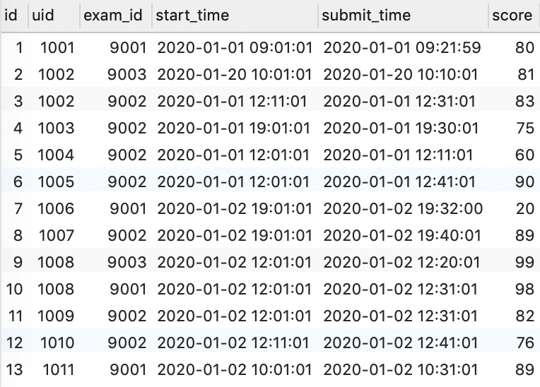

> Questions are from [Nowcoder - Advanced SQL Challenges](https://www.nowcoder.com/exam/oj?page=1&tab=SQL%E7%AF%87&topicId=240).

The sample data uses English category labels and nicknames for readability. The string-length examples retain Chinese text to show how byte length differs from character length.

Depending on your experience and interview needs, you may choose to skip the harder problems.

## Handling NULL Values

### Count Incomplete Attempts and Their Rate for Each Exam

**Description:**

Sample data from `exam_record` (`uid`: user ID, `exam_id`: exam ID, `start_time`: attempt start time, `submit_time`: submission time, `score`: score):

| id  | uid  | exam_id | start_time          | submit_time         | score  |
| --- | ---- | ------- | ------------------- | ------------------- | ------ |
| 1   | 1001 | 9001    | 2020-01-02 09:01:01 | 2020-01-02 09:21:01 | 80     |
| 2   | 1001 | 9001    | 2021-05-02 10:01:01 | 2021-05-02 10:30:01 | 81     |
| 3   | 1001 | 9001    | 2021-09-02 12:01:01 | (NULL)              | (NULL) |

For each exam with incomplete attempts, calculate the number of incomplete attempts (`incomplete_cnt`) and their rate (`incomplete_rate`). The sample output is:

| exam_id | incomplete_cnt | complete_rate |
| ------- | -------------- | ------------- |
| 9001    | 1              | 0.333         |

Explanation: Exam 9001 has three attempts: two complete and one incomplete. Its incomplete count is 1 and its incomplete rate is 0.333 (rounded to three decimal places).

**Approach:**

The query needs both an unconditional count and a conditional count. You can calculate them in separate queries and combine the results, or handle the condition directly in `SELECT`.

**Answer:**

Option 1:

```sql
SELECT
    exam_id,
    (COUNT(*) - COUNT(submit_time)) AS incomplete_cnt,
    ROUND((COUNT(*) - COUNT(submit_time)) / COUNT(*), 3) AS incomplete_rate
FROM
    exam_record
GROUP BY
    exam_id
HAVING
    (COUNT(*) - COUNT(submit_time)) > 0;
```

`COUNT(*)` counts all rows in each group. `COUNT(submit_time)` counts only rows where `submit_time` is not `NULL` (completed attempts). Their difference is the number of incomplete attempts.

Option 2:

```sql
SELECT
    exam_id,
    COUNT(CASE WHEN submit_time IS NULL THEN 1 END) AS incomplete_cnt,
    ROUND(COUNT(CASE WHEN submit_time IS NULL THEN 1 END) / COUNT(*), 3) AS incomplete_rate
FROM
    exam_record
GROUP BY
    exam_id
HAVING
    COUNT(CASE WHEN submit_time IS NULL THEN 1 END) > 0;
```

The `CASE` expression returns a non-`NULL` value (such as 1) when the condition is true, and `NULL` otherwise. `COUNT` then counts the non-`NULL` values.

Option 3:

```sql
SELECT
    exam_id,
    SUM(submit_time IS NULL) AS incomplete_cnt,
    ROUND(SUM(submit_time IS NULL) / COUNT(*), 3) AS incomplete_rate
FROM
    exam_record
GROUP BY
    exam_id
HAVING
    incomplete_cnt > 0;
```

`SUM` adds the results of an expression. `(submit_time IS NULL)` is 1 (TRUE) when `submit_time` is `NULL`, and 0 (FALSE) otherwise. Summing these values gives the number of incomplete attempts.

### Average Time and Score on Hard Exams for Level 0 Users

**Description:**

Sample data from `user_info` (`uid`: user ID, `nick_name`: nickname, `achievement`: achievement points, `level`: level, `job`: career path, `register_time`: registration time):

| id  | uid  | nick_name | achievement | level | job        | register_time       |
| --- | ---- | --------- | ----------- | ----- | ---------- | ------------------- |
| 1   | 1001 | User 1    | 10          | 0     | Algorithms | 2020-01-01 10:00:00 |
| 2   | 1002 | User 2    | 2100        | 6     | Algorithms | 2020-01-01 10:00:00 |

Sample data from `examination_info` (`exam_id`: exam ID, `tag`: category, `difficulty`: difficulty, `duration`: exam length, `release_time`: release time):

| id  | exam_id | tag        | difficulty | duration | release_time        |
| --- | ------- | ---------- | ---------- | -------- | ------------------- |
| 1   | 9001    | SQL        | hard       | 60       | 2020-01-01 10:00:00 |
| 2   | 9002    | SQL        | easy       | 60       | 2020-01-01 10:00:00 |
| 3   | 9004    | Algorithms | medium     | 80       | 2020-01-01 10:00:00 |

Sample data from `exam_record` (`uid`: user ID, `exam_id`: exam ID, `start_time`: attempt start time, `submit_time`: submission time, `score`: score):

| id  | uid  | exam_id | start_time          | submit_time         | score  |
| --- | ---- | ------- | ------------------- | ------------------- | ------ |
| 1   | 1001 | 9001    | 2020-01-02 09:01:01 | 2020-01-02 09:21:59 | 80     |
| 2   | 1001 | 9001    | 2021-05-02 10:01:01 | (NULL)              | (NULL) |
| 3   | 1001 | 9002    | 2021-02-02 19:01:01 | 2021-02-02 19:30:01 | 87     |
| 4   | 1001 | 9001    | 2021-06-02 19:01:01 | 2021-06-02 19:32:00 | 20     |
| 5   | 1001 | 9002    | 2021-09-05 19:01:01 | 2021-09-05 19:40:01 | 89     |
| 6   | 1001 | 9002    | 2021-09-01 12:01:01 | (NULL)              | (NULL) |
| 7   | 1002 | 9002    | 2021-05-05 18:01:01 | 2021-05-05 18:59:02 | 90     |

For each level 0 user, return the average time and score for all hard exam attempts. Treat incomplete attempts as taking the full exam duration and scoring 0. The sample output is:

| uid  | avg_score | avg_time_took |
| ---- | --------- | ------------- |
| 1001 | 33        | 36.7          |

Explanation: User 1001 is the only level 0 user, and exam 9001 is the only hard exam. User 1001 has three attempts on it: 20 minutes, incomplete (use the full 60-minute duration), and 30 minutes. Their scores are 80, incomplete (treat as 0), and 20. The average time is 110/3 = 36.7 minutes (rounded to one decimal place), and the average score is 33 (rounded to an integer).

**Approach:** `IF` is convenient here because the query checks for `NULL` values. `CASE WHEN` would also work. The main challenge is handling `NULL`; the other query conditions are straightforward.

**Answer:**

```sql
SELECT UID,
       round(avg(new_socre)) AS avg_score,
       round(avg(time_diff), 1) AS avg_time_took
FROM
  (SELECT er.uid,
          IF (er.submit_time IS NOT NULL, TIMESTAMPDIFF(MINUTE, start_time, submit_time), ef.duration) AS time_diff,
          IF (er.submit_time IS NOT NULL,er.score,0) AS new_socre
   FROM exam_record er
   LEFT JOIN user_info uf ON er.uid = uf.uid
   LEFT JOIN examination_info ef ON er.exam_id = ef.exam_id
   WHERE uf.LEVEL = 0 AND ef.difficulty = 'hard' ) t
GROUP BY UID
ORDER BY UID
```

## Advanced Conditional Queries

### Filter Users by Nickname, Achievement Points, and Recent Activity (Advanced)

**Description:**

Sample data from `user_info` (`uid`: user ID, `nick_name`: nickname, `achievement`: achievement points, `level`: level, `job`: career path, `register_time`: registration time):

| id  | uid  | nick_name | achievement | level | job        | register_time       |
| --- | ---- | --------- | ----------- | ----- | ---------- | ------------------- |
| 1   | 1001 | User 1    | 1000        | 2     | Algorithms | 2020-01-01 10:00:00 |
| 2   | 1002 | User 2    | 1200        | 3     | Algorithms | 2020-01-01 10:00:00 |
| 3   | 1003 | Guest 3   | 2200        | 5     | Algorithms | 2020-01-01 10:00:00 |
| 4   | 1004 | User 4    | 2500        | 6     | Algorithms | 2020-01-01 10:00:00 |
| 5   | 1005 | User 5    | 3000        | 7     | C++        | 2020-01-01 10:00:00 |

Sample data from `exam_record` (`uid`: user ID, `exam_id`: exam ID, `start_time`: attempt start time, `submit_time`: submission time, `score`: score):

| id  | uid  | exam_id | start_time          | submit_time         | score  |
| --- | ---- | ------- | ------------------- | ------------------- | ------ |
| 1   | 1001 | 9001    | 2020-01-02 09:01:01 | 2020-01-02 09:21:59 | 80     |
| 3   | 1001 | 9002    | 2021-02-02 19:01:01 | 2021-02-02 19:30:01 | 87     |
| 2   | 1001 | 9001    | 2021-05-02 10:01:01 | (NULL)              | (NULL) |
| 4   | 1001 | 9001    | 2021-06-02 19:01:01 | 2021-06-02 19:32:00 | 20     |
| 6   | 1001 | 9002    | 2021-09-01 12:01:01 | (NULL)              | (NULL) |
| 5   | 1001 | 9002    | 2021-09-05 19:01:01 | 2021-09-05 19:40:01 | 89     |
| 11  | 1002 | 9001    | 2020-01-01 12:01:01 | 2020-01-01 12:31:01 | 81     |
| 12  | 1002 | 9002    | 2020-02-01 12:01:01 | 2020-02-01 12:31:01 | 82     |
| 13  | 1002 | 9002    | 2020-02-02 12:11:01 | 2020-02-02 12:31:01 | 83     |
| 7   | 1002 | 9002    | 2021-05-05 18:01:01 | 2021-05-05 18:59:02 | 90     |
| 16  | 1002 | 9001    | 2021-09-06 12:01:01 | 2021-09-06 12:21:01 | 80     |
| 17  | 1002 | 9001    | 2021-09-06 12:01:01 | (NULL)              | (NULL) |
| 18  | 1002 | 9001    | 2021-09-07 12:01:01 | (NULL)              | (NULL) |
| 8   | 1003 | 9003    | 2021-02-06 12:01:01 | (NULL)              | (NULL) |
| 9   | 1003 | 9001    | 2021-09-07 10:01:01 | 2021-09-07 10:31:01 | 89     |
| 10  | 1004 | 9002    | 2021-08-06 12:01:01 | (NULL)              | (NULL) |
| 14  | 1005 | 9001    | 2021-02-01 11:01:01 | 2021-02-01 11:31:01 | 84     |
| 15  | 1006 | 9001    | 2021-02-01 11:01:01 | 2021-02-01 11:31:01 | 84     |

Sample data from `practice_record` (`uid`: user ID, `question_id`: question ID, `submit_time`: submission time, `score`: score):

| id  | uid  | question_id | submit_time         | score |
| --- | ---- | ----------- | ------------------- | ----- |
| 1   | 1001 | 8001        | 2021-08-02 11:41:01 | 60    |
| 2   | 1002 | 8001        | 2021-09-02 19:30:01 | 50    |
| 3   | 1002 | 8001        | 2021-09-02 19:20:01 | 70    |
| 4   | 1002 | 8002        | 2021-09-02 19:38:01 | 70    |
| 5   | 1003 | 8002        | 2021-09-01 19:38:01 | 80    |

Find users whose nicknames start with "User " and end with a digit, whose achievement points are between 1,200 and 2,500, and whose most recent activity (question or exam attempt) was in September 2021.

The sample output is:

| uid  | nick_name | achievement |
| ---- | --------- | ----------- |
| 1002 | User 2    | 1200        |

**Explanation:** Users 1002 and 1004 have nicknames that start with "User " and end with a digit, and achievement points between 1,200 and 2,500.

User 1002's most recent exam and question activity was in September 2021. User 1004's most recent exam activity was in August 2021, and they have no question activity.

Therefore, only user 1002 meets all the conditions.

**Approach:**

Start by writing the main query conditions:

Nicknames of the form User followed by a space and digits: `nick_name REGEXP '^User [0-9]+$'`.

Achievement points between 1,200 and 2,500: `achievement BETWEEN 1200 AND 2500`.

The final condition requires activity in September: `(DATE_FORMAT(record.submit_time, '%Y%m') = '202109' OR DATE_FORMAT(pr.submit_time, '%Y%m') = '202109')`.

**Answer:**

```sql
SELECT DISTINCT u_info.uid,
                u_info.nick_name,
                u_info.achievement
FROM user_info u_info
LEFT JOIN exam_record record ON record.uid = u_info.uid
LEFT JOIN practice_record pr ON u_info.uid = pr.uid
WHERE u_info.nick_name RLIKE "^User [0-9]+$"
  AND u_info.achievement BETWEEN 1200
  AND 2500
  AND (date_format(record.submit_time, '%Y%m')= 202109
       OR date_format(pr.submit_time, '%Y%m')= 202109)
GROUP BY u_info.uid
```

### Filter Attempts by Nickname and Exam Category (Advanced)

**Description:**

Sample data from `user_info` (`uid`: user ID, `nick_name`: nickname, `achievement`: achievement points, `level`: level, `job`: career path, `register_time`: registration time):

| id  | uid  | nick_name | achievement | level | job        | register_time       |
| --- | ---- | --------- | ----------- | ----- | ---------- | ------------------- |
| 1   | 1001 | User 1    | 1900        | 2     | Algorithms | 2020-01-01 10:00:00 |
| 2   | 1002 | User 2    | 1200        | 3     | Algorithms | 2020-01-01 10:00:00 |
| 3   | 1003 | User 3 ♂ | 2200        | 5     | Algorithms | 2020-01-01 10:00:00 |
| 4   | 1004 | User 4    | 2500        | 6     | Algorithms | 2020-01-01 10:00:00 |
| 5   | 1005 | User 555  | 2000        | 7     | C++        | 2020-01-01 10:00:00 |
| 6   | 1006 | 666666    | 3000        | 6     | C++        | 2020-01-01 10:00:00 |

Sample data from `examination_info` (`exam_id`: exam ID, `tag`: category, `difficulty`: difficulty, `duration`: exam length, `release_time`: release time):

| id  | exam_id | tag | difficulty | duration | release_time        |
| --- | ------- | --- | ---------- | -------- | ------------------- |
| 1   | 9001    | C++ | hard       | 60       | 2020-01-01 10:00:00 |
| 2   | 9002    | c#  | hard       | 80       | 2020-01-01 10:00:00 |
| 3   | 9003    | SQL | medium     | 70       | 2020-01-01 10:00:00 |

Sample data from `exam_record` (`uid`: user ID, `exam_id`: exam ID, `start_time`: attempt start time, `submit_time`: submission time, `score`: score):

| id  | uid  | exam_id | start_time          | submit_time         | score  |
| --- | ---- | ------- | ------------------- | ------------------- | ------ |
| 1   | 1001 | 9001    | 2020-01-02 09:01:01 | 2020-01-02 09:21:59 | 80     |
| 2   | 1001 | 9001    | 2021-05-02 10:01:01 | (NULL)              | (NULL) |
| 4   | 1001 | 9001    | 2021-06-02 19:01:01 | 2021-06-02 19:32:00 | 20     |
| 3   | 1001 | 9002    | 2021-02-02 19:01:01 | 2021-02-02 19:30:01 | 87     |
| 5   | 1001 | 9002    | 2021-09-05 19:01:01 | 2021-09-05 19:40:01 | 89     |
| 6   | 1001 | 9002    | 2021-09-01 12:01:01 | (NULL)              | (NULL) |
| 11  | 1002 | 9001    | 2020-01-01 12:01:01 | 2020-01-01 12:31:01 | 81     |
| 16  | 1002 | 9001    | 2021-09-06 12:01:01 | 2021-09-06 12:21:01 | 80     |
| 17  | 1002 | 9001    | 2021-09-06 12:01:01 | (NULL)              | (NULL) |
| 18  | 1002 | 9001    | 2021-09-07 12:01:01 | (NULL)              | (NULL) |
| 7   | 1002 | 9002    | 2021-05-05 18:01:01 | 2021-05-05 18:59:02 | 90     |
| 12  | 1002 | 9002    | 2020-02-01 12:01:01 | 2020-02-01 12:31:01 | 82     |
| 13  | 1002 | 9002    | 2020-02-02 12:11:01 | 2020-02-02 12:31:01 | 83     |
| 9   | 1003 | 9001    | 2021-09-07 10:01:01 | 2021-09-07 10:31:01 | 89     |
| 8   | 1003 | 9003    | 2021-02-06 12:01:01 | (NULL)              | (NULL) |
| 10  | 1004 | 9002    | 2021-08-06 12:01:01 | (NULL)              | (NULL) |
| 14  | 1005 | 9001    | 2021-02-01 11:01:01 | 2021-02-01 11:31:01 | 84     |
| 15  | 1006 | 9001    | 2021-02-01 11:01:01 | 2021-09-01 11:31:01 | 84     |

For users whose nicknames are either "User " followed by digits, or digits only, find the completed exam IDs and average scores for categories beginning with the letter C (such as C, C++, or c#). Sort by user ID and then average score in ascending order. The sample output is:

| uid  | exam_id | avg_score |
| ---- | ------- | --------- |
| 1002 | 9001    | 81        |
| 1002 | 9002    | 85        |
| 1005 | 9001    | 84        |
| 1006 | 9001    | 84        |

Explanation: Users 1002, 1004, 1005, and 1006 have matching nicknames.

Exams 9001 and 9002 have categories beginning with C.

Among the matching attempts, user 1002 completed exam 9001 with scores of 81 and 80. Their average is 81 after rounding 80.5 to the nearest integer.

User 1002 completed exam 9002 with scores of 90, 82, and 83, for an average of 85.

**Approach:**

As before, start by writing each condition from the prompt.

To match nicknames consisting of "User " + digits, or digits only, a first attempt might be `nick_name LIKE 'User %' OR nick_name REGEXP '^[0-9]+$'`. However, this would also match a nickname such as "User H".

Use a regular expression instead: `nick_name REGEXP '^User [0-9]+$'`.

For exam categories beginning with C, use `e_info.tag LIKE 'c%'` or `tag REGEXP '^[cC]'`. The first pattern may also match uppercase C depending on the collation.

**Answer:**

```sql
SELECT UID,
       exam_id,
       ROUND(AVG(score), 0) avg_score
FROM exam_record
WHERE UID IN
    (SELECT UID
     FROM user_info
     WHERE nick_name RLIKE "^User [0-9]+$"
       OR nick_name RLIKE "^[0-9]+$")
  AND exam_id IN
    (SELECT exam_id
     FROM examination_info
     WHERE tag RLIKE "^[cC]")
  AND score IS NOT NULL
GROUP BY UID,exam_id
ORDER BY UID,avg_score;
```

### Return Different Results Depending on Whether Matching Rows Exist (Advanced)

**Description:**

Sample data from `user_info` (`uid`: user ID, `nick_name`: nickname, `achievement`: achievement points, `level`: level, `job`: career path, `register_time`: registration time):

| id  | uid  | nick_name | achievement | level | job        | register_time       |
| --- | ---- | --------- | ----------- | ----- | ---------- | ------------------- |
| 1   | 1001 | User 1    | 19          | 0     | Algorithms | 2020-01-01 10:00:00 |
| 2   | 1002 | User 2    | 1200        | 3     | Algorithms | 2020-01-01 10:00:00 |
| 3   | 1003 | Guest 3   | 22          | 0     | Algorithms | 2020-01-01 10:00:00 |
| 4   | 1004 | User 4    | 25          | 0     | Algorithms | 2020-01-01 10:00:00 |
| 5   | 1005 | User 555  | 2000        | 7     | C++        | 2020-01-01 10:00:00 |
| 6   | 1006 | 666666    | 3000        | 6     | C++        | 2020-01-01 10:00:00 |

Sample data from `exam_record` (`uid`: user ID, `exam_id`: exam ID, `start_time`: attempt start time, `submit_time`: submission time, `score`: score):

| id  | uid  | exam_id | start_time          | submit_time         | score  |
| --- | ---- | ------- | ------------------- | ------------------- | ------ |
| 1   | 1001 | 9001    | 2020-01-02 09:01:01 | 2020-01-02 09:21:59 | 80     |
| 2   | 1001 | 9001    | 2021-05-02 10:01:01 | (NULL)              | (NULL) |
| 3   | 1001 | 9002    | 2021-02-02 19:01:01 | 2021-02-02 19:30:01 | 87     |
| 4   | 1001 | 9002    | 2021-09-01 12:01:01 | (NULL)              | (NULL) |
| 5   | 1001 | 9003    | 2021-09-02 12:01:01 | (NULL)              | (NULL) |
| 6   | 1001 | 9004    | 2021-09-03 12:01:01 | (NULL)              | (NULL) |
| 7   | 1002 | 9001    | 2020-01-01 12:01:01 | 2020-01-01 12:31:01 | 99     |
| 8   | 1002 | 9003    | 2020-02-01 12:01:01 | 2020-02-01 12:31:01 | 82     |
| 9   | 1002 | 9003    | 2020-02-02 12:11:01 | (NULL)              | (NULL) |
| 10  | 1002 | 9002    | 2021-05-05 18:01:01 | (NULL)              | (NULL) |
| 11  | 1002 | 9001    | 2021-09-06 12:01:01 | (NULL)              | (NULL) |
| 12  | 1003 | 9003    | 2021-02-06 12:01:01 | (NULL)              | (NULL) |
| 13  | 1003 | 9001    | 2021-09-07 10:01:01 | 2021-09-07 10:31:01 | 89     |

If any level 0 user has more than two incomplete exam attempts, return the incomplete count and rate (rounded to three decimal places) for every level 0 user. If no such user exists, return these metrics for every user with an exam attempt. Sort by incompletion rate in ascending order.

The sample output is:

| uid  | incomplete_cnt | incomplete_rate |
| ---- | -------------- | --------------- |
| 1004 | 0              | 0.000           |
| 1003 | 1              | 0.500           |
| 1001 | 4              | 0.667           |

**Explanation:** The level 0 users are 1001, 1003, and 1004. Their total and incomplete attempt counts are 6:4, 2:1, and 0:0.

User 1001 has more than two incomplete attempts, so return metrics for all three users. User 1004 has no attempts, so their incompletion rate defaults to 0.000.

Sort the results by incompletion rate in ascending order.

Note: If user 1001 did not have more than two incomplete attempts, return metrics for users 1001, 1002, and 1003, since these are the only users with exam records.

**Approach:**

First, write a query to find whether any level 0 user has more than two incomplete attempts:

```sql
SELECT ui.uid UID
FROM user_info ui
LEFT JOIN exam_record er ON ui.uid = er.uid
WHERE ui.uid IN
    (SELECT ui.uid
     FROM user_info ui
     LEFT JOIN exam_record er ON ui.uid = er.uid
     WHERE er.submit_time IS NULL
       AND ui.LEVEL = 0 )
GROUP BY ui.uid
HAVING sum(IF(er.submit_time IS NULL, 1, 0)) > 2
```

Then write a query for each of the two cases.

Case 1: Calculate the incompletion rate for level 0 users when the condition is met.

```sql
SELECT
	tmp1.uid uid,
	sum(
	IF
	( er.submit_time IS NULL AND er.start_time IS NOT NULL, 1, 0 )) incomplete_cnt,
	round(
		sum(
		IF
		( er.submit_time IS NULL AND er.start_time IS NOT NULL, 1, 0 ))/ count( tmp1.uid ),
		3
	) incomplete_rate
FROM
	(
	SELECT DISTINCT
		ui.uid
	FROM
		user_info ui
		LEFT JOIN exam_record er ON ui.uid = er.uid
	WHERE
		er.submit_time IS NULL
		AND ui.LEVEL = 0
	) tmp1
	LEFT JOIN exam_record er ON tmp1.uid = er.uid
GROUP BY
	tmp1.uid
ORDER BY
	incomplete_rate
```

Case 2: If the condition is not met, calculate the incompletion rate for all users with exam attempts.

```sql
SELECT
	ui.uid uid,
	sum( CASE WHEN er.submit_time IS NULL AND er.start_time IS NOT NULL THEN 1 ELSE 0 END ) incomplete_cnt,
	round(
		sum(
		IF
		( er.submit_time IS NULL AND er.start_time IS NOT NULL, 1, 0 ))/ count( ui.uid ),
		3
	) incomplete_rate
FROM
	user_info ui
	JOIN exam_record er ON ui.uid = er.uid
GROUP BY
	ui.uid
ORDER BY
	incomplete_rate
```

Combine the two cases:

```sql
WITH host_user AS
  (SELECT ui.uid UID
   FROM user_info ui
   LEFT JOIN exam_record er ON ui.uid = er.uid
   WHERE ui.uid IN
       (SELECT ui.uid
        FROM user_info ui
        LEFT JOIN exam_record er ON ui.uid = er.uid
        WHERE er.submit_time IS NULL
          AND ui.LEVEL = 0 )
   GROUP BY ui.uid
   HAVING sum(IF (er.submit_time IS NULL, 1, 0))> 2),
     tt1 AS
  (SELECT tmp1.uid UID,
                   sum(IF (er.submit_time IS NULL
                           AND er.start_time IS NOT NULL, 1, 0)) incomplete_cnt,
                   round(sum(IF (er.submit_time IS NULL
                                 AND er.start_time IS NOT NULL, 1, 0))/ count(tmp1.uid), 3) incomplete_rate
   FROM
     (SELECT DISTINCT ui.uid
      FROM user_info ui
      LEFT JOIN exam_record er ON ui.uid = er.uid
      WHERE er.submit_time IS NULL
        AND ui.LEVEL = 0 ) tmp1
   LEFT JOIN exam_record er ON tmp1.uid = er.uid
   GROUP BY tmp1.uid
   ORDER BY incomplete_rate),
     tt2 AS
  (SELECT ui.uid UID,
                 sum(CASE
                         WHEN er.submit_time IS NULL
                              AND er.start_time IS NOT NULL THEN 1
                         ELSE 0
                     END) incomplete_cnt,
                 round(sum(IF (er.submit_time IS NULL
                               AND er.start_time IS NOT NULL, 1, 0))/ count(ui.uid), 3) incomplete_rate
   FROM user_info ui
   JOIN exam_record er ON ui.uid = er.uid
   GROUP BY ui.uid
   ORDER BY incomplete_rate)
  (SELECT tt1.*
   FROM tt1
   LEFT JOIN
     (SELECT UID
      FROM host_user) t1 ON 1 = 1
   WHERE t1.uid IS NOT NULL )
UNION ALL
  (SELECT tt2.*
   FROM tt2
   LEFT JOIN
     (SELECT UID
      FROM host_user) t2 ON 1 = 1
   WHERE t2.uid IS NULL)
```

Version 2 (a shorter solution with clearer logic):

```sql
SELECT
	ui.uid,
	SUM(
	IF
	( start_time IS NOT NULL AND score IS NULL, 1, 0 )) AS incomplete_cnt, #3. Incomplete exam count
	ROUND( AVG( IF ( start_time IS NOT NULL AND score IS NULL, 1, 0 )), 3 ) AS incomplete_rate #4. Incompletion rate

FROM
	user_info ui
	LEFT JOIN exam_record USING ( uid )
WHERE
CASE

		WHEN (#1. When any level 0 user has more than two incomplete exams
		SELECT
			MAX( lv0_incom_cnt )
		FROM
			(
			SELECT
				SUM(
				IF
				( score IS NULL, 1, 0 )) AS lv0_incom_cnt
			FROM
				user_info
				JOIN exam_record USING ( uid )
			WHERE
				LEVEL = 0
			GROUP BY
				uid
			) table1
			)> 2 THEN
			uid IN ( #1.1 Find all level 0 users
			SELECT uid FROM user_info WHERE LEVEL = 0 ) ELSE uid IN ( #2. Otherwise, find users with exam attempts
			SELECT DISTINCT uid FROM exam_record )
		END
		GROUP BY
			ui.uid
	ORDER BY
	incomplete_rate #5. Sort by incompletion rate in ascending order
```

### Score Grade Distribution by User Level (Advanced)

**Description:**

Sample data from `user_info` (`uid`: user ID, `nick_name`: nickname, `achievement`: achievement points, `level`: level, `job`: career path, `register_time`: registration time):

| id  | uid  | nick_name | achievement | level | job        | register_time       |
| --- | ---- | --------- | ----------- | ----- | ---------- | ------------------- |
| 1   | 1001 | User 1    | 19          | 0     | Algorithms | 2020-01-01 10:00:00 |
| 2   | 1002 | User 2    | 1200        | 3     | Algorithms | 2020-01-01 10:00:00 |
| 3   | 1003 | User 3 ♂ | 22          | 0     | Algorithms | 2020-01-01 10:00:00 |
| 4   | 1004 | User 4    | 25          | 0     | Algorithms | 2020-01-01 10:00:00 |
| 5   | 1005 | User 555  | 2000        | 7     | C++        | 2020-01-01 10:00:00 |
| 6   | 1006 | 666666    | 3000        | 6     | C++        | 2020-01-01 10:00:00 |

Sample data from `exam_record` (`uid`: user ID, `exam_id`: exam ID, `start_time`: attempt start time, `submit_time`: submission time, `score`: score):

| id  | uid  | exam_id | start_time          | submit_time         | score  |
| --- | ---- | ------- | ------------------- | ------------------- | ------ |
| 1   | 1001 | 9001    | 2020-01-02 09:01:01 | 2020-01-02 09:21:59 | 80     |
| 2   | 1001 | 9001    | 2021-05-02 10:01:01 | (NULL)              | (NULL) |
| 3   | 1001 | 9002    | 2021-02-02 19:01:01 | 2021-02-02 19:30:01 | 75     |
| 4   | 1001 | 9002    | 2021-09-01 12:01:01 | 2021-09-01 12:11:01 | 60     |
| 5   | 1001 | 9003    | 2021-09-02 12:01:01 | 2021-09-02 12:41:01 | 90     |
| 6   | 1001 | 9001    | 2021-06-02 19:01:01 | 2021-06-02 19:32:00 | 20     |
| 7   | 1001 | 9002    | 2021-09-05 19:01:01 | 2021-09-05 19:40:01 | 89     |
| 8   | 1001 | 9004    | 2021-09-03 12:01:01 | (NULL)              | (NULL) |
| 9   | 1002 | 9001    | 2020-01-01 12:01:01 | 2020-01-01 12:31:01 | 99     |
| 10  | 1002 | 9003    | 2020-02-01 12:01:01 | 2020-02-01 12:31:01 | 82     |
| 11  | 1002 | 9003    | 2020-02-02 12:11:01 | 2020-02-02 12:41:01 | 76     |

Classify exam scores into four grades at the thresholds [90, 75, 60]: excellent, good, fair, and poor. A score equal to a threshold belongs to the higher grade. For each user level, calculate the proportion of completed exams in each grade, rounded to three decimal places. Exclude users with no completed exams. Sort by user level and then proportion in descending order.

The sample output is:

| level | score_grade | ratio |
| ----- | ----------- | ----- |
| 3     | Good        | 0.667 |
| 3     | Excellent   | 0.333 |
| 0     | Good        | 0.500 |
| 0     | Fair        | 0.167 |
| 0     | Excellent   | 0.167 |
| 0     | Poor        | 0.167 |

Explanation: Users 1001 and 1002 have completed exams. Their levels and score grades are:

| uid  | exam_id | score | level | score_grade |
| ---- | ------- | ----- | ----- | ----------- |
| 1001 | 9001    | 80    | 0     | Good        |
| 1001 | 9002    | 75    | 0     | Good        |
| 1001 | 9002    | 60    | 0     | Fair        |
| 1001 | 9003    | 90    | 0     | Excellent   |
| 1001 | 9001    | 20    | 0     | Poor        |
| 1001 | 9002    | 89    | 0     | Good        |
| 1002 | 9001    | 99    | 3     | Excellent   |
| 1002 | 9003    | 82    | 3     | Good        |
| 1002 | 9003    | 76    | 3     | Good        |

Therefore, level 0 (user 1001) has grade proportions of 1/6 excellent, 1/6 good, 1/6 fair, and 3/6 poor. Level 3 (user 1002) has proportions of 1/3 excellent and 2/3 good. Results are rounded to three decimal places.

**Approach:**

First, classify exam scores into four grades using the thresholds [90, 75, 60]. Use `CASE WHEN`:

```sql
CASE
		WHEN a.score >= 90 THEN
		'Excellent'
		WHEN a.score < 90 AND a.score >= 75 THEN
		'Good'
		WHEN a.score < 75 AND a.score >= 60 THEN
	'Fair' ELSE 'Poor'
END
```

This is the key part; the remaining work is combining the query conditions.

**Answer:**

```sql
SELECT a.LEVEL,
       a.score_grade,
       ROUND(a.cur_count / b.total_num, 3) AS ratio
FROM
  (SELECT b.LEVEL AS LEVEL,
          (CASE
               WHEN a.score >= 90 THEN 'Excellent'
               WHEN a.score < 90
                    AND a.score >= 75 THEN 'Good'
               WHEN a.score < 75
                    AND a.score >= 60 THEN 'Fair'
               ELSE 'Poor'
           END) AS score_grade,
          count(1) AS cur_count
   FROM exam_record a
   LEFT JOIN user_info b ON a.uid = b.uid
   WHERE a.submit_time IS NOT NULL
   GROUP BY b.LEVEL,
            score_grade) a
LEFT JOIN
  (SELECT b.LEVEL AS LEVEL,
          count(b.LEVEL) AS total_num
   FROM exam_record a
   LEFT JOIN user_info b ON a.uid = b.uid
   WHERE a.submit_time IS NOT NULL
   GROUP BY b.LEVEL) b ON a.LEVEL = b.LEVEL
ORDER BY a.LEVEL DESC,
         ratio DESC
```

## Limiting Results

### Three Earliest Registrants

**Description:**

Sample data from `user_info` (`uid`: user ID, `nick_name`: nickname, `achievement`: achievement points, `level`: level, `job`: career path, `register_time`: registration time):

| id  | uid  | nick_name | achievement | level | job        | register_time       |
| --- | ---- | --------- | ----------- | ----- | ---------- | ------------------- |
| 1   | 1001 | User 1    | 19          | 0     | Algorithms | 2020-01-01 10:00:00 |
| 2   | 1002 | User 2    | 1200        | 3     | Algorithms | 2020-02-01 10:00:00 |
| 3   | 1003 | User 3 ♂ | 22          | 0     | Algorithms | 2020-01-02 10:00:00 |
| 4   | 1004 | User 4    | 25          | 0     | Algorithms | 2020-01-02 11:00:00 |
| 5   | 1005 | User 555  | 4000        | 7     | C++        | 2020-01-11 10:00:00 |
| 6   | 1006 | 666666    | 3000        | 6     | C++        | 2020-11-01 10:00:00 |

Find the three users with the earliest registration times. The sample output is:

| uid  | nick_name | register_time       |
| ---- | --------- | ------------------- |
| 1001 | User 1    | 2020-01-01 10:00:00 |
| 1003 | User 3 ♂ | 2020-01-02 10:00:00 |
| 1004 | User 4    | 2020-01-02 11:00:00 |

Explanation: Sort by registration time, then return the first three users' IDs, nicknames, and registration times.

**Answer:**

```sql
SELECT uid, nick_name, register_time
    FROM user_info
    ORDER BY register_time
    LIMIT 3
```

### Page Three of Users Who Completed an Exam on Their Registration Date (Advanced)

**Description:** Sample data from `user_info` (`uid`: user ID, `nick_name`: nickname, `achievement`: achievement points, `level`: level, `job`: career path, `register_time`: registration time):

| id  | uid  | nick_name | achievement | level | job        | register_time       |
| --- | ---- | --------- | ----------- | ----- | ---------- | ------------------- |
| 1   | 1001 | User 1    | 19          | 0     | Algorithms | 2020-01-01 10:00:00 |
| 2   | 1002 | User 2    | 1200        | 3     | Algorithms | 2020-01-01 10:00:00 |
| 3   | 1003 | User 3 ♂ | 22          | 0     | Algorithms | 2020-01-01 10:00:00 |
| 4   | 1004 | User 4    | 25          | 0     | Algorithms | 2020-01-01 10:00:00 |
| 5   | 1005 | User 555  | 4000        | 7     | Algorithms | 2020-01-11 10:00:00 |
| 6   | 1006 | User 6    | 25          | 0     | Algorithms | 2020-01-02 11:00:00 |
| 7   | 1007 | User 7    | 25          | 0     | Algorithms | 2020-01-02 11:00:00 |
| 8   | 1008 | User 8    | 25          | 0     | Algorithms | 2020-01-02 11:00:00 |
| 9   | 1009 | User 9    | 25          | 0     | Algorithms | 2020-01-02 11:00:00 |
| 10  | 1010 | User 10   | 25          | 0     | Algorithms | 2020-01-02 11:00:00 |
| 11  | 1011 | 666666    | 3000        | 6     | C++        | 2020-01-02 10:00:00 |

Sample data from `examination_info` (`exam_id`: exam ID, `tag`: category, `difficulty`: difficulty, `duration`: exam length, `release_time`: release time):

| id  | exam_id | tag        | difficulty | duration | release_time        |
| --- | ------- | ---------- | ---------- | -------- | ------------------- |
| 1   | 9001    | Algorithms | hard       | 60       | 2020-01-01 10:00:00 |
| 2   | 9002    | Algorithms | hard       | 80       | 2020-01-01 10:00:00 |
| 3   | 9003    | SQL        | medium     | 70       | 2020-01-01 10:00:00 |

Sample data from `exam_record` (`uid`: user ID, `exam_id`: exam ID, `start_time`: attempt start time, `submit_time`: submission time, `score`: score):

| id  | uid  | exam_id | start_time          | submit_time         | score |
| --- | ---- | ------- | ------------------- | ------------------- | ----- |
| 1   | 1001 | 9001    | 2020-01-02 09:01:01 | 2020-01-02 09:21:59 | 80    |
| 2   | 1002 | 9003    | 2020-01-20 10:01:01 | 2020-01-20 10:10:01 | 81    |
| 3   | 1002 | 9002    | 2020-01-01 12:11:01 | 2020-01-01 12:31:01 | 83    |
| 4   | 1003 | 9002    | 2020-01-01 19:01:01 | 2020-01-01 19:30:01 | 75    |
| 5   | 1004 | 9002    | 2020-01-01 12:01:01 | 2020-01-01 12:11:01 | 60    |
| 6   | 1005 | 9002    | 2020-01-01 12:01:01 | 2020-01-01 12:41:01 | 90    |
| 7   | 1006 | 9001    | 2020-01-02 19:01:01 | 2020-01-02 19:32:00 | 20    |
| 8   | 1007 | 9002    | 2020-01-02 19:01:01 | 2020-01-02 19:40:01 | 89    |
| 9   | 1008 | 9003    | 2020-01-02 12:01:01 | 2020-01-02 12:20:01 | 99    |
| 10  | 1008 | 9001    | 2020-01-02 12:01:01 | 2020-01-02 12:31:01 | 98    |
| 11  | 1009 | 9002    | 2020-01-02 12:01:01 | 2020-01-02 12:31:01 | 82    |
| 12  | 1010 | 9002    | 2020-01-02 12:11:01 | 2020-01-02 12:41:01 | 76    |
| 13  | 1011 | 9001    | 2020-01-02 10:01:01 | 2020-01-02 10:31:01 | 89    |



Find users with a career path in Algorithms who completed an Algorithms exam on their registration date. Rank them by their highest score across all exams. The ranking is paginated with three rows per page; return the third page (page numbering starts at 1).

The sample output is:

| uid  | level | register_time       | max_score |
| ---- | ----- | ------------------- | --------- |
| 1010 | 0     | 2020-01-02 11:00:00 | 76        |
| 1003 | 0     | 2020-01-01 10:00:00 | 75        |
| 1004 | 0     | 2020-01-01 11:00:00 | 60        |

Explanation: Every user except 1011 has a career path in Algorithms. Exams 9001 and 9002 are Algorithms exams, and 11 users completed an Algorithms exam on their registration date. When finding each user's maximum score across all exams, only users 1002 and 1008 completed two exams; the others completed one. User 1002's highest score is 81, and user 1008's is 99.

Ranking by highest score:

| uid  | level | register_time       | max_score |
| ---- | ----- | ------------------- | --------- |
| 1008 | 0     | 2020-01-02 11:00:00 | 99        |
| 1005 | 7     | 2020-01-01 10:00:00 | 90        |
| 1007 | 0     | 2020-01-02 11:00:00 | 89        |
| 1002 | 3     | 2020-01-01 10:00:00 | 83        |
| 1009 | 0     | 2020-01-02 11:00:00 | 82        |
| 1001 | 0     | 2020-01-01 10:00:00 | 80        |
| 1010 | 0     | 2020-01-02 11:00:00 | 76        |
| 1003 | 0     | 2020-01-01 10:00:00 | 75        |
| 1004 | 0     | 2020-01-01 11:00:00 | 60        |
| 1006 | 0     | 2020-01-02 11:00:00 | 20        |

With three rows per page, the third page contains rows 7–9. Return the rows for users 1010, 1003, and 1004.

**Approach:**

1. Use `LIMIT` to retrieve the third page, with three rows per page.

2. Find users with a career path in Algorithms who completed an Algorithms exam on their registration date. Then join their user information and exam scores.

**Answer:**

```sql
SELECT t1.uid,
       LEVEL,
       register_time,
       max(score) AS max_score
FROM exam_record t
JOIN examination_info USING (exam_id)
JOIN user_info t1 ON t.uid = t1.uid
AND date(t.submit_time) = date(t1.register_time)
WHERE job = 'Algorithms'
  AND tag = 'Algorithms'
GROUP BY t1.uid,
         LEVEL,
         register_time
ORDER BY max_score DESC
LIMIT 6,3
```

## String Functions

### Fix Records with Misaligned Columns

**Description:** Sample data from `examination_info` (`exam_id`: exam ID, `tag`: category, `difficulty`: difficulty, `duration`: exam length, `release_time`: release time):

| id  | exam_id | tag                  | difficulty | duration | release_time        |
| --- | ------- | -------------------- | ---------- | -------- | ------------------- |
| 1   | 9001    | Algorithms           | hard       | 60       | 2021-01-01 10:00:00 |
| 2   | 9002    | Algorithms           | hard       | 80       | 2021-01-01 10:00:00 |
| 3   | 9003    | SQL                  | medium     | 70       | 2021-01-01 10:00:00 |
| 4   | 9004    | Algorithms,medium,80 |            | 0        | 2021-01-01 10:00:00 |

Some exam data was entered incorrectly: the category (`tag`), difficulty, and duration were all entered into the `tag` column. Find these rows, split the values, and return them under the correct columns.

The sample output is:

| exam_id | tag        | difficulty | duration |
| ------- | ---------- | ---------- | -------- |
| 9004    | Algorithms | medium     | 80       |

**Approach:**

First, review the function used in this problem.

`SUBSTRING_INDEX` extracts part of a string using a specified delimiter. It takes three arguments: the source string, the delimiter, and the number of parts to return.

Syntax:

```sql
SUBSTRING_INDEX(str, delimiter, count)
```

- `str`: the source string to split.
- `delimiter`: the string or character used as the separator.
- `count`: the number of parts to return.
  - If `count` is positive, return the first `count` parts from the left, separated by the delimiter.
  - If `count` is negative, return the last `count` parts from the right.

Examples of `SUBSTRING_INDEX`:

1. Extract the first part of a string:

   ```sql
   SELECT SUBSTRING_INDEX('apple,banana,cherry', ',', 1);
   -- Output: 'apple'
   ```

2. Extract the last part of a string:

   ```sql
   SELECT SUBSTRING_INDEX('apple,banana,cherry', ',', -1);
   -- Output: 'cherry'
   ```

3. Extract the first two parts of a string:

   ```sql
   SELECT SUBSTRING_INDEX('apple,banana,cherry', ',', 2);
   -- Output: 'apple,banana'
   ```

4. Extract the last two parts of a string:

   ```sql
   SELECT SUBSTRING_INDEX('apple,banana,cherry', ',', -2);
   -- Output: 'banana,cherry'
   ```

**Answer:**

```sql
SELECT
	exam_id,
	substring_index( tag, ',', 1 ) tag,
	substring_index( substring_index( tag, ',', 2 ), ',',- 1 ) difficulty,
	substring_index( tag, ',',- 1 ) duration
FROM
	examination_info
WHERE
	difficulty = ''
```

### Truncate Overly Long Nicknames

**Description:** Sample data from `user_info` (`uid`: user ID, `nick_name`: nickname, `achievement`: achievement points, `level`: level, `job`: career path, `register_time`: registration time):

| id  | uid  | nick_name           | achievement | level | job        | register_time       |
| --- | ---- | ------------------- | ----------- | ----- | ---------- | ------------------- |
| 1   | 1001 | User 1              | 19          | 0     | Algorithms | 2020-01-01 10:00:00 |
| 2   | 1002 | User 2              | 1200        | 3     | Algorithms | 2020-01-01 10:00:00 |
| 3   | 1003 | User 3 ♂           | 22          | 0     | Algorithms | 2020-01-01 10:00:00 |
| 4   | 1004 | User 4              | 25          | 0     | Algorithms | 2020-01-01 11:00:00 |
| 5   | 1005 | User 5678901234     | 4000        | 7     | Algorithms | 2020-01-11 10:00:00 |
| 6   | 1006 | User 67890123456789 | 25          | 0     | Algorithms | 2020-01-02 11:00:00 |

Some users have long nicknames that can disrupt the layout. Return users whose nicknames have more than 10 characters. For nicknames longer than 13 characters, return the first 10 characters followed by an ellipsis (`...`).

The sample output is:

| uid  | nick_name     |
| ---- | ------------- |
| 1005 | User 56789... |
| 1006 | User 67890... |

Explanation: Users 1005 and 1006 have nicknames longer than 13 characters, so both are truncated to the first 10 characters followed by an ellipsis.

**Approach:**

This problem requires counting characters in a string. Use `LENGTH` or `CHAR_LENGTH`; they differ in how they handle multibyte characters.

1. `LENGTH` returns the number of bytes in a string. A multibyte character contributes multiple bytes.

Example:

```sql
SELECT LENGTH('你好'); -- Returns 6 because each Chinese character uses 3 bytes.
```

1. `CHAR_LENGTH` returns the number of characters in a string. Each multibyte character counts as one character.

Example:

```sql
SELECT CHAR_LENGTH('你好'); -- Returns 2 because the string has two characters.
```

**Answer:**

```sql
SELECT
	uid,
CASE

		WHEN CHAR_LENGTH( nick_name ) > 13 THEN
		CONCAT( SUBSTR( nick_name, 1, 10 ), '...' ) ELSE nick_name
	END AS nick_name
FROM
	user_info
WHERE
	CHAR_LENGTH( nick_name ) > 10
GROUP BY
	uid;
```

### Filter and Count Tags with Inconsistent Capitalization (Advanced)

**Description:**

Sample data from `examination_info` (`exam_id`: exam ID, `tag`: category, `difficulty`: difficulty, `duration`: exam length, `release_time`: release time):

| id  | exam_id | tag        | difficulty | duration | release_time        |
| --- | ------- | ---------- | ---------- | -------- | ------------------- |
| 1   | 9001    | Algorithms | hard       | 60       | 2021-01-01 10:00:00 |
| 2   | 9002    | C++        | hard       | 80       | 2021-01-01 10:00:00 |
| 3   | 9003    | C++        | hard       | 80       | 2021-01-01 10:00:00 |
| 4   | 9004    | sql        | medium     | 70       | 2021-01-01 10:00:00 |
| 5   | 9005    | C++        | hard       | 80       | 2021-01-01 10:00:00 |
| 6   | 9006    | C++        | hard       | 80       | 2021-01-01 10:00:00 |
| 7   | 9007    | C++        | hard       | 80       | 2021-01-01 10:00:00 |
| 8   | 9008    | SQL        | medium     | 70       | 2021-01-01 10:00:00 |
| 9   | 9009    | SQL        | medium     | 70       | 2021-01-01 10:00:00 |
| 10  | 9010    | SQL        | medium     | 70       | 2021-01-01 10:00:00 |

Sample data from `exam_record` (`uid`: user ID, `exam_id`: exam ID, `start_time`: attempt start time, `submit_time`: submission time, `score`: score):

| id  | uid  | exam_id | start_time          | submit_time         | score  |
| --- | ---- | ------- | ------------------- | ------------------- | ------ |
| 1   | 1001 | 9001    | 2020-01-01 09:01:01 | 2020-01-01 09:21:59 | 80     |
| 2   | 1002 | 9003    | 2020-01-20 10:01:01 | 2020-01-20 10:10:01 | 81     |
| 3   | 1002 | 9002    | 2020-02-01 12:11:01 | 2020-02-01 12:31:01 | 83     |
| 4   | 1003 | 9002    | 2020-03-01 19:01:01 | 2020-03-01 19:30:01 | 75     |
| 5   | 1004 | 9002    | 2020-03-01 12:01:01 | 2020-03-01 12:11:01 | 60     |
| 6   | 1005 | 9002    | 2020-03-01 12:01:01 | 2020-03-01 12:41:01 | 90     |
| 7   | 1006 | 9001    | 2020-05-02 19:01:01 | 2020-05-02 19:32:00 | 20     |
| 8   | 1007 | 9003    | 2020-01-02 19:01:01 | 2020-01-02 19:40:01 | 89     |
| 9   | 1008 | 9004    | 2020-02-02 12:01:01 | 2020-02-02 12:20:01 | 99     |
| 10  | 1008 | 9001    | 2020-02-02 12:01:01 | 2020-02-02 12:31:01 | 98     |
| 11  | 1009 | 9002    | 2020-02-02 12:01:01 | 2020-01-02 12:43:01 | 81     |
| 12  | 1010 | 9001    | 2020-01-02 12:11:01 | (NULL)              | (NULL) |
| 13  | 1010 | 9001    | 2020-02-02 12:01:01 | 2020-01-02 10:31:01 | 89     |

Exam category tags may have inconsistent capitalization. First find tags with fewer than three attempts, then report the original attempt count for each tag after converting it to uppercase.

Do not return tags that are unchanged by the conversion.

The sample output is:

| tag | answer_cnt |
| --- | ---------- |
| C++ | 6          |

Explanation: Exams 9001, 9002, 9003, and 9004 have attempts. Their tags and attempt counts are:

| exam_id | tag        | answer_cnt |
| ------- | ---------- | ---------- |
| 9001    | Algorithms | 4          |
| 9002    | C++        | 6          |
| 9003    | c++        | 2          |
| 9004    | sql        | 2          |

The tags with fewer than three attempts are `c++` and `sql`. After conversion to uppercase, only `C++` has an existing count, so the result reports six attempts for `c++` after conversion.

**Approach:**

The example is inconsistent: exam 9004 appears only once in the sample data, but the explanation reports two attempts.

String case-conversion functions:

1. `UPPER(s)` or `UCASE(s)` converts letters in string `s` to uppercase.

2. `LOWER(s)` or `LCASE(s)` converts letters in string `s` to lowercase.

The challenge is joining a table to itself to compare different values.

**Answer:**

```sql
WITH a AS
  (SELECT tag,
          COUNT(start_time) AS answer_cnt
   FROM exam_record er
   JOIN examination_info ei ON er.exam_id = ei.exam_id
   GROUP BY tag)
SELECT a.tag,
       b.answer_cnt
FROM a
INNER JOIN a AS b ON UPPER(a.tag)= b.tag # a is lowercase; b is uppercase
AND a.tag != b.tag
WHERE a.answer_cnt < 3;
```

<!-- @include: @article-footer.snippet.md -->
