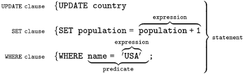
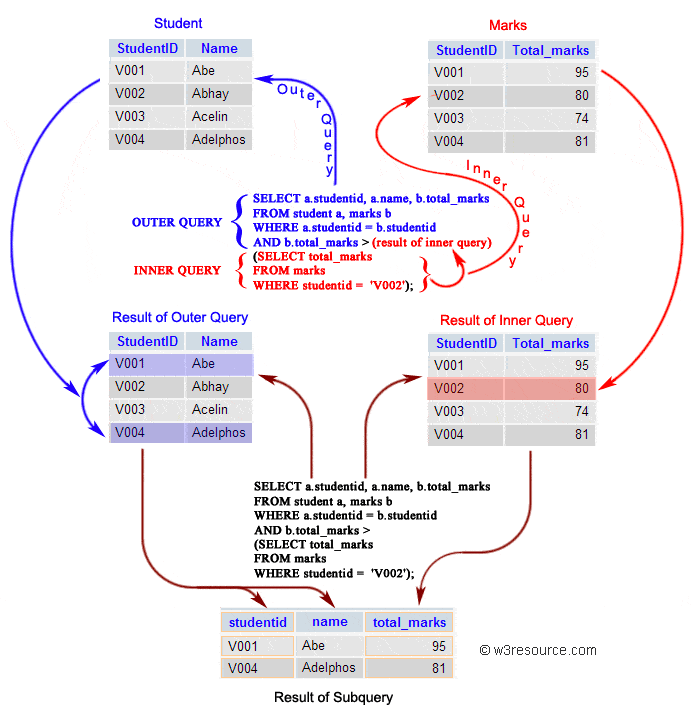
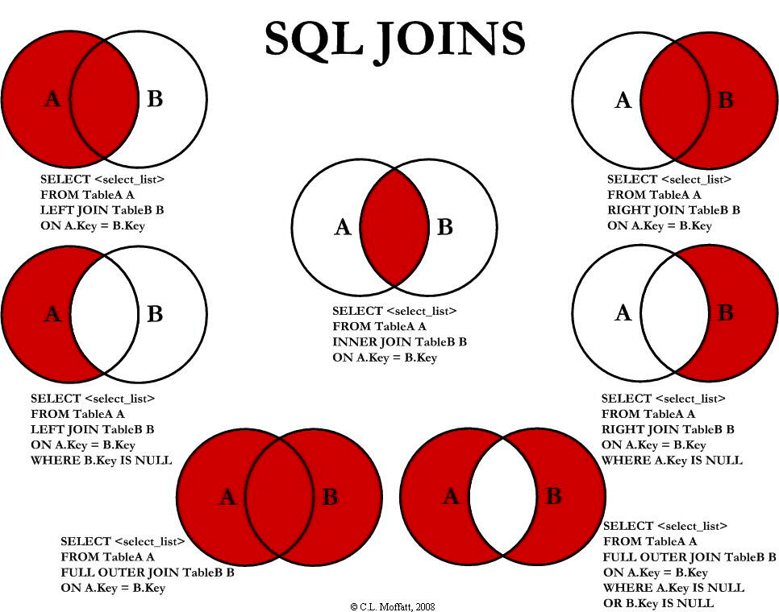
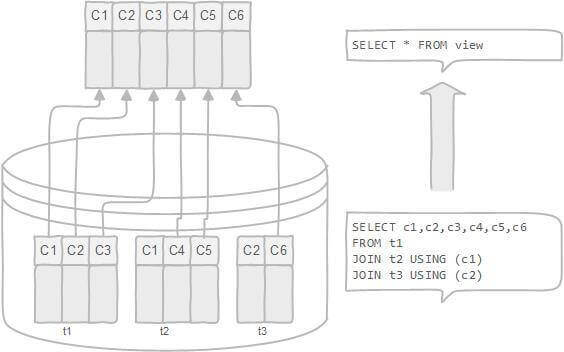
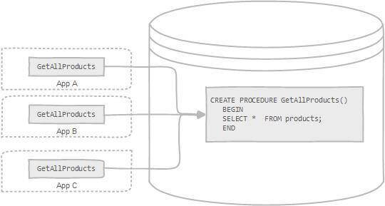
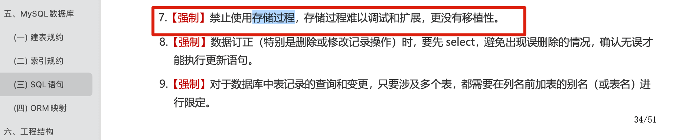

> This article is based on and expands on the following resources:
>
> - [SQL Syntax Quick Reference](https://juejin.cn/post/6844903790571700231)
> - [Complete MySQL Tutorial](https://www.begtut.com/mysql/mysql-tutorial.html)

## Basic Concepts

### Database Terminology

- `Database` - A container for organized data, usually a file or set of files.
- `Table` - A structured list of a particular type of data.
- `Schema` - Information about the layout and properties of a database and its tables. It defines how data is stored, what data is stored, how it is divided, and how each part is named. Databases and tables have schemas.
- `Column` - A field in a table. Every table consists of one or more columns.
- `Row` - A record in a table.
- `Primary key` - A column or set of columns whose values uniquely identify each row in a table.

### SQL Syntax

SQL (Structured Query Language) is standardized by ANSI and is therefore called ANSI SQL. Each DBMS also has its own implementation, such as PL/SQL and Transact-SQL.

#### SQL Syntax Structure



SQL syntax consists of:

- **`Clause`** - A component of a statement or query. Clauses may be optional.
- **`Expression`** - Produces a scalar value or uses columns and rows from database tables.
- **`Predicate`** - Specifies a condition evaluated using SQL three-valued logic (3VL: true, false, or unknown) or Boolean logic. It can restrict the effect of a statement or query, or change program flow.
- **`Query`** - Retrieves data based on specific conditions. It is a core part of SQL.
- **`Statement`** - Can persistently affect schemas and data, or control database transactions, program flow, connections, sessions, or diagnostics.

#### SQL Syntax Notes

- **SQL keywords are case-insensitive**, but whether table names, column names, and values are case-sensitive depends on the DBMS and its configuration. For example, `SELECT`, `select`, and `Select` are equivalent.
- **Separate SQL statements with semicolons (`;`).**
- **Whitespace is ignored** when SQL statements are processed.

An SQL statement can be written on one line or split across multiple lines.

```sql
-- Single-line SQL statement

UPDATE user SET username='robot', password='robot' WHERE username = 'root';

-- Multiline SQL statement
UPDATE user
SET username='robot', password='robot'
WHERE username = 'root';
```

SQL supports three comment styles:

```sql
## Comment 1
-- Comment 2
/* Comment 3 */
```

### SQL Categories

#### Data Definition Language (DDL)

Data Definition Language (DDL) defines data structures and database objects.

Its primary purpose is to **define database objects**.

The core DDL statements are `CREATE`, `ALTER`, and `DROP`.

#### Data Manipulation Language (DML)

DML consists of statements for accessing and operating on database objects and data.

Its primary purpose is **accessing data**, so its statements focus on **reading and writing the database**.

The core DML statements are `INSERT`, `UPDATE`, `DELETE`, and `SELECT`. Together, they are known as CRUD (Create, Read, Update, Delete).

#### Transaction Control Language (TCL)

TCL is used to **manage database transactions** and changes made by DML statements. It also lets you group statements into logical transactions.

The core TCL statements are `COMMIT` and `ROLLBACK`.

#### Data Control Language (DCL)

DCL controls data access. It determines which database objects, such as tables, views, stored procedures, and user-defined functions, a specific user account can access.

The core DCL statements are `GRANT` and `REVOKE`.

DCL primarily **controls user access permissions**. Permissions that can be controlled with DCL include `CONNECT`, `SELECT`, `INSERT`, `UPDATE`, `DELETE`, `EXECUTE`, `USAGE`, and `REFERENCES`.

Supported permissions vary by DBMS and security principal.

**We will first cover DML statements, which read and write data to perform CRUD operations.**

## CRUD Operations

CRUD refers to the basic database operations: create, read, update, and delete.

### Insert Data

The `INSERT INTO` statement adds new records to a table.

**Insert complete rows**

```sql
-- Insert one row
INSERT INTO user
VALUES (10, 'root', 'root', 'xxxx@163.com');
-- Insert multiple rows
INSERT INTO user
VALUES (10, 'root', 'root', 'xxxx@163.com'), (12, 'user1', 'user1', 'xxxx@163.com'), (18, 'user2', 'user2', 'xxxx@163.com');
```

**Insert part of a row**

```sql
INSERT INTO user(username, password, email)
VALUES ('admin', 'admin', 'xxxx@163.com');
```

**Insert query results**

```sql
INSERT INTO user(username)
SELECT name
FROM account;
```

### Update Data

The `UPDATE` statement modifies records in a table.

```sql
UPDATE user
SET username='robot', password='robot'
WHERE username = 'root';
```

### Delete Data

- The `DELETE` statement removes records from a table.
- `TRUNCATE TABLE` empties a table by deleting all rows. Note that `TRUNCATE` is a DDL statement, not DML.

**Delete specific rows**

```sql
DELETE FROM user
WHERE username = 'robot';
```

**Empty a table**

```sql
TRUNCATE TABLE user;
```

### Query Data

The `SELECT` statement retrieves data from a database.

`DISTINCT` returns unique values. It applies to all selected columns, so rows are considered duplicates only when every selected value matches.

`LIMIT` restricts the number of rows returned. It can take two arguments: the starting row (zero-based) and the number of rows to return.

- `ASC`: ascending (default)
- `DESC`: descending

**Query one column**

```sql
SELECT prod_name
FROM products;
```

**Query multiple columns**

```sql
SELECT prod_id, prod_name, prod_price
FROM products;
```

**Query all columns**

```sql
SELECT *
FROM products;
```

**Query distinct values**

```sql
SELECT DISTINCT
vend_id FROM products;
```

**Limit query results**

```sql
-- Return the first 5 rows
SELECT * FROM mytable LIMIT 5;
SELECT * FROM mytable LIMIT 0, 5;
-- Return rows 3 through 5
SELECT * FROM mytable LIMIT 2, 3;
```

## Sorting

`ORDER BY` sorts a result set by one or more columns. Records are sorted in ascending order by default. Use the `DESC` keyword to sort in descending order.

When sorting by multiple columns, list them in priority order. Each column can use a different sort direction.

```sql
SELECT * FROM products
ORDER BY prod_price DESC, prod_name ASC;
```

## Grouping

**`group by`**：

- The `GROUP BY` clause groups records into summary rows.
- `GROUP BY` returns one row per group.
- `GROUP BY` is often used with aggregates such as `COUNT`, `MAX`, `SUM`, and `AVG`.
- `GROUP BY` can group by one or more columns.
- After grouping by columns, `ORDER BY` can sort by an aggregate value.

**Group rows**

```sql
SELECT cust_name, COUNT(cust_address) AS addr_num
FROM Customers GROUP BY cust_name;
```

**Sort grouped rows**

```sql
SELECT cust_name, COUNT(cust_address) AS addr_num
FROM Customers GROUP BY cust_name
ORDER BY cust_name DESC;
```

**`having`**：

- `HAVING` filters the grouped results produced by `GROUP BY`.
- `HAVING` is usually used with `GROUP BY`.
- `WHERE` and `HAVING` can appear in the same query.

**Filter data with WHERE and HAVING**

```sql
SELECT cust_name, COUNT(*) AS NumberOfOrders
FROM Customers
WHERE cust_email IS NOT NULL
GROUP BY cust_name
HAVING COUNT(*) > 1;
```

**`HAVING` vs. `WHERE`**:

- `WHERE` filters individual rows and cannot contain aggregate functions. It is applied before `GROUP BY`.
- `HAVING` filters groups. It is usually used with `GROUP BY` and is applied after grouping.

## Subqueries

A subquery is an SQL query nested inside a larger query. It is also called an inner query or inner select; the statement containing it is the outer query or outer select. In short, a subquery uses the result of one `SELECT` as a data source or condition for another SQL statement (the main query).

Subqueries can be embedded in `SELECT`, `INSERT`, `UPDATE`, and `DELETE` statements, and used with operators such as `=`, `<`, `>`, `IN`, `BETWEEN`, and `EXISTS`.

Subqueries are commonly used in `WHERE` and `FROM` clauses:

- In a `WHERE` clause, a subquery can return one row and one column, multiple rows and one column, or one row and multiple columns, depending on the operator. Its result must be usable as a condition in the `WHERE` clause.
- In a `FROM` clause, a subquery generally returns multiple rows and columns, acting as a temporary table. This allows it to be used in a multi-table query.

> Note: MySQL added subquery support in version 4.1. Earlier versions do not support subqueries.

The basic syntax for a subquery in a `WHERE` clause is:

```sql
select column_name [, column_name ]
from   table1 [, table2 ]
where  column_name operator
    (select column_name [, column_name ]
    from table1 [, table2 ]
    [where])
```

- Put the subquery inside parentheses `( )`.
- `operator` is the operator used in the `WHERE` clause.

The basic syntax for a subquery in a `FROM` clause is:

```sql
select column_name [, column_name ]
from (select column_name [, column_name ]
      from table1 [, table2 ]
      [where]) as temp_table_name
where  condition
```

The result of a subquery in `FROM` acts as a temporary table, so use `AS` to give it an alias.

**Nested subqueries**

```sql
SELECT cust_name, cust_contact
FROM customers
WHERE cust_id IN (SELECT cust_id
                  FROM orders
                  WHERE order_num IN (SELECT order_num
                                      FROM orderitems
                                      WHERE prod_id = 'RGAN01'));
```

The inner query runs before its parent query so its result can be passed to the outer query. The diagram below illustrates the execution process:



### WHERE Clause

- The `WHERE` clause filters records and narrows the data being accessed.
- `WHERE` is followed by a condition that evaluates to `true` or `false`.
- `WHERE` can be used with `SELECT`, `UPDATE`, and `DELETE`.
- The following operators can be used in a `WHERE` clause:

| Operator | Description                                        |
| -------- | -------------------------------------------------- |
| =        | Equal to                                           |
| <>       | Not equal to. Some SQL versions also support `!=`. |
| >        | Greater than                                       |
| <        | Less than                                          |
| >=       | Greater than or equal to                           |
| <=       | Less than or equal to                              |
| BETWEEN  | Within a range                                     |
| LIKE     | Matches a pattern                                  |
| IN       | Matches any of several values for a column         |

**WHERE in a SELECT statement**

```ini
SELECT * FROM Customers
WHERE cust_name = 'Kids Place';
```

**WHERE in an UPDATE statement**

```ini
UPDATE Customers
SET cust_name = 'Jack Jones'
WHERE cust_name = 'Kids Place';
```

**WHERE in a DELETE statement**

```ini
DELETE FROM Customers
WHERE cust_name = 'Kids Place';
```

### IN and BETWEEN

- The `IN` operator is used in a `WHERE` clause to match any one of several specified values.
- The `BETWEEN` operator is used in a `WHERE` clause to select values within a range.

**IN example**

```sql
SELECT *
FROM products
WHERE vend_id IN ('DLL01', 'BRS01');
```

**BETWEEN example**

```sql
SELECT *
FROM products
WHERE prod_price BETWEEN 3 AND 5;
```

### AND, OR, and NOT

- `AND`, `OR`, and `NOT` are logical operators used to combine or negate filters.
- `AND` has higher precedence than `OR`. Use parentheses `()` to make the evaluation order explicit.
- `AND` requires both conditions to be true.
- `OR` requires either condition to be true.
- `NOT` negates a condition.

**AND example**

```sql
SELECT prod_id, prod_name, prod_price
FROM products
WHERE vend_id = 'DLL01' AND prod_price <= 4;
```

**OR example**

```ini
SELECT prod_id, prod_name, prod_price
FROM products
WHERE vend_id = 'DLL01' OR vend_id = 'BRS01';
```

**NOT example**

```sql
SELECT *
FROM products
WHERE prod_price NOT BETWEEN 3 AND 5;
```

### LIKE Operator

- The `LIKE` operator is used in a `WHERE` clause to test whether a string matches a pattern.
- Use `LIKE` with text values.
- `LIKE` supports two wildcard characters: `%` and `_`.
- Avoid overusing wildcards. A leading wildcard can make a match very slow.
- `%` matches any number of characters.
- `_` matches exactly one character.

**% example**

```sql
SELECT prod_id, prod_name, prod_price
FROM products
WHERE prod_name LIKE '%bean bag%';
```

**\_ example**

```sql
SELECT prod_id, prod_name, prod_price
FROM products
WHERE prod_name LIKE '__ inch teddy bear';
```

## Joins

The SQL `JOIN` clause combines two or more tables in a query.

To join tables, select a column from each table and compare their values. Matching rows are combined into one row. **A join combines records from different tables into a new table. This table is temporary and exists only for the current query.**

The basic syntax for joining two tables with `JOIN` is:

```sql
select table1.column1, table2.column2...
from table1
join table2
on table1.common_column1 = table2.common_column2;
```

`table1.common_column1 = table2.common_column2` is the join condition. Only records that satisfy it are combined into a row. You can use operators such as `=`, `>`, `<`, `<>`, `<=`, `>=`, `!=`, `BETWEEN`, `LIKE`, or `NOT`; `=` is the most common.

When two tables have columns with the same name, qualify those column names with the table name so the database engine can distinguish them. If a column name is unique across both tables, you can refer to it by name alone.

If the join columns in both tables have the same name, you can use the `USING` clause instead of `ON`:

```sql
-- JOIN ... ON
select c.cust_name, o.order_num
from Customers c
inner join Orders o
on c.cust_id = o.cust_id
order by c.cust_name;

-- Use JOIN ... USING when the join columns have the same name
select c.cust_name, o.order_num
from Customers c
inner join Orders o
using(cust_id)
order by c.cust_name;
```

**`ON` vs. `WHERE`**:

- When joining tables, SQL creates a temporary table based on the join condition. `ON` specifies that condition and determines how the temporary table is created.
- `WHERE` filters the temporary table after it has been created to produce the final result set. At this point, the join condition has already been applied.

In short: **SQL first creates a temporary table based on `ON`, then filters it with `WHERE`.**

SQL allows modifiers before `JOIN` to create different join types, as shown below:

| Join type                     | Description                                                                                   |
| ----------------------------- | --------------------------------------------------------------------------------------------- |
| INNER JOIN                    | (Default) Returns rows only when both tables have matching records.                           |
| LEFT JOIN / LEFT OUTER JOIN   | Returns every row from the left table, even when there is no matching row in the right table. |
| RIGHT JOIN / RIGHT OUTER JOIN | Returns every row from the right table, even when there is no matching row in the left table. |
| FULL JOIN / FULL OUTER JOIN   | Returns rows when either table has a matching record.                                         |
| SELF JOIN                     | Joins a table to itself. At least one table reference must be renamed to distinguish them.    |
| CROSS JOIN                    | Returns the Cartesian product of two or more joined tables.                                   |

The diagram below shows seven uses of LEFT JOIN, RIGHT JOIN, INNER JOIN, and OUTER JOIN.



If no modifier is specified, `JOIN` defaults to `INNER JOIN`.

`INNER JOIN` also has an implicit form, called an **implicit inner join**. It omits the `INNER JOIN` keyword and uses a `WHERE` clause to perform the join.

```sql
-- Implicit inner join
select c.cust_name, o.order_num
from Customers c, Orders o
where c.cust_id = o.cust_id
order by c.cust_name;

-- Explicit inner join
select c.cust_name, o.order_num
from Customers c inner join Orders o
using(cust_id)
order by c.cust_name;
```

## Combining Results

The `UNION` operator combines the results of two or more queries into one result set containing the rows returned by those queries.

Basic rules for `UNION`:

- All queries must return the same number of columns in the same order.
- The corresponding columns in each query must have the same or compatible data types.
- The result column names usually come from the first query.

By default, `UNION` removes duplicate rows. Use `UNION ALL` to keep duplicates.

```sql
SELECT column_name(s) FROM table1
UNION ALL
SELECT column_name(s) FROM table2;
```

The result set column names always come from the first `SELECT` statement in the `UNION`.

`JOIN` vs. `UNION`:

- Joined tables can have different columns in a `JOIN`, but all queries in a `UNION` must return the same number and order of columns.
- `UNION` combines query rows vertically, while `JOIN` combines columns horizontally by relating rows across tables.

## Functions

Functions often differ across databases and may not be portable. This section uses MySQL functions as examples.

### String Functions

| Function             | Description                       |
| -------------------- | --------------------------------- |
| `LEFT()`, `RIGHT()`  | Characters from the left or right |
| `LOWER()`, `UPPER()` | Convert to lowercase or uppercase |
| `LTRIM()`, `RTRIM()` | Remove leading or trailing spaces |
| `LENGTH()`           | Length in bytes                   |
| `SOUNDEX()`          | Convert to a phonetic value       |

**`SOUNDEX()`** converts a string into an alphanumeric pattern that describes how it sounds.

```sql
SELECT *
FROM mytable
WHERE SOUNDEX(col1) = SOUNDEX('apple')
```

### Date and Time Functions

- Date format: `YYYY-MM-DD`
- Time format: `HH:MM:SS`

| Function        | Description                                |
| --------------- | ------------------------------------------ |
| `AddDate()`     | Add an interval to a date                  |
| `AddTime()`     | Add an interval to a time                  |
| `CurDate()`     | Return the current date                    |
| `CurTime()`     | Return the current time                    |
| `Date()`        | Return the date part of a datetime         |
| `DateDiff()`    | Calculate the difference between two dates |
| `Date_Add()`    | Perform flexible date arithmetic           |
| `Date_Format()` | Return a formatted date or time string     |
| `Day()`         | Return the day of a date                   |
| `DayOfWeek()`   | Return the weekday for a date              |
| `Hour()`        | Return the hour part of a time             |
| `Minute()`      | Return the minute part of a time           |
| `Month()`       | Return the month part of a date            |
| `Now()`         | Return the current date and time           |
| `Second()`      | Return the second part of a time           |
| `Time()`        | Return the time part of a datetime         |
| `Year()`        | Return the year part of a date             |

### Numeric Functions

| Function | Description    |
| -------- | -------------- |
| SIN()    | Sine           |
| COS()    | Cosine         |
| TAN()    | Tangent        |
| ABS()    | Absolute value |
| SQRT()   | Square root    |
| MOD()    | Remainder      |
| EXP()    | Exponential    |
| PI()     | Pi             |
| RAND()   | Random number  |

### Aggregate Functions

| Function  | Description                           |
| --------- | ------------------------------------- |
| `AVG()`   | Return a column's average             |
| `COUNT()` | Return the number of rows in a column |
| `MAX()`   | Return a column's maximum value       |
| `MIN()`   | Return a column's minimum value       |
| `SUM()`   | Return the sum of a column's values   |

`AVG()` ignores NULL rows.

Use `DISTINCT` to aggregate only distinct values.

```sql
SELECT AVG(DISTINCT col1) AS avg_col
FROM mytable
```

**Next, we will cover DDL statements, which define database objects such as databases, tables, views, and indexes.**

## Data Definition

### Database

#### Create a Database

```sql
CREATE DATABASE test;
```

#### Drop a Database

```sql
DROP DATABASE test;
```

#### Select a Database

```sql
USE test;
```

### Tables

#### Create a Table

**Create a table**

```sql
CREATE TABLE user (
  id int(10) unsigned NOT NULL COMMENT 'Id',
  username varchar(64) NOT NULL DEFAULT 'default' COMMENT 'Username',
  password varchar(64) NOT NULL DEFAULT 'default' COMMENT 'Password',
  email varchar(64) NOT NULL DEFAULT 'default' COMMENT 'Email'
) COMMENT='User table';
```

**Create a table from an existing table**

```sql
CREATE TABLE vip_user AS
SELECT * FROM user;
```

#### Drop a Table

```sql
DROP TABLE user;
```

#### Alter a Table

**Add a column**

```sql
ALTER TABLE user
ADD age int(3);
```

**Drop a column**

```sql
ALTER TABLE user
DROP COLUMN age;
```

**Modify a column**

```sql
ALTER TABLE `user`
MODIFY COLUMN age tinyint;
```

**Add a primary key**

```sql
ALTER TABLE user
ADD PRIMARY KEY (id);
```

**Drop a primary key**

```sql
ALTER TABLE user
DROP PRIMARY KEY;
```

### Views

Definition:

- A view is a virtual table based on the result set of an SQL statement.
- A view does not contain data itself and cannot be indexed. You can query a view much like a regular table.

Uses:

- Simplify complex SQL operations, such as joins.
- Expose only part of the data in a table.
- Improve data security by granting users access only to a view.
- Change how data is formatted and presented.



#### Create a View

```sql
CREATE VIEW top_10_user_view AS
SELECT id, username
FROM user
WHERE id < 10;
```

#### Drop a View

```sql
DROP VIEW top_10_user_view;
```

### Indexes

**An index is a data structure used to query and retrieve data quickly. It can be thought of as an ordered data structure.**

An index works like a book's table of contents. Without one, finding a word in a dictionary means searching page by page. With one, you can find the word's page and go directly to it.

**Advantages**:

- Indexes can greatly speed up data retrieval by reducing the amount of data scanned. This is the main reason to create them.
- A unique index ensures that each row in a table has a unique value.

**Disadvantages**:

- Creating and maintaining indexes takes time. When table data is inserted, updated, or deleted, its indexes must also be updated, which can slow SQL operations.
- Indexes are stored in physical files and use additional space.

However, **do indexes always improve query performance?**

In most cases, an index lookup is faster than a full table scan. For a small database, however, an index may provide little improvement.

For more details, see [MySQL Indexes Explained](https://javaguide.cn/database/mysql/mysql-index.html).

#### Create an Index

```sql
CREATE INDEX user_index
ON user (id);
```

#### Add an Index

```sql
ALTER table user ADD INDEX user_index(id)
```

#### Create a Unique Index

```sql
CREATE UNIQUE INDEX user_index
ON user (id);
```

#### Drop an Index

```sql
ALTER TABLE user
DROP INDEX user_index;
```

### Constraints

SQL constraints define rules for the data in a table.

An operation that violates a constraint is rejected.

Constraints can be defined when creating a table with `CREATE TABLE` or added later with `ALTER TABLE`.

Constraint types:

- `NOT NULL` - Prevents a column from storing NULL values.
- `UNIQUE` - Requires every value in a column to be unique.
- `PRIMARY KEY` - Combines `NOT NULL` and `UNIQUE`. It uniquely identifies a row using one or more columns.
- `FOREIGN KEY` - Enforces referential integrity by requiring values to match values in another table.
- `CHECK` - Requires column values to satisfy a condition.
- `DEFAULT` - Specifies a value to use when none is provided for a column.

Define constraints when creating a table:

```sql
CREATE TABLE Users (
  Id INT(10) UNSIGNED NOT NULL AUTO_INCREMENT COMMENT 'Auto-incrementing ID',
  Username VARCHAR(64) NOT NULL UNIQUE DEFAULT 'default' COMMENT 'Username',
  Password VARCHAR(64) NOT NULL DEFAULT 'default' COMMENT 'Password',
  Email VARCHAR(64) NOT NULL DEFAULT 'default' COMMENT 'Email address',
  Enabled TINYINT(4) DEFAULT NULL COMMENT 'Enabled',
  PRIMARY KEY (Id)
) ENGINE=InnoDB AUTO_INCREMENT=2 DEFAULT CHARSET=utf8mb4 COMMENT='User table';
```

**Next, we will cover TCL statements, which manage database transactions.**

## Transaction Processing

`SELECT` statements cannot be rolled back, and rolling them back would not be useful. `CREATE` and `DROP` statements also cannot be rolled back.

**MySQL uses implicit commits by default**: each statement is treated as a transaction and committed. `START TRANSACTION` disables implicit commits. After `COMMIT` or `ROLLBACK`, the transaction closes and implicit commits resume.

Use `SET autocommit=0` to disable automatic commits. Commits resume when you set `autocommit=1`. The `autocommit` setting applies to each connection, not the server.

Statements:

- `START TRANSACTION` - Marks the beginning of a transaction.
- `SAVEPOINT` - Creates a savepoint.
- `ROLLBACK TO` - Rolls back to the specified savepoint. If none is set, it rolls back to the `START TRANSACTION` statement.
- `COMMIT` - Commits the transaction.

```sql
-- Start a transaction
START TRANSACTION;

-- Insert operation A
INSERT INTO `user`
VALUES (1, 'root1', 'root1', 'xxxx@163.com');

-- Create savepoint updateA
SAVEPOINT updateA;

-- Insert operation B
INSERT INTO `user`
VALUES (2, 'root2', 'root2', 'xxxx@163.com');

-- Roll back to savepoint updateA
ROLLBACK TO updateA;

-- Commit the transaction; only operation A takes effect
COMMIT;
```

**Next, we will cover DCL statements, which control user access permissions.**

## Access Control

Use the `GRANT` command to assign permissions to a user account and `REVOKE` to remove them. The examples below use MySQL.

Syntax for granting permissions with `GRANT`:

```sql
GRANT privilege,[privilege],.. ON privilege_level
TO user [IDENTIFIED BY password]
[REQUIRE tsl_option]
[WITH [GRANT_OPTION | resource_option]];
```

The clauses mean:

1. Specify one or more permissions after `GRANT`, separated by commas.
2. `ON privilege_level` sets the permission scope. MySQL supports global (`*.*`), database (`database.*`), table (`database.table`), and column scopes. For column-level permissions, list columns after each permission.
3. `user` is the account receiving the permissions. If it exists, `GRANT` updates its permissions; otherwise, it creates the account. The optional `IDENTIFIED BY` clause sets a password.
4. `REQUIRE ssl_option` specifies whether the user must connect to the database server through a secure connection such as SSL or X.509.
5. The optional `WITH GRANT OPTION` clause lets a user grant their permissions to other users or revoke them from other users. The `WITH` clause can also assign database server resources, such as the number of connections or statements a user can run per hour. This is useful in shared environments such as MySQL shared hosting.

Syntax for revoking permissions with `REVOKE`:

```sql
REVOKE   privilege_type [(column_list)]
        [, priv_type [(column_list)]]...
ON [object_type] privilege_level
FROM user [, user]...
```

The clauses mean:

1. List the permissions to revoke after `REVOKE`, separated by commas.
2. Specify their scope in the `ON` clause.
3. Specify the accounts whose permissions should be revoked in the `FROM` clause.

`GRANT` and `REVOKE` can control access at several levels:

- The entire server, with `GRANT ALL` and `REVOKE ALL`.
- An entire database, with `ON database.*`.
- A specific table, with `ON database.table`.
- Specific columns.
- Specific stored procedures.

New accounts have no permissions. An account is defined as `username@host`; `username@%` uses the default host name. MySQL account information is stored in the `mysql` database.

```sql
USE mysql;
SELECT user FROM user;
```

The following table lists permissions that can be used with `GRANT` and `REVOKE`:

| **Privilege**           | **Description**                                                                                                          | **Scope** |            |             |           |     |     |
| ----------------------- | ------------------------------------------------------------------------------------------------------------------------ | --------- | ---------- | ----------- | --------- | --- | --- |
| **Global**              | **Database**                                                                                                             | **Table** | **Column** | **Routine** | **Proxy** |     |     |
| ALL [PRIVILEGES]        | Grants all privileges at the specified scope except GRANT OPTION.                                                        |           |            |             |           |     |     |
| ALTER                   | Allows use of ALTER TABLE.                                                                                               | X         | X          | X           |           |     |     |
| ALTER ROUTINE           | Allows stored routines to be altered or dropped.                                                                         | X         | X          |             |           | X   |     |
| CREATE                  | Allows databases and tables to be created.                                                                               | X         | X          | X           |           |     |     |
| CREATE ROUTINE          | Allows stored routines to be created.                                                                                    | X         | X          |             |           |     |     |
| CREATE TABLESPACE       | Allows tablespaces and log file groups to be created, altered, or dropped.                                               | X         |            |             |           |     |     |
| CREATE TEMPORARY TABLES | Allows temporary tables to be created with CREATE TEMPORARY TABLE.                                                       | X         | X          |             |           |     |     |
| CREATE USER             | Allows use of CREATE USER, DROP USER, RENAME USER, and REVOKE ALL PRIVILEGES.                                            | X         |            |             |           |     |     |
| CREATE VIEW             | Allows views to be created or altered.                                                                                   | X         | X          | X           |           |     |     |
| DELETE                  | Allows use of DELETE.                                                                                                    | X         | X          | X           |           |     |     |
| DROP                    | Allows databases, tables, and views to be dropped.                                                                       | X         | X          | X           |           |     |     |
| EVENT                   | Allows use of the Event Scheduler.                                                                                       | X         | X          |             |           |     |     |
| EXECUTE                 | Allows stored routines to be executed.                                                                                   | X         | X          | X           |           |     |     |
| FILE                    | Allows files in the database directory to be read.                                                                       | X         |            |             |           |     |     |
| GRANT OPTION            | Allows permissions to be granted to or revoked from other accounts.                                                      | X         | X          | X           |           | X   | X   |
| INDEX                   | Allows indexes to be created or dropped.                                                                                 | X         | X          | X           |           |     |     |
| INSERT                  | Allows use of INSERT.                                                                                                    | X         | X          | X           | X         |     |     |
| LOCK TABLES             | Allows LOCK TABLES on tables for which the user has SELECT permission.                                                   | X         | X          |             |           |     |     |
| PROCESS                 | Allows all processes to be viewed with SHOW PROCESSLIST.                                                                 | X         |            |             |           |     |     |
| PROXY                   | Enables user proxying.                                                                                                   |           |            |             |           |     |     |
| REFERENCES              | Allows foreign keys to be created.                                                                                       | X         | X          | X           | X         |     |     |
| RELOAD                  | Allows use of FLUSH operations.                                                                                          | X         |            |             |           |     |     |
| REPLICATION CLIENT      | Allows queries that show the source or replica position.                                                                 | X         |            |             |           |     |     |
| REPLICATION SLAVE       | Allows a replica to read binary log events from a source.                                                                | X         |            |             |           |     |     |
| SELECT                  | Allows use of SELECT.                                                                                                    | X         | X          | X           | X         |     |     |
| SHOW DATABASES          | Allows all databases to be listed.                                                                                       | X         |            |             |           |     |     |
| SHOW VIEW               | Allows use of SHOW CREATE VIEW.                                                                                          | X         | X          | X           |           |     |     |
| SHUTDOWN                | Allows use of the mysqladmin shutdown command.                                                                           | X         |            |             |           |     |     |
| SUPER                   | Allows administrative operations such as CHANGE MASTER TO, KILL, PURGE BINARY LOGS, SET GLOBAL, and mysqladmin commands. | X         |            |             |           |     |     |
| TRIGGER                 | Allows trigger operations.                                                                                               | X         | X          | X           |           |     |     |
| UPDATE                  | Allows use of UPDATE.                                                                                                    | X         | X          | X           | X         |     |     |
| USAGE                   | Equivalent to having no privileges.                                                                                      |           |            |             |           |     |     |

### Create an Account

```sql
CREATE USER myuser IDENTIFIED BY 'mypassword';
```

### Rename an Account

```sql
UPDATE user SET user='newuser' WHERE user='myuser';
FLUSH PRIVILEGES;
```

### Drop an Account

```sql
DROP USER myuser;
```

### Show Permissions

```sql
SHOW GRANTS FOR myuser;
```

### Grant Permissions

```sql
GRANT SELECT, INSERT ON *.* TO myuser;
```

### Revoke Permissions

```sql
REVOKE SELECT, INSERT ON *.* FROM myuser;
```

### Change a Password

```sql
SET PASSWORD FOR myuser = 'mypass';
```

## Stored Procedures

A stored procedure is a batch of SQL operations. It can be called by a trigger, another stored procedure, or an application written in Java, Python, PHP, or another language.



Benefits of stored procedures:

- Encapsulate code and provide some security.
- Reuse code.
- Improve performance through precompilation.

When creating stored procedures:

- In the command line, define a custom delimiter. The command line uses `;` to end statements, but stored procedures also contain semicolons, which can otherwise cause syntax errors.
- Parameters can use `IN`, `OUT`, or `INOUT` modes.
- Assign values to variables with `SELECT INTO`.
- Only one variable can be assigned at a time; set-based assignments are not supported.

Note: **Alibaba's Java Development Guidelines prohibit stored procedures because they are difficult to debug and extend, and are not portable.**



Whether to use stored procedures depends on the project's requirements and the tradeoffs involved.

### Create a Stored Procedure

```sql
DROP PROCEDURE IF EXISTS `proc_adder`;
DELIMITER ;;
CREATE DEFINER=`root`@`localhost` PROCEDURE `proc_adder`(IN a int, IN b int, OUT sum int)
BEGIN
    DECLARE c int;
    if a is null then set a = 0;
    end if;

    if b is null then set b = 0;
    end if;

    set sum  = a + b;
END
;;
DELIMITER ;
```

### Call a Stored Procedure

```less
set @b=5;
call proc_adder(2,@b,@s);
select @s as sum;
```

## Cursors

A cursor is a database query stored on the DBMS server. It is not the `SELECT` statement itself, but the result set retrieved by that statement.

Within a stored procedure, a cursor can move through and process a result set.

Cursors are mainly used in interactive applications where users scroll through data and view or modify it.

The basic steps for using a cursor are:

- Declare (define) the cursor before using it. This does not retrieve data; it defines the `SELECT` statement and cursor options.

- Open the declared cursor. This retrieves data using the `SELECT` statement defined earlier.

- Fetch rows from the cursor as needed.

- Close the cursor when finished and, if possible, release it. The exact behavior depends on the DBMS.

```sql
DELIMITER $
CREATE  PROCEDURE getTotal()
BEGIN
    DECLARE total INT;
    -- Declare a variable to receive cursor data
    DECLARE sid INT;
    DECLARE sname VARCHAR(10);
    -- Declare a total counter
    DECLARE sage INT;
    -- Declare a completion flag
    DECLARE done INT DEFAULT false;
    -- Declare the cursor
    DECLARE cur CURSOR FOR SELECT id,name,age from cursor_table where age>30;
    -- Set the value returned when the cursor loop ends
    DECLARE CONTINUE HANDLER FOR NOT FOUND SET done = true;
    SET total = 0;
    OPEN cur;
    FETCH cur INTO sid, sname, sage;
    WHILE(NOT done)
    DO
        SET total = total + 1;
        FETCH cur INTO sid, sname, sage;
    END WHILE;

    CLOSE cur;
    SELECT total;
END $
DELIMITER ;

-- Call the stored procedure
call getTotal();
```

## Triggers

A trigger is a database object associated with a table. When a specified event occurs on that table, the trigger runs.

Triggers can be used for audit trails, such as recording changes in another table.

Advantages of triggers:

- SQL triggers provide another way to check data integrity.
- SQL triggers can catch errors in business logic at the database layer.
- SQL triggers provide another way to run scheduled tasks. They run automatically before or after table data changes, so you do not need to wait for a scheduled job.
- SQL triggers are useful for auditing changes to table data.

Disadvantages of triggers:

- SQL triggers provide additional validation but cannot replace all validation. Simple checks should be done in the application layer. For example, JavaScript can validate user input on the client, or server-side languages such as JSP, PHP, ASP.NET, and Perl can validate it on the server.
- SQL triggers run invisibly to client applications, making it difficult to understand what is happening at the database layer.
- SQL triggers can increase database server overhead.

MySQL does not allow the `CALL` statement in a trigger, so triggers cannot call stored procedures.

> Note: In MySQL, a semicolon (`;`) marks the end of a statement and tells MySQL to execute it. If the interpreter encounters a semicolon inside a trigger body, it tries to execute an incomplete statement and reports an error because it has not found the `END` matching `BEGIN`.
>
> Use the `DELIMITER` command to change the delimiter. It does not need a statement terminator. Its syntax is `DELIMITER new_delimiter`. The new delimiter can be one or more characters. The default is a semicolon (`;`); you can change it to another symbol, such as `$` with `DELIMITER $`. Afterward, semicolons inside statements are ignored, and only `$` ends a statement. Remember to restore the delimiter when you are done.

Before MySQL 5.7.2, each table could have at most six triggers.

- `BEFORE INSERT` - Fires before data is inserted into the table.
- `AFTER INSERT` - Fires after data is inserted into the table.
- `BEFORE UPDATE` - Fires before data in the table is updated.
- `AFTER UPDATE` - Fires after data in the table is updated.
- `BEFORE DELETE` - Fires before data is deleted from the table.
- `AFTER DELETE` - Fires after data is deleted from the table.

Starting with MySQL 5.7.2, multiple triggers can be defined for the same event and action time.

**`NEW` and `OLD`**:

- MySQL defines the `NEW` and `OLD` keywords to refer to the row that caused the trigger to run.
- In an `INSERT` trigger, `NEW` refers to the row to be inserted (`BEFORE`) or that was inserted (`AFTER`).
- In an `UPDATE` trigger, `OLD` refers to the original row, and `NEW` refers to the updated row.
- In a `DELETE` trigger, `OLD` refers to the row to be deleted or that was deleted.
- Use `NEW.columnName`, where `columnName` is a column in the table.

### Create a Trigger

> To understand triggers, first review the statement used to create them.

The `CREATE TRIGGER` statement creates a trigger.

Syntax:

```sql
CREATE TRIGGER trigger_name
trigger_time
trigger_event
ON table_name
FOR EACH ROW
BEGIN
  trigger_statements
END;
```

Parameters:

- `trigger_name`: The trigger name.
- `trigger_time`: When the trigger fires: `BEFORE` or `AFTER`.
- `trigger_event`: The event to monitor: `INSERT`, `UPDATE`, or `DELETE`.
- `table_name`: The table on which the trigger is created.
- `FOR EACH ROW`: Row-level monitoring; this is the MySQL syntax. Other DBMSs may differ.
- `trigger_statements`: One or more SQL statements that run when the trigger fires. Each statement must end with a semicolon (`;`).

When the trigger condition is met, the trigger body between `BEGIN` and `END` runs.

Example:

```sql
DELIMITER $
CREATE TRIGGER `trigger_insert_user`
AFTER INSERT ON `user`
FOR EACH ROW
BEGIN
    INSERT INTO `user_history`(user_id, operate_type, operate_time)
    VALUES (NEW.id, 'add a user',  now());
END $
DELIMITER ;
```

### Show Triggers

```sql
SHOW TRIGGERS;
```

### Drop a Trigger

```sql
DROP TRIGGER IF EXISTS trigger_insert_user;
```

## Recommended Articles

- [SQL Performance Optimization Guide for Backend Developers: 35+ Tips](https://mp.weixin.qq.com/s/I-ZT3zGTNBZ6egS7T09jyQ)
- [30 Tips for Writing High-Quality SQL](https://mp.weixin.qq.com/s?__biz=Mzg2OTA0Njk0OA==&mid=2247486461&idx=1&sn=60a22279196d084cc398936fe3b37772&chksm=cea24436f9d5cd20a4fa0e907590f3e700d7378b3f608d7b33bb52cfb96f503b7ccb65a1deed&token=1987003517&lang=zh_CN#rd)

<!-- @include: @article-footer.snippet.md -->
