## What Is an API Gateway?

An API gateway is a **single entry point** between clients and backend services. Client requests pass through the gateway, which routes them to the appropriate service.

In this distributed systems guide, gateways form the traffic entry layer. The [RPC guide](./rpc/) covers service-to-service calls; this article covers how incoming requests are routed, authorized, rate-limited, canaried, and adapted to different protocols. For Spring Cloud Gateway routes, predicates, filters, and rate limiting, see [Spring Cloud Gateway Interview Questions](./spring-cloud-gateway-questions.md).

### Why Use a Gateway?

In a microservices architecture, a system is split into multiple services. Each service may need **authentication, traffic control, logging, and monitoring**. Without a gateway, these capabilities must be implemented separately in each service, leading to:

- **Duplicated code**: The same logic is implemented across multiple services.
- **Fragmented management**: There is no unified view for configuration and monitoring.
- **High maintenance cost**: Changes require updates to every service.

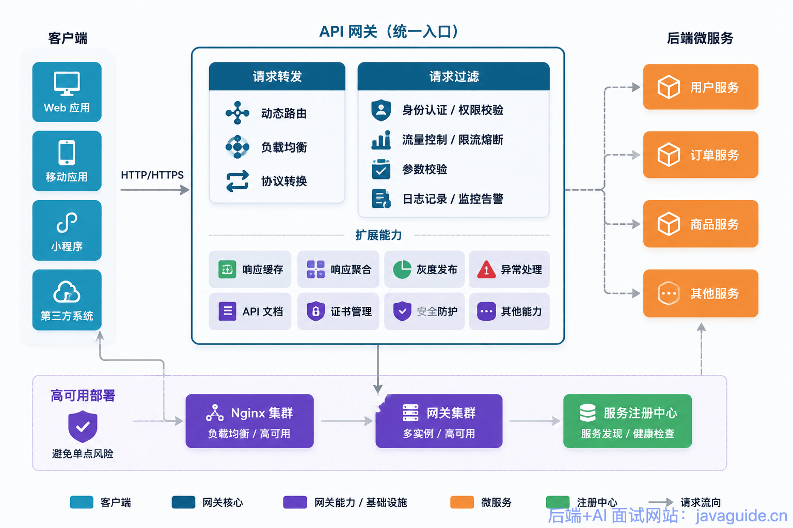

### Core Responsibilities

Although gateways can provide many features, their core responsibilities are:

| Responsibility        | Description                                                                    | Examples                                                                 |
| --------------------- | ------------------------------------------------------------------------------ | ------------------------------------------------------------------------ |
| **Request routing**   | Routes client requests to the correct service.                                 | Dynamic routing, load balancing, protocol conversion.                    |
| **Request filtering** | Intercepts and processes requests before or after they reach backend services. | Authentication, authorization, rate limiting, circuit breaking, logging. |

These are the two high-level responsibilities; they lead to the gateway capabilities listed in the next section.

A gateway can provide request routing, authentication and authorization, traffic control, load balancing, graceful degradation, circuit breaking, logging, monitoring, parameter validation, and protocol conversion.

**Where the gateway fits in a microservices architecture:** Client requests first reach the gateway, which handles authentication, authorization, traffic control, and routing. Backend services can then focus on business logic.

### High Availability

Adding a gateway introduces an extra network hop, though its performance cost is usually negligible on an internal network. It also creates a potential single point of failure, so the gateway itself must be highly available.

As shown below, place Nginx or another load balancer in front of the gateway service to provide high availability. Nginx itself must also be deployed redundantly to avoid a single point of failure.

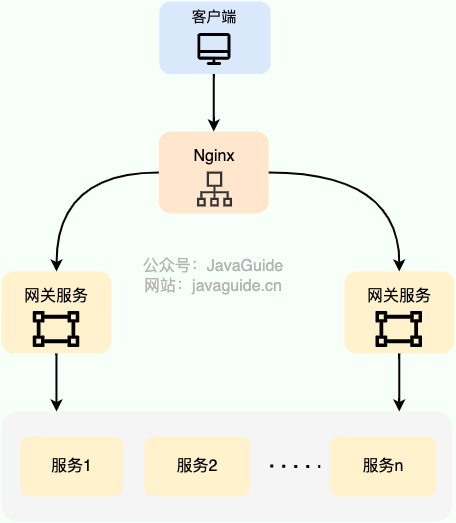

## What Can a Gateway Do?

Most gateways provide the following capabilities, though some require additional frameworks or middleware:

- **Request routing**: Forward requests to the target microservice.
- **Load balancing**: Distribute requests dynamically based on service instance load or a configured load-balancing policy.
- **Authentication and authorization**: Authenticate users, restrict API access to trusted clients, and authorize requests using approaches such as RBAC.
- **Parameter validation**: Map and validate request parameters.
- **Logging**: Record request activity for later analysis.
- **Monitoring and alerts**: Monitor business, host, and JVM metrics and raise alerts.
- **Traffic control**: Limit the number of requests allowed over a given period.
- **Circuit breaking and graceful degradation**: Monitor request statistics and, after a configured failure threshold is reached, open the circuit and return a fallback response.
- **Response caching**: Cache responses for static or infrequently updated data. Repeated requests can then be served at the gateway without calling the backend service, reducing its load.
- **Response aggregation**: Combine responses from multiple services when needed. Keep complex aggregation in a BFF (Backend for Frontend) or GraphQL layer rather than embedding business orchestration in infrastructure.
- **Canary releases**: Dynamically route requests to different service versions.
- **Error handling**: Transform service error responses before returning them, hiding internal details and providing user-friendly messages.
- **API documentation**: If APIs are exposed to developers outside the organization, provide documentation such as Swagger or OpenAPI.
- **Protocol conversion**: Integrate services using different protocols or technologies, such as REST, AMQP, and Dubbo, behind a unified interface for web, mobile, or partner clients.
- **Certificate management**: Manage SSL certificates at the API gateway to simplify certificate replacement through a centralized entry point.

Gateways should not carry every kind of logic. Complex business validation, field mapping, long-running transactions, long-lived connection logic, and fine-grained business authorization usually belong in backend services, a BFF, or GraphQL. Keep the gateway focused on generic, protocol-level capabilities shared across services to avoid creating a difficult-to-maintain monolithic gateway.

The following diagram is from [Design and Implementation of Shepherd, a Large-Scale API Gateway Service (Meituan, 2021)](https://mp.weixin.qq.com/s/iITqdIiHi3XGKq6u6FRVdg).

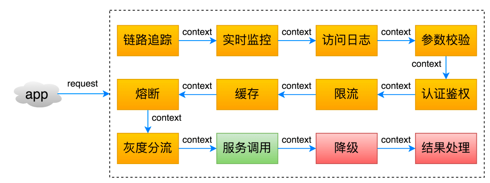

## Common API Gateway Systems

### Netflix Zuul

Zuul is a Netflix gateway service that provides dynamic routing, monitoring, resilience, and security. It is built on the Java stack and can work with components such as Eureka, Ribbon, and Hystrix.

Zuul's core architecture is shown below:

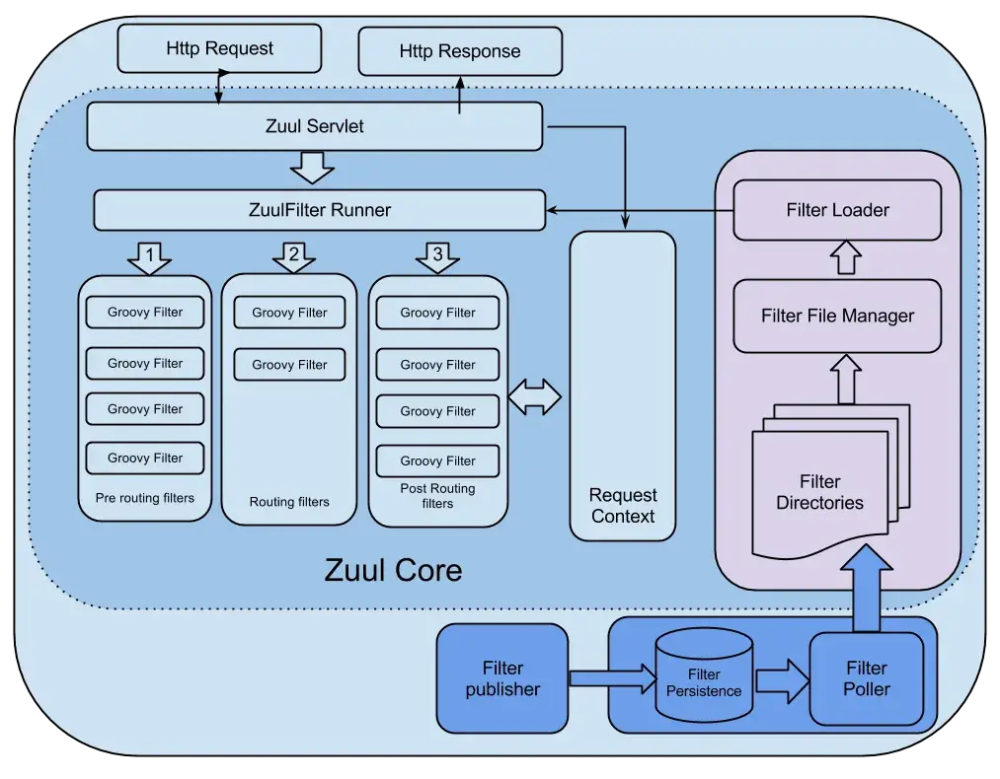

Zuul uses filters, similar to AOP, to process requests and implement gateway features.

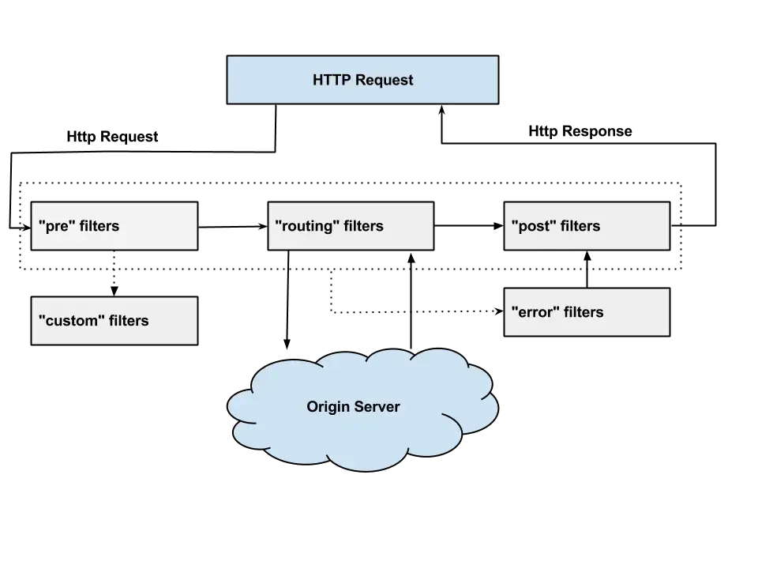

You can write custom filters to process requests, and the Zuul ecosystem includes many ready-made filters. For example, the community extension [spring-cloud-zuul-ratelimit](https://github.com/marcosbarbero/spring-cloud-zuul-ratelimit) can provide rate limiting. Hystrix is primarily responsible for circuit breaking, timeouts, fallbacks, and thread-pool or semaphore isolation; it is not a dedicated QPS rate limiter.

```xml
<dependency>
  <groupId>org.springframework.cloud</groupId>
    <artifactId>spring-cloud-starter-netflix-zuul</artifactId>
</dependency>
<dependency>
    <groupId>com.marcosbarbero.cloud</groupId>
    <artifactId>spring-cloud-zuul-ratelimit</artifactId>
    <version>2.2.0.RELEASE</version>
</dependency>
```

[Zuul 1.x](https://netflixtechblog.com/announcing-zuul-edge-service-in-the-cloud-ab3af5be08ee) uses synchronous I/O and has lower performance. [Zuul 2.x](https://netflixtechblog.com/open-sourcing-zuul-2-82ea476cb2b3) uses Netty for asynchronous I/O, improving performance substantially.

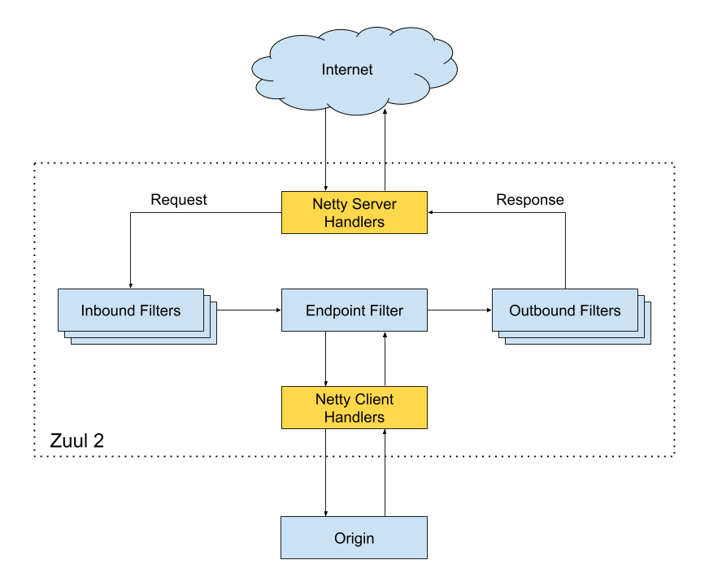

> **Important:** Zuul 1.x, Ribbon, and Hystrix in Spring Cloud Netflix are in maintenance mode, and mainstream Spring Cloud releases have moved to Spring Cloud Gateway. Netflix open-sourced Zuul 2.x, but it has not been integrated into mainstream Spring Cloud releases. New Spring Cloud projects should avoid Zuul 1.x; existing projects can migrate to Spring Cloud Gateway or another modern gateway as part of planned refactoring.

- GitHub: <https://github.com/Netflix/zuul>
- Official wiki: <https://github.com/Netflix/zuul/wiki>

### Spring Cloud Gateway

Spring Cloud Gateway is part of the Spring Cloud ecosystem and was created to replace the established gateway **Zuul**, specifically Zuul 1.x. Spring Cloud Gateway development began before Zuul 2.x; the two followed separate development paths.

#### Why Can Spring Cloud Gateway Perform Better?

| Version                  | I/O model                         | Thread model           | Throughput | Latency |
| ------------------------ | --------------------------------- | ---------------------- | ---------- | ------- |
| **Zuul 1.x**             | Synchronous blocking (Servlet)    | One thread per request | Low        | High    |
| **Zuul 2.x**             | Asynchronous non-blocking (Netty) | Event loop             | High       | Low     |
| **Spring Cloud Gateway** | Asynchronous non-blocking (Netty) | Event loop             | High       | Low     |

Spring Cloud Gateway is built on **Spring WebFlux**, not traditional Spring Web MVC. Spring WebFlux uses the **Reactor** library for its reactive programming model, with **Netty** providing asynchronous, non-blocking I/O.

**Benefits of reactive programming:**

- **Non-blocking I/O**: A separate thread is not needed for every request, so a small thread pool can handle many concurrent connections.
- **Backpressure**: Reactor backpressure applies mainly within the gateway's reactive pipeline, helping prevent in-flight requests from overwhelming the gateway. End-to-end overload protection still requires explicit rate limits, bulkheads, timeouts, and circuit breakers, such as the `RequestRateLimiter` and `CircuitBreaker` filters.
- **Efficient resource use**: It reduces the overhead of thread context switching.

#### Core Concepts

Spring Cloud Gateway has three core components:

1. **Route**: The basic building block of a gateway. It consists of an ID, a target URI, a set of predicates, and a set of filters.
2. **Predicate**: Based on Java 8's `Predicate` functional interface, it matches HTTP requests by path, method, headers, and other attributes. Examples include `Path=/api/users/**`, `Method=GET`, and `Header=X-Request-Id, \d+`. Multiple predicates are combined with logical AND.
3. **Filter**: An instance of `GatewayFilter` that modifies a request or response before or after the request is sent to a downstream service.

Spring Cloud Gateway and Zuul 2.x both process requests with filters, but Spring Cloud Gateway integrates more closely with the Spring ecosystem, including Eureka, Consul, and Config. It is generally the more common choice for new Java projects. The Spring Cloud Gateway 4.x/5.x documentation describes both Server and Proxy Exchange forms, with WebFlux and Web MVC options. Teams familiar with the Servlet stack that want to avoid reactive programming complexity can also evaluate Spring Cloud Gateway Server MVC.

Be clear about the gateway's boundaries: Spring Cloud Gateway includes the `RequestRateLimiter` filter. Its common Redis implementation uses a token bucket and requires the corresponding reactive Redis dependency. Circuit breaking is provided through Spring Cloud CircuitBreaker adapters for Resilience4j, which require dependencies such as `spring-cloud-starter-circuitbreaker-reactor-resilience4j`. Routes are not limited to in-memory configuration: they can be defined in YAML or loaded from an external source through `RouteDefinitionRepository`, a Redis route repository, or a custom implementation, then applied dynamically with refresh mechanisms.

- GitHub: <https://github.com/spring-cloud/spring-cloud-gateway>
- Website: <https://spring.io/projects/spring-cloud-gateway>

### OpenResty

According to the official description:

> OpenResty is a high-performance web platform based on Nginx and Lua. It integrates many Lua libraries, third-party modules, and dependencies to make it easier to build dynamic web applications, services, and gateways that can handle high concurrency and scale well.

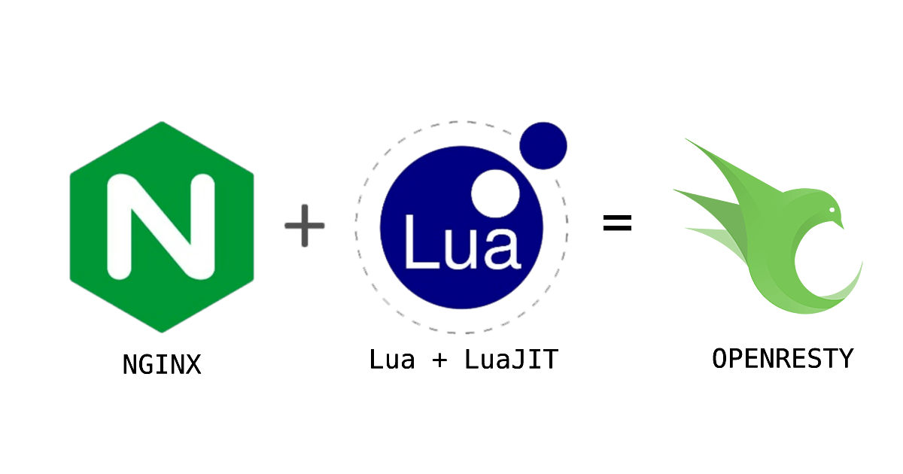

OpenResty is based on Nginx and benefits from its ability to handle high concurrency. However, Nginx is written in C, which makes custom development more difficult. Adding custom logic or features to Nginx requires writing a C module and recompiling Nginx.

To address this, OpenResty integrates and maintains modules such as `ngx_http_lua_module` and `ngx_stream_lua_module`, embedding Lua/LuaJIT in Nginx. This lets you extend the gateway with Lua scripts, for example, to implement custom routing rules, filters, and caching strategies.

> Lua is a fast dynamic scripting language with performance close to C. LuaJIT is a just-in-time compiler for Lua that can significantly improve execution speed. It precompiles and caches commonly used Lua functions and libraries so subsequent calls can use cached bytecode.

For an introduction to OpenResty and practical gateway security, see [OpenResty Fundamentals and Gateway Security for Backend Developers](https://mp.weixin.qq.com/s/3HglZs06W95vF3tSa3KrXw).

- GitHub: <https://github.com/openresty/openresty>
- Website: <https://openresty.org/>

### Kong

Kong is a high-performance, cloud-native, extensible gateway built on [OpenResty](https://github.com/openresty/) (Nginx + Lua). It has three main components:

- **Kong Server**: An Nginx-based server that receives API requests.
- **PostgreSQL**: Stores configuration and operational data in traditional database mode. Kong previously supported Cassandra, but support was removed in Kong Gateway 3.4; Cassandra is not recommended for new deployments.
- **Kong Manager**: The official UI for API management, monitoring, and configuration. It is available in OSS and Enterprise editions. You can also manage Kong through the RESTful Admin API.

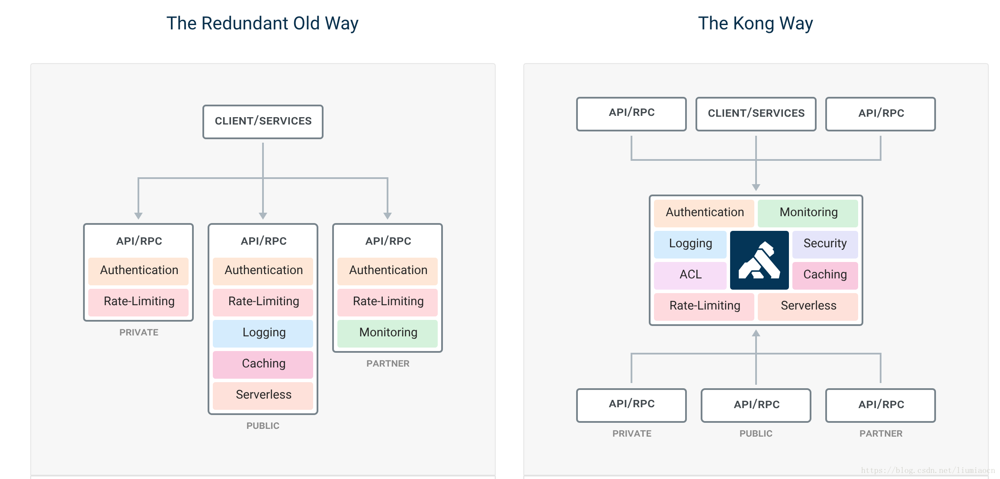

Kong's traditional mode stores configuration in an external database, which adds architectural complexity and requires high availability for the database. Since **Kong 1.1**, Kong has also supported **DB-less mode**:

- **Traditional mode**: Stores configuration in PostgreSQL. Suitable when API data must be managed persistently through the Admin API.
- **DB-less mode**: Uses declarative configuration files and does not require a database, resulting in a lighter architecture.
- **Hybrid mode**: The control plane manages configuration in a database, while the data plane does not connect directly to it. Suitable for distributing configuration across clusters or regions.
- **Kubernetes Ingress mode**: Manages configuration through ConfigMaps or CRDs (Kubernetes Custom Resource Definitions), without a database. A common approach in Kubernetes environments.

> **Note:** The Kong high-availability discussion below mainly concerns traditional database mode. Architecture and operational concerns differ when using an Ingress Controller in Kubernetes or DB-less/Hybrid mode.

Kong extends its features through plugins, which run during the API request-response lifecycle. For example, enable the Zipkin plugin on a service:

```shell
$ curl -X POST http://kong:8001/services/{service}/plugins \
    --data "name=zipkin"  \
    --data "config.http_endpoint=http://your.zipkin.collector:9411/api/v2/spans" \
    --data "config.sample_ratio=0.001"
```

Kong is a Lua application built on OpenResty. By embedding Lua in Nginx, it makes Nginx programmable and allows plugins to implement features such as rate limiting, access policies, routing, and load balancing. To create a Kong plugin, write a Lua script that follows the plugin specification, load it into Kong, and configure it for use.

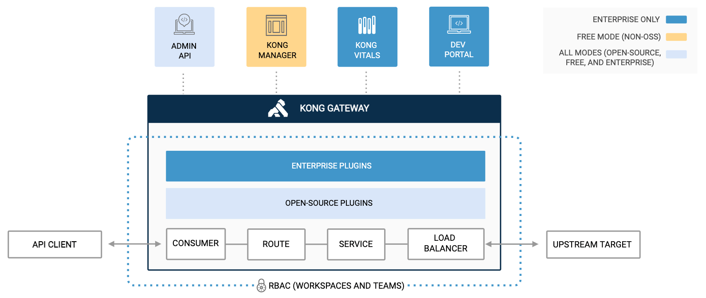

In addition to Lua, Kong plugins can be written in Go, JavaScript, Python, and other languages using the corresponding PDKs (Plugin Development Kits).

For details about Kong plugins, see the [official documentation](https://docs.konghq.com/gateway/latest/kong-plugins/).

- GitHub: <https://github.com/Kong/kong>
- Website: <https://konghq.com/kong>

### Apache APISIX

APISIX is a high-performance, cloud-native, extensible gateway based on OpenResty and etcd.

> etcd is an open-source, highly available distributed key-value store written in Go. It uses the Raft protocol for distributed consensus.

Compared with traditional API gateways, APISIX supports dynamic routing and hot-reloading plugins, making it well suited to API management in microservices systems. It also integrates with DevOps tools such as SkyWalking and Zipkin for distributed tracing and Prometheus for monitoring.

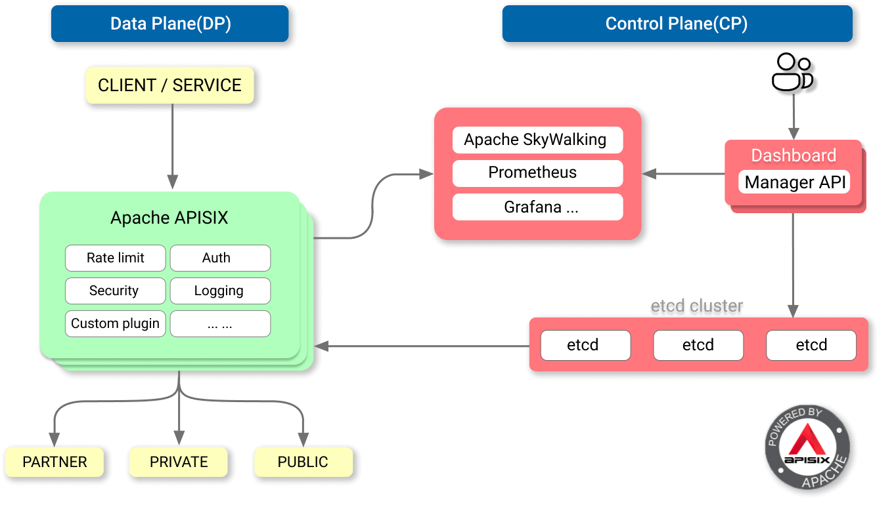

As an alternative to Nginx and Kong, APISIX became an Apache top-level project on 2020-07-15. Companies including Kingsoft, Youzan, iQIYI, Tencent, and Beike use APISIX for core business traffic.

APISIX competes with Kong through dynamic routing, etcd-based configuration hot reloads, its plugin ecosystem, and its dashboard. However, gateway performance comparisons depend heavily on version, deployment topology, route count, plugin chain length, request body size, TLS, and connection reuse. Benchmark your own workload instead of relying on vendor marketing claims.

APISIX also supports custom plugins. Besides Lua, developers can avoid learning Lua by using either of these approaches:

- Use Plugin Runner to write plugins in mainstream languages such as Java, Python, and Go. Backend engineers can use familiar languages and communicate with APISIX over local RPC. This reduces development effort and speeds up development, with some performance cost.
- Use Wasm (WebAssembly) to develop plugins. APISIX embeds Wasm and can run plugins compiled to Wasm bytecode.

> Wasm is a binary instruction format for a stack-based virtual machine. It is a low-level assembly language designed to run close to compiled machine code and achieve near-native performance. Wasm was initially built for browsers, but its use on servers has grown as the technology has matured.

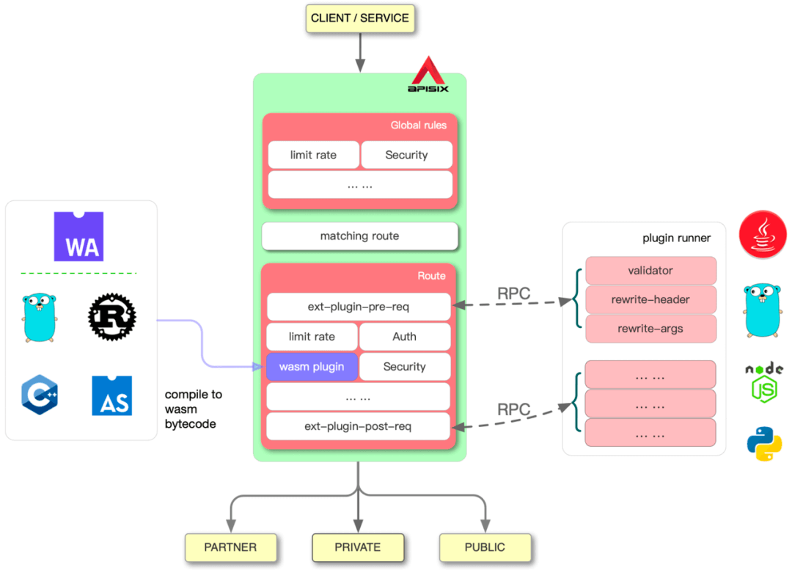

- GitHub: <https://github.com/apache/apisix>
- Website: <https://apisix.apache.org/zh/>

### Apache ShenYu

ShenYu is an extensible, high-performance reactive gateway based on WebFlux and an Apache top-level project.

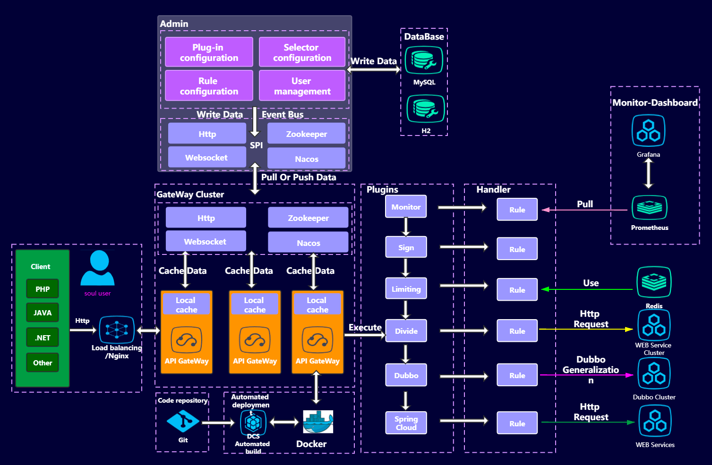

ShenYu extends its functionality through plugins, which are extensible and can be added or removed dynamically. Different plugins provide different features. Built-in plugins include rate limiting, circuit breaking, forwarding, rewriting, redirection, and route monitoring.

- GitHub: <https://github.com/apache/shenyu>
- Website: <https://shenyu.apache.org/>

### Gateway Comparison

| Feature                                | Zuul 1.x                                                   | Zuul 2.x                       | Spring Cloud Gateway                                                           | Kong                                    | APISIX                                 | ShenYu                              |
| -------------------------------------- | ---------------------------------------------------------- | ------------------------------ | ------------------------------------------------------------------------------ | --------------------------------------- | -------------------------------------- | ----------------------------------- |
| **I/O model**                          | Synchronous, blocking                                      | Asynchronous, non-blocking     | Asynchronous, non-blocking                                                     | Asynchronous, non-blocking              | Asynchronous, non-blocking             | Asynchronous, non-blocking          |
| **Technology**                         | Servlet                                                    | Netty                          | WebFlux/Server MVC + Netty/Servlet container                                   | OpenResty (Nginx + Lua)                 | OpenResty + etcd                       | WebFlux + Netty                     |
| **Performance**                        | Low                                                        | High                           | High                                                                           | Very high                               | Very high                              | High                                |
| **Dynamic configuration**              | Requires restart by default; extensible                    | Supported with a custom system | Supported                                                                      | Supported                               | Supported (hot reload)                 | Supported                           |
| **Configuration storage**              | Local config/in memory                                     | Custom                         | YAML/in memory by default; Redis or a custom route repository can be used      | PostgreSQL / YAML / Kubernetes CRD      | etcd (distributed)                     | In memory/database/service registry |
| **Rate limiting and circuit breaking** | Rate limiting via extensions; circuit breaking via Hystrix | Requires integration           | Built-in `RequestRateLimiter`; CircuitBreaker integration for circuit breaking | Plugins                                 | Plugins                                | Plugins                             |
| **Ecosystem**                          | Netflix (maintenance mode)                                 | Netflix                        | Spring Cloud                                                                   | Kong and plugins                        | Apache                                 | Apache                              |
| **Operational complexity**             | Low                                                        | Medium                         | Low to medium                                                                  | Medium (DB-less) / high (database mode) | Medium                                 | Medium                              |
| **Learning curve**                     | Gentle                                                     | Gentle                         | Gentle to moderate                                                             | Steep (Lua)                             | Steep (Lua)                            | Gentle (Java)                       |
| **Use cases**                          | Maintaining legacy systems                                 | Existing Netflix deployments   | Spring Cloud ecosystem                                                         | Cloud-native, multi-language systems    | Cloud-native, high-performance systems | Java ecosystem                      |

The “Performance” ratings above are rough estimates, not a substitute for benchmarking. Actual performance depends on route count, plugin chain length, request body size, TLS, connection reuse, log sampling, and downstream latency. Before choosing a gateway, benchmark it with tools such as wrk2, vegeta, or k6 using your traffic profile. Measure P99/P999 latency, error rate, and CPU and memory use, not just QPS.

## How to Choose

Choose an API gateway based on your technology stack, performance requirements, team skills, and operational costs.

### Two-Tier Gateway Architecture

Medium and large microservices systems often split gateway responsibilities across two tiers:

- **Traffic gateway**: Usually deployed at the edge. Options include Kong, APISIX, Nginx/OpenResty, and Envoy Gateway. It handles infrastructure concerns such as SSL termination, WAF, global rate limiting, IP allow/deny lists, DDoS protection, and protocol adaptation.
- **Business gateway**: Usually deployed inside the network. Options include Spring Cloud Gateway, ShenYu, or a custom gateway. It handles capabilities closer to the application, such as microservice routing, fine-grained authorization, parameter validation, canary routing, and application-level observability.

For a small system with one business domain and a limited team, a single gateway is usually simpler. Consider two tiers when external traffic management starts to interfere with internal business routing. Teams that already use a service mesh can also evaluate Envoy or Istio Ingress for north-south traffic to avoid adding too many proxy layers.

| Scenario                            | Recommended option                                                            | Reason                                                                                                                                            |
| ----------------------------------- | ----------------------------------------------------------------------------- | ------------------------------------------------------------------------------------------------------------------------------------------------- |
| **Spring Cloud ecosystem**          | Spring Cloud Gateway                                                          | Integrates with Spring Boot and Spring Cloud, with simple configuration.                                                                          |
| **High performance / cloud native** | APISIX                                                                        | etcd-based hot reloads, strong performance, and a cloud-native architecture.                                                                      |
| **Multi-language ecosystem**        | Kong                                                                          | Broad plugin support, multi-language development, and an established community.                                                                   |
| **Existing Netflix deployments**    | Keep the current system and plan a migration.                                 | Zuul 1.x, Ribbon, and Hystrix are in maintenance mode; avoid expanding their use in new projects.                                                 |
| **Two-tier architecture**           | Kong/APISIX/Envoy (traffic gateway) + Spring Cloud Gateway (business gateway) | The traffic gateway handles SSL, WAF, and global rate limits; the business gateway handles service authorization, validation, and canary routing. |

## References

- [Spring Cloud Gateway Documentation](https://docs.spring.io/spring-cloud-gateway/reference/)
- [Spring Cloud Netflix Maintenance Mode](https://cloud.spring.io/spring-cloud-netflix/multi/multi__modules_in_maintenance_mode.html)
- Kong Gateway 3.4 Breaking Changes：<https://docs.konghq.com/gateway/latest/breaking-changes/34x/>
- [Apache Announces APISIX as a Top-Level Project](https://news.apache.org/foundation/entry/the-apache-software-foundation-announces66)
- RFC 9113 HTTP/2：<https://www.ietf.org/rfc/rfc9113.html>
- [Kong Plugin Development Tutorial](https://cloud.tencent.com/developer/article/2104299)
- [A Practical Guide to the Kong API Gateway](https://xie.infoq.cn/article/10e4dab2de0bdb6f2c3c93da6)
- [Spring Cloud Gateway: Concepts and Applications](https://blog.fintopia.tech/60e27b0e2078082a378ec5ed/)
- [Why Do Microservices Need an API Gateway?](https://apisix.apache.org/zh/blog/2023/03/08/why-do-microservices-need-an-api-gateway/)

<!-- @include: @article-footer.snippet.md -->
