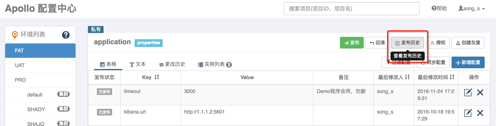
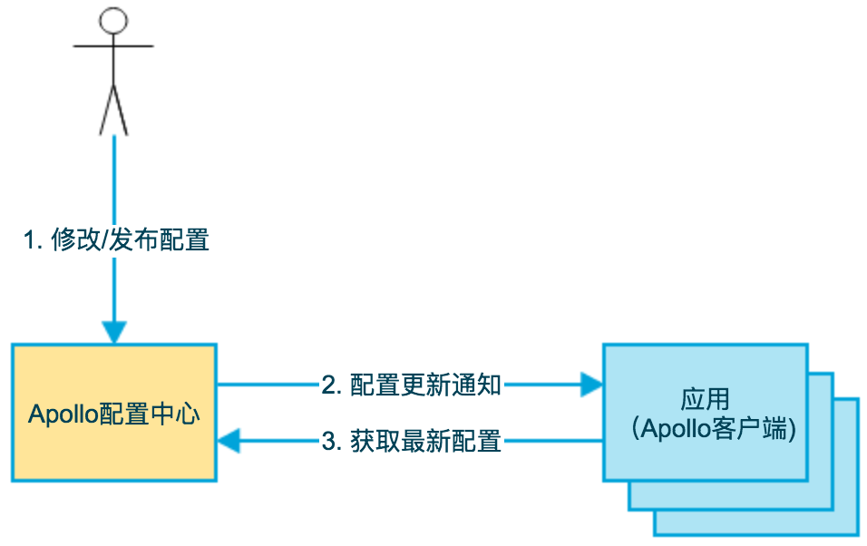
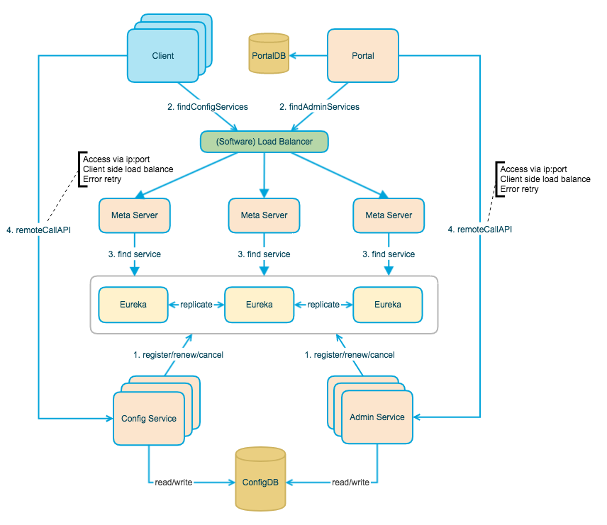

## Why use a configuration center?

In a microservice architecture, independently deployed services each have configuration such as service addresses, database settings, and feature flags. The number of settings grows with the number of services, environments, and clusters. Traditional configuration files have several limitations:

- **Restarts:** Many applications must restart to apply changes, whether settings are in a repository or external file.
- **Coupled releases:** Configuration in a code repository often ships with application releases, making independent staged rollout and rollback harder.
- **Security:** Secrets such as database passwords and API keys can leak when stored in source control.
- **Access control:** Viewing, editing, and publishing configuration cannot easily be governed separately.
- **Scattered settings:** Configuration across development, test, production, and multiple clusters is hard to manage centrally.

A configuration center commonly adds:

- **Versioning:** Record who changed what and when, and support rollback.
- **Staged rollout:** Deliver changes to a subset of instances first to reduce risk. Apollo and Nacos 1.1.0+ support this.



Not every system needs a configuration center. A monolith with one environment, few settings, and infrequent changes may be well served by `application-{profile}.yml`, environment variables, or Kubernetes ConfigMap with rolling restarts. A configuration center adds operational cost, a failure domain, and another troubleshooting dependency; small teams and infrequent changes may not justify it.

A configuration center is part of the distributed system's control plane: it decides which configuration should be used, while clients fetch, cache, watch, and refresh it. Releases, staged rollouts, rollback, and local snapshots balance centralized decisions with client resilience. See [Distributed Coordination](./protocol/centralized-and-decentralized.md) for the broader trade-offs.

Configuration centers also appear alongside [RPC](./rpc/) and [API gateways](./api-gateway.md). RPC frameworks need governance settings such as addresses, timeouts, retries, and fallbacks; gateways may use dynamic routes and staged rollout rules. These components have different roles but often form part of the same microservice workflow.

## Common options and selection

| Option                                                              | Status        | Characteristics                                                     |
| ------------------------------------------------------------------- | ------------- | ------------------------------------------------------------------- |
| [Spring Cloud Config](https://cloud.spring.io/spring-cloud-config/) | Active        | Native Spring integration; Git-backed                               |
| [Nacos](https://github.com/alibaba/nacos)                           | Active        | Alibaba open source; configuration and service discovery            |
| [Apollo](https://github.com/apolloconfig/apollo)                    | Active        | Ctrip open source; strong configuration, access, and audit features |
| Kubernetes ConfigMap                                                | Active        | Native Kubernetes option                                            |
| Disconf / Qconf                                                     | Long inactive | Not recommended for new projects                                    |

**Selection guidance:**

- Configuration management alone: **Apollo** for finer management controls or **Nacos** for a lighter standalone startup.
- Configuration and service discovery: **Nacos**.
- A simple Spring Cloud deployment: **Spring Cloud Config**.
- Kubernetes: mount a **ConfigMap volume** and watch files at the application layer. Kubelet periodically synchronizes mounted ConfigMaps; visibility depends on its sync interval and cache propagation. Environment variables and `subPath` mounts do not update automatically. Hot reload can use inotify or Spring Cloud Kubernetes watching ConfigMap changes through the Kubernetes Watch API.

### Apollo vs. Nacos vs. Spring Cloud Config

> **Versions:** This comparison covers Apollo 2.x, Nacos 2.x, and Spring Cloud Config 4.x/5.x. Spring Boot 3 typically uses Spring Cloud Config 4.x; Spring Boot 4 uses a newer Spring Cloud 2025.x release train. Spring Boot 2 generally uses Spring Cloud Config 3.x.

| Capability     | Apollo                                                | Nacos                                                                | Spring Cloud Config                          |
| -------------- | ----------------------------------------------------- | -------------------------------------------------------------------- | -------------------------------------------- |
| Management UI  | Yes; detailed permissions, audit, and release process | Yes                                                                  | No; usually managed through Git hosting      |
| Live updates   | HTTP long polling, typically detected within seconds  | gRPC change notification followed by client fetch                    | Near real time with refresh or Bus broadcast |
| Versions       | Built in                                              | Built in                                                             | Git                                          |
| Permissions    | Application, namespace, environment, and other levels | Yes                                                                  | Git platform                                 |
| Staged rollout | Yes; detailed rules                                   | Yes, since 1.1.0; more basic                                         | No                                           |
| Rollback       | Yes                                                   | Yes                                                                  | Git                                          |
| Alerts         | Yes                                                   | Yes                                                                  | No                                           |
| Languages      | Open API and multilingual clients                     | Open API and multilingual clients                                    | Primarily Spring applications                |
| Environments   | Usually physically isolated                           | Usually logically isolated by Namespace                              | Multiple Git repositories                    |
| Dependencies   | MySQL; registry embedded in Config Service by default | External MySQL recommended for production, or embedded Derby + JRaft | Git and optional message queue               |

**Further comparison:**

1. **Apollo:** Fine-grained permissions, release auditing, pre-release diffs, and rollout rules suit teams with demanding governance requirements. Physically isolated FAT/UAT/PROD environments each need Config Service, Admin Service, and a separate database, raising operational cost.
2. **Nacos:** Combines configuration and discovery and can start standalone from one JAR. Production clusters should use external MySQL; embedded Derby + JRaft is more suitable for testing or small deployments. Namespace/Group/DataId is straightforward, but environment isolation is usually logical.
3. **Spring Cloud Config:** A simple Git-based architecture, but updates are less immediate and need additional components for automatic refresh.

## Boundaries: configuration centers, registries, and ConfigMap

- **Application configuration centers** such as Apollo, Nacos, and Spring Cloud Config manage application parameters, flags, thresholds, and connection information, including audit, staged rollout, and dynamic refresh.
- **Service registries** such as Eureka, Nacos, and Consul manage instance registration, discovery, and health. Nacos supports both roles, but their responsibilities remain distinct.
- **Kubernetes ConfigMap** manages container runtime configuration such as Pod startup parameters, environment variables, and mounted files. It does not inherently provide approval workflows, staged rollout rules, or application object refresh.
- **Service Mesh / Ingress configuration** governs routing, circuit breaking, retries, timeouts, and traffic rollout, typically through CRDs or control-plane resources.

## Core design considerations

### 1. Configuration delivery

| Mode             | Timeliness              | Server load                               | Complexity | Suitable for                  |
| ---------------- | ----------------------- | ----------------------------------------- | ---------- | ----------------------------- |
| **Push**         | High; milliseconds      | High; connections must be maintained      | High       | Strict real-time requirements |
| **Pull**         | Low; seconds to minutes | High from unnecessary polls               | Low        | Very infrequent changes       |
| **Long polling** | Medium to high; seconds | Moderate; many connections consume memory | Medium     | Common general-purpose use    |

> **Delivery mechanisms:**
>
> - **Apollo:** HTTP long polling. The client sends a request; the server responds immediately if a change exists, otherwise holds it open (usually around 60 seconds, with a longer client read timeout) and responds when a change occurs.
> - **Nacos 2.x:** Service discovery uses bidirectional gRPC streams. Configuration uses a two-stage “change notification + client fetch” model: the server notifies the client, which fetches the latest content as needed.
>
> Strictly, long polling is still client-initiated pull; it is listed separately to show its operational behavior. It saves CPU and network traffic compared with short polling, but hundreds of thousands of clients still create many pending requests. Apollo uses Spring MVC `DeferredResult`, Servlet 3.0 asynchronous processing, and the Tomcat NIO connector; memory and connection limits still matter.

### 2. Essential capabilities

- **Access control:** Authorize viewing, editing, and publishing separately.
- **Audit logs:** Record who changed what and when.
- **Versioning:** Assign a release version and support rollback to historical versions.
- **Staged rollout:** Deliver to some instances before releasing broadly.
- **Environment isolation:** Manage development, test, and production independently.
- **High availability:** Deploy the configuration center as a cluster to avoid a single point of failure.

### 3. Client resilience and startup

A configuration center is infrastructure; an outage can affect many applications. Clients need resilience:

- **Multiple cache levels:** Read in-memory settings first; if the center is unavailable, use a local snapshot. If none exists, use a safe default or refuse to start.
- **Degraded startup:** Non-critical settings can use a local snapshot while reconnecting asynchronously. Critical settings such as database addresses or encryption keys may require refusing to start without configuration.
- **Reconnect:** Use backoff after a long poll or connection fails to avoid overwhelming a recovering server.
- **Refresh boundaries:** Dynamic refresh does not automatically update every object. Values already injected into ordinary or `final` fields, or used in conditional bean creation, may require `@RefreshScope`, listeners, or a redesigned bean lifecycle.

## Apollo as an example

### Introduction

According to the [Apollo project](https://github.com/apolloconfig/apollo), Apollo is a distributed configuration center developed by Ctrip's framework team. It manages configuration across environments and clusters, pushes changes to applications, and provides permissions and release governance for microservices.

Its server is built with Spring Boot and Spring Cloud and runs without a separately installed application container such as Tomcat. Its Java client does not depend on a framework and supports Java environments as well as Spring and Spring Boot integration.

Key features:

- **Hot publishing:** Long polling can deliver changes within a second.
- **Staged rollout:** Send a change to selected applications first.
- **Deployment:** A single environment depends on MySQL. The bundled registry, Eureka by default, runs inside Config Service. Physically isolated environments each need their own Config Service, Admin Service, and database.
- **Cross-language support:** HTTP APIs are available to any language.

See the [Apollo user guide](https://www.apolloconfig.com/#/zh/).

### Architecture

The basic model from Apollo's design documentation:



1. A user edits and publishes configuration in Apollo.
2. Apollo notifies the application that it changed.
3. The application fetches the latest configuration.

The official architecture diagram:



### Components

| Component           | Purpose                                                                                        | Default port           |
| ------------------- | ---------------------------------------------------------------------------------------------- | ---------------------- |
| **Portal**          | Web interface for configuration management                                                     | 8070                   |
| **Client**          | SDK for fetching configuration and listening for changes                                       | —                      |
| **Meta Server**     | Discovery entry point, co-located with Config Service; supplies addresses to Client and Portal | 8080                   |
| **Config Service**  | Configuration reads and long-poll notifications for clients; embeds the registry               | 8080                   |
| **Admin Service**   | Configuration management API for Portal                                                        | 8090                   |
| **Embedded Eureka** | Registry within Config Service for Config/Admin Service discovery; no separate deployment      | Same as Config Service |
| **MySQL**           | Configuration and metadata storage                                                             | 3306                   |

Apollo 2.0+ supports replacing service discovery through SPI, for example with Nacos, Consul, or Polaris. In the default deployment, Eureka is embedded in Config Service; it is not a separately operated external cluster.

### Main flows

**Client: fetching configuration**

1. At startup, the Client obtains Config Service addresses from Meta Server.
2. It caches the addresses locally, remaining usable if Eureka fails.
3. It sends a long-poll request.
4. Config Service responds when configuration changes.
5. The Client updates its in-memory cache, triggers callbacks, and **asynchronously persists a local snapshot**. The default cache directory is `/opt/data/{appId}/config-cache/` on Linux/macOS and `C:\\opt\\data\\{appId}\\config-cache\\` on Windows. The `apollo.cache-dir` system property can override it.

> **Recovery:** Even if all Config Service instances are down and the application restarts, the Client can start from its disk cache, reducing dependence on configuration center availability.

**Portal: publishing configuration**

1. A user changes configuration in Portal and publishes it.
2. Portal calls the Admin Service release API.
3. Admin Service writes the configuration to MySQL and creates a release version.
4. Config Service notifies Clients through long polling.
5. Clients fetch the latest configuration.

### Client examples

Read configuration:

```java
Config config = ConfigService.getAppConfig();
String someKey = "someKeyFromDefaultNamespace";
String someDefaultValue = "someDefaultValueForTheKey";
String value = config.getProperty(someKey, someDefaultValue);
```

Listen for changes:

```java
Config config = ConfigService.getAppConfig();
config.addChangeListener(new ConfigChangeListener() {
    @Override
    public void onChange(ConfigChangeEvent changeEvent) {
        // Handle configuration changes.
        for (String key : changeEvent.changedKeys()) {
            ConfigChange change = changeEvent.getChange(key);
            System.out.println(String.format(
                "Key: %s, Old: %s, New: %s",
                key, change.getOldValue(), change.getNewValue()));
        }
    }
});
```

Production Spring Boot code usually uses Apollo's Spring integration instead of calling the low-level API everywhere: enable Apollo with `@EnableApolloConfig`, inject configuration with `@Value` or `@ConfigurationProperties`, and listen with `@ApolloConfigChangeListener`. Conditional configuration such as `@ConditionalOnProperty` and already initialized complex beans may not be rebuilt automatically when values change. Verify the refresh strategy for critical settings.

## Nacos configuration model

Nacos provides both configuration management and service discovery. To locate configuration, it commonly uses three levels:

- **Namespace:** Usually isolates environments or tenants, such as dev, test, and prod.
- **Group:** Usually groups applications or business domains; the default is `DEFAULT_GROUP`.
- **DataId:** Identifies a configuration file or item, such as `order-service.yaml`.

Storage depends on deployment:

- **Production cluster:** External MySQL is recommended; its own high-availability design provides data consistency.
- **Embedded storage:** Nacos also supports Derby and similar embedded stores. In cluster mode, JRaft coordinates the nodes' embedded stores. This suits testing, small deployments, or low operational-cost requirements, but can be harder to troubleshoot.

Nacos 2.x uses long-lived gRPC connections, reducing connection overhead compared with 1.x HTTP long polling. When configuration changes, the server notifies the client; the client fetches the latest content and calls its listeners. This avoids sending large configuration bodies in notifications and supports local snapshots and recovery.

Nacos clients also keep local snapshots. If the center is unavailable, a client can read snapshot or failover files to start or continue running. Paths vary with client version, namespace, server address, Group, and DataId; check the target version's logs and local `nacos/config` directory when troubleshooting.

## References

- [Nacos documentation](https://nacos.io/docs/latest/what-is-nacos/)
- [Nacos cluster deployment](https://nacos.io/docs/v2.5/manual/admin/deployment/deployment-cluster/)
- [Apollo documentation](https://www.apolloconfig.com/#/zh/README)
- [Apollo GitHub repository](https://github.com/apolloconfig/apollo)
- [Spring Cloud Config documentation](https://cloud.spring.io/spring-cloud-config/)
- [Spring Cloud compatibility information](https://spring.io/spring-cloud)
- [Kubernetes ConfigMap documentation](https://kubernetes.io/docs/concepts/configuration/configmap/)
- [Nacos 1.1.0 staged configuration release](https://nacos.io/zh-cn/blog/nacos%201.1.0.html)
- [Apollo in practice at Youzan](https://mp.weixin.qq.com/s/Ge14UeY9Gm2Hrk--E47eJQ)
- [Comparing microservice configuration centers](https://www.itshangxp.com/spring-cloud/spring-cloud-config-center/)

<!-- @include: @planet.snippet.md -->
