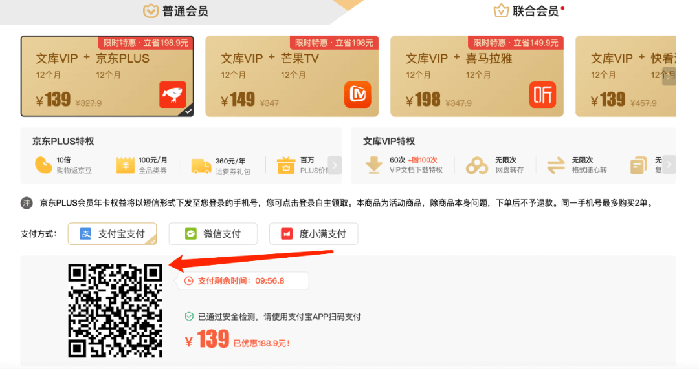
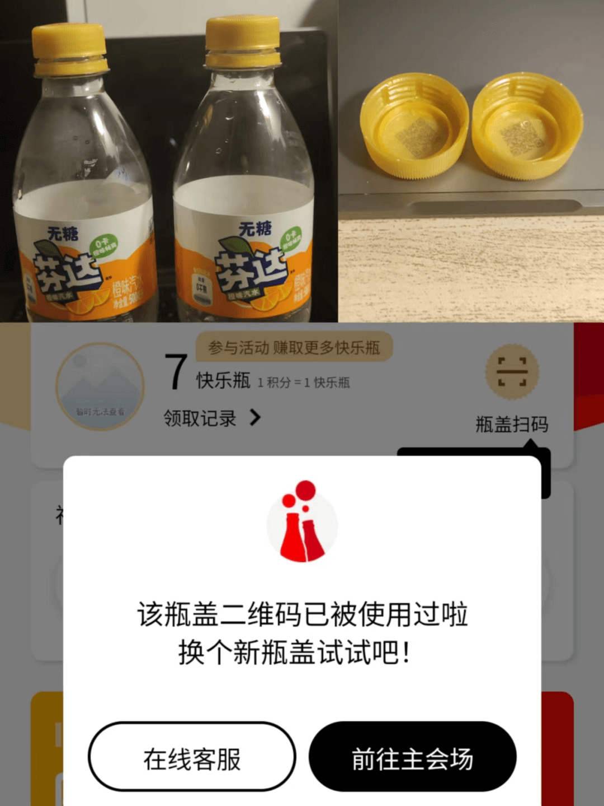
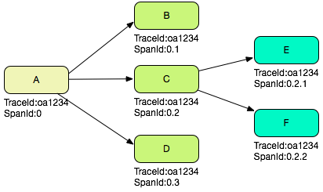
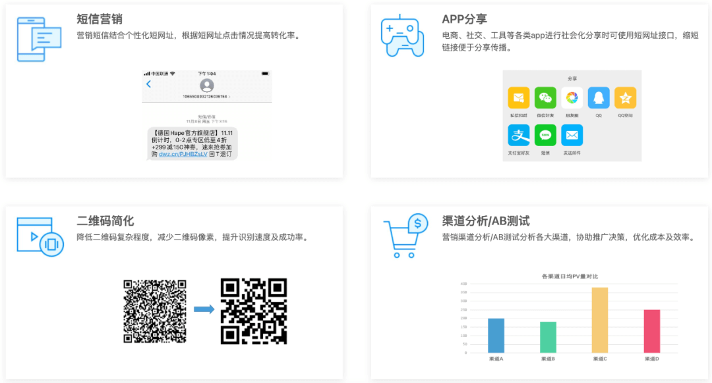

::: tip

I found an article from Baidu Geek that discusses distributed ID design through practical scenarios and thought it was useful. I have adapted some of its content here: [Technical Principles and Practical Implementation of a Distributed ID Generation Service](https://mp.weixin.qq.com/s/bFDLb6U6EgI-DvCdLTq_QA).

:::

Most articles about distributed ID generation focus on the underlying technology. Fewer explain how to choose an ID generation service for a specific business scenario.

This guide uses several scenarios to explore the requirements that different business IDs need to meet.

If you have not read about the trade-offs among UUIDs, the segment allocation pattern, Snowflake, Leaf, and Tinyid, start with [Distributed ID Generation](./distributed-id.md). This guide focuses on business design: order numbers need to be searchable and secure, TraceIds need to propagate across a call chain, and short URLs need to be concise and readable.

## Scenario 1: Order systems

Order numbers, coupon codes, and redemption codes appear throughout online shopping. Why are some numbers long while others contain only a few digits? Why do some reveal a date while others appear random? This section looks at how IDs can be designed for different order-system scenarios.

### 1. Aggregated QR-code payments

An aggregated payment QR code lets a customer scan one code with WeChat Pay or Alipay to pay.

A QR code encodes a string. An aggregated payment code usually encodes a URL. Customers can scan the same code with either payment app instead of needing a separate merchant code for each provider. This makes QR-code payments easier to use.

After a customer scans the code with an app, the backend identifies the scanning environment, such as WeChat, Alipay, QQ Wallet, JD Pay, or UnionPay QuickPass.

The backend can identify the environment from the browser's HTTP headers. When a browser opens an HTTP URL, its request includes a `User-Agent` (UA) header.

The UA is a string that can identify information such as the client's operating system and version, CPU type, browser and version, rendering engine, language, and installed browser extensions.

Payment providers use different names for their payment products, so check each provider's API documentation carefully. Examples include:

1. WeChat Pay: JSAPI Payment
2. Alipay: Mobile Website Payment
3. QQ Wallet: Official Account Payment

These products provide HTML5 payments through an in-app browser.



The document library's engineering team iterated on this idea. It generates a dynamic QR code that is pre-bound to the selected product and price, so the code updates when the customer changes their selection. One code can launch payment in multiple apps, and the customer does not need to select a product or enter an amount after scanning it.

After the customer scans the code, the frontend obtains the user's UID. The server combines it with the product details bound to the code to create the order and send payment information to the selected provider, such as QQ, WeChat, or Alipay. The provider creates the payment order and sends it to the customer's device to launch the payment flow.

Unlike a static payment code, this implementation uses a dynamic QR code that acts as a short URL. The ID service provides the unique identifier in that URL. The URL maps to the product and order information, combining the technical and business requirements to shorten the payment flow.

### 2. Order numbers

An order number uniquely identifies an order and is commonly used to:

1. Help customer support investigate an order issue.
2. Perform order operations, such as recording an offline payment or redeeming an order.
3. Track internal order workflows, such as creation, modification, fulfillment, cancellation, and after-sales service.

Order numbers are often used as the unique key when searching for order information. In addition to the properties required of an ID service, an order number should have these characteristics:

**(1) Protect sensitive information**

An order number should not reveal business information such as daily sales or transaction volume, nor should it expose personal information such as a phone number or national ID. It should not follow an obvious overall pattern that lets someone change one character and find another customer's order. Some local structure may still be useful.

For example, student exam numbers should not be sequential. Otherwise, someone could change the number slightly and look up another student's score.

**(2) Be partly readable**

The number should be a practical length and have enough structure to help customer support find an order when handling an issue or return.

Long or hard-to-read order numbers are difficult to enter and easy to mistype, which makes after-sales support harder. Depending on the use case, an order number may include information that is safe to expose and useful to users, such as a date, weekday, or order type.

Monotonically increasing components such as time or a sequence can also help prevent duplicate numbers as the business grows.

**(3) Support efficient lookups**

Many e-commerce platforms use numeric order numbers. Numeric values can be easier to read, and an integer type may be more efficient to query than a `VARCHAR` value for online workloads.

### 3. Coupons and redemption codes

Coupons and redemption codes are common promotional tools. Used well, they benefit customers and help merchants increase sales. Common examples include:

1. A customer buys a bundle of document library VIP membership and a QQ Music annual card. After payment, they receive a code to redeem the music membership in the QQ Music app.
2. Local governments issue consumer vouchers, as some did during the COVID-19 pandemic.
3. A bottle cap contains a promotional code that customers enter to claim a prize.



Some scenarios can assign an ID when a user claims a coupon, such as coupons from an e-commerce platform. Other online and offline promotions need codes generated in advance, such as consumer vouchers, bottle-cap prizes, gift cards, and supermarket cards. Pre-generated codes need to:

1. Be ready before the promotion begins.
2. Support a large volume, often hundreds of thousands of codes or more.
3. Be difficult to guess or counterfeit.
4. Support redemption and invalidation after use.
5. Avoid requiring a database row for every code. Promotions distribute codes widely, so usage can be low and storing every issued code may waste space.

The design needs a code-generation strategy that supports advance generation and validation, produces concise codes, and guarantees uniqueness. This can be treated as a specialized encoding and decoding scheme, with rules designed to meet those requirements.

The scheme needs an encoding alphabet: the characters customers can see in a code. Start with lowercase and uppercase letters and digits, then remove uppercase `O` and `I` to make codes easier to read. The resulting alphabet has 60 characters:

```text
abcdefghijklmnopqrstuvwxyzABCDEFGHJKLMNPQRSTUVWXZY0123456789
```

Codes should be as short as possible. With an alphabet of 60 characters and a maximum length of 12, the namespace contains `60^12 = 2,176,782,336,000,000,000,000` possible values (a huge number of 12-character codes for promotional use). In binary, this value is:

```text
11101100000000011101100011000011000000101000001000000000000000000000000 (71 bits)
```

**Code structure**

Codes can be generated in advance without storing every code's data separately. Each promotion gets its own code set; codes from one campaign cannot be used in another (for example, a Singles' Day code should not work for a Christmas promotion). Each code has a unique number, and its data includes a check value to validate it. The format is:

```text
promotion ID + code sequence number i + check code
```

**Encoding scheme**

1. **Code sequence number `i`:** Identifies the code's position in a promotion. Its bit width limits how many codes that promotion can issue. The example uses 30 bits, supporting up to 1,073,741,824 codes (about one billion).
2. **Promotion ID:** Identifies the promotion. Its bit width limits the number of promotions. The example uses 15 bits, supporting 32,768 promotion IDs. Given the expected promotion frequency and a starting ID of 10,000, this is enough for one promotion a day for 54 years.
3. **Check code:** Validates the code and helps distribute its bits. It uses 13 bits, divided into a 6-bit prefix and a 7-bit suffix.

Business requirements may distinguish between shared and single-use coupons:

1. **Shared coupons:** Many customers can redeem the same code, subject to total quantity and expiration limits.
2. **Single-use coupons:** An operator configures the reward, expiration, and quantity in an administration system. The system generates a list of codes, and each code is invalidated after redemption.

## Scenario 2: Tracing

### 1. Log tracing

In a distributed service architecture, a web request may enter through a gateway and call several services before returning a result. Each service-to-service call is a separate network request. A failure or delay in any service can affect the user-facing request.

Distributed tracing helps identify which part of the service chain caused a problem while processing a request.



Two important concepts in distributed tracing are **trace** and **span**. A trace is the end-to-end view of a request through the distributed system. A span represents one operation or service within that trace. Together, the spans form the complete trace.

The request carries its `traceId` as it moves downstream. Each service also creates its own `spanId` to represent its part of the call and propagates the trace and span context to downstream services.

### 2. TraceId generation

In this scenario, IDs must be unique, fast to generate, and support high throughput. An ingress server should be able to generate a `traceId` locally. Calling a shared ID service for every trace would waste network capacity, block the request from proceeding downstream, increase latency, and introduce another failure risk. Each server should be able to generate its own `traceId` and `spanId` without depending on an external service.

One generation scheme combines the server IP address, generation time, an incrementing sequence, and the process ID. For example:

```text
0ad1348f1403169275002100356696
```

The first 8 characters, `0ad1348f`, encode the IP address of the server that generated the TraceId. They are hexadecimal: convert each pair of characters to decimal to obtain the IP address `10.209.52.143`. This can help identify the first server that handled a request.

The next 13 digits, `1403169275002`, encode the generation time. The following 4 digits, `1003`, are an incrementing sequence that runs from 1000 to 9000 and then wraps back to 1000. The final 5 digits, `56696`, are the process ID. Including it helps avoid TraceId collisions when multiple processes run on one host.

### 3. SpanId generation

A span represents a layer in the call tree. The first service handling a request is the first layer; a proxy or downstream service is the next layer, and so on. A `spanId` identifies the operation's position in that tree.

Suppose server A receives a user request and is the root of the trace. Non-service-call log entries in A use span ID `0`. If A calls servers B, C, and D in sequence through RPC, their spans are `0.1`, `0.2`, and `0.3`. If C then calls servers E and F, their spans are `0.2.1` and `0.2.2`. The corresponding log entries in each service use the same span ID for that part of the call.

Collecting all the SpanIds for a request reconstructs the complete call tree.

**SpanIds are generated by propagating context across service boundaries and incrementing the child position at each level.**

## Scenario 3: Short URLs

Short URL services shorten and resolve URLs. Short URLs are easier to share in email, social networks, microblogs, and on mobile devices. They avoid line breaks and character limits that can make long URLs difficult to use.



Common ID generation approaches, such as MySQL auto-increment IDs, Redis `INCR`, and segment allocation, produce numeric IDs. A short URL service maps a long URL to a short URL by appending a generated ID to a domain such as `dwz.cn`.

Using a decimal ID directly can still produce a long URL. The service can shorten it by converting the numeric ID to a higher base. This approach is common in short URL systems and is widely useful for compact identifiers. For example:

- Original URL: <https://wenku.baidu.com/ndbusiness/browse/wenkuvipcashier?cashier_code=PCoperatebanner>
- Short URL using a numeric ID: <https://dwz.cn/2047601319t66> (example; it may not resolve)
- Short URL after base conversion: <https://dwz.cn/2ezwDJ0> (example; it may not resolve)

<!-- @include: @article-footer.snippet.md -->
