## Introduction to Distributed IDs

This article compares ID generation strategies such as UUIDs, database segments, Redis, Snowflake, Leaf, and Tinyid. For business identifiers such as order numbers, coupon codes, trace IDs, and short URLs, see [Designing Business IDs](./distributed-id-design.md).

### What Is an ID?

In software systems, IDs uniquely identify data: a user ID identifies a user, a product ID identifies a product, and an order ID identifies an order.

IDs are also used outside software, such as national identification numbers and address identifiers.

In short, **an ID is a unique identifier for data**.

### What Is a Distributed ID?

Here, a **distributed ID** uniquely identifies data across nodes, databases, or services. It prevents collisions when multiple nodes generate IDs concurrently.

Consider a sharded database.

Suppose a project starts with a single MySQL instance. As its user base and data grow, one instance may no longer meet its needs, so the database is sharded. Apache ShardingSphere-JDBC is one possible approach; the choice depends on query complexity, transaction requirements, operational capacity, and team experience.

After sharding, data is spread across database nodes, so each database's auto-incrementing primary key cannot guarantee uniqueness across the whole system. **How can each node generate globally unique primary keys?**

This is where **distributed IDs** are needed.

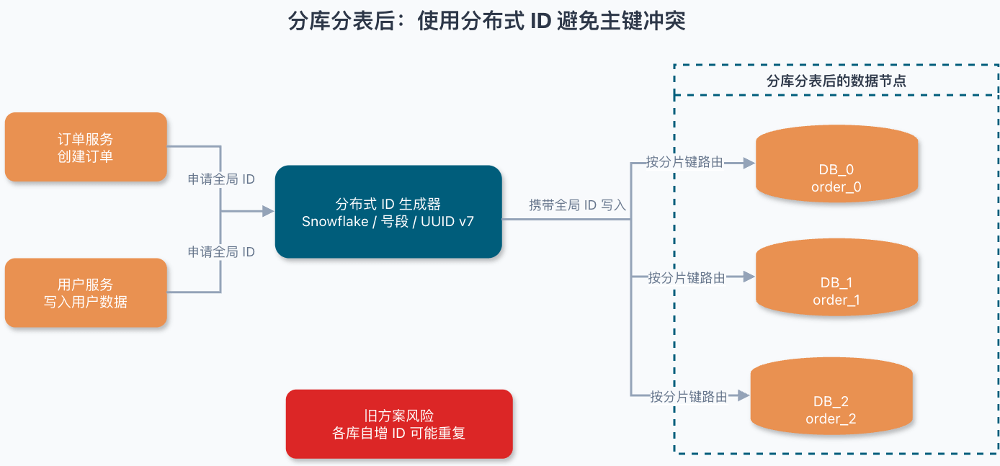

### What Properties Should a Distributed ID Have?

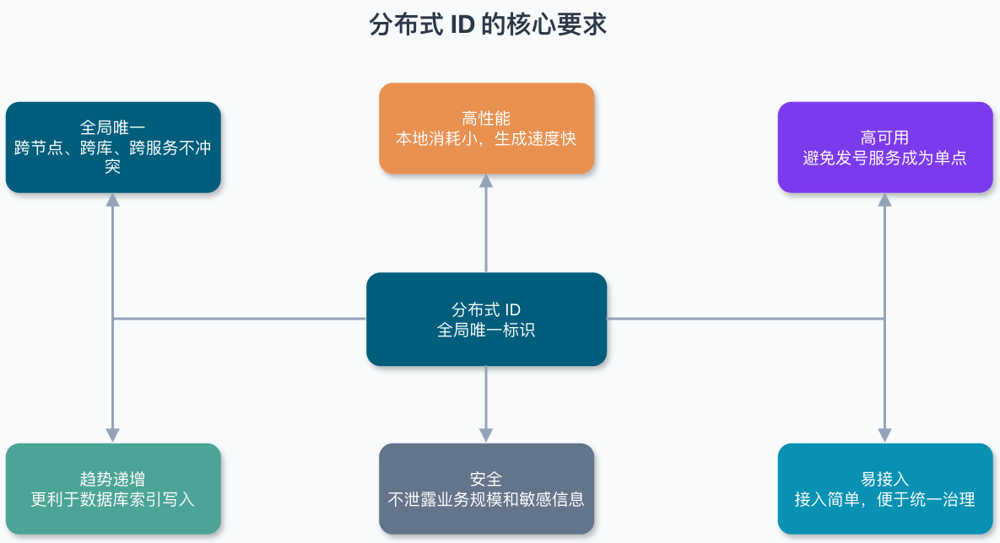

Distributed IDs are used throughout distributed systems.

At a minimum, a distributed ID should be:

- **Globally unique:** Uniqueness is the primary requirement.
- **Fast:** Generation should be quick and use few local resources.
- **Highly available:** An ID service should not become a single point of failure.
- **Easy to use:** Integration should be straightforward.

Other useful properties include:

- **Security:** IDs should not expose sensitive information.
- **Roughly increasing order:** If IDs are stored in a database, roughly increasing values often improve B+ tree index writes. Many primary-key use cases need this property rather than strict global ordering, which usually requires a centralized generator or stronger coordination.
- **Controlled business meaning:** Embedding business information may help troubleshooting, but can reveal volume, region, time, or channel and tightly couple the ID format to business rules. Many systems keep IDs opaque and store business details separately.
- **Independent deployment:** A dedicated ID service decouples ID generation from business services, but adds network calls. It is useful when many parts of a system need IDs.

The source of uniqueness varies by strategy:

- Database auto-increment and segment allocation rely on centralized storage and transactional allocation.
- Redis relies on atomic increments of a key, persistence settings, and replication behavior.
- Snowflake relies on a non-colliding combination of timestamp, worker ID, and sequence number.
- UUID v4 and v7 rely on random-number quality and the generator implementation.
- For primary keys where duplicates are unacceptable, enforce a database uniqueness constraint as a final safeguard.

## Database-Based Generation (Stateful)

### Database Auto-Increment

This approach uses a relational database's auto-incrementing primary key to generate unique IDs.

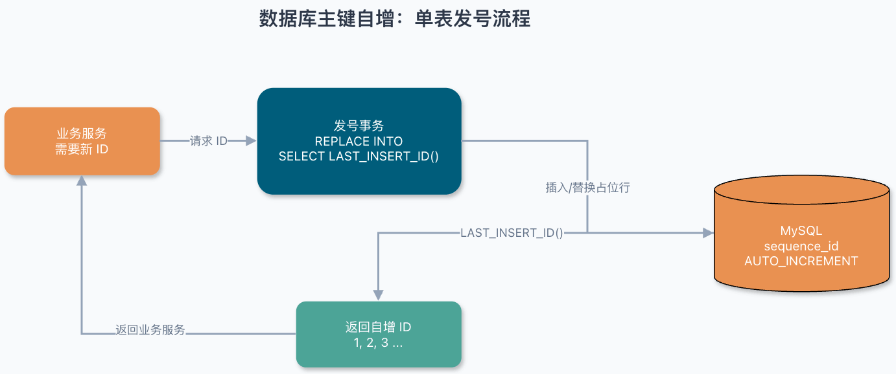

For example, in MySQL:

**1. Create a table.**

```sql
CREATE TABLE `sequence_id` (
  `id` BIGINT UNSIGNED NOT NULL AUTO_INCREMENT,
  `stub` char(10) NOT NULL DEFAULT '',
  PRIMARY KEY (`id`),
  UNIQUE KEY `stub` (`stub`)
) ENGINE=InnoDB DEFAULT CHARSET=utf8mb4;
```

The `stub` column has no business meaning; it is a placeholder that lets us insert or update a row. Its unique index enforces uniqueness.

**2. Insert a row with `REPLACE INTO`.**

```java
BEGIN;
REPLACE INTO sequence_id (stub) VALUES ('stub');
SELECT LAST_INSERT_ID();
COMMIT;
```

**⚠️ Production risks of `REPLACE INTO`:**

`REPLACE INTO` inserts a row if it does not conflict with a `PRIMARY KEY` or `UNIQUE` index. If it conflicts, MySQL deletes the old row and inserts the new one. The affected-row count may include both the deletion and insertion.

- Each operation deletes and rebuilds index entries, increasing database load.
- If the table has triggers, the delete may trigger them unexpectedly.

**Alternative:** To advance a sequence table, use `INSERT ... ON DUPLICATE KEY UPDATE` or a single-row `UPDATE` to avoid the delete semantics of `REPLACE`. In production, segment allocation is more common: update `current_max_id = current_max_id + step` once, then allocate IDs from memory.

This approach has clear advantages and disadvantages:

- **Advantages:** Simple to implement, ordered IDs, and low storage overhead.
- **Disadvantages:** Limited throughput and a database dependency. High availability can use primary-replica setups, MySQL Group Replication (MGR), or multiple segment allocators, but failover, transaction commits, duplicate allocation, and wasted segments need careful handling. IDs have no business meaning and may expose information, such as order volume. Each ID request also queries the database, increasing load and latency.

### Database Segment Allocation

With auto-increment, every ID request queries the database. This can become impractical when demand is high.

Instead, fetch a range of IDs at once and keep it in memory. This reduces database requests, latency, and load. This is **database segment allocation**.

Database segment allocation is a widely used strategy. Didi's open-source [Tinyid](https://github.com/didi/tinyid/wiki/tinyid%E5%8E%9F%E7%90%86%E4%BB%8B%E7%BB%8D) uses it, with optimizations such as double-segment caching and support for multiple databases.

For example, in MySQL:

**1. Create a table.**

```sql
CREATE TABLE `sequence_id_generator` (
  `id` INT NOT NULL,
  `current_max_id` BIGINT NOT NULL COMMENT 'Current maximum ID',
  `step` INT NOT NULL COMMENT 'Segment size',
  `version` INT NOT NULL COMMENT 'Version',
  `biz_type` INT NOT NULL COMMENT 'Business type',
  PRIMARY KEY (`id`),
  UNIQUE KEY `uk_biz_type` (`biz_type`)
) ENGINE=InnoDB DEFAULT CHARSET=utf8mb4;
```

The `current_max_id` and `step` columns define an ID range: `(current_max_id, current_max_id + step]`, excluding the old `current_max_id`. For example, if the old value is `0` and `step` is `100`, a successful update allocates IDs `1–100`.

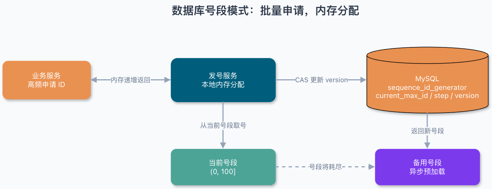

The `version` column provides optimistic locking for concurrent updates:

```sql
-- 1. Read the current values
SELECT current_max_id, step, version FROM sequence_id_generator WHERE biz_type = 101;
-- 2. Compare-and-set update (version is the optimistic lock)
UPDATE sequence_id_generator
SET current_max_id = current_max_id + step, version = version + 1
WHERE version = {version_read_above} AND biz_type = 101;
-- 3. Check affected_rows: 1 means success; 0 means another instance won, so retry
```

After `UPDATE ... WHERE version = ?`, check `affected_rows`. A result of 0 means another instance acquired the segment first; reread `current_max_id` and `version`, then retry.

> **⚠️ High-concurrency retry warning:** When a segment is exhausted, multiple threads may race to acquire the next one, causing a compare-and-set update to fail. Implement a **bounded retry loop** (for example, three attempts) with exponential backoff. If retries still fail, wait for the next segment to load or trigger an alert and circuit-breaker fallback. **Do not return a so-called “fallback ID,”** which could break the uniqueness guarantee.

The `biz_type` column identifies the business category.

**2. Insert an initial row.**

```sql
INSERT INTO `sequence_id_generator` (`id`, `current_max_id`, `step`, `version`, `biz_type`)
VALUES
 (1, 0, 100, 0, 101);
```

**3. Select the range for a business category.**

```sql
SELECT `current_max_id`, `step`, `version` FROM `sequence_id_generator` WHERE `biz_type` = 101
```

Result:

```plain
id current_max_id step version biz_type
1 0 100 0 101
```

**4. When the range is exhausted, update the row and select again.**

```sql
UPDATE sequence_id_generator SET current_max_id = 0 + 100, version = version + 1 WHERE version = 0 AND `biz_type` = 101
SELECT `current_max_id`, `step`, `version` FROM `sequence_id_generator` WHERE `biz_type` = 101
```

Result:

```plain
id current_max_id step version biz_type
1 100 100 1 101
```

Compared with auto-increment, **segment allocation accesses the database less often and reduces database load.**

To avoid a single point of failure, use replication or multiple databases. With replication, allocate ranges through the primary and ensure failover cannot revert `current_max_id`. With multiple databases, ensure their ranges, steps, or business partitions do not overlap.

Segment allocation can produce gaps: an instance usually caches a range in memory, and any unused IDs are lost if it crashes or restarts. Gaps do not affect uniqueness, but make IDs non-contiguous. Do not reclaim allocated IDs just to maintain continuity; that could create duplicates. In production, monitor range consumption, load failures, and retry counts.

**Advantages and disadvantages of segment allocation:**

- **Advantages:** IDs are roughly increasing and require little storage.
- **Disadvantages:** The database can be a single point of failure. Replication or multiple databases improve availability but add complexity. IDs have no business meaning and may reveal information such as order volume.

### NoSQL

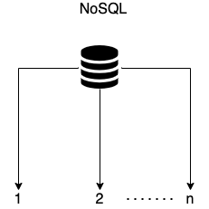

Redis is a common NoSQL option. Its `INCR` command atomically increments an ID counter.

```bash
127.0.0.1:6379> set sequence_id_biz_type 1
OK
127.0.0.1:6379> incr sequence_id_biz_type
(integer) 2
127.0.0.1:6379> get sequence_id_biz_type
"2"
```

For higher availability and throughput, Redis Cluster is an option. It is Redis's official clustering solution, available since Redis 3.0.

Codis was once a common open-source Redis cluster solution, but the project has been inactive for a long time. For new projects, evaluate Redis Cluster, a cloud provider's Redis service, or a managed Redis-compatible service first. Codis is more suitable for maintaining existing deployments; assess its maintenance status before use.

Besides availability and concurrency, Redis data must be persisted to reduce data loss after a restart or machine failure. Redis supports **snapshots (RDB)** and **append-only files (AOF)**. Starting with Redis 4.0, it also supports **hybrid RDB/AOF persistence**, controlled by `aof-use-rdb-preamble`. Example configurations disable it by default in Redis 4.0 and enable it by default in Redis 5.0 and later. Check the target Redis version, configuration file, and managed-service settings for the actual default.

For more about Redis persistence, see [Redis Persistence Explained](https://javaguide.cn/database/redis/redis-persistence.html).

Although Redis `INCR` is fast, persistence reduces the risk of losing data after a process restart but cannot eliminate ID rollback. With `appendfsync everysec`, RDB snapshots, asynchronous replication, or failover, recent `INCR` results may be lost. Consider these failure cases:

1. **Persistence delay can roll back IDs**

   - **Scenario:** Redis crashes after `INCR` but before the RDB/AOF data is flushed to disk.
   - **Consequence:** After restart, the ID counter may revert to its last persisted value and generate duplicates.

2. **AOF rewriting can briefly affect performance**

   - **Scenario:** A large AOF file triggers a rewrite.
   - **Consequence:** Forking a child process may cause a brief performance fluctuation.

3. **A hot key can overload one Redis Cluster shard**

   - **Scenario:** A counter key always maps to one shard.
   - **Consequence:** That shard may become a bottleneck under high concurrency.

4. **Failover with asynchronous replication**
   - **Scenario:** When a replica is promoted after a primary failure, its `INCR` value may lag behind the primary's.
   - **Consequence:** The new primary may issue IDs from an older value.

**Example production configuration:**

```conf
# Example configuration for Redis 7.0+
appendonly yes
appendfsync everysec
aof-use-rdb-preamble yes  # Hybrid persistence (RDB + AOF)
```

- **Redis 7.0+ improvements:** Multi-part AOF improves the organization and management of base and incremental files during rewrites. However, forking, disk I/O, and `fsync` settings can still cause performance fluctuations.
- **When to use it:** Redis can suit sequence numbers, short-lived counters, and systems with business-level deduplication. For IDs that require stronger uniqueness guarantees, such as financial orders or payment records, combine deduplication with persistence, replication consistency, and database uniqueness constraints, or consider database segments or Leaf.

**Advantages and disadvantages of Redis:**

- **Advantages:** Good performance; IDs increase while a single key on one primary is operating normally.
- **Disadvantages:** Similar to database auto-increment, with additional risks of persistence delays, hot shards, and ID rollback during failover.

MongoDB ObjectId is another commonly used distributed ID.

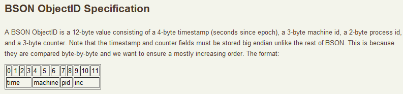

MongoDB ObjectId is 12 bytes:

- Bytes 0–3: Unix timestamp in seconds (4 bytes).
- Bytes 4–8: Random value (5 bytes), generated once per client process to distinguish machines and processes.
- Bytes 9–11: Incrementing counter (3 bytes), incremented within each client process.

ObjectId is an approximately ordered identifier that requires no central coordination and often suits document `_id` fields. It is not a globally strictly increasing sequence: its timestamp has only second-level precision, IDs generated in the same second are not guaranteed to be ordered, and client clocks may differ.

**Advantages and disadvantages of MongoDB ObjectId:**

- **Advantages:** Good performance and approximate ordering by creation time.
- **Disadvantages:** IDs are not strictly increasing. Clock differences can make their order differ from the actual creation order, and the IDs reveal timestamp information.

## Algorithm-Based Generation (Stateless)

### UUID

UUID stands for **Universally Unique Identifier**. It is a 128-bit identifier, usually represented as a 36-character string including hyphens, or 32 hexadecimal characters without them.

The JDK provides a built-in method to generate a UUID:

```java
// Example output: cb4a9ede-fa5e-4585-b9bb-d60bce986eaa
UUID.randomUUID()
```

[RFC 9562](https://www.rfc-editor.org/rfc/rfc9562.html) supersedes [RFC 4122](https://tools.ietf.org/html/rfc4122), updates the UUID specification, and adds versions 6, 7, and 8. Older references may still cite RFC 4122; use RFC 9562 for current guidance. The figure below shows an example from RFC 9562:


The version field is important because each UUID version uses a different generation method.

The eight version values have different meanings (see Wikipedia's [UUID overview](https://zh.wikipedia.org/wiki/通用唯一识别码)):

- **Version 1 (time-based):** Generated from a timestamp and node ID, often a device's MAC address. Including a MAC address can provide global uniqueness but may expose private information.
- **Version 2 (DCE security):** Similar to version 1, but also includes a local identifier, such as a user or group ID.
- **Version 3 (name-based, MD5):** Hashes a namespace UUID and a name with MD5. The same namespace and name always produce the same UUID (**deterministic generation**).
- **Version 4 (random):** Generated with a pseudorandom number generator (PRNG) or cryptographically secure PRNG (CSPRNG). UUID v4 has 122 random bits, giving `2^122` possible values. By the birthday bound, the collision probability approaches 50% after generating about `2^61` UUIDs. It is suitable for most practical uses, but uniqueness is probabilistic.
- **Version 5 (name-based, SHA-1):** Like version 3, but uses SHA-1.
- **Version 6 (reordered time-based):** An update to version 1 that places the timestamp in the most significant bits (MSBs), allowing UUIDs to sort by time.
- **Version 7 (Unix millisecond timestamp):** The high 48 bits contain a Unix timestamp in milliseconds. The remaining bits, after version and variant fields, are used for randomness; implementations may use sub-millisecond time or counters to improve monotonicity within a millisecond. UUID v7 is generally preferred over v1/v6 for new systems that need time ordering and have no compatibility constraints. Evaluate existing systems and data formats separately.
- **Version 8 (custom):** **122 bits are available for implementation-specific use**, with only the version and variant fields fixed. It can support extra information or application-specific constraints. **Uniqueness depends on the implementation and must not be assumed.**

Example of a generated UUID v1:


The JDK's `UUID.randomUUID()` method generates a version 4 UUID by default.

```java
UUID uuid = UUID.randomUUID();
int version = uuid.version();// 4
```

The variant field also has four possible values, each with a different meaning. They are beyond the scope of this guide and are rarely needed in everyday development.

If needed, see Wikipedia's overview of UUID variants.

With a correct implementation and sufficient randomness, UUIDs can be treated as unique for practical purposes. Version 4 provides probabilistic uniqueness; versions 1 and 6 rely on node IDs and timestamps and may expose private information; versions 7 and 8 depend on the implementation strategy.

Although UUIDs are generally unique enough in practice, they are not always a good choice.

For example, a non-time-ordered UUID such as UUID v4 is often a poor choice for a MySQL primary key:

- Keep database primary keys compact. A UUID is 128 bits: 36 characters with hyphens or 32 hexadecimal characters as text, but it can be stored in 16 bytes in binary form.
- A non-time-ordered UUID v4 is random. In InnoDB, random primary keys can harm performance.

UUID v7 ([RFC 9562](https://www.rfc-editor.org/rfc/rfc9562)) is a standardized, roughly time-ordered option that does not require Worker ID allocation.

UUID v7 is easier to adopt than Snowflake because it does not require Worker ID allocation. However, it still depends on random-number quality and the generator implementation. Database uniqueness constraints remain necessary when duplicate primary keys are unacceptable.

| Feature                  | Snowflake                                        | UUID v7                                                                               |
| ------------------------ | ------------------------------------------------ | ------------------------------------------------------------------------------------- |
| **Worker ID management** | Requires centralized allocation (ZooKeeper/etcd) | No allocation needed                                                                  |
| **Clock rollback**       | Requires handling                                | May be non-monotonic within a millisecond; implementations must handle clock rollback |
| **B+ tree friendliness** | Roughly increasing                               | Time-ordered                                                                          |
| **Standardization**      | Implementations vary                             | RFC standard with cross-language compatibility                                        |
| **Format**               | 64 bits (custom layout)                          | 128 bits (48-bit timestamp plus random/counter fields)                                |

**Use cases:** Small and medium-sized distributed systems that do not need Snowflake-level performance and want to avoid Worker ID operations.

UUID v7 is more suitable than UUID v4 for B+ tree locality, but it is still 128 bits and takes more space than a 64-bit Snowflake ID. In databases, prefer `BINARY(16)` or a native `uuid` type over a string primary key. Benchmark page splits, index size, and cache hit rate for write-heavy tables.

**UUID v8 (experimental use):** Consider it when embedding extra information, such as a business or cluster identifier, or when application constraints require it. **Uniqueness is implementation-specific, and compatibility with other implementations must not be assumed.**

⚠️ **Note:** Database support is still evolving. PostgreSQL 18, released on 2025-09-25, includes `uuidv7()` for generating time-ordered UUIDs. MySQL 8.0 `UUID()` generates a time- and node-based UUID, generally considered v1-style. `UUID_TO_BIN(uuid, 1)` can reorder its time fields to improve index locality, but it does not generate UUID v7. UUID v7 generally requires an application-level or custom function.

**UUID advantages and disadvantages:**

- **Advantages:** Usually fast and easy to use.
- **Disadvantages:** Require more storage, may expose MAC addresses in versions that use them, are not strictly increasing in many versions, and carry no business meaning. For applications with strict uniqueness requirements, assess random-number quality, implementation details, and duplicate handling.

### Snowflake

Snowflake is a distributed ID generation algorithm originally open-sourced by Twitter. A Snowflake ID is a 64-bit value divided into fields, each with a specific meaning:

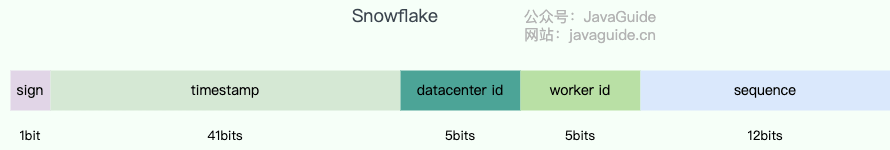

- **sign (1 bit):** The sign bit is always 0, so generated IDs are positive.
- **timestamp (41 bits):** A **relative timestamp** in milliseconds from a custom epoch, covering `2^41` milliseconds (about 69 years). The epoch is often set near the system launch date, such as 2020-01-01, rather than the Unix epoch.
- **datacenter ID + worker ID (10 bits):** Commonly split into 5 bits for a datacenter and 5 for a machine, though projects can choose a different layout. These fields distinguish nodes across clusters and datacenters.
- **sequence (12 bits):** An incrementing sequence number. With the standard 12-bit layout, one Worker can generate at most 4,096 IDs per millisecond. Changing the field size or algorithm changes this limit.

> **⚠️ High-concurrency warning (standard Snowflake):** A standard implementation supports at most 4,096 sequence values per node per millisecond. If requests exceed that in one millisecond, some implementations block until the next millisecond, which can cause latency spikes during flash sales or other traffic peaks. Variants such as Seata's modified algorithm and IdGenerator mitigate this limit by incrementing timestamp/sequence values together or “borrowing” future time, but generated timestamps may briefly be ahead of physical time. Evaluate peak QPS in production; consider multiple instances or increasing the sequence field size if needed.

In practice, Snowflake is often customized. A common change is to include a business-type field in the generated ID.

#### Snowflake Clock Rollback and Mitigation

**Cause:** NTP synchronization, manual clock adjustments, or hardware clock drift can move the system clock backward.

**Mitigation options:**

| Option                             | Advantage                 | Disadvantage                                                                | Use case                                            |
| ---------------------------------- | ------------------------- | --------------------------------------------------------------------------- | --------------------------------------------------- |
| **Reject requests**                | Simple to implement       | Unavailable while the clock is behind                                       | Systems with low availability requirements          |
| **Wait for the clock to catch up** | Preserves ID uniqueness   | A large rollback can block generation and affect service                    | Very small clock adjustments                        |
| **Use a backup Worker ID**         | Can preserve availability | Complex; leases, split brain, and recovery of old instances must be handled | Systems with a reliable registry or lease mechanism |

Using a backup Worker ID is an option, not a general recommendation. It suits systems with a reliable registry or lease mechanism. Other approaches include waiting through small rollbacks, rejecting requests after a threshold, persisting the last timestamp, and using a registry to ensure Worker ID leases are unique. For more on leases, split brain, and recovering old instances, see [Distributed Coordination](./protocol/centralized-and-decentralized.md).

#### The Challenge of Assigning Snowflake Worker IDs

In **containerized environments such as Kubernetes**, assigning Snowflake Worker IDs can be a major challenge:

**Challenges:**

- Pod IP addresses and names are dynamic and may change after a restart.
- Unlike physical machines, Pods cannot be assigned a fixed Worker ID in advance.
- Autoscaling requires Worker IDs to be allocated and released dynamically.

**Common approaches:**

| Approach                   | How it works                                                              | Advantage                            | Disadvantage                                         |
| -------------------------- | ------------------------------------------------------------------------- | ------------------------------------ | ---------------------------------------------------- |
| **ZooKeeper registration** | Create an ephemeral node at startup and use its sequence as the Worker ID | Automatically released after a crash | Depends on ZooKeeper and adds operational complexity |
| **Redis registration**     | Claim an ID with `SETNX` and an expiration                                | Lightweight; no additional component | Must handle Redis outages                            |
| **Database allocation**    | Allocate an ID from a database at startup and persist it locally          | Simple and reliable                  | Depends on the database                              |
| **Dynamic Worker ID**      | Derive an ID from a Pod IP or UID hash                                    | No centralized component             | Hash collisions are possible                         |

**Recommendation:** In production, consider Meituan Leaf, whose Snowflake mode uses ZooKeeper to manage `workId`, or a segment-allocation solution such as Didi Tinyid to avoid Worker ID allocation.

**Snowflake advantages and disadvantages:**

- **Advantages:** Fast generation, roughly increasing IDs, and flexibility to customize the layout, for example by adding a business ID.
- **Disadvantages:** **Clock rollback requires special handling.** Assigning machine IDs can also be awkward when instances start, stop, or scale automatically.

You usually do not need to implement Snowflake yourself. For production, evaluate mature options such as Leaf, Tinyid, IdGenerator, or a cloud-provider ID service. Consider maintenance status, language ecosystem, clock rollback behavior, Worker ID allocation, and benchmark results.

To decode a Snowflake ID, follow its actual bit layout. For the common 41-bit timestamp, 10-bit worker, and 12-bit sequence format, shifting right by 22 bits extracts the relative timestamp; add the custom epoch to get the generation time. Bit masks extract the Worker ID and sequence. Update the decoding logic whenever the field sizes or epoch change.

Seata also introduced a modified Snowflake algorithm intended to handle clock rollback and increase QPS. For details about its design, see:

- [Analysis of Seata's distributed UUID generator based on a modified Snowflake algorithm](https://seata.io/zh-cn/blog/seata-analysis-UUID-generator.html)
- [A modified Snowflake algorithm found in an open-source project](https://www.cnblogs.com/thisiswhy/p/17611163.html)

## Comparing Production-Grade Open-Source Distributed ID Frameworks

When evaluating these frameworks, look beyond feature lists. Check whether the project is maintained, recent release/commit/issue activity, dependencies (MySQL, Redis, ZooKeeper, etcd), clock rollback handling, Worker ID allocation, client-side versus server-side operation, and P99/TP999 latency under documented benchmark conditions.

### UidGenerator (Baidu)

[UidGenerator](https://github.com/baidu/uid-generator) is Baidu's open-source unique ID generator based on Snowflake.

UidGenerator modifies Snowflake and uses the following ID layout:

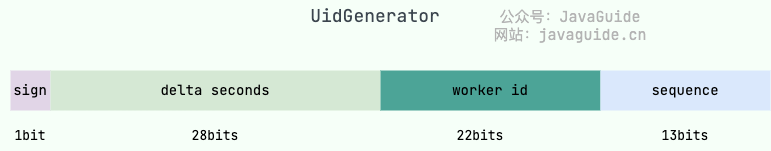

- **sign (1 bit):** Always 0, so generated IDs are positive.
- **delta seconds (28 bits):** Seconds since the epoch `2016-05-20`, supporting about 8.7 years.
- **worker ID (22 bits):** Identifies a machine and supports up to about 4.2 million startups. The built-in implementation allocates IDs from a database at startup and discards them after use by default; a reuse policy can be provided.
- **sequence (13 bits):** Per-second sequence number, supporting up to 8,192 IDs per second.

This layout differs from the original Snowflake format, and its parameters can be customized.

The official UidGenerator documentation describes it as follows:

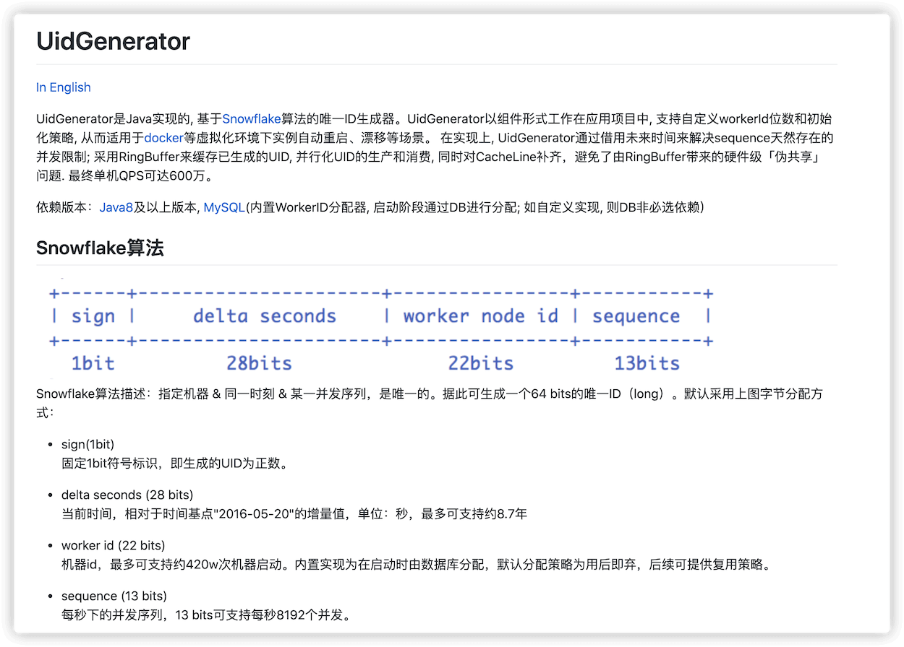

The official UidGenerator repository has been inactive for a long time. Do not choose it for a new project based on name recognition alone; first assess maintenance, dependency security, and the fork ecosystem. See the [UidGenerator documentation](https://github.com/baidu/uid-generator/blob/master/README.zh_cn.md) for details.

### Leaf (Meituan)

[Leaf](https://github.com/Meituan-Dianping/Leaf) is Meituan's open-source distributed ID solution. Its name comes from a saying attributed to German philosopher and mathematician Gottfried Leibniz: “There are no two identical leaves in the world.”

Leaf provides **segment allocation** and **Snowflake** modes. It supports double-segment buffering and handles clock rollback in its Snowflake mode. This clock handling has a soft dependency on ZooKeeper, which acts as a registry and manages `workId` through child nodes under a specified path.

Leaf was created to replace the varied and unreliable distributed ID generation methods used across Meituan's business units.

Leaf's key optimization to segment allocation is **double buffering**:

> **How it works:** Leaf does not wait for a segment to run out before requesting another from the database. Once the current segment reaches a threshold, a background thread requests the next segment and preloads it into memory. Check the current Leaf source for the threshold and implementation details. Double buffering can smooth TP999 ID retrieval latency and reduce database-related latency spikes.

Image from Meituan's article: [Leaf: Meituan's Distributed ID Generation System](https://tech.meituan.com/2017/04/21/mt-leaf.html).

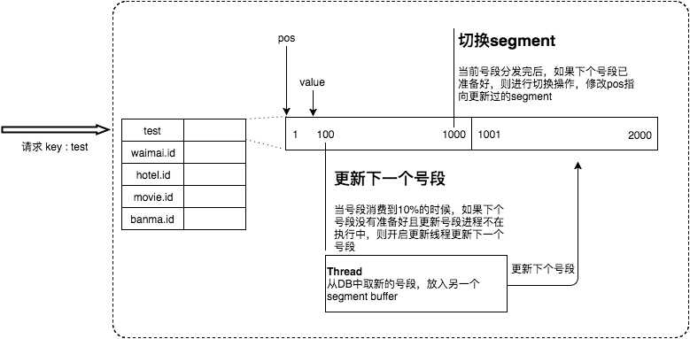

According to the original Meituan article and project README benchmarks, Leaf reached nearly 50,000 QPS with about 1 ms TP999 latency on a 4-core, 8-GB VM using Meituan's RPC setup. Treat these figures as a reference; actual performance depends on the database, RPC framework, network, segment size, and deployment.

### Tinyid (Didi)

[Tinyid](https://github.com/didi/tinyid) is Didi's open-source unique ID generator based on database segment allocation.

The database segment allocation approach was described above. **What does Tinyid add?**

To answer that, first consider a basic architecture using database segment allocation. (Image from Tinyid's [official wiki: Tinyid design](https://github.com/didi/tinyid/wiki/tinyid%E5%8E%9F%E7%90%86%E4%BB%8B%E7%BB%8D).)

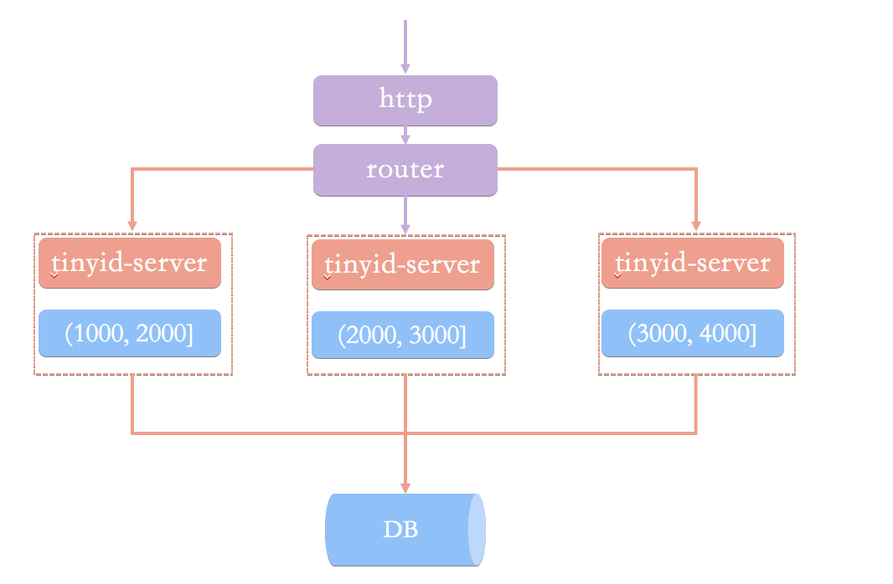

In this architecture, clients request unique IDs from an ID-generation service over HTTP. A load-balancing router forwards each request to one of the `tinyid-server` instances.

This approach has two main drawbacks, also described in Tinyid's official wiki:

- When a new segment is needed, ID generation can be slow.
- Ensuring database high availability is difficult and resource-intensive.

HTTP calls also add network overhead.

Tinyid's architecture is shown below:

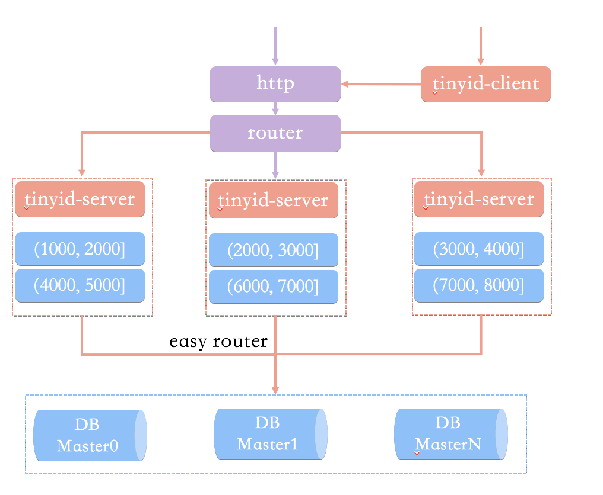

Compared with the basic database segment architecture, Tinyid makes these improvements:

- **Double-segment caching:** Tinyid asynchronously loads the next segment when the current one is partly consumed, keeping an available segment in memory and avoiding delays when fetching a new one.
- **Multiple database support:** Using multiple databases can improve availability. Their segment ranges, steps, or business partitions must not overlap, and failover must not reissue IDs that have already been allocated.
- **`tinyid-client`:** Performs generation locally without HTTP requests, improving performance and availability.

Its advantages and disadvantages follow from those of database segment allocation and the design described above.

### IdGenerator (individual project)

Like UidGenerator and Leaf, [IdGenerator](https://github.com/yitter/IdGenerator) is a unique ID generator based on Snowflake.

The project lists these features:

- Generates shorter unique IDs.
- Is compatible with multiple Snowflake variants, including segment-based and classic layouts.
- Provides native support for C#, Java, Go, C, Rust, Python, Node.js, PHP (C extension), SQL, and other languages, with a thread-safe FFI library.
- Handles clock rollback and supports manually inserting IDs. For business cases that need IDs for historical timestamps, reserved bits can generate 5,000 IDs per second.
- Does not depend on external storage.
- Claims that, with the default configuration, IDs can be generated without repetition for 71,000 years.

These claims depend on the bit layout, epoch, Worker ID, and sequence settings. Calculate capacity from your own configuration and benchmark it before production use; do not treat advertised defaults as guarantees for every workload.

An IdGenerator ID has this layout:

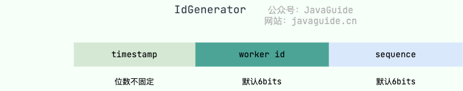

- **timestamp (variable width):** The difference, in milliseconds, between the system time when the ID is generated and `BaseTime` (the epoch, defaulting to 2020). It starts at 5 bits and grows over time. The base time can be reset, but should remain fixed afterward.
- **worker ID (6 bits by default):** Identifies a machine or application. Its maximum value is set by `WorkerIdBitLength` (6 by default). If multiple independent services run on one server, assign each a different Worker ID.
- **sequence (6 bits by default):** Per-millisecond sequence number, limited by `SeqBitLength` (6 by default). Increasing `SeqBitLength` can improve throughput but also makes IDs longer.

Java example: <https://github.com/yitter/idgenerator/tree/master/Java>.

## Summary

This article has covered the most common distributed ID generation strategies.

Middleware such as ZooKeeper can also help generate unique IDs. **There is no one-size-fits-all solution; choose based on your project's requirements.**

Finally, do not treat gap-free IDs as a requirement unless the business truly needs them. Most systems need uniqueness, not continuity; consecutive IDs may also reveal business volume. Segment allocation, Snowflake, and UUIDs can all produce gaps, which are usually not bugs. For ordering, prefer a creation-time field instead of relying solely on IDs.

**Summary comparison:**

| **Strategy**                | **Performance** | **Ordering**                               | **Operational cost** | **Use case**                                                                                        |
| --------------------------- | --------------- | ------------------------------------------ | -------------------- | --------------------------------------------------------------------------------------------------- |
| **Database auto-increment** | Low             | Strictly increasing                        | Low                  | Low traffic, single-instance applications, and back-office systems                                  |
| **Segment allocation**      | High            | Roughly increasing                         | Medium               | High-concurrency applications that need high throughput                                             |
| **Redis**                   | Very high       | Increases for one key on a healthy primary | Medium               | Existing Redis deployments that can tolerate a small risk of ID rollback                            |
| **Snowflake**               | High            | Roughly increasing                         | Medium               | Medium-to-large distributed systems that can manage Worker IDs, clock rollback, and capacity        |
| **UUID v7**                 | High            | Roughly time-ordered                       | Very low             | Cloud-native systems seeking an out-of-the-box option; use a uniqueness constraint for primary keys |

This article focuses on distributed ID concepts. Interviewers may ask how to design IDs for specific business scenarios. See [Distributed ID Design Guide](./distributed-id-design.md), which is also useful in practice.

<!-- @include: @article-footer.snippet.md -->
