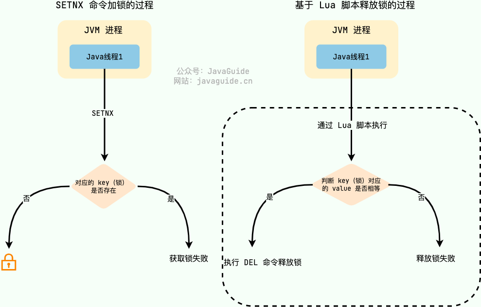
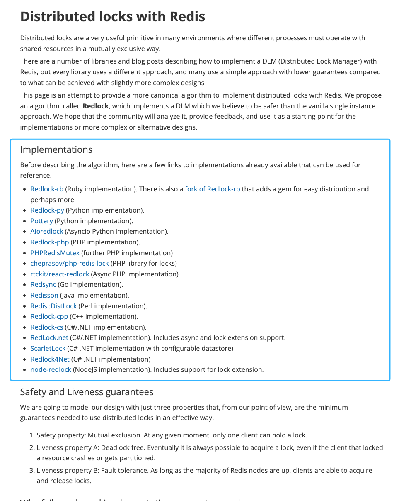
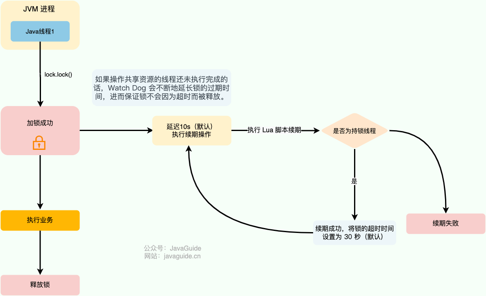
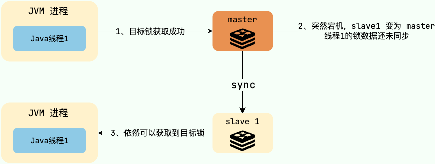
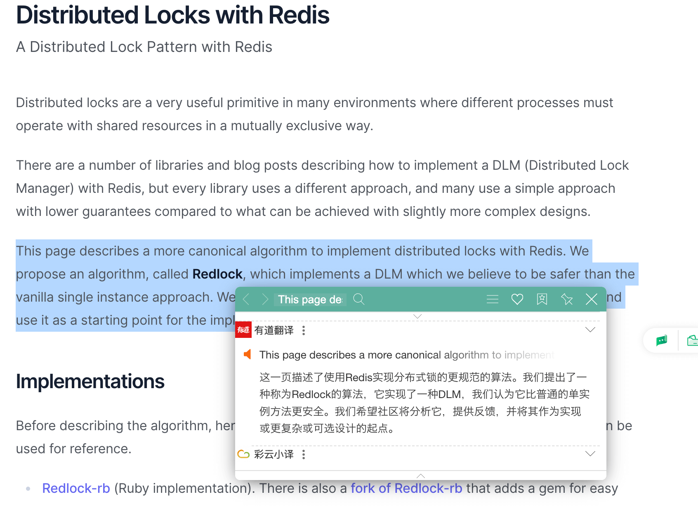
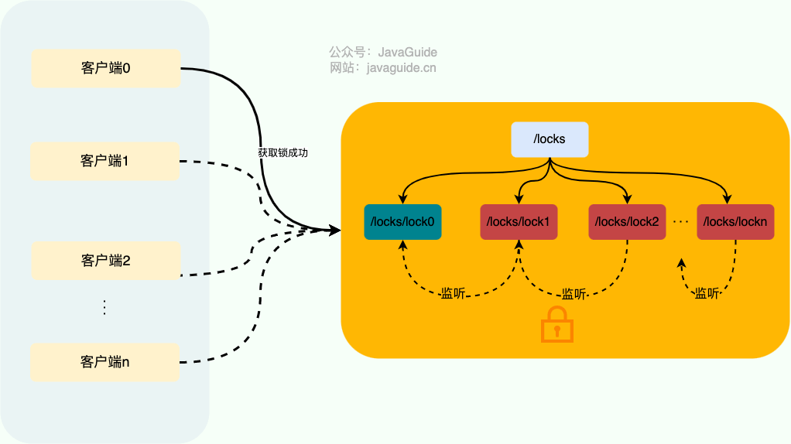

Distributed locks are commonly implemented with Redis or ZooKeeper. Redis is used more often, so this guide starts with Redis.

This guide assumes you already know why distributed locks are needed. If lock granularity, owner tokens, lock timeouts, and critical sections are unclear, start with [Distributed Locks: An Introduction](./distributed-lock.md). To understand lock expiration, recovery of stale clients, and fencing tokens within a broader coordination model, also see [Distributed Coordination](./protocol/centralized-and-decentralized.md).

## Implementing Distributed Locks with Redis

### How Can You Implement a Minimal Distributed Lock with Redis?

Whether local or distributed, the core property of a lock is mutual exclusion.

In Redis, the `SETNX` command can provide mutual exclusion. `SETNX` means **SET** if **N**ot e**X**ists (equivalent to Java's `setIfAbsent` method): it sets the key only if it does not already exist. If the key exists, `SETNX` does nothing.

```bash
> SETNX lockKey uniqueValue
(integer) 1
> SETNX lockKey uniqueValue
(integer) 0
```

To release the lock, delete the corresponding key with `DEL`.

```bash
> DEL lockKey
(integer) 1
```

To avoid deleting another client's lock, use a Lua script to check that the key's value matches the unique value written when acquiring the lock, then delete it only if they match.

Lua makes the unlock operation atomic. Redis executes Lua scripts atomically, which ensures that checking the value and releasing the lock happen as one operation.

```lua
-- Compare the key's value with the unique value written when acquiring the lock.
-- Delete the key only if they match, so another client's lock is not removed.
if redis.call("get", KEYS[1]) == ARGV[1] then
    return redis.call("del", KEYS[1])
else
    return 0
end
```



This is a simple and efficient Redis distributed lock implementation, but it has some problems. For example, if the application crashes before releasing the lock, the lock may remain indefinitely, preventing other threads or processes from accessing the shared resource.

### Why Should a Lock Have an Expiration Time?

One way to prevent a lock from remaining indefinitely is to **set an expiration time on its key**.

```bash
127.0.0.1:6379> SET lockKey uniqueValue EX 3 NX
OK
```

- **lockKey**: The name of the lock.
- **uniqueValue**: A random string that uniquely identifies the lock.
- **NX**: The `SET` succeeds only if the key does not already exist.
- **EX**: Sets the expiration time in seconds. `EX 3` makes the lock expire automatically after three seconds. `PX` provides the same option in milliseconds.

**Setting the key and its expiration time must be one atomic operation.** Otherwise, the lock may still remain indefinitely.

Why use `SET NX EX` instead of calling `SETNX` and then `EXPIRE`? The older two-step approach could leave a permanent lock if the client crashed after `SETNX` succeeded but before `EXPIRE` ran. Redis 2.6.12 and later support atomic forms such as `SET key value NX EX seconds`; prefer this form to avoid that deadlock risk.

This addresses the problem, but introduces another one: **if an operation takes longer than the lock's expiration time, the lock expires too early and the distributed lock becomes ineffective. Setting the timeout too high can also hurt performance.**

This is why fencing tokens are needed: simply extending the TTL cannot eliminate the window in which client A still believes it holds the lock, even though the lock has expired and client B has acquired it.

You might be thinking: **it would be useful if the lock could renew its expiration while the operation on the shared resource is still running.**

### How Can a Lock Renew Its Expiration Automatically?

For Java developers, **[Redisson](https://github.com/redisson/redisson)** provides a ready-made solution. Solutions for other languages are covered in the [Redis documentation](https://redis.io/docs/latest/develop/clients/patterns/distributed-locks/).



Redisson is an open-source Redis client for Java. It provides many ready-to-use features, including several distributed lock implementations, and supports deployment architectures such as standalone Redis, Redis Sentinel, and Redis Cluster.

Redisson's distributed locks automatically renew their expiration. It provides a **watchdog** that monitors and renews the lock. If the thread operating on the shared resource has not finished, the watchdog keeps extending the lock's expiration so it is not released due to a timeout.



The watchdog's timeout is returned by `getLockWatchdogTimeout()`. This is the expiration interval used when renewing the lock, and defaults to 30 seconds (based on [Redisson 3.17.6](https://github.com/redisson/redisson/releases/tag/redisson-3.17.6)). Redisson is now in the 4.x series; check the source for `Config#getLockWatchdogTimeout` and `RedissonBaseLock#renewExpiration` in the version used by your project for the exact configuration semantics.

```java
// Defaults to 30 seconds; configurable.
private long lockWatchdogTimeout = 30 * 1000;

public Config setLockWatchdogTimeout(long lockWatchdogTimeout) {
    this.lockWatchdogTimeout = lockWatchdogTimeout;
    return this;
}
public long getLockWatchdogTimeout() {
   return lockWatchdogTimeout;
}
```

The `renewExpiration()` method contains the watchdog's main logic:

```java
private void renewExpiration() {
         // ...
        Timeout task = commandExecutor.getConnectionManager().newTimeout(new TimerTask() {
            @Override
            public void run(Timeout timeout) throws Exception {
                // ...
                // Renew asynchronously using a Lua script.
                CompletionStage<Boolean> future = renewExpirationAsync(threadId);
                future.whenComplete((res, e) -> {
                    if (e != null) {
                        // Renewal failed.
                        log.error("Can't update lock " + getRawName() + " expiration", e);
                        EXPIRATION_RENEWAL_MAP.remove(getEntryName());
                        return;
                    }

                    if (res) {
                        // The timer callback schedules the next renewal without growing the call stack.
                        renewExpiration();
                    } else {
                        // Cancel renewal.
                        cancelExpirationRenewal(null);
                    }
                });
            }
         // Invoke after internalLockLeaseTime / 3 (10 seconds by default, or 30 / 3).
        }, internalLockLeaseTime / 3, TimeUnit.MILLISECONDS);

        ee.setTimeout(task);
    }
```

By default, the watchdog renews the lock every 10 seconds and sets its expiration to 30 seconds. Before renewing, it checks whether renewal is still needed; otherwise, it cancels renewal.

The watchdog renews the lock asynchronously by calling `renewExpirationAsync()`:

```java
protected CompletionStage<Boolean> renewExpirationAsync(long threadId) {
    return evalWriteAsync(getRawName(), LongCodec.INSTANCE, RedisCommands.EVAL_BOOLEAN,
            // Check whether this thread holds the lock. If so, renew it for 30 seconds (the default).
            "if (redis.call('hexists', KEYS[1], ARGV[2]) == 1) then " +
                    "redis.call('pexpire', KEYS[1], ARGV[1]); " +
                    "return 1; " +
                    "end; " +
                    "return 0;",
            Collections.singletonList(getRawName()),
            internalLockLeaseTime, getLockName(threadId));
}
```

The `renewExpirationAsync` method uses a Lua script to renew the lock, which keeps the renewal operation atomic.

This example uses Redisson's reentrant lock, `RLock`, to show how to implement a distributed lock with Redisson:

```java
// 1. Get the specified distributed lock.
RLock lock = redisson.getLock("lock");
// 2. Acquire it without a timeout; the watchdog renews it automatically.
lock.lock();
// 3. Run the business operation.
...
// 4. Release the lock.
lock.unlock();
```

The watchdog renews the lock only when no expiration time is specified.

```java
// Set an expiration time manually; the watchdog will not renew the lock.
lock.lock(10, TimeUnit.SECONDS);
```

If you use Redis for distributed locks, Redisson is a good choice.

### How Can You Implement a Reentrant Lock?

A reentrant lock lets the same thread acquire the same lock multiple times. For example, if a thread calls a method guarded by a lock, and that method calls another method guarded by the same lock, the thread can enter the second method without acquiring the lock again. Java's `synchronized` and `ReentrantLock` are reentrant locks.

**Non-reentrant distributed locks are sufficient for most business scenarios. Some special cases may require reentrant distributed locks.**

The core idea is to check whether the lock is already held by the requesting thread. If it is, the thread can reuse the lock. Each lock therefore needs a reentrancy counter and the identity of its owning thread. When the counter is greater than zero, the lock is held, so the system must check whether the owner and requester are the same thread.

In practice, you do not need to implement this yourself. **Redisson**, introduced above, provides several types of locks, including reentrant, spin, fair, multi-lock, RedLock, and read-write locks.


### How Can Redis Distributed Locks Remain Reliable in a Cluster?

Redis is usually deployed as a cluster in production to avoid a single point of failure.

The Redis lock described above has a reliability problem in a cluster. Redis replication is asynchronous by default: after writing a lock, the primary immediately responds to the client and then replicates the data to its replicas. If the primary crashes before replication, Sentinel or Redis Cluster may promote a replica that never received the lock. The original lock is lost, so another client can acquire the lock and break mutual exclusion.



To address this problem, Redis creator antirez designed the [Redlock algorithm](https://redis.io/docs/latest/develop/clients/patterns/distributed-locks/).



Redlock has a client request the lock from multiple independent Redis masters in sequence. If it acquires the lock on a strict majority of the instances, the client is considered to hold the distributed lock; otherwise, acquisition fails.

The full Redlock criteria are:

- Use N independent Redis masters (not Redis Cluster shards).
- The client records the start time.
- It requests the lock from each node in turn, using the same key, value, and TTL, with a short timeout for each request so that one slow node does not delay acquisition too long.
- Acquisition succeeds only if at least `N/2 + 1` nodes grant the lock and the total time is less than the TTL.
- The lock's effective validity is approximately `TTL - acquisition time - clock-drift margin`.
- On failure, send release requests to every node, including those where acquisition failed or timed out.

Redlock operates directly on independent Redis nodes rather than through Redis Cluster. This avoids losing the lock when a single primary-replica shard fails over.

Redlock is relatively complex and has lower performance. Clock changes can also create safety concerns. Martin Kleppmann, author of _Designing Data-Intensive Applications_, published a critique of Redlock in [“How to do distributed locking” (2016)](https://martin.kleppmann.com/2016/02/08/how-to-do-distributed-locking.html), arguing that it is a poor distributed lock implementation. For more detail, see [From Redis Lock Interview Questions to the Redlock Debate](https://mp.weixin.qq.com/s?__biz=Mzg3NjU3NTkwMQ==&mid=2247505097&idx=1&sn=5c03cb769c4458350f4d4a321ad51f5a&source=41#wechat_redirect), which covers the discussion between antirez and Martin Kleppmann.

How do you decide whether to use Redlock? First distinguish between the lock's use cases:

1. For **efficiency-oriented locking**, where lock failure may cause acceptable outcomes such as duplicate computation or task execution, you can use standalone Redis, Sentinel, or Cluster, while explicitly accepting the risk of occasional concurrent execution in extreme cases.
2. For **correctness-oriented locking**, where lock failure could cause unacceptable outcomes such as incorrect inventory or account balances, or data corruption, prefer ZooKeeper or etcd with fencing tokens. Do not rely on Redis primary-replica failover to guarantee strict mutual exclusion.
3. Redlock assumes bounded network delays, process pauses, and clock drift. Long GC pauses, clock jumps, and delayed messages can weaken its correctness.
4. Kleppmann's main point is that correctness-oriented locks require fencing tokens. antirez's response emphasizes that clock drift is limited in practical systems and random values prevent accidental lock deletion. Choose a solution based on the use case.

## Implementing Distributed Locks with ZooKeeper

Compared with Redis, ZooKeeper can provide greater reliability and offers another useful feature: **watches**. Watches can be used to implement fair distributed locks. However, ZooKeeper locks generally perform worse, so ZooKeeper may not be suitable when performance is critical.

### How Can You Implement a Distributed Lock with ZooKeeper?

ZooKeeper distributed locks use **ephemeral sequential nodes** and **watchers (event listeners)**.

To acquire the lock:

1. Create a persistent `/locks` node. A client requests the lock by creating an ephemeral sequential node under `/locks`.
2. Suppose Client 1 creates `/locks/lock1`. It then checks whether `lock1` is the smallest child node under `/locks`.
3. If `lock1` is the smallest child, the client has acquired the lock. Otherwise, acquisition fails.
4. A failed acquisition means another client holds the lock. Client 1 does not repeatedly poll. Instead, it registers a watcher on the previous node, such as `/locks/lock0`. When that node is removed, the watcher notifies Client 1, avoiding busy waiting and allowing it to try again.

To release the lock:

1. After completing its business operation, the client that acquired the lock deletes its corresponding child node.
2. If the client fails, its ephemeral sequential node is deleted automatically, preventing the lock from remaining held indefinitely.
3. The watcher listens for deletion of this child node, which indicates that the lock has been released.



For real projects, Curator is recommended for implementing ZooKeeper distributed locks. Curator is an open-source ZooKeeper client framework for Java, originally created by Netflix. It provides a more complete abstraction than ZooKeeper's native client and makes its APIs easier to use.

Curator provides these four main lock types:

- `InterProcessMutex`: A distributed reentrant exclusive lock.
- `InterProcessSemaphoreMutex`: A distributed non-reentrant exclusive lock.
- `InterProcessReadWriteLock`: A distributed read-write lock.
- `InterProcessMultiLock`: A container that manages multiple locks as one. Acquiring it acquires all locks; releasing it releases all lock resources, ignoring any lock whose release fails.

```java
CuratorFramework client = ZKUtils.getClient();
client.start();
// Distributed reentrant exclusive lock.
InterProcessLock lock1 = new InterProcessMutex(client, lockPath1);
// Distributed non-reentrant exclusive lock.
InterProcessLock lock2 = new InterProcessSemaphoreMutex(client, lockPath2);
// Manage multiple locks as one.
InterProcessMultiLock lock = new InterProcessMultiLock(Arrays.asList(lock1, lock2));

if (!lock.acquire(10, TimeUnit.SECONDS)) {
   throw new IllegalStateException("Could not acquire all locks");
}
System.out.println("Acquired all locks");
System.out.println("First lock acquired: " + lock1.isAcquiredInThisProcess());
System.out.println("Second lock acquired: " + lock2.isAcquiredInThisProcess());
try {
    // Use the resource.
    resource.use();
} finally {
    System.out.println("Releasing all locks");
    lock.release();
}
System.out.println("First lock acquired: " + lock1.isAcquiredInThisProcess());
System.out.println("Second lock acquired: " + lock2.isAcquiredInThisProcess());
client.close();
```

### Why Use Ephemeral Sequential Nodes?

Each data node in ZooKeeper is called a **znode**. It is the smallest unit of data in ZooKeeper.

Znodes are generally divided into four types:

- **Persistent (`PERSISTENT`) nodes**: Remain until deleted, even if the ZooKeeper cluster goes down.
- **Ephemeral (`EPHEMERAL`) nodes**: Their lifetime is bound to the **client session**; **when the session ends, the node is deleted**. **Ephemeral nodes can only be leaf nodes** and cannot have children.
- **Persistent sequential (`PERSISTENT_SEQUENTIAL`) nodes**: Have the properties of persistent nodes, and their child names include a sequence number, such as `/node1/app0000000001` and `/node1/app0000000002`.
- **Ephemeral sequential (`EPHEMERAL_SEQUENTIAL`) nodes**: Have the properties of ephemeral nodes, and their child names include a sequence number.

The key difference between ephemeral and persistent nodes is how they handle session expiration. When the session ends, the ephemeral node is deleted. If a client fails before releasing its lock, session expiration removes the node automatically and prevents a crashed process from holding the lock forever.

ZooKeeper still requires consideration of GC pauses, network partitions, and session timeouts. If a long GC pause or network partition causes a session to expire, ZooKeeper deletes the ephemeral node and lets a new client acquire the lock. The old client may not yet know that its session expired and may still believe it holds the lock. For correctness-critical scenarios, use fencing tokens to prevent a recovered stale client from writing outdated data.

Redis uses expiration times to prevent deadlocks caused by locks that are not released. ZooKeeper uses ephemeral nodes to handle lock release after a client crashes.

Without sequential nodes, every client waiting for the lock would watch the node holding it. When the lock is released, all waiting clients would compete to acquire it, which hurts performance. With sequential nodes, each client only needs to watch its immediate predecessor, which is more efficient.

### Why Watch the Previous Node?

> A watcher is an important ZooKeeper feature. Users can register watchers on specific nodes, and when certain events occur, the ZooKeeper server notifies interested clients. This mechanism is essential to ZooKeeper's distributed coordination service.

Many clients may request a lock at the same time, but only one can acquire it. A client that fails to acquire the lock knows another client holds it. Instead of continuously retrying, it registers a watcher on the previous node.

The watcher works as follows: **when the client holding the previous node releases its lock (the node is deleted, which triggers the watcher), the waiting client is notified. Its waiting thread is awakened (using Java's `wait/notifyAll`), tries to acquire the lock, and can then succeed.**

### How Does Curator Implement a Reentrant Lock?

This section uses Curator's reentrant lock implementation, `InterProcessMutex` (source: [InterProcessMutex.java](https://github.com/apache/curator/blob/master/curator-recipes/src/main/java/org/apache/curator/framework/recipes/locks/InterProcessMutex.java)).

When we call `InterProcessMutex#acquire` to acquire the lock, it calls `InterProcessMutex#internalLock`.

```java
// Acquire the reentrant mutex, waiting until successful.
@Override
public void acquire() throws Exception {
  if (!internalLock(-1, null)) {
    throw new IOException("Lost connection while trying to acquire lock: " + basePath);
  }
}
```

The `internalLock` method gets the thread requesting the lock, then retrieves its `lockData` from `threadData` (a `ConcurrentMap<Thread, LockData>`). `lockData` contains information about the lock and the number of times it has been acquired, which is key to implementing reentrancy.

On the first lock attempt, `lockData` is `null`. After successfully acquiring the lock, the current thread and its `lockData` are added to `threadData`.

```java
private boolean internalLock(long time, TimeUnit unit) throws Exception {
  // Get the thread requesting the lock.
  Thread currentThread = Thread.currentThread();
  // Get its lockData.
  LockData lockData = threadData.get(currentThread);
  // lockData is null on the first attempt.
  if (lockData != null) {
    // The current thread already acquired the lock.
    // Increment lockCount and return, allowing the thread to reenter.
    lockData.lockCount.incrementAndGet();
    return true;
  }
  // Try to acquire the lock.
  String lockPath = internals.attemptLock(time, unit, getLockNodeBytes());
  if (lockPath != null) {
    LockData newLockData = new LockData(currentThread, lockPath);
    // After acquisition, store the current thread and its lockData in threadData.
    threadData.put(currentThread, newLockData);
    return true;
  }

  return false;
}
```

`LockData` is a static nested class in `InterProcessMutex`.

```java
private final ConcurrentMap<Thread, LockData> threadData = Maps.newConcurrentMap();

private static class LockData
{
    // Thread currently holding the lock.
    final Thread owningThread;
    // Child node corresponding to the lock.
    final String lockPath;
    // Number of times the lock was acquired.
    final AtomicInteger lockCount = new AtomicInteger(1);

    private LockData(Thread owningThread, String lockPath)
    {
      this.owningThread = owningThread;
      this.lockPath = lockPath;
    }
}
```

If the thread has already acquired the lock, a subsequent attempt is handled by the `if (lockData != null)` branch, which calls `lockData.lockCount.incrementAndGet()` to increment the acquisition count.

The reentrant lock implementation is simple: the client checks whether the current thread already holds the lock and, if so, increments the acquisition count.

Note the limits of reentrancy: Curator's `InterProcessMutex` is reentrant only for the same thread within the same JVM. Redisson's `RLock` also records the lock-holding thread and reentrancy count using `UUID:threadId`; it does not make the same business user reentrant across JVMs or threads. For business-level reentrancy across processes or JVMs, design business identity, idempotency, and deduplication at the application layer.

## Applying Fencing Tokens in Practice

A fencing token is simply a monotonically increasing version number. It works only when the resource validates it. Clients must include the token when accessing a database, object store, or external resource. The resource must store the largest token it has seen and reject writes with smaller tokens. Generating tokens alone is not enough.

Common implementation approaches include:

| Storage/system | Token source                                      | Validation method                                                                                                            |
| -------------- | ------------------------------------------------- | ---------------------------------------------------------------------------------------------------------------------------- |
| MySQL          | Add a `fencing_token` field to the business table | `UPDATE ... SET fencing_token = ? WHERE id = ? AND ? > fencing_token` ensures the new token is greater than the stored token |
| Object storage | Include a token or version condition on writes    | Use conditional writes or object version checks                                                                              |
| ZooKeeper      | Consider `zxid` or znode stat version             | The resource rejects writes with an older version                                                                            |
| etcd           | `revision` / `mod_revision`                       | Validate the version with a conditional transaction (`Txn`)                                                                  |

If an external resource does not support conditional writes or version checks, it is not suitable for correctness-critical distributed locking. Consider a stronger-consistency coordination service or change the resource write path to validate tokens.

This is the source of the “lock expires too early” problem described above: extending the TTL alone cannot eliminate the window in which Client A still believes it holds the lock, even though the lock has expired and Client B has acquired it. A fencing token provides a safeguard through version validation at the resource.

## Brief Comparison of etcd and Consul

- **etcd**: Built on Raft, it provides leases, transactions, and revisions, making it a natural fit for coordination with fencing. It is common in cloud-native and Kubernetes ecosystems.
- **Consul**: Provides sessions and locks, but session TTL misjudgment and fencing still need to be considered.

ZooKeeper and Curator are more established in the Java ecosystem, while etcd is more common in cloud-native and Kubernetes ecosystems.

Choose based on your team's existing infrastructure, client ecosystem, performance requirements, and ability to handle failures.

## Summary

This guide covered two common ways to implement distributed locks: **Redis** and **ZooKeeper**, with a brief comparison of etcd and Consul. Choose the approach that best fits the business requirements.

- If performance is important and the risk of occasional concurrent execution in extreme cases is acceptable, Redis can be used for distributed locks. Prefer the ready-made implementation provided by **Redisson** over writing your own.
- If reliability and correctness are critical, consider ZooKeeper or etcd with fencing tokens. **Curator** is recommended for ZooKeeper locks. However, many projects do not otherwise use ZooKeeper, so introducing it solely for distributed locks may add unnecessary system complexity for a small feature.

Regardless of the implementation—Redis, ZooKeeper, or etcd—any lease-based distributed lock has a window in which a client may believe it still holds the lock during events such as process GC pauses, network delays, network partitions, or clock drift. To improve reliability, use a resource-side safeguard such as a fencing token to prevent stale clients from writing.

<!-- @include: @article-footer.snippet.md -->
