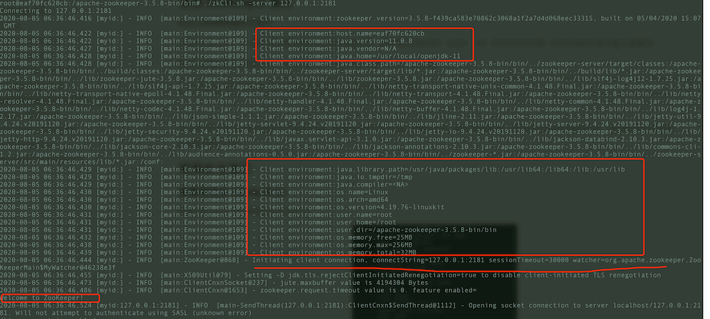
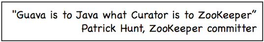

This guide demonstrates common ZooKeeper commands and basic use of the Curator Java client. These operations cover everyday needs.

This is a practical guide. For ZNodes, Watchers, and sessions, start with [ZooKeeper Fundamentals](./zookeeper-intro.md); then read [Advanced ZooKeeper](./zookeeper-plus.md) or [ZAB Explained](../../protocol/zab.md) for protocol and cluster details.

Suggestions for improvements are welcome in the comments.

## Installing ZooKeeper

### Install ZooKeeper with Docker

**a. Download ZooKeeper with Docker**

```shell
docker pull zookeeper:3.5.8
```

**b. Run ZooKeeper**

```shell
docker run -d --name zookeeper -p 2181:2181 zookeeper:3.5.8
```

### Connect to ZooKeeper

**a. Enter the ZooKeeper container**

Use `docker ps` to find the ZooKeeper container ID, then enter it with `docker exec -it ContainerID /bin/bash`.

**b. Enter the bin directory, then connect with `./zkCli.sh -server 127.0.0.1:2181`**

```bash
root@eaf70fc620cb:/apache-zookeeper-3.5.8-bin# cd bin
```

The following console output indicates a successful connection.



## Common ZooKeeper commands

### Show commands with `help`

Use `help` to list common ZooKeeper commands.

### Create a node with `create`

Create `/node1` with the associated string `node1`:

```shell
[zk: 127.0.0.1:2181(CONNECTED) 34] create /node1 “node1”
```

Create the child node `/node1/node1.1` with the value `123`:

```shell
[zk: 127.0.0.1:2181(CONNECTED) 1] create /node1/node1.1 123
Created /node1/node1.1
```

### Update node data with `set`

```shell
[zk: 127.0.0.1:2181(CONNECTED) 11] set /node1 "set node1"
```

### Read node data with `get`

`get` returns a node’s data and status. The earlier `set` command changed the data to `set node1`.

```shell
[zk: zookeeper(CONNECTED) 12] get -s /node1
set node1
cZxid = 0x47
ctime = Sun Jan 20 10:22:59 CST 2019
mZxid = 0x4b
mtime = Sun Jan 20 10:41:10 CST 2019
pZxid = 0x4a
cversion = 1
dataVersion = 1
aclVersion = 0
ephemeralOwner = 0x0
dataLength = 9
numChildren = 1

```

### List child nodes with `ls`

List nodes under the root:

```shell
[zk: 127.0.0.1:2181(CONNECTED) 37] ls /
[dubbo, ZooKeeper, node1]
```

List nodes under `/node1`:

```shell
[zk: 127.0.0.1:2181(CONNECTED) 5] ls /node1
[node1.1]
```

Like Linux `ls`, ZooKeeper `ls` lists the immediate children of an absolute path; it does not recurse.

### View node status with `stat`

Use `stat` to inspect a node:

```shell
[zk: 127.0.0.1:2181(CONNECTED) 10] stat /node1
cZxid = 0x47
ctime = Sun Jan 20 10:22:59 CST 2019
mZxid = 0x47
mtime = Sun Jan 20 10:22:59 CST 2019
pZxid = 0x4a
cversion = 1
dataVersion = 0
aclVersion = 0
ephemeralOwner = 0x0
dataLength = 11
numChildren = 1
```

Fields such as `cversion`, `aclVersion`, and `numChildren` are explained in [ZooKeeper Fundamentals](https://javaguide.cn/distributed-system/distributed-process-coordination/zookeeper/zookeeper-intro.html).

### List children and status with `ls2`

`ls2` combines `ls` and `stat`, returning:

1. The child node list.
2. The current node’s status.

```shell
[zk: 127.0.0.1:2181(CONNECTED) 7] ls2 /node1
[node1.1]
cZxid = 0x47
ctime = Sun Jan 20 10:22:59 CST 2019
mZxid = 0x47
mtime = Sun Jan 20 10:22:59 CST 2019
pZxid = 0x4a
cversion = 1
dataVersion = 0
aclVersion = 0
ephemeralOwner = 0x0
dataLength = 11
numChildren = 1

```

### Delete a node with `delete`

The node must have no children before it can be deleted.

```shell
[zk: 127.0.0.1:2181(CONNECTED) 3] delete /node1/node1.1
```

The following section introduces the Java client API and the open-source Curator client; ZkClient is another available client.

## Using the Curator Java client

Curator is a ZooKeeper Java client framework open-sourced by Netflix. It provides higher-level wrappers and convenient APIs compared with the native client.



The following examples demonstrate basic Curator operations.

Curator 4.0+ supports ZooKeeper 3.5.x. Add these dependencies before starting:

```xml
<dependency>
    <groupId>org.apache.curator</groupId>
    <artifactId>curator-framework</artifactId>
    <version>4.2.0</version>
</dependency>
<dependency>
    <groupId>org.apache.curator</groupId>
    <artifactId>curator-recipes</artifactId>
    <version>4.2.0</version>
</dependency>
```

### Connect the client

Create a `CuratorFramework` with `CuratorFrameworkFactory`, then call `start()`:

```java
private static final int BASE_SLEEP_TIME = 1000;
private static final int MAX_RETRIES = 3;

// Retry strategy. Retry 3 times, and will increase the sleep time between retries.
RetryPolicy retryPolicy = new ExponentialBackoffRetry(BASE_SLEEP_TIME, MAX_RETRIES);
CuratorFramework zkClient = CuratorFrameworkFactory.builder()
    // the server to connect to (can be a server list)
    .connectString("127.0.0.1:2181")
    .retryPolicy(retryPolicy)
    .build();
zkClient.start();
```

Key parameters:

- `baseSleepTimeMs`：Initial delay between retries
- `maxRetries`：Maximum retry count
- `connectString`：Server list
- `retryPolicy`：Retry policy

### Create, read, update, and delete nodes

#### Create nodes

[ZooKeeper Fundamentals](./zookeeper-intro.md) describes four common znode types:

- **Persistent (`PERSISTENT`):** Remains until deleted, even if the cluster stops.
- **Ephemeral (`EPHEMERAL`):** Bound to the client session and removed when that session ends. Ephemeral nodes must be leaves and cannot have children.
- **Persistent sequential (`PERSISTENT_SEQUENTIAL`):** Persistent, with sequential child names such as `/node1/app0000000001` and `/node1/app0000000002`.
- **Ephemeral sequential (`EPHEMERAL_SEQUENTIAL`):** Ephemeral, with sequential child names.

`CreateMode` contains seven znode types; these four are the most common.

**a. Create persistent nodes**

Either of these calls creates a persistent node:

```java
//Note: these calls fail for the reason explained below.
zkClient.create().forPath("/node1/00001");
zkClient.create().withMode(CreateMode.PERSISTENT).forPath("/node1/00002");
```

These calls fail if the parent `/node1` has not been created.

Create the parent first:

```java
zkClient.create().forPath("/node1");
```

Alternatively, **`creatingParentsIfNeeded()` creates missing parent nodes automatically**:

```java
zkClient.create().creatingParentsIfNeeded().withMode(CreateMode.PERSISTENT).forPath("/node1/00001");
```

**b. Create an ephemeral node**

```java
zkClient.create().creatingParentsIfNeeded().withMode(CreateMode.EPHEMERAL).forPath("/node1/00001");
```

**c. Create a node with data**

```java
zkClient.create().creatingParentsIfNeeded().withMode(CreateMode.EPHEMERAL).forPath("/node1/00001","java".getBytes());
zkClient.getData().forPath("/node1/00001");//Read the node data as a byte array.
```

**d. Check whether creation succeeded**

```java
zkClient.checkExists().forPath("/node1/00001");//A non-null result indicates that the node exists.
```

#### Delete nodes

**a. Delete a child node**

```java
zkClient.delete().forPath("/node1/00001");
```

**b. Delete a node and its children**

```java
zkClient.delete().deletingChildrenIfNeeded().forPath("/node1");
```

#### Read and update node data

```java
zkClient.create().creatingParentsIfNeeded().withMode(CreateMode.EPHEMERAL).forPath("/node1/00001","java".getBytes());
zkClient.getData().forPath("/node1/00001");//Read node data.
zkClient.setData().forPath("/node1/00001","c++".getBytes());//Update node data.
```

#### Get child paths

```java
List<String> childrenPaths = zkClient.getChildren().forPath("/node1");
```

<!-- @include: @article-footer.snippet.md -->
