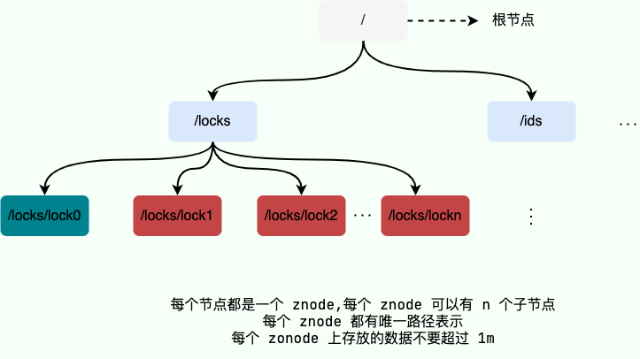
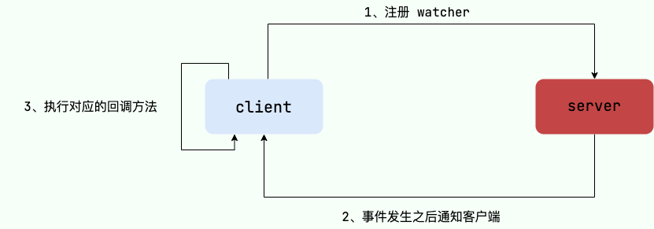
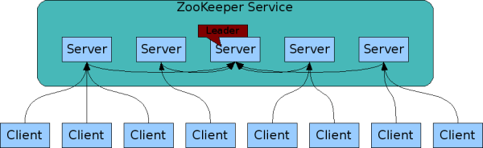
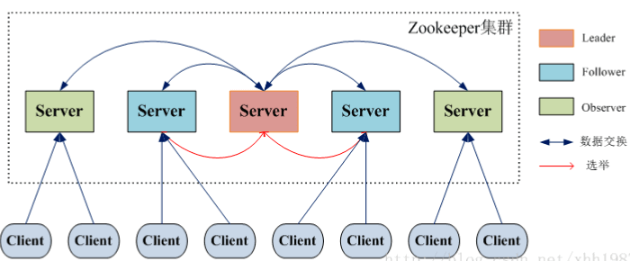

ZooKeeper is probably familiar to many of you. But do you know what it is used for? If someone, or an interviewer, asks you to explain ZooKeeper, how much could you say?

For example, when I used Dubbo for a distributed project at university, I used ZooKeeper as a service registry. I also used it to implement distributed locks so that a distributed system could coordinate access to a resource. Later, while learning Kafka, I found that many of its features depended on ZooKeeper.

Recently, while reviewing my project experience, I asked myself what ZooKeeper really is. After thinking for a while, I could come up with only a few points:

1. ZooKeeper can be used as a service registry and for distributed locks.
2. ZooKeeper is part of the Hadoop ecosystem.
3. It is best to use an odd number of servers when building a ZooKeeper cluster.

Clearly, my understanding of ZooKeeper was only superficial.

This article aims to give you a closer look at ZooKeeper. If you have not studied it before, this can be a first step. If you have used it already, this article will review some of its fundamentals.

This article covers some ZooKeeper concepts. Later articles introduce common ZooKeeper commands and Apache Curator as a ZooKeeper client.

_If you see anything that could be improved or clarified, please leave a comment so we can learn together._

## Introduction to ZooKeeper

### Origin of ZooKeeper

Before introducing ZooKeeper, let's look at how it got its name.

The following excerpt is from Chapter 4, Section 1 of _From Paxos to ZooKeeper_, which is worth reading:

> ZooKeeper originated in a research group at Yahoo Research. Researchers found that many large systems at Yahoo depended on similar systems for distributed coordination, but these systems often had a single point of failure. Yahoo's developers therefore set out to build a general-purpose distributed coordination framework without a single point of failure, so developers could focus on business logic.
>
> The name “ZooKeeper” also has an amusing origin. Early in the project, Yahoo engineers wanted an animal name, since many internal projects were named after animals (for example, the well-known Pig project). Raghu Ramakrishnan, then chief scientist at Yahoo Research, joked, “If we keep going like this, this place will turn into a zoo!” The team suggested calling the project the zookeeper: with all the animal-named distributed components together, Yahoo's distributed system looked like a large zoo, and ZooKeeper was meant to coordinate that environment. That is how the name came about.

### ZooKeeper Overview

ZooKeeper is an open-source **distributed coordination service**. It aims to encapsulate complex, error-prone distributed consistency services as an efficient and reliable set of primitives, exposed through a collection of simple interfaces.

> **Primitive:** In operating systems and computer networks, a primitive is a sequence of instructions that performs a specific function. It is indivisible: execution must be continuous and cannot be interrupted.

ZooKeeper provides a highly available, high-performance, and stable solution for distributed data consistency. It is commonly used for data publish/subscribe, load balancing, naming, distributed coordination and notifications, cluster management, leader election, distributed locks, and distributed queues. These features mainly rely on ZooKeeper's **data storage and event notification** capabilities, which are described below.

ZooKeeper stores data in memory and performs well, especially in read-heavy applications, because writes require state synchronization across servers. Read-heavy workloads are typical for coordination services.

Many prominent open-source projects have used ZooKeeper, including:

- **Kafka**: ZooKeeper mainly provided broker and topic registration, as well as load balancing across partitions. Starting with Kafka 2.8, the Raft-based KRaft mode was introduced, removing the ZooKeeper dependency and greatly simplifying Kafka's architecture.
- **HBase**: ZooKeeper helps ensure that the cluster has only one active master and stores and provides region server status information, such as whether a server is online.
- **Hadoop**: ZooKeeper provides high availability for the NameNode.

### ZooKeeper Characteristics

- **Sequential consistency:** Transaction requests from the same client are applied to ZooKeeper in order.
- **Atomicity:** Every machine in the cluster applies a transaction, or none of them do.
- **Single system image:** Clients see a consistent server-side data model regardless of which ZooKeeper server they connect to.
- **Reliability:** Once a change request is applied, it is persisted until a later change overwrites it.
- **Consistent ordering:** All clients see data changes in the same global FIFO commit order. This does not mean that a change is propagated to every node immediately.
- **Cluster deployment:** A cluster can use three to five machines, preferably an odd number. Each machine keeps all ZooKeeper data in memory and synchronizes with the others; clients can connect to any machine.
- **High availability:** The cluster remains available as long as no more than half its machines fail. A three-node cluster can lose one node; a five-node cluster can lose two.

### ZooKeeper Use Cases

As described above, ZooKeeper is commonly used for data publish/subscribe, load balancing, naming, distributed coordination and notifications, cluster management, leader election, distributed locks, and distributed queues.

Here are three typical use cases:

1. **Naming service**: ZooKeeper sequential nodes can be used to generate globally unique IDs.
2. **Data publish/subscribe**: The **watcher mechanism** makes it easy to implement publish/subscribe. After data is published to a watched ZooKeeper node, other machines can monitor changes to that node and update their configuration dynamically.
3. **Distributed locks**: Create a unique node to acquire a distributed lock. The client releases it after completing its work, or the lock is released if the client crashes. Distributed locks also use the **watcher mechanism**. See [Distributed Locks](https://javaguide.cn/distributed-system/distributed-lock.html) for details on implementing them with ZooKeeper.

These features mainly rely on ZooKeeper's ability to store data. Keep in mind that ZooKeeper is not suitable for storing large amounts of data.

## Important ZooKeeper Concepts

_In an excited voice: Take out your notes; the following concepts are important!_

### Data Model

ZooKeeper's data model is a hierarchical tree. Each node can store a number, string, or binary sequence, and can have any number of child nodes. The root node is represented by `/`. Each data node in ZooKeeper is called a **znode**, the smallest unit of ZooKeeper data. Every znode has a unique path.

To emphasize: **ZooKeeper is primarily for coordination, not business data storage. Avoid putting large data in znodes; ZooKeeper sets the maximum data size per node at 1 MB.**

The diagram below shows that ZooKeeper node paths are similar to Unix file system paths: each consists of path components separated by slashes (`/`). Developers can write data to a node and create child nodes under it. These operations are covered later.



### Znode (Data Node)

As described in the tree data model, each ZooKeeper data node is called a **znode**. It is the smallest data unit in ZooKeeper and the node where data is stored.

Znodes are generally divided into four types:

- **Persistent (`PERSISTENT`) nodes**: Remain until deleted, even if the ZooKeeper cluster goes down.
- **Ephemeral (`EPHEMERAL`) nodes**: Their lifetime is bound to a **client session**; **when the session ends, the node is deleted**. **Ephemeral nodes can only be leaf nodes** and cannot have children.
- **Persistent sequential (`PERSISTENT_SEQUENTIAL`) nodes**: Have the properties of persistent nodes, and child names include a sequence number, such as `/node1/app0000000001` and `/node1/app0000000002`.
- **Ephemeral sequential (`EPHEMERAL_SEQUENTIAL`) nodes**: Have the properties of ephemeral nodes, and child names include a sequence number.

Each znode has two parts:

- **stat**: State information.
- **data**: The contents stored in the node.

The following example uses the `get` command to retrieve the contents of the `/dubbo` node at the root (the command is introduced below).

```shell
[zk: 127.0.0.1:2181(CONNECTED) 6] get /dubbo
# The data associated with this node is empty.
null
# The following state information is the formatted output of the Stat object.
cZxid = 0x2
ctime = Tue Nov 27 11:05:34 CST 2018
mZxid = 0x2
mtime = Tue Nov 27 11:05:34 CST 2018
pZxid = 0x3
cversion = 1
dataVersion = 0
aclVersion = 0
ephemeralOwner = 0x0
dataLength = 0
numChildren = 1
```

The `Stat` class contains fields for all the state information of a data node, including its transaction ID (`cZxid`), creation time (`ctime`), and number of child nodes (`numChildren`).

Here is what each znode state field means. This information comes from _From Paxos to ZooKeeper: Principles and Practice of Distributed Consistency_; it's important to consult references when a topic is unclear.

| Znode state field | Description                                                                                                                          |
| ----------------- | ------------------------------------------------------------------------------------------------------------------------------------ |
| cZxid             | Create ZXID: transaction ID when the data node was created.                                                                          |
| ctime             | Create time: time when the node was created.                                                                                         |
| mZxid             | Modified ZXID: transaction ID of the node's latest update.                                                                           |
| mtime             | Modified time: time of the node's latest update.                                                                                     |
| pZxid             | Transaction ID of the last change to the child list. It changes only when the list of children changes, not when child data changes. |
| cversion          | Child version; increases by one whenever the current node's child list changes.                                                      |
| dataVersion       | Data version; starts at 0 when the node is created and increases by one on every data update, even if the content is unchanged.      |
| aclVersion        | ACL version; the number of changes to the node's ACL.                                                                                |
| ephemeralOwner    | Session ID of the session that created the ephemeral node; `0` for persistent nodes.                                                 |
| dataLength        | Length of the data stored in the node.                                                                                               |
| numChildren       | Number of child nodes.                                                                                                               |

### Versions

As mentioned above, ZooKeeper maintains a **Stat** data structure for each znode. It records three related versions:

- **dataVersion**: The version of the current znode's data.
- **cversion**: The version of the current znode's children.
- **aclVersion**: The version of the current znode's ACL.

### ACL (Access Control)

ZooKeeper uses an ACL (Access Control List) strategy for permissions, similar to the permission model in the UNIX file system.

ZooKeeper provides five permissions for znode operations:

- **CREATE**: Create child nodes.
- **READ**: Read node data and list its children.
- **WRITE**: Set or update node data.
- **DELETE**: Delete child nodes.
- **ADMIN**: Set the node's ACL.

Note that **CREATE** and **DELETE** permissions apply to **child nodes**.

ZooKeeper supports the following authentication schemes:

- **world**: The default; all users have unrestricted access.
- **auth**: Does not use a specific ID; represents any authenticated user.
- **digest**: Username and password authentication in the form _username:password_.
- **ip**: Restricts access by IP address.

### Watchers (Event Listeners)

A watcher is an important ZooKeeper feature. Users can register watchers on specific nodes, and when certain events occur, the ZooKeeper server notifies interested clients. This mechanism is essential to ZooKeeper's distributed coordination service.



_In an excited voice: This feature is very useful, so take notes! Watchers are essential for most ZooKeeper use cases._

### Sessions

A session can be viewed as a long-lived TCP connection between a ZooKeeper server and a client. The client uses heartbeats to keep the session active, sends requests to the server and receives responses, and receives watcher notifications through the connection.

A session has a `sessionTimeout` property that defines its timeout. If a client disconnects because of server load, a network failure, or a deliberate disconnect, its session remains valid as long as it reconnects to any server in the cluster within the `sessionTimeout` period.

When creating a session, the server assigns the client a `sessionID`. Since many session-related mechanisms rely on this identifier, it must be globally unique regardless of which server assigned it.

## ZooKeeper Clusters

For high availability, deploy ZooKeeper as a cluster. The service remains available as long as most machines in the cluster are up, allowing it to tolerate some machine failures. Three servers are usually enough for a ZooKeeper cluster. The architecture diagram below shows a cluster serving clients as a whole.



Each server in the diagram runs the ZooKeeper service. Every server maintains its state in memory and communicates with the other servers. The cluster uses the ZAB (ZooKeeper Atomic Broadcast) protocol to keep data consistent.

**The most common cluster pattern is Master/Slave (primary/standby).** The Master typically handles writes, while the Slave servers asynchronously replicate the latest data from the Master and serve reads.

### ZooKeeper Cluster Roles

ZooKeeper does not use the traditional Master/Slave model. Instead, it has three roles: Leader, Follower, and Observer, as shown below.



The ZooKeeper cluster selects one machine as the **Leader** through a **leader election** process. The Leader serves both reads and writes. The **Followers** and **Observers** serve reads only and forward writes to the Leader. The only difference is that Observers do not participate in leader election or the write quorum, so they can increase read capacity without affecting write performance.

| Role     | Description                                                                                                                                                                                                          |
| -------- | -------------------------------------------------------------------------------------------------------------------------------------------------------------------------------------------------------------------- |
| Leader   | Serves reads and writes, coordinates voting and decisions, and updates system state.                                                                                                                                 |
| Follower | Serves reads and forwards writes to the Leader. Participates in leader election.                                                                                                                                     |
| Observer | Serves reads and forwards writes to the Leader. Does not participate in leader election or the write quorum, so it can improve read capacity without affecting write performance. Added in the ZooKeeper 3.3 series. |

### ZooKeeper Cluster Leader Election

If the Leader is interrupted by a network failure, crashes, or restarts, the cluster starts a leader election to select a new Leader.

The process works roughly as follows:

1. **Leader election:** Nodes begin in the election phase. A node that receives votes from a majority can become the prospective leader.
2. **Discovery:** Followers communicate with the prospective leader and synchronize the latest transaction proposals they have received.
3. **Synchronization:** The prospective leader uses the latest proposal history gathered in the previous phase to synchronize all replicas. It becomes the actual Leader after synchronization completes.
4. **Broadcast:** The ZooKeeper cluster can now serve transactions, and the Leader can broadcast messages. Any newly joined node must also be synchronized.

ZooKeeper servers have the following states:

- **LOOKING**: Searching for a Leader.
- **LEADING**: The node is the Leader.
- **FOLLOWING**: The node is a Follower.
- **OBSERVING**: The node is an Observer and does not participate in leader election.

### Why Should a ZooKeeper Cluster Have an Odd Number of Nodes?

After some ZooKeeper servers fail, the cluster remains available only if more servers remain than have failed. In a cluster with `n` ZooKeeper servers, more than `n/2` servers must remain. In short, clusters of `2n` and `2n-1` servers tolerate the same number of failures: `n-1`. This follows directly from the majority requirement.

For example, a three-server cluster can lose at most one server; a four-server cluster also tolerates only one failure.
A five-server cluster can lose at most two servers; a six-server cluster also tolerates only two failures.

So why add an extra ZooKeeper server if it does not increase fault tolerance?

### How ZooKeeper's Majority Quorum Prevents Split-Brain

**What is split-brain?**

Cluster machines are often deployed in different data centers to improve availability. However, a network failure between data centers can partition the cluster into smaller groups. If each group elects its own leader, split-brain occurs.

For example, suppose a six-server cluster is split between two data centers, with three servers in each. Under normal conditions there is one Leader. If the link between the data centers fails, each side may assume the other three servers are down, elect its own Leader, and continue serving clients. Without a majority quorum, the cluster would have two Leaders when connectivity is restored. The cluster's single “brain” would have split into two, and both might have served clients, creating data consistency problems.

**How does a majority quorum prevent split-brain?**

ZooKeeper's majority quorum prevents two Leaders from being elected: a group with half or fewer of the servers cannot elect a Leader. Therefore, no matter how the servers are split between data centers, both sides cannot independently elect a Leader.

## The ZAB Protocol and Paxos

Paxos is often described as the foundation of ZooKeeper. However, ZooKeeper does not use Paxos directly; its core algorithm for data consistency is ZAB. The official ZooKeeper documentation also notes that, unlike the general-purpose Paxos algorithm, ZAB is a crash-recoverable atomic broadcast protocol designed specifically for ZooKeeper.

### The ZAB Protocol

ZAB (ZooKeeper Atomic Broadcast) is an atomic broadcast protocol with crash recovery, designed specifically for the ZooKeeper distributed coordination service. ZooKeeper relies on ZAB for distributed data consistency and uses a primary/backup architecture to keep the cluster's replicas consistent.

### ZAB's Two Modes: Crash Recovery and Message Broadcast

The ZAB protocol has two basic modes:

- **Crash recovery**: If the service is starting up, or if the Leader is interrupted by a network failure, crashes, or restarts, ZAB enters recovery mode and elects a new Leader. Once a new Leader has been elected and more than half of the cluster has synchronized state with it, ZAB exits recovery mode. **State synchronization means synchronizing data so that a majority of the cluster matches the Leader's data state.**
- **Message broadcast**: **Once more than half of the Followers have synchronized state with the Leader, the service can enter message broadcast mode.** When a server that follows ZAB joins a cluster that already has a Leader broadcasting messages, the new server enters recovery mode, finds the Leader, synchronizes data with it, and then joins message broadcasting.

### Further Reading on ZAB and Paxos

There is much more to learn about **ZAB and Paxos**. See these guides for details:

- [Paxos Algorithm Explained](https://javaguide.cn/distributed-system/protocol/paxos-algorithm.html)
- [The ZAB Protocol Explained](https://javaguide.cn/distributed-system/protocol/zab.html)
- [Raft Algorithm Explained](https://javaguide.cn/distributed-system/protocol/raft-algorithm.html)

## ZooKeeper vs. etcd

[etcd](https://etcd.io/) is a strongly consistent distributed key-value store that provides a reliable way to store data accessed by distributed systems or machine clusters. It is implemented in Go and uses the [Raft algorithm](https://javaguide.cn/distributed-system/protocol/raft-algorithm.html) for consistency.

Like ZooKeeper, etcd can be used for data publish/subscribe, load balancing, naming, distributed coordination and notifications, and distributed locks. How should you choose between them?

The article [A Brief Look at Building a Highly Available Architecture with ZooKeeper](https://mp.weixin.qq.com/s/pBI3rjv5NdS1124Z7HQ-JA) by Dewu Technology provides the following comparison table. I have made some further revisions; use it as a reference:

|                                | ZooKeeper                                                                                               | etcd                                                               |
| ------------------------------ | ------------------------------------------------------------------------------------------------------- | ------------------------------------------------------------------ |
| **Language**                   | Java                                                                                                    | Go                                                                 |
| **Protocol**                   | TCP                                                                                                     | gRPC                                                               |
| **API access**                 | Requires its own client                                                                                 | Supports HTTP, so it can be accessed with tools such as cURL       |
| **Consistency algorithm**      | ZAB protocol                                                                                            | Raft algorithm                                                     |
| **Watcher mechanism**          | More limited; one-shot triggers                                                                         | A single Watch can monitor all events                              |
| **Data model**                 | Hierarchical, directory-based                                                                           | Flat key-value model inspired by ZooKeeper                         |
| **Storage**                    | In-memory key-value storage using `ConcurrentHashMap`; generally not suitable for large amounts of data | Key-value storage using bbolt, which can handle several GB of data |
| **MVCC**                       | Not supported                                                                                           | Supported; versions are managed with two B+ trees                  |
| **Global sessions**            | Has limitations                                                                                         | More flexible implementation that avoids security issues           |
| **Access control**             | ACL                                                                                                     | RBAC                                                               |
| **Transactions**               | Basic transaction capabilities                                                                          | Supports version checks only                                       |
| **Deployment and maintenance** | Complex                                                                                                 | Simple                                                             |

ZooKeeper has some limitations in storage performance, global sessions, and its watcher mechanism. More open-source projects are replacing it with Raft-based implementations or other distributed coordination services, such as [Kafka Needs No Keeper: Removing ZooKeeper Dependency](https://www.confluent.io/blog/removing-zookeeper-dependency-in-kafka/) and [Moving Toward a ZooKeeper-Less Apache Pulsar](https://streamnative.io/blog/moving-toward-zookeeper-less-apache-pulsar).

etcd is generally stronger in this comparison: it provides more stable read and write performance under heavy load and addresses many of ZooKeeper's limitations. It also covers most of ZooKeeper's use cases and can replace it in many systems.

## Summary

1. ZooKeeper is itself a distributed program. It can continue serving as long as more than half its nodes remain available.
2. For high availability, deploy ZooKeeper as a cluster. The service remains available as long as most machines are up, allowing it to tolerate some machine failures.
3. ZooKeeper stores data in memory, providing high throughput and low latency. Memory limits its storage capacity, which is another reason to keep znode data small.
4. ZooKeeper performs well, especially in read-heavy applications, because writes require state synchronization across servers. Read-heavy workloads are typical for coordination services.
5. ZooKeeper supports ephemeral nodes. An ephemeral node exists while its creating client's session remains active and is deleted when the session ends. Persistent nodes remain in ZooKeeper until explicitly deleted.
6. At its core, ZooKeeper provides two functions: (1) managing user-submitted data by storing and reading it; and (2) notifying user programs about changes to data nodes.

## References

- _From Paxos to ZooKeeper: Principles and Practice of Distributed Consistency_
- [On the Limitations of ZooKeeper](https://wingsxdu.com/posts/database/zookeeper-limitations/)

<!-- @include: @article-footer.snippet.md -->
