> Submitted by [FrancisQ](https://juejin.im/user/5c33853851882525ea106810).

## What Is ZooKeeper?

`ZooKeeper` was developed by `Yahoo` and later donated to `Apache`, where it became a top-level project. It is an open-source coordination server for distributed applications that provides consistency services to distributed systems. It achieves consistency with **ZAB (ZooKeeper Atomic Broadcast)**, a protocol designed specifically for ZooKeeper. Its main functions include configuration maintenance, distributed synchronization, and cluster management.

Simply put, `ZooKeeper` is a **distributed coordination service framework**. Distributed? Coordination service? What does that mean? 🤔🤔

When explaining distributed systems, I have noticed that some people do not clearly distinguish **a distributed system from a cluster**. Recently, someone told me that a distributed system is just adding machines: if one is not enough, add another to handle the load. Adding machines is part of it, of course; a distributed system does involve multiple machines. But there is another related concept in computer science: a `Cluster`. A cluster also involves adding machines, but a cluster and a distributed system are not the same thing.

For example, suppose a flash-sale service cannot handle the traffic on one machine. If I add several servers that all provide the **same** service, that is a **`Cluster`**.

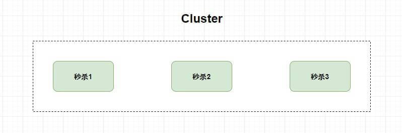

Now consider a different approach: **split the flash-sale service into multiple services**, such as order creation, reward points, and coupon redemption, **then deploy each service on a different server**. This is a **`Distributed` system**.

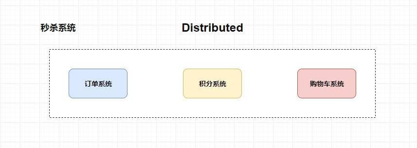

Why do I disagree that a distributed system is just adding machines? Adding machines is more directly associated with building a cluster. A distributed system requires splitting the business into services before adding machines, and it also requires solving a range of problems introduced by distribution.

These problems include coordinating distributed components, reducing coupling between systems, handling distributed transactions, and configuring the overall system. `ZooKeeper` is designed to help solve such problems.

## The Consistency Problem

One challenge in designing a distributed system is that **partition tolerance requires a trade-off between system availability and data consistency**. This is the well-known `CAP` theorem.

Here is a simple analogy. Imagine the class is the whole system and each student is an independent subsystem. Xiaohua discovers that Xiaohong and Xiaoming are secretly dating, then excitedly tells the students around her. The news starts spreading through the class. If you ask a student what happened during this propagation and they say they do not know, the class has a data consistency problem because Xiaohua already knows. If the student refuses to answer while the news is still spreading (because everyone must know before the system can serve requests), the system has an availability problem.

The first approach is how `Eureka` behaves: it favors AP (availability). The second approach is how `ZooKeeper` behaves: it favors CP (data consistency).

## Consistency Protocols and Algorithms

Researchers and engineers have developed many protocols and algorithms to address data consistency, including 2PC (Two-Phase Commit), 3PC (Three-Phase Commit), and Paxos.

Consider another question: if students pass notes to spread the news, how can you know that your note reached the intended person? What if someone intercepts and alters it?

This leads to the **Byzantine Generals Problem**. It states that **achieving consensus through message passing over an unreliable channel is impossible**. A **necessary assumption** for consistency algorithms is therefore a secure and reliable communication channel.

Why do we need to solve data consistency? Suppose a flash-sale system is split into order placement and reward-point services running on different machines. If the points service crashes while a message is being delivered, a customer might place an order but receive no points. The data in both services needs to remain consistent.

### 2PC (Two-Phase Commit)

Two-Phase Commit is a protocol for maintaining data consistency in distributed systems. Many databases use it to handle **distributed transactions**.

Before discussing 2PC, let's consider the problem that distributed transactions need to solve.

Let's reuse the flash-sale example with order placement and reward points (you may be tired of it by now 🤮🤮🤮). After placing an order, the order service sends a message telling the points service to add points. If it sends the message without waiting for a response, how does the order service know whether the points service received it? Suppose the points service sends a `Response`, but a network issue prevents the response from arriving. The order service may assume delivery failed and roll back, while the points service has already received the message and adds the points. The customer then gets points without a successful order.

The problem to solve is **atomicity** across the call chain: either all services process their data successfully, or all of them fail.

Two-Phase Commit involves two main roles: the coordinator and the participants.

**Phase 1:** To execute a distributed transaction, the initiator first sends a request to the coordinator. The coordinator then sends every participant a `prepare` request containing the transaction details. Participants execute the transaction without committing it, record `Undo` and `Redo` information in their transaction logs, and report whether they are ready.

**Phase 2:** The coordinator uses the participants' responses to decide whether to commit or roll back the transaction.

If **all participants** report that they are ready, the coordinator commits the transaction by sending every participant a **`Commit` request**. Each participant commits its transaction and sends a success response to the coordinator.

If not all participants report readiness in Phase 1, the coordinator sends every participant a **`rollback` request**. Each participant **rolls back the work it performed in Phase 1** and reports the result. After receiving their responses, the coordinator reports failure to the transaction initiator.

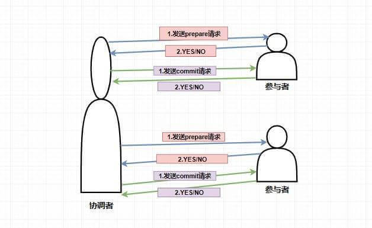

In my view, 2PC is limited in practice: it addresses atomicity across transactions, but also introduces several problems.

- **Single point of failure**: If the coordinator crashes, the entire system may become unavailable.
- **Blocking**: After receiving a `prepare` request, a participant that can proceed performs the transaction without committing it and holds its resources. If the coordinator crashes, those resources may not be released, which can severely affect performance.
- **Inconsistent data**: If the coordinator crashes after sending `commit` requests to only some participants in Phase 2, those participants commit while the others do not, leaving inconsistent data.

### 3PC (Three-Phase Commit)

**3PC (Three-Phase Commit)** was developed to address some 2PC problems, such as its single point of failure and limited fault tolerance. What are its three phases?

> Do not mistake PC for “personal computer.” It abbreviates “phase commit.”

1. **CanCommit phase**: The coordinator sends every participant a `CanCommit` request. Each participant checks whether it can execute the transaction and replies YES if it can, entering a prepared state; otherwise, it replies NO.
2. **PreCommit phase**: The coordinator uses the participants' responses to decide whether to proceed. If every participant replied YES, the coordinator sends a `PreCommit` request to all of them. **After receiving the request, participants execute the transaction and write `Undo` and `Redo` information to their transaction logs.** If execution succeeds, they report success to the coordinator. If the coordinator receives **any NO** in Phase 1 or does not receive every response **within a specified time**, it aborts the transaction and sends an abort request to all participants. A participant aborts immediately when it receives the request or after timing out while waiting for the coordinator.
3. **DoCommit phase**: This is similar to the second phase of `2PC`. If the coordinator receives YES from every participant in the `PreCommit` phase, it sends every participant a `DoCommit` request. **Participants commit the transaction** and respond to the coordinator. The transaction ends after the coordinator receives successful commit responses from all participants. If the coordinator receives **any NO during `PreCommit` or fails to receive all responses within the timeout**, it sends abort requests. Participants **roll back using the rollback logs recorded earlier**, report the result, and abort the transaction.

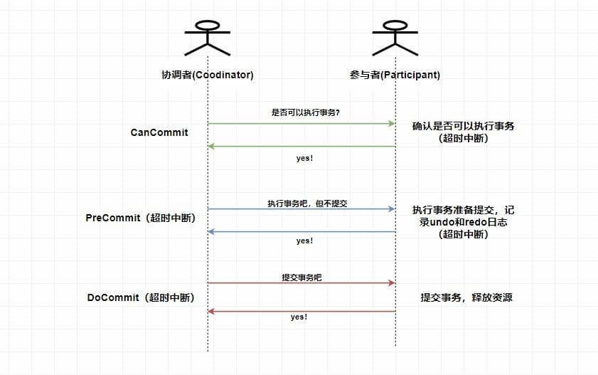

> This diagram shows the successful `3PC` workflow. `3PC` uses timeouts to abort transactions in several situations. For example, if the coordinator does not receive all acknowledgments within the specified time, it aborts the transaction, which **reduces synchronous blocking time**. Also note that **if a participant does not receive the coordinator's commit request during `DoCommit`, it commits after a timeout**. Why? By this point, **all participants confirmed in the first phase that they could execute the transaction**, so it is reasonable to **assume the other systems can execute and commit it**. Therefore, **regardless** of whether the coordinator sent the message, participants commit in the third phase.

In short, `3PC` uses timeouts to reduce blocking, but it does not fundamentally solve the consistency problem. For example, during `DoCommit`, if one participant receives a request while the coordinator and other participants crash or become separated by a network partition, the participant that received the message commits, which can leave the data inconsistent.

So, solving consistency still requires an algorithm such as `Paxos` ⭐️ ⭐️ ⭐️.

### The `Paxos` Algorithm

`Paxos` is a **message-passing consensus algorithm with high fault tolerance**. It is widely regarded as one of the most effective algorithms for distributed consistency. **It solves the problem of reaching agreement on a value (a decision) in a distributed system.**

`Paxos` has three main roles: `Proposer`, `Acceptor`, and `Learner`. Like `2PC`, the algorithm has two phases: `Prepare` and `Accept`.

#### Prepare Phase

- `Proposer`: Proposes a `proposal`. Before proposing, each proposer obtains a **globally unique, increasing proposal number N** and assigns it to its proposal. **In the first phase, it sends only the proposal number to all acceptors.**
- `Acceptor`: After accepting a proposal, each acceptor records its number `N` locally. Among the proposals it has accepted, it tracks the one with the **largest number**, called `maxN`. It accepts only proposals numbered higher than its local `maxN`. When it promises to accept a proposal, it reports the highest-numbered proposal it previously accepted to the `Proposer`.

> The following diagram shows the `Prepare` phase.

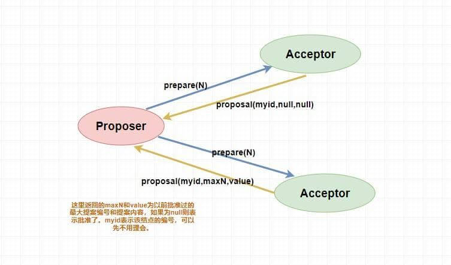

#### Accept Phase

After a `Proposer` makes a proposal, if it receives promises from a majority of `Acceptors` (including its own vote), it sends the actual proposal to all `Acceptors`. In other words, the first phase is a probe; in this phase, the `Proposer` sends both the proposal value and its number.

After receiving a proposal request, an acceptor compares its number with the largest proposal number it has already promised. If the new number is **greater than or equal to** that number, it `accept`s the proposal (accepting its value without committing it) and reports the result to the `Proposer`. Otherwise, it does not respond or returns NO.

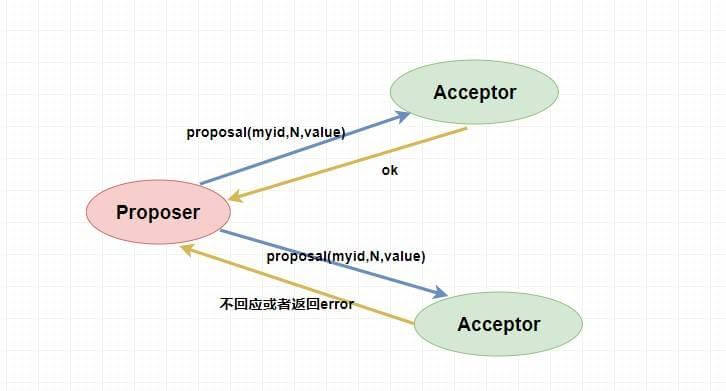

After the `Proposer` receives `accept` responses from a majority, it sends all `Acceptors` a request to commit the proposal. Note that only a majority of `Acceptors` accepted its value; the others have not applied it. Therefore, **send the proposal value and number to the unaccepting `Acceptors` and have them apply and commit it unconditionally**. For `Acceptors` that already accepted the proposal, **send only its number** so they can commit it.

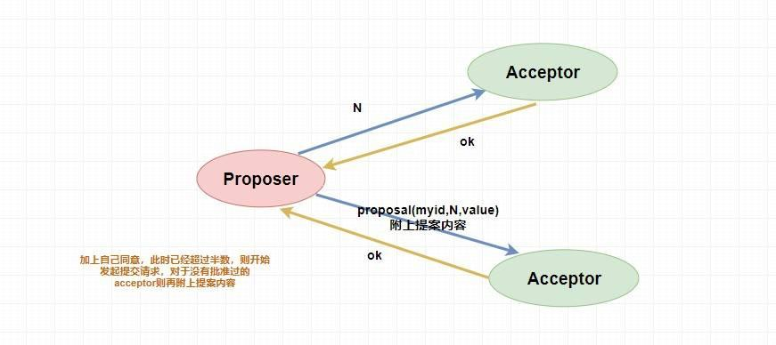

If the `Proposer` does not receive `accept` responses from a majority, it **increments** the proposal number and **restarts the `Prepare` phase**.

> There are several ways for a `Learner` to learn the proposal value accepted by the `Acceptors`; readers can explore them further. They are beyond the scope of this section.

#### The Paxos Livelock Problem

This is a bit like two people arguing: Xiaoming says he is right, Xiaohong says she is right, and neither will back down 🤬🤬.

For example, proposer P1 proposes M1 and completes the `Prepare` phase, so an `Acceptor` promises to M1. At the same time, proposer P2 proposes M2 and also completes `Prepare`. P1's proposal can no longer be accepted in Phase 2 because the `Acceptor` has promised a higher-numbered proposal, M2. P1 increments its number to M3 and restarts `Prepare`. The `Acceptor` promises M3, so it can no longer accept M2. P2 then increments its number and restarts `Prepare`...

The proposals can continue indefinitely. This is the livelock problem in `Paxos`.

How can it be resolved? Simply put, since too many proposers can conflict, **allow only one proposer**.

## Introducing ZAB

### ZooKeeper Architecture

As an efficient and reliable distributed coordination framework, `ZooKeeper` does not use `Paxos` directly to maintain distributed data consistency. Instead, it uses a custom consensus protocol called `ZAB (ZooKeeper Atomic Broadcast)`, an atomic broadcast protocol that supports **crash recovery**.

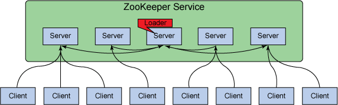

### The Three ZAB Roles

As with `Paxos`, first let's look at the three main roles in `ZAB`: `Leader`, `Follower`, and `Observer`.

- `Leader`: The cluster's **only write request processor**. It can initiate votes, which are used to process write requests.
- `Follower`: Receives client requests and handles reads locally, but **forwards writes to the `Leader`**. It votes in elections and **can be elected Leader**.
- `Observer`: A `Follower` with no voting rights and that cannot be elected Leader.

The `ZAB` protocol also defines two modes for a `zkServer` (the general term for the three roles above): **message broadcast** and **crash recovery**.

### Message Broadcast Mode

This mode describes how `ZAB` handles write requests. Only the `Leader` can process writes, but the `Follower` and `Observer` also need to **synchronize their data**. Otherwise, updates would exist only on the `Leader`.

The goal is to **keep data consistent throughout the cluster**. How would you do it?

The first step is for the `Leader` to **broadcast** the write request and ask the `Followers` whether they agree to the update. If a majority agrees, the `Follower` and `Observer` nodes are updated, as in `Paxos`. The diagram below illustrates the process.

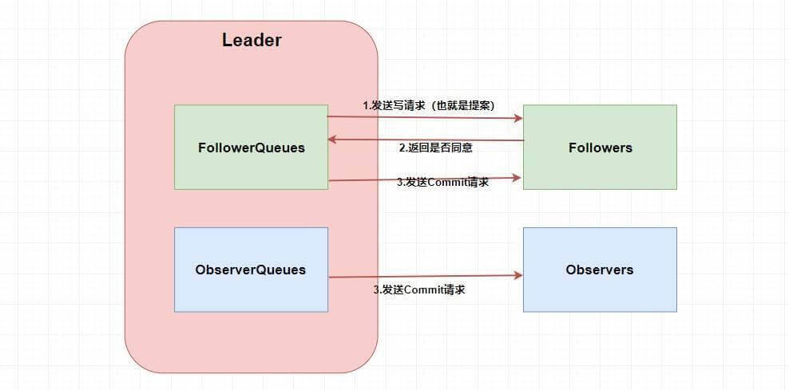

Looks simple, right? 🤥🤥🤥 But where do the two `Queue`s come from? The answer is that **`ZAB` must preserve ordering for `Followers` and `Observers`**. For example, suppose the `Leader` broadcasts write request A. Since only a majority must agree, `Follower` F1 might not receive it because of a network issue. Then the `Leader` broadcasts request B, which F1 receives before A. Processing requests in a different order could produce different data and **cause inconsistency**.

Therefore, the `Leader` maintains a **queue** for each other `zkServer` and sends messages in first-in, first-out order. Since communication uses **`TCP`**, message order is preserved during both sending and delivery.

Additionally, `ZAB` defines a **globally monotonically increasing transaction ID, `ZXID`**. It is a 64-bit `long`: the upper 32 bits represent the `epoch`, and the lower 32 bits represent the transaction ID. The `epoch` changes when the `Leader` changes. When a `Leader` fails and a new one takes over, the epoch advances. The lower 32 bits can be understood as an increasing transaction ID.

This ID also preserves ordering: each `proposal` created by the `Leader` must be **ordered by its `ZXID`** before it is processed.

### Crash Recovery Mode

Crash recovery requires discussing `ZAB`'s leader election. A `Leader` failure has the greatest impact because there is only one Leader, so the cluster must elect a replacement when it fails.

Leader election can happen in two situations: a failed `Leader` must be replaced, or the system must elect its initial `Leader` when `ZooKeeper` starts. First, let's look at how `ZAB` performs the initial election.

Suppose the cluster has three servers, so at least two votes (a majority) are required. When `server1` starts, it first **votes for itself**, with its `myid` and `ZXID` as the vote. Since the cluster is initializing, its `ZXID` is 0, so `server1` votes `(1,0)`. With only one vote, it cannot become the `Leader`; the cluster remains in the election phase, in the **`Looking` state**.

Then `server2` starts, votes for itself `(2,0)`, and broadcasts the vote (as `server1` did, although no other servers were available then). After receiving `server2`'s vote, `server1` compares it with its own. **It compares `ZXID` first; the higher `ZXID` is preferred for Leader. If they are equal, the higher `myid` is preferred.** `server1` therefore finds `server2` to be the better candidate, changes its vote to `(2,0)`, and broadcasts it. `server2` receives the matching vote and needs no change. It now has a **majority**, so **`server2` is elected Leader**. `server1` changes to the `Following` state and becomes a `Follower`. The cluster leaves the `Looking` state.

When `server3` starts and sees that the cluster is no longer in the `Looking` state, it joins directly as a `Follower`.

Consider the same three-server example. If `server2` fails while the cluster is running, how does the cluster elect a new `Leader`? The process is similar to the initial election.

The two remaining `Followers` first change their state **from `Following` to `Looking`**. Each `server` then votes for itself, as in the initial election. Their `zxid` values may no longer be zero; the example below uses arbitrary values for simplicity.

Suppose `server1` votes `(1,99)` for itself and broadcasts its vote. `server3` votes `(3,95)` and broadcasts that vote too. They receive each other's votes and compare them as during the initial election: the higher `zxid` takes priority, followed by the higher `myid` if the `zxid` values match. `server1` keeps its vote because `server3` is a weaker candidate. `server3` changes its vote to `(1,99)` and broadcasts it. `server1` now has a majority and becomes `Leader`; `server3` becomes a `Follower`.

> Why does `ZooKeeper` recommend an odd number of nodes? In this three-node example, the cluster keeps working if one node fails, but not if two fail because it can no longer reach a majority to vote. With four nodes, it can also tolerate one failure, **but still cannot work if two fail**. Four nodes provide the same fault tolerance as three, so `ZooKeeper` recommends an odd number of `servers`.

Now that we have covered `ZAB` leader election, let's look at **crash recovery**.

The main question is: **when a machine in the cluster fails, how does the cluster keep its data consistent?**

If a `Follower` fails and the number of failed nodes is less than half, data inconsistency from missing later updates is not a concern because, as discussed earlier, the `Leader` maintains a queue for each server.

If the `Leader` fails, the cluster must pause service, enter the `Looking` state, and elect a new `Leader`, as described above. Two requirements must be handled: **ensure that every proposal committed by the Leader is eventually committed by all Followers**, and **skip proposals that were discarded**.

What does it mean to ensure that every proposal committed by the Leader is eventually committed by all Followers?

Suppose `Leader (server2)` sends a `commit` request (see the message broadcast section above) to `server3`, then crashes before sending it to `server1`. If `server1` were elected as the new `Leader`, the data would become inconsistent: `server3` would commit the proposal from `server2`, while `server1`, which never received the request, would discard it.

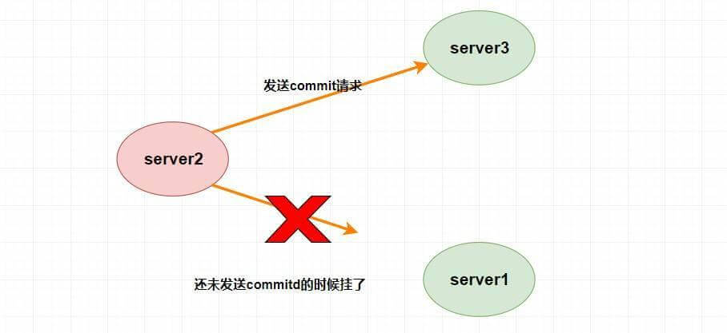

How is this resolved?

An observant reader may notice that **`server1` cannot become the `Leader` in this situation. When `server1` and `server3` vote, they compare their `ZXID` values, and `server3` has the higher `ZXID`**. See the election algorithm above for details.

What does it mean to skip proposals that were discarded?

Suppose `Leader (server2)` accepts proposal N1, commits the transaction locally, and is about to send a `commit` request to every `Follower`, but crashes. A new `Leader` must be elected; for example, `server1` may become the new Leader. Later, the **failed `Leader` recovers** and rejoins as a `Follower`. Although `server2` had accepted and committed N1, the other servers never received its `commit` message and cannot commit N1. To avoid inconsistent data, **proposal N1 must ultimately be discarded**.

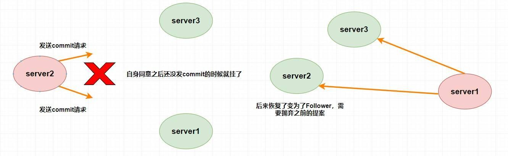

## A Few ZooKeeper Concepts

Understanding the `ZAB` protocol is not enough; it is only one part of ZooKeeper's internal implementation. How can we use `ZooKeeper` for common use cases such as cluster management, distributed locks, and `Master` election?

That brings us to using `ZooKeeper`. Before doing so, we need to understand several concepts, including its **data model**, **session mechanism**, **ACLs**, and **watcher mechanism**.

### Data Model

The `zookeeper` data structure is similar to a standard `Unix` file system: both use a tree of child nodes under a root. However, `zookeeper` has no distinction between directories and files; it **uses `znodes` as data nodes**. A `znode` is the smallest data unit in `zookeeper`. It can store data and have child nodes, forming a tree-shaped namespace.

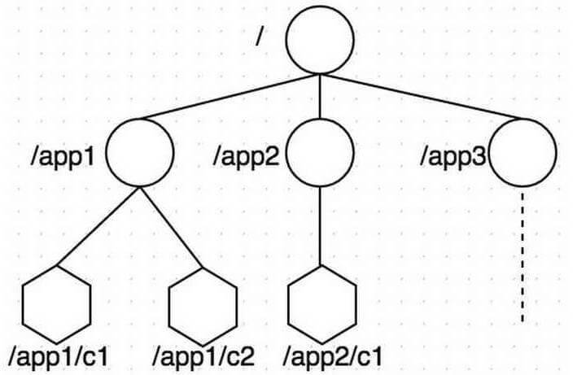

Each `znode` has a **node type** and a **node state**.

Node types are **persistent**, **persistent sequential**, **ephemeral**, and **ephemeral sequential**.

- **Persistent nodes**: Remain until deleted.
- **Persistent sequential nodes**: A parent node **maintains the creation order of its children**. The order appears in the **node name** as a 10-digit number appended automatically, starting at 0.
- **Ephemeral nodes**: Their lifetime is bound to the **client session**; **when the session ends, the node is deleted**. Ephemeral nodes **can only be leaf nodes** and cannot have children.
- **Ephemeral sequential nodes**: A parent can create an ephemeral node whose name includes a sequence number, like a persistent sequential node.

Node state contains many properties, such as `czxid` and `mzxid`, which are maintained by the `Stat` class in `zookeeper`. Here are some of these properties:

- `czxid`: `Created ZXID`, the transaction ID when the data node was **created**.
- `mzxid`: `Modified ZXID`, the transaction ID when the node was **last updated**.
- `ctime`: `Created Time`, when the node was created.
- `mtime`: `Modified Time`, when the node was last modified.
- `version`: The node's version number.
- `cversion`: The version of the node's **children**.
- `aversion`: The node's `ACL` version.
- `ephemeralOwner`: The `sessionID` of the session that created the node; `0` for persistent nodes.
- `dataLength`: The length of the node's data.
- `numChildren`: The number of child nodes; always `0` for ephemeral nodes.
- `pzxid`: The transaction ID of the last change to the node's child list. This refers to the **list** of children, not their contents.

### Sessions

Backend developers are probably familiar with a `session`. The `zk` client and server maintain a session over a **persistent `TCP` connection**; you can think of it as **keeping the connection active**.

In `zookeeper`, sessions also have associated events, such as `CONNECTION_LOSS` (connection lost), `SESSION_MOVED` (session moved), and `SESSION_EXPIRED` (session expired).

### ACLs

`ACL` stands for `Access Control List` and is used to control permissions. `zookeeper` defines five permissions:

- `CREATE`: Permission to create child nodes.
- `READ`: Permission to read node data and list child nodes.
- `WRITE`: Permission to update node data.
- `DELETE`: Permission to delete child nodes.
- `ADMIN`: Permission to set the node's ACL.

### Watcher Mechanism

`Watcher` is an event listener and an important `zk` feature used by many functions. It works like a subscription: a client **registers** a `watcher` with the server, and when an event matching its conditions occurs, the server **sends an event notification to the client**. The client then finds its `Watcher` and **executes the corresponding callback**.

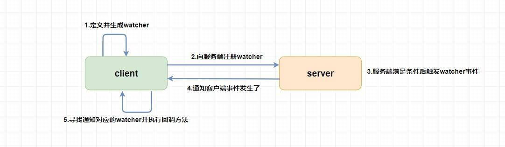

## Typical ZooKeeper Use Cases

After all that theory, you may be wondering what it is for and what it can do. Let's look at some examples.

### Leader Election

Remember ephemeral nodes? Because `Zookeeper` provides strong consistency, it can **guarantee that node creation is globally unique even under high concurrency**; the same node cannot be created twice.

We can use this property to have **multiple clients create the same specified node**. The client that succeeds becomes the `master`.

But what if the `master` crashes?

Why do we create an ephemeral node? Remember its lifecycle: if the `master` crashes, its session ends and the node is removed. We can use a `watcher` to **let the non-master nodes watch the node's state**. For example, they can watch its parent; if the number of children changes, the `master` may have crashed, so they **trigger a callback to elect a new one**. Alternatively, they can watch the node's connection state to detect whether the `master` is down.

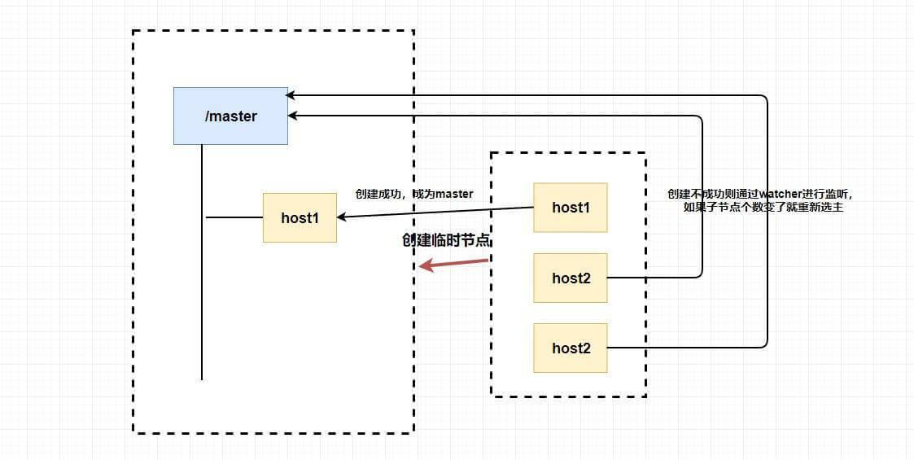

In short, **ephemeral nodes, node states, and `watchers` can implement leader election**. Ephemeral nodes are used for election, while node states and `watchers` detect whether the `master` is alive and trigger a new election.

### Data Publish/Subscribe

Remember ZooKeeper's `Watcher` mechanism? ZooKeeper combines push and pull to let clients and servers interact: a client registers a watcher on a node, and when that node's data changes, the server sends a `Watcher` event to the clients watching it. After receiving the notification, clients must **actively** fetch the latest data from the server. This is how ZooKeeper implements **data publish/subscribe**.

A typical use case is **centralized management of global configuration**. On startup, a client fetches configuration from the ZooKeeper server and **registers a `Watcher` on the specified node**. When the configuration changes, the server notifies all subscribed clients to fetch it again, keeping their configuration up to date.

Global configuration often includes server lists, runtime feature flags, and database settings. Such configuration usually has these properties:

- Small data volume.
- Data may change dynamically at runtime.
- Machines in the cluster share consistent configuration.

### Load Balancing

ZooKeeper **ephemeral nodes** can be used for load balancing. Recall that an ephemeral node is automatically removed when the creating client's session ends because the client disconnects from the server. We can use ephemeral nodes to maintain a list of server addresses and avoid routing requests to stopped services.

Each server in the cluster connects to the ZooKeeper server using a ZooKeeper client and creates an ephemeral node under a specified path using its **own address**. When a client requests the cluster service, it first gets the child-node list from ZooKeeper (all available servers), then forwards the request to a specific server using a load-balancing strategy.

### Distributed Locks

Distributed locks can be implemented in several ways, including `Redis`, databases, and `zookeeper`. In my view, `zookeeper` makes distributed locks very easy to implement.

As noted above, **`zk` guarantees globally unique node creation under high concurrency**. This property can be used to implement a mutex and, in a distributed environment, a distributed lock.

How? Much like leader election, we can use ephemeral nodes.

First, consider lock acquisition. Since node creation is unique, multiple clients can try to create the same ephemeral node; **the client that succeeds has acquired the lock**. Clients that fail can register a `watcher`, as non-leader nodes do during leader election. When the mutex is released (either because the lock-holding client crashed or released it), a callback can try to acquire the lock again.

> With `zk`, you do not need to worry about a lock remaining unreleased as you do with `redis`: when the client crashes, its node is removed and the lock is released. Simple, right?

Can `zookeeper` implement both **shared and exclusive locks**? Yes, though the implementation is a little more involved.

Remember **sequential nodes**?

Require all nodes to be created sequentially. For a read request (shared lock), the client can acquire the read lock and start reading if **there are no nodes with a lower sequence number, or all lower-numbered nodes are read requests**. **If any lower-numbered node is a write request**, the client must wait for that write to complete.

For a write request (exclusive lock), the client can acquire the write lock and modify data if **there are no lower-numbered nodes**. If **any lower-numbered nodes exist, whether reads or writes, the client cannot acquire the write lock** until all earlier operations complete.

This implements both shared and exclusive locks. It can be optimized: when a lock is released, notifying all waiting clients causes a **thundering herd**. Instead, have each waiting node watch only the node immediately before it.

Specifically, **a read request watches the last lower-numbered write request, while a write request watches the last lower-numbered node**. You can explore the details further.

### Naming Service

When assigning an ID to an object, you might think of a `UUID`. The main problem with a `UUID` is that it is very long (and long is not always good). Could `zookeeper` be used instead, when the requirements allow it?

As mentioned earlier, `zookeeper` stores data nodes in a **tree structure**, so each node's **full path** is unique and can be used as its name. More importantly, paths can be defined by the user, making IDs for some semantically meaningful objects easier to understand.

### Cluster Management and Service Registry

By now, `zookeeper` may seem remarkably powerful!

It can do even more. For example, we may need to know how many machines in a cluster are running, collect runtime status from each machine, or add and remove machines from the cluster.

`zookeeper`'s built-in `watcher` and ephemeral node features work well for these needs. Create an ephemeral node for each machine and watch the parent node. If its child list changes (because an ephemeral node was created or deleted), use a `watcher` registered on the parent for state monitoring and callbacks.

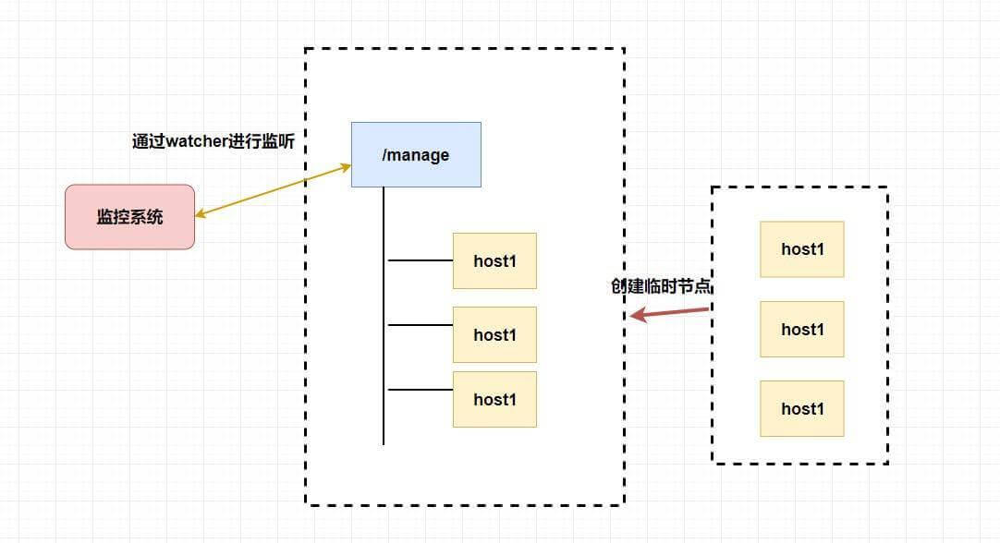

The service registry works similarly. Each **service provider** creates an ephemeral node in `zookeeper` and writes its `IP`, `port`, and invocation method to it. When a **service consumer** needs to make a call, it **gets the service address list (IP, port, and so on) from the registry** and caches it locally. For later calls, it does not query the registry again; it uses a load-balancing algorithm to select a provider from the cached list.

When a provider server crashes or goes offline, its address is removed from the provider list. The registry sends the updated list to the consumer machines, where it is cached locally. (Consumers could also watch the node directly; as I recall, `Eureka` first tries the existing address and then updates the list.)

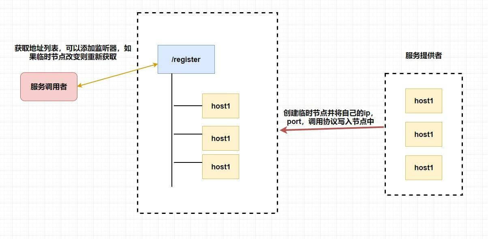

## Summary

Thanks for sticking with the article this far 👍👍👍 I wonder how much you still remember 😒.

This article introduced `zookeeper`, a powerful distributed coordination framework. Here is a brief recap:

- The difference between distributed systems and clusters.

- The principles and implementation of the consistency protocols `2PC`, `3PC`, and `paxos`.

- The `ZAB` atomic broadcast protocol, ZooKeeper's consistency protocol, including `Leader` election, crash recovery, and message broadcasting.

- Basic `zookeeper` concepts, such as `ACL`, data nodes, sessions, and the `watcher` mechanism.

- Typical `zookeeper` use cases, such as leader election and service registries.

  If anything is unclear, review the relevant section. Questions and suggestions are welcome 🤝🤝🤝.

<!-- @include: @article-footer.snippet.md -->
