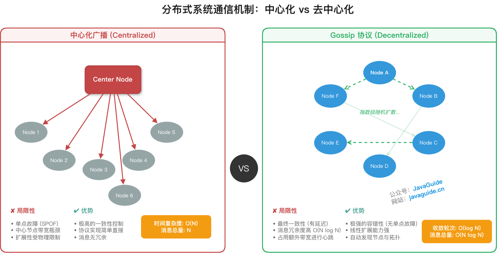
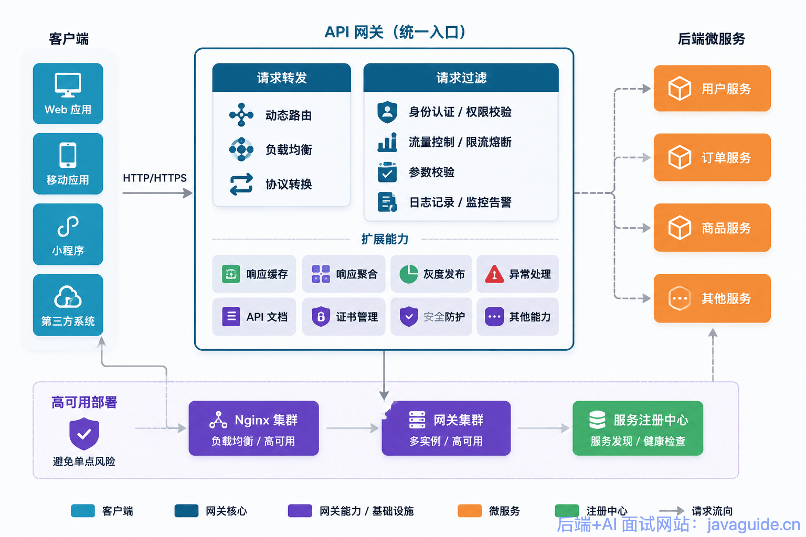
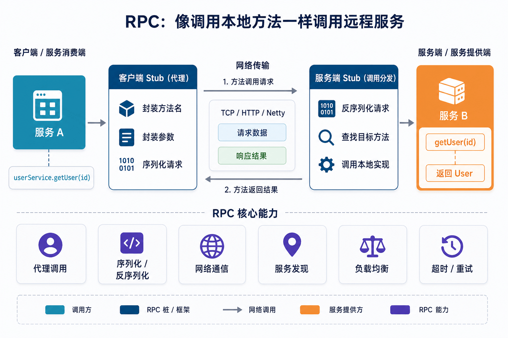

Distributed systems interviews rarely ask you to recite the definition of CAP in isolation. Interviewers usually start with a practical question: Why split a service across multiple nodes? Is it safe to retry after a network timeout? What happens if a lock expires too early? How do you keep data consistent across services?

This guide is the review entry point for JavaGuide's distributed systems section. It groups the topics into four areas: distributed systems theory, RPC and gateways, distributed IDs, locks and transactions, and configuration centers and ZooKeeper. Each section lists the questions to focus on; detailed explanations and implementations are covered in the linked articles.

If you have limited time, start with [common distributed systems interview questions](https://interview.javaguide.cn/distributed-system/distributed-system.html). Mark the topics you cannot answer, then return here to review the underlying concepts and engineering details.

## Which questions should you focus on?

| Area                           | What to explain                                                                     | Common follow-up topics                                                                         |
| ------------------------------ | ----------------------------------------------------------------------------------- | ----------------------------------------------------------------------------------------------- |
| Distributed systems theory     | How a system trades consistency for availability when nodes and networks can fail   | CAP, BASE, consensus algorithms, Gossip, consistent hashing                                     |
| RPC and gateways               | How requests enter a system and how services call one another                       | Service discovery, load balancing, serialization, timeouts, retries, routing, and rate limiting |
| IDs, locks, and transactions   | How to preserve uniqueness, mutual exclusion, and business consistency across nodes | Snowflake, Redis locks, 2PC, TCC, transactional messaging, Saga                                 |
| Configuration and coordination | How nodes discover configuration changes and coordinate their work                  | Configuration updates, versioning, ZooKeeper nodes, Watchers, and Leader election               |

Do not stop at listing possible solutions. Explain when each solution fits, what can fail, and what safeguards the project uses.

## Distributed systems theory and algorithms

Start with a common scenario: the same data is replicated across several nodes, and nodes or the network can fail. CAP, BASE, and consensus algorithms describe the choices and constraints involved.

Related articles:

- [CAP and BASE Explained](https://javaguide.cn/distributed-system/protocol/cap-and-base-theorem.html)
- [Distributed Coordination](https://javaguide.cn/distributed-system/protocol/centralized-and-decentralized.html)
- [Paxos Explained](https://javaguide.cn/distributed-system/protocol/paxos-algorithm.html)
- [Raft Explained](https://javaguide.cn/distributed-system/protocol/raft-algorithm.html)
- [ZAB Explained](https://javaguide.cn/distributed-system/protocol/zab.html)
- [Gossip Protocol Explained](https://javaguide.cn/distributed-system/protocol/gossip-protocol.html)
- [Consistent Hashing Explained](https://javaguide.cn/distributed-system/protocol/consistent-hashing.html)

Common interview questions:

- Is CAP really a “pick two” rule? Why is partition tolerance generally unavoidable in distributed systems?
- How does BASE differ from ACID, and how is eventual consistency implemented?
- How do centralized and decentralized designs differ? How should you think about a single Leader, split brain, majorities, and Gossip?
- What problems do Paxos, Raft, and ZAB solve? Why is Raft often easier to understand and implement?
- Why is Gossip useful for service discovery and state propagation?
- What problem does consistent hashing solve, and what do virtual nodes do?

Be prepared to connect the ideas: What can a system do during a network partition? Who decides when replicas disagree? How is data redistributed when nodes join or leave? Knowing algorithm steps alone is rarely enough for scenario-based follow-up questions.

## RPC and API gateways

RPC handles calls between services; an API gateway handles incoming external requests. Trace a request through the system: it may pass through the gateway for authentication, routing, or rate limiting, then enter a service. RPC calls continue the flow between services, using service discovery, load balancing, serialization, and timeout control.

API gateway diagram:

RPC diagram:

Related articles:

- [Microservices Interview Questions](https://javaguide.cn/distributed-system/microservices-interview-questions.html)
- [RPC Fundamentals and Interview Questions](https://javaguide.cn/distributed-system/rpc/rpc-intro.html)
- [Dubbo Interview Questions](https://javaguide.cn/distributed-system/rpc/dubbo.html)
- [HTTP vs. RPC](https://javaguide.cn/distributed-system/rpc/http&rpc.html)
- [API Gateways Explained](https://javaguide.cn/distributed-system/api-gateway.html)
- [Spring Cloud Gateway Interview Questions](https://javaguide.cn/distributed-system/spring-cloud-gateway-questions.html)

Common interview questions:

- How do RPC and HTTP differ? Why is RPC commonly used for internal service calls?
- What are the core components of an RPC framework?
- What problems do service discovery, load balancing, serialization, timeouts, and retries solve?
- How do API gateways differ from Nginx, load balancers, and BFFs?
- How does Spring Cloud Gateway match routes? Where do filter chains, rate limiting, and circuit breaking take effect?

Use a request flow to explain these topics. For timeouts and retries, account for the difference between reads and writes. Retries at multiple layers can amplify traffic, and writes need idempotency protection because the result may be uncertain.

## Distributed IDs, locks, and transactions

Generating order numbers, coordinating access to a shared resource, and handling partial success across services correspond to distributed IDs, distributed locks, and distributed transactions. These topics often lead to project-specific follow-up questions, so allow enough time to review them.

Related articles:

- [Distributed ID Generation](https://javaguide.cn/distributed-system/distributed-id.html)
- [Distributed ID Design in Practice](https://javaguide.cn/distributed-system/distributed-id-design.html)
- [Distributed Locks](https://javaguide.cn/distributed-system/distributed-lock.html)
- [Distributed Lock Implementations](https://javaguide.cn/distributed-system/distributed-lock-implementations.html)
- [Distributed Transaction Solutions](https://javaguide.cn/distributed-system/distributed-transaction.html)

Common interview questions:

- Why can’t a database auto-increment ID always be used after database sharding?
- What are the trade-offs among UUIDs, database ID segments, Redis, and Snowflake?
- Why does a Redis lock need an expiration time? Why use Lua to release it atomically?
- What problem does Redisson's watchdog solve, and when can a lock still fail?
- Which scenarios suit 2PC, TCC, a transactional outbox, transactional messaging, or Saga?

Include failure cases in your answers: Can a clock moving backward affect ID generation? Could the previous lock holder still be running after its lock expires? How are duplicate messages handled? Who takes over if compensation fails? These details often distinguish engineering approaches.

## Configuration centers and ZooKeeper

Configuration center questions often cover configuration changes, client push and pull, and versioning. ZooKeeper commonly appears in questions about service discovery, distributed coordination, and Leader election.

If your resume and project do not involve ZooKeeper, give this area a lower priority. If you list ZooKeeper, be ready to explain ephemeral and sequential nodes, Watchers, sessions, and common use cases. “It can implement a distributed lock” is not enough.

Related articles:

- [Distributed Configuration Center Interview Questions](https://javaguide.cn/distributed-system/distributed-configuration-center.html)
- [ZooKeeper Fundamentals](https://javaguide.cn/distributed-system/distributed-process-coordination/zookeeper/zookeeper-intro.html)
- [ZooKeeper Advanced Topics](https://javaguide.cn/distributed-system/distributed-process-coordination/zookeeper/zookeeper-plus.html)

Common interview questions:

- Why is a configuration center more than a repository of configuration files?
- How are configuration changes delivered, and how can clients ensure they have the latest version?
- What problems do ZooKeeper ephemeral nodes, sequential nodes, and Watchers solve?
- Why is ZooKeeper useful for distributed coordination?
- How are ZooKeeper, service registries, and configuration centers related?

## Plan your review by available time

| Time available   | Suggested plan                                                                                                                                                                                            | Goal                                                                                           |
| ---------------- | --------------------------------------------------------------------------------------------------------------------------------------------------------------------------------------------------------- | ---------------------------------------------------------------------------------------------- |
| 1–2 days         | Review [common distributed systems interview questions](https://interview.javaguide.cn/distributed-system/distributed-system.html), prioritizing distributed IDs, locks, transactions, RPC, and gateways. | Give complete answers to common questions and explain each solution's main limitation.         |
| 3–7 days         | Add CAP/BASE, Raft, and consistent hashing; draw the request flow from the gateway through RPC services.                                                                                                  | Explain the trade-offs behind a solution and handle follow-up questions beyond its definition. |
| More than a week | Read the topic guides in order, then prepare failure scenarios and technology choices from your own project.                                                                                              | Connect business constraints to the solution, failure handling, and extension points.          |

For experienced-hire and senior roles, connect your answers to your own project. If asked why you used a Redis distributed lock, its general pros and cons are only a starting point. Expect questions about the protected resource, concurrency, timeout and renewal behavior, and how release failures are detected. If you have not used a solution in production, describe what you learned and researched; do not invent project metrics.

<!-- @include: @article-footer.snippet.md -->
