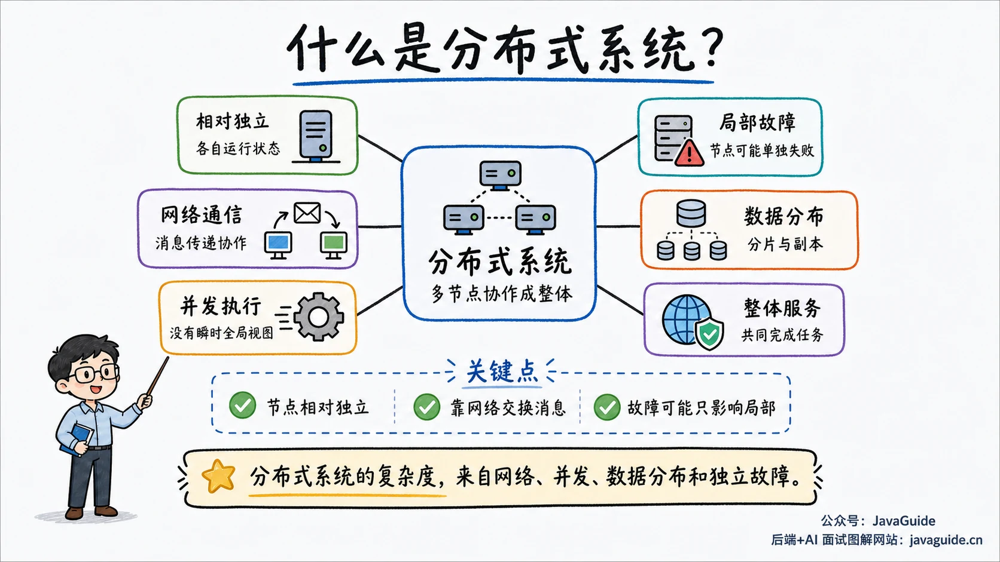
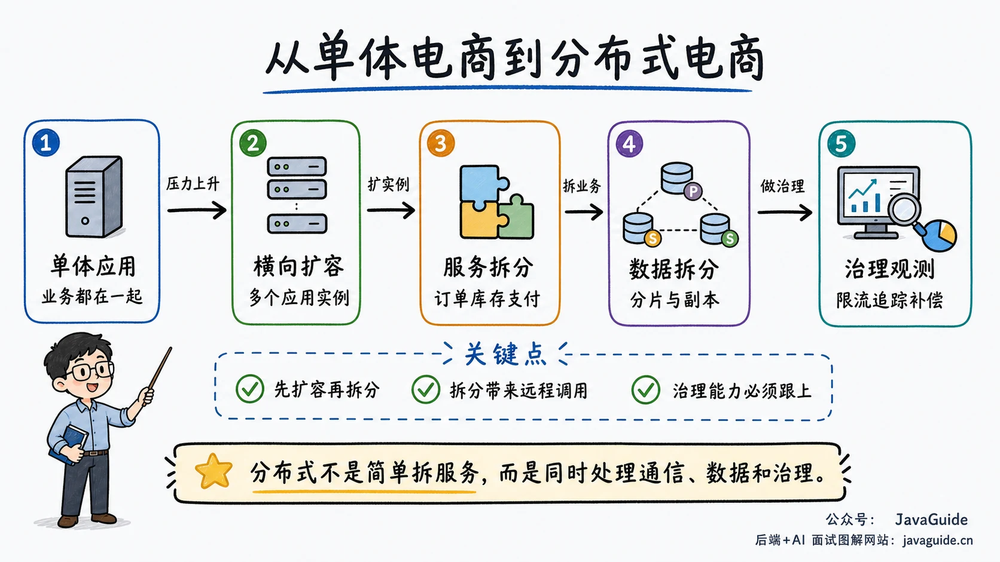
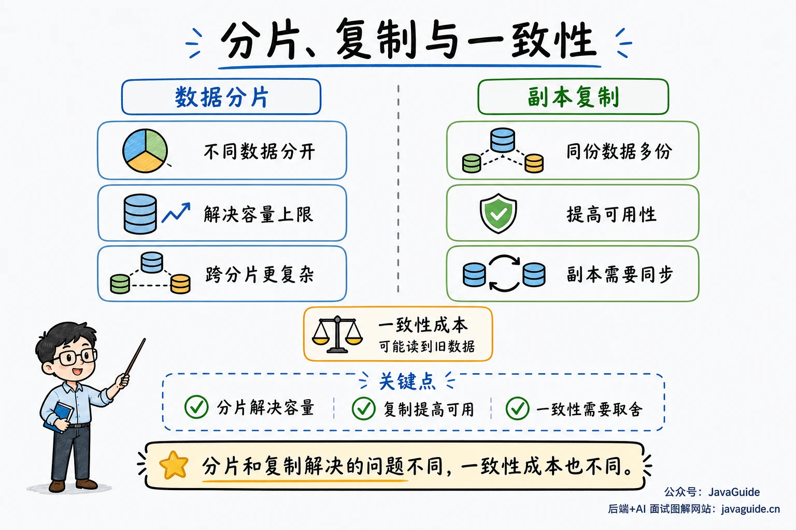
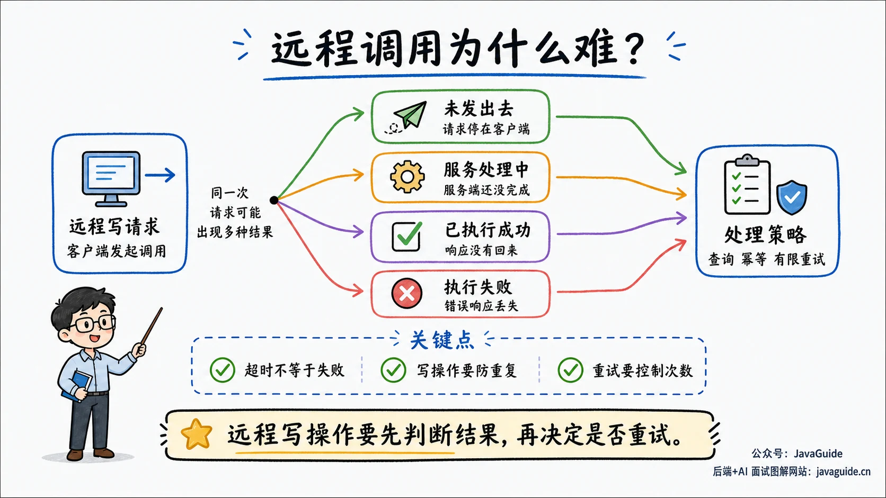

When starting with distributed systems, you may encounter CAP, BASE, Paxos, Raft, distributed locks, and distributed transactions all at once.

These concepts matter, but a practical starting point is to ask why work once handled by one machine, process, and database is split across machines—and why a timeout, retry, or duplicate message creates new design problems.

This article explains what a distributed system is and where concepts such as Paxos, Raft, and distributed transactions fit, without deriving those protocols in detail.

## What is a distributed system?

_Distributed Systems: Concepts and Design_ defines a distributed system as hardware or software components on networked computers that communicate and coordinate solely by passing messages.

In practice, **a distributed system consists of relatively independent computing units that communicate over a network and cooperate to provide a complete service**.

Independence does not mean each node exclusively owns a CPU, memory, disk, and operating system. A node can be a physical machine, virtual machine, container, or process. Processes on one machine share underlying hardware, and containers often share the host kernel. Independence here means that a node has its own execution state and local data, can run separately, and may independently stall, restart, or lose connectivity.

Nodes do not share one process address space. After a system is split, a local method call may become an RPC, HTTP request, message delivery, or replica synchronization. Networks add latency and packet loss: a request may reach the server while its response is lost. A client timeout does not prove the server did not execute it.

No node can instantly observe the true state of the entire system. Each sees its local state and received messages. Clocks also differ; even NTP cannot provide a perfectly synchronized global clock.

A user clicking “submit order” sees one request. The backend may pass it through a gateway and user, product, order, inventory, coupon, and payment services, while writing to a database, sending messages, and updating a cache.

| Aspect          | Single machine or process              | Distributed system                                     |
| --------------- | -------------------------------------- | ------------------------------------------------------ |
| Communication   | Method calls and shared memory         | RPC, messages, network protocols                       |
| Failure scope   | Often one shared failure boundary      | Nodes can fail independently                           |
| Time            | Mainly one machine's clock             | Node clocks can differ                                 |
| State           | Easier to observe globally             | Nodes generally have local views                       |
| Transactions    | Local database transactions are common | Cross-service coordination, compensation, or consensus |
| Scaling         | Primarily vertical                     | Add nodes horizontally                                 |
| Troubleshooting | One process's logs and stack traces    | Logs, metrics, tracing, and cross-node state           |

## Why use distributed systems?

A monolith is a valid choice. An administrative application or low-traffic system with one application and one database can be easier to develop, deploy, and troubleshoot. Splitting too early can add complexity before it provides a benefit.

Distributed systems often become necessary as pressure grows.

**Compute capacity:** One machine has limits on CPU, memory, and disk I/O. Vertical scaling is constrained by cost, hardware limits, and single-point-of-failure risk. Distributing requests across machines increases capacity.

**Storage capacity:** When an order table grows from one million to one billion rows, queries, backups, index maintenance, and recovery become harder. Sharding splits different data among nodes, for example by user or order ID. Replication keeps copies to improve availability and disaster recovery and can distribute reads. Both introduce cross-shard queries, replica synchronization, and consistency challenges.

**Availability:** If one application server or database fails, the service may stop. Multiple instances, replicas, and availability zones can preserve some or all functionality during partial failures.

Common motivations include:

- **Insufficient performance:** Spread requests across machines.
- **Insufficient storage capacity:** Use shards or replicas when storage, indexing, backup, and recovery exceed one machine's practical limits.
- **Failure risk:** Use redundancy, failover, and degradation to reduce the effect of a single failure.

Geography, organizations, and security boundaries can also motivate distribution. Deploying closer to users reduces latency and supports regional disaster recovery. Independent deployment across teams, business domains, or security domains avoids one shared release window and failure boundary.

**Distribution addresses capacity, availability, isolation, and coordination, while introducing network, failure, consistency, and troubleshooting costs.**

## From a monolith to distributed e-commerce

Imagine an early e-commerce system with user, product, order, inventory, and payment logic in one Spring Boot application and one MySQL instance.

Initially, placing an order is a local call chain: validate the user, look up the product, decrement stock, create the order, and initiate payment. Code runs in one process and the transaction uses one database. One application log and one database can usually help diagnose a problem.

As traffic grows, product reads, order writes, inventory contention, and payment reliability place different demands on the application. A slow module can affect the whole system.

A team may first scale horizontally: deploy three or more application instances behind Nginx, a gateway, or a load balancer. Keeping the application largely stateless lets the instances share traffic.

Later, it may split responsibilities:

- The product service handles product information and prices.
- The order service creates orders and manages order state.
- The inventory service handles decrements, rollbacks, and stock records.
- The payment service integrates with payment providers.
- A message queue asynchronously delivers payment, inventory, and shipping events.

This allows the product service to scale independently, the payment service to use its own rate limits, retries, and circuit breakers, and the inventory service to use data structures and locks tailored to contention.

It also raises questions. If the inventory call times out, should the order service retry? Did the request fail to leave the client, or did the decrement succeed while the response was lost? How should stock be restored if order creation fails? Could a duplicate payment message update an order twice?

These problems can exist in monoliths too, but distribution magnifies them. Once there is no single process, memory space, or transaction context, operations that were previously straightforward need redesign.

## Typical characteristics

The number of machines alone does not explain distributed complexity. The following characteristics do.

### Multiple nodes cooperate

One order request may pass through a gateway, order, inventory, and payment services, a message queue, and a database. Each node handles only part of the workflow.

Longer chains amplify latency and failures. An exhausted thread pool, slow database query, or network jitter may appear to the user as a loading order screen.

### Concurrent nodes have no instantaneous global view

Nodes run concurrently and see only local state and received messages. One may have a new configuration while another still has the old version. One may believe the Leader is alive while another has timed out and started an election. Different observations at different times can create problems even when the code is correct.

### Network communication

Unlike local memory, a network does not guarantee that a request arrives or a response returns within the expected time. A remote call may be in any of these states:

- The request has not left the client.
- The server received it but has not finished execution.
- The server succeeded, but its response did not reach the client.
- The client timed out while the server continued executing.
- The server failed, but its error response was also lost.

Timeouts, retries, idempotency, circuit breakers, and fallbacks address these cases. They should be designed before remote calls become part of a critical production path.

### Partial failures

A distributed system may be partly healthy: some nodes or requests succeed while others fail; service A may be unable to reach B while C can still reach B.

A missing response does not necessarily mean a crash. Network jitter, a GC pause, an exhausted thread pool, or blocked disk I/O can make a node temporarily appear dead. Treating every missed response as a crash can produce false positives.

### Replication and sharding

Sharding distributes different data across nodes, often by user ID, order ID, region, or hash. It reduces individual-node load but complicates cross-shard queries, transactions, and scaling.

Replication stores multiple copies, as with MySQL or Redis replication, Kafka partition replicas, and ZooKeeper nodes. Replicas can improve availability and distribute reads, but synchronization takes time. After a primary accepts a write, a replica may lag; a subsequent read from that replica can return an old value.

### No perfectly synchronized global clock

Each machine has a physical clock subject to offset and drift. NTP and GPS reduce error but cannot guarantee identical time on every node at every instant.

Distributed systems rarely rely solely on wall-clock time to order events. Logical clocks such as Lamport clocks and vector clocks can express causality; terms, epochs, versions, and monotonically increasing sequences are also used for replication, elections, and state changes.

Physical time is still needed for logs, timeouts, leases, and cache expiration. Designs must account for acceptable clock error and drift. Logical clocks help order events but cannot directly replace physical-time requirements such as when a lock expires.

## Common distributed systems

Distributed systems are a category of architecture, not one middleware product.

| Type                   | Problems addressed                                                             | Examples                            |
| ---------------------- | ------------------------------------------------------------------------------ | ----------------------------------- |
| Coordination           | Leader election, configuration, discovery, locks                               | ZooKeeper, etcd, Consul             |
| Database               | Sharding, replication, horizontal scaling                                      | TiDB, CockroachDB, Cassandra, HBase |
| Cache                  | Multi-node caching and capacity                                                | Redis Cluster, Memcached clusters   |
| Message queue          | Asynchronous decoupling, traffic smoothing, events                             | Kafka, RocketMQ, Pulsar             |
| File or object storage | Large files, replication, high-throughput I/O                                  | HDFS, Ceph, MinIO                   |
| RPC framework          | Interface definitions, serialization, remote requests and responses            | gRPC, Apache Thrift                 |
| Service governance     | Discovery, load balancing, traffic management, circuit breaking, configuration | Dubbo, Spring Cloud                 |

These systems often work together. An order system might use Redis for caching, RocketMQ for events, ZooKeeper or Nacos for discovery, sharded MySQL for orders, and tracing to follow requests across services.

When studying a component, ask what problem it solves and what complexity it leaves to the application rather than memorizing settings alone.

## Distributed systems, clusters, and microservices

A **cluster** describes deployment: multiple machines provide a service. Three Nginx instances, five Redis nodes, or three application instances are examples. Nodes may perform the same role or use primary-replica, sharding, or election roles.

A **distributed system** emphasizes cooperation among nodes that communicate over a network and present a unified service. A cluster can form part of a distributed system, whose concerns also include replication, consistency, fault tolerance, scheduling, and coordination.

**Microservices** are an application architecture in which services are organized around business capabilities and can be developed, deployed, and scaled independently. They are usually distributed because they communicate over a network. Distributed systems are not necessarily microservices: Kafka, HDFS, and ZooKeeper are distributed systems but not business microservices.

A monolithic application can also depend on distributed infrastructure such as Redis Cluster, Kafka, Elasticsearch, and MySQL replication without itself being split into microservices.

## What makes distributed systems difficult?

Networks make operation outcomes uncertain, and independent failures give nodes different views of system state.

A local call shares a process or failure boundary with its caller, so its result is relatively easier to determine. A remote timeout says only that the client did not receive a response in time. The request may never have been sent, or it may have succeeded and lost its response. This distinction affects retry design.

Suppose an order service calls an inventory service with a two-second timeout. If no response arrives, it could:

- Assume the decrement failed and cancel the order.
- Retry the inventory call.
- Query inventory records to determine whether the earlier call succeeded.
- Mark the order as processing and use a message or scheduled task for later compensation.

Each choice has a cost. Cancellation may be wrong if stock was already decremented; retrying may decrement twice; querying requires an idempotency identifier and accessible records; asynchronous compensation exposes a processing state that the product experience must support.

Idempotency matters because timeouts and retries can cause one business request to be processed multiple times. The server must recognize the same operation and avoid duplicate charges, stock decrements, or coupons. Remote writes with side effects also need business idempotency keys, result lookup, bounded retries, exponential backoff, and jitter so retry traffic does not overwhelm a failing dependency.

Consistency presents a similar challenge. A monolith can update order and inventory tables in one database transaction. After splitting them into services, their databases no longer share that transaction. Coordinating success or failure may require distributed transactions, transactional messages, TCC, Saga, or a local message table.

Many cross-service workflows accept temporary inconsistency and use messaging, retries, compensation, and reconciliation until order, inventory, and payment states satisfy business constraints. This is often called “eventual consistency” in engineering. It differs from replica eventual consistency, which means replicas converge when no new writes occur; the business use concerns asynchronous coordination across services.

Troubleshooting also becomes harder. A request passing through six services is difficult to trace when logs are inconsistent, tracing is missing, or error codes are unclear. Without observability, it is hard to identify where a request stalled or an error began.

## Common capabilities in business systems

These capabilities support microservices and online systems; they are not part of the definition of a distributed system. Membership does not always require a separate registry: DNS, static configuration, Gossip, or a cluster protocol may be sufficient.

- **Service discovery and load balancing:** Instances scale and restart, so callers should not hard-code addresses. A registry records instances and a load balancer selects an available one.
- **Timeouts, retries, and idempotency:** Set timeouts for remote calls. Retry only suitable operations with idempotency protection. Payments, stock decrements, and coupon issuance need a business key or idempotency table.
- **Circuit breaking, rate limiting, and fallback:** When a downstream service slows down or fails, upstream services should not wait or retry indefinitely; otherwise, failures can spread along the call chain. Circuit breakers fail fast, rate limits control incoming load, and fallbacks preserve the primary request path.
- **Configuration management and dynamic changes:** As the number of services grows, configuration cannot be managed by manually editing local files alone. A configuration center manages settings centrally and supports staged releases, dynamic refresh, and rollback.
- **Logs, metrics, and tracing:** Logs answer “What happened?”, metrics answer “Is the system healthy now?”, and traces show “Which services did this request pass through?” Together, these three kinds of data help locate distributed failures.
- **Data consistency and compensation:** For writes across nodes, decide in advance how to handle failures: require strong or eventual consistency, or allow temporary inconsistency? Should failures be handled with retries, manual intervention, reconciliation, or business rollback? These decisions should be made before an incident occurs.

## How to study distributed systems

Start with engineering problems before memorizing algorithm names.

1. **Start with network communication:** HTTP, RPC, TCP, timeouts, retries, connection pools, and serialization determine how services communicate. Without these basics, service governance is difficult to understand.
2. **Study service decomposition and governance:** Understand why services are split, then study discovery, load balancing, rate limiting, circuit breaking, tracing, version compatibility, and staged releases. Many day-to-day microservice problems arise here.
3. **Study the data layer:** Cover replication, sharding, caches, message queues, distributed IDs, locks, and transactions. Ask what happens when messages are delivered more than once, a cache and database disagree, or a lock expires before the work finishes.
4. **Then study theory and protocols:** Cover CAP, BASE, centralized and decentralized coordination, Paxos, Raft, ZAB, Gossip, and consistent hashing. Focus on why systems such as ZooKeeper, etcd, Kafka, Redis Cluster, and distributed databases make their design choices.

[Distributed Coordination](./protocol/centralized-and-decentralized.md) connects Leader, Quorum, split brain, Lease, Fencing Token, and Gossip. It explains who decides, how state spreads, and what happens on failure before you study the protocols in detail.

Distinguish consensus from distributed transactions. Paxos, Raft, and ZAB coordinate replicas on log order, Leaders, or state changes. TCC, Saga, and transactional messages coordinate commits and compensation among business participants. Both can appear in one system, but solve different problems.

At the introductory stage, be able to explain:

1. Why split a single-machine system across nodes?
2. How do remote and local calls differ?
3. Why does a timeout not necessarily mean failure?
4. Why do replicas introduce consistency problems?
5. Why do cross-service writes need idempotency, compensation, and eventual consistency?
6. Why do some systems need a Leader while others use Gossip to propagate state?

## References

- [What are distributed systems and how should you study them?](https://www.cnblogs.com/xybaby/p/7787034.html)
- [Common open-source distributed system architectures](https://www.zhihu.com/question/19832447/answer/91660607)
- [Illustrated distributed system designs](https://www.raychase.net/6364)
- [A brief introduction to distributed systems](https://www.researchgate.net/publication/306241722_A_brief_introduction_to_Distributed_Systems)
- [MIT 6.824 Distributed Systems](https://pdos.csail.mit.edu/6.824/)
- [Time, Clocks, and the Ordering of Events in a Distributed System](https://www.microsoft.com/en-us/research/publication/time-clocks-ordering-events-distributed-system/)
- [Timeouts, retries and backoff with jitter](https://aws.amazon.com/builders-library/timeouts-retries-and-backoff-with-jitter/)
- [Eventually Consistent - Revisited](https://www.allthingsdistributed.com/2008/12/eventually_consistent.html)
- [Raft Consensus Algorithm](https://raft.github.io/)
- _Designing Data-Intensive Applications_
- _Distributed Systems: Concepts and Design_

<!-- @include: @article-footer.snippet.md -->
