**Why write another article about distributed transactions?**

1. Many existing articles are difficult to follow, especially for developers with less experience. This guide aims to make distributed transactions accessible to beginners.
2. Many introductions also omit important concepts and details.

Before discussing distributed transactions, let's review the basic concepts of a transaction.

> **Version note:** The Seata material is based on documentation for versions 1.7+ and 2.x; the RocketMQ transactional-message material is based on versions 4.9+ and 5.x. Defaults, APIs, and deployment may differ between versions. Consult the documentation for the version used by your project.

This article focuses on coordinating commits or compensation across services. Before reading it, review the trade-offs in [CAP and BASE](./protocol/cap-and-base-theorem.md) and mutual exclusion and leases in [Distributed Locks](./distributed-lock.md). Afterward, consider which states in a specific business process require strong constraints and which can be eventually consistent.

## Transactions

Suppose we need to insert several related records into a database. The process may encounter problems such as:

- The database crashes partway through.
- The client loses its database connection because of a network problem.
- Concurrent writes overwrite one another.
- ……

Any of these problems can leave data inconsistent. A system needs a way to handle them, and transactions provide an abstraction for doing so. The concept originated in databases and is now used more broadly.

**What is a transaction?** In short, **a transaction is a logical group of operations that either all execute or none execute.**

The classic example is a bank transfer. If Alex transfers $1,000 to Sam, two operations are involved, and they must either both succeed or both fail:

1. Subtract $1,000 from Alex's balance.
2. Add $1,000 to Sam's balance.

A transaction treats these operations as one logical unit: either both succeed or both fail. This prevents Alex's balance from decreasing without Sam's balance increasing.

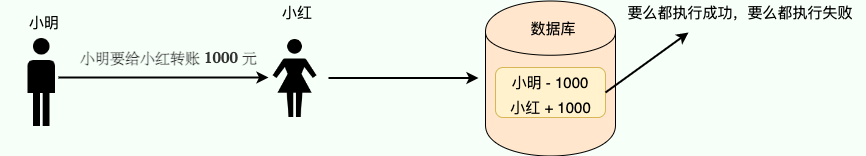

## Database Transactions

Unless otherwise specified, “transaction” usually refers to a **database transaction**.

Database transactions are common in everyday development. In a monolithic application, they are often the transactions you work with.

**What does a database transaction do?**

It groups multiple database operations (SQL statements) into one logical unit: **either they all succeed or none of them take effect.**

```sql
# Begin a transaction
START TRANSACTION;
# Multiple SQL statements
SQL1,SQL2...
## Commit the transaction
COMMIT;
```

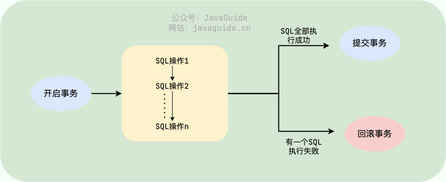

Transactions in relational databases such as `MySQL`, `SQL Server`, and `Oracle` have **ACID** properties:

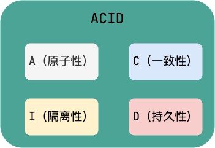

1. **Atomicity:** A transaction is an indivisible unit of execution. Its operations either all take effect or none do.
2. **Consistency:** Data satisfies its invariants before and after a transaction. For a transfer, the combined balance of sender and recipient should remain unchanged whether the transaction succeeds or fails.
3. **Isolation:** Concurrent transactions do not interfere with one another beyond what the selected isolation level permits.
4. **Durability:** Once committed, changes persist, including through a database failure, subject to the database's durability guarantees.

🌈 One clarification: **Atomicity, isolation, and durability help an application preserve consistency. A, I, and D are mechanisms; C is the goal.** This distinction is discussed in [Zhou Zhihua's Software Architecture course](https://time.geekbang.org/opencourse/intro/100064201).

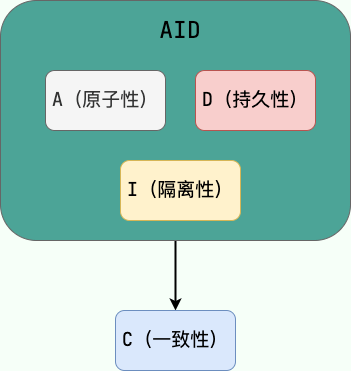

The author of [_Designing Data-Intensive Applications_ (DDIA)](https://book.douban.com/subject/30329536/) makes the following point:

> Atomicity, isolation, and durability are properties of the database, whereas consis‐
> tency (in the ACID sense) is a property of the application. The application may rely
> on the database’s atomicity and isolation properties in order to achieve consistency,
> but it’s not up to the database alone.
>
> Atomicity, isolation, and durability are database properties, whereas consistency (in the ACID sense) is an application property. An application may rely on the database's atomicity and isolation to achieve consistency, but consistency is not determined by the database alone. Therefore, C is not a database property in ACID.

_Designing Data-Intensive Applications_ is highly recommended and rewards rereading. Its Chinese translation is available on GitHub: [Vonng/ddia](https://github.com/Vonng/ddia).


**How are database transactions implemented?**

Here is a brief overview using MySQL's InnoDB engine.

InnoDB uses the **redo log** for transaction **durability** and the **undo log** for **atomicity**. It uses **locks**, **MVCC**, and other mechanisms to provide isolation. Its default isolation level is **`REPEATABLE READ`**.

## Distributed Transactions

In a microservice architecture, a system is split into smaller services that may run on different machines and use separate databases. A single workflow can therefore involve multiple services and databases. For example, creating an e-commerce order may involve an order service (create the order) and an inventory service (decrement stock), each with its own database.

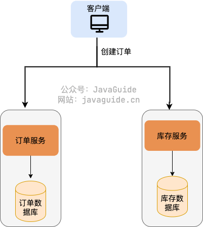

**How can we ensure that this group of operations either all succeed or all fail?**

A database transaction alone cannot coordinate them. This is where **distributed transactions** come in.

Cross-database operations may need distributed transaction coordination. For example, when a database reaches its performance or capacity limits, data may be split across databases. If one operation touches multiple databases, a transaction provided by just one database cannot coordinate all of them.

In short, **the goal of a distributed transaction is to maintain consistency across related databases in a system.**

Since distributed transactions are transactions, in theory they should satisfy ACID. In practice, performance, availability, and other constraints often make full ACID guarantees impractical, so a trade-off is needed.

Several theories help explain these trade-offs.

## Distributed Transaction Fundamentals

### CAP and BASE

CAP and BASE are useful background for understanding distributed transaction trade-offs. When writing data across services, a system usually cannot achieve strong consistency, continuous availability, and low complexity at the same time. In practice, the design decision is which steps require strict guarantees and which can converge through compensation.

This section does not cover the full definitions of CAP and BASE. See [An In-Depth Explanation of the CAP Theorem and BASE Theory](./protocol/cap-and-base-theorem.md) first. To learn how Leader/Quorum, split-brain, leases, and fencing tokens affect locks, transactions, and configuration centers, see [Distributed Coordination](./protocol/centralized-and-decentralized.md).

### Three Levels of Consistency

Consistency requirements are often grouped into these three levels:

- **Strong consistency:** A read returns the value that was written.
- **Weak consistency:** A read may not return the latest value, and there is no guarantee about when it will do so; the system only aims for the data to become consistent eventually.
- **Eventual consistency:** A stronger form of weak consistency in which the system guarantees that replicas converge within some period of time.

Other consistency models include read-your-writes and causal consistency. See the paper [Operational Characterization of Weak Memory Consistency Models](https://es.cs.uni-kl.de/publications/datarsg/Senf13.pdf) for details. These models are less common in everyday work, so they are outside the scope of this article. 😅

Eventual consistency is common in industry, but use cases with strict consistency requirements, such as bank transfers, still need strong consistency.

### Flexible Transactions

High availability is critical for Internet applications; even a few seconds of downtime in a distributed system can cause significant losses. Building on CAP and BASE, the industry introduced the concept of **flexible transactions**, which **aim for eventual consistency**.

In practice, flexible transactions combine **BASE principles with business-specific techniques**. They use mechanisms suited to the application to achieve eventual consistency. **TCC**, **Saga**, **message-queue transactions**, and the **local message table** are examples.

### Rigid Transactions

In contrast to flexible transactions, **rigid transactions** aim for **strong consistency**. **2PC** and **3PC** are examples.

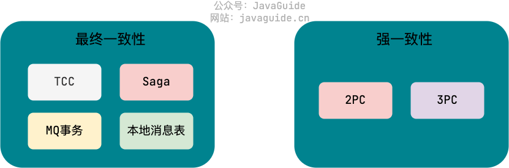

## Distributed Transaction Solutions

Common distributed transaction solutions include **XA / 2PC**, **3PC**, **AT**, **TCC**, **Saga**, **transactional outbox**, **MQ transactions** (supported by Kafka and RocketMQ), and **best-effort delivery**.

2PC and 3PC do not require changes to business code. The XA specification, defined by X/Open, is a Distributed Transaction Processing (DTP) standard that defines the interfaces between a TM and RMs. It typically uses 2PC to commit. TCC and Saga require changes to business code, while AT sits between XA and TCC. MQ transactions apply when a message queue is used. A transactional outbox and best-effort delivery mainly target eventual consistency and do not support automatic rollback.

These solutions suit different scenarios, so choose one based on the needs of your project.

A simple selection guide:

- **Eventual consistency is not acceptable**: Consider XA / 2PC for short, strongly consistent transactions such as financial and accounting operations, while accounting for the performance and availability costs.
- **You want to minimize business changes**: Consider Seata AT, a transactional outbox, or MQ transactions. AT has relatively low business-code intrusion, but imposes requirements on database schemas, supported SQL, and global locks.
- **Business-code changes are acceptable and the workflow is short**: Consider TCC for operations that reserve resources, such as freezing funds, reserving inventory, or locking coupons.
- **The workflow is long or has many steps**: Consider Saga for long-running processes such as order fulfillment, travel booking, or approval workflows.
- **You only need to notify another system of the eventual result**: Consider best-effort delivery for payment callbacks, shipping updates, or reward points.

Before covering 2PC and 3PC, let's introduce the roles they use, as defined by the XA model:

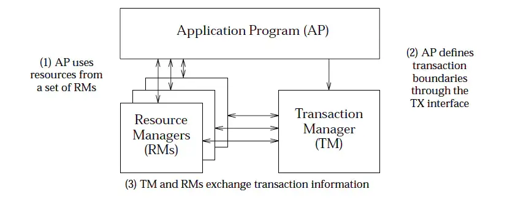

- **AP (Application Program)**: The application itself.
- **RM (Resource Manager)**: A transaction participant, usually a database (the examples below use relational databases). A distributed transaction often involves multiple RMs.
- **TM (Transaction Manager)**: Manages the global transaction, assigns it a unique ID, tracks its progress, and handles commit, rollback, and recovery after failures.

### 2PC (Two-Phase Commit)

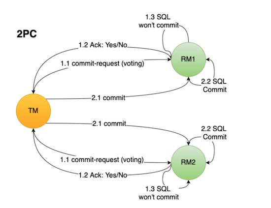

The letters in 2PC (Two-Phase Commit) stand for:

- **2** -> The two transaction commit phases
- **P** -> Prepare
- **C** -> Commit

2PC divides transaction commit into two phases: **Prepare** and **Commit**.

#### Prepare Phase

The Prepare phase asks each transaction participant whether it can successfully perform its local database operations.

The Prepare phase works as follows:

1. The **transaction coordinator/manager (TM)** sends a message to every **transaction participant (RM)** asking whether it can perform the transaction, then waits for a response.
2. On receiving the message, each **RM** starts its local database transaction work, such as writing redo and undo logs. **The transaction is not committed yet.**
3. If the local work succeeds, the **RM** replies “Yes” to indicate that it is ready; otherwise, it replies “No.”

#### Commit Phase

The Commit phase tells the participants to commit their local transactions.

If all participants are ready:

1. The **TM** sends every participant a **Commit message**.
2. On receiving it, each **RM** commits its local database transaction and then **releases the resources held during the transaction**.
3. Each **RM** replies with an **ACK** to confirm that the transaction has committed.
4. After receiving an **ACK** from every participant, the **TM** ends the distributed transaction.

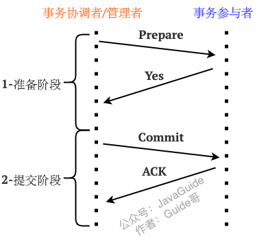

If any participant is not ready:

1. The **TM** sends every participant a **Rollback message**.
2. On receiving it, each **RM** rolls back its local database transaction and then **releases the resources held during the transaction**.
3. Each **RM** replies with an **ACK** to confirm that the transaction has rolled back.
4. After receiving an **ACK** from every **RM**, the **TM** aborts the transaction.

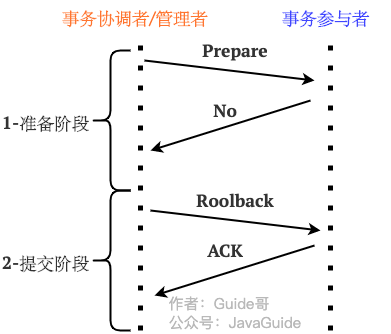

#### Summary

Key points about the two **2PC** phases:

1. The **Prepare phase** checks whether each **RM** can perform its **local database transaction**. **It does not commit the transaction.**
2. In the **Commit phase**, the **TM** uses the responses from the **RMs** in the Prepare phase to decide whether to commit or roll back.
3. The distributed transaction ends after the **Commit phase**.

**Advantages of 2PC:**

- The theoretical model is simple and easy to understand and implement.
- Major databases such as MySQL InnoDB, Oracle, and PostgreSQL generally support XA. They can act as RMs in 2PC, with an external TM coordinating commit or rollback.

**Trade-offs of 2PC:**

- 2PC is designed to provide strong consistency. In real-world implementations, network partitions, TM crashes, RM timeouts, and other extreme conditions can still cause inconsistent data or long-running blocked transactions. It does not guarantee “absolute strong consistency” by itself.

**Problems with 2PC:**

- **Synchronous blocking**: Participants hold resources until the transaction is committed. For example, while Xiao Ming transfers money to Xiao Hong, other transactions that need to access either account may be blocked.
- **Inconsistent data**: Network failures or a TM crash can leave participants with different outcomes. For example, if some participants do not receive the Commit or Rollback message during the second phase, their local states may diverge.
- **Single point of failure**: The TM is critical. If it crashes after the Prepare phase, participants may remain stuck waiting for a Commit or Rollback decision.

### XA Mode

XA can be understood as a standardized implementation of 2PC at the database and resource level. 2PC is a commit protocol; XA is a DTP interface specification defined by X/Open that describes how a TM coordinates multiple RMs in one global transaction.

The typical flow is:

1. The AP starts a global transaction, and the TM creates its global transaction context.
2. Each RM (for example, a database) executes its local transaction without committing it yet.
3. The TM calls `prepare` on each RM. If all RMs prepare successfully, the TM calls `commit`; otherwise, it calls `rollback`.

XA requires few changes to business code, and the database provides transaction isolation and rollback. It suits short, strongly consistent transactions with moderate concurrency. Its drawback is that database resources can be held for a long time, which can affect performance and availability.

Seata has supported XA mode since version 1.2. It uses XA support in resources such as databases and messaging services to manage branch transactions. This provides stronger overall consistency, but throughput is usually lower than with flexible approaches such as AT, TCC, and Saga.

### 3PC (Three-Phase Commit)

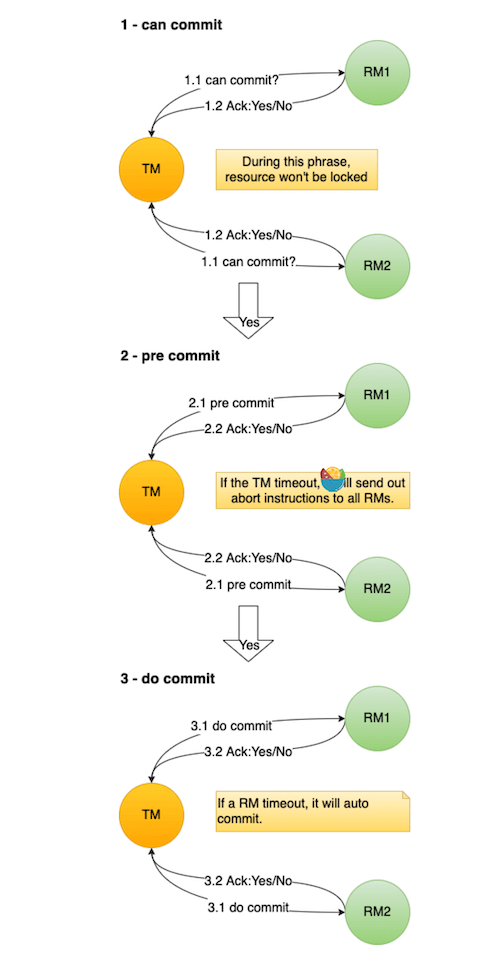

3PC is an optimization of 2PC. It splits the **Prepare phase** into two separate phases: CanCommit (asks whether the transaction can be committed without doing any transaction work) and PreCommit (performs preliminary transaction work and writes redo/undo logs). Together with the final DoCommit phase, there are three phases:

1. CanCommit (ask whether the transaction can be committed)
2. PreCommit (perform preliminary transaction work)
3. DoCommit (commit the transaction)

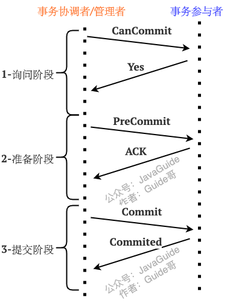

#### CanCommit Phase

In this phase, the RM does not perform transaction work. The TM sends the RM a **prepare request** and asks whether the participant can perform its local database operations. The RM replies “Yes” or “No,” or times out without replying.

#### PreCommit Phase

If every RM replies “Yes” in the CanCommit phase, the TM sends each RM a **PreCommit message (pre-commit request)**. On receiving it, each RM performs preliminary local database work, such as writing redo and undo logs.

If any RM replies “No” or times out in the CanCommit phase, the TM sends every RM an **Abort message (abort request)**. Each RM aborts the transaction when it receives the message. This has little cost for the RMs because they have not yet done significant work.

If an RM successfully performs the preliminary transaction work, it replies “Yes.” Otherwise, it replies “No.” This is the last chance to abort.

The TM and RMs both use timeouts during the PreCommit phase. If a **participant** does not receive the TM's PreCommit message, or the TM does not receive the participant's result, the transaction is aborted after the timeout. This helps prevent indefinite blocking.

#### DoCommit Phase

The **DoCommit** phase performs the actual commit.

If every RM replies “Yes” in the PreCommit phase, the TM sends each RM a **DoCommit message (commit request)**. Each RM commits its local database transaction and releases its resources, then replies “Yes” once the commit succeeds.

If any RM replies “No” or times out during the PreCommit phase, the TM sends every RM an **Abort message (abort request)**. Each RM rolls back its transaction, releases its resources, and aborts.

If an RM does not receive a DoCommit message from the TM before the timeout, it assumes that the TM may have failed and commits the transaction.

If every RM returns `Yes` in the PreCommit phase, the transaction is likely to succeed in the third phase.

Note that **defaulting to commit after an RM timeout is a double-edged sword in 3PC**. It mitigates the risk of RMs remaining blocked indefinitely if the TM crashes during 2PC, but introduces a new risk of inconsistency. For example, the TM may decide to abort, but if only some RMs receive the Abort message, the others may commit after timing out. The same transaction would then be partly committed and partly rolled back across RMs. This is one reason 3PC is rarely used in practice.

#### Summary

**Besides splitting the Prepare phase of 2PC, what else does 3PC improve?**

3PC adds **timeouts** to both the TM and RMs. If the TM does not receive a message from an RM within a specified time, it assumes failure and aborts the transaction. If an RM does not receive the TM's next instruction in time, it aborts or commits based on its current phase, helping prevent resources from being blocked for too long.

However, 3PC does not completely solve 2PC's blocking problem. It can also perform worse and still allow inconsistent data, so it is not widely used in practice. A more common engineering approach is to use consensus protocols such as Paxos or Raft, usually with a replicated state machine, to address coordinator failures and state consistency instead of using 3PC directly.

### TCC (Compensating Transaction)

TCC is a common approach to flexible transactions. In 2007, database researcher Pat Helland published [“Life beyond Distributed Transactions: an Apostate’s Opinion”](https://www.ics.uci.edu/~cs223/papers/cidr07p15.pdf), which discusses avoiding traditional distributed transactions in favor of business-level compensation.

TCC stands for Try, Confirm, Cancel, and consists of three phases:

1. **Try phase**: Validate the business operation and reserve the resources it needs.
2. **Confirm phase**: If every participant completes Try successfully, Confirm finalizes the resources reserved during Try. Otherwise, Cancel runs.
3. **Cancel phase**: Abort the operation and release the resources reserved during Try.

Business code controls each phase. This avoids long-running database transactions and long-held locks, but requires more changes to the business code. Developers must handle resource reservation, confirmation, cancellation, retries, and failure compensation themselves.

Consider a money transfer:

1. **Try phase**: Check that the account has enough funds and reserve the transfer amount.
2. **Confirm phase**: If Try succeeds, deduct the funds.
3. **Cancel phase**: Release the funds reserved during Try.

With `TCC`, you generally implement the `try`, `confirm`, and `cancel` methods yourself to achieve eventual consistency.

In the normal case, `try` and `confirm` run.

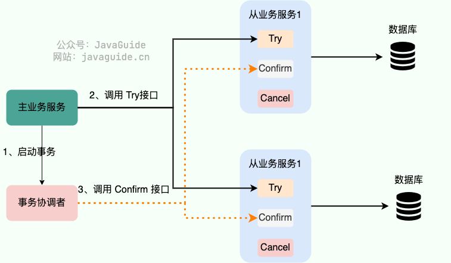

If an error occurs, `try` and `cancel` run.

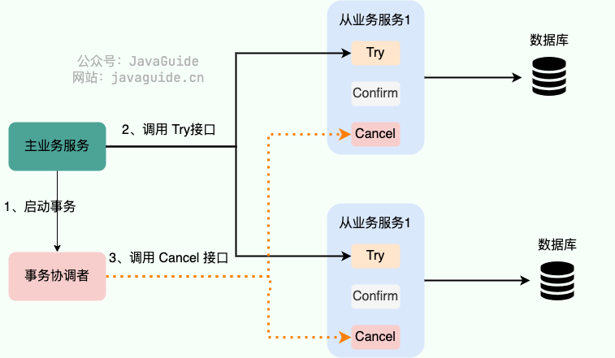

If a problem occurs during Try, Cancel can run. **What happens if Confirm or Cancel fails?**

TCC records transaction logs in a storage system such as local files, a relational database, or ZooKeeper. These logs record the transaction state, including whether it committed or failed and which phase failed. If Confirm or Cancel fails, the system retries that phase. The framework determines the retry limit; if retries are exhausted, it usually raises an alert and requires manual intervention.

If the code has no bugs, failures during Confirm or Cancel should be uncommon.

TCC implementations must address three well-known engineering problems:

1. **Idempotency**: Network timeouts or TC retries may cause Confirm and Cancel to be called more than once. Repeated calls must have the same result. A common approach is to store transaction states in a database table and check the state before each operation.
2. **Empty rollback**: A Try request may never reach the RM because of a network issue, while the TM has already sent Cancel. Cancel must recognize that Try never ran and return successfully without performing an invalid rollback.
3. **Suspension**: Cancel may reach the RM before Try, and the delayed Try request may arrive later. If Try reserves resources, they may never be confirmed or cancelled. Try should check whether the transaction has already been cancelled and reject the request if so.

**Are transaction logs deleted?** Yes. If the transaction commits without an exception, its log can be deleted to save resources.

**TCC does not depend on transaction support from the underlying data resources, but requires more code to be implemented manually.** It is a distributed transaction solution that **intrudes on business code**.

The TCC transaction model is similar to 2PC. The diagram below compares them.

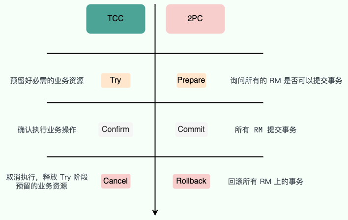

**How does TCC differ from 2PC/3PC?**

- 2PC/3PC rely on transactions provided by databases or other storage resources; TCC is implemented mainly by changing business code.
- 2PC/3PC do not require changes to business code, while TCC does.
- 2PC/3PC aim for strong consistency and hold database locks throughout the two-phase commit process. TCC aims for eventual consistency and does not hold locks on business resources throughout the process.

Several open-source frameworks implement TCC. Their implementations may differ, but the general idea is the same.

1. **[ByteTCC](https://github.com/liuyangming/ByteTCC)**: A distributed transaction manager based on the Try-Confirm-Cancel (TCC) mechanism. Further reading: [Thoughts on Implementing a TCC Distributed Transaction Framework](https://www.bytesoft.org/how-to-impl-tcc/).
2. **[Seata](https://seata.apache.org/zh-cn/)**: An open-source distributed transaction solution that supports AT, TCC, Saga, and XA. This section refers to its TCC mode.
3. **[Hmily](https://gitee.com/dromara/hmily)**: A financial-grade distributed transaction solution. For new projects, also evaluate community activity and alternatives such as Seata.

### AT Mode (Automatic Compensation)

AT (Automatic Transaction) is one of Seata's core modes. It aims to provide eventual consistency with minimal changes to business code. It can be understood as an automatic compensation solution: the business operation still commits as a local transaction, while the framework records the information needed for rollback.

AT mode has two phases:

1. **Phase 1**: The business SQL runs and commits as a local transaction. Meanwhile, Seata's proxied data source parses the SQL, records before and after images in the `undo_log` table, and registers the branch transaction with the TC.
2. **Phase 2 commit**: If the global transaction commits, the TC tells the RM to delete the `undo_log` asynchronously.
3. **Phase 2 rollback**: If the global transaction rolls back, the RM generates compensating SQL from the `undo_log` and restores the data to its before image.

AT mode requires few changes to business code and suits many routine CRUD operations on relational databases. However, it has requirements for SQL types, table primary keys, global locks, and isolation levels. It is not suitable for every complex SQL operation or transactions involving non-relational resources.

### TCC vs Saga

| Dimension             | TCC                                                               | Saga                                                          |
| --------------------- | ----------------------------------------------------------------- | ------------------------------------------------------------- |
| Resource handling     | Reserves or freezes resources during Try                          | Commits each local transaction directly                       |
| Isolation             | Provides “pseudo-isolation” through business resource reservation | Weak isolation; other transactions may see committed results  |
| Business-code changes | High; requires Try, Confirm, and Cancel logic                     | High; requires forward and compensating actions for each step |
| Transaction length    | Better for short workflows with clear resource reservations       | Better for long workflows with many steps                     |
| Typical use cases     | Transfers, inventory reservation, coupon locking                  | Order fulfillment, travel booking, approval workflows         |

### MQ Transactions

RocketMQ, Kafka, Pulsar, and QMQ provide transaction-related features. These let event-streaming applications define message consumption, processing, and production as a single atomic operation.

This section uses RocketMQ as an example (image source: _Advanced Message Queueing_). Further reading: [RocketMQ transactional message documentation](https://rocketmq.apache.org/docs/featureBehavior/04transactionmessage/).


1. The MQ producer (for example, a shipping service) starts a transaction with the message queue and sends a “half message” to the MQ server/broker. The message is hidden from subscribers/consumers (for example, a third-party notification service) until the transaction commits.
2. After the half message is sent successfully, the producer executes its local transaction.
3. If the local transaction succeeds, the half message becomes a regular message that can be consumed. If the local transaction fails, it is rolled back.

RocketMQ transactional messages borrow the idea of two-phase commit: first send a half message that is hidden from consumers, then commit it after the local transaction succeeds so that it becomes consumable. This is not 2PC with traditional XA semantics; it is a mechanism designed to make the local transaction result and message visibility eventually consistent.

**What if the MQ producer fails while committing or rolling back a transactional message?**

The RocketMQ broker periodically checks the producer for the outcome of its local transaction, then decides whether to commit or roll back the message based on the result.

The transaction-check mechanism relies on an interface implemented by the business code. For example, to check whether a local transaction created shipping information successfully, query the database to see whether that information exists.


**What if a regular message is not consumed successfully?**

If message consumption fails, RocketMQ retries it automatically. If it still fails after the maximum number of retries, RocketMQ treats it as a problematic message and moves it to a **dead-letter queue**.


Messages in the dead-letter queue usually require manual investigation and handling.

QMQ's transactional messaging is simpler than RocketMQ's and uses the database's built-in transaction support. Its core idea is eBay's **transactional outbox** pattern, which breaks a distributed transaction into local transactions.

Maintain a local message table to track message delivery status. Write the delivery record and perform the business operation in the same transaction. If the business operation succeeds, the message record is also saved.

Then run a separate thread to poll the table periodically and send pending messages to the message broker.

After a message is sent successfully, update its status or delete it.

The main difference between these approaches is how they depend on MQ availability:

- **RocketMQ transactional messages**: The local transaction itself does not depend on the broker, but the half message must be sent successfully before the local transaction runs. If the broker is unavailable, sending the half message fails. The application must choose whether to fail fast, retry, or fall back to another compensation process; this does not necessarily mean the entire application is down.
- **QMQ / transactional outbox**: The message is first written to the business service's local database in the same transaction as the business operation. A temporary MQ outage does not prevent the business transaction from committing; a separate thread delivers the message later.

The transactional outbox therefore tolerates temporary MQ outages better, but the business service must maintain the message table, delivery thread, retry policy, idempotent consumers, and reconciliation. QMQ packages this pattern into a more complete, ready-to-use solution.

Further reading: [Interviewer: What Are the Drawbacks of RocketMQ Transactional Messages?](https://mp.weixin.qq.com/s/cBx1l1zaThN6_808fMl27g)

### Saga

Saga has a long history. The theory was introduced in the 1987 paper [“Sagas”](https://www.cs.cornell.edu/andru/cs711/2002fa/reading/sagas.pdf) by Hector and Kenneth, before the concept of distributed transactions was introduced.

Saga is a solution for long-running transactions. Its core idea is to split a long transaction into a sequence of short local transactions.

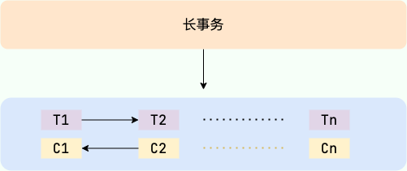

- Long-running transaction -> local transactions T1, T2, ..., Tn
- Each local transaction has a compensating action -> C1, C2, ..., Cn

The following diagram is from Microsoft's technical documentation on [Saga distributed transactions](https://docs.microsoft.com/zh-cn/azure/architecture/reference-architectures/saga/saga).


If all the short transactions T1, T2, ..., Tn complete successfully, the overall transaction succeeds. Otherwise, the system enters a recovery mode.

**Backward recovery:**

- Description: If local transaction Ti fails to commit, compensate for all completed transactions by running their compensating actions.
- Order: T1, T2, ..., Ti (fails), Ci (compensation), ..., C2, C1.

**Forward recovery:**

- Description: If local transaction Ti fails to commit, retry Ti until it succeeds.
- Order: T1, T2, ..., Ti (fails), Ti (retry), ..., Ti+1, ..., Tn.

Like TCC, Saga requires business developers to implement both forward and compensating actions, so it **requires changes to business code**. One major difference from TCC is that Saga has no Try phase: each local transaction Ti commits directly. As a result, performance is very high.

Compensating actions are business code too, so they can fail because of network issues, unavailable dependencies, or changes in business rules. Saga frameworks typically handle compensation failures with repeated retries, a retry limit, and manual intervention. Compensating actions must therefore be idempotent. To improve fault tolerance (the Saga system itself may also crash) and ensure that every short transaction is either committed or compensated, log these operations in a Saga log, similar to a database log. After recovery, the Saga system can determine how far the transactions and compensations progressed.

Also, Saga does not reserve resources in a Try phase, so it cannot guarantee isolation. This is one of its main drawbacks.

Several open-source frameworks implement Saga. Their implementations may differ, but the general idea is the same.

1. **[ServiceComb Pack](https://github.com/apache/servicecomb-pack)**: An eventual consistency solution for microservice applications.
2. **[Seata](https://seata.apache.org/zh-cn/)**: An open-source distributed transaction solution that supports Saga as one of its modes.

### Best-Effort Delivery

Best-effort delivery is a lightweight approach to eventual consistency, commonly used for payment callbacks, shipping updates, and reward point distribution.

The idea is simple: after the sender completes its local transaction, it makes a best effort to notify the receiver. If notification fails, it keeps retrying at fixed intervals or with exponential backoff. The receiver's endpoint must be idempotent. After the retry limit is reached, the case usually requires manual handling or reconciliation.

Best-effort delivery can be seen as a simplified transactional outbox: it can avoid MQ, with the sender retrying calls to the receiver directly. However, its reliability and ability to absorb traffic spikes are usually lower than those of a complete “transactional outbox + MQ + idempotent consumer” solution.

## Overview of Seata's Integrated Solution

Seata is a commonly used, integrated distributed transaction solution. Its core roles are:

- **TC (Transaction Coordinator)**: Maintains the state of global and branch transactions.
- **TM (Transaction Manager)**: Defines global transaction boundaries and starts, commits, or rolls back global transactions.
- **RM (Resource Manager)**: Manages branch transaction resources, registers branch transactions with the TC, and reports their status.

Seata supports several transaction modes:

| Mode | Business-code changes | Consistency goal                            | Typical characteristics                                                | Suitable scenarios                                           |
| ---- | --------------------- | ------------------------------------------- | ---------------------------------------------------------------------- | ------------------------------------------------------------ |
| AT   | Low                   | Eventual consistency                        | Generates `undo_log`; automatic second-phase compensation              | Routine relational database CRUD                             |
| TCC  | High                  | Eventual consistency / business constraints | Business code implements Try/Confirm/Cancel                            | Short workflows that reserve resources                       |
| Saga | High                  | Eventual consistency                        | Splits long transactions into local transactions and compensation      | Long workflows across multiple services                      |
| XA   | Low                   | Strong consistency                          | Relies on database XA support and holds resource locks for a long time | Short, strongly consistent transactions with low concurrency |

Seata should not be classified simply as a TCC or Saga framework. Choose among AT, TCC, Saga, and XA based on the required business-code changes, database support, workflow length, performance, and consistency.

## Recommended Reading

The following Chinese-language articles provide further reading:

> **[An In-Depth Analysis of Saga Distributed Transactions](https://segmentfault.com/a/1190000041001954)**
>
> **[Seven Classic Solutions for Distributed Transactions](https://segmentfault.com/a/1190000040321750)**
>
> **[Common Pitfalls in Distributed Transactions and How to Avoid Them](https://segmentfault.com/a/1190000041031586)**
>
> Ye Dongfu 👍👍👍👍👍

This is well written, with a thorough and detailed overview of the solutions.

> [Comparing Seven Distributed Transaction Solutions: Why I Prefer Alibaba's Open-Source Seata (Theory and Practice)](https://mp.weixin.qq.com/s/sXVSFqq2UZ6Pwwt7vx7vIA)
>
> Code Ape Technology Column 🗓️2021-10-25 👍👍👍👍👍

It introduces several mainstream distributed transaction solutions and Seata, Alibaba's integrated open-source solution.

The article covers the theory and demonstrates Seata's AT mode.

> **[Seata Distributed Transaction Practice and Open-Source Deep Dive | GIAC Talk](https://www.sofastack.tech/blog/seata-distributed-transaction-deep-dive/)**
>
> Zhang Sen 🗓️2019-07-02 👍👍👍👍👍

This article is a talk at the GIAC Global Internet Architecture Conference by Zhang Sen (also known as Shaohui), an Ant Financial technical expert and one of the initiators of Seata. It explains the causes of distributed transaction problems and Ant Financial's response: Seata's AT, TCC, Saga, and XA modes.

It includes many clear diagrams that help explain the concepts. This is an excellent article.

> **[Master Distributed Transaction Principles with 25 Diagrams](https://mp.weixin.qq.com/s/qeUfEJFYCfyDjgzDnq_Jdw)**
>
> Mahai 🗓️2020-10-30 👍👍👍👍👍

It mainly covers single- and multiple-data-source transactions, common distributed transaction solutions, and the implementation of Seata's AT mode.

> **[Understand XA Mode for Distributed Transactions with Six Diagrams](https://mp.weixin.qq.com/s/Rp8paKc2bQhERBGDKtpMcA)**
>
> Zhu Jinjun 🗓️2021-04-25 👍👍👍

An Alibaba Cloud Native article about XA mode and Seata's implementation and optimization of it. The overview is broad, so read related articles for more detail.

## Open-Source Distributed Transaction Projects

1. **[Seata](https://seata.apache.org/zh-cn/)**: An open-source distributed transaction solution that supports AT, TCC, Saga, and XA, aiming to provide high-performance, easy-to-use distributed transactions for microservice architectures.
2. **[Hmily](https://gitee.com/dromara/hmily)**: A high-performance, financial-grade flexible distributed transaction solution that mainly provides TCC and TAC (automatic rollback SQL generation). For new projects, check its community activity and evaluate it alongside solutions such as Seata and DTM.
3. **[Raincat](https://gitee.com/dromara/Raincat)**: Middleware for distributed transactions using two-phase commit.
4. **[Myth](https://gitee.com/dromara/myth)**: An open-source framework that uses message queues to handle distributed transactions. It is written in Java (JDK 1.8) and supports RPC frameworks such as Dubbo, Spring Cloud, and Motan.

## References

- [Consistency Protocols in Distributed Systems: 2PC and 3PC - Matt - 2018](https://matt33.com/2018/07/08/distribute-system-consistency-protocol/)
- [Dealing Distributed Transactions with 2PC, 3PC, Local Transaction Table with MQs - Adrian -2021](https://masteranyfield.com/2021/07/26/dealing-distributed-transactions-with-2pc-3pc-local-transaction-table-with-mqs/)
- [How Does 3PC Address 2PC's Blocking Problem? - Zhihu question](https://www.zhihu.com/question/422691164)
- [Apache Seata Official Documentation](https://seata.apache.org/docs/overview/what-is-seata/)
- [Seata XA Mode](https://seata.apache.org/zh-cn/docs/user/mode/xa)
- [Seata TCC Fence: Idempotency, Empty Rollback, and Suspension](https://seata.apache.org/blog/seata-tcc-fence)
- [RocketMQ Transactional Message Documentation](https://rocketmq.apache.org/docs/featureBehavior/04transactionmessage/)
