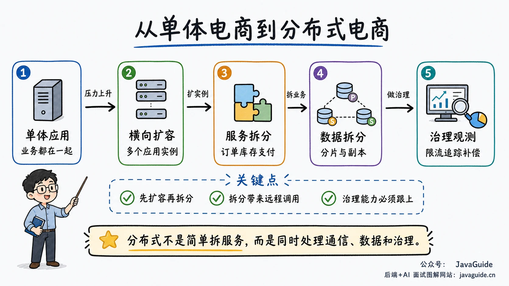
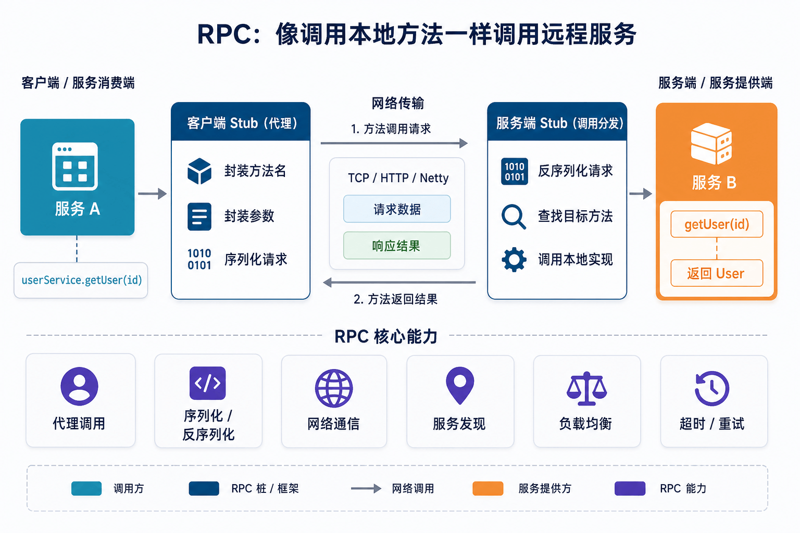
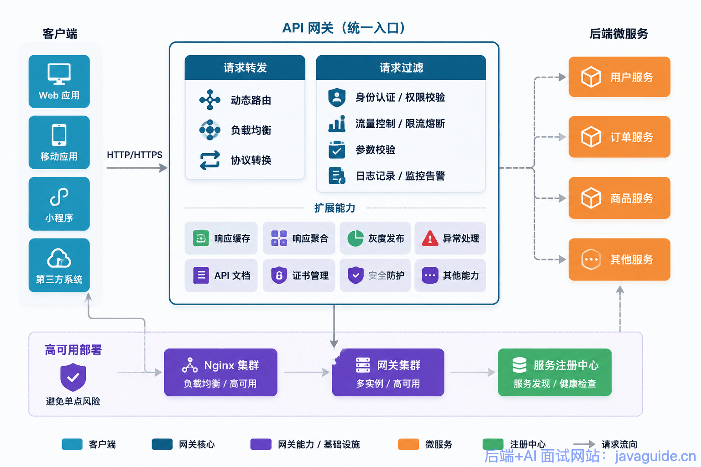
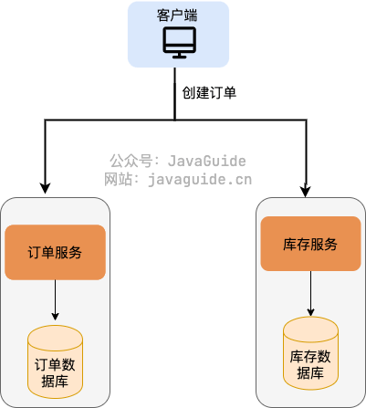
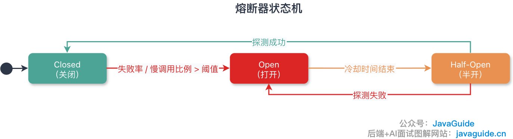

Microservices interviews often move beyond definitions to architecture decisions: Why were services divided this way? What happens when a remote call fails? How can services query data and maintain consistency when each owns its data? How are deployments, scaling, and recovery handled?

This review guide connects articles on service boundaries, communication, data consistency, resilience, and observability across the distributed systems, high availability, messaging, and security sections. It identifies what to review; the linked articles provide detailed answers.

If time is limited, start with [common microservices interview questions](https://interview.javaguide.cn/distributed-system/microservices-interview-questions.html), mark the gaps in your knowledge, and use the linked guides to fill them.

## What should you focus on?

| Area                             | What to explain                                                           | Common follow-up topics                                                                               |
| -------------------------------- | ------------------------------------------------------------------------- | ----------------------------------------------------------------------------------------------------- |
| Architecture and decomposition   | Why and how services are split, and at what granularity                   | Monoliths, clusters, distributed systems, bounded contexts, service boundaries, distributed monoliths |
| Communication and infrastructure | How services discover and call each other and how external requests enter | REST, RPC, queues, discovery, gateways, configuration centers                                         |
| Data and consistency             | Cross-service queries and transactions when services own their data       | Database per Service, aggregation, Saga, transactional messaging, Outbox, idempotency                 |
| Resilience and delivery          | How failures are contained and services safely released and scaled        | Timeouts, retries, circuit breakers, rate limits, isolation, probes, graceful shutdown, compatibility |
| Observability and security       | How to trace problems and pass identity and permissions across services   | Logs, metrics, tracing, alerts, gateway authentication, service authorization                         |

Component names are only part of an answer. Explain service boundaries, data ownership, failure handling, and whether the team can independently develop, deploy, and operate the services.

## Microservice fundamentals and service boundaries

Microservices organize services around business capabilities. Many processes do not automatically mean good boundaries. If services must change and deploy together and directly share tables, the result can be a distributed monolith with higher operational cost.

Related articles:

- [Distributed Systems Fundamentals](./distributed-system-intro.md)
- [Distributed Systems Interview Questions](./distributed-system-interview-questions.md)

Common questions:

- How do monoliths, clusters, distributed systems, and microservices differ?
- What benefits do microservices provide, and what complexity do network calls, consistency, and operations add?
- Which teams or business stages are not ready for microservices?
- Should services be split by business capability, domain boundary, or database table?
- How do bounded contexts relate to service boundaries?
- What happens when services are too granular?
- What is a distributed monolith, and how can you recognize one?

Consider business change, data ownership, and team responsibilities together. A service per table often creates many network calls for one business operation. Boundaries based only on organization charts can become awkward after teams reorganize.

## Communication and infrastructure

Splitting services turns in-process calls into network communication. Synchronous calls need timeouts and handling for uncertain results; asynchronous messages need duplicate handling, ordering, and eventual consistency. Discovery, gateways, and configuration centers support addressing, traffic entry, and configuration as service counts grow.

Related articles:

- [RPC Fundamentals](./rpc/rpc-intro.md)
- [HTTP vs. RPC](../cs-basics/network/http-vs-rpc.md)
- [Message Queue Interview Questions](../high-performance/message-queue/message-queue-interview-questions.md)
- [API Gateways](./api-gateway.md)
- [Spring Cloud Gateway Questions](./spring-cloud-gateway-questions.md)
- [Distributed Configuration Centers](./distributed-configuration-center.md)

Common questions:

- When should services use REST, RPC, or a message queue?
- How do long synchronous call chains amplify latency and failures?
- Why does an RPC framework need discovery, load balancing, serialization, and timeouts?
- How do client-side and server-side discovery differ?
- Which routing, authentication, rate-limiting, and protocol conversion duties belong at the gateway?
- What do gateways, Nginx, load balancers, and BFFs each do?
- Why is a configuration center more than a remote directory of files?
- How are configuration changes rolled out gradually, and how do clients start or run when fetching fails?

Synchronous and asynchronous communication can coexist. A user query usually needs a synchronous response, while notifications, loyalty points, or data synchronization after an order can use messages. Choose based on timing, failure handling, and consistency requirements.

## Data ownership and consistency

Independent service evolution usually requires clear data ownership. Directly sharing a table avoids an API call, but schema or semantic changes by one service can affect the others and prevent independent releases.

Related articles:

- [Distributed Transaction Solutions](./distributed-transaction.md)
- [Message Queue Interview Questions](../high-performance/message-queue/message-queue-interview-questions.md)
- [Idempotency Approaches](../high-availability/idempotency.md)

Common questions:

- Why should each microservice own its data?
- What coupling results from shared tables?
- When should cross-service queries use API aggregation, a read model, a search engine, or synchronized data?
- How do you choose between strong and eventual consistency?
- When are 2PC, TCC, Saga, transactional messages, and a local message table appropriate?
- How does Transactional Outbox handle a successful database write followed by a failed message send?
- How do you preserve business correctness when compensation fails or runs twice?
- Why must consumers still be idempotent?

Discuss distributed transactions in terms of actual business actions. Inventory reservations can be reversed, an SMS cannot be unsent, and an external payment may not participate in a local transaction. Compensation must produce a valid business outcome; it does not necessarily restore an earlier technical value.

## Resilience, release, and scaling

A request crossing more nodes encounters more potential partial failures. Timeouts bound waits, retries address transient errors, circuit breakers stop repeated calls to failing dependencies, and rate limits and isolation protect resources. Configure them together across the call chain.

Related articles:

- [High Availability Interview Questions](../high-availability/high-availability-system-interview-questions.md)
- [Timeouts and Retries](../high-availability/timeout-and-retry.md)
- [Rate Limiting](../high-availability/limit-request.md)
- [Fallback and Circuit Breaking](../high-availability/fallback-and-circuit-breaker.md)
- [Redundancy](../high-availability/redundancy.md)

Common questions:

- What do timeouts, retries, circuit breakers, rate limits, fallbacks, and isolation each solve?
- How should timeouts account for an upstream deadline and downstream latency distribution?
- Why can retries at multiple layers cause a retry storm?
- What should Liveness, Readiness, and Startup probes check?
- How can graceful shutdown avoid interrupting in-flight requests?
- How can APIs and message formats remain backward compatible?
- How do you roll back traffic and data after a failed staged rollout?
- Why check partitions, connection pools, and downstream capacity before scaling consumers or services?

Do not put every dependency into one health probe. If a database slows briefly and every instance restarts because its Liveness probe fails, the dependency problem can become a larger outage. Design probes, traffic removal, connection draining, and shutdown order together.

## Observability and security

A microservice request can cross a gateway, several services, caches, databases, and queues. Correlate logs, metrics, and traces with a shared request identifier; otherwise individual errors are difficult to assemble into a complete picture.

Related articles:

- [High Availability Guide](../high-availability/)
- [Authentication, Authorization, and Data Security](../system-design/security/)
- [API Gateways](./api-gateway.md)

Common questions:

- What problems do logs, metrics, and traces each help diagnose?
- Which traffic, error, latency, resource, and business metrics should be monitored?
- How is a TraceId propagated across HTTP, RPC, and queues?
- Should authentication happen at the gateway or service?
- Why must a service still enforce resource-level authorization after gateway authentication?
- How is identity passed between services, and how are direct calls that bypass the gateway controlled?

A gateway can validate tokens and enforce coarse access rules, but the service that owns the data must check order ownership, tenant scope, and data permissions. Hiding a button or checking only a gateway role does not cover object-level authorization or direct service calls.

## Migration and design answers

When migrating a monolith, start with modules that change frequently, have clear capacity pressure, or have well-defined team boundaries. Old and new systems coexist during migration, so data synchronization, traffic switching, compatibility, and rollback need more planning than the service count itself.

Common questions:

- How do you identify the best module to extract first?
- How do you migrate traffic and data while old and new services coexist?
- How do you avoid the schedule and risk of a complete rewrite?
- What should a microservice design answer include?

Structure an answer around business goals, boundaries, APIs and messages, data ownership, consistency, resilience, observability, security, and migration. If traffic, team size, or consistency requirements are missing, clarify them before choosing an architecture and components.

## Review by available time

| Time             | Suggested plan                                                                                                                                                                                               | Goal                                                                      |
| ---------------- | ------------------------------------------------------------------------------------------------------------------------------------------------------------------------------------------------------------ | ------------------------------------------------------------------------- |
| 1–2 days         | Review [common microservices questions](https://interview.javaguide.cn/distributed-system/microservices-interview-questions.html), prioritizing boundaries, communication, consistency, and fault tolerance. | Explain the benefits, costs, and a complete call chain.                   |
| 3–7 days         | Add RPC, gateways, configuration, distributed transactions, queues, timeouts, and circuit breaking; draw an order or payment flow and its data changes.                                                      | Explain failures, trade-offs, and common infrastructure.                  |
| More than a week | Use a project to prepare a service decomposition or design, including compatibility, staged releases, monitoring, capacity, and rollback.                                                                    | Connect business constraints to services, data, delivery, and operations. |

<!-- @include: @article-footer.snippet.md -->
