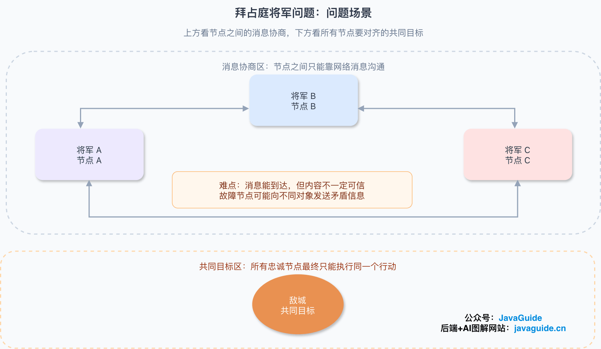
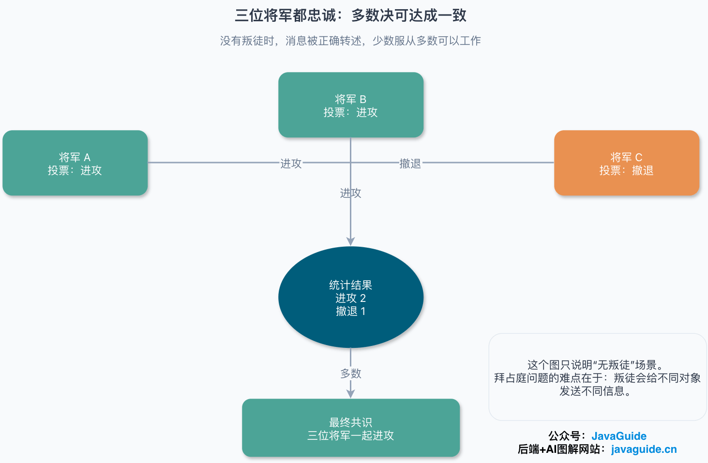
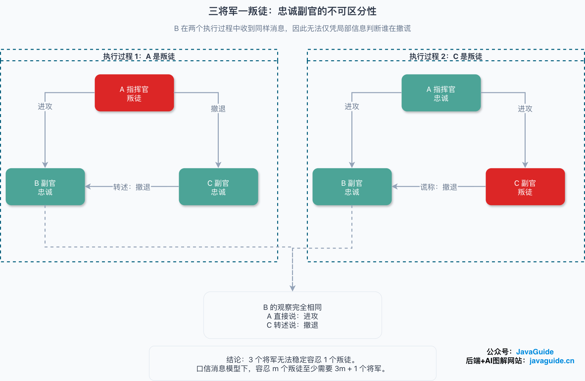
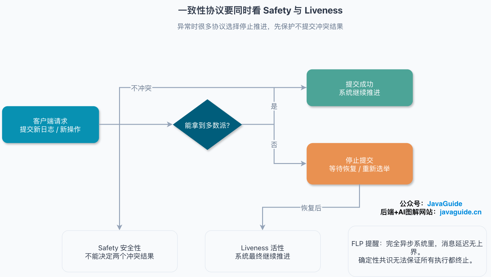
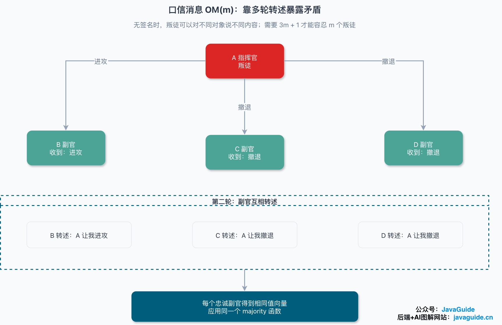
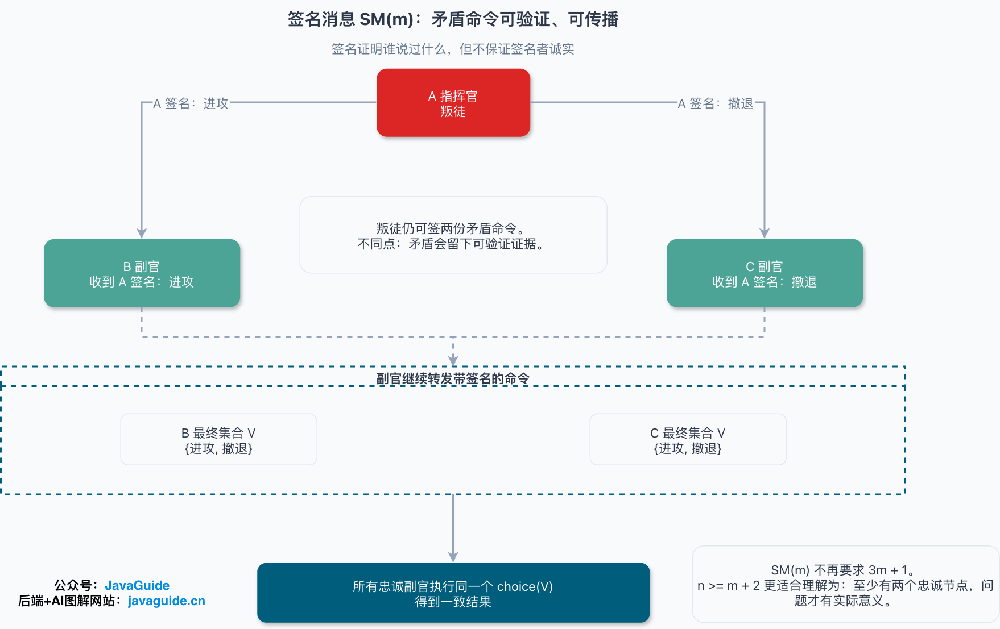
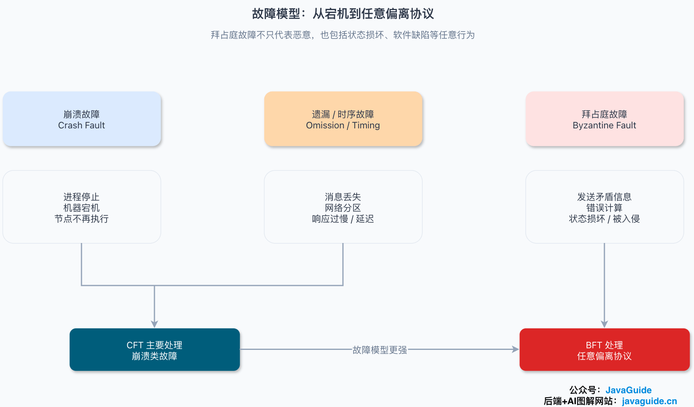
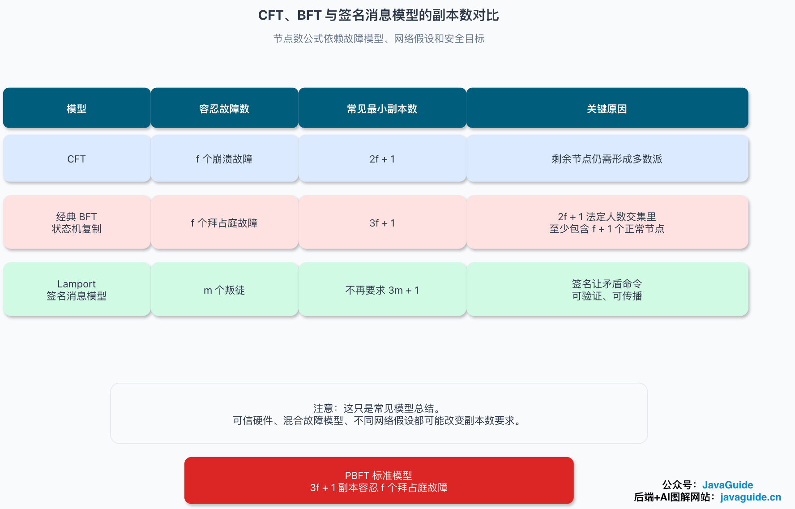
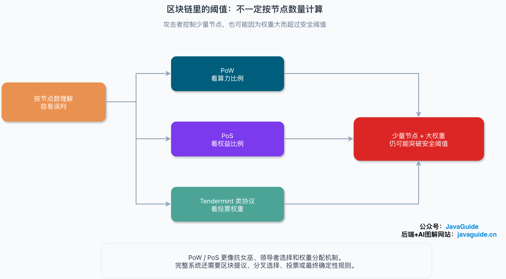

Several service nodes each claim to be right. Which one should the client trust?

In everyday backend systems, failures are usually less extreme. Redis replication, ZooKeeper, etcd, Nacos, and database replication more often encounter machine crashes, network jitter, disk failures, and process restarts. A node usually is not trying to deceive you; it may simply stop responding, respond slowly, or become temporarily disconnected from the cluster.

The Byzantine Generals Problem addresses a more difficult case: **some nodes may behave unpredictably or send contradictory information to different participants**.

That is why the problem matters in distributed systems. The ancient military story is just an analogy; the real question is how to reach agreement among unreliable participants.

When studying common coordination systems such as Raft, ZAB, ZooKeeper, or etcd, distinguish between two failure models. These systems usually handle crash faults and network partitions; they do not assume that nodes lie maliciously. The Byzantine problem uses a stronger failure model. For consensus without Byzantine faults, see [Raft](./raft-algorithm.md) and [ZAB](./zab.md).

## What is the Byzantine Generals Problem?

Leslie Lamport, Robert Shostak, and Marshall Pease introduced the Byzantine Generals Problem in their 1982 paper [The Byzantine Generals Problem](https://www.microsoft.com/en-us/research/publication/byzantine-generals-problem/), published in _ACM Transactions on Programming Languages and Systems_ in July 1982.

Lamport is a foundational figure in distributed systems. He received the 2013 ACM A.M. Turing Award for his contributions to distributed and concurrent systems. He also created the original LaTeX document preparation system.

The story goes like this:

Several Byzantine generals command armies surrounding an enemy city. The armies are in different locations, so the generals cannot meet in person and must communicate through messengers. They need to decide whether to attack or retreat the next day. A lone army will lose; they need enough armies to act together.

The complication is that some generals may be traitors.

A traitor may do more than disobey. They can tell General A to attack and General B to retreat, or fabricate messages to make loyal generals choose differently. In a computer system, similar behavior can come from software bugs, corrupted state, memory or disk errors, or a compromised node. If some loyal generals attack while others retreat, the plan fails.

In a distributed system, generals are nodes, messengers are network messages, and the attack-or-retreat decision is a value on which the nodes need to agree. For example:

- Which node becomes Leader?
- Is a log entry committed?
- Is a transaction valid?
- Which command should a state machine execute next?

In engineering terms, the question is:

> If some nodes can fail, lie, forge information, or send contradictory messages, how can all correct nodes agree on the same result?

One detail is worth clarifying. Many explanations include messengers being intercepted, or messages being lost or altered, to illustrate unreliable communication. However, the “oral messages” model in Lamport's paper makes several assumptions for its formal proof: messages are delivered correctly, recipients know who sent them, and a missing message can be detected.

So the paper addresses a harder problem than packet loss: **the sender itself may be malicious**.

## What properties must consensus satisfy?

In the Byzantine Generals Problem, one commander sends an attack-or-retreat order to several lieutenants. The system needs to satisfy two conditions:

- **Agreement:** All loyal lieutenants eventually follow the same order.
- **Validity:** If the commander is loyal, all loyal lieutenants follow the commander's order.

The first condition prevents loyal participants from splitting. The second prevents the protocol from discarding a valid command just because it is designed to handle traitors.

Strictly speaking, the commander-and-lieutenants model in Lamport's paper is closer to **Byzantine broadcast** or **interactive consistency** than to general consensus. They are closely related, but have different interfaces: in general consensus, each node may propose an initial value and correct nodes must decide on the same value. In the commander-and-lieutenants model, one commander sends an order and the lieutenants decide what to follow.

More general consensus definitions also require termination: correct nodes must eventually decide rather than wait forever. Some definitions include **integrity**, which means a node can decide at most once. Mechanisms such as timeouts, retries, election terms, and view changes help real systems meet these goals.

Return to the generals for an example. Suppose there are three generals, A, B, and C. A is the commander, and B and C are lieutenants. If one general is a traitor, the problem becomes difficult.

From loyal lieutenant B's perspective, these two executions may look identical:

- A is a traitor: A tells B to attack and C to retreat. Loyal C reports “retreat” to B.
- C is a traitor: A is a loyal commander and tells both B and C to attack. C lies to B and claims A said “retreat.”

In both cases, B directly hears “attack” from A and hears C report “retreat.” B cannot tell whether A is lying or C is lying based only on the messages received.

That is the difficulty with three generals and one traitor. Loyal nodes do not lack a voting rule; they lack enough information to identify who is lying. A symmetric scenario for the other loyal lieutenant can push the two loyal lieutenants toward different decisions, violating agreement. Lamport's paper warns that intuitive arguments about this problem can be misleading. Its reduction proof shows that, using only oral messages, tolerating `m` traitors requires at least `3m + 1` generals. In other words, loyal generals must account for more than two-thirds of the total.

At least four generals are needed to tolerate one traitor; at least seven are needed to tolerate two.

## Agreement does not guarantee progress

When studying consensus protocols, distinguish two properties:

- **Safety:** The system never decides on two conflicting results.
- **Liveness:** The system eventually makes progress and reaches a decision.

Many protocols prioritize safety during failures. For example, if a Raft cluster cannot reach a majority, it stops committing new log entries instead of letting two network partitions commit conflicting entries. This harms availability, but avoids corrupting the state.

In a fully asynchronous system, message delays have no upper bound. A timeout alone cannot prove that a node has crashed rather than slowed down. The FLP result further shows that in a fully asynchronous model, a deterministic consensus protocol may fail to terminate even if only one process can crash.

Real systems introduce additional assumptions or mechanisms to restore liveness, such as eventual synchrony, randomization, failure detectors, retries, and view changes. Claims that PBFT can run on an asynchronous network like the Internet should be understood in this context: safety and liveness are separate guarantees.

## Oral messages: why are 3m + 1 nodes required?

Lamport's paper first discusses **oral messages**.

The oral-messages model assumes:

1. A sent message is delivered correctly.
2. The recipient knows who sent the message.
3. Failure to receive a message can be detected.

These assumptions are much stronger than those of a real network. In practice, messages may be lost or delayed unpredictably, and a timeout can only approximate whether a node has crashed or is merely slow.

Even under these strong assumptions, traitors can tell different people different things if messages are not signed. The protocol counters this by having lieutenants relay the orders they heard to one another over multiple rounds, exposing contradictions.

The oral-messages algorithm is written as `OM(m)`, where `m` is the maximum number of traitors.

When `m = 0`, the process is simple: the commander sends an order to each lieutenant, and the lieutenants follow it.

When `m > 0`, the process recurses:

1. The commander sends an order to every lieutenant.
2. Each lieutenant forwards the order it received to the other lieutenants.
3. If the protocol needs to tolerate more traitors, the recipients relay the messages again.
4. Each loyal lieutenant applies the same `majority` function to the values received. If there is no majority, they can use a default value; the paper uses retreat. It also notes that the median can be used when values are ordered. The important point is that all loyal lieutenants use the same deterministic rule.

The `m = 1` case shows why four generals are required.

Suppose A is the commander, B, C, and D are lieutenants, and the system must tolerate one traitor. If A is a traitor, A may tell B to attack and tell C and D to retreat. B, C, and D then relay the orders they received:

- B tells C and D that A ordered an attack.
- C tells B and D that A ordered a retreat.
- D tells B and C that A ordered a retreat.

B sees “attack, retreat, retreat,” so the majority is retreat. C and D reach the same result. Thus the loyal lieutenants agree even if the commander is a traitor.

The key is more than “follow the majority.” If the commander is loyal, loyal lieutenants receive and relay the same value, and the loyal majority preserves validity. If the commander is a traitor, the protocol's more important job is to give every loyal lieutenant the same vector of values, so they can apply the same `majority` function and preserve agreement.

If there are too few nodes, the information available to loyal nodes cannot distinguish different failure scenarios. No voting rule can fix that.

`OM(m)` is mainly a theoretical algorithm for understanding the result; it is not suitable for direct use in business systems. It requires a known upper bound `m` and recursively relays messages over multiple rounds, causing communication to grow rapidly with the number of nodes and tolerated faults. Production systems generally use more practical protocols.

## Signed messages: do signatures make the problem easier?

The paper next discusses **signed messages**.

Compared with oral messages, signatures provide two additional guarantees:

- A loyal general's signature cannot be forged, and message changes can be detected.
- Anyone can verify whether a signature belongs to the claimed general.

Traitors can still lie, but they cannot easily lie on behalf of a loyal node. If B receives a message saying “C reports that A ordered a retreat,” B can verify C's signature and the signature on A's relayed order.

This weakens the traitor's most troublesome capability: telling different people conflicting stories that cannot be traced back to their source.

Signatures authenticate the source and protect message integrity; they do not make the signer honest. A traitorous commander can still sign two conflicting orders. The difference is that both orders leave verifiable evidence, which other nodes can relay so all loyal lieutenants eventually see the same set of contradictory messages.

For the signed-messages model, Lamport gives the `SM(m)` algorithm. It can satisfy IC1 and IC2 with up to `m` traitors without requiring `3m + 1` nodes as the oral-messages model does. The paper also notes that if the total number of nodes is less than `m + 2`, the problem is trivial because there may not even be two loyal generals; meaningful agreement among loyal nodes is impossible. Thus `n >= m + 2` is best understood as requiring at least two loyal nodes for the problem to be meaningful, not as a fault-tolerance bound comparable to `3m + 1`.

`SM(m)` does not simply use majority voting. Each loyal lieutenant maintains a set `V` of the orders received and applies a deterministic `choice(V)` function agreed upon by all participants. If a traitorous commander signs both “attack” and “retreat,” loyal lieutenants eventually receive the same set and apply the same `choice` function, reaching the same result.

This does not mean that practical BFT systems need only `m + 2` nodes. That result applies to a particular interactive-consistency model in Lamport's paper. Real systems must also consider asynchronous networks, performance, client requests, state machine replication, view changes, malicious clients, and replay attacks. The paper also notes that repeated executions of `SM(m)` need sequence numbers to prevent replaying old signed messages. Practical protocols such as PBFT usually still use `3f + 1` replicas to tolerate `f` Byzantine faults.

This distinction is easy to miss: signatures make it possible to verify who said what, but they do not eliminate quorum intersection, unbounded message delays, or the challenges of state machine replication.

## How do Byzantine faults differ from ordinary faults?

Backend engineering uses the word “failure” for several different failure models.

| Failure type          | Typical behavior                                                                                        | Description                                                                     |
| --------------------- | ------------------------------------------------------------------------------------------------------- | ------------------------------------------------------------------------------- |
| Crash fault           | A process stops or a machine goes down.                                                                 | The node stops executing.                                                       |
| Omission/timing fault | Messages are lost or delayed, the network is partitioned, or responses are slow.                        | The node may still be running, but communication does not complete as expected. |
| Byzantine fault       | A node sends contradictory information, computes incorrectly, has corrupted state, or acts maliciously. | The node may behave arbitrarily and violate the protocol.                       |

Paxos, Raft, and ZAB are generally in the CFT (Crash Fault Tolerance) category. They assume nodes do not act maliciously; nodes may stop responding, respond slowly, lose connectivity, or crash. Raft's documentation gives a typical example: a five-server cluster can continue working after two servers fail. If more fail, it stops making progress rather than returning an incorrect result.

BFT (Byzantine Fault Tolerance) handles a stronger failure model. A node may still be running and communicating normally, but its messages cannot be trusted. PBFT is a classic practical Byzantine fault-tolerant state machine replication protocol. In their 1999 OSDI paper [Practical Byzantine Fault Tolerance](https://www.usenix.org/conference/osdi-99/practical-byzantine-fault-tolerance), Castro and Liskov implemented a Byzantine fault-tolerant NFS service that was only 3% slower than a standard unreplicated NFS service under normal conditions.

PBFT allows network messages to be lost, delayed, duplicated, or reordered, and allows faulty nodes to deviate arbitrarily from the protocol. Its safety does not depend on a synchrony assumption: even during long periods of network instability, correct replicas do not commit conflicting operations. Its liveness does depend on a weaker eventual-synchrony condition: correct nodes and messages cannot be delayed forever.

In the standard model, PBFT uses `3f + 1` replicas to tolerate up to `f` Byzantine faults. Signatures and MACs authenticate messages and help prevent forgery and replay; `3f + 1` ensures enough correct nodes in the intersection between quorums. These address different problems.

Common models can be summarized as follows:

| Model                                 | Faults tolerated     | Common minimum replicas   | Reason                                                                     |
| ------------------------------------- | -------------------- | ------------------------- | -------------------------------------------------------------------------- |
| CFT                                   | `f` crash faults     | `2f + 1`                  | The remaining nodes must still form a majority.                            |
| Classic BFT state machine replication | `f` Byzantine faults | `3f + 1`                  | A quorum intersection of `2f + 1` includes at least `f + 1` correct nodes. |
| Lamport's signed-messages model       | `m` traitors         | Does not require `3m + 1` | Signatures make contradictory messages verifiable and relayable.           |

This table summarizes common models; it is not a universal rule for every protocol. Trusted hardware, hybrid failure models, network assumptions, and security goals can change the replica requirements.

Most Java backend systems do not need BFT. Their service nodes usually belong to one organization and share an authorization and operations environment, so the nodes are trusted by default. The main concerns are high availability, failover, log consistency, and preventing split brain—not protecting against a node deliberately lying to the others.

Byzantine faults matter more in scenarios such as:

- Public or consortium blockchains and cross-organization settlement systems.
- A ledger or state maintained jointly by parties that do not fully trust one another.
- Systems that must tolerate a compromised node sending validly formatted but incorrect messages.
- Replicated state machine systems with strict security requirements.

Consensus algorithms make different assumptions about failures. Saying a system “uses consensus” is not enough: saying “it uses Raft” does not mean it tolerates malicious nodes, and using signatures alone does not mean it implements full Byzantine fault tolerance.

## How does the Byzantine Generals Problem relate to blockchain?

Many people first encounter the Byzantine Generals Problem in articles about blockchain.

The connection is real, but the two are not interchangeable. The Byzantine Generals Problem is a foundational distributed consensus problem; blockchain is one application area. Public blockchain nodes are operated by different parties, may be malicious, and communicate over networks with substantial delays, so Byzantine faults are part of the model.

However, PoW, PoS, and BFT-style protocols in blockchains are not at the same level as the oral-messages and signed-messages models in Lamport's paper:

- Lamport's paper formalizes the problem and early solutions, focusing on how loyal nodes reach agreement despite traitors.
- Protocols such as PBFT, HotStuff, and Tendermint are closer to engineering implementations; they define replica coordination, voting phases, view changes, and commit rules.
- PoW and PoS also introduce economic costs, stake, probabilistic confirmation, longest-chain rules, or finality.

Blockchain fault thresholds are not always based on node counts. PoW usually considers an attacker's share of total computing power. PoS and Tendermint-style protocols usually consider the stake or voting power controlled by malicious validators. An attacker controlling only a few nodes may still exceed the security threshold if those nodes hold enough weight.

PoW and PoS are better understood as mechanisms for Sybil resistance, Leader selection, and weight assignment. A complete system also needs block proposal, fork choice, voting, or finality rules; PoW and PoS alone are not complete consensus protocols.

The Byzantine Generals Problem is useful background for studying consensus algorithms. Understanding it first makes Paxos, Raft, ZAB, PBFT, and blockchain consensus easier to compare.

## How to answer this in an interview

If an interviewer asks, “What is the Byzantine Generals Problem?”, answer in this order:

1. State the problem: Some nodes in a distributed system may fail or act maliciously, while correct nodes still need to agree on a value.
2. Explain the difficulty: Byzantine nodes can send contradictory messages to different nodes, making it hard for correct nodes to identify the truth.
3. Give a key result: In the oral-messages model, tolerating `m` traitors requires at least `3m + 1` nodes; three nodes cannot tolerate one traitor.
4. Describe the solution families: Lamport's paper presents oral-message and signed-message algorithms. Common CFT algorithms include Paxos, Raft, and ZAB; BFT algorithms include PBFT, HotStuff, and Tendermint.
5. Relate it to engineering: Most backend systems use CFT because nodes are trusted by default. Cross-organization, blockchain, and security-sensitive systems may need BFT.

A complete answer might be:

> The Byzantine Generals Problem asks how a distributed system can reach consensus when some nodes may be malicious or faulty. It is harder than a crash fault because a Byzantine node can send different messages to different nodes and undermine agreement among correct nodes. Lamport's paper shows that the oral-messages model needs at least `3m + 1` nodes to tolerate `m` traitors. The signed-messages model does not require `3m + 1`, because contradictory orders can be verified and relayed. Paxos, Raft, and ZAB primarily handle crash faults and assume nodes do not lie maliciously. Protocols such as PBFT handle Byzantine faults and are suitable when participants do not fully trust one another; they commonly use `3f + 1` replicas to tolerate `f` Byzantine faults.

This is enough for most backend interviews. Unless the role involves blockchain, distributed database internals, or consensus protocol implementation, you usually do not need to derive the full recursive proof for `OM(m)` on the spot.

## References

- [The Byzantine Generals Problem — Microsoft Research](https://www.microsoft.com/en-us/research/publication/byzantine-generals-problem/)
- [The Byzantine Generals Problem (PDF)](https://lamport.azurewebsites.net/pubs/byz.pdf)
- [Leslie Barry Lamport — A.M. Turing Award Laureate](https://amturing.acm.org/award_winners/lamport_1205376.cfm)
- [Raft Consensus Algorithm](https://raft.github.io/)
- [Practical Byzantine Fault Tolerance — USENIX](https://www.usenix.org/conference/osdi-99/practical-byzantine-fault-tolerance)
- [Impossibility of Distributed Consensus with One Faulty Process](https://groups.csail.mit.edu/tds/papers/Lynch/jacm85.pdf)
- [HotStuff: BFT Consensus in the Lens of Blockchain](https://arxiv.org/abs/1803.05069)
- [What Is Tendermint?](https://docs.tendermint.com/master/introduction/what-is-tendermint.html)
- [About the Byzantine Generals Problem](https://justinzhangonline.wordpress.com/2010/01/13/%E6%9C%89%E5%85%B3%E6%8B%9C%E5%8D%A0%E5%BA%AD%E5%B0%86%E5%86%9B%E9%97%AE%E9%A2%98/)
- [The Byzantine Generals Problem with OM: A Visual Explanation](https://marslenjoy.medium.com/%E5%9B%BE%E7%A0%81%E5%B9%B6%E8%8C%82%E4%B8%80%E6%96%87%E7%9C%8B%E6%87%82%E6%8B%9C%E5%8D%A0%E5%BA%AD%E5%B0%86%E5%86%9B%E9%97%AE%E9%A2%98om%E7%89%88-49e2dcbb629c)
- [The Byzantine Generals Problem — TheByte](https://www.thebyte.com.cn/consensus/The-Byzantine-General-Problem.html)

<!-- @include: @article-footer.snippet.md -->
