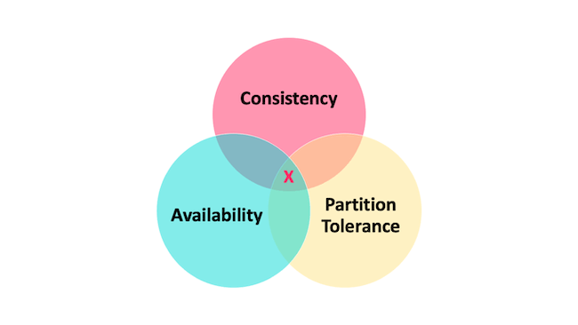
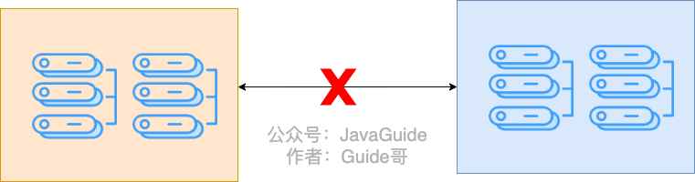
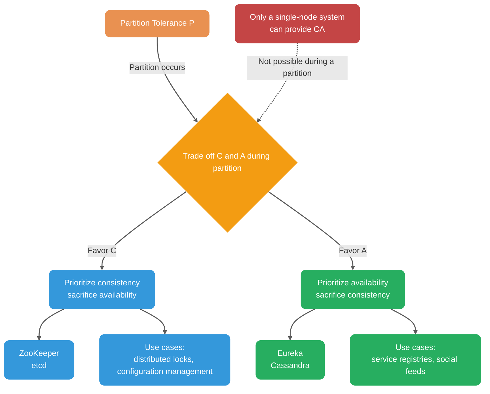
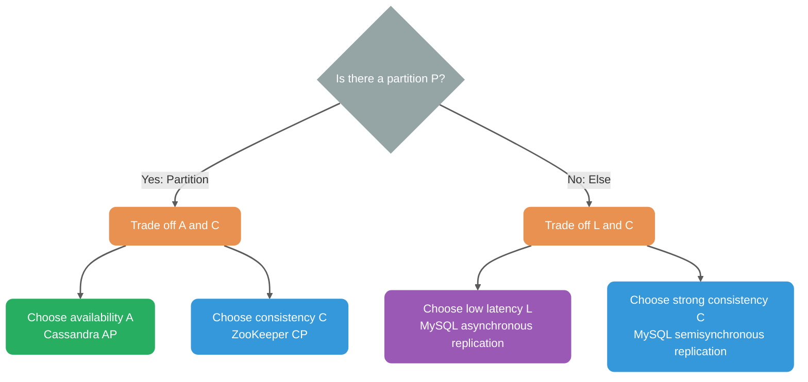
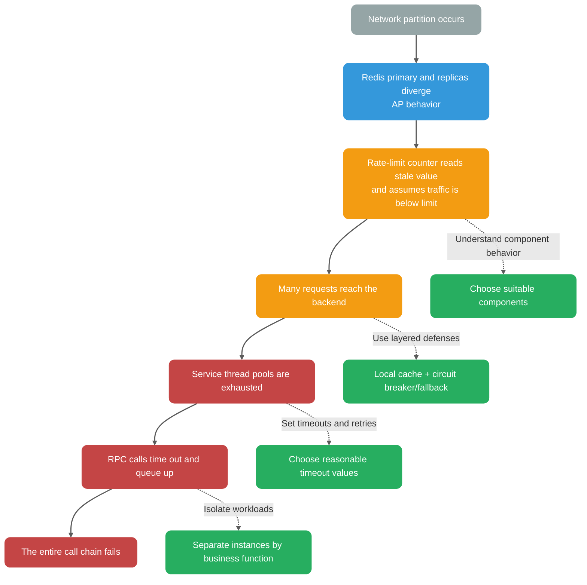
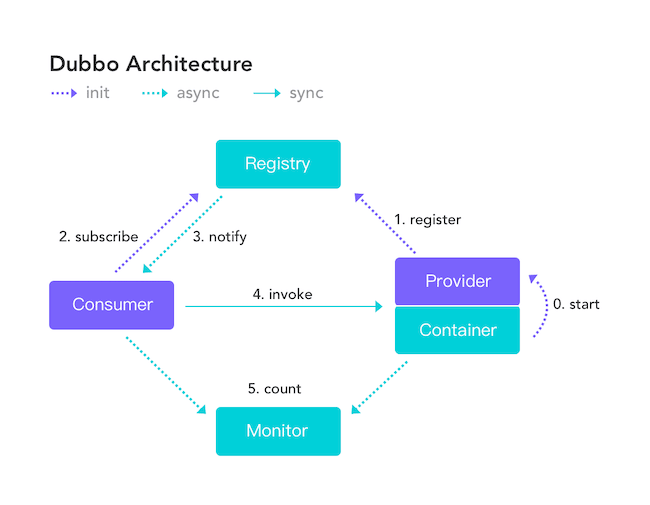
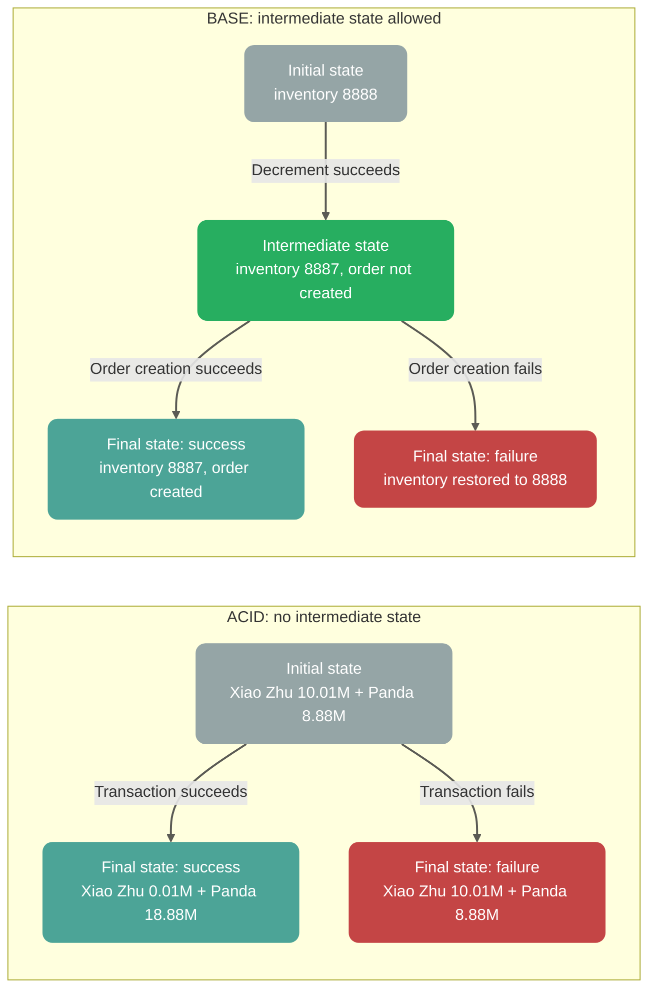
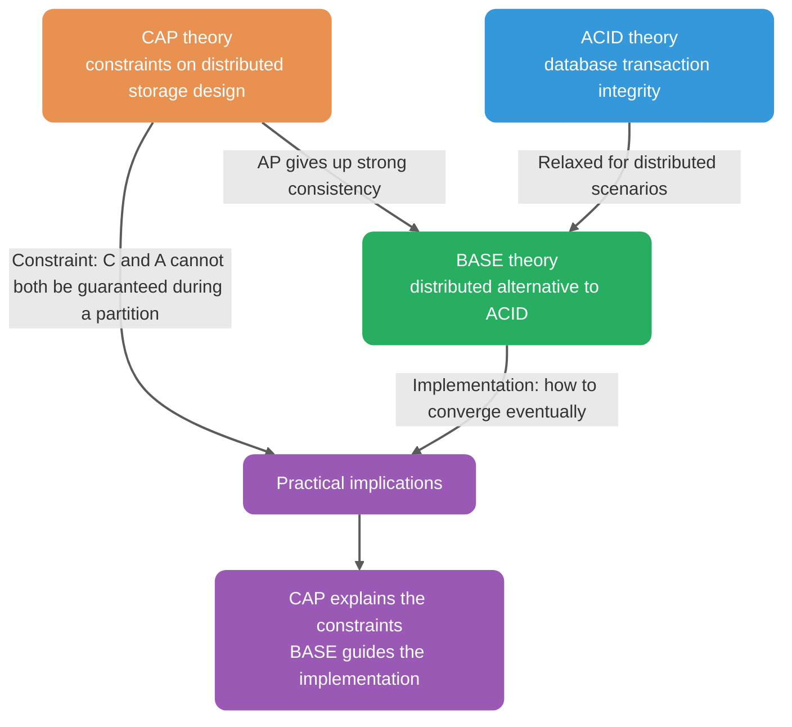

If you have interviewed for a technical role, you have probably heard of CAP and BASE. CAP and BASE are foundational concepts for understanding distributed systems and are common interview topics, so it is useful to understand them well enough to explain them in your own words.

This guide focuses on the trade-offs a system faces during a network partition. For Leader, Quorum, Lease, and Gossip, see [Distributed Coordination](./centralized-and-decentralized.md). For business-level implementations of eventual consistency, see [Distributed Transaction Solutions](../distributed-transaction.md).

## CAP theorem

The [CAP theorem](https://en.wikipedia.org/wiki/CAP_theorem) originated in 2000, when UC Berkeley professor Eric Brewer presented the conjecture at the Symposium on Principles of Distributed Computing (PODC). It is also known as **Brewer's theorem**.

Two years later, MIT researchers Seth Gilbert and Nancy Lynch proved Brewer's conjecture, establishing CAP as a theorem in distributed computing.

### Overview

CAP describes trade-offs among **Consistency**, **Availability**, and **Partition Tolerance**.

> **Important:** “CP-leaning” and “AP-leaning” are informal descriptions used below for intuition. Under the strict CAP definitions (C = linearizability; A = every non-failing node must respond), many systems cannot be classified cleanly. Different operations in the same system may have different consistency and availability guarantees, and a system may satisfy neither CAP-C nor CAP-A.



When Brewer proposed the CAP conjecture, he did not give strict definitions for **Consistency**, **Availability**, and **Partition Tolerance**. There are several informal interpretations. A commonly used interpretation is:

In theoretical computer science, the CAP theorem says that when designing reads and writes for a distributed system, only two of the following three properties can be guaranteed at the same time:

- **Consistency:** In the context of Gilbert and Lynch's 2002 proof, CAP consistency means **atomic consistency**, usually treated as **linearizability**. All operations can be ordered according to real time: once a write completes, every later read returns that value or a newer one. **This differs from consistency in ACID**, which means that database constraints hold before and after a transaction.
- **Availability:** Every non-failing node must return a response to every request; response latency is not part of this definition. **This is the strict CAP definition**, not an engineering latency or SLA target such as “respond within one second.”
- **Partition tolerance:** CAP's P assumes an asynchronous network, where delays, packet loss, and partitions may occur. P is not a feature that a system can choose to enable or disable. The actual trade-off during a partition is between **linearizability** (CAP consistency) and **CAP availability** (every non-failing node returns a non-error response).

**What is a network partition?**

A network partition occurs when failures, such as problems affecting some links or nodes, prevent some nodes in a distributed system from communicating. The network is split into separate groups.



### CAP is not simply “pick two”

CAP is often summarized as “a system can provide only two of consistency, availability, and partition tolerance.” This phrasing is misleading. In 2012, twelve years after the original paper, Brewer revisited and clarified the conjecture.

> **When a network partition occurs, if the system continues serving requests, it must choose between strong consistency and availability.**
>
> In short, P is not an optional feature. When a partition occurs, a system that continues operating must trade off A against C.

**Why can’t a distributed system choose CA?**

Distributed systems rely on network communication, and network failures are inevitable:

- Heartbeat packets may be dropped during network jitter, causing a node to be suspected of failing.
- Data synchronization may lose packets. Repeated retries to restore consistency can block requests.

**Therefore, in an asynchronous network where partitions can occur, a system must trade off linearizability against CAP availability during a partition.** A single-node system can provide CA because it has no network partition between replicas: after a successful write, later requests to that node see the same data, as long as the node remains available.

The diagram below shows the core CAP trade-off and common system tendencies:



**PACELC** extends CAP and gives a more complete view. Daniel J. Abadi's PACELC theory says: **if a partition (P) occurs, a system must choose between availability (A) and consistency (C); else (E), it must choose between latency (L) and consistency (C).**



In practice, a distributed system must also trade off latency against consistency even when there is no partition. For example:

- **Cassandra:** Read and write consistency levels (`ONE`, `QUORUM`, `ALL`) let users trade latency for consistency.
- **MySQL primary-replica replication:** Asynchronous replication favors low latency; semisynchronous replication favors stronger consistency.

ZooKeeper and HBase are commonly described as CP systems; Cassandra and Eureka as AP systems. Nacos supports both CP and AP modes.

**The right choice depends on the business scenario.** CP is often chosen for use cases that require strong consistency, such as distributed locks and configuration management. AP may suit use cases that prioritize availability, such as service registries.

**One more qualification:** Without a partition, a system can provide both linearizability and the CAP requirement to respond. In practice, it still often trades latency against consistency, as described by PACELC's ELC branch.

### Scope of the CAP theorem

**Key point:** CAP primarily describes the consistency/availability trade-off for a single data object with replicated copies.

| Closer to the CAP model                        | Requires analysis by shard, object, or operation                          |
| ---------------------------------------------- | ------------------------------------------------------------------------- |
| Redis primary-replica or Sentinel cluster      | Business applications with stateless services                             |
| MySQL primary-replica or multi-primary cluster | Redis Cluster (each shard can still have replicas)                        |
| MongoDB replica set                            | MongoDB sharded cluster (shards and replicas)                             |
| ZooKeeper, etcd                                | Sharded databases (cross-shard transactions need additional coordination) |
| Kafka, RocketMQ                                | Most microservice applications\*                                          |

**Notes:**

- The CAP model concerns replicated semantics for a single read/write register.
- Complex systems need analysis of consistency at the level of each object, partition, or operation.
- Sharded systems often replicate each shard, so the consistency/availability trade-off still applies to each shard.

> **How CAP affects business applications**
>
> Business applications may not replicate data themselves, but they **are affected by the CAP properties of their underlying components**. Ignoring those properties can contribute to cascading failures during a network partition.
>
> **Business scenarios affected by CAP:**
>
> | Scenario                           | Underlying component                       | Effect of CP component                                        | Effect of AP component                                              |
> | ---------------------------------- | ------------------------------------------ | ------------------------------------------------------------- | ------------------------------------------------------------------- |
> | RPC routing                        | Service registry, such as Nacos in CP mode | Registration may be unavailable and requests rejected         | Routing may use an instance that is already down, requiring retries |
> | Distributed locks                  | Redis (AP) / ZooKeeper (CP)                | Lower performance, stronger coordination                      | Higher performance, but a lock may fail                             |
> | Rate limiting and circuit breaking | Redis counter                              | A stale counter may cause rate limiting to fail               | Similar risk                                                        |
> | Cache updates                      | Redis primary-replica                      | Failover may lose data                                        | Similar risk                                                        |
> | Message consumption                | Kafka                                      | Slow progress synchronization may cause duplicate consumption | Similar risk                                                        |
>
> **Practical guidance:** Application developers do not implement the CAP theorem, but they **must understand it** so they can:
>
> - Choose an appropriate CP or AP component for each use case.
> - Understand how the selected component behaves during a network partition.
> - Design suitable fault-handling mechanisms such as retries, circuit breakers, and fallbacks.

Developers sometimes say they are “applying CAP” when they are choosing between existing CP and AP components. Engineers building distributed storage systems such as Redis or MySQL are the ones who implement the underlying trade-offs.

### Applying CAP thinking in business systems

Most business developers choose a suitable architecture rather than implementing CAP itself:

| Scenario             | CP-leaning choice                              | AP-leaning choice                             | Trade-off                                        |
| -------------------- | ---------------------------------------------- | --------------------------------------------- | ------------------------------------------------ |
| Database replication | Synchronous replication (stronger consistency) | Asynchronous replication (higher performance) | Consistency vs. response time                    |
| Distributed locks    | ZooKeeper (strong consistency)                 | Redis (higher performance)                    | Lock reliability vs. acquisition speed           |
| Service registry     | ZooKeeper or Consul (CP mode)                  | Eureka or Nacos (AP mode)                     | Registration accuracy vs. discovery availability |
| Rate-limit counter   | Redis with stronger consistency                | Redis allowing expiration                     | Accuracy vs. performance                         |

**Selection guidelines:**

- **When performance matters:** Consider components that allow asynchronous replication. The primary can acknowledge writes quickly, but data loss or stale reads are possible, so retries and other safeguards may be needed.
- **When data safety matters:** Consider components that wait for a majority. Writes wait for quorum confirmation, which increases latency but can reduce data-loss risk.

**Note:** Data loss depends more directly on persistence, replication acknowledgments, and the failure model. A CP/AP label alone does not determine whether data will be lost.

**Cascading failure example:**

The following diagram shows how ignoring component behavior during a partition can contribute to cascading failure:



**Protective measures:**

1. **Understand the CAP properties of dependencies:** Know how each component behaves during a network partition.
2. **Use layered defenses:** Do not rely on a single component; combine local caches, circuit breakers, and fallbacks.
3. **Set timeouts and retries:** Avoid waiting indefinitely.
4. **Isolate workloads:** Separate underlying component instances for different business functions to limit fault propagation.

### CAP in practice: service registries

Consider how CAP applies to a service registry. If you are unfamiliar with registries, the Dubbo example below provides some context.

The following diagram shows Dubbo's architecture. What does the **Registry** do?

A registry stores and looks up service addresses, acting as a directory. Providers and consumers contact it when they start; the registry does not forward requests, so it usually handles less traffic.



Common service registry choices include ZooKeeper, Eureka, and Nacos.

#### ZooKeeper 3.8.x (CP)

ZooKeeper is commonly described as **CP**. ZooKeeper 3.x uses ZAB to provide **linearizable writes**, but read guarantees depend on the read type:

- **Synchronous read:** Explicitly synchronizes with the Leader to provide linearizability.
- **Ordinary read:** By default, provides **sequential consistency**. Clients observe updates in global order and a client's view never moves backward within a session, but a read may be stale.

> **Important distinction:** Sequential consistency is not eventual consistency. ZooKeeper ordinary reads preserve the same **global update order** (the global ZXID order) across clients, but may lag behind. Eventual consistency does not guarantee a global order; it guarantees only eventual convergence. ZooKeeper's default read is better described as “stale but ordered.”

During Leader election or when fewer than a quorum (`N/2 + 1`) of Followers are available, ZooKeeper may reject requests to preserve consistency, reducing availability.

ZooKeeper uses quorum-based coordination in multi-node deployments: a majority (`N/2 + 1`) must agree for a change to take effect.

ZooKeeper also provides Watchers for asynchronous change notifications and version numbers such as ZXID to help clients assess freshness.

Failure paths and client behavior:

| Failure scenario                                   | System state                                | Client behavior                                                                                         |
| -------------------------------------------------- | ------------------------------------------- | ------------------------------------------------------------------------------------------------------- |
| Quorum unavailable (more than half the nodes fail) | **LOOKING**, electing a Leader              | Writes are rejected; reads may return stale data or time out.                                           |
| Follower is partitioned from Leader                | Follower enters **ELECTION**                | It cannot vote but may serve reads from stale data.                                                     |
| Leader is partitioned from the majority            | Leader steps down and the cluster re-elects | Writes accepted by the old Leader may be lost; clients need to retry and detect ZXID regression.        |
| Watcher notification is missed                     | Network jitter or GC pressure               | Clients should retry with exponential backoff and jitter; monitor the `Watches` queue for backpressure. |

#### Eureka (AP)

Eureka is an AP system. Nodes are peers and synchronize through peer replication (periodic full fetches plus incremental updates); there is no Leader election. **Note:** Spring Cloud historically used the 1.x dependency line more often; Netflix Eureka 2.x is still maintained and continues to receive releases.

Failure paths and client behavior:

| Failure scenario                                     | System state                                                                    | Client behavior                                                                                                                                              | Self-preservation behavior                                                                                                                     |
| ---------------------------------------------------- | ------------------------------------------------------------------------------- | ------------------------------------------------------------------------------------------------------------------------------------------------------------ | ---------------------------------------------------------------------------------------------------------------------------------------------- |
| Network partition (split brain)                      | Both sides of the partition continue independently and accept reads and writes. | Clients may see stale registrations (inconsistency window = 30-second heartbeat interval plus Gossip delay; in a 10-node topology, P99 is under 60 seconds). | When renewals fall below 85% of the threshold, **self-preservation** pauses instance eviction to avoid removing healthy instances incorrectly. |
| Half the nodes fail                                  | Remaining nodes continue serving, but data may diverge.                         | Reads work; writes may exist only on minority nodes.                                                                                                         | Self-preservation is triggered; Gossip merges state after nodes recover.                                                                       |
| Brief node restart                                   | The node fetches the registry from peers in a batch.                            | Service discovery may be briefly unavailable (< 1 minute); caches help.                                                                                      | Normal mode; recovery is automatic.                                                                                                            |
| Registration storm (many instances register at once) | The write queue backs up and may drop requests.                                 | Some registrations time out and need client retries.                                                                                                         | Rate limiting and backpressure can be configured, for example through Ribbon retry policies.                                                   |

**How self-preservation works:**

Eureka Server uses the following logic to decide whether to enter self-preservation mode:

```text
Expected renewals per minute E = current instance count N × (60 / heartbeat interval in seconds)
Threshold T = E × 0.85
If actual renewals R in the last minute < T, enter self-preservation and pause eviction.
(E and T are recalculated periodically based on N; a common interval is about 15 minutes.)
```

With the default 30-second heartbeat interval, the expected renewals per minute are twice the number of instances.

When the `actual renewal rate < 85%`:

1. Eureka enters **SELF PRESERVATION** mode.
2. It stops evicting expired instances (`EvictionTask` is paused).
3. The log reports: `ENTER SELF PRESERVATION MODE`.

**Trade-off:** Eureka would rather retain a stale instance than incorrectly evict a healthy one. In microservice systems, a brief degradation is often preferable to widespread service unavailability. Clients commonly use retries and circuit breakers to handle unavailable instances.

#### Summary

Choose CP or AP according to the use case. ZooKeeper suits use cases such as configuration management that require strong consistency; Eureka suits highly available service discovery. Nacos supports both CP and AP modes.

### CAP summary

CAP teaches that when a distributed system may experience network partitions (P), it must trade off strong consistency (C) and high availability (A).

- **CP:** Sacrifices availability to preserve strong consistency. Suitable for use cases with strict consistency requirements, such as financial transactions and distributed locks.
- **AP:** Sacrifices consistency to preserve availability. Suitable when the system must remain available and brief inconsistencies are acceptable, such as social feeds and product search.
- **PACELC:** Without a partition (E), a system still trades off latency (L) and consistency (C).

### Further reading

1. [CAP Theorem Simplified](https://medium.com/@ravindraprasad/cap-theorem-simplified-28499a67eab4) (English; includes examples)
2. [Where Is the Famous CAP Theorem Applied?](https://juejin.im/post/6844903936718012430) (Chinese; includes practical examples)
3. [Please Stop Calling Database CP or AP](https://martin.kleppmann.com/2015/05/11/please-stop-calling-databases-cp-or-ap.html) (English; offers a different perspective)

## BASE theory

[BASE theory](https://dl.acm.org/doi/10.1145/1394127.1394128) originated in 2008, when eBay architect Dan Pritchett published the paper “Base: An ACID Alternative” in an ACM publication.

> **Key insight:** As the paper title suggests, **BASE was first presented as an alternative to ACID**. BASE is also closely related to CAP: **eventual consistency is an engineering principle for allowing an AP system to converge in practice.**

### Overview

**BASE** stands for **Basically Available**, **Soft State**, and **Eventually Consistent**. The theory summarizes experience from large-scale Internet systems.

### BASE and ACID

To understand BASE, first recall **consistency** in ACID:

**ACID consistency:** A transaction moves the database from one valid state to another.

For example, Xiao Zhu transfers 10 million to Panda:

- **Initial state:** Xiao Zhu has 10.01 million; Panda has 8.88 million; total: 18.89 million.
- **Result state:** Xiao Zhu has 0.01 million; Panda has 18.88 million; total: 18.89 million.

Whether the transaction succeeds or fails, the overall data must remain consistent, much like conservation of energy.

**The challenge in distributed systems:**

Suppose the inventory and order services are deployed separately. Reducing inventory and creating an order require network calls, so there is necessarily a time gap:

```text
Time T1: inventory 8888 → 8887 (decrement succeeds)
Time T2: network call to the order service...
Time T3: order creation succeeds
```

Between T1 and T3, the system is in an **intermediate state**: inventory has been decremented, but the order has not been created. Once the services are separated, a single-database ACID transaction cannot atomically commit or roll back the whole operation. Intermediate states are unavoidable; BASE accepts them and uses retries or compensation to converge to a final state.

**BASE's approach:**

BASE allows intermediate states:

- **Soft State:** The system may temporarily be in an intermediate state, as long as this does not make the whole system unavailable.
- **Eventually Consistent:** The intermediate state eventually reaches a final state, either success or rollback.

The diagram compares ACID and BASE transaction flows:



Therefore, **BASE is an alternative to ACID for distributed scenarios, not an extension of CAP.**

### The three BASE properties


#### Basically available

Basic availability means the system may lose some availability when an unexpected failure occurs. It does not mean that the system becomes entirely unavailable.

**What does partial loss of availability mean?**

- **Increased response time:** A request that normally takes 0.5 seconds may take 3 seconds during a failure.
- **Reduced functionality:** A sudden increase in traffic may make some non-critical features unavailable while core features continue to work.

#### Soft State

**Soft State** means that data may temporarily be in an intermediate state, and that this state does not make the whole system unavailable.

> **Compared with ACID:** ACID transactions finish in a terminal state, either success or failure, without exposing an intermediate state. BASE recognizes that intermediate states are inevitable in distributed systems, provided they eventually reach a terminal state.

For example:

- **ACID:** A bank transfer must debit and credit accounts together or do neither; “debited but not credited” is not allowed as a final transaction state.
- **BASE:** An e-commerce flow may temporarily have inventory reduced before an order is created, provided the system eventually creates the order or restores inventory.

#### Eventual consistency

**Eventual consistency** means that if no new updates occur for some time, all replicas eventually converge to the same value.

The term has two meanings in different contexts:

| Context                                   | Meaning                                                             | Example                                      |
| ----------------------------------------- | ------------------------------------------------------------------- | -------------------------------------------- |
| **Replicated storage (CAP context)**      | Data replicas eventually synchronize.                               | Cassandra replication                        |
| **Transaction state (BASE/ACID context)** | An intermediate transaction state eventually reaches a final state. | Distributed transactions such as TCC or Saga |

**Eventual consistency in replicated storage:**

The convergence period is not bounded by the definition; it may be milliseconds for synchronization in a local network or minutes for cross-region replication. Production systems can accelerate convergence using **Read Repair**, **Anti-Entropy** (background synchronization), or **Quorum** writes.

**Eventual consistency in transaction state:**

Consider a distributed transaction that reduces inventory, creates an order, and debits an account:

- T1: Inventory is reduced (intermediate state).
- T2: The order is created (intermediate state).
- T3: The account is debited (final state: transaction succeeds).

On failure:

- T1: Inventory is reduced (intermediate state).
- T2: Order creation fails (rollback begins).
- T3: Inventory is restored (final state: transaction fails).

The system reaches a consistent state within some period without requiring strong consistency at every instant.

Three common consistency levels are:

1. **Strong consistency:** A read returns the latest successful write.
2. **Weak consistency:** A read may not return the latest write, and there is no guarantee about when it will. The system only tries to reach a consistent state eventually.
3. **Eventual consistency:** A stronger form of weak consistency in which the system guarantees convergence within some period.

Eventual consistency is common in industry. Some scenarios, such as bank transfers, require strong consistency.

Common ways to implement eventual consistency include:

- **Read Repair:** Detect and repair inconsistent data during a read. Suits read-heavy, write-light workloads.
- **Write Repair (Hinted Handoff):** If the target node is unavailable during a write, buffer the data and resend it when the node recovers. This can reduce write latency but increases the risk of stale reads while the data remains buffered.
- **Asynchronous Repair (Anti-Entropy):** Compare replicas in the background and repair differences. A key engineering challenge is efficient difference detection: comparing every record (O(n)) is impractical for large datasets, so production systems use **Merkle Trees** to locate differences efficiently.

**Choosing an approach:**

- **Write Repair:** Suits write-heavy, read-light workloads; improves write performance at the cost of a longer inconsistency window.
- **Read Repair:** Suits read-heavy, write-light workloads; helps ensure that reads return accurate data.
- **Anti-Entropy:** Provides background repair for large datasets with strict eventual-convergence requirements.

### Why is BASE often called an extension of CAP?

This is **partly right but imprecise**. A more accurate explanation is:

1. **BASE was first proposed as an alternative to ACID.** The title of the paper, [“Base: An ACID Alternative”](https://spawn-queue.acm.org/doi/10.1145/1394127.1394128), reflects its original goal of relaxing ACID in distributed transaction scenarios.
2. **BASE is related to AP systems in CAP:**
   - Choosing AP means giving up strong consistency (C) during a partition.
   - After giving up strong consistency, the system still needs a way to converge. Eventual consistency provides that goal.
   - BASE, especially eventual consistency, guides the engineering practices used to make an AP system converge.
3. **The misunderstanding:** The relationship between BASE and AP is sometimes mistaken for BASE being an extension of CAP. In fact:
   - **BASE does not extend or revise the CAP theorem.**
   - **BASE is an engineering guide for AP systems:** after choosing AP, BASE describes how to eventually converge in practice.

The relationship can be summarized as follows:



| Dimension               | CAP                                       | BASE                                                                        |
| ----------------------- | ----------------------------------------- | --------------------------------------------------------------------------- |
| Scope                   | Distributed storage with replicas         | Distributed systems broadly                                                 |
| Meaning of consistency  | Data consistency among replicas           | Consistency of transaction state and final outcome                          |
| Meaning of availability | Service availability during node failures | Some functionality remains available when some nodes fail                   |
| Relationship            | —                                         | (1) Distributed alternative to ACID<br>(2) Engineering guide for AP systems |

> **In practice:** CAP says an AP system cannot guarantee strong consistency during a partition. BASE explains how eventual consistency can help it converge. They are related as **constraint and implementation**, not as extension and original.

CAP describes constraints on distributed storage design—what cannot be guaranteed. BASE guides the practice of distributed systems, especially business applications—how to proceed. **For many use cases, accepting intermediate states and eventual convergence is more practical than requiring strong consistency.**

### BASE summary

**ACID describes database transaction integrity. CAP describes trade-offs in distributed storage. BASE is an alternative to ACID in distributed scenarios and an engineering guide for AP systems.**

> **Key distinctions:**
>
> - **CAP consistency:** Replica consistency (synchronization among copies of data).
> - **BASE consistency:** Transaction-state consistency (reaching a final state), related to ACID consistency.
> - **CAP availability:** A replicated cluster continues responding when nodes fail.
> - **BASE availability:** A sharded system may keep serving some users when some nodes fail.
> - **CAP and BASE:** After choosing AP, BASE guides how to converge through eventual consistency.

<!-- @include: @article-footer.snippet.md -->
