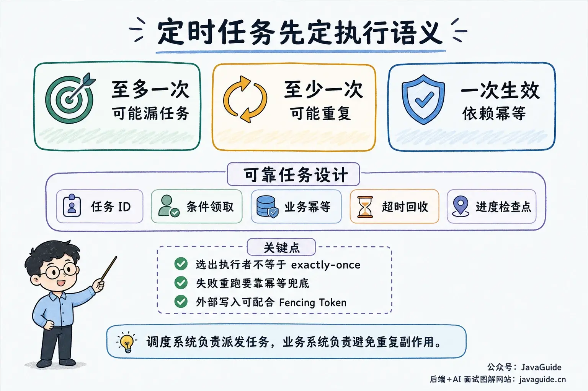
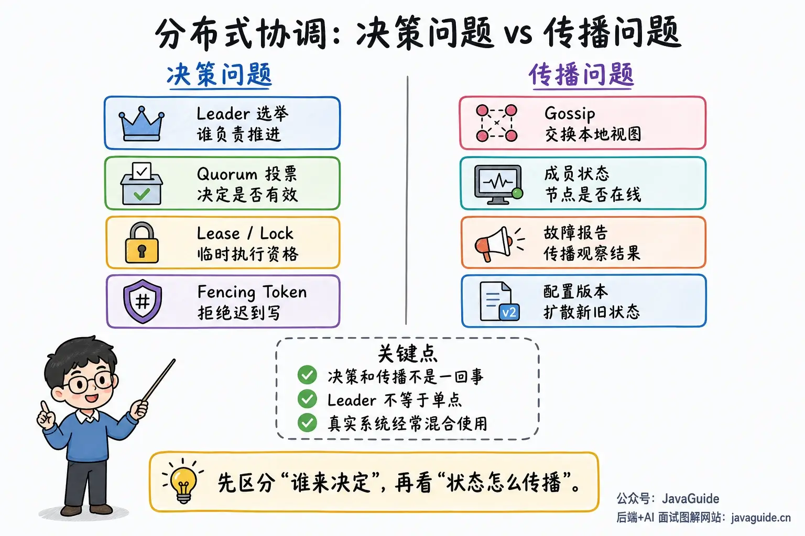
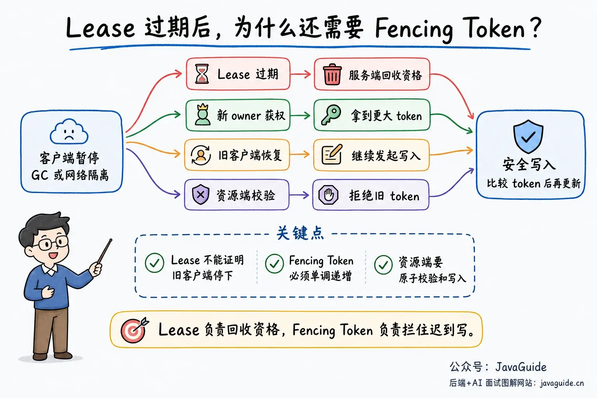
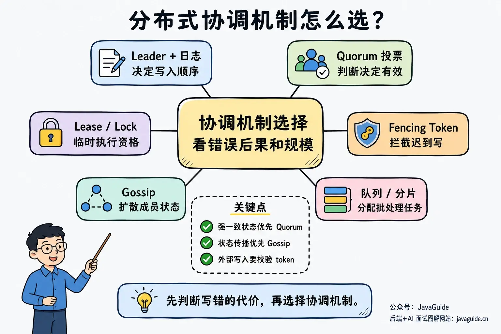

Three instances run a scheduled job. At 2 a.m., which one should execute it?

If all three run it, data may be processed more than once. If all three wait for another instance, the job may be skipped. Cache clusters, message queues, configuration centers, and distributed locks face similar issues. As a system grows to multiple nodes, it needs a way to decide who is responsible for what, which nodes are still alive, and in what order changes take effect.

This is the coordination problem in distributed systems.

First, distinguish between **choosing one executor** and **ensuring a business operation takes effect only once**.

Leader election, distributed locks, and database claims can reduce concurrent execution by multiple instances, but they cannot guarantee end-to-end exactly-once processing by themselves. An executor may finish the work and crash before updating task status. To avoid losing the task, the scheduler may dispatch it again. The Kubernetes CronJob documentation also warns that job creation is approximate: a CronJob may create two Jobs or none in some cases. Therefore, the Job itself should be idempotent.

Production scheduled tasks are usually closer to “at least once + business idempotency.” A task ID, business key, state machine, deduplication table, or transaction constraint can prevent repeated execution from causing additional side effects.

This article focuses on design trade-offs rather than the complete implementation of systems such as ZooKeeper, etcd, Redis Cluster, or Eureka. For consensus algorithms, see [Raft](./raft-algorithm.md) and [ZAB](./zab.md). For state propagation, see [Gossip](./gossip-protocol.md). For mutual exclusion in business operations, see [Distributed Lock Implementations](../distributed-lock-implementations.md).

## How does this article relate to the others?

[Distributed Systems Fundamentals](../distributed-system-intro.md) explains why a single-node system becomes more complex when split across nodes. [CAP and BASE Explained](./cap-and-base-theorem.md) covers consistency and availability trade-offs during a partition. Raft, Paxos, and ZAB help a group of nodes agree on a value or log order. Gossip propagates state across many nodes until it converges.

This article connects those topics and focuses on a practical question: **How does a distributed system coordinate multiple nodes?**

To keep the concepts distinct, divide the problem into two categories:

- **Decision-making:** Who can become Leader? Is a log entry committed? Who owns a resource? Can a task run?
- **Propagation:** How do membership, failure reports, configuration versions, and cache metadata reach other nodes?

Leader, Quorum, Lease, Lock, and Fencing Token mainly govern decisions and execution rights. Gossip mainly propagates state. Real systems often combine these mechanisms; they are rarely purely centralized or decentralized.

## Why do distributed systems need coordination?

On a single machine, local memory, database transactions, or process locks can solve many problems. In a distributed system, these mechanisms may no longer be enough.

The network introduces uncertainty.

Each node sees only its local state and the messages it has received. A node that does not respond may have crashed, or it may be affected by network jitter, a GC pause, stalled disk I/O, or an exhausted thread pool. A timeout only means that the caller did not receive a result within the specified time; it does not prove that the other node did not execute the operation.

Coordination addresses questions such as:

- **Membership:** Which nodes belong to the cluster, and which can participate now?
- **Task assignment:** Which node owns a shard, task, partition, or primary replica?
- **Ordering:** If several nodes submit changes at once, what is their order?
- **Failover:** Who takes over when the responsible node becomes unreachable, and what state must be checked first?
- **Version progression:** How do nodes distinguish new state from old state after a configuration, metadata, or election change?

A Leader can coordinate these decisions. A group of nodes can use a Quorum to decide together. Gossip can spread observed state before a vote, version, or business rule determines what to do.

## Leader/Quorum coordination: who makes the decision?

Many systems use a Leader, Primary, or scheduler. Other nodes mainly execute tasks or apply logs, configuration, and assignments from the Leader.

A common misconception is that a Leader is necessarily a fragile single point of failure. In systems such as Raft and ZAB, the Leader is a role elected from multiple replicas; log replication and a Quorum protect the state. The important questions are whether the Leader's state is replicated, whether the remaining nodes can elect a new Leader after a failure, and whether the new Leader can continue from the existing state.

Leaders commonly have several responsibilities.

First, they maintain a cluster view: which Workers are online, their load, which node owns a shard, and whether a replica is falling behind. This information may come from heartbeats, reports, probes, or a backing store's membership records.

Second, they make assignment decisions. A scheduler may assign a task to an executor, distributed storage may move a shard to another machine, or a message queue may transfer partition leadership to another replica. Workers do not need to guess; they follow the confirmed assignment.

Third, they control write ordering. Distributed systems can often spread reads across nodes; writes to shared metadata are more difficult. Without a common order, two nodes may both believe they own a shard or are the primary executor for a task. A Leader can order writes in a log and replicate it to other nodes.

A Leader makes system behavior easier to understand and provides a clear place to inspect decisions. The trade-offs are that the coordination path may become a bottleneck and the system must handle false suspicions, split brain, and failover.

## What problems arise with Leader/Quorum coordination?

The first concern is a single point of failure.

If the Leader's state exists only in its memory, a crash leaves the cluster without task assignments, shard ownership, or current metadata. A common design gives the Leader the role of “current decision-maker” while replicating metadata and logs to several nodes. If the Leader fails, the remaining nodes elect a new Leader from the replicated state.

Another concern is bottlenecking. Coordination requests pass through the Leader, so its CPU, network, and disk log writes affect the whole system. Frequent metadata changes can limit scalability. Many systems separate the data plane from the control plane: normal reads and writes are distributed, while elections, metadata changes, and shard migrations use the coordination path.

False suspicions are more difficult.

Heartbeats are common, but they are not proof that a node is alive or dead. If the Leader misses a Worker heartbeat, it only knows that it has not received a response within the current network and timeout conditions. The Worker may still be executing a task but be paused by Full GC, network isolation, or a disk write. If the Leader assigns that task elsewhere, the old Worker may resume and write a duplicate result.

Split brain can arise from the same uncertainty.

During a split brain, multiple partitions believe they can advance system state. For example, the old Leader may be isolated from some nodes while the other partition elects a new Leader. If both accept writes, the partitions can develop conflicting state after the network recovers. This is usually unacceptable for configuration centers, distributed locks, failover, and shard ownership.

The challenge is not only to “elect a Leader,” but also to prevent an old Leader from causing damage after it loses authority.

## How can Leader bottlenecks and split brain be mitigated?

A standby node alone is not enough. To take over, it must know which decisions the Leader made, which were committed, and which only appeared successful to the Leader.

This requires replicas, a Quorum, and protocol rules.

### A majority is not the whole solution

A majority rule is straightforward: a decision is valid only after more than half of the nodes agree. For a cluster with `N` voting nodes, a majority is `floor(N/2) + 1`. Three nodes require two votes; five require three.

This formula assumes:

- The membership set is relatively stable.
- Every voting node has equal weight.
- The system handles crash faults and network partitions, not malicious nodes.
- The system uses a simple majority Quorum, not a weighted, Flexible, or BFT Quorum.

An important property of majorities is that any two majority sets overlap.

However, overlap alone is not sufficient. The protocol must also constrain who can be elected and how the new Leader recovers state. In Raft, each node votes at most once per Term, and a candidate's log must be at least as up to date as the voter's. The intersection of majorities, combined with log freshness checks, prevents committed entries from being lost during later elections. Raft calls this property **Leader Completeness**.

Thus, a majority provides the basis for intersection. Safety also depends on election, log matching, and commit rules.

Majorities have a cost. To preserve safety for coordinated state or replicated logs, a system usually stops committing new writes when it cannot reach a Quorum. Whether it can still serve stale reads depends on the protocol and consistency requirement. Three nodes tolerate one voting-node failure; five tolerate two. Four still tolerate only one, and six still tolerate only two, which is why many coordination systems recommend an odd number of voting nodes.

### Term/Epoch protects protocol state, not every external resource

Leader election usually needs a term concept. Raft calls it a **Term**; ZAB uses an **Epoch**. Each election begins a new term. When a node sees a higher term, it rejects requests from the old term, and an old Leader should step down to Follower.

This mainly protects the coordination protocol's internal state.

A term is not automatically propagated to external business resources. If an old Leader bypasses the replication protocol and writes directly to a database, object store, or third-party API, that resource does not know that the Raft Term or ZAB Epoch has changed. To reject stale writes, the resource must validate a version or Fencing Token.

### A Lease reclaims resources; it does not prove an old client has stopped

Suppose a client acquires a lock and then experiences a long GC pause. The lock service considers it disconnected and grants the lock to another client. When the old client resumes, it may still use its old execution context to write to a database, object store, or external API. A new Leader or lock owner does not make the old client's business thread disappear.

A **Lease** is a time-limited grant of authority. A client that receives a Lease must renew it before its TTL expires. If renewal fails or the Lease expires, the coordination system can reclaim associated resources. The etcd Lease API works this way: the cluster grants a Lease with a TTL, and if it receives no `keepAlive` within that TTL, the Lease expires and attached keys are deleted. The TTL is determined and returned by the server; the client does not decide expiration using its local clock.

The danger is that a client may have a stale view of its Lease. A long GC pause, network isolation, or blocked thread may prevent it from learning that the Lease has expired.

A Lease is useful for failure detection and automatic resource reclamation, but it cannot prove that the old client has stopped executing. If the client can still access a shared resource, it may still issue stale writes.

### Fencing Tokens reject stale executors

A **Fencing Token** addresses this more directly. Each time a client gains authority, the coordination system issues a monotonically increasing token. The client includes the token when writing to a shared resource. The resource records the largest token it has seen and rejects writes with smaller tokens.

For example:

1. Client A acquires the lock and receives token 10.
2. A pauses for a long time and its lock expires.
3. Client B acquires the lock, receives token 11, and writes to the resource.
4. A resumes and tries to write with token 10.
5. The resource sees `10 < 11` and rejects A's write.

The resource's validation is essential; the token value alone does not help. Ideally, the resource atomically compares the token, updates the data, and records the latest token. If it checks the token and writes the data in separate operations, a concurrent request can still intervene.

Lease, Fencing Token, and idempotency keys solve different problems:

| Mechanism       | What it solves                                                          | What it does not guarantee                     |
| --------------- | ----------------------------------------------------------------------- | ---------------------------------------------- |
| Lease           | Reclaims authority held by an unreachable client.                       | That the old client has stopped running.       |
| Fencing Token   | Rejects stale writes from an old owner.                                 | That the business operation is safe to retry.  |
| Idempotency key | Prevents the same business request from causing duplicate side effects. | That the current executor is the latest owner. |

## Gossip state propagation: nodes exchange local views

Gossip does not rely on one fixed node maintaining the complete cluster view. Each node stores a local view and exchanges state with peers.

Nodes periodically select peers and exchange information. State spreads through the cluster like a message. After learning about a new member, failure, or version, a node can tell others. After several rounds, most nodes have similar views.

Gossip is suited to propagating “what I observed,” not to deciding by itself “what everyone must accept.”

It usually provides eventual propagation and convergence, not strict mutual exclusion or global write ordering. Because Gossip takes time, nodes may see different states at the same moment. A message may also be delivered multiple times, so systems need version numbers, message IDs, timestamps, or another deduplication method. During a network partition, different partitions may reach different conclusions; after recovery, they need versions, terms, and conflict-resolution rules to converge.

This does not mean that every protocol without a fixed Leader provides only eventual consistency. Leaderless consensus protocols such as EPaxos can still provide strong consistency, though their implementation complexity and use cases differ from common Leader-based protocols.

Real systems often combine mechanisms. Redis Cluster is one example: nodes use the Cluster Bus and Gossip to propagate membership, slot assignments, and failure observations. A node may first mark another node PFAIL. After enough Masters report the failure, the status is promoted to FAIL. Replica promotion also uses majority voting, `currentEpoch`, and `configEpoch` to distinguish old and new configurations.

Gossip is suited to **state propagation**, not to strict mutual exclusion or global write ordering by itself. If a scenario requires exactly one owner at any moment or linearizable writes, it also needs consensus, majority voting, resource-side version validation, or Fencing Tokens.

## How should you choose among these mechanisms?

Start by considering the cost of an incorrect decision.

If running a task twice only wastes some resources, or if a node can briefly see stale state, state propagation and eventual convergence may be enough. Node discovery, health-state propagation, cache metadata, and other non-critical state updates can use Gossip or a similar peer-to-peer mechanism.

If a wrong decision could corrupt financial data, inventory, or metadata, or let two primaries write the same data, prioritize Leader/Quorum coordination, consensus, or majority commits. Add Fencing Tokens when necessary. A small loss of availability or throughput is usually cheaper than repairing corrupted data.

Then consider cluster size and the write path.

A Leader is often easier to operate for a small control plane. Peer-to-peer propagation is more suitable when there are many nodes, state changes frequently, and each node needs only an approximate view. Gossip adds redundant messages but avoids routing every state update through one fixed node. It also adds the cost of conflict resolution, deduplication, and state troubleshooting.

Use this table as a quick guide:

| Mechanism                | Main purpose                                 | Consistency characteristics                     | Common scenarios                                            |
| ------------------------ | -------------------------------------------- | ----------------------------------------------- | ----------------------------------------------------------- |
| Leader + log replication | Orders writes and metadata state.            | Can provide strong consistency.                 | Configuration publishing, failover, metadata changes        |
| Quorum voting            | Determines whether a decision is valid.      | Depends on set intersection and protocol rules. | Log commits, Leader election, failure confirmation          |
| Lease/Lock               | Temporarily grants execution authority.      | Authority may expire.                           | Scheduled jobs, resource ownership, short critical sections |
| Fencing Token            | Rejects stale writes from old owners.        | Depends on resource-side validation.            | Database, object store, or external-resource writes         |
| Gossip                   | Propagates membership and state information. | Usually converges eventually.                   | Service discovery, health state, cache metadata             |
| Queue/task claiming      | Distributes work among Workers.              | Usually at least once.                          | Batch processing, consumer tasks, shard scans               |

Real systems often combine these mechanisms.

For example, a control plane may use a Leader and a majority to protect metadata, while distributing data-plane requests. Gossip may spread cluster membership, while voting and Epochs control primary-replica failover. A scheduler may use a central coordinator or let executors trigger work, while database conditional updates, ZooKeeper, etcd, or a message queue provide the underlying coordination.

## How should a scheduled task run on three instances?

There is more than one way to handle the 2 a.m. scheduled task from the opening example:

1. Elect a scheduling Leader to create the task.
2. Let every instance trigger, then use a database unique key, conditional update, or distributed lock to claim execution.
3. Have a scheduler produce task messages and let a consumer group claim and process them.
4. Split the task into shards, with each instance processing the shards it claims.

Whichever approach you choose, do not assume that only one instance will ever execute the task. A robust design usually includes:

- A unique task ID in the scheduling record.
- Conditional updates, versions, or Leases when claiming the task.
- Idempotent business processing.
- Recovery and reassignment for timed-out tasks.
- Fencing Tokens or resource-version checks when writing to shared external resources.
- Saved progress so a failed task can resume from a checkpoint.

For a short task that is cheap to retry, a database unique key or message queue may be enough. If the task holds an external resource for a long time, or a resumed old executor could corrupt data, consider Leases, Fencing Tokens, idempotency keys, and a state machine.

## How to answer this in an interview

If asked about centralized and decentralized coordination, do not immediately frame Leader and Gossip as opposites. Explain why coordination is needed, split the topic into decision-making and propagation, then discuss split brain, Leases, Fencing Tokens, and trade-offs.

One possible answer:

> A distributed system needs coordination when multiple nodes jointly perform work. It must manage membership, assign tasks, handle failover, and order writes.
>
> I divide the problem into two categories. Decision-making includes who becomes Leader, whether a log entry is committed, and who owns a resource. Propagation includes how membership, failure observations, and configuration versions reach other nodes.
>
> Leader, Quorum, and consensus protocols mainly address decisions. A Leader is not necessarily a single point of failure; the important questions are whether its state is replicated and whether the cluster can elect a replacement by majority. Preventing split brain usually requires majority rules, Terms/Epochs, election restrictions, and log-matching rules.
>
> Gossip mainly propagates state. It can spread membership and health information, but it should not provide strict mutual exclusion or global write ordering by itself. Real systems combine mechanisms; for example, Gossip can spread failure observations while majority voting and Epochs decide whether to promote a primary.
>
> For locks or task ownership, I also consider Leases and Fencing Tokens. A Lease can reclaim authority from an unreachable client but cannot prove that the old client has stopped. A Fencing Token must be checked by the resource to reject stale writes. The business operation still needs idempotency keys, unique constraints, or a state machine to handle repeated execution.

This covers most interview scenarios. If the interviewer asks for more, discuss these questions.

### Does having a Leader always create a single point of failure?

No.

If the Leader's state exists only in its memory and no replica can take over, it is a single point of failure. In many distributed systems, the Leader is the current decision-maker: it accepts writes, advances a log, or assigns tasks, while state is replicated to several nodes. The remaining nodes can elect a new Leader after a failure.

To determine whether the Leader is a single point of failure, check:

- Is the Leader's state persisted and replicated?
- Can the remaining nodes automatically elect a new Leader after it fails?
- Can the new Leader recover the state that was already committed?

### How can split brain be prevented?

The risk is that multiple partitions believe they can accept writes.

A common approach combines majority rules with Terms. Only a majority can elect a Leader or commit writes. Three nodes need at least two votes; five need at least three. After a network partition, the minority cannot obtain a majority and must stop committing new coordination writes.

Terms distinguish old and new Leaders. Raft Terms and ZAB Epochs follow this idea. After seeing a higher term, a node rejects protocol requests from an older one. Thus, an old Leader that recovers from isolation or a long pause cannot continue advancing the internal log using its old identity.

This mainly protects the coordination system's internal state. A business resource may still receive writes from an old client after it resumes. Use a Fencing Token in that case: issue a higher token whenever a client acquires the lock or authority, include it in writes, and have the resource reject lower tokens.

### Can Gossip provide only eventual consistency?

Pure Gossip state propagation usually spreads information and converges eventually; it does not directly provide strong mutual exclusion or global write ordering.

However, “leaderless” does not mean “eventually consistent.” Some leaderless consensus protocols can provide strong consistency, though they are more complex. A common system design is to use Gossip for membership and failure reports, then use Quorum, Epochs, log replication, or resource-side validation to make the final decision.

### How should you explain a technology choice in a project?

Do not just say, “We used ZooKeeper/Redis/etcd.” Explain why.

For distributed locks, configuration changes, primary failover, and shard ownership, you might say:

> Writing this state incorrectly is costly, so I would favor a coordination component with majority and session/Lease semantics. I would also account for stale writes if an old lock or owner resumes. If the resource supports version checks, I would use a Fencing Token as an additional safeguard.

For service discovery, node-state propagation, and cache-cluster status, you might say:

> This information can be briefly inconsistent, so scalability and propagation cost matter more. Gossip or a similar mechanism can converge gradually, provided the system handles duplicate messages, stale state, and version conflicts after a partition heals.

This answer moves beyond reciting “centralized vs. decentralized” definitions. It covers the important distributed systems trade-offs: decisions, propagation, Leases, idempotency, and failure recovery.

## References

- [Kubernetes CronJob](https://kubernetes.io/docs/concepts/workloads/controllers/cron-jobs/)
- [The Raft Consensus Algorithm](https://raft.github.io/)
- [In Search of an Understandable Consensus Algorithm](https://raft.github.io/raft.pdf)
- [ZooKeeper Internals: Atomic Broadcast, Leader Activation, and Quorums](https://zookeeper.apache.org/doc/current/zookeeperInternals.html)
- [ZooKeeper Administrator's Guide: Clustered Setup and Majority Deployment](https://zookeeper.apache.org/doc/current/zookeeperAdmin.html)
- [Redis Cluster Specification](https://redis.io/docs/latest/operate/oss_and_stack/reference/cluster-spec/)
- [etcd API: Lease API](https://etcd.io/docs/v3.7/learning/api/)
- [EPaxos](https://efficient.github.io/epaxos/)
- [How to Do Distributed Locking — Martin Kleppmann](https://martin.kleppmann.com/2016/02/08/how-to-do-distributed-locking.html)
- [Epidemic Algorithms for Replicated Database Maintenance](https://dl.acm.org/doi/10.1145/43921.43922)

<!-- @include: @article-footer.snippet.md -->
