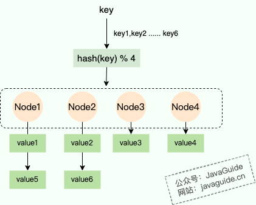
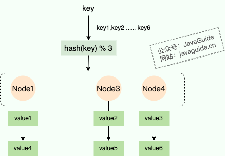
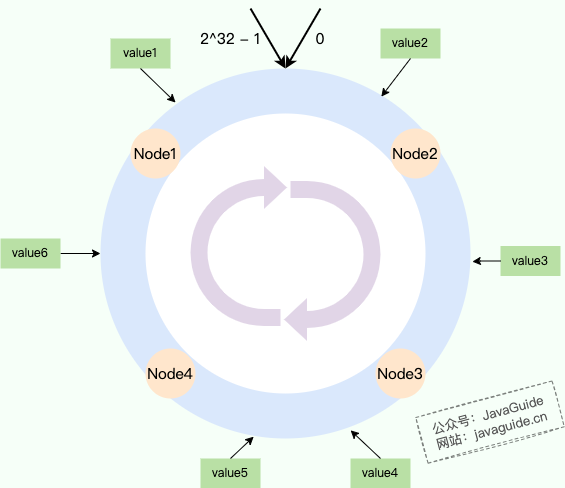
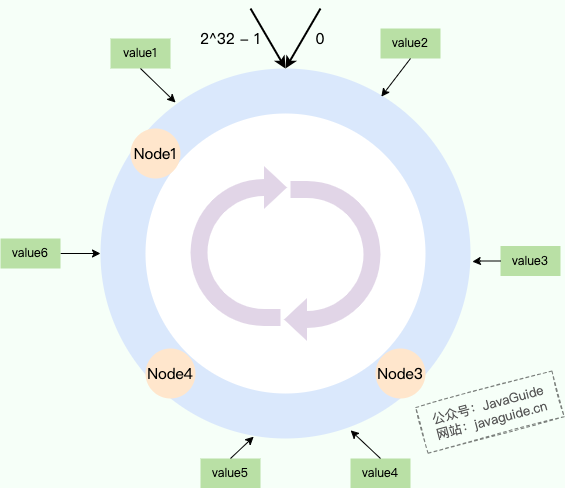
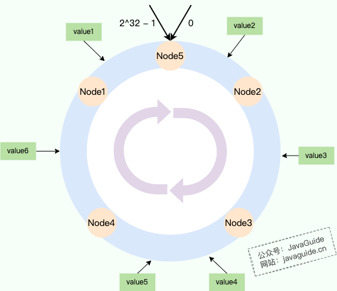
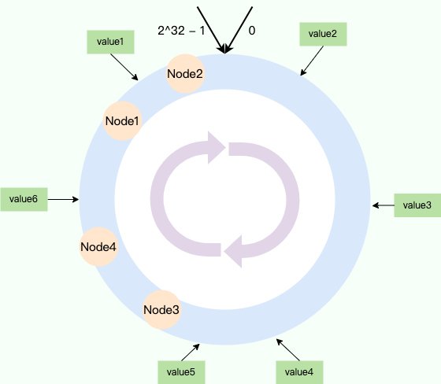
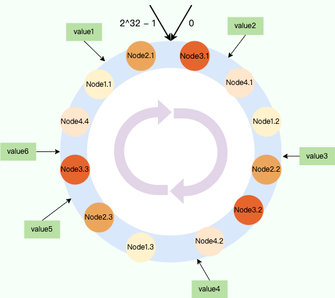

Consider two common scenarios:

1. **Load balancing:** A website runs the same service on several servers to handle a large number of requests, but each server stores different data. Requests with the same key, such as a client IP or user ID, need to reach the same server so they receive a consistent response.
2. **Distributed caching:** Several cache servers jointly store a large dataset. Data should be distributed as evenly as possible, and a key should identify the cache server that stores its value.

Both scenarios need a **stable mapping from keys to servers or nodes**.

In the distributed protocols section, consistent hashing addresses **how data or requests are assigned to nodes**. It does not make replicas agree with each other. For state propagation, see [Gossip Protocol](./gossip-protocol.md); for write ordering and majority-based commits, see [Raft](./raft-algorithm.md).

What approach would you consider first?

## Basic hashing

A common solution is **hashing followed by modulo**. Hash the key, then take the remainder after dividing by the number of servers.

```java
node_number = hash(key) % N
```

- `hash(key)`: Apply a hash function to the unique key. A fast non-cryptographic hash such as SipHash, MurmurHash3, CRC32, or DJB is often suitable.
- `% N`: Map the hash to a value from 0 to N-1, where N is the number of nodes or servers.



However, ordinary modulo hashing handles dynamic membership poorly. If a server is added or removed—for example, because a machine fails—the mapping changes substantially.

Suppose there are initially four servers (`N = 4`). If one server fails, `N` becomes 3. For the same key, `hash(key) % 3` will usually differ from `hash(key) % 4`.



Nearly all key-to-server mappings can change. In a distributed cache, this can cause widespread cache misses and cache penetration, suddenly sending a large amount of traffic to the database and potentially causing an outage.

When the node count changes from N to N-1, an estimated `(N-1)/N` of the data must move on average. This approaches 100% as N grows. Such a large remapping is usually unacceptable in production.

Consistent hashing was designed to reduce this problem.

## Consistent hashing

Consistent hashing was introduced by researchers at MIT in 1997 ([paper](https://www.cs.princeton.edu/courses/archive/fall09/cos518/papers/chash.pdf)). It is a hashing technique that minimizes changes to existing request-to-server mappings when a server is added or removed. It addresses dynamic membership in distributed [hash tables](https://baike.baidu.com/item/%E5%93%88%E5%B8%8C%E8%A1%A8/5981869) (DHTs).

The key idea is to organize the hash space into a **hash ring**.

### Hash ring

Consistent hashing arranges the hash space as a ring. Both data and nodes are mapped onto the ring, and a key is assigned to the first node encountered when moving clockwise. A common hash space ranges from 0 to `2^32 - 1`, with the endpoints connected, so the integer range is **[0, 2^32 - 1]**.

Ordinary hashing takes the modulo of the server count. Consistent hashing takes the modulo of the fixed hash-space size, usually `2^32`:

```java
node_number = hash(key) % 2^32
```

Servers or nodes are mapped onto the ring in the same way. For example, hash a server's IP address or hostname, then take the modulo:

```java
hash(server_ip) % 2^32
```

The following diagram illustrates the ring:



Each node on the ring owns an interval. In the diagram:

- **Node 1:** Owns the interval from Node 4 to Node 1, including `value6`.
- **Node 2:** Owns the interval from Node 1 to Node 2, including `value1` and `value2`.
- **Node 3:** Owns the interval from Node 2 to Node 3, including `value3`.
- **Node 4:** Owns the interval from Node 3 to Node 4, including `value4` and `value5`.

### Adding or removing nodes

The hash ring limits how much data moves when a node is added or removed.

In the diagram above, if Node 2 is removed, Node 3 takes over its data. Only Node 2's data needs to move; the other nodes are unaffected.



Similarly, suppose Node 5 is added between Node 1 and Node 2. Node 5 takes over the data whose hashes fall between Node 1 and Node 5, such as `value1` in the diagram. Only that portion of data moves from Node 2 to Node 5, so the impact remains limited to adjacent nodes.



### Data skew

Ideally, nodes are evenly distributed around the ring. In practice, especially with few nodes, several may map close together. One node can then end up responsible for most of the data.



In the diagram, the data is assigned as follows:

- **Node 1:** Owns the interval from Node 4 to Node 1, including `value6`.
- **Node 2:** Owns the interval from Node 1 to Node 2, including `value1`.
- **Node 3:** Owns the interval from Node 2 to Node 3, including `value2`, `value3`, `value4`, and `value5`.
- **Node 4:** Owns the interval from Node 3 to Node 4.

Uneven assignment also makes node removal risky. If Node 3 is removed, Node 4 receives all of Node 3's data and traffic. If Node 4 has less capacity, it may become overloaded. Ideally, several nodes would share that load.

**Virtual nodes** help address these problems.

### Virtual nodes

A virtual node is a position on the hash ring that represents a physical node. Data assigned to the virtual node is stored by its physical node. Distributing virtual nodes across the ring makes data assignment more even.

In the following diagram, each of the four physical nodes—Node 1 through Node 4—has three virtual nodes. This is only an illustration; real distributions are not usually this regular.



The data assignment in the diagram is:

- **Node 1:** `value4`
- **Node 2:** `value1`, `value3`
- **Node 3:** `value5`
- **Node 4:** `value2`, `value6`

Virtual nodes provide two major benefits:

1. **Better balance:** More virtual nodes create more positions around the ring, which generally makes data distribution more even and reduces skew. A physical node often has 100–200 virtual nodes. For example, Nginx assigns 160 virtual nodes per weight. A server's weight represents its capacity: a more powerful server gets more virtual nodes and is more likely to receive requests.
2. **Improved fault tolerance:** When a physical node fails, all its virtual nodes disappear from the ring. Their data and traffic are distributed across multiple other physical nodes instead of concentrating on one neighbor. This improves system stability and fault tolerance.

## References

- [A Deep Dive into Nginx Load-Balancing Algorithms](https://www.taohui.tech/2021/02/08/nginx/%E6%B7%B1%E5%85%A5%E5%89%96%E6%9E%90Nginx%E8%B4%9F%E8%BD%BD%E5%9D%87%E8%A1%A1%E7%AE%97%E6%B3%95/)
- [Learn System Architecture by Reading Source Code: Consistent Hashing](https://zhaoyang.me/posts/consistent-hash-algorithm/)
- [A Summary of Consistent Hashing](https://mp.weixin.qq.com/s/WTz1KA9kOGrqFVTtALJzjQ)

<!-- @include: @article-footer.snippet.md -->
