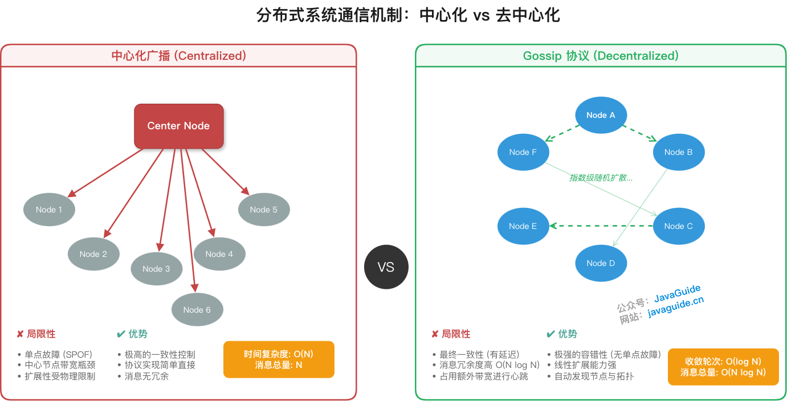
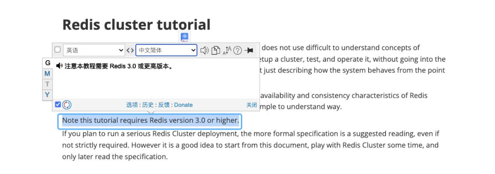
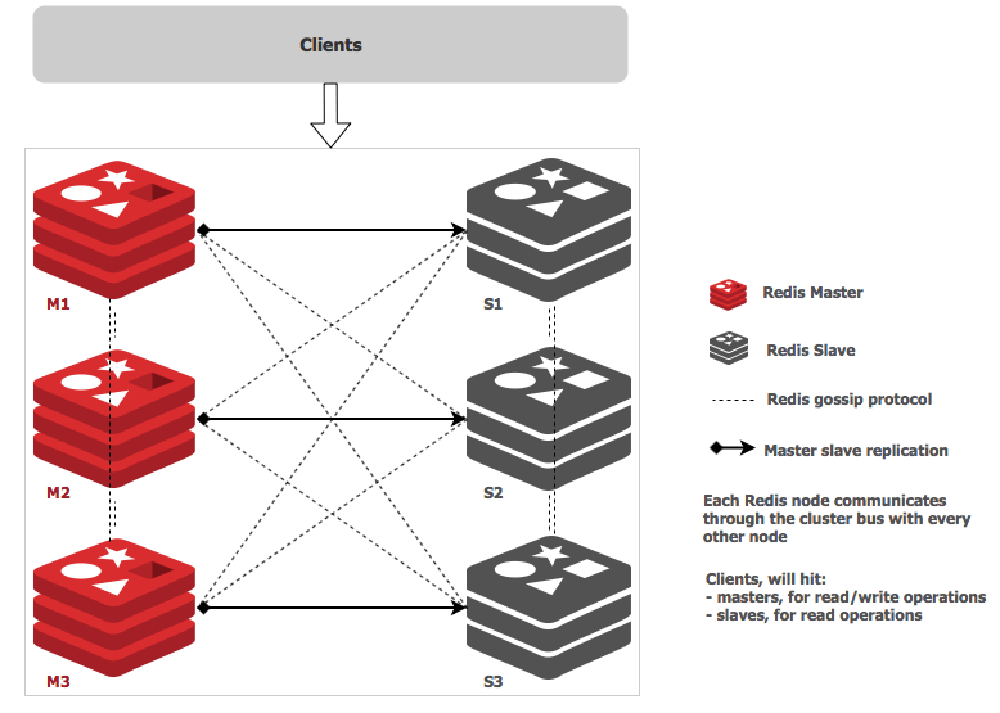
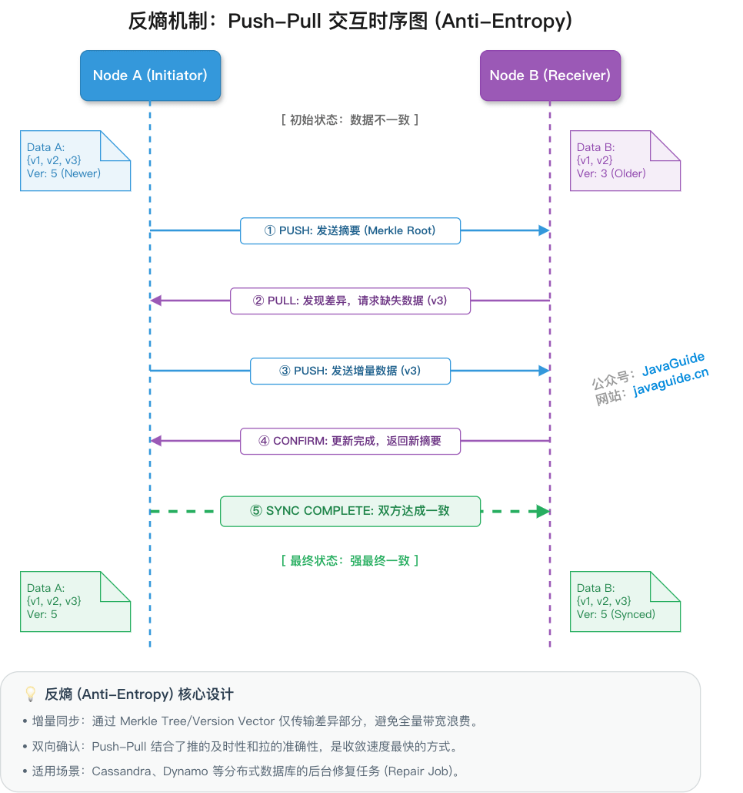
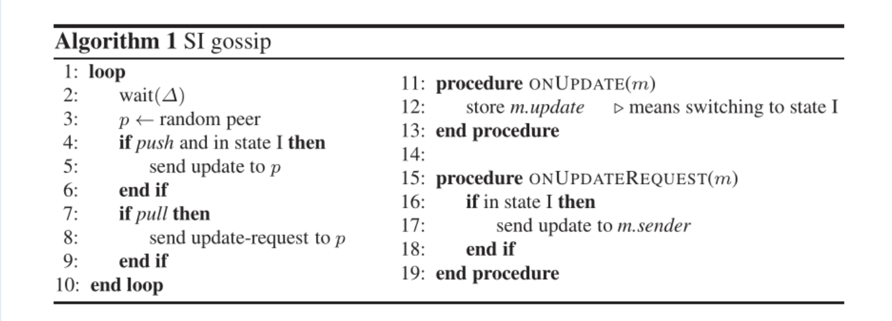
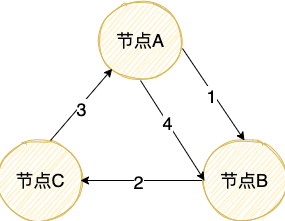
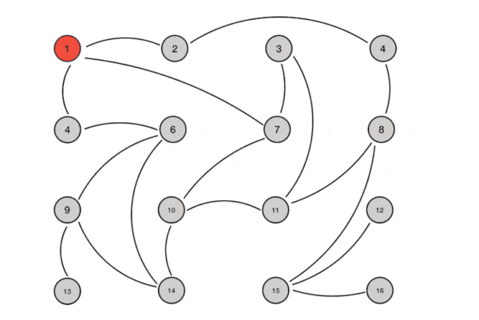
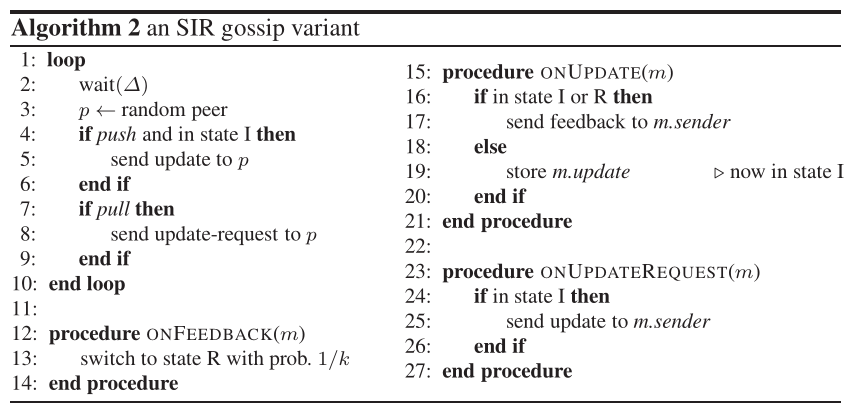
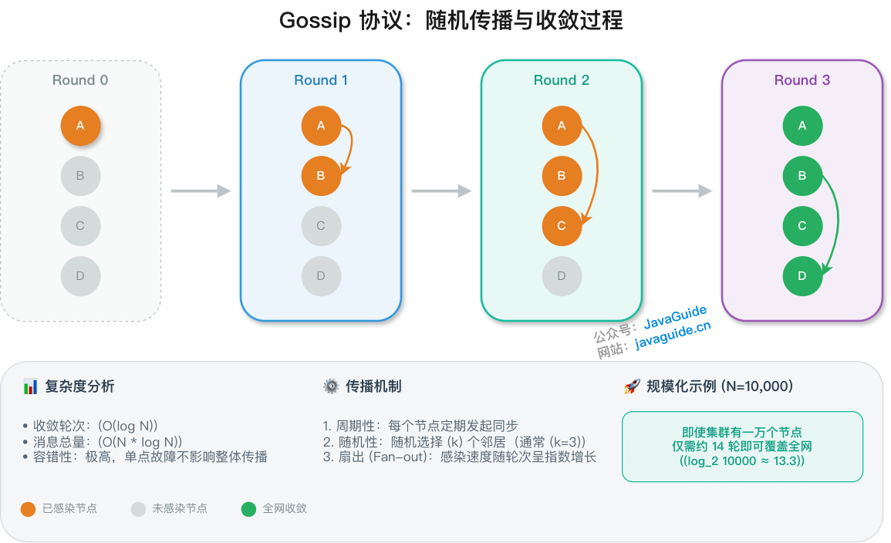

## Background

Distributed systems need nodes to share state.

A simple approach is **centralized broadcast**: one central node synchronizes information with all other nodes. This works in centralized systems, but synchronization becomes less efficient as the cluster grows (O(N) complexity), and the central node becomes a single point of failure.

The **Gossip protocol** provides a decentralized alternative.

If you are unsure which problems Leader/Quorum coordination and Gossip address, start with [Distributed Coordination](./centralized-and-decentralized.md). This article focuses on how state is propagated and converges; it does not cover strong coordination problems such as Leader election, split brain, and Fencing Tokens.

## What is the Gossip protocol?

**Gossip**, also called the **epidemic protocol**, is inspired by how information spreads through an epidemic. Each node periodically selects several other nodes at random and exchanges information with them. The data spreads through the network like a virus.

Demers et al. first described the Gossip protocol in their 1987 paper [“Epidemic Algorithms for Replicated Database Maintenance”](https://dl.acm.org/doi/10.1145/41840.41841), which addressed replica synchronization in distributed databases.

**Definition:** Gossip is a **decentralized** communication protocol that uses random information exchange between nodes to achieve **eventual consistency** across a cluster. This assumes non-Byzantine nodes, no permanent network partition, and continued periodic exchanges.

> **Important distinction:** Gossip is an information propagation protocol, **not a consensus algorithm** such as Raft or Paxos. Consensus algorithms provide stronger consistency and safety guarantees. Gossip provides eventual consistency and is not suitable for tasks such as Leader election or state machine replication that require strong consistency.

**Key properties:**

- **Decentralized:** There is no central node; all nodes are peers.
- **Fault tolerant:** It can tolerate node failures, network partitions, and dynamic membership changes.
- **Probabilistic convergence:** In the classic model, where nodes are selected uniformly at random and fanout is constant, the expected number of rounds is O(log N). For example, N=100 may take about 5–7 rounds, depending on fanout and packet loss.
- **Redundant messages:** A node may receive the same message multiple times, so deduplication is needed.

## Where Gossip is used

Gossip is used in many distributed systems:

- **Redis Cluster:** Synchronizes node state and detects failures.
- **Apache Cassandra:** Propagates membership and node state. Replica repair uses anti-entropy/repair based on Merkle Trees.
- **Consul:** Handles membership discovery, failure detection, and event broadcast using the SWIM protocol.
- **Amazon Dynamo:** Supports eventual consistency in distributed storage.

Consider **Redis Cluster** (version 3.0 and later) as an example.

Redis Cluster is a decentralized distributed cache. Its nodes use Gossip to exchange cluster state, including node information, slot assignments, and node status (`online`, `PFAIL`, or `FAIL`).

**Gossip message types:**

| Message | Purpose                                            |
| ------- | -------------------------------------------------- |
| `MEET`  | Adds a specified node to the cluster.              |
| `PING`  | Periodically exchanges node state.                 |
| `PONG`  | Responds to `PING` and carries the sender's state. |
| `FAIL`  | Broadcasts a node failure report.                  |

> Note: In the implementation, `MEET`, `PING`, and `PONG` share a message structure. `PONG` responds to `PING` or `MEET`; `MEET` is similar to a `PING` that forces a handshake.

**Failure detection:**

1. If node A receives no response from B within `cluster-node-timeout` (commonly 15 seconds, depending on configuration), A marks B as **PFAIL** (possibly failing).
2. If A receives PFAIL reports for B from other primary nodes, and **more than half of the primary nodes** confirm the report before it expires, A marks B as **FAIL** (failed) and broadcasts the failure to the cluster.

The diagram below shows a Redis Cluster with primary and replica nodes. Dashed lines indicate Gossip communication; solid lines indicate primary-replica replication.

> Note: Redis Cluster primarily uses incremental Gossip in `PING`/`PONG` messages to propagate node, slot, and failure information, including timestamps and flags. It does not use a Dynamo-style anti-entropy repair process based on Merkle Trees.

For more details, see [Redis Cluster Explained (paid)](https://javaguide.cn/database/redis/redis-cluster.html).

## Gossip propagation modes

Gossip has two main propagation modes: **anti-entropy** and **rumor mongering**.

### Anti-entropy

**Definition:** Nodes exchange **complete datasets** (or summaries) to eliminate differences and achieve eventual consistency.

In physics, **entropy** measures disorder. In this context, think of entropy as the differences among node states. Anti-entropy reduces those differences and makes node data more consistent.

According to Wikipedia:

> Entropy originated in [physics](https://en.wikipedia.org/wiki/Physics), where it measures the disorder of a thermodynamic system. It is best understood as a measure of uncertainty rather than certainty, since a more random source has higher entropy.

**Three common modes:**

| Mode      | Description                                             | Use case                          |
| --------- | ------------------------------------------------------- | --------------------------------- |
| Push      | The sender pushes its complete dataset to the receiver. | The sender has new data.          |
| Pull      | The receiver fetches the sender's complete dataset.     | The receiver's data is stale.     |
| Push-Pull | Both sides exchange data and compare differences.       | Most efficient and commonly used. |

Pseudocode:

**Convergence:** With uniform random peer selection and constant fanout, the expected number of rounds to reach all nodes is O(log N), often estimated at roughly log₂N rounds.

Some systems, such as InfluxDB, use **deterministic closed-loop scheduling** (for example, a ring topology) instead of random selection to synchronize data in a predictable number of rounds. This is an engineering variation of anti-entropy, not a core mechanism of the standard Gossip protocol. Deterministic scheduling trades some fault tolerance for predictable convergence time.

1. Node A pushes data to B, and B receives A's latest data.
2. Node B pushes data to C, and C receives the latest data from A and B.
3. Node C pushes data to A, and A receives the latest data from B and C.
4. Node A pushes data to B again, completing the loop so B receives C's latest data.

**Trade-off:** Closed-loop scheduling completes synchronization in a predictable time, but a node failure in the loop can interrupt propagation, and dynamic membership is difficult to handle.

**Use case:** Periodic background reconciliation when missed updates should be minimized. For large datasets, incremental comparison using summaries or trees is needed to control the cost.

> **Production optimization:** Distributed storage systems such as Cassandra and DynamoDB may store terabytes of data per node, so exchanging full datasets is impractical. They use **Merkle Trees** to identify differences incrementally. Nodes first exchange root hashes; if they differ, they compare subtrees recursively to locate discrepancies in O(log M) tree levels, where M is the number of entries in that range, then transfer only the changed data.

### Rumor mongering

**Definition:** When a node has **new data**, it becomes active and periodically sends the data to randomly selected nodes until the cluster has received it.

**How it differs from anti-entropy:**

- It propagates only **new data (deltas)**, not the complete dataset.
- After receiving an update, a node periodically propagates it. It stops according to a policy such as a count, probability, or TTL after contacting nodes that already know the update.
- It suits systems with **many nodes** and **small incremental updates**.

> **Deduplication:** Production systems such as Redis Cluster use version numbers or message IDs to avoid processing the same message repeatedly.

The following diagram is from the article [Introduction to Gossip](https://managementfromscratch.wordpress.com/2016/04/01/introduction-to-gossip/):

Pseudocode:

**Convergence:** With uniform random peer selection and constant fanout, all nodes are covered with high probability after O(log N) rounds.

**Practical considerations:**

- Keep messages small and avoid fragmentation where possible; account for the path MTU.
- Use deduplication, such as message IDs or version numbers.
- Avoid message storms caused by frequent updates.
- Add **jitter** (randomized timing) to spread out synchronization and avoid many nodes propagating at once.

### Summary

| Property         | Anti-entropy                  | Rumor mongering           |
| ---------------- | ----------------------------- | ------------------------- |
| Data propagated  | Complete dataset or summary   | New data only (delta)     |
| Suitable for     | Moderate number of nodes      | Large or dynamic clusters |
| Message overhead | Higher                        | Lower                     |
| Convergence      | Synchronizes the full dataset | Propagates known updates  |

## Advantages and limitations

**Advantages:**

1. **Simple:** The protocol is straightforward to understand and implement.
2. **Fault tolerant:** It can tolerate node failures, network partitions, and dynamic membership changes. Under ideal conditions, a new or restarted node eventually converges with the rest of the cluster.
3. **Scalable:** Convergence takes O(log N) rounds. For large N (for example, N > 100), parallel propagation is often faster than sending messages from one central node, which takes O(N) rounds. Typical rumor-spreading models use O(N log N) total messages, depending on the implementation and stopping condition, so redundant traffic is a cost.

**Limitations:**

1. **Eventual consistency:** Multiple rounds are needed to reach the entire network, so temporary inconsistency is possible. Convergence time depends on the network, Gossip interval (often 100 ms–1 s, depending on configuration), and cluster size.
2. **Not designed for Byzantine failures:** Gossip assumes non-Byzantine nodes and does not handle nodes that maliciously forge or alter messages.
3. **Redundant messages:** Random propagation may deliver the same message to a node multiple times, so deduplication is needed.

## Summary

- Gossip is a **decentralized** communication protocol that uses random information exchange to bring cluster state to **eventual consistency**.
- It is **not a consensus algorithm**: Gossip does not guarantee strong or linearizable consistency and cannot be used for Leader election or state machine replication. Algorithms such as Raft and Paxos provide consensus safety and linearizability.
- Key properties include decentralization, fault tolerance, and O(log N) convergence.
- The two propagation modes are **anti-entropy** (complete data or summaries) and **rumor mongering** (incremental data).
- Common uses include metadata propagation in Redis Cluster and eventually consistent storage in Cassandra and DynamoDB.
- The trade-off is simple, fault-tolerant propagation in exchange for eventual-consistency delays and redundant messages.

## References

- [Epidemic Algorithms for Replicated Database Maintenance](https://dl.acm.org/doi/10.1145/41840.41841) — Demers et al., 1987
- [Amazon Dynamo: All Things Distributed](https://www.allthingsdistributed.com/files/amazon-dynamo-sosp2007.pdf) — DeCandia et al., 2007
- [Redis Cluster Specification](https://redis.io/docs/management/scaling/)
- [Redis Cluster Gossip Protocol Explained](https://segmentfault.com/a/1190000038373546)
- _Distributed Protocols and Algorithms in Practice_
- _Redis Design and Implementation_

<!-- @include: @article-footer.snippet.md -->
