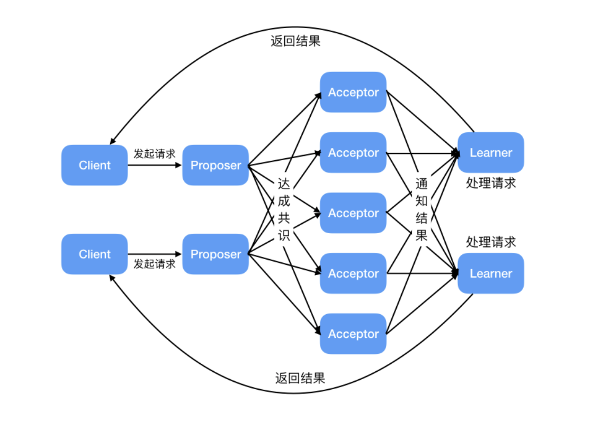
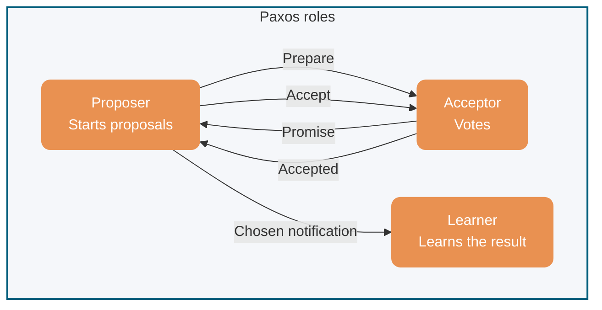
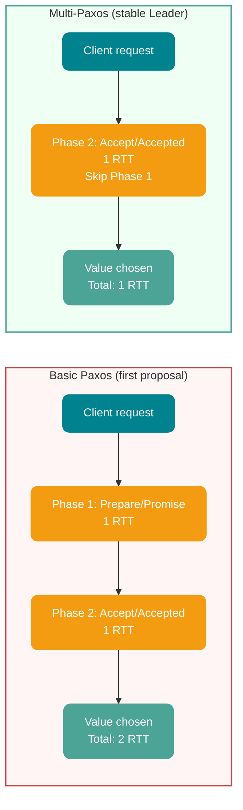
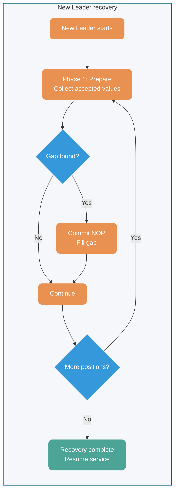

## Background

Leslie Lamport proposed Paxos in **1990** as a distributed **consensus** algorithm. It was one of the earliest widely recognized consensus algorithms for systems without Byzantine, or malicious, nodes.

To explain Paxos, Lamport wrote a humorous paper using a fictional Greek city-state called Paxos. The reviewers did not appreciate the story and asked him to remove it before publication. Lamport declined, and the paper was not published at the time.

In 1998, two researchers at the Systems Research Center (SRC) needed distributed algorithms for a system they were building. Paxos addressed some of their requirements, so Lamport shared the paper with them. After they responded positively, he published [The Part-Time Parliament](http://lamport.azurewebsites.net/pubs/lamport-paxos.pdf) in **1998**.

Readers still found the paper difficult, so in **2001** Lamport wrote [Paxos Made Simple](http://lamport.azurewebsites.net/pubs/paxos-simple.pdf), focusing on the two-phase consensus protocol. At 14 pages, it was considerably shorter than the 33-page original. Its abstract consists of one sentence:


> The Paxos algorithm, when presented in plain English, is very simple.

The phrasing also reflects Lamport's humor about the difficulty readers had reported.

## Introduction

This article covers two parts:

- **Basic Paxos:** How multiple nodes agree on a single value.
- **Multi-Paxos:** How multiple Basic Paxos instances can establish agreement on a sequence of values.

Consensus algorithms let distributed nodes agree on a proposal. Depending on the system, a proposal can concern Leader election, event ordering, or another decision.

Paxos is widely considered difficult to understand and implement. The more approachable [Raft algorithm](./raft-algorithm.md) appeared in 2013.

**Raft and Paxos:** Raft is not strictly a variant of Paxos; they differ in design choices such as log gaps and Leader authority. From an engineering perspective, Raft can be understood as a redesign inspired by Multi-Paxos. The comparison later in this article explores these differences.

For non-Byzantine systems, related consensus approaches include **ZAB** and **Fast Paxos**. Byzantine scenarios involving malicious nodes may use mechanisms such as **Proof of Work (PoW)** or **Proof of Stake (PoS)**, particularly in blockchains.

## Basic Paxos

### Roles

Basic Paxos has three roles:

1. **Proposer (coordinator):** Receives client requests and proposes a value with a proposal ID.
2. **Acceptor (voter):** Votes on proposals and remembers its voting history.
3. **Learner:** Learns the chosen value. In a replicated state machine, this is typically a command applied in order before the service returns its result.



**Role interactions:**



A node may perform multiple roles. A proposal is chosen when a majority of Acceptors accept it, allowing the cluster to tolerate failures of fewer than half its nodes.

### Basic Paxos execution

Basic Paxos reaches consensus in two phases: **Prepare/Promise** and **Accept/Accepted**.

```mermaid
sequenceDiagram
    participant P as Proposer
    participant A1 as Acceptor 1
    participant A2 as Acceptor 2
    participant A3 as Acceptor 3
    note over P, A3: Phase 1: Prepare and obtain prior accepted values
    P->>A1: Prepare(ID=N)
    P->>A2: Prepare(ID=N)
    P->>A3: Prepare(ID=N)
    A1-->>P: Promise(ID=N, accepted value=null)
    A2-->>P: Promise(ID=N, accepted value=null)
    note right of A3: A3 has not responded due to network delay
    note over P, A3: Phase 2: Accept
    P->>A1: Accept(ID=N, Value="Set X=1")
    P->>A2: Accept(ID=N, Value="Set X=1")
    A1-->>P: Accepted(ID=N)
    A2-->>P: Accepted(ID=N)
    note over P: A majority (two) accepted; the value is chosen
```

#### Phase 1: Prepare/Promise

The Proposer chooses a globally unique, increasing proposal number `n` and sends `Prepare(n)` to a majority of Acceptors.

For each request, an Acceptor:

- If `n` exceeds the highest proposal number `max_n` it has seen, returns `Promise(n, max_v)`, where `max_v` is the value of its highest-numbered previously accepted proposal, if any, and promises not to accept proposals numbered below `n`.
- Otherwise, rejects or ignores the request.

This lets the Proposer learn about earlier accepted or promised proposals and avoid proposing a conflicting value.

#### Phase 2: Accept/Accepted

After receiving Promises from a majority, the Proposer selects the value associated with the highest-numbered accepted proposal in those responses. If none was accepted, it chooses a value of its own. It sends `Accept(n, v)` to a majority of Acceptors.

An Acceptor accepts and records `(n, v)`, returning `Accepted(n, v)`, if `n` is at least its highest promised proposal number. Otherwise it rejects the request.

#### Chosen value

When a majority accepts `Accept(n, v)`, value `v` is **chosen**. The Proposer notifies the Learners.

### Safety and termination

1. **Agreement:** Once a value is chosen, every subsequently chosen value is the same.
2. **Termination:** If Proposers do not compete and communication is reliable, a value is eventually chosen.

The Phase 1 Promises let the Proposer carry forward the value of the highest-numbered accepted proposal, or select a new value when none was reported. This prevents conflicting values from being chosen.

### Liveness

Basic Paxos can experience **livelock** when multiple Proposers issue proposals with interleaved, increasing numbers. Neither may receive a majority of Accept responses, so they can compete indefinitely without reaching consensus.

**Example: dueling Proposers**

Suppose P1 and P2 propose at the same time:

1. P1 sends `Prepare(1)` and P2 sends `Prepare(2)`.
2. Acceptors promise P2's higher number.
3. P1 discovers it has been superseded and sends `Prepare(3)`.
4. P2 discovers it has been superseded and sends `Prepare(4)`.
5. The cycle continues, preventing progress to Phase 2.

```mermaid
sequenceDiagram
    participant P1 as Proposer 1
    participant A as Acceptors
    participant P2 as Proposer 2

    Note over P1,P2: Livelock: dueling Proposers
    P1->>A: Prepare(N=1)
    P2->>A: Prepare(N=2)
    A-->>P1: Promise(rejected, higher N=2)
    A-->>P2: Promise(accepted, N=2)
    Note over P1: Superseded; increase number
    P1->>A: Prepare(N=3)
    A-->>P2: Promise(rejected, higher N=3)
    A-->>P1: Promise(accepted, N=3)
    Note over P2: Superseded; increase number
    P2->>A: Prepare(N=4)
    A-->>P1: Promise(rejected, higher N=4)
    A-->>P2: Promise(accepted, N=4)
    Note over P1,P2: The cycle can continue without reaching Phase 2
```

A stable Leader in Multi-Paxos can reduce this competition.

**Randomized exponential backoff:** Production implementations can also use random backoff. When a Prepare request is rejected because its number is too low, the Proposer:

1. Waits a random duration: `base_delay * random(1, 2^attempt)`.
2. Chooses a higher proposal number, for example `n = n + k`, where `k > 0`.
3. Retries Prepare.

Example parameters are a `base_delay` of 10 ms, an `attempt` count of 1, 2, 3, and so on, and a maximum backoff of `max(1s, base_delay * 2^10)`. Randomizing retries reduces the chance of repeated collisions and helps a Proposer complete Phase 1.

**Network partitions:** The majority side can elect a Leader and choose new proposals. The minority cannot form a quorum and must wait for recovery.

## Multi-Paxos

### Core idea

Basic Paxos chooses a single value. Multi-Paxos runs multiple Basic Paxos instances to agree on a sequence of values.

Its main optimization is **reusing a stable Leader**: once a Proposer becomes Leader, it can initiate subsequent proposals without repeating the Prepare/Promise phase each time.

### Optimizations

#### 1. Stable Leader election

- Elect one Proposer as Leader using Basic Paxos.
- If the Leader crashes, elect another through a new round.
- A stable Leader reduces livelock caused by competing Proposers.

#### 2. Skip Phase 1

- Once the Leader is stable, later proposals proceed directly to Phase 2 (Accept).
- Skipping repeated Prepare/Promise exchanges saves a round trip.
- **Latency:** Basic Paxos needs two round trips per proposal (Prepare and Accept); subsequent Multi-Paxos proposals need one, reducing the protocol round trips from two to one.

**Performance comparison:**



#### 3. Log indexes

- Assign each proposal an increasing **log index**.
- Establish an order: the Leader appends entries and Acceptors accept them by index.
- Allow **gaps**: an entry may be temporarily absent after a Leader change and filled later.

#### 4. Filling log gaps with NOP

**Problem:** A former Leader may have chosen a value at a log position before crashing, while the new Leader does not know that value. Proposing a different value at the same position would violate agreement.

**Solution: NOP (no-operation) entries**

1. During Phase 1, the new Leader collects previously accepted values from Acceptors.
2. If a position already has a chosen value, the new Leader **must** reuse it rather than propose a new one.
3. For a gap with no accepted value, the Leader can propose a special NOP value.
4. A NOP occupies a log position but performs no business operation when the state machine applies it.

**Example:**

```text
Before the former Leader crashes:
Index 1: Value=A (chosen)
Index 2: Value=B (chosen)
Index 3: <gap> (unfinished)

After the new Leader starts:
Index 1: Reuse Value=A
Index 2: Reuse Value=B
Index 3: Commit NOP (fill the gap without business logic)
Index 4: Commit Value=C (normal entry)
```

**Recovering a gap and an accepted value:**

```mermaid
sequenceDiagram
    participant OldL as Former Leader
    participant A1 as Acceptor 1
    participant A2 as Acceptor 2
    participant NewL as New Leader
    participant SM as State machine
    Note over OldL, A2: Before the former Leader crashes
    OldL->>A1: Accept(ID=5, Value="X")
    OldL->>A2: Accept(ID=5, Value="X")
    A1-->>OldL: Accepted(ID=5)
    Note over OldL: Crashes before receiving A2 response; A1 accepted X
    Note over NewL, A2: New Leader starts
    NewL->>A1: Prepare(ID=10, index=5)
    NewL->>A2: Prepare(ID=10, index=5)
    A1-->>NewL: Promise(accepted value="X")
    A2-->>NewL: Promise(accepted value=null)
    Note over NewL: A1 accepted X; the value must be reused
    NewL->>A1: Accept(ID=10, index=5, Value="X")
    NewL->>A2: Accept(ID=10, index=5, Value="X")
    A1-->>NewL: Accepted(ID=10)
    A2-->>NewL: Accepted(ID=10)
    Note over NewL, SM: Commit and apply
    NewL->>SM: Apply Value="X"
    Note over SM: Execute X after safely recovering the accepted value
```

### Multi-Paxos execution

1. **Leader election:** Select a Leader through Basic Paxos.
2. **Log replication:** The Leader accepts a client request, appends it locally, and assigns an increasing index.
3. **Direct Accept:** The Leader sends `Accept(index, value)` to Acceptors, skipping Prepare.
4. **Response:** Acceptors record accepted log entries locally by index.
5. **Commit:** An index can be committed after a majority accepts its entry.

### Fault tolerance and recovery

- **Leader crash:** A new Leader compares logs, identifies committed positions, and fills unfinished entries.
- **Network partition:** The majority continues; the minority waits for recovery.
- **Log gaps:** A new Leader can fill positions left unfinished by its predecessor.

**New Leader recovery:**



⚠️ **Note:** Multi-Paxos is an approach built on multiple Basic Paxos instances agreeing on a sequence of values.

Lamport's description leaves some implementation details open, including Leader election and gap handling, which makes it harder to understand and implement. Mature implementations exist. Raft is not strictly a Paxos variant, but draws on ideas such as Leader election and log replication while simplifying implementation; it is often a practical choice.

## Paxos vs. Raft

After 2014, Raft became popular in industry because it is easier to understand. It is not a Paxos variant; the two differ in their design choices.

| Dimension    | Multi-Paxos                                                              | Raft                                                       | Engineering effect                                                                              |
| ------------ | ------------------------------------------------------------------------ | ---------------------------------------------------------- | ----------------------------------------------------------------------------------------------- |
| Log ordering | Entries may be chosen out of order and leave gaps.                       | Entries are appended in order without log gaps.            | Raft simplifies state machine replay; Paxos allows more concurrency but is harder to implement. |
| Leader       | A Leader optimizes performance by avoiding Phase 1 but is not essential. | Strong Leader model; entries flow from Leader to Follower. | Raft's election restrictions simplify recovery.                                                 |
| Livelock     | Requires additional backoff or election mechanisms.                      | Uses randomized election timeouts.                         | Raft provides more behavior out of the box.                                                     |
| Examples     | ZooKeeper's ZAB is similar to Multi-Paxos; Google Spanner                | etcd, HashiCorp Consul, TiKV                               | Raft is common in modern microservice infrastructure.                                           |

## Practical applications

Systems based on Paxos or related consensus approaches include:

- **Google Chubby:** A distributed lock service based on Paxos.
- **Apache ZooKeeper 3.8+:** Uses ZAB, which resembles Multi-Paxos and broadcasts writes through a Leader in FIFO order.
- **etcd 3.5+:** Uses Raft for strongly consistent consensus, dynamic membership, and lightweight transactions (`Txn`).
- **HashiCorp Consul:** Uses Raft for service discovery and configuration management.

These systems support distributed coordination, configuration management, and service discovery.

> **Version note:** Protocol implementations evolve. Examples include etcd 3.4 Lease keep-alive optimizations and ZooKeeper 3.5 dynamic reconfiguration. Consult the release notes for the version being deployed.

## Production guidance

### Observability checklist

| Category    | Metric                        | Suggested alert threshold | Meaning                                           |
| ----------- | ----------------------------- | ------------------------- | ------------------------------------------------- |
| Latency     | Proposal commit latency (p99) | > 100 ms                  | Time from client request to majority confirmation |
| Throughput  | Proposal processing rate      | < 50% of expected QPS     | May indicate a partition or node failure          |
| Election    | Leader changes                | > 3 per hour              | Frequent changes suggest an unstable cluster      |
| Gaps        | Uncommitted log positions     | > 100                     | Too many gaps can slow state machine replay       |
| Split brain | Multiple competing Leaders    | 0                         | No such event should occur                        |

### Chaos engineering

| Scenario          | What to verify                     | Suggested tool           |
| ----------------- | ---------------------------------- | ------------------------ |
| Leader crash      | Fast election and no data loss     | Chaos Mesh, Chaos Monkey |
| Network partition | Majority continues; minority waits | Toxiproxy                |
| Network jitter    | Random backoff avoids livelock     | `tc` (netem)             |
| Clock drift       | Proposal numbers remain unique     | —                        |

### Anti-patterns

1. **Ignoring gaps:** Skipping a gap during state machine replay can lose client requests.
2. **Fixed proposal numbering:** Timestamps or node IDs alone do not guarantee globally increasing proposal numbers.
3. **No timeouts:** Waiting indefinitely for Prepare or Accept can stall the system.
4. **Ignoring accepted values:** A new Leader that forces its own value can violate agreement.

## Summary

- Lamport proposed Paxos in 1990 as a foundation for distributed consensus.
- Basic Paxos uses Prepare/Promise and Accept/Accepted to choose one value.
- Multi-Paxos reuses a Leader and skips Phase 1 for subsequent values, reducing the protocol from two round trips to one.
- Raft draws on Multi-Paxos ideas but redesigns details such as a strong Leader and gap-free logs to simplify implementation.
- In practice, consider mature implementations such as Raft, etcd, and ZooKeeper.

## References

- [Paxos Made Simple](http://lamport.azurewebsites.net/pubs/paxos-simple.pdf) — Lamport, 2001
- [The Part-Time Parliament](http://lamport.azurewebsites.net/pubs/lamport-paxos.pdf) — Lamport, 1998
- [In Search of an Understandable Consensus Algorithm](https://raft.github.io/raft.pdf) — Ongaro and Ousterhout, 2014
- <https://zh.wikipedia.org/wiki/Paxos>
- [Consistency and consensus algorithms in distributed systems](http://www.xuyasong.com/?p=1970)

<!-- @include: @article-footer.snippet.md -->
